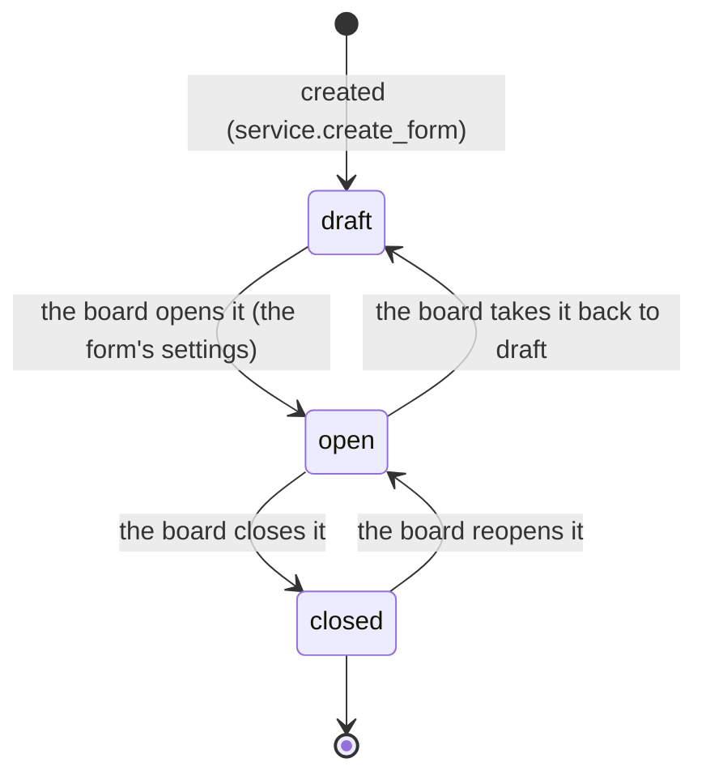

# forms — the form engine

## Purpose and process

*Purpose.* The form engine: a form with sections, questions and options that the board builds, the submissions it receives, and the answers another domain's record carries (a registration's questions). *Process (A2.4.3 — web content and forms; the questions of a registration in A2.2).* Aggregates: `Form` (with its sections, fields and options) and `FormSubmission` (with its answers).

## Publishes

- **Facade** (`api.py`):
  - `get_form_by_slug(db, slug) -> Form | None` — publiek raadpleegbaar formulier.
  - `submission_count(db, form_id) -> int`.
  - `submission_confirmation(db, submission_id) -> dict | None` — what the confirmation of
    a submission says (the form's title, the submitter's name, the form's own sentence, the
    link to change the answer); a read, for `mail`, which words the confirmation.
- **Events**: `SubmissionCreated` (kernel/contracts/forms.py) — gepubliceerd bij elke inzending (berichten/workflow is de
  eerste consument; event-ladder trede 1, synchroon/in-transactie).
  Since CR-13 phase 4d (#1251) it carries `confirm_to`: the address a confirmation goes to,
  or None. Forms decides (the form asks for one, is not anonymous, an address was given);
  `mail` subscribes and queues the mail. An ordinary form's submission publishes it too
  since then — until then only a message did, whatever the line above said.
  `SubmissionDeleted` (same contract file, #1377) — published by
  `delete_submission` in the delete's transaction; workflow closes the open task.
- **Constant**: `CONTACT_FORM_SLUG` — the slug of the seeded contact form, written
  once in `service.py` (#1377).

### Ports this domain offers

A port is a synchronous command another domain may ask of forms, with an answer
(`kernel/ports.py`, `docs/architecture.md` §3.2.1 step 2). The contracts stand in
`kernel/contracts/forms.py`, the handlers in `handlers.py`; a handler flushes and
never commits — the caller's transaction commits.

| Port | What forms does | Outcome | Refuses with |
|---|---|---|---|
| `SubmitAttached` | stores the answers another domain's record carries (a registration's answers to its component's questions, CR-14 §B4.2) as an attached submission, judged by the form's own rules; no mail, no event | `AttachedSubmission(submission_id)` | `VeldFout` (422, the question in `veld_id`): a required question without an answer, an option that is not the question's, a value outside its range |
| `UpdateAttached` | replaces the answers of an attached submission (the board corrects them, CR-14 §B4.7), by the same rules | `AttachedSubmission(submission_id)` | `VeldFout` as above; `LookupError` for a submission that does not exist or is not attached |
| `SubmitMessage` | stores a message for the board on the contact form — the one write path of a message (#398), for a caller without a visitor's form (the chatbot's tool); publishes `SubmissionCreated` | `MessageSubmitted(submission_id)`, None when there is no contact form | forms' own refusal of a missing name, address or message, unchanged |
| `CopyForm` | makes a new form with the same sections, questions and options and no submissions, the new year in its title and slug (a copied activity's component, #1397) | `FormCopied(form_id)` | `LookupError` for a form that does not exist |

The two service functions behind them are not in the facade any more: another
domain asks through the ports.

*Counted in the code on 13 October 2026:* the facade exports 74 names (58 functions, 9 classes, 7 values); events it owns (`kernel/contracts/`): `SubmissionCreated`, `SubmissionDeleted`; ports it offers: `CopyForm`, `SubmitAttached`, `SubmitMessage`, `UpdateAttached`.

## Consumes

- Facades: geen.

*Counted in the code on 13 October 2026:* imports the facades of auth, workflow; subscribes to `TenantCreated`; calls no port.

Where the Dutch line above says no facade is consumed, the code imports two.

## Owns

<!-- figure: name=lc-form caption=A_form:_draft,_open_or_closed,_set_by_the_board_in_its_settings -->

*What to see:* no transition is refused; the status is a setting. What it
guards is elsewhere: a submission is accepted only when the form is `open`
(`submit_form`, `update_submission`), and a draft form is not listed.

- **Schema**: `form` (forms, form_sections, form_fields, form_field_options,
  form_submissions, form_submission_answers) — geen cross-schema FK's.
- **Jobs**: geen (nog).

*Counted in the code on 13 October 2026:* schema `form`, 10 tables (6 data, 4 code and label), 6 of them with `tenant_id`; status columns: `forms.status` (code list `form_status`: draft, open, closed); jobs: none.

## Screens

- `/berichten` (publiek, htmx — ui.py): het geseede Contacteer-ons-formulier (#398).
- Nog React (`/admin/formulieren`, publieke render `/f/<slug>`); klappen om met
  de form-builder-herbouw (#405) resp. blok P-fundament.

`ui.py`: 7 routes under `/berichten`, `/f/{slug}` and `/formulier/{share_token}`; `admin_ui.py`: 25 routes under `/admin/formulieren`. Where the Dutch text above says "Nog React", the code has moved on: both are server-rendered since the React exit (#405).

## Deprecations

| Sinds | Wat | Vervangen door | Verwijderen bij |
|---|---|---|---|

None: no part of this contract is in its deprecation cycle.

## Standards

| Standard | Element | Our name | Follows / deviates, with the reason |
|---|---|---|---|
| OpenDocument | Spreadsheet (ODS), cells typed | the export of a form's submissions (`export_submissions_ods`) | follows (#200) |

## Rules and gates

- **Rules whose home is this module** — No `@validates` and no `check()` in `models.py`; no `CheckConstraint` there. Its rules stand in its service. A refusal names its question (`VeldFout`, with `veld_id`).
- **Gates in this module's own `tests/`** — none among its 21 test files.

## Evolutions

Ids of part E of the architecture document, as it stood on 13 October 2026.

- **E21** — the command port (CR-16): the ports forms offers to activities; on hold, re-measured before planning.
- **E22** — web content (CR-17): a form placed on a page; in build, on v2.17.
- **E34** — parked on v2.19: #1858 (two delete buttons say why they refuse), #1859 (the form builder refuses in one way).
