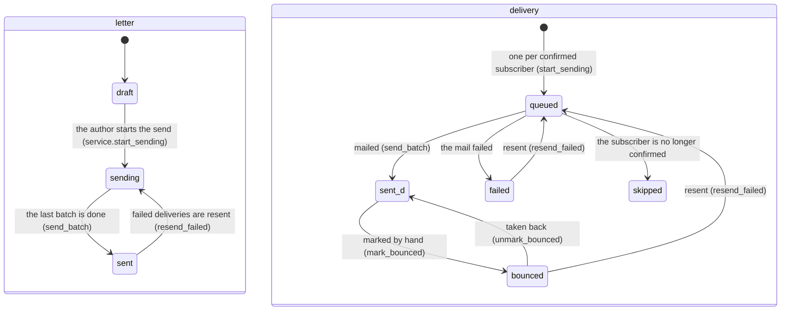
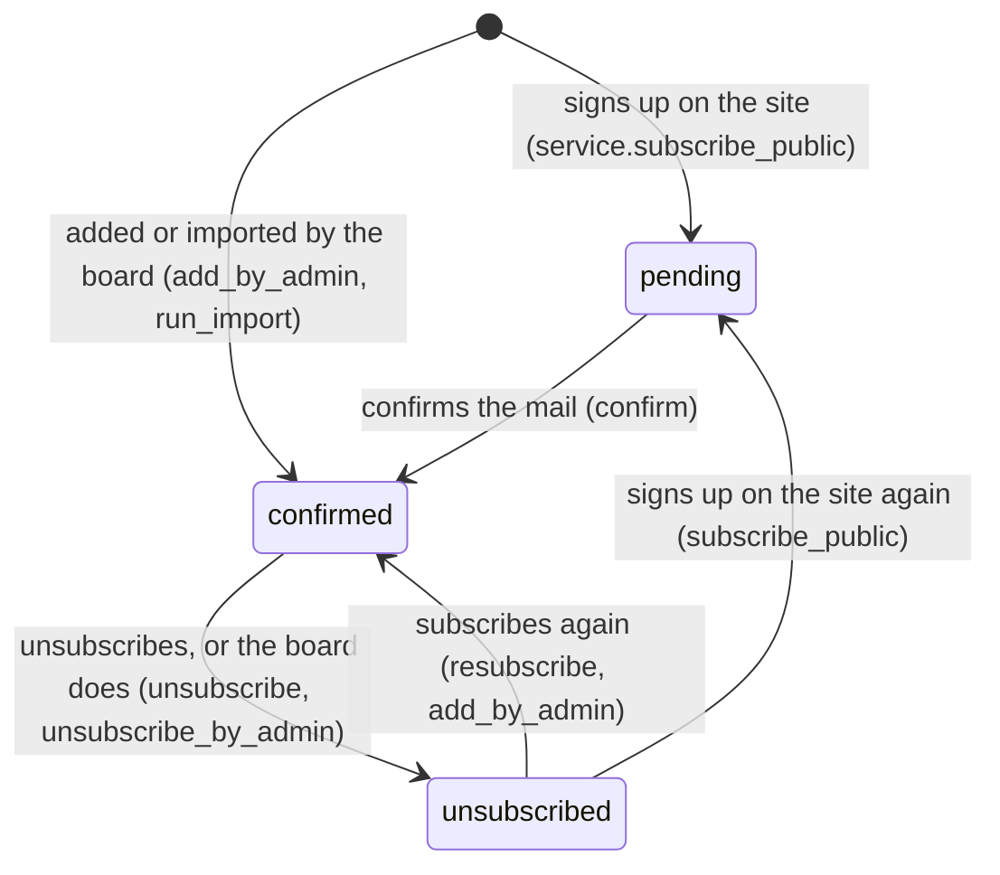

# newsletter — the newsletter and its co-writer

*First written for CR-05, #984.*

## Purpose and process

**Purpose.** The newsletter to members and non-members: subscribers with a
recorded consent, a letter written in the portal with Raakje drafting alongside,
and a send of one mail per recipient in a queue under a daily cap.

*Process (A2.4.2 — the newsletter).* Aggregates: `Newsletter` with its deliveries and drafting messages, and `Subscriber`.

## Publishes

### Facade (`api.py`) — the only door for other components and for this component's screens

- **Subscribers:** `subscribe_public`, `confirm`, `unsubscribe`, `resubscribe`,
  `add_by_admin`, `unsubscribe_by_admin`, `erase`, `list_subscribers`,
  `subscriber_counts`, `preview_import`, `run_import`.
- **Audiences:** `member_addresses`, `recipients_for`, `audience_counts`; for the
  fourth audience *Eerdere deelnemers* (CR-36, #2026) `recipients_of` (the one place an
  audience becomes addresses), `offered_activities`, `set_participant_activity`,
  `chosen_activities`, `participant_recipients` (the recipients and what is said of
  them, from one computation), `sample_kind_of`; the participant's unsubscribe link is
  signed per delivery (`unsubscribe_link_of`, `participant_delivery_by_link`,
  `unsubscribe_participant`; the signing helper is `kernel/signing.py`).
- **Letters:** `create_newsletter`, `update_draft`, `set_draft_sources`,
  `copy_newsletter`, `delete_draft`, `list_newsletters`, `get_newsletter`.
  A letter's text is a document of the page editor's `letter` set
  (`Newsletter.body_document`, CR-17 phase 7); `letter_document` validates what the
  editor sends, `markup_of` gives the text with markers Raakje reads and writes
  (`letter_markup.py`: `[[activiteit:…]]`, `[[kalender]]`, `[[afsluiting]]`),
  `render_body` builds the mail's body from the blocks (`mail_blocks`),
  `letter_is_blank` says whether there is anything to send.
- **Counting (CR-37, #2027):** `record_open`, `record_click`, `results_of` (and `PIXEL_GIF`,
  `LetterResult`, `LinkResult`); the code, the rewriting and the store live in `tracking.py`.
- **Content helpers:** `activity_facts`, `activity_line_html`, `calendar_html`,
  `closing_html`, `insertable_activities`.
- **Sending:** `render_test` (a read: the test mail rendered; the door hands it
  to mail), `start_sending`, `send_batch` (the job's work),
  `progress_of`, `expected_days`, `deliveries_of`,
  `unfilled_placeholders`, `placeholder_refusal` (a placeholder stops the send).
- **Raakje:** `ask_raakje`, `apply_proposal`, `dismiss_proposal`,
  `display_proposal`, `record_turn`, `get_drafting_message`, `messages_of`.
- **Settings:** `save_settings` (house style, daily cap).
- **Models as types, for other domains' services only:** `Subscriber`,
  `Newsletter`, `Delivery`, `DraftingMessage`.

### What other components take from here

Today: nothing. The registrant mail of CR-05 §3.14 will reuse the sending
machinery when it is built.

*Counted in the code on 13 October 2026:* the facade exports 88 names (61 functions, 15 classes, 12 values); events it owns (`kernel/contracts/`): none; ports it offers: none.

## Consumes

### What this component uses from others (only through their facade)

| Component | For |
|---|---|
| `membership.api` | `members_with_membership_for_year` — who is a member (CR-05 §3.3) |
| `mdm.api` | `email_addresses_of_members` (the member audience), `organization_address` (the mail footer), `person_name_parts` (the name list Raakje scrubs with, the guard's own) |
| `activities.api` | `activities_from`, `Activity` — the facts of an activity |
| `media.api` | `activity_photo_covers` (does an album exist), `tenant_logo` (the mail header) |
| `meetings.api` | `sent_reports`, `report_points_of` — the reports the composer may tick, and their points |
| `cms.api` | `sanitize_cms_html` — the letter's HTML |
| `mail.api` | `send_campaign_mail`, `send_newsletter_confirmation`, `SendingQuotaReached` |
| `chatbot.api` | `GuardedProvider`, `admin_rules`, `sink_for`, `get_provider`, `run_chat`, `read_tool_specs`, `execute_read_tool`, `admin_chat_char_budget`, `SeamBlocked`, `ChatTimeout` |

*Counted in the code on 13 October 2026:* imports the facades of activities, auth, chatbot, cms, mail, mdm, media, meetings, membership; subscribes to no event; calls `StoreFile` (media).

## Owns

<!-- figure: name=lc-newsletter caption=A_newsletter_and_its_deliveries -->

*What to see:* a letter is `sending` while any delivery is `queued`; the
batch job moves deliveries, and the letter follows the last one. (`sent_d` is
the delivery's `sent`: Mermaid needs distinct state ids.)

<!-- figure: name=lc-subscriber caption=A_subscriber:_pending,_confirmed,_unsubscribed -->

*What to see:* a public sign-up always passes `pending`; the board's door
skips it. Only a `confirmed` subscriber gets a delivery.

### Where to start reading

`service.py` for the rules, `drafting.py` for Raakje, `handlers.py` for the job,
`docs/change_request_05_newsletter.md` for the why.

*Counted in the code on 13 October 2026:* schema `newsletter`, 20 tables (4 data, 16 code and label), 4 of them with `tenant_id`; status columns: `newsletters.status` (`letter_status`: draft, sending, sent), `deliveries.status` (`delivery_status`: queued, sent, failed, skipped), `subscribers.status` (`subscriber_status`: pending, confirmed, unsubscribed); jobs: none.

## Screens

`ui.py`: 9 routes under `/nieuwsbrief` (sign up, confirm, unsubscribe, subscribe again, and the two that count — the pixel `/nieuwsbrief/o/<code>.gif`, called by a reader's mail program, and the click `/nieuwsbrief/k/<code>/<link>`, called by a reader's browser); `admin_ui.py`: 31 routes under `/admin/nieuwsbrieven`.

## Deprecations

None: no part of this contract is in its deprecation cycle.

## Standards

None: no row of part D of the architecture document names this module, and its `models.py` names no standard.

## Rules and gates

### Invariants

- **Members are derived, never stored.** `subscribers` holds non-members only.
- **No audience, no send** — in the screen, in the service and as a database
  CHECK.
- **Only a subscriber's mail carries an unsubscribe link** and the one-click
  header; a member's never does (CR-05 §3.4).
- **An import never resubscribes an unsubscribed address.**
- **Erasure is real:** the subscriber row goes, its deliveries keep their
  counts with the address replaced.
- **The recipient list is fixed when sending starts;** an address that
  unsubscribes during a multi-day send is skipped when its row comes up.
- **The queue never exceeds the daily cap** and pauses on Gmail's quota answer
  without marking anything as failed; each delivery is committed right after
  its mail left.
- **Confirming and unsubscribing act on a POST,** never on opening the link —
  mail scanners open links.
- **A letter is counted without knowing who** (CR-37). Each real mail carries one code made
  while it is rendered and stored nowhere; an event holds the letter, the code, the link and the
  *day* — no address, delivery, IP, device or time of day (a gate lists the columns). The
  test mail and the preview carry no code. The unsubscribe link is never counted or changed.
  "Nobody is tracked" holds for the portal's tables and its e-mail log (90 days): the Sent
  folder of the mailbox the portal sends from keeps every mail with its code and its recipient,
  and so does every recipient's own mailbox.
  The click forwards only to an address stored for that letter. Operations: a link of a
  sent letter points at the portal's address, so it fails while the portal is down; the
  code is signed with a key derived from the portal's secret, so **rotating that secret
  ends the counting of late opens and clicks of letters sent before** (nothing else here
  depends on it); the e-mail log keeps a mail with its codes for 90 days.
- **Raakje proposes, never acts:** no tool sends, nothing reaches the editor
  without "Toepassen", nothing outbound carries a known name or a recipient
  address, and a marked sentence is left out unless the author keeps it.

- **Rules whose home is this module** — beside the invariants above: no `@validates` and no `check()` in `models.py`, and no `CheckConstraint` there (the `CHECK` of "no audience, no send" is not declared in `models.py`).
- **Gates in this module's own `tests/`** — none; it has 1 test file there.

## Evolutions

Ids of part E of the architecture document, as it stood on 13 October 2026.

- **E8** — consent first, then segments, then the AI-drafted newsletter with review in the workbench (CR-05 beyond phase A): planned.
- **E22** — web content (CR-17): the one rich-text editor, of which the letter is one of three users; in build, on v2.17.
- **E38** — the close-out of CR-05's status line.
