| | |
|---|---|
| **Version** | 2.0 — in restructuring (13 October 2026) |
| **As-is** | `master` @ cf80ccde, 13 October 2026; the last GitHub Release is v2.16.0 (what PROD runs is measured at the close-out of the next release) |
| **Scope** | every claim is traceable to code (Appendix B); planned work stands in part E |

> **While this document is being restructured** it grows part by part on the
> architecture branch, each part measured against `master` in the commit that
> adds it: parts C and E first, then A, B and D (`docs/architecture-skeleton.md`
> holds the plan and Koen's decisions of 11 and 13 October 2026). Until the
> restructuring is complete, `docs/architecture.md` remains the document the
> PDF build reads; this file replaces it when every part stands.

# Part A — The solution

What the platform is, which business processes it carries, on which principles
it is built and how it runs. Mirrors A1–A3 and B1–B3 of the change request
template. Everything here describes `master` @ cf80ccde (13 October 2026);
what is planned stands in part E, referred to as "→ En".

## A1. What it is and for whom

A multi-tenant web platform for member organisations and small companies,
server-rendered, one PostgreSQL database with one schema per domain, built and
maintained by one architect directing AI coding agents inside a harness of
gates (part C). It runs in production for one community association since
June 2026 and carries the association's public site, its activity
registrations with online and bank-transfer payment, family membership with
renewal, a form engine, web content, board meetings, a newsletter with an AI
co-writer, a poster studio, a chatbot, reporting and a workbench for the board.

Three kinds of tenant exist since CR-19 (tenant kinds, v2.13.0): an
*association* (every module on), a *company* (a site, forms and a workbench; no
members, no registrations) and the *platform* itself (the operator's landing
site). A tenant is today a row of `mdm.organizations` with `org_type = UNIT`
under an `ACCOUNT` row, the customer that pays (→ E24 moves the tenant into a
table of its own; → E28 names the parties). The first tenant is small on
purpose; the structure underneath — master data with merge and survivorship, a
payment ledger with a stated invariant, row-level tenancy from the kernel, a
job queue, a workbench that turns every exception into a task — is that of
business software, so that a second customer is configuration, not code.

Who uses it: the *member* (a household's main member, partner or child) on the
public site and in the household portal; the *board* in the back office — the
member administration, the treasurer, the organiser of an activity, the
secretary of a meeting, the newsletter's author — each with the rights of their
role (`docs/rollen-en-rechten.md`, CR-24); the *operator* of the platform for
tenants and their settings.

## A2. The processes it automates

One figure per business process, end to end, in the convention of 13 October
2026: the lanes are people and roles, the colour of a step is the tool it is
done in (platform blue with the module in brackets, white by hand, orange in
another system), a task the workbench hands to a person is a green hexagon, and
a lane *Platform, uit zichzelf* appears only where the platform does something
without a person. So a figure shows where the platform guides the process and
where the person has to know it alone.

### A2.1 Membership: joining, changing, leaving

A household joins on *Lid worden* and pays; a member changes their data or
leaves in *Mijn gezin*. The national association keeps the member register of
record and has no API: the member administration retypes every new household
and every change in the national programme, and only a new household needs
the member report back, for the national member number that the import in
*Leden* links (`mdm/import_service.py`: the report is the source of truth for
what it holds; `reporting/changes.py`: the change list for retyping).

<!-- figure: name=proc-membership caption=Membership_end_to_end_-_no_platform_lane:_the_administration_remembers_the_three_white_steps_alone -->
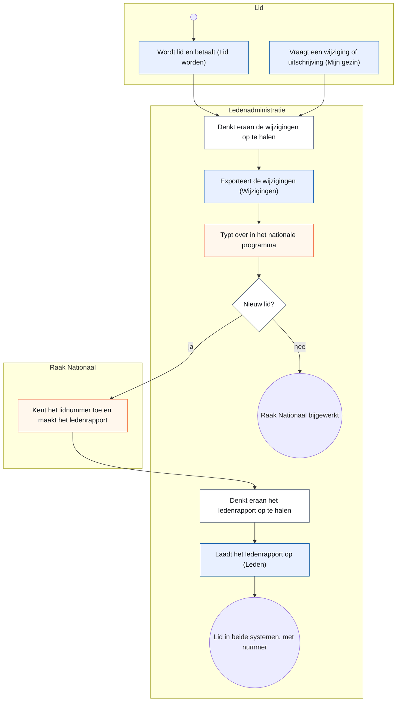

*What to see:* no platform lane and three white boxes — nothing reminds the
administration; the platform supports the two ends (the sign-up, the import)
and not the middle. → E30 proposes the tasks that close that gap. Renewal runs
yearly through `membership`: the household renews in the portal or the board
renews it in the back office, and either way the household gets the order mail
(A9).

### A2.2 An activity: registering and paying

The organiser publishes an activity with its components (what one registers
for, with capacity and price) and products (order lines); a visitor or member
registers on the public page or the board registers them in the back office
(the same page in two shells, CR-14), chooses online or bank transfer, and the
total is computed on the server. Online, the platform watches the outcome;
by transfer, the treasurer does.

<!-- figure: name=proc-payment caption=Paying_for_a_registration_-_online_the_platform_watches,_by_transfer_the_treasurer_does -->
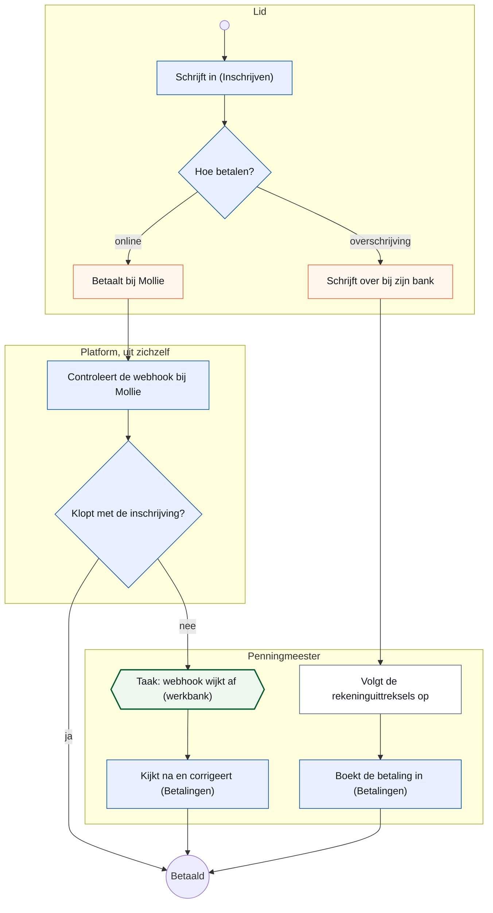

*What to see:* the two ways differ in who watches. Online, the platform
re-fetches the payment at Mollie and raises a task only when something is off
(A9); by transfer, following up the bank statements is a white box — the
treasurer's own discipline.

### A2.3 A refund

A member reduces an order after paying, or the treasurer decides a refund; the
ledger records the obligation and the workbench hands the treasurer the task;
the money goes back by bank transfer, by hand, and the treasurer confirms.

<!-- figure: name=proc-refund caption=A_refund_-_the_platform_records_and_reminds,_the_treasurer_pays_by_hand -->
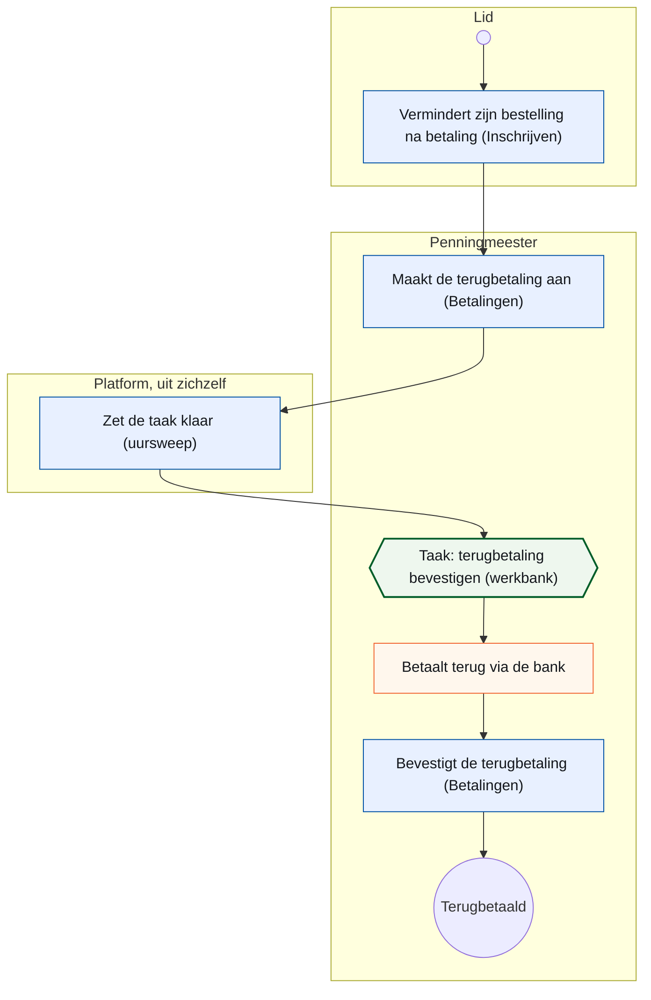

### A2.4 The other processes

Six more processes run on the platform. Their figures are drawn in the same
convention when their module's section (part B) is measured against the code;
until then one paragraph each names the process and the lanes.

- **Board meetings** (`meetings`, CR-09): the secretary creates a meeting, the
  agenda is generated from live data (upcoming activities, the finances), the
  minutes are typed per item, attachments are kept, and the report is mailed as
  a PDF to the board. Lanes: secretary, board, platform (the agenda, the mail).
- **The newsletter** (`newsletter`, CR-05 phase A): the author composes a
  letter from activity blocks, with Raakje as co-writer whose every factual
  claim is checked against the selected sources; a test send, then the send.
  Lanes: author, member (receives), platform (the check, the send, the log).
- **Web content and forms** (`cms`, `forms`, CR-17 in build → E22): the board
  edits pages with text placeholders that resolve from tenant settings, builds
  forms with branching, and reads the submissions; a visitor fills a form and
  the message lands as a task in the workbench. Lanes: board, visitor,
  platform (the task).
- **Reporting and the change report** (`reporting`, CR-06, CR-07): a board
  member asks a question in the query panel or to the admin assistant, the
  universe answers it from views on the live database, and exports it as
  OpenDocument; the change report lists every change to a logged object for
  the member administration (A2.1). Lanes: board member, platform.
- **The poster studio** (`designstudio`, CR-10): the organiser chooses a
  preset for an activity, Raakje proposes the text, Inkscape renders the
  poster and the social image. Lanes: organiser, platform (the render).
- **The chatbot** (`chatbot`): a visitor asks Raakje about the site; the answer
  comes from the published pages and three allow-listed tools; an idea
  submitted through the bot goes through the site's own form port into the
  workbench. Lanes: visitor, platform, board (the task).

The webshop (CR-21 → E25) joins this list when it is built.

## A3. Principles

Each principle names where it is enforced; a principle that is only written
down is a wish. The first eight are leading principles of the way of working
and carry Koen's words from `AGENTS.md`; the rest are principles of the
structure and carry a gate.

| # | Principle | In one sentence | Where it lives, and what holds it |
|---|---|---|---|
| P1 | Keep it simple | one rule for everyone beats a rule with exceptions; a decision that makes code superfluous removes that code in the same change | `AGENTS.md` (Koen, 8 October 2026: "Ik hou altijd van KIS"); the review (C4) |
| P2 | First time right | an open question is answered before what depends on it is built; no workaround to get past one | `AGENTS.md` (Koen, 13 October 2026: "ik wil het first-time right doen, geen uitzondering"); the review |
| P3 | One place per fact | a rule, a value, a figure lives once; the second place derives from the first or a gate fails on the difference | `AGENTS.md` (*Twee keer dezelfde reparatie*); `docs/code-style.md` (*A rule has one home*); `test_rules_gate.py` |
| P4 | Model on standards | build only what is needed today, in the form a standard gives it (UBL 2.1 / EN 16931, ISO 20022, ISO 6523) so that the extension is a row, not a rework | `AGENTS.md` (*Modelleer op standaarden*, 15 September 2026); part D; the build read of a change request |
| P5 | A test must be able to go red | a gate is proven red once with one deliberate violation; a gate that looked nowhere is green for nothing | `AGENTS.md` (*Testen en test-evidence*); `test_gate_niet_leeg.py` |
| P6 | Europe first | an EU option is sought before any tool, service or model; a deviation is written down with its trade-off | `AGENTS.md` (*Europe First*); the proposal of every new dependency |
| P7 | Mobile is the norm | most visits are on a phone; every screen is designed and judged at 390 px first | `docs/design-system.md`; the merge gate at 390 px (C4); the `measure` job (C3) |
| P8 | Issue first, and one source of truth per release | every deployable change has an issue; the release tracker says what ships and how | `AGENTS.md` (*Development workflow*); the process gates (C5) |
| P9 | Domain separation with facades | a domain is reached through `api.py` only; the kernel imports no domain; no foreign key crosses a schema except towards a code table of `mdm` or `auth` | `test_import_boundaries.py`, `test_schema_boundaries.py` |
| P10 | A screen builds a view-model and chooses a template, nothing else | a UI module never touches the session; a template asks for nothing its view-model does not promise; `StrictUndefined` outside production | `test_layer_gate.py`, `test_template_variables_gate.py` |
| P11 | ERP-ready data | master data is never hard-deleted; merges keep a survivorship chain; every entity has an append-only history table written in the same transaction; cross-domain references are values | `mdm/service.py` (`merge_persons`, `resolve`), `kernel/history.py`, `test_payable_delete_gate.py` |
| P12 | A ledger, not a payment field | every charge and refund is a record with a polymorphic reference to what is paid; one function owns *sum of records equals amount due*; the webhook body is never trusted | `payment/service.py` (`reconcile_charges`), the webhook test that posts a forged body |
| P13 | Multi-tenant by construction | `tenant_id` from a kernel mixin, resolved per request, applied as a global ORM filter no query can forget | `kernel/tenancy.py`; `test_reporting_schema_gate.py` for the views |
| P14 | Gatekeepers in the request path | eighteen checks between a request and a row, most of them explicit route dependencies so each is testable alone; the financial gate is separate from the administrative one | A8; `test_role_model_gates.py`, `test_rights_gate.py` |
| P15 | Security by design, refused at startup | a weak `SECRET_KEY`, `DEBUG` or SQL echo stop the application in UAT and production; no API docs there; logs carry an allow-list of fields | `config.py`; the tests on the 404 of `/docs` |
| P16 | AI in both directions, inside a boundary | built with AI agents inside the gates; AI in the product behind an allow-listed tool list, every call logged, every feature dark-launched per environment | `test_public_tool_boundary_gate.py`, `test_ai_log_coverage_gate.py` |

## A4. System context and deployment

Every environment is a Docker Compose stack with an explicit project name
(`docker-compose.dev.yml`, `.hdev.yml`, `.uat.yml`, `.prod.yml`, and
`docker-compose.caddy.yml` for the shared proxy). Development and the
integration environment HDEV carry their own reverse proxy; UAT and production
publish no host ports and sit behind one shared Caddy container that
terminates TLS for both, deployed with an expand/contract discipline because
its configuration serves two releases at once (`AGENTS.md`, *Shared Caddy*).
The backend serves HTML and JSON from one process; there is no frontend
container since the React exit (v2.0.0).

<!-- figure: name=deployment caption=Deployment_topology_-_the_shared_proxy_in_front_of_UAT_and_PROD,_HDEV_with_its_own -->
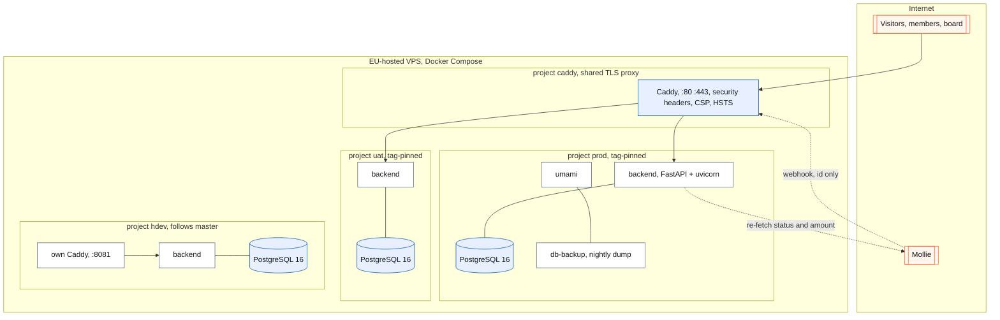

*What to see:* only the shared proxy reaches UAT and PROD; HDEV is a stack of
its own and never enters the shared proxy (Koen, 10 September 2026).

What an operator looks for: images are pinned; the backend runs as a non-root
user; the production compose fails fast on a missing secret (`${VAR:?…}`); one
entry point, `raakctl` on the server and `raak` from a laptop, resolves an
environment name to its checkout so nobody runs the UAT script against
production; the deploy takes a pre-migration dump, checks out the tag
detached, rebuilds, runs a read-only smoke test and checks the migration chain
and a clean start (C5 for the order, `AGENTS.md` for the six verification
lines).

## A5. The way of working

Written in full in `AGENTS.md`; this section is the map, not a copy.

- **Two kinds of working copy.** The master worktree works on `master`:
  releases, merges, deploys, issues, reviews routed, the conversation with
  Koen; it writes no production code. A feature worktree works on a branch:
  all code, tests, commits and pushes come from there, and a green pull request
  is handed to the master CLI, which alone merges.
- **Sessions and what each gets** (Koen, 12 October 2026): two dev CLIs for
  large work and migrations, a third on a smaller model for small, bounded
  work that tests and CI catch, a design-documentation CLI for screen design
  and change request documents, an architecture CLI for structural design and
  this document, and builders outside the Claude series on their own branch
  with one pull request as their mailbox.
- **A change is a change request first** when it carries a data model, a
  domain boundary or a migration strategy: shaped on the architecture branch
  from `docs/change_request_template.md`, read against the code by a dev CLI
  before Koen assigns it, built per phase, closed out at step 14 of its
  release with its as-built deviations in the document.
- **The release**: the fourteen steps of C5, with HDEV before the tag and
  three confirmations by Koen.

<!-- figure: name=branches caption=The_branch_model_-_feature_branches_and_a_change_request_branch_into_master,_a_tag_per_release -->
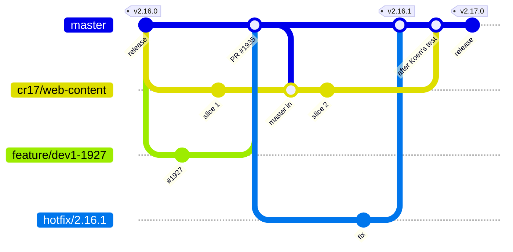

*What to see:* a feature branch lives for one issue and merges when green; a
change request branch of an outside builder lives for the whole change request
and merges once, after Koen's own test; a hotfix branches from the tag.

## A6. The GUI layer

Two shells and one kit. The public shell (`site_base.html`, with
`app.ui.site_context`) carries every page a visitor or member sees, per tenant;
the admin shell (`admin_base.html`, with `app.ui.admin_nav`) carries the back
office, with the workbench as the one way in for every role. Both are drawn
from one kit: the macros in `backend/app/ui/templates/_macros.html`, the
tokens generated by `scripts/build-css.sh` (Tailwind standalone, no Node), and
the layouts — the list layout (`list_page.html`: title row, toolbar, the
kit's table), the record layout (the record head, cards, tabs, one action bar
with one save), the public form page. `docs/design-system.md` is the norm
since 9 September 2026, `docs/design-system-end-state.md` the target CR-11
rolls out, and `/admin/design-system` renders every macro live from the real
kit so the reference cannot drift.

How a screen is built: a route in `ui.py` or `admin_ui.py` reads through its
domain's facade, builds a typed view-model and chooses a template; the template
is Jinja with htmx for interaction and Alpine for small client state, and
asks for nothing the view-model does not promise. The kit gates of C2 hold
that a list is the kit's table, a form has one save in the kit's action bar,
a field is the kit's field; the ratchets measure how far the roll-out is.
The measured inventory — every macro, every screen per layout — is folded in
from the count of the design-documentation CLI when it stands (A6 count).

## A7. The module map

Fifteen packages under `backend/app/domains/` on 13 October 2026 — `activities`,
`auth`, `chatbot`, `cms`, `designstudio`, `forms`, `mail`, `mdm`, `media`,
`meetings`, `membership`, `newsletter`, `payment`, `reporting`, `workflow` —
each with its models, service, screens and templates, one PostgreSQL schema
each, and `api.py` as its only public door. (`audit` dissolved into its owners
on 9 October 2026, CR-13 phase 4c; `stt` is a package under `chatbot`.)

<!-- figure: name=components caption=Layered_package_structure_-_business_domains_on_the_foundation,_everything_on_the_kernel -->
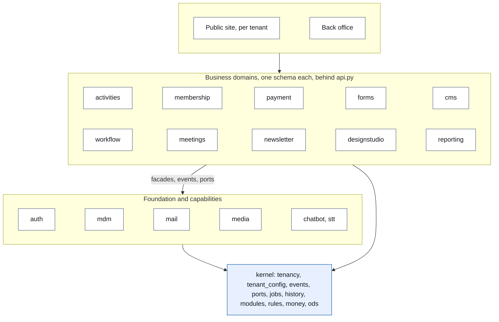

*What to see:* the foundation (identity, master data, mail) sits under the
business domains because every one of them needs it; the kernel holds no
business logic and imports no domain.

**How domains talk** (decided with Koen on 30 September 2026; the mechanics are
`kernel/events.py`, `kernel/ports.py`, `kernel/jobs.py` and the gates of
CR-13). The choice is made by what the caller says:

| The caller… | Uses | Receivers | Answer |
|---|---|---|---|
| reports a fact ("a payment was received") | an **event**: `publish` / `@subscribe`, contract in `kernel/contracts/` | zero or more | none |
| needs something done *and* the result to go on ("store these answers and tell me their id") | a **port**: `call` / `@handles`, exactly one handler, contract in `kernel/contracts/` | one | yes |
| only wants to know | a **read** through the other domain's `api.py` | — | yes |

Nine ports exist (`kernel/contracts/`: four of `forms`, `CreateHousehold` of
`mdm`, four of `media`). Events and ports both run synchronously in the
caller's transaction today; the difference shows only when a component is
extracted — an event then goes through an outbox (→ E9), a port cannot wait.
Two shapes beside the three (CR-13 phase 4d): a *door* — a route or a screen
module — may call one command of another domain and read freely; code reached
only from a `@job` may call another domain's command and act on its outcome.
What fits none stands declared with its reason in `test_rules_gate.py`
(`DECLARED_COMMAND_CALLS`, five on 13 October 2026). Deliberately not built: a
message broker, a workflow engine, event sourcing (→ E40).

<!-- figure: name=interactions caption=Cross-domain_links_on_master_-_facade_calls,_events_and_ports -->
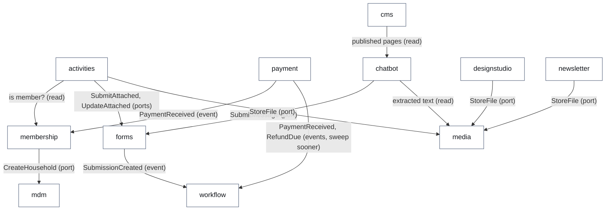

The measured inventory per module — schema, tables, tenant-scoped tables,
facade functions, events, ports, jobs, status columns — is folded in from the
count of the design-documentation CLI when it stands (A7 count) and is the
source of part B's contracts.

## A8. A request, end to end

Eighteen distinct checks stand between a request and a database row. Most are
not middleware but explicit dependencies on routes, which is what makes them
testable one by one. Two decisions are worth knowing: rights are derived per
request from the database, never baked into a token, so a revoked role takes
effect on the next request; and the UI session is a stateless, HMAC-signed
HttpOnly cookie from which the CSRF token is derived, so there is no session
store to operate.

<!-- figure: name=gatekeepers caption=Gatekeepers_in_request_order wide=1 -->
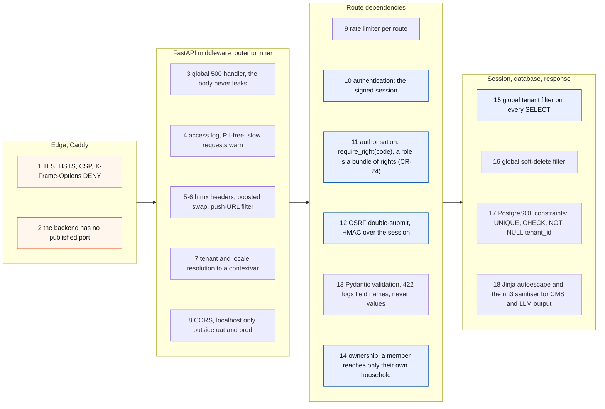

**Modules per tenant sit in step 11's place too**: `main.py` includes each
module router with `require_module(code)`, which answers 404 for a tenant that
has the module off, before any role guard runs (A10).

<!-- figure: name=request-sequence caption=A_server-rendered_admin_action_with_htmx -->
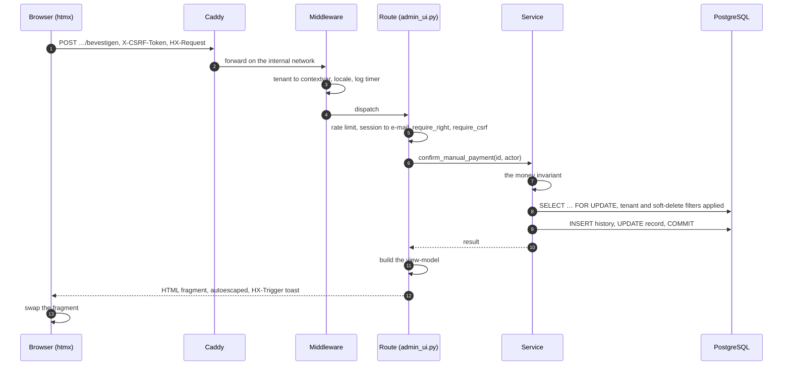

The public side follows the same shape without a session: registration, form
submission and chatbot posts are rate-limited instead of CSRF-gated, and the
total of a registration is always recomputed on the server before it is shown
or stored.

**Roles and where a person lands.** One sign-in flow serves everyone: an
e-mail address receives a magic link and a six-digit code (hashed with a
pepper, one live code per address, five attempts, fifteen minutes). Whether
the address belongs to a back-office user or to a member is decided per
request. Since CR-22 (sign-in, v2.15.0) *the door decides*: whoever signs in
on the public site stays on the public site, whoever signs in to the back
office lands on the workbench, for every role, with the menu showing what the
rights open. Rights are the unit since CR-24 (back-office rights, v2.16.0):
a role is a bundle of rights, a gate names a right and never a role
(`test_rights_gate.py`), and the treasurer's separation — FINANCE mutates
payments, ADMIN reads them — is the right `payment.manage` on every mutating payment route.
The matrix is `docs/rollen-en-rechten.md`.

**The workbench: management by exception.** Human work that the platform cannot
finish is an exception or a decision, and it lands in one place. Six task
kinds exist (`workflow/codes.py`): a message to handle, a refund to confirm, a
payment whose gateway state disagrees with the ledger, an orphaned payment
record, a mail that failed after its retries, a background job that failed for
good. Tasks come from events or from the idempotent hourly sweep, which also
closes a task whose cause disappeared, for the kinds it created itself; a
task is filtered by the right it needs. The design goal is zero-touch: an
empty workbench is a healthy system. The member administration has no task
kinds yet (→ E30).

## A9. Money

Money lives in one ledger domain, `payment`: every charge and refund is a
`PaymentRecord` that points at what it pays through a polymorphic reference
(`payable_type`, `payable_id`) without a foreign key, so one ledger serves
registrations and memberships and can serve an order (CR-21). The ledger's
single invariant has one home, `reconcile_charges` in `payment/service.py`:
*after reconciliation, the sum of all non-deleted records equals the amount
due*. Paid amounts are the truth; unpaid records are re-derived; a shortfall
becomes one transfer charge with a Belgian structured communication from a
Postgres sequence with the mod-97 check; a surplus becomes one refund that is
a pending obligation until the treasurer confirms it (A2.3).

<!-- figure: name=payment-sequence caption=Online_payment_-_the_webhook_is_never_trusted,_the_status_is_re-fetched -->
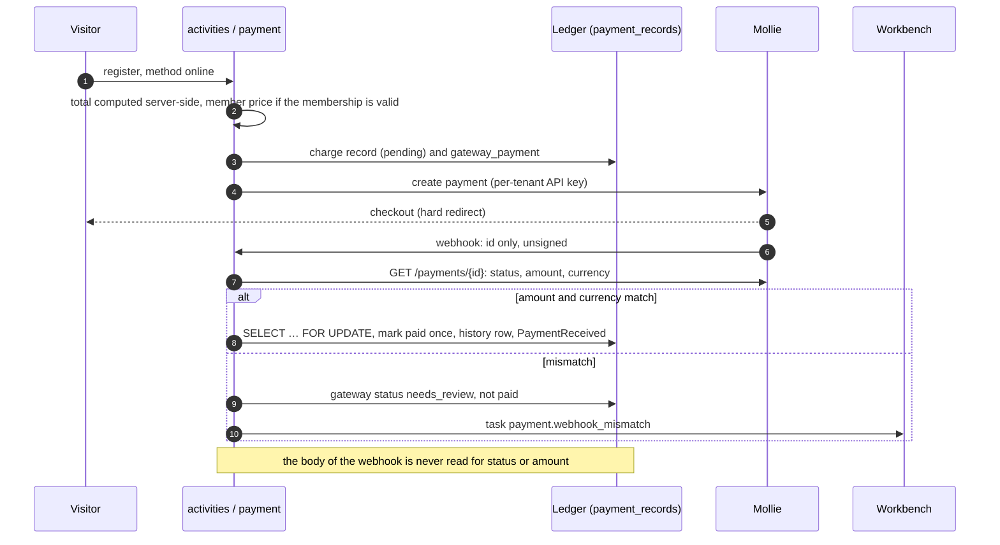

**Never trust the webhook body** is written as a security invariant in
`AGENTS.md` and held by a regression test that posts a forged
`status=paid&amount=999` and asserts the record stays pending. **Every order
confirms itself by mail, from whichever door it was placed** (Koen, 11 October
2026): a membership, a registration or an order placed by the board mails the
household the same mail the member would get.

## A10. Tenancy and security

**The tenant model.** A tenant is a row of `mdm.organizations` of type `UNIT`
under an `ACCOUNT` (the customer); the operator role stands above the tree.
Per request `kernel/tenancy.py` resolves the tenant — path prefix, then
hostname, then the platform host (root is the landing page, else the tenant
cookie), then the default — into a contextvar, from which a global ORM filter
(`with_loader_criteria`, including relationship loads) scopes every SELECT.
`TenantMixin` adds `tenant_id NOT NULL`, indexed, with a default from the
context; 64 model classes carry it on 13 October 2026. Row-level security in
PostgreSQL is prepared for and not enabled (→ E6).

<!-- figure: name=tenancy caption=Tenant_hierarchy_and_per-request_resolution -->
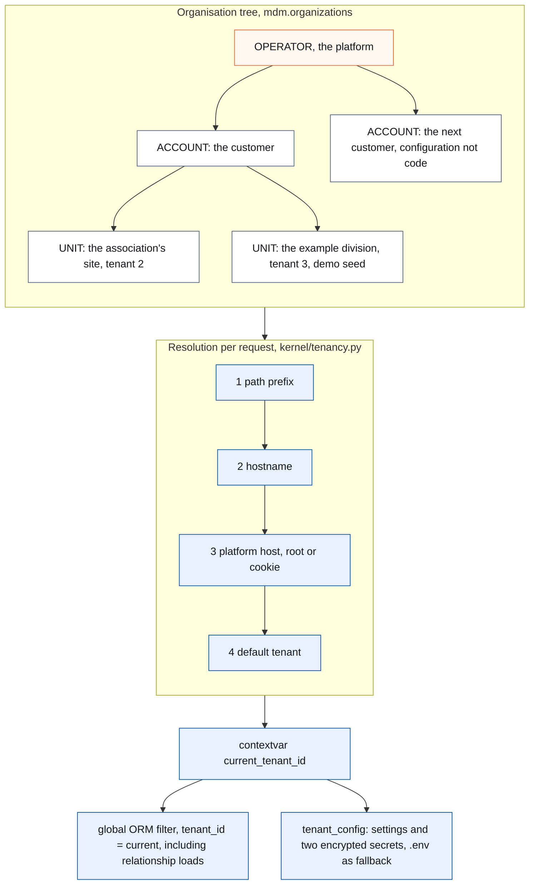

**Configuration and secrets.** `kernel_tenant_settings` holds the known keys
per tenant (display name, base URL, social links, language, membership prices
and dates, payment IBAN, mail settings, analytics, limits) and two secrets —
the Mollie API key and the mail app password — encrypted with Fernet under a
key derived from `SECRET_KEY`; secrets are never rendered back. Infrastructure
secrets stay in `.env`. Shared by design and without a tenant: back-office
identity (`auth.users`, roles, login tokens), the organisation table itself,
postal codes and code tables. A user is a platform account granted roles;
which tenant they act in is decided by the request.

**Modules per tenant** (CR-19, v2.13.0). What a module owns is code; which
modules a tenant has on is data: `kernel/modules.py` holds the registry — menu
items, route prefixes, dashboard tiles, home blocks, sitemap paths, newsletter
audiences, reporting folders, dependencies — and `mdm.tenant_modules` each
tenant's enabled set, held to the registry by a CHECK. An association has
every module, a company `cms`, `media` and `forms`. A module that is off is
refused with 404 before any role guard; the workbench is core, not a module
(#1876). `test_module_gate.py` holds every include to a module or the shell.

**Security controls**, each with its home:

| Control | Where |
|---|---|
| Startup refuses weak configuration (`SECRET_KEY`, `DEBUG`, SQL echo) in UAT and PROD; no API docs there | `config.py`; tested |
| Session and CSRF: HMAC-signed HttpOnly cookie, `secure` in UAT and PROD, 12 h; CSRF = HMAC over the session value, constant-time compare, four failure reasons logged, the token never | `auth/session.py` |
| OTP: hashed with a pepper, one live code, five attempts, generic answers, no account enumeration | `auth/service.py` |
| Financial separation: the right `payment.manage` on every mutating payment route, `payment.view` on the reads (`Right` in `auth/models.py`) | `payment/ui.py`; `test_role_model_gates.py` |
| Webhook integrity: re-fetch, amount and currency check, `needs_review` on mismatch, row lock, idempotent | `payment/gateway_service.py` |
| Ownership on the household portal: the portal reads the household of the signed-in person and nothing else (`household_view(db, person)`) | `membership/ui.py`, `membership/api.py` |
| Output: Jinja `autoescape` guarded by a lint rule; nh3 allow-lists, stricter for LLM output than for CMS | `test_ui_conventions_gate.py`; `cms/render.py`, `chatbot/render.py` |
| Logging: an allow-list of extra fields; no query strings, bodies or tokens | `app/logging_config.py` |
| Secrets in the repository: none; `.env.*.example` only; the public-repository agent reads every diff | `AGENTS.md`, C4 |
| Dependency audit: `pip-audit` on every push, reporting but never silent | the `audit` job, C3 |
| Formula injection in exports: ODS cells typed as strings, never CSV | `kernel/ods.py` |

Known and in the open, each a row of part E: the CSP still allows
`unsafe-inline` and `unsafe-eval` for scripts and inline styles (→ E3); the
history tables are append-only by convention, not by grant (→ E3); the
background jobs run without a tenant (→ E4); the rate limiters count per
process, so the backend runs one worker (→ E14).

## A11. AI in the solution

Four AI features run, every one behind a provider seam with a deterministic
mock so CI runs without keys, every one dark-launched per environment, every
call logged (`test_ai_log_coverage_gate.py`), and all of them on Mistral
(EU): **Raakje, the chatbot** on the public site — context stuffing of the
published pages, notes and counts into a system prompt with a hard limit, and
a boundary that is the tool list: three allow-listed functions, no member
data, no payments, no admin, held by `test_public_tool_boundary_gate.py`;
**document extraction** — a poster or component document is read through its
PDF text layer first and sent to OCR only when that yields too little, with an
administrator's override; **speech-to-text** — a WebSocket proxy to Voxtral so
the key never reaches the browser, with a handshake limit, a daily audio
budget and a browser-native fallback; and **the co-writer and the admin
assistant** — Raakje drafts the newsletter from the selected sources and every
factual claim is checked against them, an unsupported sentence is marked and
left out unless the author keeps it; in the back office the assistant inherits
its screen's selection or record, resolved server-side and never trusted from
a form.

<!-- figure: name=ai caption=AI_features_and_their_boundaries_-_orange_is_the_provider,_mocked_in_CI -->
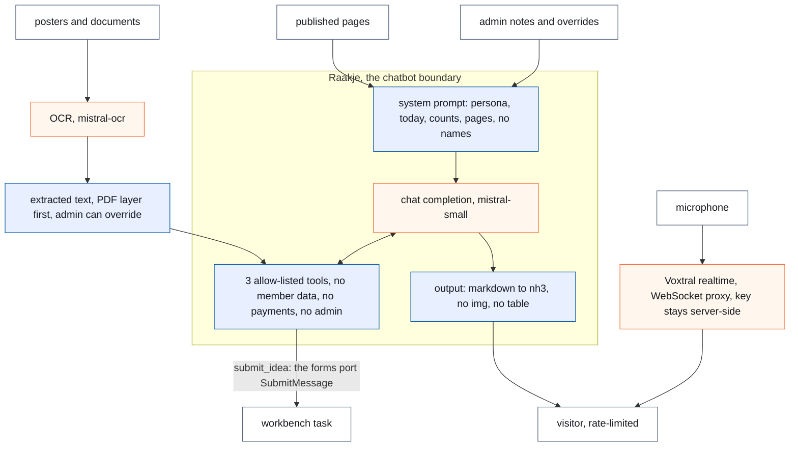

Mail is the one provider without that seam yet (→ E36). Claude Code, which
builds the platform, is itself a deviation from Europe first; what a session
may read from an environment is bounded for that reason (`AGENTS.md`, *Europe
First*).

# Part C — The harness

The rules and the gates that give predictable development without drift. This
part is the counterpart of B7 (rules of the solution) and C7 (gates) of the
change request template: what a change request writes per change, this part
holds for the whole platform.

A harness has four layers, and the order matters: a rule is written once in
its home (C1); a mechanical rule is held by a gate that runs on every push
(C2) inside a CI whose jobs block the merge (C3); what a regex cannot decide
is judged by a person or a read-only agent at a fixed moment (C4); and the
process itself has gates that stop a release where a wrong step is expensive
(C5). C6 lists what the gates caught, because every gate here exists for a
failure that happened.

## C1. The rules and where each lives

Every rule has exactly one home. The home is where the rule is *written*; a
gate *holds* it. A rule found in two places is a bug of the same kind as a fact
stored twice (`AGENTS.md`, *Twee keer dezelfde reparatie*), so the table below
is the index, not a copy.

| Rule | Home | Held by |
|---|---|---|
| The process: who may change what, issue first, branches and merges, releases, reviews, builders outside the Claude series, data operations through the app, Europe first, keep it simple, first time right | `AGENTS.md` | the process gates of C5; `backend/tests/test_ci_workflow_gate.py` holds the CI's promises |
| All new code and documentation in English; Dutch identifiers only inside a baseline that may only shrink (#780) | `AGENTS.md` (*Code language*) | `backend/tests/test_rules_gate.py`, section 7, against `backend/tests/dutch_identifiers_baseline.py` (370 entries on 13 October 2026) |
| Formatting and linting | `pyproject.toml` (ruff, #781) | the `lint` job (C3); `backend/tests/test_ruff_migrations.py` for new migrations |
| A fixed vocabulary is a code table; `CodeEnum`, never `str, Enum` | `docs/code-style.md` (CR-12) | `backend/tests/test_codes_gate.py`, eleven checks, with `backend/tests/codes_baseline.py` for what is deliberately not a code |
| A rule has one home (validator, method, service, constraint) | `docs/code-style.md` (CR-13 §B9.1) | `backend/tests/test_rules_gate.py` (CR-13 phases 0a and 0c) |
| A copied model declares every column | `docs/code-style.md` (#1464) | `backend/tests/test_copy_plans_gate.py` |
| A gate names a right, never a role | `docs/code-style.md` (CR-24) | `backend/tests/test_rights_gate.py`; the role model itself in `backend/tests/test_role_model_gates.py` (#530) |
| Three validation layers: form in the router, meaning in the service, integrity at rest in the database; a screen builds a view-model and chooses a template, never touches `db` | `AGENTS.md` (*Validation layers*), `docs/design-system.md` §8.3 | `backend/tests/test_layer_gate.py` (#635), `backend/tests/test_template_variables_gate.py` (#643) |
| A domain is reached through its `api.py` facade; a port or an event where a facade would couple | `AGENTS.md` (*Backend architecture*), `docs/architecture.md` §3.2.1 (moves to part A) | `backend/tests/test_import_boundaries.py`, `backend/tests/test_port_gate.py` (#1251), `backend/tests/test_rules_gate.py::test_every_json_route_names_its_caller` |
| Every screen is drawn by the kit: tokens, macros, layouts, one shell per side | `docs/design-system.md` (norm since 9 September 2026), `docs/design-system-end-state.md` (CR-11) | `backend/tests/test_ui_conventions_gate.py` (#528) and the kit gates of CR-11: list page, list table, record form, record header, record tab, form field, repeating group, admin frame, public shell, public form page, assistant, read-mode grid; the ratchets `test_ui_ratchets.py`, `test_public_ratchets.py`, `test_actiebalk_ratchet.py` |
| User-facing text passes through `_()`; one word per contact field; the short date and the site name are written in one place | `docs/design-system.md` §6, `AGENTS.md` (*Documentation language*) | `test_i18n_gate.py` (#407), `test_contact_labels_gate.py` (#1719), `test_short_date_gate.py` (#1242), `test_site_name_gate.py` (#1546) |
| Money: the webhook body is never trusted; no hard delete in a domain that owns a payable; the payment-method choice stands once; FINANCE sees payments only | `AGENTS.md` (*Payment*), `docs/rollen-en-rechten.md` | `backend/app/domains/payment/tests/`, `test_payable_delete_gate.py` (#667), `test_payment_choice_gate.py` (#1748), `test_role_model_gates.py` |
| Reporting is a terminus; a detail may be shown, not grouped by; every shipped report runs | `docs/change_request_06_reporting.md`, `docs/change_request_07_raakje_backoffice.md` §6.6 | the four reporting gates in `backend/app/domains/reporting/tests/` and `backend/app/domains/activities/tests/test_reporting_schema_gate.py` |
| One linear migration chain; the tool writes the file; the id in the file is the id in the name; a merged migration is never modified | `AGENTS.md` (*Alembic migrations*) | `test_migratieketen_gate.py` (#951), `test_migration_id_gate.py` (#1315); the `boot` job runs the chain against an empty database |
| A test sits where its imports say; test data on the reserved example domains; a gate must be able to go red and must look somewhere | `AGENTS.md` (*Testen en test-evidence*), CR-13 R15 | `test_tests_placement_gate.py`, `test_test_email_domains_gate.py` (#1293), `test_gate_niet_leeg.py` (#678) |
| No AI call without a row in the AI log; the public assistant reaches no admin tool; a view transition is decided in one place | the issues that made them (#978, #1075) and CR-11 (#1591) | `test_ai_log_coverage_gate.py` (#978), `test_public_tool_boundary_gate.py` (#1075), `test_view_transition_gate.py` (#1591) |
| Every module router is guarded and every registry entry is real (modules per tenant) | CR-19 (tenant kinds) | `test_module_gate.py` |
| The import smoke test covers every package; the storage seam is the only way to a file | #583, CR-15 | `test_check_imports_gate.py`, `test_media_seam_gate.py` (#1473) |
| A change request is shaped, read against the code, built and closed out per the template; a review is asked and answered per the protocol | `docs/change_request_template.md`, `docs/review-protocol.md` | the judgment layer (C4): the build read before assignment, the review on request; no mechanical gate |
| Nothing secret, no real host, no personal data in the public repository; a Claude session takes no personal data from an environment | `AGENTS.md` (*This repository is PUBLIC*, *Europe First*) | the `publieke-repo-bewaker` agent (C4), on every diff and on request over the issues |

Two things this table makes visible. First, `AGENTS.md` is the home of the
process and of the conventions that predate the code-style document; a rule
that is about code moves to `docs/code-style.md` when it gets a gate, and the
table above is where that move is recorded. Second, three rules have no gate
and no plan for one — the change request process, the review protocol and the
public-repository rule — because what they guard is judgment; they are held by
C4 and C5 instead, and that is a choice, not a gap.

## C2. The gates

A gate is a test that holds a rule of the codebase rather than a behaviour of
the application: it reads source files, templates, migrations or the rendered
HTML of every admin page, and it fails when the rule is broken anywhere. On 13
October 2026 there are **53 gate files**: 48 in `backend/tests/` named
`test_*gate*.py` or `test_*ratchet*.py`, and 5 in the test folders of the
domains they belong to (`activities`, `reporting`), where CR-13's placement
rule put them. (A file glob on `*gate*` finds 55: `test_registration_aggregate.py`
and `test_payment_record_aggregate.py` match on *aggregate* and are the B8
tests of two aggregates, not gates.) Two more files hold a list that may only
shrink without carrying the word: `test_import_boundaries.py`
(`LEGACY_ALLOWLIST`) and `test_ruff_migrations.py`; the generated table of
the future reads the meta-gate's list, not a glob, so that they count.

### The table

The table of gates — file · what it refuses · hard or ratchet · since · what it
caught — is **generated by the PDF build from the first sentence of every gate
file's docstring** (Koen, 13 October 2026, Q&A of 11 October, question 3:
"akkoord"), so it cannot go stale: a gate that is added appears, a gate whose
sentence changes changes here. The build reads the same files the meta-gate
lists in its `GATE_BESTANDEN`. Two things are needed for that and are planned in part E: the
one-sentence docstring on every gate file in the form *refuses · hard or
ratchet · since #issue* (today 53 of 53 have a docstring, in two languages
and several shapes), and a gate that requires that sentence, proven red with one
file without it.

Until the build generates it, the table below is the count of 13 October 2026
by the design-documentation CLI against `master` @ cf80ccde: the *refuses*
sentence is the counter's, from the docstring and the test names; *since* is
the first commit that added the file (`git log --follow --diff-filter=A`) with
the issue of that commit; *caught* only where the file says so.

<!-- gates-table: from tellingen_C2_poorten.md, 13 October 2026 -->
| File (under `backend/`) | Refuses | Hard or ratchet | Since (first commit, issue) | What it caught (where it says so) |
|---|---|---|---|---|
| `app/domains/activities/tests/test_reporting_schema_gate.py` | a `reporting` view without `tenant_id`, or without a comment saying what it excludes | H | 2026-09-10 `1e97de48` #832 (moved into place by `f529abe0`, 2026-09-28) | counter-proof only (broken on purpose against a live database: a view `d_lek`, a view comment set to NULL) |
| `app/domains/reporting/tests/test_reporting_detail_gate.py` | a report that groups on a *detail* attribute (grouping splits the grain without adding a question) | H | 2026-09-10 `4dfd5de9` #852 (moved into place by `f529abe0`, 2026-09-28) | — |
| `app/domains/reporting/tests/test_reporting_fanout_gate.py` | a measure that double-counts because a dimension has several rows per join key | H | 2026-09-21 `7093dfd4` #1114 (moved into place by `f529abe0`, 2026-09-28) | found at #1077, where `d_activity_organiser` (up to three organisers) became the first dimension that fans out by design |
| `app/domains/reporting/tests/test_reporting_shipped_reports_gate.py` | a shipped report that no longer runs or no longer exports after a model change | H | 2026-09-11 `882e39b2` #880 (moved into place by `f529abe0`, 2026-09-28) | Koen's question whether the shipped reports were tested (#880); counter-proof: a saved selection rewritten with a renamed key goes red |
| `app/domains/reporting/tests/test_reporting_universe_gate.py` | a declared universe object whose columns, facts or sources do not resolve against the database | H | 2026-09-10 `1e97de48` #832 (moved into place by `f529abe0`, 2026-09-28) | went red on `activity_year` pointing at `d_activity.activity_year`, which does not exist (#832 test 6) |
| `tests/test_actiebalk_ratchet.py` | an action cluster (Save/Cancel) inside a hidden read-mode wrapper | H | 2026-09-14 `a5be64e1` #780, #913 | its former ratchet on hand-rolled [Opslaan] pairs missed three of four screens of #1090 and was replaced by a rule of `test_ui_conventions_gate.py` (#1091) |
| `tests/test_activities_typed_gate.py` | an untyped function in `app.domains.activities`, or `disallow_untyped_defs` switched off for it | H | 2026-09-29 `8ea606e6` #1305 | proven red additively on 29 September 2026 (an override switching it off; an untyped `_zz`) |
| `tests/test_admin_frame_gate.py` | a second navigation loop in the admin shell, a menu item without an icon, a menu icon missing from the kit | H | 2026-10-02 `b4280786` #1482 | names the old phone menu that drifted from the sidebar (#714, #737) |
| `tests/test_ai_log_coverage_gate.py` | an AI call that leaves without a row in `ai.ai_call_log` (an unwrapped provider, an unlogged dictation or OCR path) | H | 2026-09-17 `a84383ce` #978 | — |
| `tests/test_assistant_gate.py` | an AI button of its own, a link to the assistant page, or a second assistant panel outside the two shells | H | 2026-10-04 `32282d5d` #1562 | — |
| `tests/test_check_imports_gate.py` | `check_imports.py` discovery that finds nothing, finds too little, invents a module or carries an undocumented skip | H | 2026-09-03 `8d1cb814` #583 | #581: the hand-written module list still named the removed `app.ui.settings_ui`, CI stayed green and the HDEV deploy build failed |
| `tests/test_ci_workflow_gate.py` | a workflow without job time limits, without parallel pytest, with two runs per commit, whose docs filter skips a file a test reads, or whose browser tests are not each in exactly one part | H (reads the workflow file; names, without reading, the measurement baselines of `tests_e2e`) | 2026-10-08 `e2a4b74a` #1745 | — |
| `tests/test_codes_gate.py` | the code pattern broken: a vocabulary column without FK, an enum without a code list, a code without a label in both languages, a loose string compared where a code exists, a member rendered into a template | H since 28 September 2026 (it was eleven ratchets in CR-12; no ratchet is left). Reads `backend/tests/codes_baseline.py`, which now holds only reasoned `not our list` exemptions | 2026-09-26 `25ec4e2b` #1177 | all eleven checks measured on 26 September 2026, each with its own violation; the enum-in-HTML failures are in `test_enum_render_gate.py` |
| `tests/test_contact_detail_factory_gate.py` | a `ContactDetail` constructed outside master data's `new_contact_detail` | H | 2026-10-07 `33fbf955` #1704 | proven by an added scratch module on 7 October 2026 |
| `tests/test_contact_labels_gate.py` | "gsm", "Mobiel nummer" or "E-mailadres" as a word a person reads | H (counted `ALLOWED` table in the file) | 2026-10-07 `7bb338c1` #1719 | — |
| `tests/test_copy_plans_gate.py` | a `copy_*` function that does not declare every column it copies or leaves out | H | 2026-10-02 `d338147f` #1464 | `target_audience` was added to an activity later and silently left out of `copy_activity` (#1463) |
| `tests/test_enum_render_gate.py` | an enum member reaching a template's output (`<option value="Audience.MEMBERS">`) | H | 2026-09-26 `5a7b357a` #1181 | three times in CR-12 a member ended up in an HTML attribute (subscriber filter, newsletter audience radio, …) |
| `tests/test_form_field_gate.py` | a raw `<label>`/`<input>`/`<select>`/`<textarea>` inside a kit section, a narrowed long field, a rare section that is not last | H (the per-file counts live as ratchets in `test_ui_ratchets.py`) | 2026-10-04 `19995fc6` #1558 | — |
| `tests/test_gate_niet_leeg.py` | a file-scanning gate that goes green because it scanned nothing (empty or too small a set) | H (meta-gate over the other gates) | 2026-09-05 `4bd93671` #678 | #678: a moved folder or a changed glob turns a gate green forever |
| `tests/test_i18n_gate.py` | a user-facing `HTTPException` detail or mail subject that is a string literal outside `_()` | H | 2026-07-14 `761fb5c5` #407 | — |
| `tests/test_layer_gate.py` | a UI route that imports models, touches the session or passes its context as a dict literal | H+list `VIEWMODEL_ALLOWLIST` (shrinks; `LAYER_ALLOWLIST` is empty) | 2026-09-04 `a0d9ec14` #635 | — |
| `tests/test_list_page_gate.py` | a `list_page` template that draws its own chrome beside the kit's title row and toolbar | H+list `BESIDE_THE_TOOLBAR` (empty since #1562) | 2026-10-04 `5ffd99d3` #1555 | — |
| `tests/test_list_table_gate.py` | a new back-office list of records drawn by hand instead of `ui.data_table` | R in the file itself: `HAND_DRAWN_LISTS` with `CEILING = 9`, no separate baseline file | 2026-10-12 `606764cd` #1911 | Koen, 12 October 2026: two list screens of a builder were hand-written cards (#1911) |
| `tests/test_media_seam_gate.py` | a module outside `media` that writes a picture's address by hand or reads an asset's `.data` | H (named exemptions) | 2026-10-02 `71449f58` #1473 | — |
| `tests/test_migratieketen_gate.py` | two migrations with the same id, two heads, two heads with the same sequence number | H (logic in `tests/_migratieketen.py`, called by `conftest` before `alembic upgrade head`) | 2026-09-15 `354f0fca` #951 | #951: a suite that fell over on `MultipleHeads` never reached a test that explains it |
| `tests/test_migration_id_gate.py` | a migration whose `revision` id differs from the one its file name carries | H+list `EXEMPT` (only shrinks) | 2026-09-29 `31c84f48` #1315 | #1315: `168_…` renumbered by hand to 169 after a rebase while the id stayed `168_2026_09_29_090415` |
| `tests/test_module_gate.py` | a router included without `require_module` (or declared shell), a registry entry that is not real | H | 2026-10-02 `1ebdea48` #1475 | — |
| `tests/test_one_product_row_gate.py` | a second product row, a `type="number"` field or a line amount in the activity templates | H | 2026-09-29 `d14653f7` #1287 | the two product rows drifted (#1287) |
| `tests/test_payable_delete_gate.py` | a hard `db.delete()` in a domain that owns a payable | H+list `ALLOWLIST` (only shrinks) | 2026-09-05 `72c1ce3b` #667 | Koen saw orphan payments in the workbench (#667) |
| `tests/test_payment_choice_gate.py` | the Online/Overschrijving choice written anywhere but the kit's `ui.payment_choice` | H | 2026-10-08 `488699bf` #1748 | four screens carried the same choice by hand (#1748) |
| `tests/test_port_gate.py` | a port without exactly one handler, a command that bypasses `kernel.ports.call`, a second handler | H (no baseline; proven on a small world of its own) | 2026-10-09 `8343a245` #1251 | — |
| `tests/test_public_form_page_gate.py` | a public form page that writes a card or section by hand instead of the kit | H | 2026-10-05 `0c765f7c` #1589 | — |
| `tests/test_public_ratchets.py` | more (or fewer) hand-written buttons, cards, organisation fields or activity parts than the baseline, per public template | R `backend/tests/public_baseline.py` | 2026-10-05 `a3c61baf` #1591 | — |
| `tests/test_public_shell_gate.py` | a second header or footer in a public template, a font family named in a template, the serif heading face | H | 2026-10-04 `01acb553` #1588 | — |
| `tests/test_public_tool_boundary_gate.py` | an admin tool reachable by the public Raakje, by spec or by forged call | H | 2026-09-20 `142505c1` #1075 | Koen's rule of 20 September 2026: the public side must be 100% closed (#1075); broken on purpose by adding `run_report` to the public specs |
| `tests/test_read_mode_grid_gate.py` | read mode spacing that differs from the edit grid (4 px gap), or a record template setting its own distance | H | 2026-10-13 `41cc01d5` #1928 | Koen, 12 October 2026: the lines between fields differed between household and persons (#1928) |
| `tests/test_record_form_gate.py` | a record form without exactly one `ui.action_bar(record=True)` or with a second submit | H | 2026-10-04 `a3ec4f21` #1561 | — |
| `tests/test_record_header_gate.py` | a control drawn beside `ui.record_header`, or a hand-written way back | H+list (a list that only shrinks, in the file) | 2026-10-04 `06997bf4` #1557 | — |
| `tests/test_record_tab_gate.py` | a summary card on a list tab, an inline disclosure in a kit table | H | 2026-10-04 `3eb8d360` #1560 | — |
| `tests/test_render_gate.py` | escaped attributes, unusable htmx targets and `hx-confirm` in the rendered HTML of every admin page | H (renders the pages) | 2026-09-04 `6f6d1eeb` #622 | #514, #613, #616: three times buttons that did nothing because their attributes were escaped, with 830 endpoint tests green (#622) |
| `tests/test_repeating_group_gate.py` | a screen writing its own row structure (handle, row menu, up/down) instead of `ui.repeating_group` | H | 2026-10-04 `43b00748` #1559 | — |
| `tests/test_reporting_terminus_gate.py` | a domain importing `reporting.api` or querying the `reporting` schema outside the allowed consumers | H+list `ALLOWED_IMPORTERS` (only shrinks) | 2026-09-13 `1ba5ed41` #917 | measured 13 September 2026: the rule held by discipline only; broken on purpose in three levels |
| `tests/test_rights_gate.py` | a gate or question named after a role ("is this an ADMIN?") instead of a right | H | 2026-10-09 `76415289` #1722 | — |
| `tests/test_role_model_gates.py` | FINANCE reaching the general admin screens, or ADMIN losing payments; OPERATOR denied anything | H (tests of behaviour, not a scan) | 2026-07-18 `a1dc99ab` #530 | — |
| `tests/test_rules_gate.py` | the CR-13 rules: session on an entity, module shape, commit or network in an event handler, JSON route without a caller, Dutch identifiers, foreign writes, writes after commit, rules in a router, one entrance rule, promise kept, and more (about 15 gates) | H, except two ratchets: new Dutch identifiers (#780, `backend/tests/dutch_identifiers_baseline.py`, 392 lines) and *events, not calls* (five `DECLARED_COMMAND_CALLS` in the file) | 2026-09-28 `b6d8b793` #755 | every gate proven by an additive violation, recorded in each test's docstring |
| `tests/test_short_date_gate.py` | `strftime("%d-%m-%Y")` written by hand instead of the `kortedatum` / `short_datetime` filters | H | 2026-09-27 `69f01b5a` #1242 | 22 hand-written copies stood before #1242 |
| `tests/test_site_name_gate.py` | a public template reading an organisation's `.name` where the site names itself | H | 2026-10-04 `3225447c` #1546 | — |
| `tests/test_template_variables_gate.py` | a template asking for a variable its view-model does not promise (the `tsc --noEmit` of this stack) | H | 2026-09-05 `9b15902c` #643 | — |
| `tests/test_test_email_domains_gate.py` | an e-mail address in the tests outside the reserved example domains | H+list `EXEMPT` (only shrinks) | 2026-09-29 `e0eb10f4` #1293 | a real person's address landed in a test (the design studio, #1007) and a reviewer caught it, not a check |
| `tests/test_tests_placement_gate.py` | a test file outside the folder its imports say it belongs in (one domain → its `tests/`, several → `tests/integration/`) | H (no baseline; the move and the gate landed in one PR) | 2026-09-28 `710957d1` #1248 | — |
| `tests/test_ui_conventions_gate.py` | `blue-800/900`, raw hex outside tokens, browser dialogs, `amber-*`, symbol-only buttons without `aria-label`, promised macros that do not exist, fixed waits, hand-written Opslaan pairs, and more | H+lists `ALLOWLIST`, `CONTROL_ALLOWLIST` (both empty), `VASTE_WACHTTIJDEN` (per-file counts, only shrink) | 2026-09-03 `2c8cb9bc` #528 | titles stood in three blues, fifty-fifty (the docstring's reason) |
| `tests/test_ui_ratchets.py` | more or fewer hand-written violations of the CR-11 B7 rules than the baseline says, per template; a pilot screen in the baseline | R `backend/tests/ui_baseline.py` | 2026-10-05 `3975a79d` #1563 | — |
| `tests/test_view_transition_gate.py` | a view transition set per swap (`transition:false`, `HX-Reswap`, `htmx.ajax`) instead of in `ui.htmx_ux` | H | 2026-10-05 `a3c61baf` #1591 | — |

### Hard gates and ratchets

A **hard gate** has no exceptions: the rule holds for every file it reads, and
a new violation is red the moment it is pushed. Most of the 53 are hard.

A **ratchet** holds a rule that was introduced while the code still broke it.
It freezes the violations that stood on the day the rule came (a *baseline*)
and allows the number only to fall: an entry that leaves the code must leave
the baseline, nothing may join it, and the gate is as red on room left
standing as on a new violation. A rule with a growing exemption list would be
dead; a baseline that can only shrink is the same rule with a date. The
baselines on 13 October 2026, each in a file of its own under
`backend/tests/`:

| Baseline | File | Rule | Size on 13 October 2026 |
|---|---|---|---|
| Dutch identifiers | `dutch_identifiers_baseline.py` | all new code is English (#780, 29 September 2026) | 370 names (437 when frozen) |
| The UI ratchets of CR-11 | `ui_baseline.py` | every screen on the kit: raw form elements, raw surfaces, header extras, sideways scrolls, shells extended directly, … (#1563, frozen 5 October 2026 when pilot A stood on the kit) | 165 template rows over eleven rules; the largest are `SHELL_EXTENDED_DIRECTLY` (52) and `RAW_SURFACES` (36) |
| The public ratchets | `public_baseline.py` | the public side on the kit: hand-written buttons, cards, activity parts (#1591) | 5 rows |
| The hand-drawn lists | inside `test_list_table_gate.py` (`HAND_DRAWN_LISTS`, `CEILING`) | a back-office list is the kit's table (#1911, 12 October 2026) | ceiling 9 (ten on 12 October; #1925 looks at the nine one by one) |
| What is deliberately not a code | `codes_baseline.py` | the code-list rule (CR-12): MIME types, labels that are not a vocabulary, foreign keys to lists that are not ours | an allow-list with a reason per line, not a ratchet: it may grow when a new external vocabulary arrives; the eleven ratchets CR-12 started with are all empty since 28 September 2026 |
| Five declared command calls | inside `test_rules_gate.py` (`DECLARED_COMMAND_CALLS`) | *events, not calls* between domains (CR-13 B4.6): each with its reason | 5 |

Eight hard gates carry an in-file exemption list of their own that may only
shrink (`test_layer_gate.py`, `test_list_page_gate.py`, `test_migration_id_gate.py`,
`test_payable_delete_gate.py`, `test_record_header_gate.py`,
`test_reporting_terminus_gate.py`, `test_test_email_domains_gate.py`,
`test_ui_conventions_gate.py`); two of those lists are empty.

So the sentence of the former §6.2, "on master every ratchet list is empty but
two", no longer holds since CR-11: the kit roll-out carries a baseline of 165
rows that shrinks with every screen that moves onto a macro (the kit roll-out issues of
v2.17 take the next ones). The number is the measure of how far the roll-out
is; it belongs in the release tracker of every release that lowers it.

### The meta-gate

`backend/tests/test_gate_niet_leeg.py` (#678) guards the gates themselves: a
gate collects the files it reads through one helper that fails on an empty set
and on fewer files than the rule expects, every gate uses that helper, and no
gate scans the file system directly any more. It exists because fourteen gate
functions once scanned files without asserting they found any — a moved folder
or a changed glob would have made them green for good.

## C3. The CI

One workflow, `.github/workflows/backend-tests.yml`, runs on every push to
`master` and on every pull request against it, except when only the
documentation files listed in its `paths-ignore` change (the change requests,
this document, the review protocol). Since CR-29 (8 October 2026) a run is
one per commit: a newer push cancels a pull request's stale run, a `master`
run always finishes because HDEV and the release wait for it.
`backend/tests/test_ci_workflow_gate.py` holds these promises against the
workflow file.

Eight jobs, each with a thirty-minute limit:

| Job | What it does | Blocks the merge |
|---|---|---|
| `lint` | `ruff format --check` and `ruff check` on the whole tree (#781); a job of its own so a style finding is red within seconds | yes |
| `pytest` | `mypy`, then the suite with `pytest -n 4` against a PostgreSQL 16 service container, coverage of `app` at least 85 %; Inkscape is installed for the poster tests | yes |
| `audit` | `pip-audit` on the backend requirements, **reporting only** (#574): the findings go to the run's summary and to the release tracker, and Koen decides what blocks a release, not the scanner | no — but never silent |
| `e2e (part 1)`, `e2e (part 2)` | the Playwright suite in `backend/tests_e2e/` against a really started backend with seeded data, split in two parts by folder so the two run side by side | yes |
| `measure` | the measurement baseline of the pilot screens (#1605, `scripts/measure-run.sh`): positions and sizes read from the rendered DOM at 390 px and at the wider widths each screen declares, compared with the committed baseline, so a kit change that moves another screen is red before anyone looks | yes |
| `css` | rebuilds `backend/app/static/app.css` from the templates with the pinned Tailwind CLI and fails on a diff (#652): a template change whose CSS was not rebuilt is red | yes |
| `boot` | runs the real `startup.sh` — migrations, every seed, uvicorn — against an empty PostgreSQL 16 and probes the health route (#450); the import check runs the same way as the Docker build | yes |

The last green run on `master` before this part was written: run 38381461117
on 92791f8b (13 October 2026) — `pytest` 6 291 passed, 1 skipped; e2e 305 and
86 passed; `pip-audit` *No known vulnerabilities found*. Every closed issue
carries the run id, the test count and the audit outcome as evidence
(`AGENTS.md`, *Testen en test-evidence*), and the release tracker carries them
once more at step 4 of the release.

Three things the CI deliberately does **not** do. It does not deploy: HDEV is
deployed by the master CLI from `master` HEAD, UAT and PROD from a tag, by
hand and with a confirmation (C5). It does not tag: a release tag is created
on GitHub on a commit that HDEV has already run. And it does not read an
environment: the six verification lines after a deploy (`AGENTS.md`,
*Verifying a deploy*) are measured by the session that deploys.

## C4. The judgment layer

What a gate cannot express is judged at a fixed moment by a person or by a
read-only agent. Four moments:

**The merge gate on the rendered screen.** Before merging a pull request that
touches a screen, the master CLI looks at the rendered screen at 390 px — the
screens the pull request touches, rendered against a seeded local backend
(`backend/tests_e2e/screenshots.py`) — and a handover of a UI change without a
measurement taken from the rendered DOM goes back (Koen, 27 September 2026,
after six of twenty-four issues of v2.6.0 reached him broken with CI green).
The `measure` job of C3 holds the pilot screens mechanically; the eye holds
the rest.

**Two read-only agents**, defined in `.claude/agents/`, both on Sonnet, both
with read tools only, both producing a report and never a commit:
`design-conformiteit-bewaker` reads templates and UI modules against the
design system where the gate stops — patterns, and the layering of the Python
UI modules — and ranks its findings with `file:line` and a proposed issue
title; `publieke-repo-bewaker` screens a diff and, on request, the issues and
their comments for secrets, real hosts, credentials and personal data, because
the repository and its tracker are public.

**The build read of a change request** (Koen, 7 October 2026, after CR-22):
every change request, small or large, is laid against `master` by a dev CLI
before Koen assigns it, through the review door below. CR-22 was assigned
first, and the two dev CLIs then found twelve points where the document and
the code disagreed. What the read looks for stands in
`docs/change_request_template.md`.

**The review on request** (`docs/review-protocol.md`): one trigger — the
`ai-review` label and one sentence naming the scope and the reviewer — one
answer as one comment, findings grouped by weight with file and line, ending
with *take in · already decided · not taken*. Within the Claude series the
master CLI routes it; an outside reviewing agent is started by Koen. A review
is advisory: only CI blocks a merge, and Koen decides what is taken in. One
review is standing and needs no request: every pull request of a builder
outside the Claude series is read by a Claude dev CLI before a merge, the
first time and after every later commit (`AGENTS.md`, *A builder outside the
Claude series*).

## C5. The process gates

The process has gates of its own, written in `AGENTS.md` and held by the
master CLI, which is the only session that merges, tags and deploys.

- **Issue first.** Every deployable code change goes through a GitHub issue;
  no drive-by commits. The issue is the record of *why*; the commit references
  it; the release tracker ticks it off.
- **The release assignment is the merge approval, and only the master CLI
  merges.** A feature CLI readies a green pull request and hands it over; work
  not on a release never reaches that handover, not with green CI, not with an
  approved deliverable (Koen, 6 and 14 September 2026).
- **The fourteen steps of a release**, in `AGENTS.md` (*Running a release from
  the CLI — the order*): tracker (1), merge gate (2), the closing comment per
  issue at its merge with how to test it on HDEV (3), CI evidence (4), env vars
  by Koen (5), HDEV deploy (6), Koen validates on HDEV (7), the GitHub Release
  on the HDEV-tested commit (8), UAT (9), the shared Caddy when touched (10),
  PROD (11), the six verification lines (12), close the tracker (13), close out
  every change request the release built (14).
- **HDEV before the tag.** A release tag is created only on a commit that
  HDEV has run and Koen has validated; the tag is the single source of truth
  for what UAT and PROD run.
- **Three confirmations stop the pipeline, nothing else does:** the UAT
  deploy, a change to the shared proxy, the PROD deploy. Inside an assigned
  release the agent works autonomously.
- **The close-out at step 14** exists because CR-14 showed what happens
  without it: a change request that is not closed out keeps telling the next
  reader the design, not what runs. The architecture CLI edits the document,
  the master CLI closes the issue. From v2.17 on this step also updates this
  document (part B of the modules touched, part D for a new standard, part E's
  row and change log E3; see the change request template, C10).
- **Who may change the process.** `AGENTS.md`, `CLAUDE.md`, `.github/` and the
  process documents are changed by Koen or the master CLI at his explicit
  word; every other session proposes. A decision of Koen is written only with
  his own words, the date and the question they answered.
- **First time right** (Koen, 13 October 2026): an open question is answered
  before what depends on it is built; no workaround to get past one; a
  proposal says when it is not the final form.

## C6. What the gates caught

Every gate in C2 exists for a failure that happened, and the failure is
written in the gate's docstring so the next reader does not have to rediscover
it. The ones that shaped the harness:

- **The escaping class** (#622, `test_render_gate.py`). Three times an htmx
  attribute was HTML-escaped and a button silently did nothing while every
  endpoint test passed — 830 tests green while three buttons were dead. Answer:
  a gate over the *rendered* HTML of every admin page, plus browser flows on
  the admin screens.
- **Green by looking nowhere** (#678, `test_gate_niet_leeg.py`). Fourteen gate
  functions scanned files without asserting they found any. Answer: the
  meta-gate of C2, and the rule in `AGENTS.md` that a gate proves it looked.
- **Green while undeployable** (#450, the `boot` job). A renamed module passed
  CI and failed only in the Docker build; the backend crash-looped on HDEV with
  CI green. Answer: the real `startup.sh` boots in CI against an empty
  database, and the import check derives its module list from the package
  (#583, `test_check_imports_gate.py`).
- **The typo that rendered blank** (#643, `test_template_variables_gate.py`).
  Jinja rendered an unknown variable as an empty string. Answer:
  `StrictUndefined` outside production, typed view-models, and a gate that
  compares each template's variables with its view-model's fields; its first
  run found five real gaps, among them role checkboxes that had silently
  disappeared from a form.
- **CSS that drifted** (#652, the `css` job). `app.css` is generated and
  committed, and it silently fell behind the templates: the e-mail log on HDEV
  rendered with wrong margins and nothing failed. Answer: CI rebuilds it and
  fails on a diff.
- **Two migrations with one key** (#951, #1315). Hand-typed migration ids
  drifted from real timestamps to round hours until two branches chose the
  same key on 19 September 2026. Answer: the tool writes the file, a gate
  checks the chain has one head and that the id in the file is the id in the
  name.
- **Twenty-six Dutch function names** that review caught on 26 September 2026
  after CI had let them through. Answer: the English-identifier ratchet (#780)
  three days later.
- **The hidden read wrapper** (#913, `test_actiebalk_ratchet.py`). An action
  cluster stood inside a collapsed read wrapper and was unreachable. Answer: a
  ratchet that reads the templates.
- **Two list screens drawn as cards** (#1911, `test_list_table_gate.py`). On 12
  October 2026 Koen found two webshop lists hand-drawn while the same builder's
  third used the macro, after several reads: "Hebben we geen gate die bewaakt
  dat op lijst-schermen enkel nog via de macro mag gewerkt worden?". Nothing
  mechanical said it, so no review brought it back; now one does.
- **A cancelled run that nobody saw** (CR-29, `test_ci_workflow_gate.py`). With
  one concurrency group for all of `master`, GitHub cancelled a queued run as
  soon as a newer commit arrived (8 October 2026). Answer: one group per
  `master` commit, cancellation only for pull requests, and a gate on the
  workflow file.

The pattern is the same every time: a failure that CI let through becomes a
rule, the rule gets a gate on the day it is written, and the gate is proven red
once with one deliberate violation before it is trusted (`AGENTS.md`, *Testen
en test-evidence*). A gate that cannot go red is worse than none.

# Part E — Evolutions

This document describes what runs. Everything that is planned, in build or
deliberately rejected stands here and nowhere else in the text (Koen, 13
October 2026, Q&A of 11 October, question 4: "akkoord"): a sentence in parts
A to D that mentions a future refers to a row of E2 with "→ En" and says
nothing more. A row is closed at step 14 of the release that builds it; a
rejected choice stays with its reason, so the next reader does not reopen it.

## E1. The as-is line

| | |
|---|---|
| Document version | 2.0, in restructuring |
| Measured against | `master` @ cf80ccde, 13 October 2026 |
| Last GitHub Release | v2.16.0 |
| In build | v2.17 (webshop phase 1 and the kit roll-out) |

The former status tags — [PROD], [HDEV], [PARTIAL], [ROADMAP] on every
section — are gone. The text describes `master`; a part that is not on
`master` is a row below. The tags had stopped being true: on 13 October 2026
the head of the former document still said PROD ran v2.5.0 of 21 September.

## E2. The evolutions

One table. The *track* is the change request or the issue that carries the
row; the *status* is one of planned · in build · built in vX.Y.Z · rejected ·
open (named, no track yet). The first block re-measures the roadmap of the
former chapter 9 (R0–R11) against `master`; the second lists the gaps the
former §5.2 named; the third the open change requests; the fourth what was
decided on 13 October 2026 for this document and the harness; the last the
rejected choices.

<!-- evolutions: tracking issues, releases and the parking list from
     tellingen_E2_evoluties.md (design-documentation CLI, 13 October 2026) -->

**The former roadmap, re-measured**

| Id | What | Why | Track | Status on 13 October 2026 |
|---|---|---|---|---|
| E1 | The v2.0.0 cutover: server-rendered UI, modular domains, multi-tenancy, gates | the React build of 13 July 2026 replaced | v2.0.0 | built in v2.0.0 (September 2026); the former R0 |
| E2 | The contract step of the shared proxy and the removal of the deploy wrappers | closes the expand/contract cycle of the cutover | — | built: the wrappers are gone (`deploy.sh <env>` and `raakctl`), `deploy-caddy.sh` stays by design as the shared proxy's own script; the former R1 |
| E3 | Security audit against the code that runs: CSP without `unsafe-inline` and `unsafe-eval`, append-only history by grant, shared rate-limit store | the CSP of `caddy/parts/snippets.caddy` still allows both for scripts and inline styles; the history tables (migrations 052, 090) are append-only by convention — no code updates them — not yet by a database grant; the API-key mechanism went with #1251 | #530 (open) | open; the former R2, one of its four points done |
| E4 | Tenant-aware background jobs | `kernel_jobs` has no `tenant_id`: the hourly sweep and the orphan reconciler scan all tenants and file their tasks under the default tenant — correct for one paying tenant, wrong for two; #1792 is the first symptom (the mail retry job sends with the environment's settings, not the tenant's) | #1792 (open); the rest unplanned | open; the former R3, first half |
| E5 | The OPERATOR cross-tenant view | the former §5.2 said the `include_all_tenants` escape hatch had no call site; on 13 October 2026 it has twenty-one outside the tests (organisations, tenants, the platform's own pages, reporting, cms, forms, the workbench), each with its reason on the line; what is missing is a designed cross-tenant screen, not the mechanism | — | open, re-stated; the former R3, second half |
| E6 | Row-level security in PostgreSQL as the second line behind the ORM filter | raw SQL bypasses the ORM filter; no migration enables RLS on 13 October 2026 | — | planned, unassigned; the former R4 |
| E7 | The remaining view-model conversions and the facade clean-up | `VIEWMODEL_ALLOWLIST` in `backend/tests/test_layer_gate.py` holds 14 entries on 13 October 2026, the same number the former R5 named; `LAYER_ALLOWLIST` is empty | the kit roll-out of CR-11 takes screens one by one | in build, by ratchet; the former R5 |
| E8 | Consent register in MDM, then segments, then the AI-drafted newsletter with review in the workbench | consent first, by law and by design; no consent table exists on 13 October 2026 | CR-05 (newsletter): phase A built in v2.5.0 (#984, closed); tracker #258 closed, on hold; the status line of the document still says "being shaped" | planned beyond phase A; the former R6 and the former §7.2 |
| E9 | Transactional outbox for events; component extraction where a driver appears | today's events are synchronous and in-transaction by design (`backend/app/kernel/events.py` names the outbox as the next step) | — | planned, no driver yet; the former R7 |
| E10 | Ports for synchronous commands between domains | `backend/app/kernel/ports.py` with nine ports in `kernel/contracts/` (forms 4, mdm 1 — `CreateHousehold` — , media 4) | #1251, CR-13 phase 4 | built in v2.16.0; the former R10 |
| E11 | Object storage adapter for media | blobs live in Postgres (`media_assets.data`, `LargeBinary`); the seam behind which an adapter swaps is the media facade and the storage ports `StoreFile`, `RemoveFileOf` (CR-15) | CR-15 built the seam in v2.13.0; the adapter has no track | planned, seam built; the former R8 |
| E12 | PWA manifest and service worker | designed in the frontend decision; nothing in the templates or static files on 13 October 2026 | — | planned, not started; the former R9 |
| E13 | Modules per tenant: registry, guard, menus, the tenant kind and its editor | a tenant that is not an association on the same platform, as configuration | CR-19 (tenant kinds) | built in v2.13.0; the former R11 |

**The gaps of the former §5.2 not covered above**

| Id | What | Why | Track | Status |
|---|---|---|---|---|
| E14 | A shared store for the rate limiters | `backend/startup.sh` refuses more than one uvicorn worker because the limiter counts per process (#395); horizontal scaling needs a shared store | part of E3 | open |

**The open change requests** — the status line of each document on 13 October
2026; the tracking issues follow from the count.

| Id | What | Why | Track | Status |
|---|---|---|---|---|
| E15 | The domain model as a party model | the organisation had to be reworked once for lack of a party (`AGENTS.md`, *Modelleer op standaarden*) | CR-04 (domain model), proposal, not scheduled | planned |
| E16 | Raakje in the back office: conversational reporting | — | CR-07; #917 and the tracker of v2.5.0 (#925) closed; the status line still says "draft, not assigned" | built in v2.5.0; close-out of the document due |
| E17 | The visual tightening (Cobalt) | direction chosen 13 September 2026; the three decisions left open on #785 (closed) | CR-08, no tracking issue | open: what of it was executed is measured at the close-out |
| E18 | GUI redesign 2: the end state of every screen on the kit | one kit, one shell per side; the ratchets of C2 measure the distance | CR-11, #1481 (open); phase 1 v2.11.0–v2.12.0, the frame and pilots A and B v2.13.0, pilot C v2.14.0; the roll-out on v2.17 (#1902) and the five open CR-11 issues (#1481, #1516, #1931, #1932, #1933) | in build |
| E19 | Codes and enums | — | CR-12; #779 and the tracker of v2.7.0 (#1184) closed; the status line still says "not assigned to a release" | built in v2.7.0; close-out of the document due |
| E20 | The OO foundation | — | CR-13; #236 (open, the pointer), trackers #1235 and #1252 closed; #1502 (the registration history through a counter or an event) open, not planned | built in v2.8.0 and v2.16.0; one follow-up open |
| E21 | The command port | re-measure before planning: CR-13 phase 4c built the mechanism | CR-16, #1411 (open), on hold | planned |
| E22 | Web content: the CMS carries a company tenant's whole public site | — | CR-17, #1427 (open); phases 1 and 2 (#1671, #1679) on the tracker of v2.17 (#1902), while the status line of the document still says "not assigned" | in build |
| E23 | Code review by another AI tool | — | CR-18, on hold; its tracking issue #1455 is closed | planned |
| E24 | The tenant apart from the organisation: `mdm.tenants`, `org_type` becomes a role | a tenant is a site, an organisation is a party; the list of organisations shows both today | CR-20, #1578 (open), decided 4 October 2026, one release, not on a release | planned; goes first when the party model (E28) is planned |
| E25 | The webshop | — | CR-21, #1743 (open); phase 0 on v2.16 (#1738, #1748); the webshop on v2.18 (#1947) | in build |
| E26 | Checkout in two steps | — | CR-31, #1829 (open), "Dit plannen we ooit" | planned |
| E27 | A European forge | Europe first, for the repository and the CI | CR-30, #1754 (open), parked by Koen on 8 October 2026 for a few weeks | planned |

**Decided on 13 October 2026, for this document and the harness**

| Id | What | Why | Track | Status |
|---|---|---|---|---|
| E28 | The party model: the vocabulary for a natural person, a household, an organisation (account, member organisation, company), the party reference, the buyer and the invoice address | Koen, 13 October 2026: the kind of an organisation, a household and a company need one name each before the next screen uses them; "first time right" | CR-26 (party model), to be written on the architecture branch; Q&A of 13 October nr. 03 open | planned |
| E29 | The kind of an organisation on the list is its role: the label of `ACCOUNT` becomes "Account" | "Rechtspersoon" is a legal form, not a role, and does not fit a phone | #1932 (organisations list and record), v2.17 | in build |
| E30 | Tasks in the workbench for the member administration: a new household and a changed member create a task to retype in the national programme; the task closes on the re-import of the member report | the end-to-end figure of the member process has no platform lane and three white boxes: nobody reminds the administration today | — | open; the first evolution the process figures made visible |
| E31 | A one-sentence docstring on every gate file (refuses · hard or ratchet · since) and a gate that requires it | the table of C2 is generated from those sentences | — | planned, with the restructuring |
| E32 | The PDF build reads part B from the fifteen `CONTRACT.md` files and the gates table from the docstrings | one place per fact: a module's section lives with its code | — | planned, with the restructuring |
| E33 | The reference architecture (the former chapter 8, *from association to enterprise*, and the *Gespreksleidraad*) as a document of its own that quotes this one | this document is the as-is of the project | — | planned, with the restructuring |

**Parked small work** — kept as issues, not as rows of their own; the count of 13 October 2026.

| Id | What | Why | Track | Status |
|---|---|---|---|---|
| E34 | Sixteen small issues parked on v2.19 (Koen, 9 October 2026: "parkeren op v2.19, niet wachten op CR11"): #1858, #1859, #1860, #1873, #1874, #1882, #1883, #1884, #1885, #1886, #1888, #1905, #1910, #1917, #1924, #1925 | each a finding of a validation or a review, too small for a change request | the tracker of v2.19, #1949 (Koen, 13 October 2026: "ja"), with the sixteen and #1951 since | planned |
| E35 | The nine hand-drawn tables outside the list gate, looked at one by one | the list gate's ceiling of 9 comes down with each | #1925 | planned |
| E36 | A mail provider seam like the mock pattern chat, OCR, STT and Mollie follow | the former §7.1 named it as the one provider without a seam | — | open |
| E37 | A load test beyond an association's traffic | the former chapter 8: "the shape transfers, the volume does not yet" | the reference architecture (E33) | open |
| E38 | The close-out of the change requests whose status line says less than GitHub: CR-05, CR-06, CR-07, CR-10, CR-12, CR-17, CR-18 | a status line that lags is the fault step 14 exists for | step 14 of the next release, by the design-documentation CLI (Koen, 13 October 2026, to the master CLI's question who folds the as-built notes in at a release: "dus design-documentation") | planned |

The *non-goals* of every change request — 141 items in 23 documents on 13
October 2026 — stay in the document that decided them, one place per fact;
this table holds only what is rejected for the platform as a whole.

**Rejected, with the reason**

| Id | What | Why rejected | Decided |
|---|---|---|---|
| E39 | A return to a JavaScript frontend | the decision record weighed React against server-rendered htmx along eleven dimensions and chose one language for one architect plus agents; the v2.0.0 validation confirmed that the feel of the interface is a matter of polish (navigation without reload, feedback on every action, server latency under 150 ms on every admin route), not of framework | the frontend decision, 2026; confirmed by the v2.0.0 validation |
| E40 | A rule engine or a workflow engine for the workbench | task rules are queries in the owning domain, tested; BPMN is the vocabulary, not the motor | the intermediate architecture document §20.6; CR-13 |
| E41 | A workaround in the kit to let the segment bar wrap, so that a wrong label could ship | the label was the real question; "first time right, geen uitzondering" | Koen, 13 October 2026, on #1932 |

## E3. The change log of this document

Filled at step 14 of every release from v2.17 on: the release, the change
request, the sections touched.

| Release | Change request | Sections touched |
|---|---|---|
| — | the restructuring (Koen's decisions of 11 and 13 October 2026) | parts C and E written against `master` @ cf80ccde; parts A, B and D follow |
