| | |
|---|---|
| **Version** | 2.0 — restructured on 13 October 2026 (Koen's decisions of 11 and 13 October 2026); E45 and Koen's reading notes of 14 October 2026 |
| **As-is** | `master` @ 537f5feb, 14 October 2026; the last GitHub Release is v2.16.0 (what PROD runs is measured at the close-out of the next release) |
| **Scope** | every claim is traceable to code (Appendix B); planned work stands in part E |

# Part A — The solution

What the platform is, which business processes it carries, on which principles
it is built and how it runs. Mirrors A1–A3 and B1–B3 of the change request
template. Everything here describes `master` @ cf80ccde (13 October 2026);
what is planned stands in part E, referred to as "→ En".

## A1. What it is and for whom

A multi-tenant web platform for member organisations and small companies,
server-rendered, one PostgreSQL database with one schema per domain, built and
maintained by one architect directing AI coding agents inside a harness of
gates (part C). It runs in production for one community association since
June 2026 and carries the association's public site, its activity
registrations with online and bank-transfer payment, family membership with
renewal, a form engine, web content, board meetings, a newsletter with an AI
co-writer, a poster studio, a chatbot, reporting and a workbench for the board.

Three kinds of tenant exist since CR-19 (tenant kinds, v2.13.0): an
*association* (every module on), a *company* (a site, forms and a workbench; no
members, no registrations) and the *platform* itself (the operator's landing
site). A tenant is today a row of `mdm.organizations` with `org_type = UNIT`
under an `ACCOUNT` row, the customer that pays (→ E24 moves the tenant into a
table of its own; → E28 names the parties). The first tenant is small on
purpose; the structure underneath — master data with merge and survivorship, a
payment ledger with a stated invariant, row-level tenancy from the kernel, a
job queue, a workbench that turns every exception into a task — is that of
business software, so that a second customer is configuration, not code.

Who uses it: the *member* (a household's main member, partner or child) on the
public site and in the household portal; the *board* in the back office — the
member administration, the treasurer, the organiser of an activity, the
secretary of a meeting, the newsletter's author — each with the rights of their
role (`docs/rollen-en-rechten.md`, CR-24); the *operator* of the platform for
tenants and their settings.

## A2. The processes it automates

One figure per business process, end to end, in the convention of 13 October
2026: the lanes are people and roles, the colour of a step is the tool it is
done in (platform blue with the module in brackets, white by hand, orange in
another system), a task the workbench hands to a person is a green hexagon, and
a lane *Platform, uit zichzelf* appears only where the platform does something
without a person. So a figure shows where the platform guides the process and
where the person has to know it alone.

### A2.1 Membership: joining, changing, leaving

A household joins on *Lid worden* and pays; a member changes their data or
leaves in *Mijn gezin*. The national association keeps the member register of
record and has no API: the member administration retypes every new household
and every change in the national programme, and only a new household needs
the member report back, for the national member number that the import in
*Leden* links (`mdm/import_service.py`: the report is the source of truth for
what it holds; `reporting/changes.py`: the change list for retyping).

<!-- figure: name=proc-membership caption=Membership_end_to_end_-_no_platform_lane:_the_administration_remembers_the_three_white_steps_alone -->
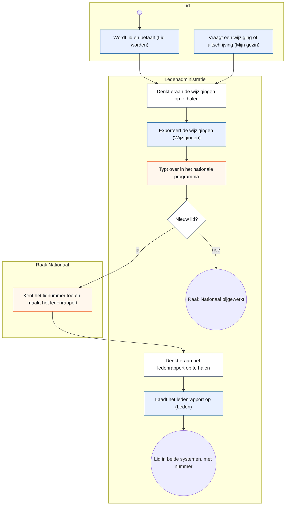

*What to see:* no platform lane and three white boxes — nothing reminds the
administration; the platform supports the two ends (the sign-up, the import)
and not the middle. → E30 proposes the tasks that close that gap. Renewal runs
yearly through `membership`: the household renews in the portal or the board
renews it in the back office, and either way the household gets the order mail
(A9).

### A2.2 An activity: registering and paying

The organiser publishes an activity with its components (what one registers
for, with capacity and price) and products (order lines); a visitor or member
registers on the public page or the board registers them in the back office
(the same page in two shells, CR-14), chooses online or bank transfer, and the
total is computed on the server. Online, the platform watches the outcome;
by transfer, the treasurer does.

<!-- figure: name=proc-payment caption=Paying_for_a_registration_-_online_the_platform_watches,_by_transfer_the_treasurer_does -->
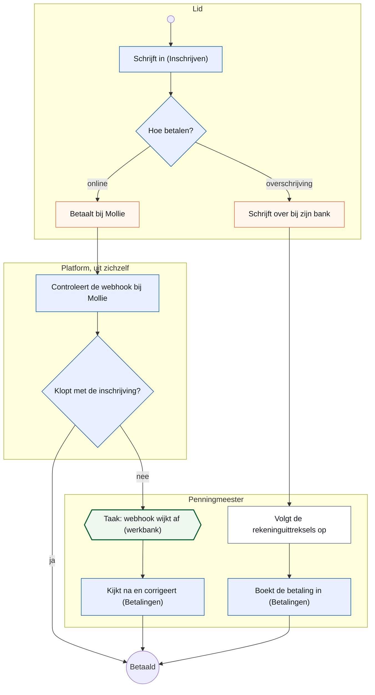

*What to see:* the two ways differ in who watches. Online, the platform
re-fetches the payment at Mollie and raises a task only when something is off
(A9); by transfer, following up the bank statements is a white box — the
treasurer's own discipline.

### A2.3 A refund

A member reduces an order after paying, or the treasurer decides a refund; the
ledger records the obligation and the workbench hands the treasurer the task;
the money goes back by bank transfer, by hand, and the treasurer confirms.

<!-- figure: name=proc-refund caption=A_refund_-_the_platform_records_and_reminds,_the_treasurer_pays_by_hand -->
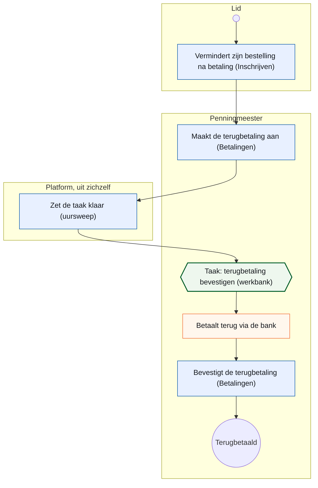

### A2.4 The other processes

The legend of A2 holds for every figure: lanes are people and roles, blue is the platform with the screen's menu name in brackets, white is by hand without any system, orange is another system, a green hexagon is a task on the workbench, and the lane *Platform, uit zichzelf* holds only what a job or an event handler does without a person. The six figures below were drawn by the design-documentation CLI on 13 October 2026 from the contracts and services on `master` @ fdf7b5b6 (docs commits past cf80ccde); the sources per step stand in its figure notes in Koen's project folder.

#### A2.4.1 A board meeting

The secretary creates the meeting and the agenda is built from the activities
and the finances; the agenda goes to the board with a PDF; attendance and
minutes are typed in the same document; the report is mailed and the PDF
archived; a sent report can be reopened. `meetings` registers no job and no
handler, so there is no platform lane: everything happens in the secretary's
own request.

<!-- figure: name=proc-meeting caption=A_board_meeting_-_the_platform_carries_the_document,_the_secretary_remembers_to_start -->
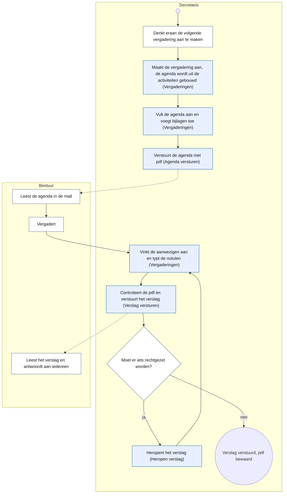

*What to see:* the platform carries the document (agenda from live data, attendance and notes in one place, the PDF with every mail) and the two mails; the humans only have to remember to start the meeting, to hold it, and to reply to all.

#### A2.4.2 The newsletter

The author composes a letter from the chosen sources — activities and the
ticked points of sent meeting reports — with Raakje as co-writer; the writing,
the deterministic checks and the verification pass run in the author's own
request, so they are the author's steps, not the platform's. Only the sending
is the platform's: a job sends in batches within the daily cap and logs every
delivery. Two figures, because one did not fit a page.

<!-- figure: name=proc-newsletter-write caption=Writing_the_newsletter_with_Raakje_-_every_fact_checked_against_the_chosen_sources -->
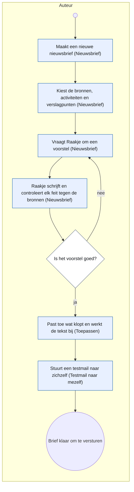

*What to see:* Raakje writes and checks in the author's request; a sentence the sources do not support is marked and left out unless the author keeps it (`drafting.py`); nothing reaches the letter without *Toepassen*.

<!-- figure: name=proc-newsletter-send caption=Sending_the_newsletter_-_the_job_sends_in_batches_and_logs_every_delivery -->
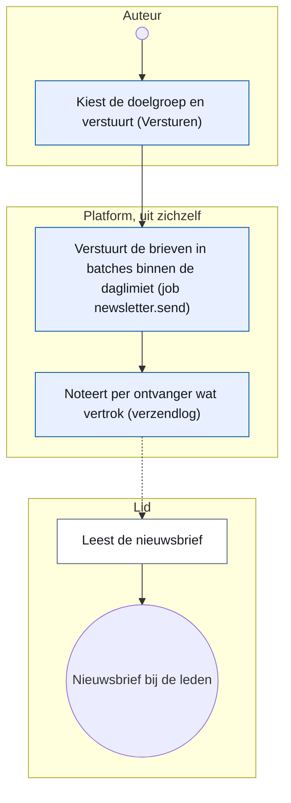

*What to see:* from *Versturen* on the platform carries everything: the recipient list is fixed, the job `newsletter.send` pauses on the daily cap and schedules itself again, and the delivery log says per member what left.

#### A2.4.3 Web content and forms

The board writes pages and sets them online (`is_published`; CR-17's
draft-and-publish → E22 is not built yet), builds forms and shares the link;
a visitor reads and submits; the platform mails a confirmation when the form
asks for one and, for the contact form, puts a task on the workbench without
anyone starting it.

<!-- figure: name=proc-content caption=Web_content_and_forms_-_a_submission_becomes_a_mail_and,_for_the_contact_form,_a_task -->
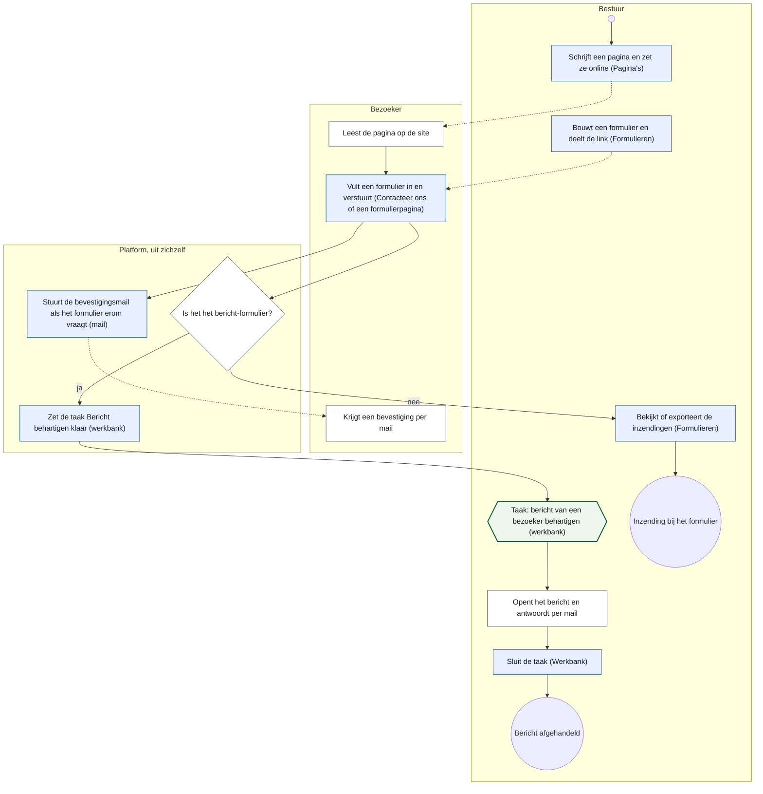

*What to see:* the platform turns a visitor's submission into a confirmation mail and, for the contact form, into a task without anyone starting it (`SubmissionCreated`, two handlers); the board only opens the task, answers by mail and closes it.

#### A2.4.4 Reporting and the change report

Two independent processes on one module, so the figure has two starts: a
board member asks a question — to the assistant, with names masked on their
way to the model, or by choosing objects and filters — reads the answer as a
table, pivot or chart, saves and exports it; and the member administration
fetches the change report for retyping in the national programme (A2.1). The
universe answers inside the request and the history rows are written by each
owner in the transaction of the change, so there is no platform lane.

<!-- figure: name=proc-reporting caption=A_question_to_reporting,_and_the_change_report_-_two_processes,_no_platform_lane -->
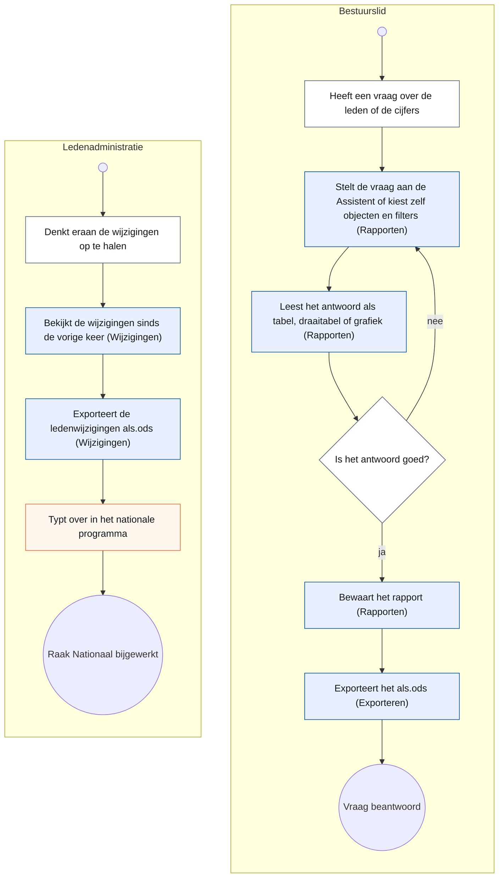

*What to see:* the platform answers a question from the whole data set and hands the change report over as a file; the humans judge the answer, remember to fetch the changes (a white box), and retype them.

#### A2.4.5 A poster from the Design Studio

The organiser makes a design from the activity (its facts are read fresh at
render time, never stored), chooses text, highlights and sponsors, takes a
picture from the library or describes one and asks for four variants — the
job `designstudio.generate` fetches them from the image provider and stores
them through media's port — picks one, makes the version final (Inkscape
renders every layout and refuses a text that does not fit), publishes the A3
PDF as the activity's poster and downloads PDF or PNG. There is no text
proposal by Raakje in the code on `master` (CR-10 still plans it); the only AI
call is the translation of the picture description.

<!-- figure: name=proc-poster caption=A_poster_-_the_picture_requests_run_in_the_background,_Inkscape_renders_inside_the_platform -->
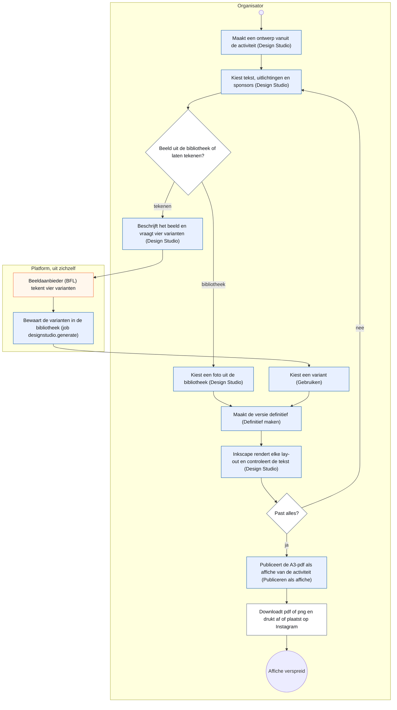

*What to see:* the platform reads the activity's facts fresh, keeps the picture requests going in the background (orange: the image provider) and refuses a version whose text does not fit; the organiser says what the picture shows, chooses, and puts the result in the world.

#### A2.4.6 A question to Raakje on the site

A visitor asks Raakje; the answer is built inside the visitor's request from
the published pages and three read-only tools, through the seam guard and the
log on every outgoing call. A visitor who is not helped leaves name, e-mail
and message through Raakje: the forms port `SubmitMessage` stores it, and the
event handlers put a task on the workbench and send the confirmation.

<!-- figure: name=proc-chatbot caption=A_question_to_Raakje_-_answered_in_the_request,_a_left_message_becomes_a_task -->
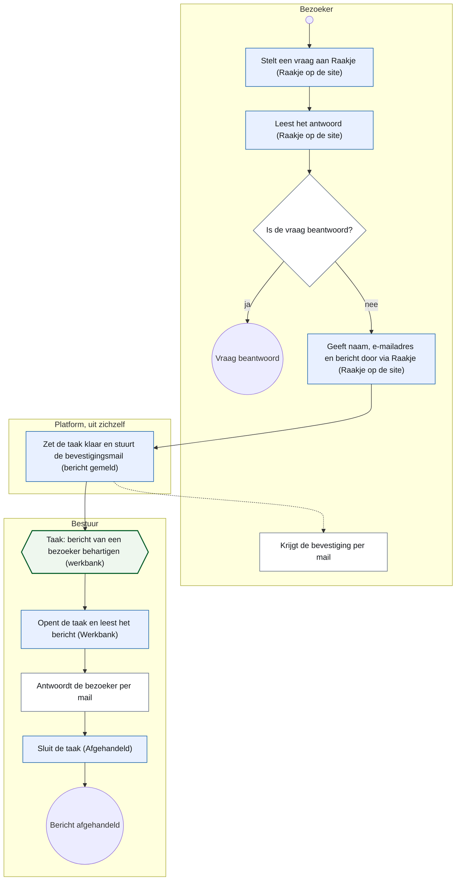

*What to see:* the platform answers inside the visitor's own request (context from the site's pages, read tools only, the seam guard and the log) and turns a left message into a mail and a task without anyone starting it; the board opens the task and replies.

The webshop (CR-21 → E25) joins this list when it is built.

## A3. Principles

Each principle names where it is enforced; a principle that is only written
down is a wish. The first eight are leading principles of the way of working
and carry Koen's words from `AGENTS.md`; the rest are principles of the
structure and carry a gate.

| # | Principle | In one sentence | Where it lives, and what holds it |
|---|---|---|---|
| P1 | Keep it simple | one rule for everyone beats a rule with exceptions; a decision that makes code superfluous removes that code in the same change | `AGENTS.md`; the review (C4) |
| P2 | First time right | an open question is answered before what depends on it is built; no workaround to get past one | `AGENTS.md`; the review |
| P3 | One place per fact | a rule, a value, a figure lives once; the second place derives from the first or a gate fails on the difference | `AGENTS.md` (*Twee keer dezelfde reparatie*); `test_rules_gate.py` |
| P4 | Model on standards | build only what is needed today, in the form a standard gives it (UBL 2.1 / EN 16931, ISO 20022, ISO 6523) so that the extension is a row, not a rework | `AGENTS.md` (*Modelleer op standaarden*, 15 September 2026); part D; the build read of a change request |
| P5 | A rule has one home | a validation, an aggregate's `check()`, a service or a constraint: each rule is written once, at the one address that fits it | `docs/code-style.md` (*A rule has one home*, CR-13); `test_rules_gate.py` |
| P6 | A test must be able to go red | a gate is proven red once with one deliberate violation; a gate that looked nowhere is green for nothing | `AGENTS.md` (*Testen en test-evidence*); `test_gate_niet_leeg.py` |
| P7 | Europe first | an EU option is sought before any tool, service or model; a deviation is written down with its trade-off | `AGENTS.md` (*Europe First*); the proposal of every new dependency |
| P8 | Mobile is the norm on the public side, desktop in the back office | about four in five visits to the public site are on a phone, so every public screen is designed and judged at 390 px first; in the back office it is the other way round (about four in five on a desktop), so a back-office screen is designed for the desktop and must still work at 390 px | `docs/design-system.md`; the merge gate at 390 px (C4); the `measure` job (C3) |
| P9 | Domain separation with facades | a domain is reached through `api.py` only; the kernel imports no domain; no foreign key crosses a schema except towards a code table of `mdm` or `auth` | `test_import_boundaries.py`, `test_schema_boundaries.py` |
| P10 | A screen builds a view-model and chooses a template, nothing else | a UI module never touches the session; a template asks for nothing its view-model does not promise; `StrictUndefined` outside production | `test_layer_gate.py`, `test_template_variables_gate.py` |
| P11 | ERP-ready data | master data is never hard-deleted; merges keep a survivorship chain; every entity has an append-only history table written in the same transaction; cross-domain references are values | `mdm/service.py` (`merge_persons`, `resolve`), `kernel/history.py`, `test_payable_delete_gate.py` |
| P12 | A ledger, not a payment field | every charge and refund is a record with a polymorphic reference to what is paid; one function owns *sum of records equals amount due*; the webhook body is never trusted | `payment/service.py` (`reconcile_charges`), the webhook test that posts a forged body |
| P13 | Multi-tenant by construction | `tenant_id` from a kernel mixin, resolved per request, applied as a global ORM filter no query can forget | `kernel/tenancy.py`; `test_reporting_schema_gate.py` for the views |
| P14 | Gatekeepers in the request path | eighteen checks between a request and a row, most of them explicit route dependencies so each is testable alone; the financial gate is separate from the administrative one | A8; `test_role_model_gates.py`, `test_rights_gate.py` |
| P15 | Security by design, refused at startup | a weak `SECRET_KEY`, `DEBUG` or SQL echo stop the application in UAT and production; no API docs there; logs carry an allow-list of fields | `config.py`; the tests on the 404 of `/docs` |
| P16 | AI in both directions, inside a boundary | built with AI agents inside the gates; AI in the product behind an allow-listed tool list, every call logged, every feature dark-launched per environment | `test_public_tool_boundary_gate.py`, `test_ai_log_coverage_gate.py` |

*Issue first* and the one release tracker are rules of the way of working too (A5, C5), not principles: they say how work is recorded, not how the system is decided. The eight above are the eight Koen agreed to on 15 October 2026 ("akkoord" to the list of the architecture CLI's question of 13 October).

## A4. System context and deployment

Every environment is a Docker Compose stack with an explicit project name
(`docker-compose.dev.yml`, `.hdev.yml`, `.uat.yml`, `.prod.yml`, and
`docker-compose.caddy.yml` for the shared proxy). Development and the
integration environment HDEV carry their own reverse proxy; UAT and production
publish no host ports and sit behind one shared Caddy container that
terminates TLS for both, deployed with an expand/contract discipline because
its configuration serves two releases at once (`AGENTS.md`, *Shared Caddy*).
The backend serves HTML and JSON from one process; there is no frontend
container since the React exit (v2.0.0).

<!-- figure: name=deployment caption=Deployment_topology_-_the_shared_proxy_in_front_of_UAT_and_PROD,_HDEV_with_its_own -->
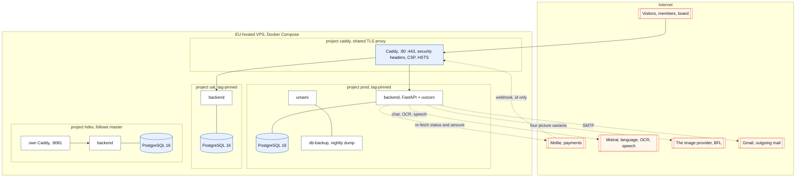

*What to see:* only the shared proxy reaches UAT and PROD; HDEV is a stack of
its own and never enters the shared proxy. Four outside services, all called
from the backend and never from the browser: Mollie for payments (the one
that calls back, with a webhook that is never trusted, A9), Mistral for
language, OCR and speech, the image provider for the poster studio, and Gmail
for outgoing mail — each behind an adapter with a mock, so CI runs without
keys (A11); the keys are per tenant or in `.env`, never in the repository.

What an operator looks for: images are pinned; the backend runs as a non-root
user; the production compose fails fast on a missing secret (`${VAR:?…}`); one
entry point, `raakctl` on the server and `raak` from a laptop, resolves an
environment name to its checkout so nobody runs the UAT script against
production; the deploy takes a pre-migration dump, checks out the tag
detached, rebuilds, runs a read-only smoke test and checks the migration chain
and a clean start (C5 for the order, `AGENTS.md` for the six verification
lines).

## A5. The way of working

Written in full in `AGENTS.md`; this section is the map, not a copy.

- **Two kinds of working copy.** The master worktree works on `master`:
  releases, merges, deploys, issues, reviews routed, the conversation with
  Koen; it writes no production code. A feature worktree works on a branch:
  all code, tests, commits and pushes come from there, and a green pull request
  is handed to the master CLI, which alone merges.
- **Sessions and what each gets**: two dev CLIs for
  large work and migrations, a third on a smaller model for small, bounded
  work that tests and CI catch, a design-documentation CLI for screen design
  and change request documents, an architecture CLI for structural design and
  this document, and builders outside the Claude series on their own branch
  with one pull request as their mailbox.
- **A change is a change request first** when it carries a data model, a
  domain boundary or a migration strategy: shaped on the architecture branch
  from `docs/change_request_template.md`, read against the code by a dev CLI
  before Koen assigns it, built per phase, closed out at step 14 of its
  release with its as-built deviations in the document.
- **The release**: the fourteen steps of C5, with HDEV before the tag and
  three confirmations by Koen.

<!-- figure: name=branches caption=The_branch_model_-_feature_branches_and_a_change_request_branch_into_master,_a_tag_per_release -->
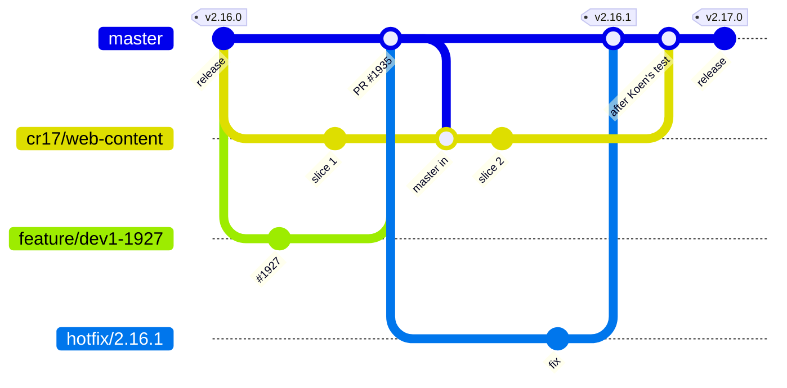

*What to see:* a feature branch lives for one issue and merges when green; a
change request branch of an outside builder lives for the whole change request
and merges once, after Koen's own test; a hotfix branches from the tag.

## A6. The GUI layer

Two shells and one kit. The public shell (`site_base.html`, with
`app.ui.site_context`) carries every page a visitor or member sees, per tenant;
the admin shell (`admin_base.html`, with `app.ui.admin_nav`) carries the back
office, with the workbench as the one way in for every role. Both are drawn
from one kit: the macros in `backend/app/ui/templates/_macros.html`, the
tokens generated by `scripts/build-css.sh` (Tailwind standalone, no Node), and
the layouts — the list layout (`list_page.html`: title row, toolbar, the
kit's table), the record layout (the record head, cards, tabs, one action bar
with one save), the public form page. `docs/design-system.md` is the norm
since 9 September 2026, `docs/design-system-end-state.md` the target CR-11
rolls out, and `/admin/design-system` renders every macro live from the real
kit so the reference cannot drift.

How a screen is built: a route in `ui.py` or `admin_ui.py` reads through its
domain's facade, builds a typed view-model and chooses a template; the template
is Jinja with htmx for interaction and Alpine for small client state, and
asks for nothing the view-model does not promise. The kit gates of C2 hold
that a list is the kit's table, a form has one save in the kit's action bar,
a field is the kit's field; the ratchets measure how far the roll-out is.
The inventory of 13 October 2026 (the design-documentation CLI, against
`master` @ cf80ccde): **123 kit macros** (114 in `_macros.html`, 9 in
`_public_macros.html`), none unused; **214 templates**, of which **92 screens**
(68 in the admin shell, 24 in the public shell); **321 routes**. Where the
screens stand: 4 back-office lists on `list_page.html` with the kit's table,
8 records on the record head, 13 forms on the public form page (5 of them in
the back office), and **51 back-office screens and 16 public screens on no
layout marker yet** — the distance the CR-11 roll-out measures with its
ratchets (165 template rows in `ui_baseline.py`, 5 in `public_baseline.py`).
Two gaps the count found: five public-kit macros have neither a demo on
`/admin/design-system` nor a reasoned exemption (→ E43), and the
`document_page` layout that the end state names (§2.3) does not exist in the
code (→ E44).

## A7. The module map

Fifteen packages under `backend/app/domains/` on 13 October 2026 — `activities`,
`auth`, `chatbot`, `cms`, `designstudio`, `forms`, `mail`, `mdm`, `media`,
`meetings`, `membership`, `newsletter`, `payment`, `reporting`, `workflow` —
each with its models, service, screens and templates, one PostgreSQL schema
each, and `api.py` as its only public door. (`audit` dissolved into its owners
on 9 October 2026, CR-13 phase 4c; `stt` is a package under `chatbot`.)

<!-- figure: name=components caption=Layered_package_structure_-_business_domains_on_the_foundation,_everything_on_the_kernel -->
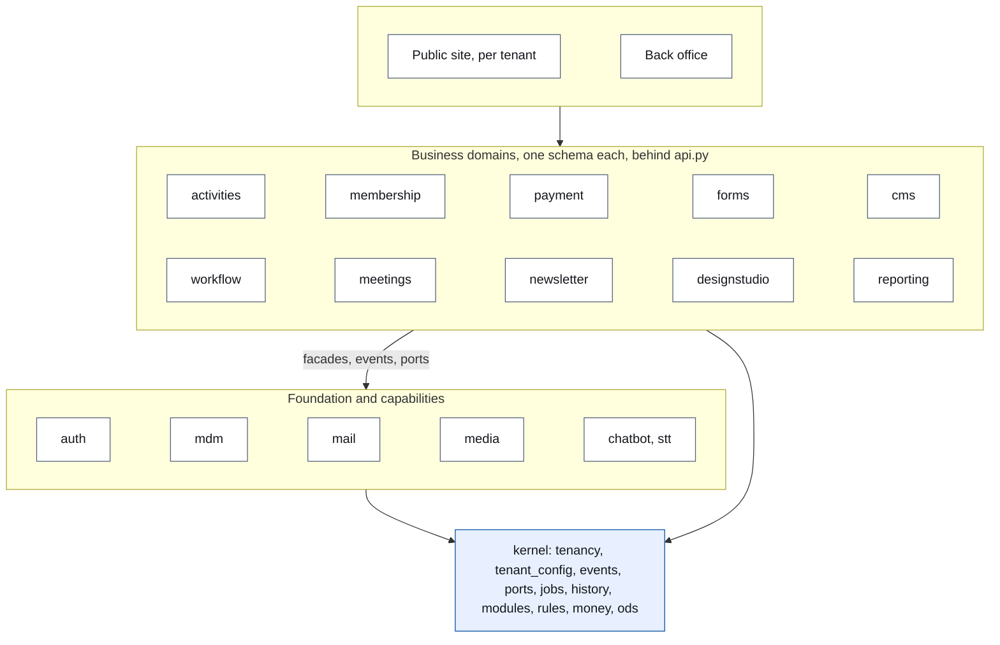

*What to see:* the foundation (identity, master data, mail) sits under the
business domains because every one of them needs it; the kernel holds no
business logic and imports no domain.

**How domains talk** (decided with Koen on 30 September 2026; the mechanics are
`kernel/events.py`, `kernel/ports.py`, `kernel/jobs.py` and the gates of
CR-13). The choice is made by what the caller says:

| The caller… | Uses | Receivers | Answer |
|---|---|---|---|
| reports a fact ("a payment was received") | an **event**: `publish` / `@subscribe`, contract in `kernel/contracts/` | zero or more | none |
| needs something done *and* the result to go on ("store these answers and tell me their id") | a **port**: `call` / `@handles`, exactly one handler, contract in `kernel/contracts/` | one | yes |
| only wants to know | a **read** through the other domain's `api.py` | — | yes |

Nine ports exist (`kernel/contracts/`: four of `forms`, `CreateHousehold` of
`mdm`, four of `media`). Events and ports both run synchronously in the
caller's transaction today; the difference shows only when a component is
extracted — an event then goes through an outbox (→ E9), a port cannot wait.
Two shapes beside the three (CR-13 phase 4d): a *door* — a route or a screen
module — may call one command of another domain and read freely; code reached
only from a `@job` may call another domain's command and act on its outcome.
What fits none stands declared with its reason in `test_rules_gate.py`
(`DECLARED_COMMAND_CALLS`, five on 13 October 2026). Deliberately not built: a
message broker, a workflow engine, event sourcing (→ E40).

<!-- figure: name=interactions caption=Cross-domain_links_on_master_-_facade_calls,_events_and_ports -->
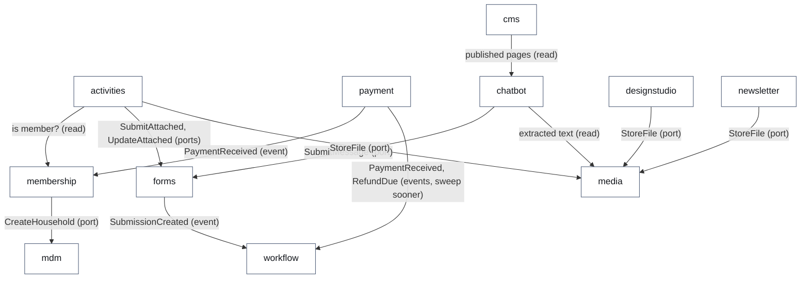

The inventory of 13 October 2026, read from SQLAlchemy's metadata, not from
text: **192 tables** — 186 in the domains (73 data tables, 113 code and label
tables) and 6 in the kernel (jobs, operations, tenant settings) — of which
**66 domain tables carry `tenant_id`**; **967 public names on the fifteen
facades** (610 functions); **25 event contracts, 9 ports, 3 jobs**. The cards
per module stand in part B.

## A8. A request, end to end

Eighteen distinct checks stand between a request and a database row. Most are
not middleware but explicit dependencies on routes, which is what makes them
testable one by one. Two decisions are worth knowing: rights are derived per
request from the database, never baked into a token, so a revoked role takes
effect on the next request; and the UI session is a stateless, HMAC-signed
HttpOnly cookie from which the CSRF token is derived, so there is no session
store to operate.

<!-- figure: name=gatekeepers caption=Gatekeepers_in_request_order wide=1 -->
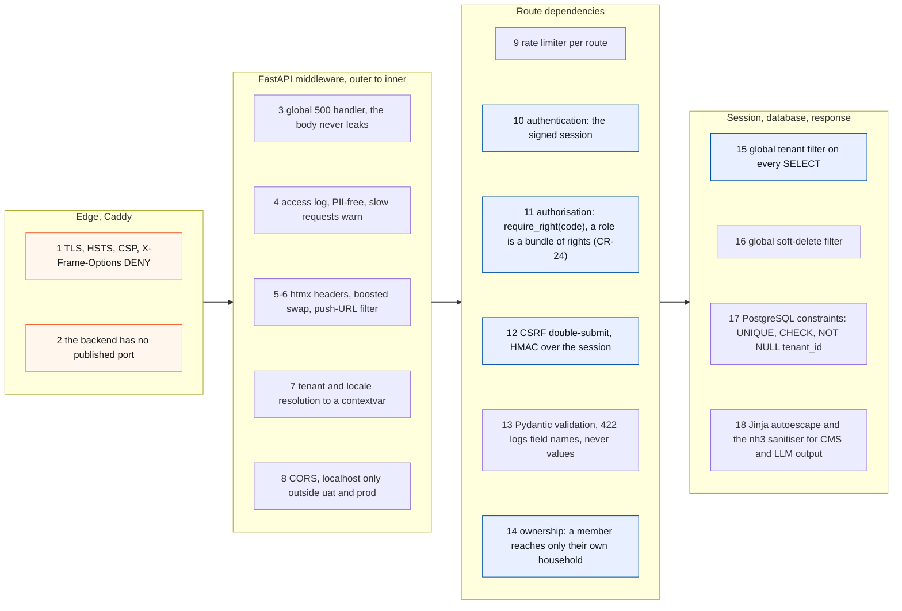

**Modules per tenant sit in step 11's place too**: `main.py` includes each
module router with `require_module(code)`, which answers 404 for a tenant that
has the module off, before any role guard runs (A10).

**The parties in the next figure.** The *browser* runs the page the server
rendered; htmx, a small library in it, sends a button's action as an HTTP
request and swaps the HTML fragment that comes back into the page, so no
page reloads and no JavaScript application exists. *Caddy* is the reverse
proxy of A4: it terminates TLS and forwards on the internal network. The
backend is one Python process on *FastAPI*, a web framework that maps a URL
and a method to a Python function (a *route*), runs that function's declared
*dependencies* first — the rate limit, the session, the right, the CSRF token
of step 9 to 12 — and turns its return value into the response; the
*middleware* is the ring of code FastAPI runs around every request (steps 3
to 8). The *route* in `admin_ui.py` builds a view-model and chooses a
template; the *service* is the domain's rule book; *PostgreSQL* is the one
database, one schema per domain.

<!-- figure: name=request-sequence caption=A_server-rendered_admin_action_with_htmx -->
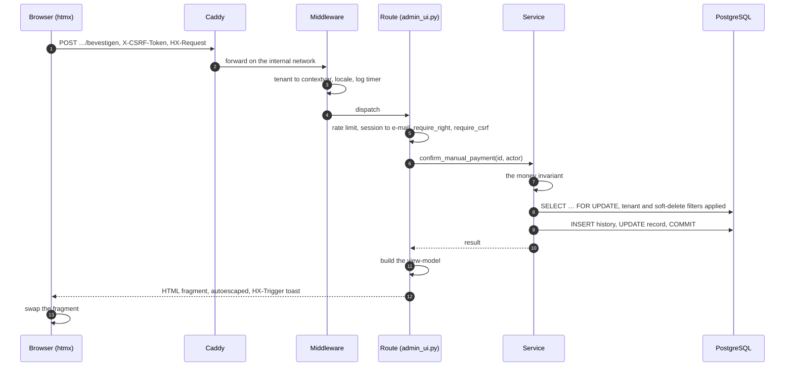

The public side follows the same shape without a session: registration, form
submission and chatbot posts are rate-limited instead of CSRF-gated, and the
total of a registration is always recomputed on the server before it is shown
or stored.

**Roles and where a person lands.** One sign-in flow serves everyone: an
e-mail address receives a magic link and a six-digit code (hashed with a
pepper, one live code per address, five attempts, fifteen minutes). Whether
the address belongs to a back-office user or to a member is decided per
request. Since CR-22 (sign-in, v2.15.0) *the door decides*: whoever signs in
on the public site stays on the public site, whoever signs in to the back
office lands on the workbench, for every role, with the menu showing what the
rights open. Rights are the unit since CR-24 (back-office rights, v2.16.0):
a role is a bundle of rights, a gate names a right and never a role
(`test_rights_gate.py`), and the treasurer's separation — FINANCE mutates
payments, ADMIN reads them — is the right `payment.manage` on every mutating payment route.
The matrix is `docs/rollen-en-rechten.md`.

**The workbench: management by exception.** Human work that the platform cannot
finish is an exception or a decision, and it lands in one place. Six task
kinds exist (`workflow/codes.py`): a message to handle, a refund to confirm, a
payment whose gateway state disagrees with the ledger, an orphaned payment
record, a mail that failed after its retries, a background job that failed for
good. Tasks come from events or from the idempotent hourly sweep, which also
closes a task whose cause disappeared, for the kinds it created itself; a
task is filtered by the right it needs. The design goal is zero-touch: an
empty workbench is a healthy system. The member administration has no task
kinds yet (→ E30).

## A9. Money

Money lives in one ledger domain, `payment`, which also holds the Mollie
integration: the adapter `payment/providers/mollie.py` behind the provider
seam `providers/base.py`, with `stub.py` as the stand-in of development and
the browser tests, `gateway_service.py` for the checkout and the webhook, and
the ledger in `service.py`. Every charge and refund is a
`PaymentRecord` that points at what it pays through a polymorphic reference
(`payable_type`, `payable_id`) without a foreign key, so one ledger serves
registrations and memberships and can serve an order (CR-21). The ledger's
single invariant has one home, `reconcile_charges` in `payment/service.py`:
*after reconciliation, the sum of all non-deleted records equals the amount
due*. Paid amounts are the truth; unpaid records are re-derived; a shortfall
becomes one transfer charge with a Belgian structured communication from a
Postgres sequence with the mod-97 check; a surplus becomes one refund that is
a pending obligation until the treasurer confirms it (A2.3).

<!-- figure: name=payment-sequence caption=Online_payment_-_the_webhook_is_never_trusted,_the_status_is_re-fetched -->
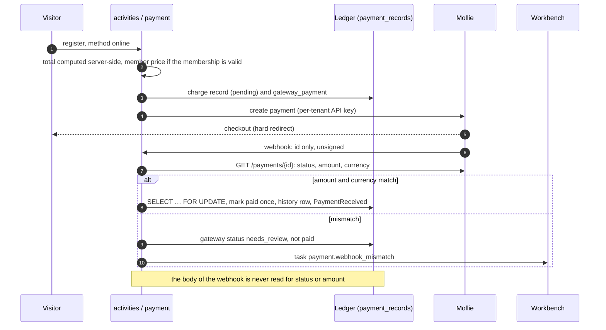

**Never trust the webhook body** is written as a security invariant in
`AGENTS.md` and held by a regression test that posts a forged
`status=paid&amount=999` and asserts the record stays pending. **Every order
confirms itself by mail, from whichever door it was placed**: a membership, a registration or an order placed by the board mails the
household the same mail the member would get.

## A10. Tenancy and security

**The tenant model.** *A tenant is a site; an organisation is a party; a
tenant-scoped row points at a tenant by a foreign key.* (CR-20, built in
v2.17, migration 313.) A tenant is a row of `mdm.tenants` with a `kind` (the
platform, an association's site, …), an `account_id` (the customer it belongs
to) and the organisation it shows; it carries the tenant's code, site name and
active flag, and it keeps the ids the tenants always had. The organisation is
a party and no longer a tenant; a tenant without an account is its own account.
Every tenant-scoped model has a foreign key on `tenant_id` to `mdm.tenants`,
and `tests/test_tenant_key_gate.py` (test 7 of CR-20) is red for one without;
the `mdm` seam rows (addresses, contacts) that still carry a party id in
`tenant_id` are the exception, a baseline that only shrinks until CR-26 phase 1
moves them to the party. A tenant column on `mdm.organizations` is red as well
(test 9). The operator role stands above the accounts.
Per request `kernel/tenancy.py` resolves the tenant — path prefix, then
hostname, then the platform host (root is the landing page, else the tenant
cookie), then the default — into a contextvar, from which a global ORM filter
(`with_loader_criteria`, including relationship loads) scopes every SELECT.
`TenantMixin` adds `tenant_id NOT NULL`, indexed, with a default from the
context; 64 model classes carry it on 13 October 2026. Row-level security in
PostgreSQL is prepared for and not enabled (→ E6).

**The tenant's day.** A moment is stored in UTC; "today" is the tenant's, computed in its
time zone (`mdm.tenants.time_zone`) by `kernel/clock.py` and by `mdm.tenant_today()` /
`mdm.tenant_day()` in SQL, never by `date.today()` or `CURRENT_DATE` (#2156;
`tests/test_one_clock_gate.py`).

<!-- figure: name=tenancy caption=Tenant_hierarchy_and_per-request_resolution -->
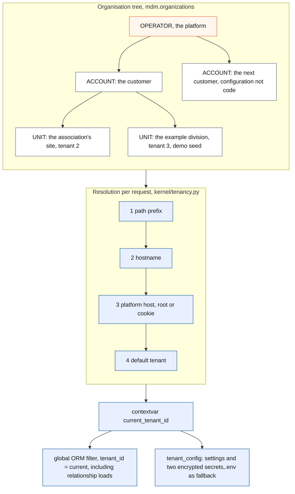

**Configuration and secrets.** `kernel_tenant_settings` holds the known keys
per tenant (display name, base URL, social links, language, membership prices
and dates, payment IBAN, mail settings, analytics, limits) and two secrets —
the Mollie API key and the mail app password — encrypted with Fernet under a
key derived from `SECRET_KEY`; secrets are never rendered back. Infrastructure
secrets stay in `.env`. Shared by design and without a tenant: back-office
identity (`auth.users`, roles, login tokens), the organisation table itself,
postal codes and code tables. A user is a platform account granted roles;
which tenant they act in is decided by the request.

**Modules per tenant** (CR-19, v2.13.0). What a module owns is code; which
modules a tenant has on is data: `kernel/modules.py` holds the registry — menu
items, route prefixes, dashboard tiles, home blocks, sitemap paths, newsletter
audiences, reporting folders, dependencies — and `mdm.tenant_modules` each
tenant's enabled set, held to the registry by a CHECK. An association has
every module, a company `cms`, `media` and `forms`. A module that is off is
refused with 404 before any role guard; the workbench is core, not a module
(#1876). `test_module_gate.py` holds every include to a module or the shell.

**Security controls**, each with its home:

| Control | Where |
|---|---|
| Startup refuses weak configuration (`SECRET_KEY`, `DEBUG`, SQL echo) in UAT and PROD; no API docs there | `config.py`; tested |
| Session and CSRF: HMAC-signed HttpOnly cookie, `secure` in UAT and PROD, 12 h; CSRF = HMAC over the session value, constant-time compare, four failure reasons logged, the token never | `auth/session.py` |
| OTP: hashed with a pepper, one live code, five attempts, generic answers, no account enumeration | `auth/service.py` |
| Financial separation: the right `payment.manage` on every mutating payment route, `payment.view` on the reads (`Right` in `auth/models.py`) | `payment/ui.py`; `test_role_model_gates.py` |
| Webhook integrity: re-fetch, amount and currency check, `needs_review` on mismatch, row lock, idempotent | `payment/gateway_service.py` |
| Ownership on the household portal: the portal reads the household of the signed-in person and nothing else (`household_view(db, person)`) | `membership/ui.py`, `membership/api.py` |
| Output: Jinja `autoescape` guarded by a lint rule; nh3 allow-lists, stricter for LLM output than for CMS | `test_ui_conventions_gate.py`; `cms/render.py`, `chatbot/render.py` |
| Logging: an allow-list of extra fields; no query strings, bodies or tokens | `app/logging_config.py` |
| Secrets in the repository: none; `.env.*.example` only; the public-repository agent reads every diff | `AGENTS.md`, C4 |
| Dependency audit: `pip-audit` on every push, reporting but never silent | the `audit` job, C3 |
| Formula injection in exports: ODS cells typed as strings, never CSV | `kernel/ods.py` |

Known and in the open, each a row of part E: the CSP still allows
`unsafe-inline` and `unsafe-eval` for scripts and inline styles (→ E3); the
history tables are append-only by convention, not by grant (→ E3); the
background jobs run without a tenant (→ E4); the rate limiters count per
process, so the backend runs one worker (→ E14).

## A11. AI in the solution

Four AI features run, every one behind a provider seam with a deterministic
mock so CI runs without keys, every one dark-launched per environment, every
call logged (`test_ai_log_coverage_gate.py`), and all of them on Mistral
(EU): **Raakje, the chatbot** on the public site — context stuffing of the
published pages, notes and counts into a system prompt with a hard limit, and
a boundary that is the tool list: three allow-listed functions, no member
data, no payments, no admin, held by `test_public_tool_boundary_gate.py`;
**document extraction** — a poster or component document is read through its
PDF text layer first and sent to OCR only when that yields too little, with an
administrator's override; **speech-to-text** — a WebSocket proxy to Voxtral so
the key never reaches the browser, with a handshake limit, a daily audio
budget and a browser-native fallback; and **the co-writer and the admin
assistant** — Raakje drafts the newsletter from the selected sources and every
factual claim is checked against them, an unsupported sentence is marked and
left out unless the author keeps it; in the back office the assistant inherits
its screen's selection or record, resolved server-side and never trusted from
a form.

<!-- figure: name=ai caption=AI_features_and_their_boundaries_-_orange_is_the_provider,_mocked_in_CI -->
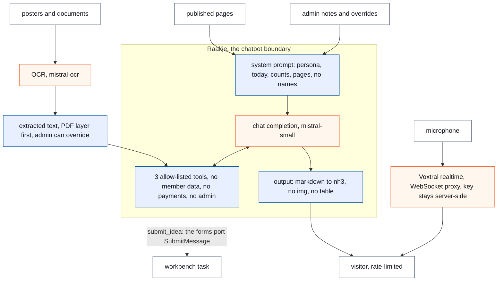

Mail is the one provider without that seam yet (→ E36). Claude Code, which
builds the platform, is itself a deviation from Europe first; what a session
may read from an environment is bounded for that reason (`AGENTS.md`, *Europe
First*).

# Part B — Per module

Fifteen sections, one per package under `backend/app/domains/`. **A module's
section is its `CONTRACT.md`**: the PDF build includes the contract at the module's heading
(→ E32), so nothing about a module stands twice. The build honours that line since #1953 (`master` @ 3ae15a8e), and since 14
October 2026 (E45) the contract's own title line is the module heading and its
lifecycle stands under *Owns*: nothing about a module stands in this file.
Before the contracts, one table holds per module the card measured on 13
October 2026 against `master` @ cf80ccde by the design-documentation CLI —
schema, tables, what it owns and offers, its status columns.

The order follows the processes of A2: the two foundation domains first, then
the business domains, then the cross-cutting ones — `mdm`, `auth`, `membership`, `activities`, `payment`, `forms`, `cms`, `meetings`, `newsletter`, `designstudio`, `workflow`, `reporting`, `mail`, `media`, `chatbot`.

**Two findings of the measurement, before the cards.** First, on 13 October
2026 the contracts did not share one layout: only `forms` carried the five
headings the skeleton assumed, the other fourteen used older or English
headings. The same day #1954 brought every contract to the nine English
headings of `docs/CONTRACT-template.md` — *Purpose and process · Publishes ·
Consumes · Owns · Screens · Deprecations · Standards · Rules and gates ·
Evolutions* — with the old sections moved whole as third-level headings under
the new ones, and the module-shape gate requires the nine (`master` @
f82e5eeb). The *Evolutions* heading of a contract names the rows of part E by
id: the planned ones that touch the module. A row that is built leaves the
contract's list at the close-out of its release (the contract describes the
as-is) and keeps its id and its history in E2. Second, the
contracts name what matters, not the surface: of 967 public names on the
fifteen facades (610 functions), 635 appear in no contract. That is right as
long as the rule holds that a facade promises its *invariants* in the
contract and its *signatures* in the code; the contract is not an index.

| Module | Schema | Tables (data + code) | With `tenant_id` | Facade functions | Events owned | Ports offered · called | Jobs | Status columns | Covered (14 Oct 2026) |
|---|---|---|---|---|---|---|---|---|---|
| `mdm` | `mdm` | 39 (16 + 23) | 13 | 99 | `BoardMemberReported`, `EmailAddressAdded`, `EntityMerged`, `HouseholdDeleted`, `MembershipReported`, `TenantCreated` | `CreateHousehold` · — | — | — | 92 % |
| `auth` | `auth` | 10 (4 + 6) | 1 | 28 | `AccountCodeEntered`, `AddressCodeEntered`, `CodeMailRequested` | — · — | — | — | 97 % |
| `membership` | `membership` | 2 (2 + 0) | 2 | 33 | `FamilyRegistered`, `MembershipDeleted`, `MembershipRenewalPlaced` | — · `CreateHousehold` | — | — | 96 % |
| `activities` | `activities` | 21 (13 + 8) | 13 | 71 | `ActivityCopied`, `AnswerLinkSent`, `OrderChanged`, `RegistrationConfirmed` | — · `CopyForm`, `SubmitAttached`, `UpdateAttached`, `StoreFile`, `RemoveFileOf` | — | `activities.status`: draft, published | 96 % |
| `payment` | `payment` | 11 (3 + 8) | 3 | 41 | `PaymentReceived`, `RefundDue` | — · — | — | `payment_records.status`: pending, paid, failed, cancelled; `gateway_payments.status`: the provider's word, no list (CR-12 §B4.10) | 97 % |
| `forms` | `form` | 10 (6 + 4) | 6 | 57 | `SubmissionCreated`, `SubmissionDeleted` | `CopyForm`, `SubmitAttached`, `SubmitMessage`, `UpdateAttached` · — | — | `forms.status`: draft, open, closed | 94 % |
| `cms` | `cms` | 1 (1 + 0) | 1 | 16 | — | — · — | — | — | 94 % |
| `meetings` | `meetings` | 14 (6 + 8) | 6 | 44 | `CircleStartChosen` | — · — | — | `meetings.status`: agenda, report, sent; `meeting_attendances.status`: present, excused | 93 % |
| `newsletter` | `newsletter` | 20 (4 + 16) | 4 | 61 | — | — · `StoreFile` | — | `newsletters.status`: draft, sending, sent; `deliveries.status`: queued, sent, failed, skipped; `subscribers.status`: pending, confirmed, unsubscribed | 94 % |
| `designstudio` | `designstudio` | 20 (6 + 14) | 6 | 31 | — | — · `StoreFile`, `RemoveAsset` | `designstudio.generate` | `designs.status`: draft, final; `image_generations.status`: requested, fetched, picked, discarded, refused, failed | 90 % |
| `workflow` | `workflow` | 13 (3 + 10) | 3 | 14 | — | — · — | `workflow.sweep` | `workflow_tasks.status`: open, done; `workflow_instances.status`: running, done, failed | 97 % |
| `reporting` | `reporting` (tables; the views are not in the metadata) | 4 (2 + 2) | 2 | 46 | — | — · — | — | — | 95 % |
| `mail` | `mail` | 5 (1 + 4) | 1 | 8 | `MailRequested` | — · — | `mail.retry` | `email_log.status`: sent, failed, skipped, logged | 90 % |
| `media` | `media` | 6 (4 + 2) | 3 | 37 | `DocumentTextExtracted` | `ReadTextAgain`, `RemoveAsset`, `RemoveFileOf`, `StoreFile` · — | — | — | 97 % |
| `chatbot` | `ai` | 10 (2 + 8) | 2 | 24 | — | — · `ReadTextAgain`, `SubmitMessage` | — | `ai_call_log.status`: ok, blocked, error, moderated | 93 % |

The last column is the statement coverage of the module's code on the last
green run of `master` (C3, *Coverage, measured*): with its gates (*Rules and
gates* in the contract) and its browser flows (C3, *The browser flows*) it is
the test picture per module, re-measured at the close-out of every release
until the build reads it (→ E47).

Totals: 192 tables (186 in the domains — 73 data, 113 code and label — and 6
in the kernel: jobs, operations, tenant settings); 66 domain tables carry
`tenant_id`; 25 event contracts, two of which (`SalesOrderPlaced`,
`SalesOrderChanged`) belong to the webshop's `sales` domain that is not on
`master` yet (CR-21 → E25); 9 ports; 3 jobs.

**Lifecycles.** Sixteen status columns in nine modules: fourteen are a code
list with a foreign key, two are plain (the provider's word on
`gateway_payments`, the copy on `payment_record_history`). Each record status
has its `stateDiagram-v2` in its module's contract under *Owns*, drawn from
the transitions in the service, not from the text; three columns are outcomes written once, not
lifecycles (`ai_call_log`, `meeting_attendances`, the history copy), and say
so in their section.

<!-- include: backend/app/domains/mdm/CONTRACT.md -->

<!-- include: backend/app/domains/auth/CONTRACT.md -->

<!-- include: backend/app/domains/membership/CONTRACT.md -->

<!-- include: backend/app/domains/activities/CONTRACT.md -->

<!-- include: backend/app/domains/payment/CONTRACT.md -->

<!-- include: backend/app/domains/forms/CONTRACT.md -->

<!-- include: backend/app/domains/cms/CONTRACT.md -->

<!-- include: backend/app/domains/meetings/CONTRACT.md -->

<!-- include: backend/app/domains/newsletter/CONTRACT.md -->

<!-- include: backend/app/domains/designstudio/CONTRACT.md -->

<!-- include: backend/app/domains/workflow/CONTRACT.md -->

<!-- include: backend/app/domains/reporting/CONTRACT.md -->

<!-- include: backend/app/domains/mail/CONTRACT.md -->

<!-- include: backend/app/domains/media/CONTRACT.md -->

<!-- include: backend/app/domains/chatbot/CONTRACT.md -->

# Part C — The harness

The rules and the gates that give predictable development without drift.
*Drift* is the slow, unnoticed divergence between what the document says, what
the rules say and what the code does: a second place for a fact, a convention
followed in nine screens and forgotten in the tenth, a comment that stayed
true for a month. With AI agents writing most of the code, drift is the main
risk, because an agent copies what it sees and sees only part of the code; a
rule it cannot read in a failing test does not exist for it. So every rule here
is held by something that fails. This part is the counterpart of B7 (rules of the solution) and C7 (gates) of the
change request template: what a change request writes per change, this part
holds for the whole platform.

A harness has four layers, and the order matters: a rule is written once in
its home (C1); a mechanical rule is held by a gate that runs on every push
(C2) inside a CI whose jobs block the merge (C3); what a regex cannot decide
is judged by a person or a read-only agent at a fixed moment (C4); and the
process itself has gates that stop a release where a wrong step is expensive
(C5). C6 lists what the gates caught, because every gate here exists for a
failure that happened.

## C1. The rules and where each lives

Every rule has exactly one home. The home is where the rule is *written*; a
gate *holds* it. A rule found in two places is a bug of the same kind as a fact
stored twice (`AGENTS.md`, *Twee keer dezelfde reparatie*), so the table below
is the index, not a copy.

| Rule | Home | Held by |
|---|---|---|
| The process: who may change what, issue first, branches and merges, releases, reviews, builders outside the Claude series, data operations through the app, Europe first, keep it simple, first time right | `AGENTS.md` | the process gates of C5; `backend/tests/test_ci_workflow_gate.py` holds the CI's promises |
| All new code and documentation in English; Dutch identifiers only inside a baseline that may only shrink (#780) | `AGENTS.md` (*Code language*) | `backend/tests/test_rules_gate.py`, section 7, against `backend/tests/dutch_identifiers_baseline.py` (370 entries on 13 October 2026) |
| Formatting and linting | `pyproject.toml` (ruff, #781) | the `lint` job (C3); `backend/tests/test_ruff_migrations.py` for new migrations |
| A fixed vocabulary is a code table; `CodeEnum`, never `str, Enum` | `docs/code-style.md` (CR-12) | `backend/tests/test_codes_gate.py`, eleven checks, with `backend/tests/codes_baseline.py` for what is deliberately not a code |
| A rule has one home (validator, method, service, constraint) | `docs/code-style.md` (CR-13 §B9.1) | `backend/tests/test_rules_gate.py` (CR-13 phases 0a and 0c) |
| A copied model declares every column | `docs/code-style.md` (#1464) | `backend/tests/test_copy_plans_gate.py` |
| A gate names a right, never a role | `docs/code-style.md` (CR-24) | `backend/tests/test_rights_gate.py`; the role model itself in `backend/tests/test_role_model_gates.py` (#530) |
| Three validation layers: form in the router, meaning in the service, integrity at rest in the database; a screen builds a view-model and chooses a template, never touches `db` | `AGENTS.md` (*Validation layers*), `docs/design-system.md` §8.3 | `backend/tests/test_layer_gate.py` (#635), `backend/tests/test_template_variables_gate.py` (#643) |
| A domain is reached through its `api.py` facade; a port or an event where a facade would couple | `AGENTS.md` (*Backend architecture*), `docs/architecture.md` §3.2.1 (moves to part A) | `backend/tests/test_import_boundaries.py`, `backend/tests/test_port_gate.py` (#1251), `backend/tests/test_rules_gate.py::test_every_json_route_names_its_caller` |
| Every screen is drawn by the kit: tokens, macros, layouts, one shell per side | `docs/design-system.md` (norm since 9 September 2026), `docs/design-system-end-state.md` (CR-11) | `backend/tests/test_ui_conventions_gate.py` (#528) and the kit gates of CR-11: list page, list table, record form, record header, record tab, form field, repeating group, admin frame, public shell, public form page, assistant, read-mode grid; the ratchets `test_ui_ratchets.py`, `test_public_ratchets.py`, `test_actiebalk_ratchet.py` |
| User-facing text passes through `_()`; one word per contact field; the short date and the site name are written in one place | `docs/design-system.md` §6, `AGENTS.md` (*Documentation language*) | `test_i18n_gate.py` (#407), `test_contact_labels_gate.py` (#1719), `test_short_date_gate.py` (#1242), `test_site_name_gate.py` (#1546) |
| Money: the webhook body is never trusted; no hard delete in a domain that owns a payable; the payment-method choice stands once; FINANCE sees payments only | `AGENTS.md` (*Payment*), `docs/rollen-en-rechten.md` | `backend/app/domains/payment/tests/`, `test_payable_delete_gate.py` (#667), `test_payment_choice_gate.py` (#1748), `test_role_model_gates.py` |
| Reporting is a terminus; a detail may be shown, not grouped by; every shipped report runs | `docs/change_request_06_reporting.md`, `docs/change_request_07_raakje_backoffice.md` §6.6 | the four reporting gates in `backend/app/domains/reporting/tests/` and `backend/app/domains/activities/tests/test_reporting_schema_gate.py` |
| One linear migration chain; the tool writes the file; the id in the file is the id in the name; a merged migration is never modified | `AGENTS.md` (*Alembic migrations*) | `test_migratieketen_gate.py` (#951), `test_migration_id_gate.py` (#1315); the `boot` job runs the chain against an empty database |
| A test sits where its imports say; test data on the reserved example domains; a gate must be able to go red and must look somewhere | `AGENTS.md` (*Testen en test-evidence*), CR-13 R15 | `test_tests_placement_gate.py`, `test_test_email_domains_gate.py` (#1293), `test_gate_niet_leeg.py` (#678) |
| No AI call without a row in the AI log; the public assistant reaches no admin tool; a view transition is decided in one place | the issues that made them (#978, #1075) and CR-11 (#1591) | `test_ai_log_coverage_gate.py` (#978), `test_public_tool_boundary_gate.py` (#1075), `test_view_transition_gate.py` (#1591) |
| Every module router is guarded and every registry entry is real (modules per tenant) | CR-19 (tenant kinds) | `test_module_gate.py` |
| The import smoke test covers every package; the storage seam is the only way to a file | #583, CR-15 | `test_check_imports_gate.py`, `test_media_seam_gate.py` (#1473) |
| A change request is shaped, read against the code, built and closed out per the template; a review is asked and answered per the protocol | `docs/change_request_template.md`, `docs/review-protocol.md` | the judgment layer (C4): the build read before assignment, the review on request; no mechanical gate |
| Nothing secret, no real host, no personal data in the public repository; a Claude session takes no personal data from an environment | `AGENTS.md` (*This repository is PUBLIC*, *Europe First*) | the `publieke-repo-bewaker` agent (C4), on every diff and on request over the issues |

Two things this table makes visible. First, `AGENTS.md` is the home of the
process and of the conventions that predate the code-style document; a rule
that is about code moves to `docs/code-style.md` when it gets a gate, and the
table above is where that move is recorded. Second, three rules have no gate
and no plan for one — the change request process, the review protocol and the
public-repository rule — because what they guard is judgment; they are held by
C4 and C5 instead, and that is a choice, not a gap.

## C2. The gates

A gate is a test that holds a rule of the codebase rather than a behaviour of
the application: it reads source files, templates, migrations or the rendered
HTML of every admin page, and it fails when the rule is broken anywhere. On 13
October 2026 there are **53 gate files**: 48 in `backend/tests/` named
`test_*gate*.py` or `test_*ratchet*.py`, and 5 in the test folders of the
domains they belong to (`activities`, `reporting`), where CR-13's placement
rule put them. (A file glob on `*gate*` finds 55: `test_registration_aggregate.py`
and `test_payment_record_aggregate.py` match on *aggregate* and are the B8
tests of two aggregates, not gates.) Four more files are gates without carrying
the word: `test_import_boundaries.py` (`LEGACY_ALLOWLIST`, may only shrink),
`test_schema_boundaries.py`, `test_docs_gating.py` (no API docs in UAT and
PROD) and `integration/test_query_budget.py` (a query budget per screen); the
generated table of the future reads the meta-gate's list, not a glob, so that
they count.

### The table

The table of gates — file · what it refuses · hard or ratchet · since · what it
caught — is **generated by the PDF build from the first sentence of every gate
file's docstring**, so it cannot go stale: a gate that is added appears, a gate whose
sentence changes changes here. The build reads the same files the meta-gate
lists in its `GATE_BESTANDEN`. The one-sentence docstring on every gate file in the form *refuses · hard or
ratchet · since #issue*, and the gate that requires it, are #1952 (→ E31).

The table is generated here by the documentation build (#1953, `master` @
3ae15a8e) from `GATE_BESTANDEN` and `GATE_SENTENCE` of
`backend/tests/test_gate_niet_leeg.py`; the build fails on a gate without its
sentence, a gate missing from the list, or an empty list. The *caught* column
of the hand-written table of 13 October 2026 (the design-documentation CLI's
count) is not in the sentence and stands in C6 for the gates that shaped the
harness.

<!-- gates-table -->

### Hard gates and ratchets

A **hard gate** has no exceptions: the rule holds for every file it reads, and
a new violation is red the moment it is pushed. Most of the 53 are hard.

A **ratchet** (Dutch *ratel* or *palrad*: a toothed wheel with a pawl, so it
turns one way only) holds a rule that was introduced while the code still broke
it.
It freezes the violations that stood on the day the rule came (a *baseline*)
and allows the number only to fall: an entry that leaves the code must leave
the baseline, nothing may join it, and the gate is as red on room left
standing as on a new violation. A rule with a growing exemption list would be
dead; a baseline that can only shrink is the same rule with a date. The
baselines on 13 October 2026, each in a file of its own under
`backend/tests/`:

| Baseline | File | Rule | Size on 13 October 2026 |
|---|---|---|---|
| Dutch identifiers | `dutch_identifiers_baseline.py` | all new code is English (#780, 29 September 2026) | 370 names (437 when frozen) |
| The UI ratchets of CR-11 | `ui_baseline.py` | every screen on the kit: raw form elements, raw surfaces, header extras, sideways scrolls, shells extended directly, … (#1563, frozen 5 October 2026 when pilot A stood on the kit) | 165 template rows over eleven rules; the largest are `SHELL_EXTENDED_DIRECTLY` (52) and `RAW_SURFACES` (36) |
| The public ratchets | `public_baseline.py` | the public side on the kit: hand-written buttons, cards, activity parts (#1591) | 5 rows |
| The hand-drawn lists | inside `test_list_table_gate.py` (`HAND_DRAWN_LISTS`, `CEILING`) | a back-office list is the kit's table (#1911, 12 October 2026) | ceiling 9 (ten on 12 October; #1925 looks at the nine one by one) |
| What is deliberately not a code | `codes_baseline.py` | the code-list rule (CR-12): MIME types, labels that are not a vocabulary, foreign keys to lists that are not ours | an allow-list with a reason per line, not a ratchet: it may grow when a new external vocabulary arrives; the eleven ratchets CR-12 started with are all empty since 28 September 2026 |
| Five declared command calls | inside `test_rules_gate.py` (`DECLARED_COMMAND_CALLS`) | *events, not calls* between domains (CR-13 B4.6): each with its reason | 5 |

Eight hard gates carry an in-file exemption list of their own that may only
shrink (`test_layer_gate.py`, `test_list_page_gate.py`, `test_migration_id_gate.py`,
`test_payable_delete_gate.py`, `test_record_header_gate.py`,
`test_reporting_terminus_gate.py`, `test_test_email_domains_gate.py`,
`test_ui_conventions_gate.py`); two of those lists are empty.

So the sentence of the former §6.2, "on master every ratchet list is empty but
two", no longer holds since CR-11: the kit roll-out carries a baseline of 165
rows that shrinks with every screen that moves onto a macro (the kit roll-out issues of
v2.17 take the next ones). The number is the measure of how far the roll-out
is; it belongs in the release tracker of every release that lowers it.

### The meta-gate

`backend/tests/test_gate_niet_leeg.py` (#678) guards the gates themselves: a
gate collects the files it reads through one helper that fails on an empty set
and on fewer files than the rule expects, every gate uses that helper, and no
gate scans the file system directly any more. It exists because fourteen gate
functions once scanned files without asserting they found any — a moved folder
or a changed glob would have made them green for good.

## C3. The CI

One workflow, `.github/workflows/backend-tests.yml`, runs on every push to
`master` and on every pull request against it, except when only the
documentation files listed in its `paths-ignore` change (the change requests,
this document, the review protocol). Since CR-29 (8 October 2026) a run is
one per commit: a newer push cancels a pull request's stale run, a `master`
run always finishes because HDEV and the release wait for it.
`backend/tests/test_ci_workflow_gate.py` holds these promises against the
workflow file.

Eight jobs, each with a thirty-minute limit:

| Job | What it does | Blocks the merge |
|---|---|---|
| `lint` | `ruff format --check` and `ruff check` on the whole tree (#781) — ruff is one tool that is both the formatter (quotes, line length, import order, decided once for everyone) and the linter (unused imports, undefined names, a hundred small mistakes), fast enough to run on every push; a job of its own so a style finding is red within seconds | yes |
| `pytest` | `mypy`, then the suite with `pytest -n 4` against a PostgreSQL 16 service container, coverage of `app` at least 85 %; Inkscape is installed for the poster tests | yes |
| `audit` | `pip-audit` on the backend requirements, **reporting only** (#574): the findings go to the run's summary and to the release tracker, and Koen decides what blocks a release, not the scanner | no — but never silent |
| `e2e (part 1)`, `e2e (part 2)` | the Playwright suite in `backend/tests_e2e/` against a really started backend with seeded data, split in two parts by folder so the two run side by side | yes |
| `measure` | the measurement baseline of the pilot screens (#1605, `scripts/measure-run.sh`): positions and sizes read from the rendered DOM at 390 px and at the wider widths each screen declares, compared with the committed baseline, so a kit change that moves another screen is red before anyone looks | yes |
| `css` | rebuilds `backend/app/static/app.css` from the templates with the pinned Tailwind CLI and fails on a diff (#652): a template change whose CSS was not rebuilt is red | yes |
| `boot` | runs the real `startup.sh` — migrations, every seed, uvicorn — against an empty PostgreSQL 16 and probes the health route (#450); the import check runs the same way as the Docker build | yes |

The last green run on `master` when this was measured: run 38517522227 on
38a4a5a4 (14 October 2026) — `pytest` 6 712 passed, 1 skipped; the two e2e
parts 913 passed together; `pip-audit` *No known vulnerabilities found*. Every closed issue
carries the run id, the test count and the audit outcome as evidence
(`AGENTS.md`, *Testen en test-evidence*), and the release tracker carries them
once more at step 4 of the release.

### The browser flows

The `pytest` job proves what the code promises; the browser flows prove what
a person sees. Only a real browser shows that a button *does* something: in
the v2.0.0 validation the server and the markup looked right and three buttons
were dead (#613, #622). The suite in `backend/tests_e2e/` runs
playwright-python against a really started backend with a migrated database
and seeded data, outside the ordinary `pytest` run; CI starts uvicorn and runs
it in two parts. A flow **fails rather than skips** when the seed data it needs
is missing, so an empty environment cannot turn it green.

On 14 October 2026 the suite holds **572 test functions** (913 passed on the
last green run on `master`, parametrised cases counted differently):

| Suite | Tests | What it walks |
|---|---|---|
| `test_golden_flows.py` — the **golden flows** of the public side (#405, the React exit) | 9 | a household registers and pays by transfer; a registration is blocked without a valid postal code; an activity registration with a team name; one with products and online payment; the form wizard's navigation; the public core is reachable; and the three *doors* of CR-22: from an activity to *Mijn inschrijvingen* through the account, a guest registers and it is nobody's history, a member signs in from the page that asked |
| `test_beheer_flows.py` — the golden flows of the **back office** (#622, layer 3) | 7 | confirm a payment; change an order line and the amounts follow; cancel a membership and a refund appears; navigating does not rebuild the shell; a running action is visible; the export stays a download; editing replaces the date line |
| `activities/`, `forms/`, `shell/`, `pages/`, `members/`, `meetings/`, `assistant/`, `media/`, `reports/` — one folder per area, grown with the change requests | 99 · 98 · 91 · 84 · 76 · 34 · 31 · 23 · 6 | the screens of each area as a person uses them: the kit's lists and records, the public shell and forms, the household portal, the meeting document, the assistant, the media library, the reports |
| `test_measure_baselines.py`, `test_measure_compare.py` — the **measurement baseline** (#1605) | 14 | positions and sizes read from the rendered DOM at 390 px and the screen's wider widths, compared with the committed baseline (`baselines/`), run by the `measure` job |

`screenshots.py` renders the screens the master CLI looks at before a merge
(C4); `seed_e2e.py` and `measure_seed.py` are the made-up data every flow
starts from.

### Coverage, measured

The suite's floor is one number, 85 % over the whole of `app`
(`--cov-fail-under=85`); CI prints the report per file in the log of the
`pytest` job and stores it nowhere. The tables below are that report of the
last green run on `master` before this was written — run 38517522227 on
38a4a5a4, 14 October 2026, **95 % over 31 696 statements** — summed per module
and per layer (statements and missed statements, as `coverage` counts them:
lines, not branches). They are re-measured at the close-out of every release
until the build reads them itself (→ E47).

| Module | Statements | Missed | Covered |
|---|---|---|---|
| `auth` | 953 | 25 | 97 % |
| `workflow` | 720 | 19 | 97 % |
| `payment` | 1 632 | 44 | 97 % |
| `media` | 1 359 | 41 | 97 % |
| kernel | 1 711 | 52 | 97 % |
| `app` itself (config, main, logging, the module registry) | 673 | 22 | 97 % |
| `membership` | 1 267 | 45 | 96 % |
| `activities` | 3 975 | 142 | 96 % |
| `app/ui` (the shells, the kit, the platform screens) | 1 324 | 50 | 96 % |
| `reporting` | 2 624 | 128 | 95 % |
| `cms` | 1 452 | 83 | 94 % |
| `forms` | 1 851 | 107 | 94 % |
| `newsletter` | 2 308 | 142 | 94 % |
| `chatbot` | 1 623 | 111 | 93 % |
| `meetings` | 1 276 | 94 | 93 % |
| `mdm` | 3 923 | 298 | 92 % |
| `mail` | 671 | 65 | 90 % |
| `designstudio` | 2 311 | 236 | 90 % |

| Layer (by file name) | Statements | Missed | Covered |
|---|---|---|---|
| models, history, codes | 2 941 | 15 | 99 % |
| kernel | 1 410 | 43 | 97 % |
| facades (`api.py`) | 439 | 17 | 96 % |
| screens (`ui.py`, `admin_ui.py`, view-models) | 6 582 | 314 | 95 % |
| the `app/ui` package | 493 | 31 | 94 % |
| routers (the webhook, the media bytes, the stub) | 495 | 35 | 93 % |
| services, handlers, rules | 11 263 | 829 | 93 % |
| adapters (providers, seams, speech) | 810 | 108 | 87 % |
| other files (exports, imports, rendering, helpers) | 7 220 | 312 | 96 % |

*What to see:* the data layer is nearly complete and the adapters are the
least covered, which is where the mocks stand in for the outside world; the
services are the largest layer and carry half of what is missed. **The money
code** (`payment` and `kernel/money.py`, `kernel/structured_communication.py`)
stands at 97 %: fourteen of its twenty-two files are at 100 %, the ledger
`service.py` at 97 % (18 lines), the Mollie adapter at 88 % (6 lines), the
stub router of development at 79 % (8 lines). A floor of 100 % for the money
code (→ E46) is therefore about 40 lines, and the question which of them a
test cannot reach on purpose.

Three things the CI deliberately does **not** do. It does not deploy: HDEV is
deployed by the master CLI from `master` HEAD, UAT and PROD from a tag, by
hand and with a confirmation (C5). It does not tag: a release tag is created
on GitHub on a commit that HDEV has already run. And it does not read an
environment: the six verification lines after a deploy (`AGENTS.md`,
*Verifying a deploy*) are measured by the session that deploys.

## C4. The judgment layer

What a gate cannot express is judged at a fixed moment by a person or by a
read-only agent. Four moments:

**The merge gate on the rendered screen.** Before merging a pull request that
touches a screen, the master CLI looks at the rendered screen at 390 px — the
screens the pull request touches, rendered against a seeded local backend
(`backend/tests_e2e/screenshots.py`) — and a handover of a UI change without a
measurement taken from the rendered DOM goes back.
The `measure` job of C3 holds the pilot screens mechanically; the eye holds
the rest.

**Two read-only agents**, defined in `.claude/agents/`, both on Sonnet, both
with read tools only, both producing a report and never a commit:
`design-conformiteit-bewaker` reads templates and UI modules against the
design system where the gate stops — patterns, and the layering of the Python
UI modules — and ranks its findings with `file:line` and a proposed issue
title; `publieke-repo-bewaker` screens a diff — staged, or against `master` —
and, on request, the issues and their comments for secrets, credentials, real
hosts and domains, `.env` files with real values, personal ops tooling and
personal data (names, e-mail addresses, addresses, IBANs), because the
repository and its tracker are public. Its norm is *before every commit or push,
and periodically over the issues*; it is a judgment, not a gate: nothing runs it
by itself, a session calls it. Behind it stands the masking rule of
`AGENTS.md` (*Wat je uit een draaiende omgeving plakt, maskeer je eerst*: the
identity goes, the measurement stays) and the rule that a Claude session takes
no personal data from an environment into its chat at all. What it cannot do:
a leak that reaches GitHub is public from that second — editing removes
nothing, a credential is rotated — so the agent is the last reader before the
push, not a net after it. Two mechanical lines stand with it: GitHub's own
secret scanning with push protection, on since 14 October 2026 (it refuses a
push that carries a known credential pattern; the first scan found no alert),
and a blocking secret scan in CI, coming with #1996 on v2.18 (→ E48). Neither
reads a name or an address: personal data stays the agent's.

**The build read of a change request**:
every change request, small or large, is laid against `master` by a dev CLI
before Koen assigns it, through the review door below. CR-22 was assigned
first, and the two dev CLIs then found twelve points where the document and
the code disagreed. What the read looks for stands in
`docs/change_request_template.md`.

**The review on request** (`docs/review-protocol.md`): one trigger — the
`ai-review` label and one sentence naming the scope and the reviewer — one
answer as one comment, findings grouped by weight with file and line, ending
with *take in · already decided · not taken*. Within the Claude series the
master CLI routes it; an outside reviewing agent is started by Koen. A review
is advisory: only CI blocks a merge, and Koen decides what is taken in. One
review is standing and needs no request: every pull request of a builder
outside the Claude series is read by a Claude dev CLI before a merge, the
first time and after every later commit (`AGENTS.md`, *A builder outside the
Claude series*).

## C5. The process gates

The process has gates of its own, written in `AGENTS.md` and held by the
master CLI, which is the only session that merges, tags and deploys.

- **Issue first.** Every deployable code change goes through a GitHub issue;
  no drive-by commits. The issue is the record of *why*; the commit references
  it; the release tracker ticks it off.
- **The release assignment is the merge approval, and only the master CLI
  merges.** A feature CLI readies a green pull request and hands it over; work
  not on a release never reaches that handover, not with green CI, not with an
  approved deliverable.
- **The fourteen steps of a release**, in `AGENTS.md` (*Running a release from
  the CLI — the order*): tracker (1), merge gate (2), the closing comment per
  issue at its merge with how to test it on HDEV (3), CI evidence (4), env vars
  by Koen (5), HDEV deploy (6), Koen validates on HDEV (7), the GitHub Release
  on the HDEV-tested commit (8), UAT (9), the shared Caddy when touched (10),
  PROD (11), the six verification lines (12), close the tracker (13), close out
  every change request the release built (14).
- **HDEV before the tag.** A release tag is created only on a commit that
  HDEV has run and Koen has validated; the tag is the single source of truth
  for what UAT and PROD run.
- **Three confirmations stop the pipeline, nothing else does:** the UAT
  deploy, a change to the shared proxy, the PROD deploy. Inside an assigned
  release the agent works autonomously.
- **The close-out at step 14** exists because CR-14 showed what happens
  without it: a change request that is not closed out keeps telling the next
  reader the design, not what runs. The architecture CLI edits the document,
  the master CLI closes the issue. From v2.17 on this step also updates this
  document (part B of the modules touched, part D for a new standard, part E's
  row and change log E3; see the change request template, C10).
- **Who may change the process.** `AGENTS.md`, `CLAUDE.md`, `.github/` and the
  process documents are changed by Koen or the master CLI at his explicit
  word; every other session proposes. A decision of Koen is written only with
  his own words, the date and the question they answered.
- **First time right**: an open question is answered
  before what depends on it is built; no workaround to get past one; a
  proposal says when it is not the final form.

## C6. What the gates caught

Every gate in C2 exists for a failure that happened, and the failure is
written in the gate's docstring so the next reader does not have to rediscover
it. The ones that shaped the harness:

- **The escaping class** (#622, `test_render_gate.py`). Three times an htmx
  attribute was HTML-escaped and a button silently did nothing while every
  endpoint test passed — 830 tests green while three buttons were dead. Answer:
  a gate over the *rendered* HTML of every admin page, plus browser flows on
  the admin screens.
- **Green by looking nowhere** (#678, `test_gate_niet_leeg.py`). Fourteen gate
  functions scanned files without asserting they found any. Answer: the
  meta-gate of C2, and the rule in `AGENTS.md` that a gate proves it looked.
- **Green while undeployable** (#450, the `boot` job). A renamed module passed
  CI and failed only in the Docker build; the backend crash-looped on HDEV with
  CI green. Answer: the real `startup.sh` boots in CI against an empty
  database, and the import check derives its module list from the package
  (#583, `test_check_imports_gate.py`).
- **The typo that rendered blank** (#643, `test_template_variables_gate.py`).
  Jinja rendered an unknown variable as an empty string. Answer:
  `StrictUndefined` outside production, typed view-models, and a gate that
  compares each template's variables with its view-model's fields; its first
  run found five real gaps, among them role checkboxes that had silently
  disappeared from a form.
- **CSS that drifted** (#652, the `css` job). `app.css` is generated and
  committed, and it silently fell behind the templates: the e-mail log on HDEV
  rendered with wrong margins and nothing failed. Answer: CI rebuilds it and
  fails on a diff.
- **Two migrations with one key** (#951, #1315). Hand-typed migration ids
  drifted from real timestamps to round hours until two branches chose the
  same key on 19 September 2026. Answer: the tool writes the file, a gate
  checks the chain has one head and that the id in the file is the id in the
  name.
- **Twenty-six Dutch function names** that review caught on 26 September 2026
  after CI had let them through. Answer: the English-identifier ratchet (#780)
  three days later.
- **The hidden read wrapper** (#913, `test_actiebalk_ratchet.py`). An action
  cluster stood inside a collapsed read wrapper and was unreachable. Answer: a
  ratchet that reads the templates.
- **Two list screens drawn as cards** (#1911, `test_list_table_gate.py`). On 12
  October 2026 Koen found two webshop lists hand-drawn while the same builder's
  third used the macro, after several reads: "Hebben we geen gate die bewaakt
  dat op lijst-schermen enkel nog via de macro mag gewerkt worden?". Nothing
  mechanical said it, so no review brought it back; now one does.
- **A cancelled run that nobody saw** (CR-29, `test_ci_workflow_gate.py`). With
  one concurrency group for all of `master`, GitHub cancelled a queued run as
  soon as a newer commit arrived (8 October 2026). Answer: one group per
  `master` commit, cancellation only for pull requests, and a gate on the
  workflow file.

The pattern is the same every time: a failure that CI let through becomes a
rule, the rule gets a gate on the day it is written, and the gate is proven red
once with one deliberate violation before it is trusted (`AGENTS.md`, *Testen
en test-evidence*). A gate that cannot go red is worse than none.

# Part D — Standards

One table of what the platform follows and where it deliberately deviates; "checked, not
applicable" stays in the change request that checked it. A new standard
enters only through a change request: its B3a rows are summed here at the
close-out (template, C10). The rule behind the table is *Modelleer op
standaarden* in `AGENTS.md`: build only what is needed today, in the form a
standard gives it, so that the extension is a row and not a rework.

Measured on 13 October 2026 by the design-documentation CLI against `master`
@ cf80ccde and the architecture branch: of 27 change requests, five carry a
B3a section (CR-21, CR-22, CR-31 with tables; CR-29 and CR-30 with one
sentence each) — the section exists in the template since CR-21 — and the
model docstrings that name a standard are all in `mdm/models.py` (fourteen
lines) plus one comment in `chatbot/models.py`. Everything older than CR-21
stands here from the code, not from a change request.

## D0. The standards, one sentence each

| Standard | What it is | What we take from it |
|---|---|---|
| UBL 2.1 | the Universal Business Language, an OASIS XML vocabulary for business documents (orders, invoices, despatch advices) with one shared model of a party, an address, an item and a payment | the *shape* of a party, its identifications, bank accounts, contacts and addresses, and of an order line and a payment means — what is repeatable and what is singular |
| EN 16931 | the European norm for the semantic content of an electronic invoice; PEPPOL BIS Billing 3.0 is its profile, mandatory for B2B invoicing in Belgium | the fields an invoice line and a payment reference must carry, so that invoicing later is a mapping, not a rework |
| ISO 20022 | the international standard for financial messages between banks and their customers, with `IBAN` and `BICFI` as the names of an account and a bank | the names and the shape of a bank account, and the remittance information behind a structured payment reference |
| Belgian structured communication (OGM) | the twelve-digit payment reference of Belgian bank transfers, with a two-digit check (modulo 97) at the end | the reference every transfer charge carries, so a payment can be matched to its record |
| ISO 4217 | the three-letter currency codes (`EUR`, `USD`) | the currency of an amount, next to the amount, never implied |
| ISO 8601 with offset | the date and time notation `2026-10-14T09:30:00+02:00`: year first, the time zone offset at the end | every timestamp is stored with its offset, so a moment is the same in every time zone and after a clock change |
| ISO 3166-1 alpha-2 | the two-letter country codes (`BE`, `NL`) | the country of an identification and of an address |
| ISO 6523 / ICD | the registry of identification schemes for organisations (the International Code Designator), such as the Belgian enterprise number or a VAT number, each scheme with a code | the *scheme* column of an organisation's identification, so a number says which register it comes from |
| vCard | the contact-card format of address books (RFC 6350), with repeatable, typed e-mail addresses and telephone numbers and a preferred one | the shape of a person's contact details: typed rows with one primary, where UBL keeps them singular |
| E.164 | the international telephone number format (`+32 …`, at most fifteen digits) | not followed yet: a mobile number is stored as typed (D2) |
| OpenID Connect `email_verified` | the identity layer on OAuth 2.0 whose user profile carries whether an e-mail address was verified | the meaning of a confirmed e-mail address; we store *when* instead of yes/no |
| NIST SP 800-63B | the United States guideline for digital authentication, with the rules for one-time codes sent out of band (lifetime, attempts, hashing) | the sign-in code: hashed, one live code, five attempts, fifteen minutes |
| OpenDocument (ODS) | the ISO 26300 open file format of spreadsheets, documents and presentations, the native format of LibreOffice | every export is a spreadsheet in this format, with typed cells, never CSV |
| BPMN level 1 | the Business Process Model and Notation, restricted to the palette of Bruce Silver's *Method and Style* level 1: lanes, activities, gateways, start and end events, message flows | the drawing standard of every process figure in this document and in a change request |
| UNCL 5387 | the UN/CEFACT code list of price types (list price, member price, …) | the type of a price in the webshop (D3) |
| GS1 GTIN, GLN, EPCIS | the GS1 identifiers of a trade item and a location, and the event standard for what happened to goods | the shape of a stock movement and the later item and location identifiers of the webshop (D3) |
| schema.org | the vocabulary search engines read for structured data on web pages (`Product`, `ProductGroup`) | the names of a product and its variants on the public side (D3) |

## D1. Followed, on `master`

| Standard · element | Ours (table · column) | Module | Source |
|---|---|---|---|
| UBL 2.1 `cac:Party/cac:Person` (`cbc:FirstName`, `cbc:FamilyName`) | `mdm.persons` · `first_name`, `last_name` (the names stay: `AGENTS.md`, do not rename) | mdm | CR-22 B3a |
| UBL `cac:BuyerCustomerParty/cac:Party` | `mdm.persons.id`, referenced by value from a registration or an order | mdm | CR-22 B3a |
| UBL `cac:PartyLegalEntity` (`cbc:CompanyLegalForm`, `cbc:RegistrationName`) | `mdm.organizations` · `legal_form`, `name`; singular on the party | mdm | `mdm/models.py` docstrings |
| UBL `cac:PartyIdentification`, `cac:PartyTaxScheme`, repeatable, with a scheme; ISO 6523 / ICD for the scheme; ISO 3166-1 alpha-2 for the country | `mdm.party_identifications` · `scheme`, `value`, `country`, on the party (CR-26 phase 3) | mdm | `mdm/models.py` docstrings |
| UBL `cac:PayeeFinancialAccount`; ISO 20022 `IBAN`, `BICFI` | `mdm.bank_accounts` · `iban`, `bic`, `beneficiary` — one table, a party can have several | mdm | `mdm/models.py` docstrings (#945) |
| UBL `cac:Contact` (`cbc:ElectronicMail`, `cbc:Telephone`, `cbc:WebsiteURI`); vCard `EMAIL`, `TEL` repeatable with `PREF` | `mdm.contact_details` · `contact_type_code`, `value`, `is_primary` — repeatable and typed where UBL keeps them singular; the primary maps to UBL's one element | mdm | CR-22 B3a, `mdm/models.py` |
| UBL `cac:PostalAddress` with `cac:Country` | `mdm.addresses`, hung on the party, postal code from the lookup table | mdm | `AGENTS.md` (*Modelleer op standaarden*) |
| OpenID Connect `email_verified` | `mdm.contact_details.confirmed_at` — a timestamp instead of a boolean, because *when* matters for an audit | mdm | CR-22 B3a |
| NIST SP 800-63B §5.1.3, out-of-band authenticator | `auth.login_tokens` · `otp_code` (hash), `expires_at`, `attempts`, `used` | auth | CR-22 B3a |
| ISO 8601 with offset | `DateTime(timezone=True)` on every timestamp | all | CR-22 B3a |
| IANA tz database | the time zone identifier `Europe/Brussels` on `mdm.tenants.time_zone` | all | #2156 |
| Belgian structured communication (OGM, mod 97); ISO 20022 `RmtInf/Strd` | `payment.payment_records.structured_communication`, from a Postgres sequence | payment | CR-21, CR-31 B3a; `kernel/structured_communication.py` |
| UBL `cac:PaymentMeans`, `cbc:PaymentID`, `cbc:Note` | `payment.payment_records` · `structured_communication`, `description` | payment | CR-31 B3a |
| ISO 4217 | `chatbot.ai_call_log` · `cost_currency`; `kernel/money.py` (`Money`: an amount in a currency) | chatbot, kernel | `chatbot/models.py` comment; CR-13 §B4.7 |
| OpenDocument (ODS) for every export; cells typed, never CSV | `kernel/ods.py`; the exports of activities, payments, forms, reporting | kernel, several | #200; A10 (formula injection) |
| One language code list behind every label table | `mdm.language_codes` (`nl`, `en`); the `language` column of every `_labels` table points at it, so a stray tag is refused | mdm, all | CR-12 §B2.4 |
| BPMN level 1 (Silver's *Method and Style*) as the palette of every process figure | the figures of A2 and of every change request's A2/A3 | docs | `docs/change_request_template.md` |

## D2. Deliberate deviations, with the reason

| Standard · element | Ours | Why we deviate | Source |
|---|---|---|---|
| E.164 for telephone numbers | `mdm.contact_details` · MOBILE stored as typed, read as a person reads it (`kernel/phone.py`) | "not now": no sending party needs the international form yet; the column holds one value, so the normalisation is a later step, not a second column | CR-22 B3a |
| ISO 20022 payment status (`ACSC`, `RJCT`, …) | `payment.gateway_payments.status` holds the provider's own word | an external party's vocabulary is not our list (CR-12 §B4.10): it is mapped in the adapter, never stored as ours | CR-31 B3a |
| UBL `cbc:ID` for the IBAN and `cac:FinancialInstitutionBranch/cbc:ID` for the BIC | `mdm.bank_accounts` · `iban`, `bic` | the UBL names are unreadable on a screen and mean nothing to a treasurer; the mapping to UBL is one line in the docstring | `mdm/models.py` (#945) |
| UBL `cac:BuyerCustomerParty` for a guest | a guest registration carries name, e-mail and mobile on the record, without a party | "not now", as registrations always did; the party model (→ E28) decides the buyer for a guest and for an organisation | CR-21 B3a |

## D3. Decided in a change request, not yet on `master`

The webshop (CR-21 → E25) decided fifteen rows for its `product`, `pricing`,
`stock` and `sales` schemas: UBL `cac:Item`, `cac:AdditionalItemProperty`,
`cac:SellersItemIdentification`, `cac:Price` with `cbc:PriceTypeCode` (UNCL
5387), `cac:OrderLine/cac:LineItem` with the unit code and the price at sale
(EN 16931 BT-146), `DespatchAdvice` per line, `InventoryReport` and GS1 EPCIS
for stock movements, `cac:Location`; GTIN and GLN "not now", each as a later
row. They move to D1 at the close-out of the release that builds them.

The attribute register (CR-33 → E52) decided its shape against **ISO/IEC
11179-3** (metadata registries): one entry per data element with name and
definition apart, the value domain a separate object (the code lists of
CR-12), the representation left on the report object, no registration
authority; the AI classification (public, plain, tokenised, never) is ours, a
decision about what a model may receive and not a legal category.

# Part E — Evolutions

This document describes what runs. Everything that is planned, in build or
deliberately rejected stands here and nowhere else in the text (Koen, 13
October 2026, Q&A of 11 October, question 4: "akkoord"): a sentence in parts
A to D that mentions a future refers to a row of E2 with "→ En" and says
nothing more. A row is closed at step 14 of the release that builds it; a
rejected choice stays with its reason, so the next reader does not reopen it.

## E1. The as-is line

| | |
|---|---|
| Document version | 2.0, in restructuring |
| Measured against | `master` @ cf80ccde, 13 October 2026 |
| Last GitHub Release | v2.16.0 |
| In build | v2.17 (webshop phase 1 and the kit roll-out) |

The former status tags — [PROD], [HDEV], [PARTIAL], [ROADMAP] on every
section — are gone. The text describes `master`; a part that is not on
`master` is a row below. The tags had stopped being true: on 13 October 2026
the head of the former document still said PROD ran v2.5.0 of 21 September.

## E2. The evolutions

One table. The *track* is the change request or the issue that carries the
row; the *status* is one of planned · in build · built in vX.Y.Z · rejected ·
open (named, no track yet). **An id is permanent**: the contracts of part B
name rows by id since #1954, so a row is closed or rejected in place and never
renumbered, and a new row takes the next number. The first block re-measures the roadmap of the
former chapter 9 (R0–R11) against `master`; the second lists the gaps the
former §5.2 named; the third the open change requests; the fourth what was
decided on 13 October 2026 for this document and the harness; the last the
rejected choices.

<!-- evolutions: tracking issues, releases and the parking list from
     tellingen_E2_evoluties.md (design-documentation CLI, 13 October 2026) -->

**The former roadmap, re-measured**

| Id | What | Why | Track | Status on 13 October 2026 |
|---|---|---|---|---|
| E1 | The v2.0.0 cutover: server-rendered UI, modular domains, multi-tenancy, gates | the React build of 13 July 2026 replaced | v2.0.0 | built in v2.0.0 (September 2026); the former R0 |
| E2 | The contract step of the shared proxy and the removal of the deploy wrappers | closes the expand/contract cycle of the cutover | — | built: the wrappers are gone (`deploy.sh <env>` and `raakctl`), `deploy-caddy.sh` stays by design as the shared proxy's own script; the former R1 |
| E3 | Security audit against the code that runs: CSP without `unsafe-inline` and `unsafe-eval`, append-only history by grant, shared rate-limit store | the CSP of `caddy/parts/snippets.caddy` still allows both for scripts and inline styles; the history tables (migrations 052, 090) are append-only by convention — no code updates them — not yet by a database grant; the API-key mechanism went with #1251 | #530 (open) | open; the former R2, one of its four points done |
| E4 | Tenant-aware background jobs | `kernel_jobs` has no `tenant_id`: the hourly sweep and the orphan reconciler scan all tenants and file their tasks under the default tenant — correct for one paying tenant, wrong for two; #1792 is the first symptom (the mail retry job sends with the environment's settings, not the tenant's) | #1792 (open); the rest unplanned | open; the former R3, first half |
| E5 | The OPERATOR cross-tenant view | the former §5.2 said the `include_all_tenants` escape hatch had no call site; on 13 October 2026 it has twenty-one outside the tests (organisations, tenants, the platform's own pages, reporting, cms, forms, the workbench), each with its reason on the line; what is missing is a designed cross-tenant screen, not the mechanism | — | open, re-stated; the former R3, second half |
| E6 | Row-level security in PostgreSQL as the second line behind the ORM filter | raw SQL bypasses the ORM filter; no migration enables RLS on 13 October 2026 | — | planned, unassigned; the former R4 |
| E7 | The remaining view-model conversions and the facade clean-up | `VIEWMODEL_ALLOWLIST` in `backend/tests/test_layer_gate.py` holds 14 entries on 13 October 2026, the same number the former R5 named; `LAYER_ALLOWLIST` is empty | the kit roll-out of CR-11 takes screens one by one | in build, by ratchet; the former R5 |
| E8 | Consent register in MDM, then segments, then the AI-drafted newsletter with review in the workbench | consent first, by law and by design; no consent table exists on 13 October 2026 | CR-05 (newsletter): phase A built in v2.5.0 (#984, closed); tracker #258 closed, on hold; the status line of the document still says "being shaped" | planned beyond phase A; the former R6 and the former §7.2 |
| E9 | Transactional outbox for events; component extraction where a driver appears | today's events are synchronous and in-transaction by design (`backend/app/kernel/events.py` names the outbox as the next step) | — | planned, no driver yet; the former R7 |
| E10 | Ports for synchronous commands between domains | `backend/app/kernel/ports.py` with nine ports in `kernel/contracts/` (forms 4, mdm 1 — `CreateHousehold` — , media 4) | #1251, CR-13 phase 4 | built in v2.16.0; the former R10 |
| E11 | Object storage adapter for media | blobs live in Postgres (`media_assets.data`, `LargeBinary`); the seam behind which an adapter swaps is the media facade and the storage ports `StoreFile`, `RemoveFileOf` (CR-15) | CR-15 built the seam in v2.13.0; the adapter has no track | planned, seam built; the former R8 |
| E12 | PWA manifest and service worker | designed in the frontend decision; nothing in the templates or static files on 13 October 2026 | — | planned, not started; the former R9 |
| E13 | Modules per tenant: registry, guard, menus, the tenant kind and its editor | a tenant that is not an association on the same platform, as configuration | CR-19 (tenant kinds) | built in v2.13.0; the former R11 |

**The gaps of the former §5.2 not covered above**

| Id | What | Why | Track | Status |
|---|---|---|---|---|
| E14 | A shared store for the rate limiters | `backend/startup.sh` refuses more than one uvicorn worker because the limiter counts per process (#395); horizontal scaling needs a shared store | part of E3 | open |

**The open change requests** — the status line of each document on 13 October
2026; the tracking issues follow from the count.

| Id | What | Why | Track | Status |
|---|---|---|---|---|
| E15 | The domain model as a party model | the organisation had to be reworked once for lack of a party (`AGENTS.md`, *Modelleer op standaarden*) | CR-04 (domain model), proposal, not scheduled | planned |
| E16 | Raakje in the back office: conversational reporting | — | CR-07; #917 and the tracker of v2.5.0 (#925) closed; the status line still says "draft, not assigned" | built in v2.5.0; close-out of the document due |
| E17 | The visual tightening (Cobalt) | direction chosen 13 September 2026; the three decisions left open on #785 (closed) | CR-08, no tracking issue | open: what of it was executed is measured at the close-out |
| E18 | GUI redesign 2: the end state of every screen on the kit | one kit, one shell per side; the ratchets of C2 measure the distance | CR-11, #1481 (open); phase 1 v2.11.0–v2.12.0, the frame and pilots A and B v2.13.0, pilot C v2.14.0; the roll-out on v2.17 (#1902) and the five open CR-11 issues (#1481, #1516, #1931, #1932, #1933) | in build |
| E19 | Codes and enums | — | CR-12; #779 and the tracker of v2.7.0 (#1184) closed; the status line still says "not assigned to a release" | built in v2.7.0; close-out of the document due |
| E20 | The OO foundation | — | CR-13; #236 (open, the pointer), trackers #1235 and #1252 closed; #1502 (the registration history through a counter or an event) open, not planned | built in v2.8.0 and v2.16.0; one follow-up open |
| E21 | The command port | re-measure before planning: CR-13 phase 4c built the mechanism | CR-16, #1411 (open), on hold | planned |
| E22 | Web content: the CMS carries a company tenant's whole public site | — | CR-17, #1427 (open); phases 1 and 2 (#1671, #1679) built on v2.17 (#1902); its phase 5 moved to CR-32 (→ E51) on 15 October 2026; phases 3 and 4 remain | in build |
| E23 | Code review by another AI tool | — | CR-18, on hold; its tracking issue #1455 is closed | planned |
| E24 | The tenant apart from the organisation: `mdm.tenants`, `org_type` becomes a role | a tenant is a site, an organisation is a party; the list of organisations shows both today | CR-20, #1578 (open), decided 4 October 2026, one release, not on a release | planned; goes first when the party model (E28) is planned |
| E25 | The webshop | — | CR-21, #1743 (open); phase 0 on v2.16 (#1738, #1748); the webshop on v2.18 (#1947) | in build |
| E26 | Checkout in two steps | — | CR-31, #1829 (open), "Dit plannen we ooit" | planned |
| E27 | A European forge | Europe first, for the repository and the CI | CR-30, #1754 (open), parked by Koen on 8 October 2026 for a few weeks | planned |

**Decided on 13 October 2026, for this document and the harness**

| Id | What | Why | Track | Status |
|---|---|---|---|---|
| E28 | The party model: the vocabulary for a natural person, a household, an organisation (account, member organisation, company), the party reference, the buyer and the invoice address | Koen, 13 October 2026: the kind of an organisation, a household and a company need one name each before the next screen uses them; "first time right" | CR-26 (party model), `docs/change_request_26_party_model.md`, shaped 15 October 2026 with Koen (Q&A nr. 05): one person, one household and one organisation **per account**, the facts per tenant (a membership of a department, an order), a party table, relationships as one table, roles read from the facts, a company buying through a signed-in person; after CR-20 (tenant apart from organisation), before CR-34 | #2020; shaped, Koen's reading and three screen concepts to come, then the build read; parked from 13 October ("CR26 ga ik laten liggen voorlopig") until Koen took it up on 15 October ("om dat fundament eindelijk juist te zetten") |
| E29 | The kind of an organisation on the list is its role: the label of `ACCOUNT` becomes "Account" | "Rechtspersoon" is a legal form, not a role, and does not fit a phone | #1932 (organisations list and record), v2.17 | in build |
| E30 | Tasks in the workbench for the member administration: a new household and a changed member create a task to retype in the national programme; the task closes on the re-import of the member report | the end-to-end figure of the member process has no platform lane and three white boxes: nobody reminds the administration today | — | open; the first evolution the process figures made visible |
| E31 | A one-sentence docstring on every gate file (refuses · hard or ratchet · since) and a gate that requires it | the table of C2 is generated from those sentences | #1952, v2.17 | in build |
| E32 | The PDF build reads part B from the fifteen `CONTRACT.md` files and the gates table from the docstrings | one place per fact: a module's section lives with its code | #1953, v2.17 | built, 13 October 2026 (`master` @ 3ae15a8e); this document uses both lines |
| E33 | The reference architecture (the former chapter 8, *from association to enterprise*, and the *Gespreksleidraad*) as a document of its own that quotes this one | this document is the as-is of the project | `docs/reference-architecture.md` | done, 13 October 2026, with the restructuring |

**Parked small work** — kept as issues, not as rows of their own; the count of 13 October 2026.

| Id | What | Why | Track | Status |
|---|---|---|---|---|
| E34 | Sixteen small issues parked on v2.19 (Koen, 9 October 2026: "parkeren op v2.19, niet wachten op CR11"): #1858, #1859, #1860, #1873, #1874, #1882, #1883, #1884, #1885, #1886, #1888, #1905, #1910, #1917, #1924, #1925 | each a finding of a validation or a review, too small for a change request | the tracker of v2.19, #1949 (Koen, 13 October 2026: "ja"), with the sixteen and #1951 since | planned |
| E35 | The nine hand-drawn tables outside the list gate, looked at one by one | the list gate's ceiling of 9 comes down with each | #1925 | planned |
| E36 | A mail provider seam like the mock pattern chat, OCR, STT and Mollie follow | the former §7.1 named it as the one provider without a seam | — | open |
| E37 | A load test beyond an association's traffic | the former chapter 8: "the shape transfers, the volume does not yet" | the reference architecture (E33) | open |
| E38 | The close-out of the change requests whose status line says less than GitHub: CR-05, CR-06, CR-07, CR-10, CR-12, CR-17, CR-18 | a status line that lags is the fault step 14 exists for | step 14 of the next release, by the design-documentation CLI (Koen, 13 October 2026, to the master CLI's question who folds the as-built notes in at a release: "dus design-documentation") | planned |
| E42 | A lifecycle (`stateDiagram-v2`) per record status column, drawn from the transitions in the service (part B) | a lifecycle that comes from the text instead of the code is the kind of stale fact this document wants rid of | part B | done, 13 October 2026; in the contracts under *Owns* since 14 October 2026 (E45) |
| E43 | The five public-kit macros without a demo or an exemption (`date_tile`, `year_heading`, `activity_facts`, `public_back_link`, `photo_card`) get a demo on `/admin/design-system` or a reasoned line in the exemption list; the completeness gate covers `_public_macros.html` | `docs/design-system.md` §11 promises that a new macro without a demo fails CI; the public kit is outside that promise today | — | open |
| E44 | The `document_page` layout of the end state (§2.3) exists in no template | the end state names a layout the code does not have; either the roll-out builds it or the end state drops it | CR-11 | open |
| E45 | One heading per module in part B: the included contract's own title line ("mdm — componentcontract (fase 2, #400)") doubles the module heading in the table of contents | the include lowers the contract's `#` to `##`, the level of the module heading; the title lines name a phase and an issue of 2026 and are in two languages | the contracts' title lines, at the close-out of v2.17 by the design-documentation CLI (Koen, 13 October 2026, to the choice between the title lines and an option in the build: "1 a"); the form: the title line becomes the module heading, `# <module> — <what it is>`, this document drops its own module headings, and the lifecycles move into each contract under *Owns* | done, 14 October 2026 (Koen: finish it before his meeting), by the architecture CLI |
| E46 | A coverage floor per module, with the money code at 100 %: `payment`, `kernel/money.py`, `kernel/structured_communication.py` | the suite's floor is 85 % over the whole of `app`; a global floor says nothing about one module, and the ledger is where a gap costs money; measured on 14 October 2026 the money code stands at 97 %, about 40 lines short (C3) | — | open (Koen's question of 14 October 2026: "Hoe bepalen we dat Money bvb. 100% test covered is?") |
| E47 | The coverage report stored per CI run (`coverage.xml` as an artifact of the `pytest` job) and read by the documentation build into C3, like the gates table | the tables of C3 are copied from a log by hand today and age with every release | #1995, v2.19 (Koen, 14 October 2026: "2xja op v2.19") | planned |
| E48 | A mechanical line beside the public-repository agent: GitHub's secret scanning with push protection, and a secret scan in CI as a blocking job | found on 14 October 2026 while answering Koen's question: both GitHub settings were off and CI scanned nothing, so the agent was the only wall, and it runs only when a session calls it (C4) | GitHub's scanning and push protection on since 14 October 2026; the CI scan is #1996 on v2.18 (Koen, 14 October 2026, to "Mag ik secret scanning en push protection aanzetten op de repo?" and the CI scan: "ja op 1, ja op 2 en in v2.18") | half built, half planned |
| E49 | BPMN 2.0 as the *execution* model of the workbench and of the end-to-end processes, not only their drawing standard: a process definition is a BPMN document that an engine runs, and the figure of A2 is that definition | today a `WorkflowDefinition` is a flat JSON list of steps (kind, title, role), one definition exists (*Bericht behartigen*), and the end-to-end processes live in code and in people's heads; with BPMN as the definition, the drawing and the running process are one fact, editable in a modeller | to examine, then a change request (Koen, 14 October 2026: "Kan je ook de standaard zoals BPMN voor procesflows/taken/... gebruiken? Ik bedoel echt voor de executie, flow van de werkbank en e2e processen in het systeem.") | open |
| E50 | DMN as the target for decisions: a decision table (who gets which task, which price applies, when a refund is due) as data an engine evaluates, instead of a query in code | not used today; every such rule is a function in the owning domain (CR-13, *a rule has one home*); DMN would make the table that home for rules of this kind, readable by the board | to examine with E49 (Koen, 14 October 2026: "en DMN voor decisions als target, momenteel nog niet gebruikt, te bekijken of we introduceren") | open |
| E51 | Sections with a tone and full-bleed bands, a hero as a property of the page, text cards, the value and gallery blocks (CR-17's former phase 5), the activity and album data blocks, the association's home page from blocks, a tenant's favicon and typeface pair; the page stores the heading levels it shows | the concept site of the company tenant iX hosted and edited on the platform, and a home page the board composes | CR-32 (sections, cards, data blocks and a tenant's own look), #2003, v2.17 (Koen, 15 October 2026: "v2.17") | in build, phases 1–3 first |
| E52 | One attribute register in the kernel, declared per domain like the code lists: per datum one label (a sentence of the translation catalogue), an English name, one line of help and the AI classification in four levels (public, plain, tokenised, never); the kit's fields, the exports, the changes list, the import's check, the mails and the reporting universe read it; the universe keeps no name, description or AI flag of its own; the chatbot's facade applies the classification by key for every surface, with the pattern guard kept for free text | one word per datum everywhere a volunteer reads it (Koen, 7 October 2026: "laten we voor consistente naamgeving gaan"), and an AI boundary that follows the datum into every module that talks to a model (Koen, 15 October 2026: "verhuis naar het gegeven") | CR-33 (the attribute register), #2007, v2.17 (Koen, 15 October 2026: "Release 2.17") | shaped, in build read |

The *non-goals* of every change request — 141 items in 23 documents on 13
October 2026 — stay in the document that decided them, one place per fact;
this table holds only what is rejected for the platform as a whole.

**Rejected, with the reason**

| Id | What | Why rejected | Decided |
|---|---|---|---|
| E39 | A return to a JavaScript frontend | the decision record weighed React against server-rendered htmx along eleven dimensions and chose one language for one architect plus agents; the v2.0.0 validation confirmed that the feel of the interface is a matter of polish (navigation without reload, feedback on every action, server latency under 150 ms on every admin route), not of framework | the frontend decision, 2026; confirmed by the v2.0.0 validation |
| E40 | A rule engine or a workflow engine for the workbench | task rules are queries in the owning domain, tested; BPMN is the vocabulary, not the motor | the intermediate architecture document §20.6; CR-13 — **re-opened for examination on 14 October 2026** (→ E49, E50): the rejection of July holds until that examination says otherwise |
| E41 | A workaround in the kit to let the segment bar wrap, so that a wrong label could ship | the label was the real question; "first time right, geen uitzondering" | Koen, 13 October 2026, on #1932 |

## E3. The change log of this document

Filled at step 14 of every release from v2.17 on: the release, the change
request, the sections touched.

| Release | Change request | Sections touched |
|---|---|---|
| — (15 October 2026) | E28: the party model shaped as CR-26, per account | E |
| — (15 October 2026) | E52: the attribute register, CR-33 shaped | E |
| — (15 October 2026) | E51: CR-32 on v2.17; E22 follows the move of CR-17's phase 5 | E |
| — (14 October 2026) | E49 and E50: BPMN as execution model and DMN for decisions, to examine; E40 re-opened | E |
| — (14 October 2026) | D0: every standard of part D in one sentence, on Koen's question | D |
| — (14 October 2026) | The public-repository agent in C4: its norm, what it cannot do, and that no mechanical scan stands in front of it; E48 | C4, E |
| — (14 October 2026) | Coverage per module as a column of the module table in part B | B |
| — (14 October 2026) | The browser flows in C3: the golden flows of the public side and the back office, the suites per area, the measurement baseline | C3 |
| — (14 October 2026) | Coverage per module, per layer and of the money code in C3, from run 38517522227; E47 | C3, E |
| — (14 October 2026) | Koen's reading notes before his meeting: P7 (mobile, now P8), the outside services in A4, the Mollie adapter in A9, the parties of the request figure in A8, built evolutions leave a contract, ruff, drift and ratchet explained, E46; the decision citations taken out of parts A–D (they stay in E) | A3, A4, A8, A9, B, C, E |
| — (14 October 2026) | E45: the contracts' title lines are the module headings, the lifecycles under *Owns* | part B, the fifteen contracts |
| — (15 October 2026) | A3: the eight leading principles as Koen agreed them (Q&A of 13 October, question 6: "akkoord"): *A rule has one home* a principle of its own (P5), *Issue first* a rule of the way of working under the table; E49/E50 stay "to examine" without a change request (Koen, the same day: "laat E49/E50 op te onderzoeken") | A3, E |
| — (13 October 2026) | the restructuring (Koen's decisions of 11 and 13 October 2026; #1952, #1953, #1954) | the whole document: five parts and Appendix B, measured against `master` @ cf80ccde and the docs commits of the same day; chapter 8 and the Gespreksleidraad to `docs/reference-architecture.md`; the PDF built, not committed |

# Appendix B — Evidence index

Every claim in this document points at a file; this index groups them by
topic. Every path was checked to exist on `master` @ cf80ccde on 13 October
2026. The former Appendix A (the working document of July 2026 compared with
the code) is gone: its job is done by the measurement of every part against
the code, and what it found that was still open stands in part E.

| Topic | Files |
|---|---|
| Working instructions and the release process | `AGENTS.md` (imported by `CLAUDE.md`), `docs/change_request_template.md`, `docs/review-protocol.md`, `docs/code-style.md` |
| Kernel | `backend/app/kernel/{tenancy,tenant_config,events,ports,jobs,history,modules,rules,money,ordering,ods}.py`, `backend/app/kernel/contracts/` |
| Gatekeepers | `backend/app/main.py`, `backend/app/limiter.py`, `backend/app/soft_delete.py`, `backend/app/domains/auth/{session,service,login,models}.py`, `caddy/parts/snippets.caddy` |
| Ledger and Mollie | `backend/app/domains/payment/{service,gateway_service,gateway_router,structured_communication,exports,ui}.py`, `backend/app/domains/payment/providers/{base,mollie}.py` |
| Master data and the household portal | `backend/app/domains/mdm/{models,service,tenant_service,import_service,history,organization_service}.py`, `backend/app/domains/membership/{ui,household_service}.py`, `backend/app/domains/reporting/changes.py` |
| Form engine | `backend/app/domains/forms/{models,service,results,export,ui}.py`, `backend/app/static/form-json-formaat.md` |
| Workflow | `backend/app/domains/workflow/{models,codes,handlers,api}.py` |
| AI | `backend/app/domains/chatbot/{context,tools,service,render}.py`, `backend/app/domains/chatbot/providers/`, `backend/app/domains/chatbot/stt/`, `backend/app/domains/media/extraction.py` |
| Gates | the 53 files of part C2 under `backend/tests/` and the domains' `tests/`; beside them `backend/tests/test_import_boundaries.py`, `backend/tests/test_schema_boundaries.py`, `backend/tests/test_docs_gating.py`, `backend/tests/integration/test_query_budget.py`, `backend/tests/test_ruff_migrations.py`; the baselines `backend/tests/{dutch_identifiers,ui,public,codes}_baseline.py` |
| Browser flows, measurement and seed | `backend/tests_e2e/`, `backend/tests_e2e/measures.py`, `backend/seed_e2e.py`, `scripts/measure-run.sh` |
| CI and deployment | `.github/workflows/backend-tests.yml`, `deploy.sh`, `deploy-caddy.sh`, `raakctl`, `backend/startup.sh`, `backend/Dockerfile`, `docker-compose.{dev,hdev,uat,prod,caddy}.yml` |
| Agents | `.claude/agents/design-conformiteit-bewaker.md`, `.claude/agents/publieke-repo-bewaker.md` |
| Design system and roles | `docs/design-system.md`, `docs/design-system-end-state.md`, `docs/rollen-en-rechten.md`, `backend/app/ui/templates/_macros.html`, `scripts/build-css.sh` |
| The decision record on the frontend, and the working document of July 2026 | `docs/intermediate-architecture-upgrade-v1.md` (§21 the frontend decision; §20.6 BPMN as vocabulary, not motor) |
| The reference architecture and the conversation guide | `docs/reference-architecture.md` |
