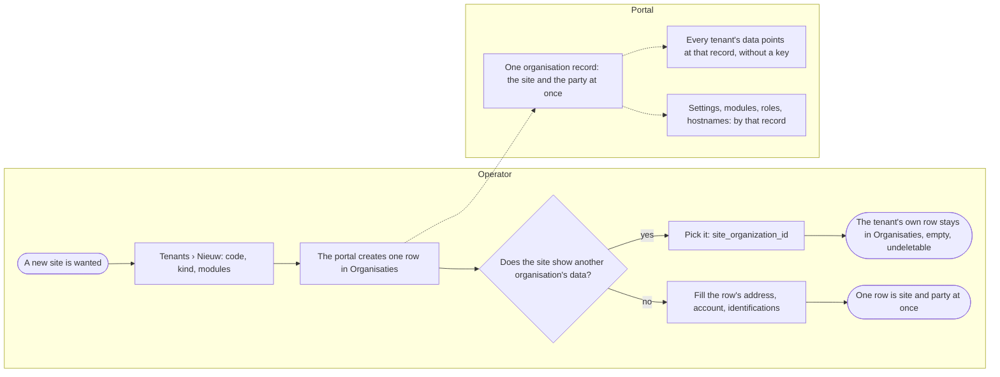
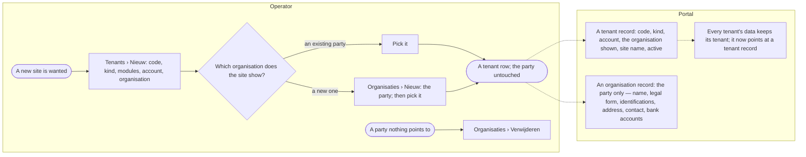
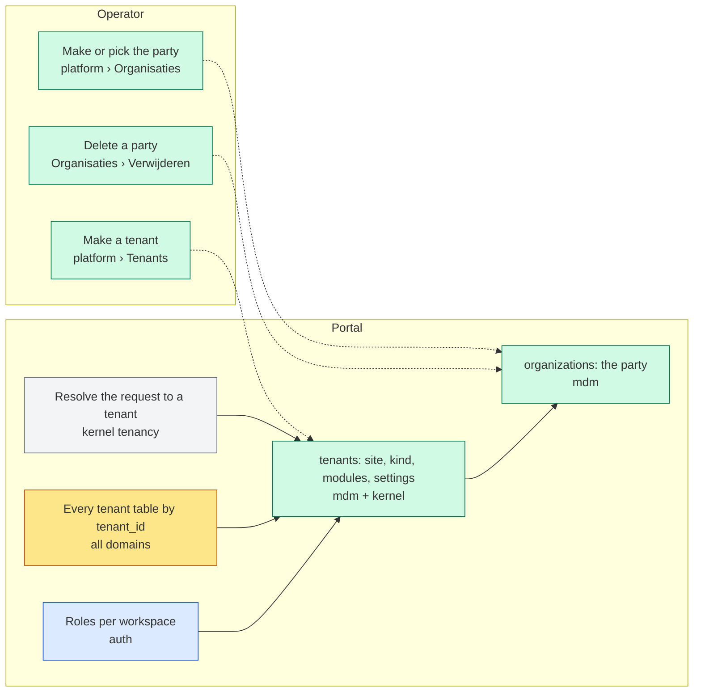
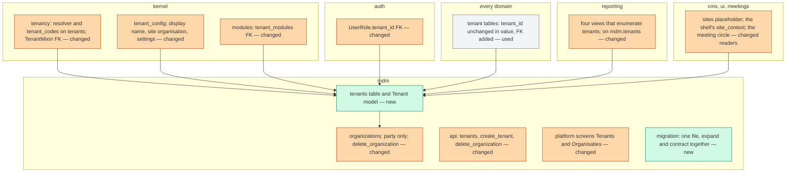
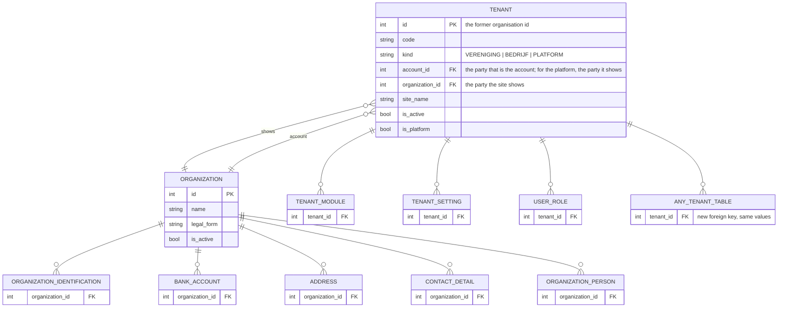

# Change Request 20 — A tenant is its own thing, apart from the organisation whose data it shows

**Project:** Web Portal "Raak Millegem"
**Status:** shaped on 4 October 2026 · decided by Koen on 4 October 2026 (B8 answered: one release) · nothing is built · v2.17 on Koen's word (18 October 2026, to the master CLI's question whether CR-20, CR-26 and CR-34 stay in v2.17 even if the tag comes later or become v2.18: "v2.17"; the assignment to a builder follows the build read) · build read by dev4 on 18 October 2026 against master `d23caea5` (#2020), taken in the same day (B9) · **B8 empty** (18 October 2026: Q7 answered by Koen, "a" — the named exception) · ready for dev4's short re-read
**Tracking issue:** #1578 — the one place where what is open stands; this document is the design, the issue is the status
**Applies to:** the mdm domain (`mdm.organizations` and everything that reads it as a tenant), the kernel's tenancy (`TenantMixin`, the resolver, `kernel_tenant_settings`, `mdm.tenant_modules`), the auth roles per workspace, the platform screens Tenants and Organisaties, the reporting universe; every tenant-scoped table by its key, none by its content.
**Reading:** A 1 535 words · B 3 811 · C 3 571 — measured on 18 October 2026 after the re-read, drawings excluded, tables included; prose alone A 704 · B 1 186 · C 2 500. The budget is A ≤ 1 500, B ≤ 2 500: over in the tables (the requirements, the matrix, the ACs), the prose within it — the form Koen accepted for CR-26, CR-32 and CR-33

---

# Part A — The business

## A1. Reason to act — the trigger

On 4 October 2026, validating v2.13.0 on HDEV, Koen asked "that the tenant really is the tenant, not the organisation". Since CR-19 a tenant's site may show the data of another organisation of its account (#1550): a brand site and the platform of one company each show that company's name, address and account number. But the tenant itself is still a row in the list of organisations, with legal form, identifications and bank accounts nobody fills in; it stands beside the company as if it were a second company, and it cannot be deleted, because deleting it would delete the site. There is no delete for an organisation at all.

One row carries two things: **the tenant** (a site: its code, its kind, its modules, its settings, the name its site shows) and **an organisation** (a party: name, legal form, identifications, address, contact, bank accounts). The ask: pull them apart. A tenant hangs under an account and points to the organisation whose data it shows; an organisation is a party on its own, shared by several tenants when they are the same company, deletable when nothing points to it. The smaller step — hiding such tenants from the list — Koen does not want.

## A2. As-is process — how it works today, and where it hurts

Two actors: the platform operator (who makes tenants and organisations) and the portal. Measured on 4 October 2026 (C1).

What to see in it: one row, two meanings; the second meaning is empty for every tenant that borrows its data, and nothing can remove it.

| # | Step | Today | Pain |
|---|---|---|---|
| 1 | Make a tenant | Tenants › Nieuw writes one organisation record with the role *afdeling*, a code, a kind, the modules | the record is also an organisation |
| 2 | Show whose site it is | the record points at another organisation of the account (#1550); the footer and "Onze organisatie" read that one | the tenant's own record keeps name, legal form, address fields — unused |
| 3 | The list of organisations | every row, tenants included | a brand site and the platform stand next to the company as organisations |
| 4 | Delete | none for an organisation; a tenant's record cannot go because every tenant table points at it | clutter that cannot be cleaned |
| 5 | An account | an organisation record with the role *account*; tenants hang under it | the customer is a party too — that part is right |

## A3. To-be process — how it should work afterwards

What changes, one line each:

- Step 1: a tenant is made as a tenant — code, kind, modules, the account it belongs to, the organisation it shows — and becomes no row in Organisaties.
- Step 3: the list of organisations shows parties only; the list of tenants shows tenants only; a party shows which tenants point at it.
- Step 4: a party nothing points at can be deleted; a party a tenant points at refuses, naming the tenant.
- Step 5: an account stays a party with the role *customer*; a tenant points at it.
- Nothing changes for a member, a visitor or a board member: the sites, the data, the footers and the roles are the same the day after.

The words the user reads: "Tenant", "Organisatie", "Account", "Toont de gegevens van", "Verwijderen" (on an organisation), "Deze organisatie wordt gebruikt door 2 tenants".

## A4. Benefits — what the change earns

- **The model says what things are**: a site is a site, a party is a party; the next feature (invoicing an account, a company with three brand sites) finds its place instead of a workaround.
- **Clean lists**: Organisaties holds organisations; a brand site is not a second company.
- **Delete exists** for a party, with a reason when it refuses.
- **The door CR-19 left open stays open**: an account workspace over its tenants' members is a query over tenants with one account, not a new model.
- Not quantified in money; a model mistake found at the first extra site is cheaper fixed now than after the tenth.

## A5. Supplied material — and what it taught us

- Koen's sentence of 4 October and his model: "a tenant hangs under an account and under an organisation" (relayed by the master CLI).
- #1578 with its six points to measure; #1546 (`site_name`), #1550 (`site_organization_id`), #1569 (the footer page as a page's flag); CR-19 B9's direction (the account is the customer; no data shared across accounts).
- The code behind the organisation record, the tenancy, the settings, the modules, the roles and the platform screens (named per file in C1); the organisation's own docstring already names the three roles.
- The modelling rule in `AGENTS.md`: a party is UBL `cac:Party`; what repeats gets a table; the shape that grows.

## A6. Business requirements — what the board asks, with MoSCoW

| # | Requirement | MoSCoW | Source |
|---|---|---|---|
| R1 | A tenant is its own record — a site with a code, a kind, modules and settings — under an account and pointing to the organisation whose data it shows. | Must | Koen, 4 Oct |
| R2 | An organisation is a party on its own: several tenants may point to one; one that nothing points to can be deleted. | Must | Koen, 4 Oct |
| R3 | The list of organisations shows organisations only; the list of tenants shows tenants only. | Must | #1578 |
| R4 | Nothing a member, visitor or board member sees or does changes; every site keeps its data, address, roles and hostnames. One exception (Koen, 18 Oct 2026, B9): a tenant that had no account becomes its own account, and "Overige" disappears. | Must (limit) | author |
| R5 | An account stays what it is — the customer, a party with that role; tenants hang under it; no data crosses accounts. | Must | CR-19 B9 |
| R6 | The split keeps the door open to an account workspace with access to its tenants' members: the tenants of one account can be listed as such. | Should | CR-19 B9 |
| R7 | The migration runs on PROD in one release, after a checked dump and a tested restore (the expand/contract rule set aside here — B4). | Must | Koen, 4 Oct |
| R8 | Hiding tenants from the list of organisations as a stop-gap. | Won't | Koen, 4 Oct |
| R9 | Invoicing, billing or a customer portal for accounts. | Won't | author |

## A7. Non-functional requirements — security, privacy, house style, tenants

| Concern | This change |
|---|---|
| **Security** | The tenant isolation does not weaken: every tenant table keeps its tenant, which now gets the key it never had (a key across schemas, by the exception of B4); the resolver reads codes from tenants; a role per workspace points at a tenant. The platform screens stay operator-only. |
| **Privacy** | No personal data moves; a party's details stay a party's. Deleting a party is a soft delete like every delete. |
| **House style** | The two platform screens on the kit's list and record layouts of CR-11 when their roll-out comes; nothing new in shape. |
| **Multi-tenant** | This *is* the multi-tenant model: tenant → account (party, role customer) and tenant → organisation (party shown); a company with three sites is one party and three tenants. |

## A8. Acceptance criteria — what the business signs off on HDEV

| # | Criterion | R | Walkthrough steps |
|---|---|---|---|
| AC1 | After the migration every site renders exactly as before: home, footer, "Onze organisatie", roles, hostnames (the rendered HTML and the measurements per tenant compared, as CR-17 test 19 does; a smoke per tenant). | R4 | 6, 7 |
| AC2 | Tenants lists tenants only, with kind, account and the organisation shown; Organisaties lists parties only, each with "gebruikt door n tenants". | R1, R3 | 1, 2 |
| AC3 | A new tenant is made pointing at an existing party; no row appears in Organisaties. | R1 | 3 |
| AC4 | A party nothing points at is deleted; a party a tenant points at refuses with the tenant's name. | R2 | 4 |
| AC5 | Two tenants pointing at one party show the same footer; changing the party's address changes both. | R2 | 5 |
| AC6 | A board member's roles, a member's login and a form's share link work unchanged on each tenant. | R4 | 6 |
| AC7 | Tenants shows the tenants of one account together, the account named once; the platform's sites block lists the same sites per account as before, except that a tenant that had no account stands under its own heading and not under "Overige" (B9). | R6 | 1, 8 |
| AC8 | On HDEV the migration ran as one revision: `alembic current` equals the one head, the deploy's chain check passed, and the restore test of the dump taken before it passed. | R7 | 7 |

---

# Part B — The solution, for whoever approves it

## B1. Solution outline — the solution and the decisions that shape it

A new table **`mdm.tenants`** carries what a site is: `id`, `code`, `kind`, `account_id` (a party with the customer role), `organization_id` (the party the site shows), `site_name`, `is_active`, the platform flag. **`mdm.organizations` becomes the party only**: name, legal form, identifications, addresses, contacts, bank accounts, persons; `org_type`, `code`, `kind`, `site_organization_id`, `site_name` and the platform row leave it — a role is not stored: a party a tenant names as its account *is* an account (CR-26, Koen 15 October 2026, B9). **Every tenant-scoped table keeps its `tenant_id` and its values**: the tenant rows are created **with the same ids** as today's UNIT and PLATFORM rows, so the 79 tenant tables, their 522 references and the 234 migrations change nothing — the column gains the key it never had (a key across schemas, B4). Settings, modules, roles and the resolver point at tenants. One release, one migration (Koen, 4 October 2026): the table, the keys, the drop of the tenant columns and the soft delete of the organisation rows that were borrowed-data tenants, in that order.

Decisions, each with the rejected alternative (the reasoning in C4):

- **Same ids, a new table** (C4.1). Rejected alternative: a new key and a rewrite of every `tenant_id`. The ids are the only thing every table shares; keeping them makes the migration a copy, not a rewrite.
- **The account stays a party; being an account is read from the tenants that name it** (C4.2, C4.7). Rejected alternative: an `accounts` table now, or a role column. Nothing invoices yet; a party that pays is a party (UBL `cac:Party`); an `accounts` table is a row later when billing comes, not a rework; a role column is what CR-26 took out (B9).
- **The platform is a tenant** (C4.3). Rejected alternative: a third thing. The platform has a site, settings and modules — it is a tenant whose kind is PLATFORM and that shows the operator's party.
- **Delete a party by rule, soft** (C4.4). Rejected alternative: cascade. A party referenced by a tenant refuses; its own details (addresses, contacts, accounts, identifications, persons) go with it, soft.
- **Codes and hostnames stay on the tenant** (C4.5). Rejected alternative: on the party. A hostname serves a site.
- **One release, one migration** (C4.6). Rejected alternative: expand/contract over two releases, the project's rule. Koen chose one release; the safety is the checked dump and `raak restore-test` before the deploy, not a redeploy of the previous tag.

### B1.1 Functional analysis — the derived requirements

| # | Derived requirement | From |
|---|---|---|
| F1 | `mdm.tenants (id PK — the former organisation id, code UNIQUE, kind FK tenant_kind_codes, account_id FK organizations NOT NULL — the platform tenant's account is the party it shows (C4.7), organization_id FK organizations NOT NULL, site_name, is_active, is_platform BOOL, created_at, updated_at)`; `tenant_modules.tenant_id` and `kernel_tenant_settings.tenant_id` get FKs to it; `UserRole.tenant_id` too (nullable stays). | R1, R4 |
| F2 | `TenantMixin.tenant_id` gains `ForeignKey("mdm.tenants.id")` on every table **except the `mdm` tables whose `tenant_id` holds a party id today** — `addresses`, `contact_details` and their two history tables: an organisation's rows carry the organisation's own id there (C1, C4.8); those four wait for CR-26 phase 1, which takes them to the account scope; `organization_persons` is **not** in the seam — its `tenant_id` is the tenant of the workspace that wrote the row (`mdm/service.py:539-546`, the mixin default; re-read of 18 October) and it gets the key like every other table — added in the migration as NOT VALID then validated, after the counts of C1. The key crosses a schema, which the schema-boundary gate (`tests/test_schema_boundaries.py`) refuses today: **a named exception** (Koen, 18 October 2026, Q7: "a") — the gate allows a key towards `mdm.tenants` and CR-26's `mdm.parties`, the two identity tables of the kernel, names them in `_is_code_table_of_a_foundation`'s sibling, and keeps refusing `mdm.persons` (its red proof stays). | R4 |
| F3 | `organizations` keeps the party: `name`, `legal_form`, `is_active`, timestamps, `parent_id` dropped (Q3); ~~`org_type` becomes `role` (`CUSTOMER`, `PARTY`) (Q2)~~ **as shaped by CR-26 (party model), 15 October 2026: no `role` column — a role is read from the facts (an order, a tenant that names the party as its account); `org_type` is dropped like the other tenant columns** (Koen, 15 October 2026: "ja op 1" to roles derived from facts; CR-26 B4); `code`, `kind`, `site_organization_id`, `site_name` dropped in the same migration; the `organization_type` code list goes with its only column (`mdm/codes.py`, `ORGANIZATION_TYPE`), `TenantKind`'s `fk_from` moves to `mdm.tenants.kind`. | R2 |
| F4 | The resolver (`tenancy.resolve_tenant`, `tenant_codes()`, `TENANT_HOSTNAMES`) reads tenants; `platform_tenant_id` the tenant with `is_platform`; `tenant_config.site_organization_id` becomes `tenants.organization_id`; `tenant_display_name` and `site_name_default` read the tenant then its party. | R1, R4 |
| F5 | Platform screens: Tenants (list grouped by account, editor with kind, modules, account, organisation shown, site name) on tenants; Organisaties (list, editor, **Verwijderen** with the refusal naming the tenants; *Nieuw* makes a party, no code — C4.7; the Tenants › Nieuw form of this item is built in phase 1, the rest in phase 2, B9) on parties, its segment bar on `org_type` (#1932) goes; the tenant editor offers as account the parties that tenants name plus "nieuwe organisatie", and as shown organisation a party of that account; the department's *Onze organisatie* (`/admin/organisatie`) and `/admin/instellingen` read the tenant's shown party, **editable when the party is nobody's account and no other tenant shows it** — `is_account(party)` is false, this tenant's own account included, and `tenants_showing(party)` is this tenant alone; otherwise read-only, with the line naming where it is edited — the platform's Organisaties. An account's record is the customer's, edited once for every tenant under it, never from a site: that is #1550's case (a brand site showing its account's party, the only tenant under it) and its test stays as it is; a tenant that is its own account edits its record at the platform's Organisaties too (no such tenant on UAT or PROD; sharpened on dev4's question, 19 October, B9) (the intent of #1550's rule, which today reads "the row whose id equals the tenant's" and which no new tenant would ever satisfy); the rights stay CR-24's `PARTY_*` and `SETTINGS_*`; test 16. Rejected: always editable — a department that displays its account's party would then edit the account's record, the case #1550 made read-only (re-read of 18 October, M4). | R1, R3 |
| F6 | `mdm.api`: `tenants()`, `tenant(id)`, `tenants_of_account(party)`, `create_tenant(…)` (writes a tenant, never a party), `create_organization(name)` (a party; `create_account` and its code go), `delete_organization(id)` refusing when a tenant names the party (C4.4), soft-deleting the party row with its organisation and details otherwise, `is_account(party)` (named by a tenant). | R1, R2, R6 |
| F7 | Migration, one file: create tenants from UNIT and PLATFORM rows with the same ids, copy code/kind/site_name/account (= `parent_id`; the platform's = the party it shows)/organisation (= `site_organization_id` or self); repoint the keys of settings, modules and roles; **recreate the four reporting views that enumerate tenants by `org_type` on `mdm.tenants`** (`d_date`, `d_payment_method`, `d_payment_status`, `d_membership_status` — Postgres refuses the drop while they depend on the column); add the mixin keys (F2); rewrite the stored sites placeholder (F10); then drop `code`, `kind`, `site_organization_id`, `site_name`, `parent_id` and `org_type` from organizations, soft-delete the organisation rows of tenants that showed another party — with their own addresses and contacts, and the meeting circle's rows repointed to the party shown by the tenant in their `tenant_id` (F11) — and keep the rows of tenants that were their own party (now the party they show). Measured on a dump before the `VALIDATE`: the `mdm` rows whose `tenant_id` is a party id (C4.8), and the settings and role rows whose id is no tenant. | R7 |
| F8 | The account workspace of CR-19 B9 stays a query: tenants with one `account_id`; no schema reserved for it. | R6 |
| F9 | Reporting: the universe has no organisation folder or dimension (measured, `reporting/universe.py`); the four views that enumerate the tenants read `mdm.tenants` (F7); no saved report changes; no new folder — a tenant folder is new scope (Non-goals). | R4 |
| F10 | The sites placeholder of the page editor, `{{tenants:<code>}}` (#1543), names **a tenant** from now on and lists the sites of that tenant's account; the stored `{{tenants:<account code>}}` is rewritten once by the migration to the code of that account's first active tenant; the editor's legend follows (C4.7). | R4 |
| F11 | The meeting circle hangs on the party **the current tenant** shows: `circle_organization` reads the current tenant's `organization_id` instead of the PLATFORM row (`tenant_service.py:609-637`); the migration repoints each relation row to the shown party of the tenant in its own `tenant_id` (today every row points at the PLATFORM row and carries the department's tenant id, `mdm/service.py:539-546`); the rows keep their ids; the "already in the circle" check of `add_to_circle` includes the organisation, so one person may stand in the circle of two departments. Rejected: the platform tenant's party (the build read's answer, Q10) — under CR-26 a department's persons and the platform's party lie in two accounts, and a relation across accounts is what CR-26 C5 forbids; the account filter would hide the platform's party and every circle screen would say *Er is nog geen organisatie ingesteld* (re-read of 18 October, M1). | R4 |
| F12 | The attribute register (CR-33): the entries of `mdm.organizations.org_type`, `code`, `site_name`, `kind` move to `mdm.tenants` (`code`, `kind`, `site_name`, `is_active`, `is_platform`, `account_id`, `organization_id`, all *intern*), `org_type`'s goes; the labels the two *Nieuw* forms read keep their keys. | R4 |

## B2. Fit with the process and the requirements — for the business

Legend: green mdm · grey kernel · yellow every domain (by key only) · blue auth.

**Traceability matrix**

| R | How the solution meets it | F | Module (C2) | Test (C6) | AC |
|---|---|---|---|---|---|
| R1 a tenant is its own record | a `tenants` table with the same ids; the resolver, settings, modules and roles on it; Tenants on it | F1, F4, F5, F6 | mdm, kernel, auth | 1, 2, 5 | AC2, AC3 |
| R2 a party on its own, deletable | the organisation keeps the party's columns only; a delete that refuses by name | F3, F6 | mdm | 3, 4 | AC4, AC5 |
| R3 two lists | Tenants on tenants, Organisaties on parties | F5 | mdm (screens) | 5 | AC2 |
| R4 nothing changes for a user | the values of `tenant_id` do not move; the readers of the old columns repointed | F2, F4, F7, F9, F10, F11, F12 | kernel, reporting, cms, ui, meetings | 6, 7, 8, 11, 12, 13 | AC1, AC6 |
| R5 the account a party | the account is a party a tenant names; no role column | F1, F6 | mdm | 2 | AC2 |
| R6 the door stays open | the tenants of one account are a query | F6, F8 | mdm | 15 | AC7 |
| R7 one release | one migration, the dump and the restore test before it | F7 | mdm (migration) | 9, 14 | AC8 |
| R8 hiding as a stop-gap | Won't | — | — | — | — |
| R9 invoicing, a customer portal | Won't | — | — | — | — |

**Walkthrough on HDEV** (the operator; a board member for 6):

1. Open Tenants. *See:* the known sites, each with kind, account and "toont de gegevens van"; the platform among them.
2. Open Organisaties. *See:* the parties only — the association, the company, the operator's party; each with "gebruikt door n tenants"; no brand site, no platform.
3. Make a tenant "Noordhoek" under the company's account, showing the company. *See:* a tenant; Organisaties unchanged.
4. Delete the party "Oude Firma" that nothing uses. *See:* gone (soft), with its addresses. Try the company. *See:* refused: "gebruikt door Noordhoek, Firma Zuid".
5. Change the company's address. *See:* both sites' footers follow.
6. As a board member of the association: log in, open the admin, the members, a form's share link. *See:* unchanged.
7. On the server: `alembic current`, the deploy's chain check, the restore test's result, the rendered HTML and measurements per tenant before and after.
8. On the platform's landing page: the sites block lists the same sites under the same accounts as before.

## B3. The whole across the modules — for the architect

Legend: green new · orange changed · grey used.

**Data model at a glance**

Who calls whom: the middleware resolves host → path → default to a tenant through `mdm.api.tenant_codes()`; every domain keeps filtering on `tenant_id`; `tenant_config` reads a tenant's settings and, for the name and the footer, the party it shows; the platform screens call `mdm.api` only. Transaction boundary: the door commits; a tenant's creation is one transaction (the tenant, its modules, its settings seed). Impact: one new table, keys on the 79 tenant tables less the `mdm` seam (F2), two platform screens and the department's two settings screens, the resolver, four reporting views, and three readers of the old columns outside `mdm` — the sites placeholder of `cms` (`cms/render.py`), the shell's `site_context` (`app/ui/__init__.py`, `Organization.kind`/`org_type` by tenant id) and the meeting circle (`meetings/admin_ui.py` through `tenant_service.platform_org`); every other domain changes nothing of its own.

## B3a. Standards the model follows — and where it deviates, on purpose

Standards checked: **UBL 2.1 / EN 16931** for the party (`cac:Party` with `cac:PartyLegalEntity`, `cac:PartyIdentification`, `cac:PostalAddress`, `cac:Contact`, `cac:PayeeFinancialAccount`); **Silverston, The Data Model Resource Book, vol. 1** for the party role; none for a tenant, which is the platform's own concept.

| Concept in this change | Standard and element | Ours | Follows / deviates — why |
|---|---|---|---|
| the organisation | UBL `cac:Party` with `cac:PartyLegalEntity` (`RegistrationName`, `CompanyLegalForm`), repeatable identifications, addresses, contacts, bank accounts | `organizations` with its repeatable tables, the tenant columns gone | follows: the reason the change exists |
| the account | Silverston *Party Role* (customer) | no role stored: a party a tenant names as account | deviates on Koen's word (CR-26 B9, 15 October 2026): a role is read from a fact; a role table is the standard's shape when a role without a fact appears |
| the tenant | none | `tenants`: a site with code, kind, modules, settings, under an account, showing a party | ours: multi-tenancy is not the standards' concern |
| the key from a tenant table to the tenant | relational practice: a foreign key | `tenant_id` with a key to `mdm.tenants` | follows: the schema-boundary gate of the code base gets a named exception for the two identity tables of the kernel (Koen, 18 October 2026, Q7) |

## B4. Rules this change needs an exception from — decided once, here

| Rule (where) | What the design does instead | Temporary until … / the new rule | Decided |
|---|---|---|---|
| No foreign key across schemas except to a code table of `mdm` or `auth` (`tests/test_schema_boundaries.py`, the architecture document) | one named exception: a key may point at `mdm.tenants` and `mdm.parties`, the two identity tables of the kernel; the gate names them and keeps refusing `mdm.persons` (its red proof) | the new rule for those two tables; every other cross-schema key stays refused | Koen, 18 October 2026, Q&A nr. 03 question 1: "a" |
| Expand/contract, one shape per release (#1255) | one migration adds the tenant table and drops the tenant columns from organizations in the same release; the previous tag cannot run on the result | this change only; the rule stands for the next one. Safety: a checked dump and `raak restore-test` before the deploy; the deploy stops instead of rolling back (#1203) | Koen, 4 Oct 2026 |
| "Never modify a merged migration" | one new migration; the old ones that mention organizations stay | the rule applied | — |
| Model on standards: a party is `cac:Party` (AGENTS.md) | the party keeps its repeatable tables; the tenant is not a party | the rule applied, the reason the change exists | — |
| Data operations through the app, never raw SQL | the migration copies rows itself (schema work, not an operation); the soft delete of the old rows runs as a migration step with a count in the log | the rule applied | — |

## B5. Cost — investment and running cost, and what operations must know

| Module | Ph 1 model and migration | Ph 2 screens | Total |
|---|---|---|---|
| mdm (model, api, migration) | 3 | 1 | 4 |
| kernel (tenancy, config, modules) | 2 | — | 2 |
| auth, reporting | 0.5 | 0.5 | 1 |
| platform screens | — | 2 | 2 |
| tests, screenshots, smoke per tenant | 2 | 1 | 3 |
| **Total** | **7.5** | **4.5** | **~12 CLI-days** |

**Running cost:** none. **Operations:** one migration in one release; before the deploy a checked backup and `raak restore-test`; the smoke per tenant (`SMOKE_TENANT`) extended to every tenant's home and footer; no env var — `TENANT_HOSTNAMES` keeps host=code.

## B6. Phasing — shippable phases, and what changes on the failure paths

| Phase | Delivers | Migration | Failure paths that change | Validation |
|---|---|---|---|---|
| **1 — model and migration** | `mdm.tenants` filled with the same ids; the keys (F2); the resolver, settings, modules and roles on tenants; `tenant_config` reads the tenant then its party; the four reporting views on tenants; the sites placeholder, the shell's `site_context` and the meeting circle on the new columns; the tenant columns dropped from organizations and the borrowed-data organisation rows soft-deleted in the same migration; roles and settings whose `tenant_id` is not a tenant deleted, counted per role and per key in the log; a tenant without an account made its own account; **Tenants › Nieuw** in full (F5: the account and the shown organisation, "nieuwe organisatie" as a choice), because after the split no tenant can be created without it | one migration: the additive part first, then the contract part (`NOT VALID` FKs validated in it, proven in the suite and on a copy of the shared development database; the PROD-sized check is read-only counts, and the first run on real data is the UAT deploy with the checked dump and `raak restore-test`; no dump leaves the server, B9) | a request for an unknown code answers as today; a tenant without a party refuses to render with a named error | AC1, AC6 |
| **2 — the screens** | Tenants (grouped by account) and Organisaties on their own records; a party in Organisaties › Nieuw; delete a party with its refusal; "gebruikt door n tenants"; *Onze organisatie* and `/admin/instellingen` editable by the rule of F5 | none | the refusal names the tenants | AC2–AC5, AC7 |

Dependencies: none on other change requests; CR-11's roll-out moves the two screens to the kit's layouts whenever it comes. Both phases ship in one release, the contract part included (Q4, Koen).

## B7. Rule and gatekeeper — what this fixes for all future work

1. **The rule.** *A tenant is a site; an organisation is a party; a tenant-scoped row points at a tenant by a foreign key.* Lives in `docs/architecture.md` A10 (tenancy, since the restructuring of 13 October 2026) and in the organisation's docstring, which today explains the confusion instead of the rule.
2. **Reach and baseline.** 79 tenant-scoped models, 522 references in 60 files outside the tests, no foreign key on any of them (measured 18 October 2026 on `d23caea5`); after phase 1: every one with a key, except the `mdm` seam of F2 until CR-26.

**The gate:** a model with `TenantMixin` whose `tenant_id` has no foreign key is red (test 7, with the seam of F2 as a baseline that only shrinks); a tenant column on `organizations` is red (test 9). No facade gate: no test keeps `create_tenant` the only writer (the import gate checks imports, and `mdm.api` exports the model), and this change claims none.

## B8. Open decisions — what the approver still decides

None (18 October 2026). Koen answered Q1–Q4 on 4 October 2026 (B9, the Q&A log): the same ids, `parent_id` dropped, and everything in one release; Q2's role column was taken out again by CR-26 (B9, 15 October 2026); Q7, the key across schemas, on 18 October 2026: the named exception (B4).

## B9. Decisions log — dated answers

| Date | Decision | By |
|---|---|---|
| 10 Sep 2026 | The three roles of an organisation written down: ACCOUNT the customer, UNIT the tenant, PLATFORM the platform (the model's docstring). | Koen |
| 2 Oct 2026 | CR-19: a tenant has a kind and modules; the account is the customer; a tenant's shown organisation may differ from its account (#1550). | Koen |
| 4 Oct 2026 | "That the tenant really is the tenant, not the organisation": a tenant under an account and under an organisation; the stop-gap (hiding) refused; a change request, not an issue. | Koen, via the master CLI |
| 4 Oct 2026 | *Proposed:* same ids, a new `tenants` table, the party kept, the account a party with a role, the platform a tenant, soft delete by rule, expand/contract over two releases. | author |
| 4 Oct 2026 | Q1–Q4: as proposed — same ids, the role column kept, `parent_id` dropped — **but everything in one release, the contract part included**; the expand/contract rule set aside for this change (B4), as for CR-19. | Koen |
| 15 Oct 2026 | As shaped by CR-26 (the party model): no role column on the party; `org_type` is dropped with the other tenant columns; being an account is read from the tenants that name the party ("ja op 1" to roles derived from facts, CR-26 B9). | Koen, with the architecture CLI |
| 18 Oct 2026 | **Build read taken in** (dev4, #2020, master `d23caea5`): the `mdm` seam out of F2 until CR-26 (blocker 2); the four reporting views recreated before the drop and F9 rewritten (blocker 3); the role column gone everywhere (F3, F7, the ERD, C2, C3, Q2); the account read from the tenants, `create_account` and the account code gone, the sites placeholder on a tenant code (F10); the platform's account NOT NULL, the party it shows; the meeting circle on that party (F11); the editable rule of *Onze organisatie* and `/admin/instellingen` (F5); the register entries (F12); CR-24's rights named; the facade gate claim dropped (B7); C1 re-measured; B3a and the matrix completed; Part A in words. The key across schemas is Koen's: Q7. | the architecture CLI |
| 18 Oct 2026 | Q7, the key across schemas: "a" — one named exception for `mdm.tenants` and `mdm.parties` (Q&A nr. 03 of 18 October 2026, question 1). | Koen |
| 18 Oct 2026 | Release: with CR-26 (the party model) and CR-34 (invoices for the webshop) in v2.17, to "Houd je de drie in v2.17, ook als de tag later komt, of worden ze v2.18, meteen erna?": "v2.17" (in the chat with the master CLI; on #1578). | Koen |
| 18 Oct 2026 | **Short re-read taken in** (dev4, #2020, master `7c389256`, commit `4f8d9c0c`; the form is the architecture CLI's, told to Koen the same day): the meeting circle hangs on the party **the current tenant** shows, not the platform's — under CR-26 a department's persons and the platform's party lie in two accounts (M1; F11, F7, C2 meetings, Q10); `organization_persons` is out of the seam, its `tenant_id` is a real tenant id (F2, C1, C4.8, Q11); the editable rule of *Onze organisatie* is defined: editable when no other tenant shows the party (M4; F5, test 16, Q12); the minors: the B4 row below its separator, this row in its table, two phases in C2, 79 tables in C4.1, A10 in B7. | the architecture CLI |
| 18 Oct 2026 | **Four decisions for phase 1** (#1578, comments of the master CLI). (1) Roles on an account: "1a" — the migration deletes roles and settings whose `tenant_id` is not a tenant and logs the number per role and per key (a role on an account opens nothing today; measured: 0 roles and 0 settings on UAT and PROD, 3 roles on HDEV, test data; the account workspace of CR-19 can bring one back later as a fact on the account); not taken: moving them to the account's departments, a third exception to the key. (2) A tenant without an account: "2a" — it becomes its own account, "Overige" disappears, AC7 and R4 read with that exception (on UAT and PROD every department and the platform already have an account; only the seed and the tests of #1543 and #1525 change). (3) "3 akkoord" — the Tenants › Nieuw form of F5 is built in phase 1, in full; the rest of F5 (the list per account, Verwijderen, "gebruikt door n tenants", the edit rule) stays in phase 2. (4) "4a" — the migration is proven in the suite and on a copy of the shared development database; the PROD-sized check is read-only counts (2 departments, 21 roles, 51 settings, 30 meeting-circle relations, 0 rows that would fail a key); the first run on real data is the UAT deploy, with the checked dump and `raak restore-test` as the safety net; no dump leaves the server. Koen's words: "1a"; "2a, 3 akkoord, 4a". | Koen |
| 19 Oct 2026 | **Built as** (phase 1, PR #2155, master `9ee34b08`, migration 313): (1) no `is_platform` column — `Tenant.is_platform` is a property on `kind`; (2) the register keys of the tenant columns are `mdm.tenant.code`, `.kind`, `.site_name`, `.is_active` (F12 said "keep their keys"); (3) "an organisation of the account" means, until CR-26, that no tenant of another account names it — CR-26 phase 1 moves the check to `parties.account_id`; (4) the Tenants list names the shown organisation for every tenant; (5) a tenant's name in a list is its `site_name`, else the name of the organisation it shows; (6) logged changes name ids, not codes; (7) a refused Tenants › Nieuw shows the form again with what was typed; (8) the platform, when it is its own account, stays off the sites placeholder, as before 313 (#1542, R4). | master CLI |
| 19 Oct 2026 | **Built as**, two findings of dev2's review: the `mdm.tenants` sequence starts past the highest id of organisations and tenants; Tenants › Nieuw checks every input before it writes a new organisation. **Open window until CR-26 phase 1:** an organisation created after 313 can still take an id a tenant carries, and the seam rows (addresses, contacts) on it would then be seen by that tenant. Both ship in v2.17, so the window exists on HDEV only. | master CLI |
| 19 Oct 2026 | **Test 11 built** before the merge (Koen, 18 October 2026, to "Laat ik dev4 test 11 bouwen vóór de merge?": "Ja"): per tenant the header, footer, the sites placeholder with and without a code and the meeting circle render byte-equal before and after 313, with "Overige" (Koen "2a") as the one named exception. | master CLI |
| 19 Oct 2026 | **Delete, phase 2** (dev4's two questions, via the master CLI; the architecture CLI's reading, #1578): (1) *in use* is one thing — a tenant names the party as shown organisation or as account; a relation (`organization_persons`, from CR-26 phase 2 `party_relationships`) is a detail that goes with the party; an order or invoice naming the party as buyer never blocks, since it carries its buyer copy (CR-26 F8) — the rule is defined now, no later phase adds one. (2) Yes: the `mdm.parties` row is soft-deleted with the organisation, in the same transaction — party and row are one-to-one and go together; `delete_person` on master still leaves the party live, one line to add in the phase that first touches it. C4.4, F6, test 4, Q13. | the architecture CLI |
| 19 Oct 2026 | **Editable, sharpened** (dev4's question at phase 2, via the master CLI; the architecture CLI's reading, #1578): the rule of F5 read literally made #1550's case editable — a brand site that alone shows its account's party. The rule gains one word: editable when the party is **nobody's account** (`is_account`, this tenant's own account included) and no other tenant shows it. An account's record is the customer's, edited once at the platform's Organisaties for every tenant under it, never from a site; a tenant that is its own account (none on UAT or PROD) edits there too. Not taken: dev4's "not the account of *another* tenant", which still flips #1550's test, the one-tenant account being that very case. F5, test 16, Q12, Q14. | the architecture CLI |
| 19 Oct 2026 | **Built as** (phase 2, PR #2167, master `d45a87b2`, no migration): Organisaties › **Verwijderen** refuses with the tenants' names when a tenant names the party, otherwise soft-deletes the organisation, its party row and its details in one transaction; `delete_person` takes the person's party and its relations along; *Onze organisatie* follows F5 as sharpened (#1550's test unchanged); the Tenants list keeps its Account column and sorts on it by default (test 15; Koen, 19 October 2026, to "Groeperen we de tenants per account met (a) sorteren op de kolom Account, of met (b) een tussenkop per account?": "a"). Taken in from dev2's review: the "in use" rule stands once, `tenant_service.tenants_naming_each`, read by the list's *Gebruikt door* and by the delete's refusal. Two deviations: (1) *Gebruikt door* counts a tenant once when it names the party both as account and as shown organisation; (2) the delete writes no history row for the organisation, the party, bank accounts, identifications or relations — those tables have no history table (C4.4: "a history row where the table has one"); the audit log carries the delete. Measured on HDEV before the merge: 0 tenants point at a soft-deleted organisation. Open for CR-26 phase 2 (merges second): relations with the party on either end in `delete_organization`. | master CLI, at the merge |

---

# Part C — The build, for the master CLI and the dev CLIs

## C1. Verified premises — measured before the handover

Measured on 4 October 2026 and re-measured by the build read of dev4 on 18 October 2026 against master `d23caea5` (#2020); the counts below are the latter's.

| Claim | Measured how | Result | Consequence |
|---|---|---|---|
| One row carries site and party | `mdm/models.py` `Organization`: `parent_id`, `site_organization_id`, `org_type`, `code`, `name`, `site_name`, `is_active`, `legal_form`, `kind` | true; the docstring itself names the three roles | B1 |
| `tenant_id` has no foreign key anywhere | `kernel/tenancy.py:64-70` (`Column(Integer, nullable=False, index=True, default=_tenant_default)`) | true | F2: the key is new |
| 79 models carry `TenantMixin`; 522 references to `tenant_id` in 60 files outside the tests; 234 migrations | `grep "class .*TenantMixin" domains/*/models.py`; `grep -rn tenant_id app`; `ls alembic/versions` | true on `d23caea5` | same ids or a rewrite (Q1) |
| A cross-schema foreign key is refused | `tests/test_schema_boundaries.py:28-42` (any FK between two schemas, unless to a `*_codes` table of `mdm` or `auth`), `:44-58` (proof that `mdm.persons` stays refused); `user_roles.tenant_id` has no key for that reason (`alembic/versions/127_roles_per_workspace.py:28-29`) | true: F2 as written is red | Q7, B4 |
| Some `mdm` rows carry a party id in `tenant_id` | `mdm/organization_service.py:576-582` writes an organisation's address with `tenant_id = organization_id`; the `ContactDetail` docstring (`mdm/models.py:569-587`): the account organisation's rows carry `tenant_id = 1`, "and tenant 1 is not a tenant" | true for `addresses`, `contact_details` and their two history tables; **not** for `organization_persons`, whose `tenant_id` is the current tenant's (`mdm/service.py:539-546`; re-read of 18 October) — it gets the key; it has no history table | F2's seam, C4.8; count the rows on a PROD-sized dump before the `VALIDATE` |
| Reporting views depend on `org_type` | `reporting.d_date` reads `FROM mdm.organizations o … WHERE o.org_type = 'UNIT'` (`alembic/versions/096_reporting_star_schema.py:57-73`); `_code_list` builds `d_payment_method`, `d_payment_status`, `d_membership_status` the same way (`:185-204`); no later migration redefines them; the universe has no organisation folder (`reporting/universe.py:509-584`) | true: Postgres refuses the drop while a view depends on the column | F7 recreates the four views first; F9 rewritten |
| Readers of `org_type`, `parent_id` and `code` outside the platform screens | `tenant_service.py:340-346, 456-457, 574-600` (`active_sites_by_account`, `list_accounts` by `org_type == ACCOUNT`, `platform_org` by `org_type == PLATFORM`, `create_account` with a code); `ui/tenants_ui.py:425-440, 654-667`; `ui/organisaties_ui.py:315-330` (Organisaties › Nieuw makes an account with a code); `cms/render.py:265, 322` (`{{tenants:<account code>}}` matched on `account.code`; `OrganizationType.PLATFORM`); `ui/__init__.py:1374-1400, 1552-1557` (the shell's `site_context` reads `Organization.kind`/`org_type` by tenant id); `meetings/admin_ui.py:335-616` through `tenant_service.circle_organization` → `platform_org` | true: three readers outside `mdm` and the platform screens | C2 cms, ui, meetings; F10, F11, C4.7 |
| "Editable" on *Onze organisatie* is "the row whose id equals the tenant's" | `ui/organisaties_ui.py:544-551` (`site_organization_id(db, tenant) == tenant`); `/admin/instellingen` at `ui/tenants_ui.py:828-850` behind CR-24's `PARTY_*` and `SETTINGS_*` | true; a new tenant's id never equals its party's after the split | F5 |
| The register of CR-33 names the tenant columns | `mdm/attributes.py:123-178` (entries for `org_type`, `code`, `site_name`, `is_active`, `kind` of `mdm.organizations`); `tests/test_attribute_coverage_gate.py:29, 65` refuses a column without an entry and an entry without a column; the keys label fields in `admin_tenant_nieuw.html:15,18` and `admin_organisatie_nieuw.html:16`; `TENANT_KIND.fk_from` at `mdm/codes.py:225` | true | F12 |
| The platform may hang under an account | `tenant_service.py:298-305, 600-601` (#1542) | true: F1's "NULL for the platform" did not hold | F1: NOT NULL, the party it shows |
| The platform right | `require_platform_operator_ui` is gone; today `require_platform_right(Right.PLATFORM_*)` with `is_platform_workspace` (`auth/session.py:196-219`, `auth/users.py:51-58`) | CR-24 | C2 auth |
| What points at an organisation as a party | FKs: `OrganizationPerson`, `Address.organization_id`, `ContactDetail.organization_id`, `BankAccount`, `OrganizationIdentification`, `parent_id`, `site_organization_id`, `tenant_modules.tenant_id` (CASCADE) | eight; no `OrganizationHistory` | F3, C4.4 |
| What uses the organisation as a tenant | `kernel_tenant_settings.tenant_id`, `tenant_modules.tenant_id`, `UserRole.tenant_id` (nullable), `TENANT_HOSTNAMES` host=code, `tenant_codes()` from UNIT rows (`mdm/tenant_lookup.py:29`), `platform_tenant_id`, `tenant_config` (33 functions by tenant id) | true | F1, F4 |
| No delete for an organisation | no `delete_organization` in `mdm/api.py` or service | true | F6 |
| The account is an organisation with `org_type = ACCOUNT`; tenants hang under it by `parent_id` | `OrganizationType` codes ACCOUNT · UNIT · PLATFORM; `tenants_ui` `account_id` = `parent_id` | true | C4.2 |
| `site_name` (#1546) and the footer page flag (#1569) are on master | `organizations.site_name`; `cms_pages.show_in_footer` | true | F1 carries `site_name`; the footer flag is the page's, untouched |
| *To measure at phase 1*: the time to add and validate the keys at the UAT deploy, on the checked dump (read-only counts on PROD, no dump leaves the server, B9); the count of `mdm` rows whose `tenant_id` is a party id; the settings and role rows whose id is no tenant; the addresses and contacts of the rows to be soft-deleted | `raak restore-test` + the migration; counts, no identities | — | the deploy window; F7 |

## C2. Per module: what must happen

#### mdm (phases 1–2)

- **Model:** `Tenant` (`mdm.tenants`) per F1; `Organization` loses its tenant meaning and its tenant columns in phase 1; `TenantKind` moves to the tenant; `OrganizationType` and its code list go (no role column, B9 15 October); the `Organization` docstring states the rule of B7; `mdm/CONTRACT.md`'s E24 line follows.
- **Facade (`api.py`):** `tenants()`, `tenant(id)`, `tenant_by_code(code)`, `tenants_of_account(party)`, `platform_tenant_id()`, `create_tenant(code, kind, account_id, organization_id, site_name, modules)`, `set_modules` unchanged in signature, `organizations()` (parties only), `create_organization(name)` (replaces `create_account`; no code), `is_account(party)`, `accounts()` (the parties tenants name), `delete_organization(id)` → refuses with the tenants' names when referenced, soft-deletes the party and its details otherwise; `active_sites_by_account` groups by `tenants.account_id`; `circle_organization` reads the platform tenant's party (F11).
- **Migration:** one file, `alembic revision -m \"tenants apart from organisations\"` — create `mdm.tenants`; insert from organizations where `org_type IN ('UNIT','PLATFORM')` with the same `id`, `code`, `kind`, `site_name`, `is_active`, `account_id = COALESCE(parent_id, site_organization_id, id)`, `organization_id = COALESCE(site_organization_id, id)`, `is_platform = (org_type = 'PLATFORM')`; `SELECT setval` on the sequence; recreate the four reporting views on `mdm.tenants` (F7); add the keys on `tenant_modules`, `kernel_tenant_settings`, `auth user_roles` (nullable) and on every `TenantMixin` table except the seam of F2, as `NOT VALID` + `VALIDATE CONSTRAINT` ; the mixin declares the key; rewrite the stored `{{tenants:<account code>}}` to the first active tenant's code (F10); then, in the same file, drop `code`, `kind`, `site_organization_id`, `site_name`, `parent_id` and `org_type` from organizations, drop the `organization_type` code table, soft-delete the borrowed-data organisation rows with their own addresses and contacts (log the counts) and repoint the meeting circle's `organization_persons` rows of a soft-deleted platform row to the party it showed. Check the CHECK constraints on `organizations` first (the `media_assets.kind` lesson).
- **Screens** (`app/ui/`): `tenants_ui.py` (list grouped by account, editor, nieuw; `/admin/instellingen` editable by F5's rule) on `Tenant`; `organisaties_ui.py` (list with "gebruikt door n tenants" and without the `org_type` segment bar, editor, *Nieuw* as a party without a code, Verwijderen with the refusal; *Onze organisatie* editable when the party is the tenant's own) on parties; the tenant editor's account select lists `accounts()` plus "nieuwe organisatie", its organisation select the account's parties plus "nieuwe organisatie"; the rights stay CR-24's (`PLATFORM_MANAGE`, `PARTY_*`, `SETTINGS_*`).
- **Tests:** C6 1–5, 9, 15.

#### kernel (phase 1)

- `tenancy.py`: `TenantMixin.tenant_id` with `ForeignKey("mdm.tenants.id")`, the seam tables of F2 declaring their column without it until CR-26; `tenant_codes()` from tenants; the hard-coded fallback map keyed the same; `resolve_tenant` unchanged in logic.
- `tenant_config.py`: `_organisatie()` → the tenant's shown party; `site_organization_id()` → `tenants.organization_id`; `tenant_display_name`, `site_name_default` read the tenant then the party; settings keyed by tenant id as today.
- `modules.py`: `tenant_modules.tenant_id` FK to tenants; DEFAULTS per kind read the tenant's kind.
- **Tests:** C6 6, 7, 8, 14.

#### auth (phase 1)

- `UserRole.tenant_id` gets the key (nullable stays for platform-wide roles); `is_platform_workspace` and `require_platform_right(Right.PLATFORM_*)` (CR-24; `auth/session.py:196-219`, `auth/users.py:51-58`) read the platform tenant's flag.

#### reporting (phase 1)

- The four views that enumerate tenants (`d_date`, `d_payment_method`, `d_payment_status`, `d_membership_status`) are recreated on `mdm.tenants` in the migration, before the drop; the universe has no organisation folder and gains none; no saved report changes.

#### cms, ui, meetings (phase 1)

- `cms/render.py`: `_SITES` and `_site_groups` take a tenant code and list the sites of that tenant's account (F10); `sites_in_words` and the editor's legend say so; `OrganizationType.PLATFORM` becomes the tenant's `is_platform`.
- `app/ui/__init__.py` (`site_context`): the tenant's `kind` and platform flag from `mdm.tenants`.
- `meetings/admin_ui.py`: unchanged in code; `tenant_service.circle_organization` returns the current tenant's shown party (F11); `add_to_circle`'s duplicate check includes the organisation.

#### every other domain

- Nothing in code; the key arrives through the mixin. Their tests run as they are: a test that creates a row with an arbitrary `tenant_id` now needs a tenant — the test seed makes the tenants (C6 10).

## C3. Cross-cutting impact — the checklist of what gets forgotten

| Row | Answer |
|---|---|
| Reporting views and saved reports | yes — four views enumerate the tenants by `org_type` and are recreated on `mdm.tenants` before the drop (F7); no folder changes, no saved report changes |
| Existing tests, e2e flows, screenshots | yes — every test that writes a `tenant_id` needs a tenant row (the seed); the e2e seed makes tenants; the rendered HTML and the measurements per tenant before and after (AC1, test 11); `mdm/tests/test_tenant_modules.py` and the tests of #1932's segment bar change |
| Fixed UI decisions, `AGENTS.md` | the tenancy part of `docs/architecture.md` (A10 since the restructuring of 13 October 2026); `AGENTS.md`'s "Rollen" line on tenants unchanged |
| Design-system documentation | no |
| Code lists | `tenant_kind` moves to the tenant (`fk_from` → `mdm.tenants.kind`); `organization_type` goes with its column (B9 15 October) |
| Attribute register (CR-33) | the entries of the tenant columns move to `mdm.tenants`, `org_type`'s goes (F12); the coverage gate is red until they do |
| Page content | the stored `{{tenants:<account code>}}` is rewritten once to a tenant code (F10); the editor's legend follows |
| Events and handlers | no; `tenant_id` on an event payload keeps its value |
| Mail templates | the footer and signature read the party through the tenant — same output |
| Migration: additive or contract | both in one migration and one release (Koen, 4 Oct 2026; B4); the checked dump and the restore test come first |
| Tenant settings | keyed by tenant id as today; no key changes |
| Env vars | none; `TENANT_HOSTNAMES` unchanged (host=code) |
| JSON routes and API callers | none: no `/api/v1/tenants` exists (#1251) |
| External services | no |
| PROD data | the migration copies a handful of rows and validates the keys on the tenant tables; the counts of F7 on a dump first; `raak restore-test` first; the deploy stops, not rolls back, on a failed migration (#1203) |

## C4. Detailed decisions — one subsection each, with the reasons

### C4.1 Same ids, a new table

The only thing every tenant table shares is the integer in `tenant_id`. A new key would mean rewriting that integer in 79 tables, every history row and every event payload, and keeping a mapping during the switch. Creating `mdm.tenants` **with the same ids** as the UNIT and PLATFORM rows makes the migration a copy of a handful of rows and the addition of a key; the values do not move. `tenants` has a sequence of its own, set past the highest copied id; from then on a tenant id and a party id are keys of two tables and nothing relates them — the equality held only at the copy, and no reader may lean on it (F5's old editable rule did).

### C4.2 The account stays a party; no role column

An account pays and receives the invoices (CR-19 B9): that is a party, UBL's `cac:Party` with `cac:PartyLegalEntity`, identifications and bank accounts — all tables the party already has. A separate `accounts` table today would carry nothing the party does not; when billing comes, an invoice points at a party, and an `accounts` table — if ever — is one row per customer party. The role is not stored either (Koen, 15 October 2026, CR-26 B9: roles are read from facts): a party is an account because a tenant names it as its account (`tenants.account_id`), and `mdm.api.is_account(party)` says so. What that costs: an account cannot exist before its first tenant — and does not need to: Tenants › Nieuw takes an existing party or makes one (C4.7).

### C4.3 The platform is a tenant

The platform has a hostname, settings (sender, keys), modules and a landing page: everything a tenant has, nothing a party has. It becomes the tenant with `is_platform` and kind PLATFORM, showing the operator's party as the organisation behind it. `platform_tenant_id()` reads that flag.

### C4.4 Deleting a party

**In use means: a tenant names the party**, as its shown organisation or as its account — nothing else. Such a party refuses with the tenants' names: the user sees why. Every other pointer at the party is either a detail that goes with it or a fact that stands on its own: a relation (`organization_persons` today, `party_relationships` from CR-26 phase 2 — who acts for it, who sits on its board) is a detail and is soft-deleted with the party; an order or, later, an invoice that names the party as buyer (`sales_orders.buyer_party_id`, CR-26 F8) never blocks, because the order carries its buyer copy for exactly this — the party may change or go and the order still says who bought. One rule, no later phase adds to it (the architecture CLI's reading, 19 October 2026, B9). A party nothing names is soft-deleted together with its details — addresses, contacts, bank accounts, identifications, relations — **and its `mdm.parties` row itself**: the party and its one organisation (or person) row are one-to-one and live and die together, in one transaction; a live party whose row is gone would be a pointer at nothing. The same holds for `delete_person`, which on master leaves the person's party live (`mdm/service.py:1894-1935`): one `soft_delete` of the party there, in the phase that first touches it. Every delete is soft, as in the whole portal; a history row records who where the table has one (the party and the organisation have none today; the audit log carries the delete). No cascade through foreign keys: the facade decides, the key only guards.

### C4.5 Codes and hostnames on the tenant

`TENANT_HOSTNAMES` maps a host to a code; a code names a site. Both belong to the tenant. A party has no code: it has identifications (enterprise number, VAT) in their own table, as the standard says.

### C4.6 One release, by decision

The project's rule is expand/contract: the old columns survive one release so a rollback is a redeploy of the previous tag. Koen chose one release for this change (4 October 2026), as he did for CR-19: the migration that creates the tenants also drops the tenant columns from `organizations` and soft-deletes the organisation rows that were borrowed-data tenants (the brand site, the platform); the rows of tenants that were their own party stay, as the party they show. What replaces the rollback: a checked dump and `raak restore-test` before the deploy, a deploy that stops instead of rolling back (#1203), and the per-tenant screenshot comparison on HDEV before the tag. B4 records the exception; the rule stands for the next change.

### C4.7 What `parent_id` and `code` did, and what replaces them

Today `parent_id` says which account a tenant belongs to, `code` names a tenant *and* an account (`create_account` gives an account a code, and the page editor's `{{tenants:<account code>}}` lists an account's sites by it), and `org_type == ACCOUNT` lists the accounts for the tenant editor. After the split: the account of a tenant is `tenants.account_id`; the accounts are the parties tenants name (`accounts()`); an account has no code — a party has identifications, not codes (C4.5) — so the sites placeholder names a **tenant** and lists the sites of that tenant's account, and the migration rewrites the stored parameter once (F10). Organisaties › Nieuw makes a party; Tenants › Nieuw makes a tenant and names its account. The platform tenant's account is the party it shows (the operator's own organisation): #1542 already let the platform hang under an account, so `account_id` is NOT NULL for every tenant, and CR-26's "the platform tenant is its own account" is this same row.

### C4.8 The `mdm` seam: rows whose `tenant_id` is a party id

An organisation's addresses and contacts are written with `tenant_id = organization_id` (`organization_service.py:576-582`), and the account organisation's contact rows carry `tenant_id = 1`, which the `ContactDetail` docstring itself calls "not a tenant". `mdm.tenants` holds site ids only, so a key from those tables to it cannot be validated, and every later party address would fail on it. CR-26 phase 1 ends this: the four tables leave the tenant scope for the account scope together with the persons and organisations they hang on, an organisation's rows taking the account of the organisation's party (CR-26 F1), and `tenant_id` disappears from them. `organization_persons` is not in the seam: its `tenant_id` is the tenant of the workspace that wrote the row (`mdm/service.py:539-546`), so it carries the key from this change on (re-read of 18 October). Until then `addresses`, `contact_details` and their two history tables declare `tenant_id` without the key (F2), test 7 carries them as a baseline that only shrinks, and the migration counts them on a dump (F7). Rejected: rewriting those rows to a tenant id now — there is none that is right (an organisation belongs to an account, not to a site), and CR-26 would undo it a release later.

## C5. Privacy and security — the mechanics behind A7

Tenant isolation rests on `tenant_id`; this change gives that column the foreign key it lacked, so a row can no longer carry a tenant that does not exist. The resolver's input (host, path) and its output (a tenant id) do not change. Roles per workspace point at tenants. A soft-deleted party's data stays in the database as every soft delete does; a party is organisation data, not personal data, except the persons linked to it (`organization_persons`), which are references, not copies.

## C6. Tests — what the build must prove

1. **A tenant is a tenant.** `create_tenant` writes a row in `mdm.tenants` and none in `mdm.organizations`; the tenant points at an existing party.
2. **The account is a party a tenant names.** A tenant's `account_id` references a party; `is_account(party)` is true for a party a tenant names and false for one none does; `accounts()` lists exactly those; no role column exists on `organizations` (introspection).
3. **Delete refuses with names.** `delete_organization` on a party used by two tenants raises with both names; the party stays.
4. **Delete is soft and complete.** On an unused party: the `mdm.parties` row, the organisation and its addresses, contacts, accounts, identifications and relations carry `deleted_at`; a history row where the table has one; nothing hard-deleted. A party only an order names as buyer is deleted, and the order still renders its buyer copy.
5. **Two lists.** Tenants lists no party; Organisaties lists no tenant; "gebruikt door n tenants" counts right.
6. **The resolver.** Host, path prefix and default resolve to the same tenant ids as before the migration (a table of hosts and codes from the seed, asserted before and after).
7. **The key exists.** Every model with `TenantMixin` has a foreign key on `tenant_id` to `mdm.tenants` (introspection), except the seam of F2, named in a baseline that only shrinks; red on master today. The schema-boundary gate names `mdm.tenants` and `mdm.parties` as the two allowed targets and still refuses `mdm.persons` (its existing proof).
8. **Settings, modules, roles.** A tenant's settings, modules and roles read unchanged after the migration (a snapshot of the seed before, compared after).
9. **Contract.** After the migration no tenant column exists on `organizations` (introspection); the borrowed-data rows are soft-deleted and counted.
10. **The seed.** The test seed creates tenants and parties; a test writing a `tenant_id` that no tenant has fails on the key (proven by one).
11. **Screens unchanged.** The rendered HTML and the measurements of every tenant's home, footer and admin menu are identical before and after phase 1 (the comparison of CR-17 test 19, reused; screenshot bytes are not compared).
12. **The views.** After the migration `d_date` and the three code-list dimensions list exactly the tenants of `mdm.tenants`; `org_type` is gone (introspection); red when the views are not recreated first (the migration fails on the drop).
13. **The sites placeholder.** `{{tenants:<tenant code>}}` lists the sites of that tenant's account; a stored `{{tenants:<account code>}}` is rewritten by the migration and renders the same cards as before (a page fixed before, compared after).
14. **The seam.** The migration's count of `mdm` rows whose `tenant_id` is no tenant is logged; no key is declared on the seam tables; a party address written after the migration is accepted (red if the key were on them).
15. **The tenants of an account.** `tenants_of_account(party)` returns the tenants that name it and no other; the Tenants list groups by it.
16. **Editable.** *Onze organisatie* at a tenant that alone shows a party that is nobody's account renders the form under `PARTY_EDIT`; at a tenant whose shown party another tenant also shows, and at a tenant that shows an account's party — its own account included, the only tenant under it (#1550's `test_onze_organisatie_shows_the_account_read_only`, unchanged) — it renders read-only with the line, and a POST is refused; the platform's Organisaties edits that party (F5).

**Impact on the test landscape:** every domain's tests that insert rows with a bare `tenant_id` run on the seed's tenants; the mdm and tenancy tests change; the e2e set gains the per-tenant comparison.

## C7. The gate — what refuses a deviation from now on

Test 7 is hard from phase 1: a `TenantMixin` model without the foreign key is red, the seam of F2 excepted by a baseline that only shrinks. Test 9 is hard from the same release. No facade gate is claimed (B7). What stays with judgment: whether a new thing is a tenant, a party or a role on a party — decided in this document's Q&A.

## C8. Prototype findings — what was measured before the build

Measured on 4 October 2026 and re-measured by the build read on `d23caea5` (18 October 2026): the organisation row with its two meanings (C1); 79 tenant models without a key; the eight tables pointing at a party; no delete; the four reporting views on `org_type`; the `mdm` rows with a party id in `tenant_id`. To measure at phase 1, at the UAT deploy on the checked dump (B9): the time of `VALIDATE CONSTRAINT` on the largest tenant tables (registrations, payments, history), so the deploy knows its window; the counts of F7.

## C9. Screens before the build — the concepts the approver saw

Waived in the author's proposal: the two platform screens are a list and a record on the existing kit, with one new column each and one delete; the refusal text is in A3. Koen decides whether a concept is wanted.

## C10. Close-out at the release

Not yet: on hold, nothing built. Filled in when the release runs on PROD (release step 14).

---

## Q&A log — asked once, answered here

| # | Date | Question (who) | Answer |
|---|---|---|---|
| Q1 | 4 Oct 2026 | Keep the organisation ids as the tenant ids? (author) | Yes (Koen, 4 Oct 2026; C4.1). |
| Q2 | 4 Oct 2026 | What becomes of `org_type` on the party? (author) | A role column, CUSTOMER or PARTY (Koen, 4 Oct 2026) — **superseded** on 15 October 2026 by CR-26 (roles from facts, "ja op 1"): the column is dropped, an account is a party a tenant names (C4.2). |
| Q3 | 4 Oct 2026 | Keep `parent_id` on the party? (author) | Dropped, in the one migration (Koen, 4 Oct 2026). |
| Q4 | 4 Oct 2026 | Phases 1 and 2 in one release? (author) | Yes — and the contract part with them: everything in one release (Koen, 4 Oct 2026; C4.6, B4). |
| Q5 | 4 Oct 2026 | Why not the smaller step (hide tenants from the list)? (master CLI) | Koen refused it: it hides the symptom and keeps the row that cannot be deleted. |
| Q6 | 4 Oct 2026 | Does the split close the door to an account workspace (CR-19 B9)? (#1578) | No: the workspace is a query over tenants with one `account_id`; the model needs nothing reserved. |
| Q7 | 18 Oct 2026 | The key across schemas: a named exception for `mdm.tenants` and `mdm.parties`, or a soft reference? (build read, blocker 1; Q&A nr. 03 of 18 October 2026, question 1) | "a" (Koen): the exception, B4. |
| Q8 | 18 Oct 2026 | Without `parent_id` and `code`, what says which party is an account and lists an account's sites? (build read) | The tenants that name it; the sites placeholder names a tenant; an account has no code (C4.7). The architecture CLI's reading, in the document's form. |
| Q9 | 18 Oct 2026 | May `tenants.account_id` be NULL for the platform? (build read) | No: the platform's account is the party it shows (#1542 already hangs it under one); CR-26 reads the same row (C4.7). |
| Q10 | 18 Oct 2026 | Where does the meeting circle hang once the PLATFORM row is gone? (build read) | On the party the **current tenant** shows (F11); the rows keep their ids, each repointed to the shown party of its own tenant. The build read's answer was the platform tenant's party; dev4's re-read (18 October, M1) showed that it crosses accounts once CR-26 is built. |
| Q11 | 18 Oct 2026 | Where do the `mdm` rows whose `tenant_id` is a party id go? (build read, blocker 2) | Nowhere yet: `addresses`, `contact_details` and their history tables stay without the key until CR-26 phase 1 moves them to the account scope, an organisation's rows to its party's account (C4.8). `organization_persons` turned out not to be in the seam (re-read, 18 October): it gets the key. |
| Q12 | 18 Oct 2026 | When may *Onze organisatie* edit the party the tenant shows? (re-read, M4) | When no other tenant shows it; otherwise read-only with the line, edited in the platform's Organisaties (F5, test 16). The architecture CLI's reading, told to Koen the same day. Sharpened on 19 October (Q14): and the party is nobody's account. |
| Q13 | 19 Oct 2026 | When is a party "in use" so that Verwijderen refuses, and is the `mdm.parties` row soft-deleted with the organisation? (dev4, phase 2) | In use = a tenant names it (shown or account); relations go with it as details; a buyer pointer on an order never blocks (the buyer copy). Yes, the party row goes with its organisation, in one transaction (C4.4). The architecture CLI's reading. |
| Q14 | 19 Oct 2026 | Is *Onze organisatie* editable at a tenant that alone shows its own account's party? (dev4, phase 2; #1550's test case) | No: an account's party is read-only on every site, its own tenant included; editable only when the party is nobody's account and this tenant alone shows it (F5, test 16). The architecture CLI's reading. |

## Non-goals — deliberately outside this change

- Invoicing, billing, a customer portal (R9).
- The account workspace itself (R6 keeps the door open; nothing built).
- Hiding tenants from the list as a stop-gap (R8).
- Changing any domain's own tables or screens beyond the key.
- The kit's layouts for the two platform screens (CR-11's roll-out).
- A tenant folder in the reporting universe: new scope, asked for by nobody.

## Relationship to existing work — issues and change requests

- **#1578** — the tracking issue of this change.
- **CR-19 (#1468)** — kinds and modules per tenant; the shown organisation (#1550); `site_name` (#1546); the direction on accounts (B9); this change gives those a home.
- **#1569** — the footer page as a page's flag, untouched.
- **#406, #854, #963** — the tenancy phase, the platform row, roles per workspace: the three steps that put the tenant on the organisation row.
- **#1255** — expand/contract, set aside for this change (B4).
- **AGENTS.md, "Modelleer op standaarden"** — the party as `cac:Party`; the reason the organisation keeps its repeatable tables and loses the tenant.
