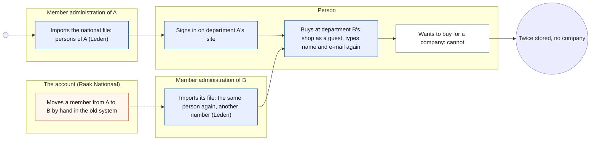
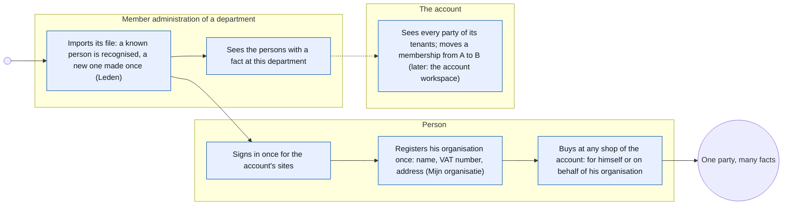
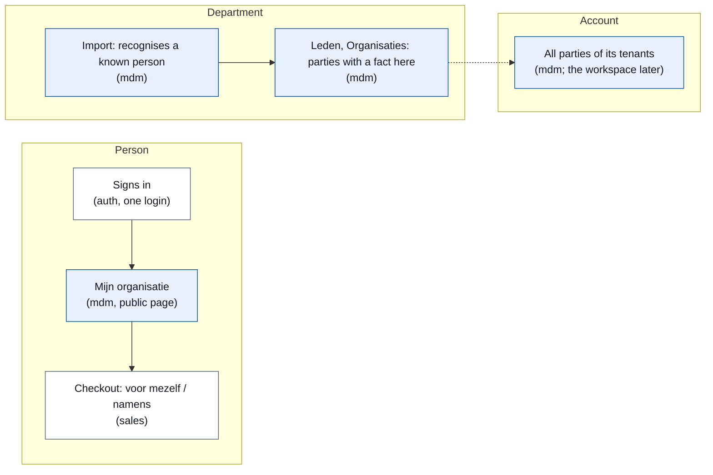
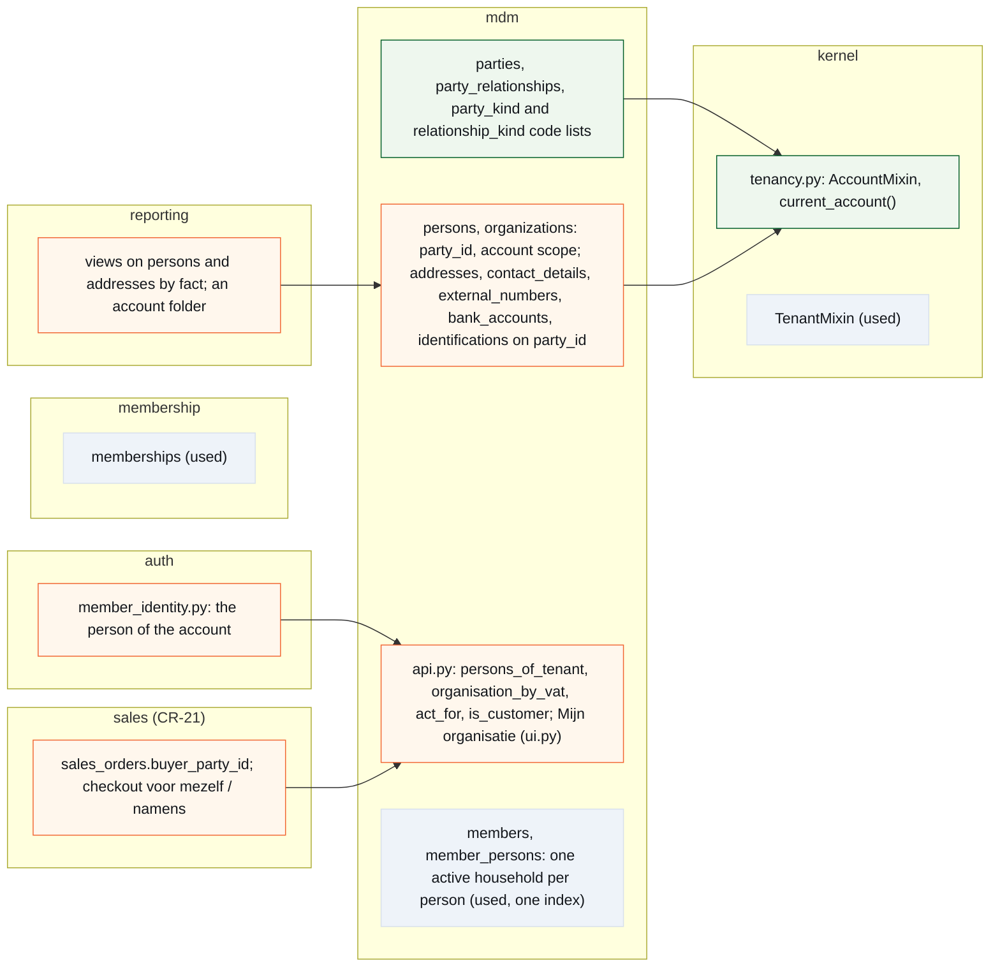
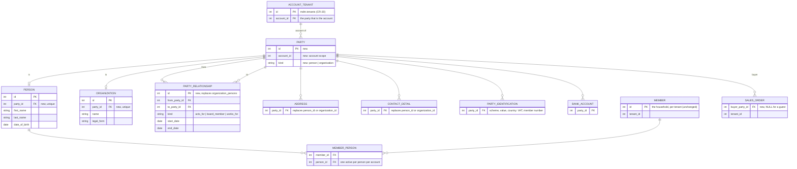

# CR-26 — The party model: one person and one organisation per account, the facts per tenant

**Status:** shaped on 15 October 2026 by the architecture CLI with Koen (Q&A nr. 05 of 15 October 2026, nine questions and a tenth answered the same day) · depends on CR-20 (tenant apart from organisation, #1578), decided and not built · not assigned to a release · build read not yet asked
**Tracking issue:** #2020 — the one place where what is open stands; this document is the design, the issue is the status
**Applies to:** `mdm` (persons, organisations, households, addresses, contacts, identifications, bank accounts: the party and what hangs on it), the kernel's tenancy (an account scope beside the tenant scope), `auth` (who a sign-in is), `membership` (one household at a time), `sales` (the buyer of an order, CR-21), the public account pages (*Mijn organisatie*), reporting (the views on persons and addresses)
**Reading:** A 1 894 words · B 3 641 · C 3 482 — measured on 15 October 2026, drawings excluded, tables included; prose alone A 826 · B 1 545 · C 2 454. The budget is A ≤ 1 500, B ≤ 2 500: over budget in the tables (the requirements, the traceability matrix, the standards table, the decisions log), the prose within it; Koen accepted the same for CR-32 and CR-33

---

# Part A — The business

## A1. Reason to act — the trigger

The platform has no notion of *who* that holds across its screens. A member is a person in a household of one department; an organisation is a row that until CR-20 is also a tenant; a buyer in the webshop is a person or three guest fields; a company cannot buy at all, and CR-34 (invoices for the webshop) needs a buyer with an address and a VAT number. Every table that points at "someone" has two columns, person or organisation, and the next one would get the same two. Koen, 15 October 2026: *"Ik zou met jou graag de party change request vormgeven om dat fundament eindelijk juist te zetten."* And on 15 September 2026, after `Organization` had to be reworked (#924): *"Ik had achteraf gezien ook liever met de 'party' gewerkt."*

The decision that shapes everything else came in the same conversation. Persons are stored per department today, as Raak Nationaal's own system does: a member of two departments exists twice, with two member numbers, and nobody knows it is one person. Koen: *"de natuurlijke persoon en de organisatie zouden niet mogen verdubbeld worden … Je kan wel maar van één afdeling lid zijn."* So a person and an organisation exist **once per account** (the customer of the platform: Raak Nationaal, iX), and what is per tenant is the **fact**: a membership of one department, an order at one shop, a role in one organisation.

## A2. As-is process — how it works today, and where it hurts

<!-- figure: name=cr26-as-is caption=Today_a_person_is_made_again_at_every_department_and_a_company_cannot_buy -->

*What to see:* the same person is a row per department and a guest in every shop; the company buyer has no step at all.

| Step | Who | Today | Pain |
|---|---|---|---|
| A person becomes a member | the department, from the national file | one `persons` row per tenant, with the member number of that department | a member of two departments is two rows; a move is a deactivation and a new row |
| A person signs in | the person | one login for the platform (`auth.users`, no tenant); the person is found per tenant by e-mail | at a second tenant of the same account the login finds nobody and the person types everything again |
| A person buys | the person | `sales_orders.person_id` or three guest columns | a guest is never the same person twice |
| A company buys | nobody | not possible | CR-34 (invoices for the webshop) has no buyer with a VAT number |
| An organisation is kept | the operator | `mdm.organizations` is the tenant tree until CR-20; address and contact point at it with a second column | every "someone" table carries person-or-organisation twice |
| A relation person ↔ organisation | the operator | `organization_persons` (relation type, period) | one relation kind; a contact person of a customer has no home |
| The account sees its members | Raak Nationaal | not in the platform; in the old system, all members of all departments | the platform has no account scope at all |

## A3. To-be process — how it should work afterwards

<!-- figure: name=cr26-to-be caption=Afterwards_a_person_exists_once_per_account,_signs_in_once,_and_acts_for_an_organisation -->

*What changes:* the second row disappears (one party per account), the guest at a second shop disappears (the sign-in knows him), and the company gets a step: a person registers it once and buys on its behalf.

**The words the user reads** (Koen, Q&A nr. 05 question 8 and 13 October 2026): *persoon* and *organisatie*; an organisation shows its **rechtsvorm** (vzw, bv, eenmanszaak, feitelijke vereniging) in the record's head; the role of an organisation towards the platform is **Account** (Koen's word of 13 October 2026) or *Afdeling*/*Platform* as the tenant kinds say. The word *partij* appears nowhere on a screen; it is the model's word. New on the public side: **Mijn organisatie** (register and edit the organisation one acts for) and in the checkout **voor mezelf** / **namens …**; the sign-in stays *Aanmelden*.

## A4. Benefits — what the change earns

- **One person, once**: a member who moves or joins a second shop is not typed again; the account sees one person with one history.
- **A company can buy and be invoiced**: CR-34 gets a buyer with name, address and VAT number from the organisation's record, not from a form on the order.
- **The next "someone" costs one column**: an invoice recipient, a sponsor, a supplier point at a party; no third pair of columns, no CHECK.
- **The account is real**: what CR-19 B9 called the account workspace (the customer that pays, sees across its tenants) has the data model it needs.

## A5. Supplied material — and what it taught us

- **The Q&A of 13 October 2026 (nr. 03, questions 2–6)** and **of 15 October 2026 (nr. 05, questions 1–10)**, in Koen's project folder: Koen's answers and his context on Raak Nationaal's system (persons per department, a member of two departments twice, a move as deactivate-and-activate, no national register number so no dedup, member pricing between departments not fixed and out of scope).
- **CR-20 (tenant apart from organisation)**: decided 4 October 2026, not built; it gives the tenant its own table with an `account_id`, and leaves the organisation as the party. This change builds on it and changes one of its rows (B4).
- **CR-21 (webshop)** on its build branch: `sales_orders` with `person_id` and three guest columns; the shop is where the company buyer first appears.
- **CR-34 (invoices for the webshop)**, shaped by the design-documentation CLI on 15 October 2026: its C4.10 carries the cut this change delivers in phase 2.
- **Measurements on master @ `39b26f10`, 15 October 2026** (C1): seven tenant-scoped tables in `mdm`; two tables with the person-or-organisation pair (`addresses`, `contact_details`); 64 tenant-scoped tables in all; 21 reporting views; `auth.users` without a tenant and roles per tenant; the sign-in resolves a person by e-mail through one function; the import writes persons per tenant.
- **Reporting need**: the persons of a department and the parties of an account are each a question a report answers today or will; R7.

## A6. Business requirements — what the board asks, with MoSCoW

| # | Requirement | MoSCoW | Source | Comment |
|---|---|---|---|---|
| R1 | A natural person and an organisation exist once per account; a department never holds a second copy | Must | Koen, 15 October 2026 ("zouden niet mogen verdubbeld worden") | the account is the customer of the platform (CR-19 B9, CR-20) |
| R2 | A person is a member of one department at a time; a move ends the membership at one and starts it at the other, same person | Must | Koen, 15 October 2026 ("Je kan wel maar van één afdeling lid zijn") | |
| R3 | A person signs in once for every site of the account | Must | Koen, 15 October 2026 ("waarom zou hij een tweede keer zichzelf als gebruiker moeten registreren?") | the login is the platform's already |
| R4 | A person can register the organisation he acts for, once, with name, VAT number and address, and then buy on its behalf; the checkout asks no company data | Must | Koen, 15 October 2026 (Q&A nr. 05, 10: "ja, akkoord") | the VAT number is required, the enterprise number is not |
| R5 | An organisation has no login of its own; several persons may act for one organisation | Must | Koen, 15 October 2026 ("Ik bedoel een persoon namens dat bedrijf") | |
| R6 | A guest order stays possible for a private person | Should | CR-21 as built | |
| R7 | A department sees the persons and organisations that have a fact at it; the account sees all parties of its tenants | Must | Koen, 15 October 2026 | the account's own screens are CR-19 B9's workspace, later; this change gives the data |
| R8 | The household stays a group of persons of one department, not a party | Must | Koen, Q&A nr. 05, 1: "a" | |
| R9 | Roles such as customer or supplier are not declared; they follow from the facts | Must | Koen, 15 October 2026 ("ja op 1" to roles derived from facts) | a role table comes with the first role without a fact |
| R10 | The words: persoon, organisatie, rechtsvorm, Account; Mijn organisatie; voor mezelf / namens | Must | Koen, Q&A nr. 05, 8: "a" | |
| R11 | Member pricing for members of another department | Won't | Koen, 15 October 2026 ("Even buiten scope laten") | context kept in the Q&A |
| R12 | Merging the duplicates that exist today across departments automatically | Won't | shaping | no national register number; the merge tool exists for a person the administration recognises |

## A7. Non-functional requirements — security, privacy, house style, tenants

| Concern | This change |
|---|---|
| **Security** | the sign-in does not change; a person acts for an organisation only through a relation he made or an administrator confirmed; no new route accepts data without a session except the existing guest order |
| **Privacy** | nothing is shared across accounts: a party of Raak Nationaal is invisible to iX and the other way round; inside an account a department sees only the parties with a fact at it; the attribute register (CR-33) classifies every new column; no national register number is stored |
| **House style / UI norm** | *Mijn organisatie* and the checkout choice on the kit; the organisation record of #1932 gains the persons who act for it; judged at 390 px |
| **Multi-tenant** | this change *is* the tenancy change: an account scope beside the tenant scope in the kernel; everything a tenant owns (activities, orders, memberships, settings) stays per tenant |

## A8. Acceptance criteria — what the business signs off on HDEV

| # | Criterion | Requirement | Walkthrough steps |
|---|---|---|---|
| AC1 | A member of department A who signs in on department B's site is recognised; no second person appears in B's *Leden* unless he gets a fact there | R1, R3, R7 | 1–3 |
| AC2 | Moving a membership from A to B leaves one person with both memberships in its history, only one active | R2 | 4 |
| AC3 | A signed-in person registers his organisation once under *Mijn organisatie*; a second person entering the same VAT number is linked to the same organisation | R4, R5 | 5–6 |
| AC4 | In the checkout he chooses *voor mezelf* or *namens <organisation>*; no VAT or address field appears; the order shows the buyer | R4 | 7 |
| AC5 | A guest without a sign-in still orders as a private person | R6 | 8 |
| AC6 | The organisation record shows the persons who act for it, with their relation and period | R5, R10 | 9 |
| AC7 | A department's *Leden* and *Organisaties* show only parties with a fact at it; the reports' persons folder counts the same | R7 | 10 |

---

# Part B — The solution, for whoever approves it

## B1. Solution outline — the solution and the decisions that shape it

One table **`mdm.parties`** (id, account, kind: person or organisation) is the one thing every "someone" points at. `persons` and `organizations` hang on it one-to-one and move from the tenant scope to a new **account scope** of the kernel: a party row carries `account_id`, the kernel filters party tables by the current tenant's account (CR-20's `tenants.account_id`), and a tenant *sees* the parties that have a fact at it. The facts stay per tenant: a household and its members (`members`, `member_persons`, one active household per person per account), a membership year, an order, a registration. **`party_relationships`** (from party, to party, kind, period) replaces `organization_persons` and carries the new kind *acts for*. A person registers his organisation once (*Mijn organisatie*: name, VAT number, address) and buys on its behalf: `sales_orders.buyer_party_id`. Addresses, contacts, identifications and bank accounts point at the party with one column. Roles are derived from facts; nothing declares them.

- **The party is per account, not per tenant.** Decided on Koen's word (R1). Rejected alternative: a party per tenant, with a copy when a person appears at a second tenant — the first version of this shaping; lost because the copy is the duplication this change exists to end. Rejected alternative: a party platform-wide — lost because two accounts are two customers with their own responsibility for personal data; a shared row would carry one's address change into the other.
- **The account scope lives in the kernel, beside the tenant scope.** An `AccountMixin` with `account_id` and the same loader criterion as `TenantMixin`, resolved from the current tenant's account. Rejected alternative: keep `tenant_id` on persons and add a link table person ↔ tenant — lost because the person's own data would still belong to one tenant.
- **A tenant sees parties by fact.** "The persons of this department" is "the persons with a membership, a registration, an order or a relation here". Rejected alternative: a visibility table per tenant — lost because it would be a second place for what the facts already say (*één plek per feit*).
- **One household at a time.** `member_persons` keeps its tenant; a constraint over the account refuses a second active household for one person. Rejected alternative: a membership per person instead of per household — lost because the household is the unit the departments count and price in (R8).
- **The user is not a party.** `auth.users` stays the platform's login; a sign-in resolves to at most one person *per account*. Rejected alternative: a user per tenant — the duplication again.
- **Relations are one table, roles are none.** `party_relationships` with a kind from a code list (*member of the board*, *works for*, *acts for*, …); customer, supplier and account are read from the facts (an order, a purchase, a tenant that names the party as account). Rejected alternative: CR-20's `role` column or a role table — lost on Koen's word ("ja op 1"); a role table comes with the first role that has no fact behind it.
- **A company buys through a signed-in person.** No company login, no company fields in the checkout; *Mijn organisatie* once, then *namens*. Rejected alternative: VAT number and address on the order form — lost on Koen's proposal ("Anders moeten we ook nog een veld btw-nummer, adres, … gaan voorzien op een bestelformulier").
- **The VAT number is the key for an organisation within the account**, required for a company order; the enterprise number is not asked (in Belgium it is the same digits). Rejected alternative: match on name — unreliable.
- **One release for the three phases** (Koen, Q&A nr. 05, 3: "a, maar wel in één release"), after CR-20.

| # | Derived requirement | From |
|---|---|---|
| F1 | `mdm.parties (id, account_id FK tenants-account, kind FK party_kind_codes, created_at, updated_at, deleted_at)`; `persons.party_id` and `organizations.party_id` UNIQUE NOT NULL; `persons` and `organizations` drop `tenant_id` and carry `account_id` through the mixin | R1 |
| F2 | `AccountMixin` in `kernel/tenancy.py`: `account_id` NOT NULL indexed, a loader criterion `account_id == current_account()`, `current_account()` read from the resolved tenant (`tenants.account_id`, the platform tenant is its own account) | R1, R7 |
| F3 | `addresses`, `contact_details`, `external_numbers`, `bank_accounts`, `organization_identifications` → `party_id` FK parties NOT NULL, the person/organisation columns dropped; all five on the account scope | R1 |
| F4 | `party_relationships (id, from_party_id, to_party_id, kind FK party_relationship_kind_codes, start_date, end_date)` on the account scope; the rows of `organization_persons` migrated with their kind; `organization_persons` dropped | R5 |
| F5 | `members`, `member_persons`, `memberships` stay tenant-scoped; a partial unique index refuses a second active `member_persons` row for one person within the account (via the party's account) | R2, R8 |
| F6 | `sign_in_identity` resolves the e-mail to the person of the current account (one, by contact detail), not of the tenant | R3 |
| F7 | *Mijn organisatie*: a public page for a signed-in person to register or edit the organisation he acts for: name, legal form, VAT number with country (required), address; the facade finds the organisation by VAT number within the account or creates party + organisation + identification + address in one transaction, and makes the relation *acts for* | R4, R5 |
| F8 | `sales_orders.buyer_party_id` FK parties NULL (NULL for a guest); the checkout offers *voor mezelf* and one *namens …* per *acts for* relation; `person_id` is replaced by the person's party; the guest columns stay | R4, R6 |
| F9 | A tenant's lists read parties by fact: `mdm.api.persons_of_tenant(tenant)` = persons with a `member_persons`, a registration, an order or a relation at the tenant; the same for organisations; the account reads all | R7 |
| F10 | Reporting: the views on persons and addresses join the facts for the tenant's folders; an account folder lists parties | R7 |
| F11 | Roles: no table, no column; `mdm.api` offers `is_customer(party, tenant)` and the like as queries over the facts; CR-20's F3 drops its `role` column | R9 |
| F12 | The words of A3 on every screen; the attribute register (CR-33) gets the new columns with their classification (a party's kind intern, a relation kind intern, the VAT number intern) | R10 |

## B2. Fit with the process and the requirements — for the business

<!-- figure: name=cr26-usage caption=Where_each_step_lives:_mdm_holds_the_party,_the_tenants_hold_the_facts -->

*Legend:* blue is mdm (the party), white the domains that hold facts about it.

| R | How the solution meets it (for the role) | F | Module (C2) | Test (C6) | AC |
|---|---|---|---|---|---|
| R1 | one person, one organisation per account | F1, F2, F3 | kernel, mdm | T1, T2, T3 | AC1 |
| R2 | one active household per person | F5 | mdm, membership | T4 | AC2 |
| R3 | the sign-in finds the account's person | F6 | auth | T5 | AC1 |
| R4 | Mijn organisatie once, then namens | F7, F8 | mdm, sales | T6, T7, T8 | AC3, AC4 |
| R5 | relations, several persons per organisation | F4, F7 | mdm | T6, T9 | AC3, AC6 |
| R6 | the guest order stays | F8 | sales | T8 | AC5 |
| R7 | a tenant sees by fact, the account sees all | F2, F9, F10 | kernel, mdm, reporting | T2, T10, T11 | AC7 |
| R8 | the household is a group | F5 | mdm | T4 | AC2 |
| R9 | roles from facts | F11 | mdm | T12 | — |
| R10 | the words | F12 | mdm, sales | T13 | AC3, AC4, AC6 |
| R11 | Won't | — | — | — | — |
| R12 | Won't | — | — | — | — |

**Walkthrough (HDEV, two departments A and B of one account, one shop at B):**
1. As a member of A, sign in on B's site with the same e-mail. See your name; B's *Leden* does not list you.
2. Register for an activity of B. B's *Leden* now shows you as a person with a registration, not as a member.
3. As the administration of A, open your record: one person, one membership (A).
4. As the account (or the operator), move the membership to B: A's membership ends, B's begins; one person, two membership rows in the history, one active.
5. As a signed-in person, open *Mijn organisatie*, register a company with name, legal form, VAT number and address. Save; see it under your name.
6. As a second person, register the same VAT number: see the same organisation, now with two persons acting for it (step 9 shows them).
7. In B's shop, place an order: choose *namens <organisation>*; no VAT or address field; the order shows the organisation as buyer. Choose *voor mezelf* on a second order: the buyer is you.
8. Signed out, place a guest order with name, e-mail and mobile: accepted, as before.
9. As the administration of B, open the organisation's record: name, legal form in the head, VAT number, address, and the persons acting for it with period.
10. Open the reports, folder *Leden*: the count equals *Leden* of B; the organisation appears in B's *Organisaties* because it ordered there.

## B3. The whole across the modules — for the architect

<!-- figure: name=cr26-structure caption=New_in_green,_changed_in_orange,_only_used_in_grey wide=1 -->

<!-- figure: name=cr26-model caption=The_party_per_account_and_the_facts_per_tenant wide=1 -->

Who calls whom: `mdm` owns the party and everything that hangs on it; every other domain points at a party by id through `mdm.api` (the import gate is unchanged: `sales` imports `mdm.api`, never a model). The kernel gains the account scope and knows nothing of parties; it reads the current tenant's account from CR-20's table. `auth` asks `mdm.api` who an e-mail is within the account. `sales` stores `buyer_party_id` and asks `mdm.api` for the *acts for* relations of the signed-in person. Reporting reads `mdm` tables through its views, by fact for a tenant. Transaction boundaries: *Mijn organisatie* creates party, organisation, identification, address and relation in one transaction of `mdm`; the checkout writes the order in `sales` with a party id it read. Impact on the existing architecture: seven `mdm` tables change scope or key; `organization_persons` goes; CR-20's `role` column goes; `TenantMixin` gets a sibling; the sign-in's one function changes its scope; `sales_orders` gains a column and loses the meaning of `person_id`; 21 reporting views are reviewed, those on persons and addresses rewritten.

## B3a. Standards the model follows — and where it deviates, on purpose

Standards checked: **UBL 2.1 / EN 16931** for the party (`cac:Party` with `cac:PartyIdentification`, `cac:PartyLegalEntity`, `cac:PartyTaxScheme`, `cac:PostalAddress`, `cac:Contact`, `cac:Person`); **ISO 6523** for organisation identifiers (the VAT number as scheme 9925 for Belgium, the enterprise number as 0208); **Silverston, The Data Model Resource Book, vol. 1** for what UBL has not: party as the supertype of person and organisation, party role, party relationship; **ISO 3166** for the country of an identification and an address.

| Concept in this change | Standard and element | Ours | Follows / deviates — why |
|---|---|---|---|
| the party as supertype | Silverston *Party* with subtypes *Person*, *Organization* | `parties(kind)` with `persons` and `organizations` one-to-one | follows |
| the account scope | none | `account_id` on the party | ours: multi-tenancy is not the standard's concern; one row per customer of the platform |
| identification | UBL `cac:PartyIdentification/cbc:ID @schemeID` (ISO 6523), repeatable | `party_identifications (scheme, value, country)` for organisation and person | follows: one repeatable table; the member number is a scheme of the national office |
| tax registration | UBL `cac:PartyTaxScheme/cbc:CompanyID` | the VAT identification row, scheme VAT with country | follows; CR-34 reads it |
| legal entity | UBL `cac:PartyLegalEntity/cbc:RegistrationName`, `cbc:CompanyLegalForm` | `organizations.name`, `legal_form` (code list) | follows |
| address | UBL `cac:PostalAddress` with `cac:Country` | `addresses.party_id` | follows: hangs on the party, one column |
| contact | UBL `cac:Contact` (one), ours repeatable with a type | `contact_details.party_id` | deviates knowingly, as before: several contacts with a type are needed |
| the person | UBL `cac:Person` (name parts, birth date) | `persons` | follows |
| relationship | Silverston *Party Relationship* (from, to, type, period) | `party_relationships` | follows; the kinds are a code list of ours |
| role | Silverston *Party Role* | none: derived from facts | deviates on Koen's word; a role table is the standard's shape when a role without a fact appears |
| the household | none | `members` as a group of persons per tenant | ours: a department's unit of membership and pricing |

## B4. Rules this change needs an exception from — decided once, here

| Rule (where) | What the design does instead | Mechanism | Temporary until … / the new rule | Decided |
|---|---|---|---|---|
| CR-20 F3: `organizations.role` (CUSTOMER, PARTY) | no role column; roles are read from the facts | CR-20's document gets one as-shaped note at this row; its migration does not add the column | the new rule (R9) | Koen, 15 October 2026 ("ja op 1") |
| `TenantMixin` on every table that holds data (`kernel/tenancy.py`, the architecture document part A) | party tables carry `account_id`, not `tenant_id` | `AccountMixin`, the same loader criterion; the tenancy gate learns the second mixin | the new rule: a party is per account, a fact per tenant | Koen, 15 October 2026 ("ja op 1" to party per account) |
| expand/contract over two releases (#1255) | one release for the three phases, with the checked dump and `raak restore-test` as the safety | as CR-19 and CR-20 did, on Koen's word | this change only | Koen, Q&A nr. 05, 3: "a, maar wel in één release" |

Checked to say so: the import gate (every cross-domain read through `mdm.api`); the layer gate; the code-list gates of CR-12 (two new lists in the standard shape); the FK gate (every new foreign key real); the attribute register of CR-33 (every new column classified).

## B5. Cost — investment and running cost, and what operations must know

| Module | Phase 1 (the party per account) | Phase 2 (the buyer) | Phase 3 (the rest on the party) |
|---|---|---|---|
| kernel | M: `AccountMixin`, `current_account()`, the gate | — | — |
| mdm | L: parties, the scope change of persons and organisations, the migration of today's rows per account, the one-household index, `persons_of_tenant`, the import recognising a known person, the screens filtering by fact | M: relationships (migration of `organization_persons`), *Mijn organisatie*, `organisation_by_vat`, `act_for` | M: addresses, contacts, identifications (with `external_numbers`), bank accounts on `party_id` |
| auth | S: the person of the account | — | — |
| membership | S: reads unchanged, the index | — | — |
| sales (CR-21) | — | M: `buyer_party_id`, the checkout | — |
| reporting | M: the views on persons and addresses by fact, an account folder | S: the buyer in the orders folder | S: the views on addresses and contacts |
| tests | M: the new gates, the fixtures that build a person per tenant | S | S |

Total: about L + M + M, one dev CLI, after CR-20 and before CR-34's phase 1; the migration of phase 1 is proven on a snapshot of HDEV and PROD before the handover (C8). No purchase. **Running cost:** none. **Operations:** no env var; the deploy of the release takes the checked dump first (`raak backup`, `raak restore-test`), as for CR-20.

## B6. Phasing — shippable phases, and what changes on the failure paths

| Phase | Ships | Depends on | Failure paths that change | Na de merge |
|---|---|---|---|---|
| 0 | CR-20: tenants out of organisations, with `account_id` on the tenant | — | its own | its own |
| 1 | `parties`, the account scope on persons and organisations, the migration (a party per existing person and organisation, `account_id` from the tenant's account), the one-household index, the sign-in per account, the lists by fact, the import recognising a known person by member number or e-mail within the account, the reporting views | 0 | a person found at another tenant of the account is no longer created again: the import reports *known, linked* instead of *new*; a second active household is refused with the first named; a sign-in at a tenant where the person has no fact works and shows an empty *Mijn gezin* | one migration; the dump checked before; no env var |
| 2 | `party_relationships` (with `organization_persons` migrated), *Mijn organisatie*, `organisation_by_vat`, `act_for`, `sales_orders.buyer_party_id`, the checkout choice | 1, CR-21's checkout on master | an invalid VAT number is refused before the organisation exists; a second person on the same VAT number is linked, not refused; *namens* without a relation is impossible | one migration; CR-34 may start after this phase |
| 3 | `party_id` on addresses, contacts, identifications (one table with `external_numbers`), bank accounts; the two-column tables gone | 1 | none on the happy path; a write with both columns can no longer exist | one migration |

The three phases ship in one release (Koen), in this order, one builder; CR-34 phase 1 after phase 2.

## B7. Rule and gatekeeper — what this fixes for all future work

**The rule:** whoever can act — buy, pay, be invoiced, be addressed — is a party, once per account; a table that points at someone points at a party with one column; what a party does at a tenant is a fact in that tenant's tables; a role is read from the facts. Home: `docs/code-style.md` (one line beside the code-list rule), the architecture document part A (the party as a kernel concept) and D (the standards table of B3a).

**Reach and baseline, measured on master @ `39b26f10`:** 2 tables with the person-or-organisation pair, 5 tables that point at a person or an organisation with one column of their own, 7 party tables scoped per tenant, 0 parties. After the three phases: 0 pairs, every pointer a `party_id`, 7 tables on the account scope, one party per person and organisation.

**Ratchet or hard:** hard: a gate refuses a new `person_id` or `organization_id` column outside `mdm`'s own one-to-one tables, and a table with `TenantMixin` whose name is in the party list; the one-household index is a constraint.

## B8. Open decisions — what the approver still decides

| # | Question | Recommendation | What the answer changes |
|---|---|---|---|
| Q11 | Which release? Koen put CR-20, CR-21 and CR-34 on v2.17; this change sits between CR-20 and CR-34 | v2.17, after CR-20, before CR-34's phase 1; if v2.17 must close earlier, CR-26 phases 1–3 and CR-34 move together | the order on #1902 |
| Q12 | Today's duplicates across departments of one account (the same person imported at A and B): merged by the administration with the existing merge tool, or left as two parties until someone merges | left, with a report listing probable duplicates (same name, birth date and postal code) for the administration; no automatic merge (R12) | phase 1's migration and one report |
| Q13 | The *acts for* relation: made by the person alone (as proposed), or confirmed by the department before an order on behalf is accepted? | by the person alone; the VAT number is checked in form, and CR-34's invoice carries it; a confirmation step is a workbench task later if abuse appears | F7 |

## B9. Decisions log — dated answers

| Date | Decision | By |
|---|---|---|
| 13 October 2026 | "Account" is the word for the customer of the platform (#1932) | Koen |
| 13 October 2026 | CR-26 parked: "CR26 ga ik laten liggen voorlopig" | Koen |
| 15 October 2026 | "Ik zou met jou graag de party change request vormgeven om dat fundament eindelijk juist te zetten." | Koen |
| 15 October 2026 | Q&A nr. 05: 1 "a" (two kinds, the household is a group); 2 "a" (the party table, for the buyer); 3 "a, maar wel in één release"; 7 "a" (one identification table); 8 "a, maar rollen zoals klant, leverancier, … weet ik nog niet of we die nu willen introduceren" | Koen |
| 15 October 2026 | Roles derived from facts, no role table, CR-20's role column goes: "ja op 1"; relations in phase 1 (then phase 2 after the re-ordering): "ja op 2"; the VAT number required for a company order, the enterprise number not: "BTW-nummer zou ik verplicht maken bij een bestelling, ondernemingsnummer hoeft niet" | Koen |
| 15 October 2026 | A company buys through a signed-in person who registers the organisation once: "Zouden we een bedrijf niet altijd verplichten een account te maken? Anders moeten we ook nog een veld btw-nummer, adres, … gaan voorzien op een bestelformulier." — "Ik bedoel een persoon namens dat bedrijf." — "ja, akkoord" | Koen |
| 15 October 2026 | The party is per account, not per tenant, to the proposal of a copy per tenant: "dit vind ik eigenlijk wel niet goed, de natuurlijke persoon en de organisatie zouden niet mogen verdubbeld worden … Je kan wel maar van één afdeling lid zijn."; then to "partij per account, feiten per tenant, lidmaatschap van één afdeling tegelijk" and "CR-20 vooraf, CR-26 fase 1 de partij per account vóór de koper": "ja op 1, ja op 2" | Koen |
| 15 October 2026 | Context, out of scope: member pricing between departments is not fixed; Raak Nationaal's system keeps persons per department and moves a member by deactivating and activating | Koen |

---

# Part C — The build, for the master CLI and the dev CLIs

## C1. Verified premises — measured before the handover

Measured on master @ `39b26f10` on 15 October 2026; to be re-measured on the handover commit, after CR-20 is on master.

| Concept or claim | Kind | Readers or measurement (file:line) | Verdict | Consequence |
|---|---|---|---|---|
| `TenantMixin` adds `tenant_id` NOT NULL indexed with a default from the current tenant and a loader criterion on every ORM execute | relies on | `backend/app/kernel/tenancy.py:64–70, 174–190` | holds | `AccountMixin` copies the shape with `account_id` and `current_account()` |
| 64 tables carry `TenantMixin`; 7 of them in `mdm`: `members`, `persons`, `member_persons`, `organization_persons`, `addresses`, `contact_details`, `external_numbers` | changes | `grep "class .*(TenantMixin" backend/app/domains/*/models.py` | must change (C2 mdm): `persons`, `addresses`, `contact_details`, `external_numbers`, `organization_persons` leave the tenant scope; `members`, `member_persons` stay | |
| `organizations`, `bank_accounts`, `organization_identifications` carry no tenant | changes | `mdm/models.py:698, 797, 841` | must change: account scope through the party | |
| `addresses` and `contact_details` carry `person_id` and `organization_id`, both nullable FKs | changes | `mdm/models.py:532–560, 560–650` | must change (phase 3): one `party_id` | the CHECK "exactly one", if any, goes with them (C2 measures) |
| `organization_persons (organization_id, person_id, relation_type, start_date, end_date)` | changes | `mdm/models.py:419–487` | must change (phase 2): rows become `party_relationships` | the relation types become the kind code list |
| `auth.users` has no tenant; `user_roles.tenant_id` per role; the sign-in resolves a person by e-mail through one function | relies on / changes | `auth/models.py:96–142`; `auth/member_identity.py:107` (`login_person_for_email` → `sign_in_identity`), nine callers per its docstring | must change (C2 auth): the person of the account | |
| CR-20 gives `mdm.tenants.account_id` (a party with the customer role, NULL for the platform) and drops the tenant columns from `organizations` | relies on | `docs/change_request_20_tenant_apart_from_organisation.md` F1, F3 | holds, not built | phase 0; this change drops F3's `role` (B4) and reads `account_id` for the scope; the platform tenant is its own account |
| `sales_orders (person_id soft, guest_name, guest_email, guest_mobile, payment_method, placed_at)` on CR-21's branch | changes | `origin/cr21/webshop:backend/app/domains/sales/models.py:55–78` | must change (C2 sales): `buyer_party_id`; `person_id` replaced | measured on the build branch; re-measure on master when CR-21 lands |
| 21 reporting views; 25 files mention `d_person`, `d_address` or the person and address tables | changes | `grep` over `backend/alembic/versions` and `reporting/` | must change (C2 reporting): the views on persons and addresses | the universe objects on them keep their keys |
| The import writes persons per tenant from the national file with the member number as its key | changes | `mdm/import_service.py` (the column `relatie`, `gsm`, …; the member number) | must change (C2 mdm): recognise a known person of the account by member number, then by e-mail | |
| The merge of persons exists (`merge_persons`, `resolve`, `unmerge_person`) and is tenant-scoped today | relies on | `mdm/service.py` (§6 of the contract) | holds; becomes account-scoped with the person | Q12's report feeds it |
| Memberships are per household per year, tenant-scoped | relies on | `membership/models.py:38–76` | holds | unchanged; the one-household rule is on `member_persons` |
| Who reads `Person`, `Member`, `Address`, `ContactDetail` outside `mdm` | changes | files per domain: activities 7, auth 6, membership 7, meetings 2, reporting 2, forms 1, mail 1, newsletter 1, payment 1 | every reader is listed with a verdict in C2 at the handover | |
| 135 test files build or read persons | measurement | `grep -l` over `backend/tests`, the domains' tests and `tests_e2e` | the fixtures that make a person per tenant change (C6) | |

## C2. Per module: what must happen

**kernel** (phase 1). *Code:* `tenancy.py`: `AccountMixin` (`account_id` NOT NULL indexed, default `_account_default`), `current_account()` resolved once per request from the tenant (`tenants.account_id`, or the tenant itself when it is the platform), the loader criterion added in `do_orm_execute` beside the tenant's; `set_current_account` for jobs and scripts as for the tenant. *Tests:* T1, T2. *Database:* none of its own.

**mdm** (phases 1–3). *Screens:* *Leden* and *Organisaties* (#1932's layouts) list by fact; the organisation record gains the card *Personen* (who acts for it, relation, period); the public *Mijn organisatie* page (name, legal form, VAT number with country, address) on the kit, judged at 390 px (C9). *Code:* `models.py`: `Party`, `PartyRelationship`, `PartyKindCode`/labels, `PartyRelationshipKindCode`/labels (CR-12 shape); `Person`, `Organization` with `party_id`; `AccountMixin` on `Party`, `Person`, `Organization`, `Address`, `ContactDetail`, `ExternalNumber` → `PartyIdentification`, `BankAccount`, `PartyRelationship`; `codes.py`: the two lists; `api.py`: `persons_of_tenant`, `organisations_of_tenant`, `party_of(person | organisation)`, `organisation_by_vat(account, vat, country)`, `register_organisation(person, …)` (one transaction: party, organisation, identification, address, relation *acts for*), `acts_for(person)`, `is_customer(party, tenant)`; `service.py`: merge becomes account-scoped; `import_service.py`: a row whose member number or e-mail is known in the account links the existing person to the household instead of creating one, and reports it; `household_service.py`: the one-household refusal (`AlreadyInHousehold`, naming the department). *Database:* `mdm.parties`, `mdm.party_relationships`, `mdm.party_identifications`, the two code lists; `account_id` columns; `party_id` columns; the partial unique index on `member_persons (person_id) WHERE deleted_at IS NULL AND end_date IS NULL` scoped by the party's account (through a trigger-free design: the index is per person, and a person belongs to one account, so per person is per account); migrations: phase 1 creates parties for every person and organisation with `account_id` from the tenant's account (the platform tenant's rows to the platform account), moves the five tables to the account scope keeping their rows; phase 2 moves `organization_persons`; phase 3 moves the pointers. All three additive first (new columns NOT NULL after backfill), the drops in the same migration (Koen: one release). *Templates and mail:* the import's result mail names *bekend, gekoppeld*. *Tests:* T3, T4, T6, T9, T10, T12, T13.

**auth** (phase 1). *Code:* `member_identity.py`: `sign_in_identity` resolves the e-mail to the person of the current account; a person with no fact at the tenant is still "signed in" (an account in CR-22's sense); `has_household` reads the person's household at *this* tenant. *Tests:* T5.

**membership** (phase 1). *Code:* unchanged reads; `KnownAddress` and the household flows read the one-household refusal from `mdm.api`. *Tests:* existing suites re-run.

**sales** (phase 2, CR-21 on master first). *Screens:* the checkout's *Wie bestelt*: *voor mezelf* / *namens <organisation>* for a signed-in person with relations; nothing for a guest. *Code:* `models.py`: `buyer_party_id` FK `mdm.parties` NULL; `person_id` dropped in favour of the party; `service.py`: the order takes the party; the invoice of CR-34 reads it. *Database:* one migration. *Tests:* T7, T8.

**reporting** (phases 1–3). *Code:* the views `d_person`, `d_address` and the member views join the facts for a tenant's folders (a person appears in a department's folder through its membership, registration or order there); a folder *Account* lists parties for the account's own reports (the universe objects get their attributes per CR-33); `exports` and `changes.py` read the party's address. *Database:* view migrations per phase. *Tests:* T11, the universe gates.

**activities, meetings, newsletter, forms, mail, payment** — only used: they point at a person by id today and keep doing so (a person's id does not change); each reader is listed with its verdict in C1 at the handover; `newsletter` subscribers stay per tenant (a subscription is a fact).

**Reporting is one of the modules** (above); no column of this change is left without its view named.

## C3. Cross-cutting impact — the checklist of what gets forgotten

| Concern | Answer |
|---|---|
| Reporting views and saved reports | the views on persons and addresses are rewritten by fact; saved reports keep their object keys |
| Existing tests, e2e flows, 390 px screenshots | the fixtures that create a person per tenant create a party per account (one helper); the household e2e flows re-run; new screenshots for *Mijn organisatie* and the checkout choice |
| Fixed UI decisions, `AGENTS.md` | the *Key models* lines of `AGENTS.md` on `Member`/`Person` stay true; one line to propose: a person is per account (proposed to Koen, not written by this CLI) |
| Design-system documentation | nothing new: kit forms and record layouts |
| Code lists | two new (party kind, relationship kind) in CR-12's shape; the relation types of `organization_persons` become the second |
| Events, ports, handlers; new cross-domain calls | `sales` → `mdm.api` (exists); `auth` → `mdm.api` (exists); no new edge |
| Mail templates | the import's result mail; *Mijn organisatie* sends nothing |
| Migration | three, contract in the same migration (B4); the dump checked before the deploy |
| Tenant settings, env vars | none |
| JSON routes and callers | none |
| External services | none (no VIES check in this change; the VAT number is checked in form) |
| Copy actions | no entity with a copy action gains a column |
| Visitors and tenants, walked one by one | anonymous: unchanged, guest order stays; guest: as anonymous; account (a signed-in person without household): recognised at every tenant of the account, sees *Mijn organisatie*; member with own or shared address: unchanged, one household; board user without a person: unchanged; signed in at another tenant of the same account: recognised, no second person; at a tenant of another account: another account, another party, by design; operator: sees every account's parties through the platform screens; a tenant with members: lists by fact; without members (a company tenant): its organisations by fact; the platform tenant: its own account |
| Order inside a transaction | *Mijn organisatie* writes in one `mdm` transaction; no mail, no event leaves it |

## C4. Detailed decisions — one subsection each, with the reasons

### C4.1 Per account, not per tenant, not platform-wide

Koen's reading decided it (B9). The account is the customer of the platform (CR-19 B9, CR-20): it pays, it is invoiced, and in Raak Nationaal's case it is the body that sees every member of every department. A person who is a member of department A and buys at department B's shop is one person for the account; for two accounts (Raak Nationaal, iX) he is two parties, because two customers of the platform must not share a row that one of them edits. The platform tenant is its own account, so the operator's parties live there.

### C4.2 The account scope as a kernel mixin

The tenant scope is a mixin with a column and a loader criterion; the account scope is the same shape with another column, resolved once per request from the tenant's `account_id`. A party table carries one of the two, never both: the party is the account's, the fact is the tenant's. The tenancy gate (which tables carry the mixin) learns the second list. Rejected: keeping `tenant_id` on the party and adding "also visible to" rows — a second place for what the facts say.

### C4.3 Visibility by fact

"The persons of this department" is a query over facts (`member_persons`, registrations, orders, relations at the tenant), offered once by `mdm.api.persons_of_tenant`. The lists, the import's recognition and the reporting folders use it. The cost is a join instead of a filter; the gain is that nothing has to be kept in sync when a fact appears or ends.

### C4.4 One active household per person

The household stays a group of persons per tenant (R8). The rule "member of one department at a time" is a partial unique index on `member_persons` per person over the active rows; because a person belongs to one account, per person is per account. Moving a member is ending the row at A and starting one at B; the history keeps both. The import that finds a person already in a household of another department refuses and names it, so the administration decides.

### C4.5 The user is not a party

`auth.users` is the platform's login with roles per tenant; nothing changes there. The sign-in resolves the e-mail to the person of the current account (one, through the contact detail); at a tenant where that person has no fact he is signed in all the same, with an empty household, as CR-22's account already is. A person with two accounts (a Raak member who also buys at iX) has one login and two parties; that is right, not a duplicate.

### C4.6 Roles from facts, relations as one table

Koen decided (B9) that customer, supplier and account are not declared: a customer is a party with an order at the tenant, an account is the party a tenant names. CR-20's `role` column therefore does not come (B4). Relations between parties, which UBL has not and Silverston has, become one table with a kind: the existing *person in organisation* rows (board member, works for) and the new *acts for* that lets a person buy on behalf. A role table is the standard's shape for the day a role has no fact behind it (a sponsor); it is a row then, not a rework.

### C4.7 A company buys through a person; the VAT number is the key

Koen's proposal (B9): no company data in the checkout. A person registers his organisation once, under *Mijn organisatie*, with the VAT number required; the facade finds the organisation of the account by that number or creates it, and makes the relation. In the checkout he chooses *namens*. Several persons may act for one organisation; a second person entering the same VAT number is linked. The enterprise number is not asked: in Belgium it is the VAT number's digits, and an association without VAT registration buys as a private person. No VIES call in this change; the format is checked, the invoice carries the number as given.

### C4.8 One release, three phases, after CR-20

CR-20 makes the account a thing the kernel can resolve (`tenants.account_id`); without it, parties would have to be scoped on a tenant tree that is also the organisation table. So CR-20 first, as its own decided document, then phases 1–3 of this change in one release (Koen), one builder, the migration proven on snapshots of HDEV and PROD before the handover.

## C5. Privacy and security — the mechanics behind A7

A party row is readable only within its account (the loader criterion); a tenant's screens read by fact. No data crosses accounts: the sign-in resolves per account, so one login yields one party per account and nothing more. *Mijn organisatie* accepts data only from a signed-in person; the organisation's VAT number, name and address are intern for the AI (CR-33). The national register number is not stored (R12's context). The guest order keeps its three columns and their classification (nooit).

## C6. Tests — what the build must prove

- **T1** kernel: a table with `AccountMixin` is filtered by the current account; a query from another tenant of the same account sees it; a query from another account does not (proven on a test model).
- **T2** kernel: the tenancy gate lists the party tables as account-scoped and refuses a party table with `TenantMixin` or a fact table with `AccountMixin`.
- **T3** mdm: the phase-1 migration on a snapshot with two tenants of one account: every person and organisation has one party with the account's id; counts equal before and after; a person present at both tenants (by member number) becomes one party (Q12: or stays two with the report, per Koen's answer).
- **T4** mdm: a second active household for one person is refused with the department named; ending the first makes the second possible; the history shows both.
- **T5** auth: an e-mail of a member of A signs in at B and resolves to the same person; at a tenant of another account it resolves to that account's person or none.
- **T6** mdm: *Mijn organisatie* with a VAT number creates party, organisation, identification, address and relation in one transaction; the same number from a second person links; a malformed number is refused before anything exists.
- **T7** sales: an order *namens* stores the organisation's party as buyer; *voor mezelf* stores the person's; a relation that does not exist cannot be chosen (the choice is built from `acts_for`).
- **T8** sales: a guest order stores no buyer party and keeps the three guest columns.
- **T9** mdm: the migration of `organization_persons` keeps every row as a relationship with the same kind and period; the organisation record shows them.
- **T10** mdm: `persons_of_tenant` returns a person with a membership, a registration, an order or a relation at the tenant, and not one without.
- **T11** reporting: the members folder of a department counts the same as its *Leden*; an account folder lists every party of the account.
- **T12** mdm: `is_customer(party, tenant)` is true after an order and false before; no role column exists (a gate reads the model).
- **T13** screens: *Mijn organisatie*, the checkout choice and the organisation record render on the kit at 390 px; the words of A3; snapshots.

Impact on the test landscape: every fixture that builds a `Person` or an `Organization` per tenant builds through one helper that makes the party; the household, membership, import and sign-in suites re-run on it; the e2e golden flows of the family portal and the shop re-record where the checkout changes; the reporting universe gates re-run on the new views. The import tests gain the *known, linked* case.

## C7. The gate — what refuses a deviation from now on

Three gates, pytest under `backend/tests/`, in CI on every push:
- **the pointer gate**: no table outside `mdm`'s own `persons`/`organizations` one-to-one carries a `person_id` or `organization_id` column, and no table carries both; message names the table and says *point at a party*; proven with a test model.
- **the scope gate** (T2): the party tables carry `AccountMixin` and no `TenantMixin`; every other table with data carries `TenantMixin`; proven both ways.
- **the role gate** (T12): no column named `role` on a party table; a role is a query.

The one-household rule is a constraint, not a gate.

## C8. Prototype findings — what was measured before the build

Not run yet. Before the handover: the phase-1 migration on a snapshot of PROD's and HDEV's `mdm` schema, counting persons per tenant before and parties per account after, and listing the probable duplicates (same last name, first name, birth date) across departments of one account for Q12; the tests that mention `tenant_id` on a person (the import, the household service, the sign-in) read for the behaviour they guard.

## C9. Screens before the build — the concepts the approver saw

Three concepts to render on the kit at 390 px and desktop, with invented data, kept in Koen's project folder, before the handover: *Mijn organisatie* (empty, filled, second person linked), the checkout's *Wie bestelt* with *voor mezelf* / *namens*, the organisation record with the card *Personen*. Not yet shown; this change is not assigned without them.

## C10. Close-out at the release

Not built.

---

## Q&A log — asked once, answered here

| # | Date | Question (who) | Answer |
|---|---|---|---|
| Q1–Q10 | 15 October 2026 | The ten questions of Q&A nr. 05 (architecture CLI) | Koen's answers in B9; questions 4, 5, 6, 9 and 10 settled in the chat the same day, 6 revised from *per tenant* to *per account* on his reading |
| — | 13 October 2026 | Q&A nr. 03, questions 2–6 (architecture CLI) | 2, 3, 4 answered through nr. 05 (8, 1, 2); 5 (what CR-26 is, CR-20 before it) answered by B6; 6 (the leading principles) belongs to the architecture document, not to this change |

## Non-goals — deliberately outside this change

- Member pricing for members of another department (R11).
- Automatic merging of duplicates across departments (R12); the merge tool and Q12's report serve the administration.
- The account workspace (CR-19 B9): the screens where the account sees and moves its members; this change gives the data and the one-household rule, not the screens.
- A role table (R9): comes with the first role without a fact.
- VIES validation of VAT numbers; CR-34 or CR-35 may add it.
- Household merging or a household as a party.
- CR-20 itself: a dependency, decided elsewhere; this change notes one row of it (B4).

## Relationship to existing work — issues and change requests

- Tracking issue #2020; E28 of the architecture document is the row; Q&A nr. 03 (13 October 2026) and nr. 05 (15 October 2026) hold Koen's words.
- CR-20 (tenant apart from organisation, #1578): phase 0; its F3 `role` column goes (B4).
- CR-19 (tenant types): B9's account direction, kept.
- CR-21 (webshop): `sales_orders` gets the buyer; the checkout choice.
- CR-34 (invoices for the webshop) and CR-35 (Peppol): read the buyer party; their C4.10 and header follow this document.
- CR-33 (the attribute register): every new column classified.
- CR-22: the account as a person without a household, which this change generalises to every tenant of the account.
- #1932 (organisations list and record): the record gains the persons card.
- #924: the rework of `Organization` that made *Modelleer op standaarden* a rule.
