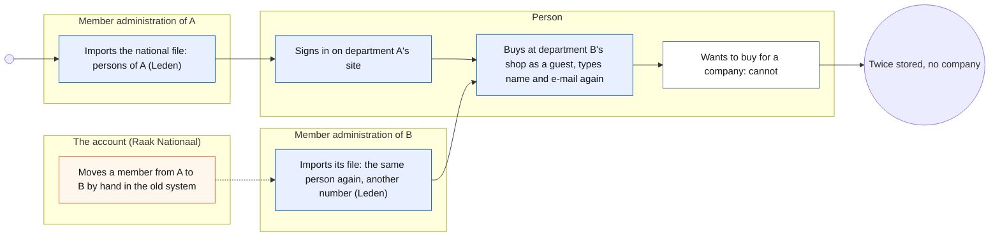
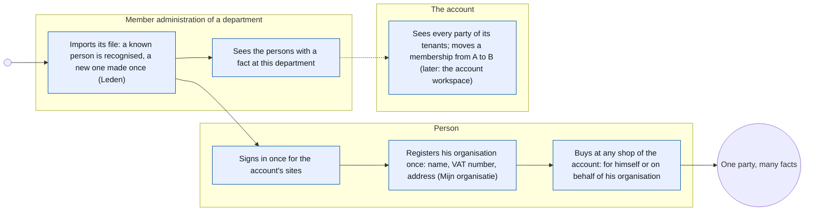
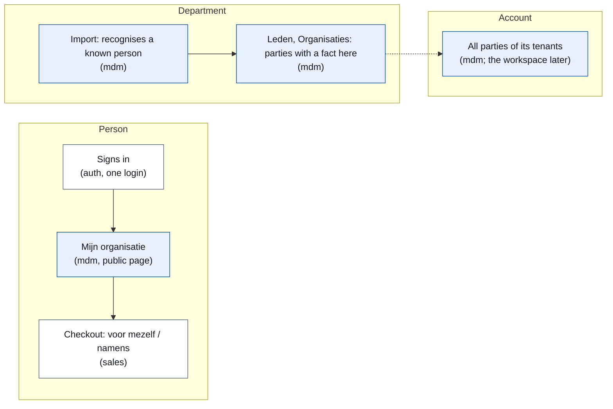
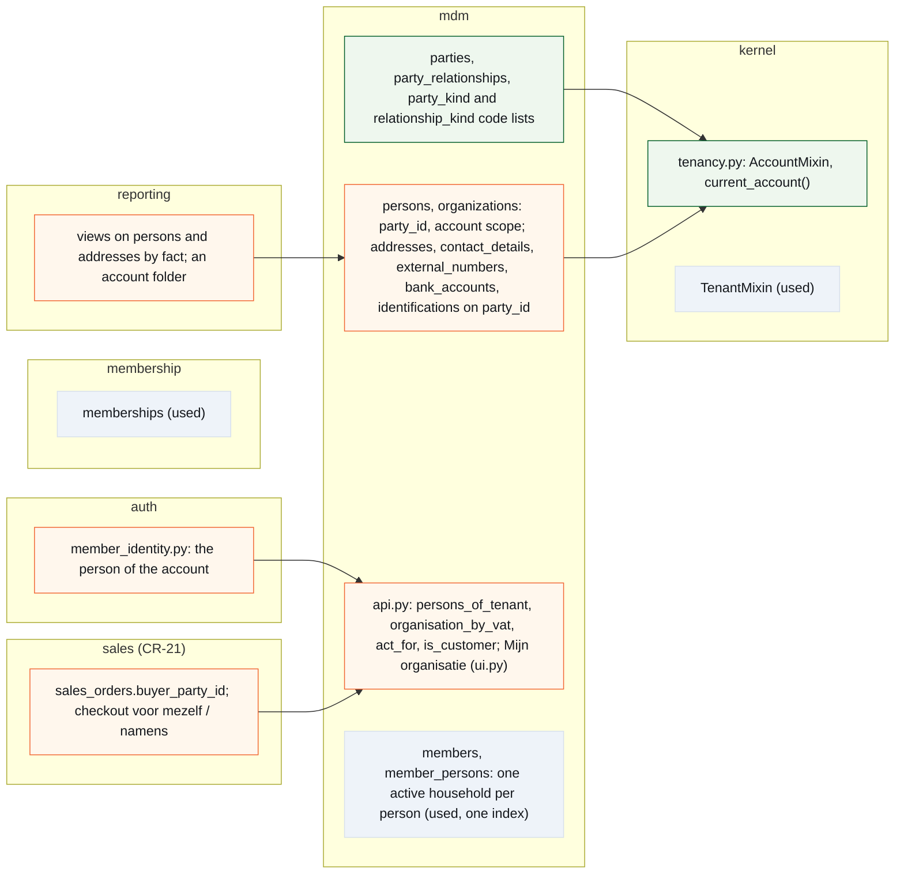
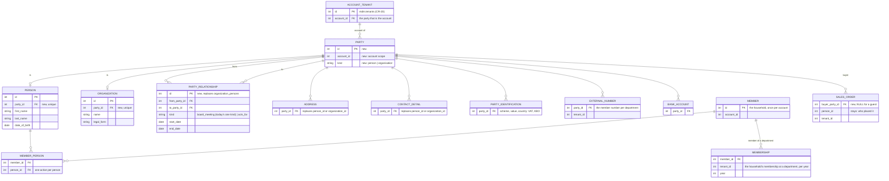

# CR-26 — The party model: one person and one organisation per account, the facts per tenant

**Status:** shaped on 15 October 2026 by the architecture CLI with Koen (Q&A nr. 05 of 15 October 2026) · **built in v2.17.0** (phase 1, PR #2158; phase 2, PRs #2168 and #2169; phase 3, PR #2161; v2.17 on Koen's word of 18 October 2026) · build read by dev4 on 18 October 2026, taken in (B9) · **B8 empty** · the decisions and the as-built notes stand in B9, and the text above reads as built · Koen's reading of the screen concepts (C9) ran beside the build
**Tracking issue:** #2020 — the one place where what is open stands; this document is the design, the issue is the status
**Applies to:** `mdm` (persons, organisations, households, addresses, contacts, identifications, bank accounts: the party and what hangs on it), the kernel's tenancy (an account scope beside the tenant scope), `auth` (who a sign-in is), `membership` (one household at a time), `sales` (the buyer of an order, CR-21), the public account pages (*Mijn organisatie*), reporting (the views on persons and addresses)
**Reading:** A 2 368 words · B 7 684 · C 5 356 — measured on 18 October 2026 after the re-read, drawings excluded, tables included; prose alone A 943 · B 2 026 · C 3 563. The budget is A ≤ 1 500, B ≤ 2 500: over in the tables (the requirements, the matrix, the standards table and above all B9's quotes), the prose within it; Koen accepted the same for CR-32 and CR-33

---

# Part A — The business

## A1. Reason to act — the trigger

The platform has no notion of *who* that holds across its screens. A member is a person in a household of one department; an organisation is a row that until CR-20 is also a tenant; a buyer in the webshop is a person or three guest fields; a company cannot buy at all, and CR-34 (invoices for the webshop) needs a buyer with an address and a VAT number. Every table that points at "someone" has two columns, person or organisation, and the next one would get the same two. Koen, 15 October 2026: *"Ik zou met jou graag de party change request vormgeven om dat fundament eindelijk juist te zetten."* And on 15 September 2026, after `Organization` had to be reworked (#924): *"Ik had achteraf gezien ook liever met de 'party' gewerkt."*

The decision that shapes everything else came in the same conversation. Persons are stored per department today, as Raak Nationaal's own system does: a member of two departments exists twice, with two member numbers, and nobody knows it is one person. Koen: *"de natuurlijke persoon en de organisatie zouden niet mogen verdubbeld worden … Je kan wel maar van één afdeling lid zijn."* So a person, a household and an organisation exist **once per account** (the customer of the platform: Raak Nationaal, iX), and what is per tenant is the **fact**: a membership of the household at one department, an order at one shop, a role in one organisation. Koen, revising the same afternoon: *"Je bent inderdaad maar één persoon. … We maken die maar één keer, ook als gezin maar één keer. En je kan, ja, van twee raken lid worden."*

## A2. As-is process — how it works today, and where it hurts

<!-- figure: name=cr26-as-is caption=Today_a_person_is_made_again_at_every_department_and_a_company_cannot_buy -->

*What to see:* the same person is a row per department and a guest in every shop; the company buyer has no step at all.

| Step | Who | Today | Pain |
|---|---|---|---|
| A person becomes a member | the department, from the national file | one person record per department, with the member number of that department | a member of two departments is two rows; a move is a deactivation and a new row |
| A person signs in | the person | one login for the platform; the person is found per department by e-mail | at a second tenant of the same account the login finds nobody and the person types everything again |
| A person buys | the person | the order names a person, or carries a guest's name, e-mail and mobile | a guest is never the same person twice |
| A company buys | nobody | not possible | CR-34 (invoices for the webshop) has no buyer with a VAT number |
| An organisation is kept | the operator | the organisation record is the tenant tree until CR-20; an address or contact points at a person or at an organisation, two columns | every "someone" table carries person-or-organisation twice |
| A relation person ↔ organisation | the operator | a relation record with a kind and a period | one relation kind (the board meeting's circle); a contact person of a customer has no home |
| The account sees its members | Raak Nationaal | not in the platform; in the old system, all members of all departments | the platform has no account scope at all |

## A3. To-be process — how it should work afterwards

<!-- figure: name=cr26-to-be caption=Afterwards_a_person_exists_once_per_account,_signs_in_once,_and_acts_for_an_organisation -->

*What changes:* the second row disappears (one party per account), the guest at a second shop disappears (the sign-in knows him), and the company gets a step: a person registers it once and buys on its behalf.

**The words the user reads** (Koen, Q&A nr. 05 question 8 and 13 October 2026): *persoon* and *organisatie*; an organisation shows its **rechtsvorm** (vzw, bv, eenmanszaak, feitelijke vereniging) in the record's head; the role of an organisation towards the platform is **Account** (Koen's word of 13 October 2026) or *Afdeling*/*Platform* as the tenant kinds say. The word *partij* appears nowhere on a screen; it is the model's word. New on the public side: **Mijn organisatie** (register and edit the organisation one acts for) and in the checkout **voor mezelf** / **namens …**; the sign-in stays *Aanmelden*; on the site of a department where the household is no member, the signed-in person sees **Word lid** instead of *Mijn gezin*, and it makes a membership of the existing household there (Koen: "Als je nog geen lid bent van bijvoorbeeld Raak Achterbos … dan staat daar word lid").

## A4. Benefits — what the change earns

- **One person, once**: a member who moves or joins a second shop is not typed again; the account sees one person with one history.
- **A company can buy and be invoiced**: CR-34 gets a buyer with name, address and VAT number from the organisation's record, not from a form on the order.
- **The next "someone" costs one column**: an invoice recipient, a sponsor, a supplier point at a party; no third pair of columns, no CHECK.
- **The account is real**: what CR-19 B9 called the account workspace (the customer that pays, sees across its tenants) has the data model it needs.

## A5. Supplied material — and what it taught us

- **The Q&A of 13 October 2026 (nr. 03, questions 2–6)** and **of 15 October 2026 (nr. 05, questions 1–10)**, in Koen's project folder: Koen's answers and his context on Raak Nationaal's system (persons per department, a member of two departments twice, a move as deactivate-and-activate, no national register number so no dedup, member pricing between departments not fixed and out of scope).
- **CR-20 (tenant apart from organisation)**: decided 4 October 2026, not built; it gives the tenant its own table with an `account_id`, and leaves the organisation as the party. This change builds on it and changes one of its rows (B4).
- **CR-21 (webshop)**, on master since 18 October 2026: an order names the person who placed it, or carries a guest's name, e-mail and mobile; the shop is where the company buyer first appears.
- **CR-34 (invoices for the webshop)**, shaped by the design-documentation CLI on 15 October 2026: its C4.10 carries the cut this change delivers in phase 2.
- **Measurements on master** (C1; 15 October 2026 on `39b26f10`, re-measured by the build read of 18 October 2026 on `d23caea5`): thirteen tenant-scoped tables in master data, six of them history tables; two tables with the person-or-organisation pair; 79 tenant-scoped tables in all; 21 reporting views; one login without a tenant and roles per tenant; the sign-in resolves a person by e-mail through one function; the import writes persons per department.
- **Reporting need**: the persons of a department and the parties of an account are each a question a report answers today or will; R7.

## A6. Business requirements — what the board asks, with MoSCoW

| # | Requirement | MoSCoW | Source | Comment |
|---|---|---|---|---|
| R1 | A natural person and an organisation exist once per account; a department never holds a second copy | Must | Koen, 15 October 2026 ("zouden niet mogen verdubbeld worden") | the account is the customer of the platform (CR-19 B9, CR-20) |
| R2 | A person belongs to one household, and the household exists once per account; a membership of a department is a fact of that household at that tenant, and a household may hold memberships of several departments, each paid, each with its own member number of the national office | Must | Koen, 15 October 2026 ("We maken die maar één keer, ook als gezin maar één keer. En je kan, ja, van twee raken lid worden.") | a move is ending one membership and starting another, same household |
| R3 | A person signs in once for every site of the account | Must | Koen, 15 October 2026 ("waarom zou hij een tweede keer zichzelf als gebruiker moeten registreren?") | the login is the platform's already |
| R4 | A person can register the organisation he acts for, once, with name, VAT number and address, and then buy on its behalf; the checkout asks no company data | Must | Koen, 15 October 2026 (Q&A nr. 05, 10: "ja, akkoord") | the VAT number is required, the enterprise number is not |
| R5 | An organisation has no login of its own; several persons may act for one organisation | Must | Koen, 15 October 2026 ("Ik bedoel een persoon namens dat bedrijf") | |
| R6 | A guest order stays possible for a private person | Should | CR-21 as built | |
| R7 | A department sees the persons and organisations that have a fact at it; the account sees all parties of its tenants | Must | Koen, 15 October 2026 | the account's own screens are CR-19 B9's workspace, later; this change gives the data |
| R8 | The household stays a group of persons, not a party; it exists once per account | Must | Koen, Q&A nr. 05, 1: "a"; 15 October 2026 ("ook als gezin maar één keer") | |
| R9 | Roles such as customer or supplier are not declared; they follow from the facts | Must | Koen, 15 October 2026 ("ja op 1" to roles derived from facts) | a role table comes with the first role without a fact |
| R10 | The words: persoon, organisatie, rechtsvorm, Account; Mijn organisatie; voor mezelf / namens | Must | Koen, Q&A nr. 05, 8: "a" | |
| R11 | Member pricing for members of another department | Won't | Koen, 15 October 2026 ("Even buiten scope laten") | context kept in the Q&A |
| R12 | Merging the duplicates that exist today across departments automatically | Won't | shaping | no national register number; the merge tool exists for a person the administration recognises |
| R13 | Organisations are always managed in the back office (the list and record of #1932, a person linked to one); an organisation as **customer** — a buyer, a member, a registrant, and the registering of an organisation on the public side (*Mijn organisatie*) — exists only at a tenant with the invoices module (CR-34) on, on the public side and in the back office alike; with it off the public side shows nothing of organisations (no *Mijn organisatie*, no *namens*: a person cannot register one) and Verkoop cannot sell to one. Other roles of an organisation — a sponsor that pays, the counterparty of a bank statement line (CR-27), a supplier, the tenant's own organisation (CR-20) — are not behind this switch and come with their own change request. In this change the only customer fact is the order (F8); a membership or a registration of an organisation is in no change | Must | Koen, 18 October 2026 (B9: "Organisaties is aan of uit"; "Als je aan organisaties verkoopt, heb je ook facturen. Punt.") | the module is off by default for every tenant kind (B9) |

## A7. Non-functional requirements — security, privacy, house style, tenants

| Concern | This change |
|---|---|
| **Security** | the sign-in does not change; a person acts for an organisation only through a relation he made or an administrator confirmed; no new route accepts data without a session except the existing guest order |
| **Privacy** | nothing is shared across accounts: a party of Raak Nationaal is invisible to iX and the other way round; inside an account a department sees only the parties with a fact at it; the attribute register (CR-33) classifies every new column; no national register number is stored |
| **House style / UI norm** | *Mijn organisatie* and the checkout choice on the kit; the organisation record of #1932 gains the persons who act for it; judged at 390 px |
| **Multi-tenant** | this change *is* the tenancy change: an account scope beside the tenant scope in the kernel; everything a tenant owns (activities, orders, memberships, settings) stays per tenant |

## A8. Acceptance criteria — what the business signs off on HDEV

| # | Criterion | Requirement | Walkthrough steps |
|---|---|---|---|
| AC1 | A member of department A who signs in on department B's site is recognised; no second person appears in B's *Leden* unless he gets a fact there | R1, R3, R7 | 1–3 |
| AC2 | A member of A who clicks *Word lid* on B's site gets a membership of his existing household at B: one person, one household, two memberships; ending the one at A leaves one active | R2 | 4 |
| AC3 | A signed-in person registers his organisation once under *Mijn organisatie*; a second person entering the same VAT number is linked to the same organisation | R4, R5 | 5–6 |
| AC4 | In the checkout he chooses *voor mezelf* or *namens <organisation>*; no VAT field and no address field appear; the order shows the buyer | R4 | 7 |
| AC5 | A guest without a sign-in still orders as a private person | R6 | 8 |
| AC6 | The organisation record shows the persons who act for it, with their relation and period | R5, R10 | 9 |
| AC7 | A department's *Leden* and *Organisaties* show only parties with a fact at it; the reports' persons folder counts the same | R7 | 10 |
| AC8 | The organisation record shows *Klant* once the organisation has an order at this department, and nothing before; no role is typed anywhere | R9 | 9, 10 |
| AC9 | On a department with the invoices module off, a signed-in person finds no *Mijn organisatie* and no *namens* in the checkout, and Verkoop cannot pick an organisation as buyer; the back office still lists Organisaties | R13 | 11 |

---

# Part B — The solution, for whoever approves it

## B1. Solution outline — the solution and the decisions that shape it

One table **`mdm.parties`** (id, account, kind: person or organisation) is the one thing every "someone" points at. `persons` and `organizations` hang on it one-to-one and move from the tenant scope to a new **account scope** of the kernel: a party row carries `account_id`, the kernel filters party tables by the current tenant's account (CR-20's `tenants.account_id`), and a tenant *sees* the parties that have a fact at it. The household (`members`, `member_persons`) moves to the account scope with the person, one active household per person; the facts stay per tenant: a membership of the household at a department (`memberships`), an order, a registration. **`party_relationships`** (from party, to party, kind, period) replaces `organization_persons` and carries the new kind *acts for*. A person registers his organisation once (*Mijn organisatie*: name, VAT number, address) and buys on its behalf: `sales_orders.buyer_party_id`. Addresses, contacts, identifications and bank accounts point at the party with one column. Roles are derived from facts; nothing declares them.

- **The party is per account, not per tenant.** Decided on Koen's word (R1). Rejected alternative: a party per tenant, with a copy when a person appears at a second tenant — the first version of this shaping; lost because the copy is the duplication this change exists to end. Rejected alternative: a party platform-wide — lost because two accounts are two customers with their own responsibility for personal data; a shared row would carry one's address change into the other.
- **The account scope lives in the kernel, beside the tenant scope.** An `AccountMixin` with `account_id` and the same loader criterion as `TenantMixin`, resolved from the current tenant's account. Rejected alternative: keep `tenant_id` on persons and add a link table person ↔ tenant — lost because the person's own data would still belong to one tenant.
- **A tenant sees parties by fact.** "The persons of this department" is "the persons with a membership, a registration, an order or a relation here". Rejected alternative: a visibility table per tenant — lost because it would be a second place for what the facts already say (*één plek per feit*).
- **One household per person, memberships per department.** The household is the account's, like the person; a constraint refuses a second active household for one person; a department's membership is a row of `memberships` for that household at that tenant, and a household may hold several. Rejected alternative (the first version of this document): the household per tenant, one department at a time — lost on Koen's revision: a member of two departments is one person and one household with two memberships, not two persons. Rejected alternative: a membership per person instead of per household — lost because the household is the unit the departments count and price in (R8).
- **The user is not a party.** `auth.users` stays the platform's login; a sign-in resolves to at most one person *per account*. Rejected alternative: a user per tenant — the duplication again.
- **Relations are one table, roles are none.** `party_relationships` with a kind from a code list (*member of the board*, *works for*, *acts for*, …); customer, supplier and account are read from the facts (an order, a purchase, a tenant that names the party as account). Rejected alternative: CR-20's `role` column or a role table — lost on Koen's word ("ja op 1"); a role table comes with the first role that has no fact behind it.
- **A company buys through a signed-in person.** No company login, no company fields in the checkout; *Mijn organisatie* once, then *namens*. Rejected alternative: VAT number and address on the order form — lost on Koen's proposal ("Anders moeten we ook nog een veld btw-nummer, adres, … gaan voorzien op een bestelformulier").
- **The VAT number is the key for an organisation within the account**, required for a company order; the enterprise number is not asked (in Belgium it is the same digits). Rejected alternative: match on name — unreliable.
- **One release for the three phases** (Koen, Q&A nr. 05, 3: "a, maar wel in één release"), after CR-20.

| # | Derived requirement | From |
|---|---|---|
| F1 | `mdm.parties (id, account_id FK parties — the account's own party, itself for an account, kind FK party_kind_codes, created_at, updated_at, deleted_at)`; `persons.party_id` and `organizations.party_id` UNIQUE NOT NULL; `persons` drops `tenant_id` (organisations never had one) and both carry `account_id` through the mixin — a person's from the tenant's account; **an organisation's from the tenants that name it** (as shown or as account party), an account party's being itself; an organisation no tenant names — made by the operator in Organisaties (#1932) — goes to the platform's account, the operator's own, counted on the dump first (C8); `addresses`, `contact_details`, `bank_accounts` and their history tables move to the account scope **in this phase**, with the persons and organisations they hang on — an organisation's rows, whose `tenant_id` holds the organisation's id today (CR-20 C4.8), take the account of the organisation's party; their pointer columns are phase 3's (F3); CR-20's `tenants.account_id` is repointed from `organizations.id` to the account's `parties.id` in the same migration, so the account has one key (C4.9) | R1 |
| F2 | `AccountMixin` in `kernel/tenancy.py`: `account_id` NOT NULL indexed, a loader criterion `account_id == current_account()`; **`current_account()` is derived from the current tenant inside the filter** (`tenants.account_id`, read once per tenant and cached with the tenant codes) — no second context variable and no second setter, because the tenant is set in two places today (`main.py:385`, `newsletter/handlers.py:30`) and a job that forgot the second would see every account; a tenant without an account does not exist (CR-20 F1: NOT NULL) | R1, R7 |
| F3 | `addresses`, `contact_details`, `bank_accounts` → `party_id` FK parties NOT NULL, the person/organisation columns dropped (the tables are on the account scope since phase 1, F1); `organization_identifications` becomes **`party_identifications`** (`party_id`, `scheme`, `value`, `country`; the schemes stay `VAT` and `KBO` as migration 124 made them, the ISO 6523 codes 9925 and 0208 are CR-35's mapping) on the account scope; **`external_numbers` stays a tenant-scoped fact table** whose `person_id` is **replaced** by `party_id` FK parties NOT NULL, pointing at the person's party — one pointer per row, as on addresses and contacts, `tenant_id` staying its scope; the `person` relationship the import reads (member number → person) goes through the party — a member number is issued by the national office *per department*, so a member of two departments has two, each a fact at its tenant (C4.10) | R1 |
| F4 | `party_relationships (id, from_party_id, to_party_id, kind FK party_relationship_kind_codes, start_date, end_date)` on the account scope; the rows of `organization_persons` migrated with their kind; `organization_persons` dropped | R5 |
| F5 | `members` and `member_persons` move to the account scope (with their history tables, F13); `memberships` stays tenant-scoped (the household's membership at a department, per year) and **its unique index becomes `(tenant_id, member_id, year)`** — today `uq_memberships_member_year (member_id, year)` would refuse the second department in one year; a partial unique index on `member_persons (person_id) WHERE deleted_at IS NULL` refuses a second active row for one person (`member_persons` has no `end_date`; the persons with more than one live row are counted first, C8); *Word lid* on a department's site creates a membership for the signed-in person's existing household; `members.board_member_id` stays on the household as a named exception (B4; Koen, 18 October 2026, Q20: "a") | R2, R8 |
| F6 | `sign_in_identity` resolves the e-mail to the person of the current account (one, by contact detail), not of the tenant; **today's duplicates** (one e-mail on two persons in two households of one account, kept on Koen's word, Q12) answer `MULTIPLE` and sign in nowhere **until the administration merges them** (Koen, 18 October 2026, Q19: "c"): no second rule in the sign-in; the refusal screen keeps CR-22's words for an address that says nobody and the administration uses the existing merge tool; the pairs are **counted** on a PROD-sized dump before the build (C8) and the count reported to Koen | R3 |
| F7 | *Mijn organisatie*: a public page for a signed-in person to register or edit the organisation he acts for: name, legal form, VAT number with country (required), address; the facade finds the organisation by VAT number within the account or creates party + organisation + identification + address in one transaction, and makes the relation *acts for* | R4, R5 |
| F8 | `sales_orders.buyer_party_id` FK `mdm.parties` NULL (NULL for a guest; a key across schemas by the named exception of B4, Koen 18 October 2026, Q18: "a") and a **buyer copy** on the order (name, street, house number, box, postal code, municipality, country, VAT number): typed by a guest, copied from the party at placement for a signed-in person or an organisation, so the invoice of CR-34 reads one source; the checkout offers *voor mezelf* and one *namens …* per *acts for* relation; **only at a tenant with the invoices module (CR-34 D1) on** — off, the public side has no *Mijn organisatie* and no *namens*, and the service refuses an order whose buyer party is an organisation, in the back office too (R13; the module check is a rule of the service, as CR-32 F16's); **`person_id` stays** and keeps its one meaning, the person who placed the order (B9, 15 October: "who placed it"); `buyer_party_id` comes beside it; for *voor mezelf* both name the same person, for *namens* the buyer is the organisation and `person_id` the contact, for a guest both are NULL, and for an order Verkoop enters for an organisation `person_id` may be NULL — so `SalesOrder.check()` demands the guest fields only when **both** are NULL; the readers of `person_id` (C1) keep working: CR-21's guest columns become the name and contact fields of the copy; the address of the copy **comes from the party when it has one and is asked of nobody by this change** (Koen, 18 October 2026, Q21: "a, … een adres is dan ook niet verplicht"): an organisation always has one (required under *Mijn organisatie*), a person's record may hold one, a guest's address columns stay NULL — CR-21's checkout gains no step, with the module on or off; **CR-34 adds the address step** where it issues an invoice to a buyer whose party holds no address (its C2 sales rule), which is why the copy's address columns are nullable; a private person has no VAT number and is never asked one (re-read of 18 October, M3: the earlier wording gave every guest an address step at a tenant that invoices nobody) | R4, R6 |
| F9 | A tenant's lists read parties by fact: `mdm.api.persons_of_tenant(tenant)` = persons of a household with a membership at the tenant, or with a registration, an order or a relation there (an organiser does not count; built as, B9); the same for organisations; the account reads all. **A by-id route of a department refuses a party without a fact there** (`/admin/leden/gezin/{family_id}` and its sub-routes, the person and organisation records): the account filter alone would show one department another's households; one guard in `mdm.api` (`party_at_tenant(party, tenant)`), 404 as for any id that is not yours. **A department gets the list and record Organisaties** — today `/admin/organisaties` is the operator's (`PLATFORM_MANAGE`) and a department has only its own organisation (`/admin/organisatie`, `PARTY_VIEW`): the department's list is #1932's layout filtered by fact, at `/admin/relaties`, menu item *Organisaties* (in a department only, and behind the `invoices` module), behind CR-24's `PARTY_VIEW`, create and edit behind `PARTY_MASTERDATA` (the right `PARTY_EDIT` does not exist); the account's own organisation is not listed through the "no fact anywhere" branch, but one a tenant shows is a fact and stays, read-only; one edit rule, `organisation_editable_here`, serves both this screen and `/admin/organisatie`; a record without a fact at the department answers 404 (built as, B9); the account folder of reporting is the operator's until the account workspace exists (roles are per tenant) | R7 |
| F10 | Reporting: the views on persons and addresses join the facts for the tenant's folders; an account folder lists parties | R7 |
| F11 | Roles: no table, no column; the domain that owns the fact offers the query (`sales.api.has_orders(party, tenant)` for *klant*, `mdm.api.is_account(party)` for the account), and a screen that shows the word reads that facade; CR-20's F3 drops its `role` column | R9 |
| F12 | The words of A3 on every screen; the attribute register (CR-33) gets the new columns with their classification (a party's kind intern, a relation kind intern, the VAT number intern; `account_id` and `buyer_party_id` are not technical columns to the register — only `tenant_id` is, `kernel/attributes.py:210` — so they get entries, *intern*); the entries of `mdm.organization_persons.*` move to `party_relationships`, `sales.sales_orders.person_id`'s stays | R10 |
| F13 | The six history tables of `mdm` (`person_history`, `member_history`, `member_person_history`, `address_history`, `contact_detail_history`, `external_number_history`) follow the scope of their table, in the phase their table moves: account scope in phase 1 with persons, members, member persons, addresses and contacts (F1); `external_number_history` stays tenant-scoped with `external_numbers`; in phase 3 each history table takes the pointer of its table — one `party_id`, filled from the existing `person_id`/`organization_id` through the party rows, those columns dropped — so the pair gate (C7) is green on them too | R1 |
| F14 | The invoices module (R13): `ModuleCode.INVOICES` is **excluded from `DEFAULTS["VERENIGING"]`** as `SHOP` is (`kernel/modules.py:324`: every module but the shop is on for an association by default), the CHECK `ck_tenant_modules_module_code` (migration 304) is widened by the migration, the entry depends on `SHOP` and `PAYMENT` (CR-34 C2), and *Mijn organisatie*'s router — in `mdm`, which is core — is included under `require_module(INVOICES)` with its prefix in the entry's `route_prefixes`, so the module gate sees it; the checkout's *namens* and Verkoop's organisation choice ask `module_enabled(ModuleCode.INVOICES)` (`mdm/tenant_lookup.py:147`); the order service refuses an organisation as buyer at a tenant without it | R13 |

## B2. Fit with the process and the requirements — for the business

<!-- figure: name=cr26-usage caption=Where_each_step_lives:_mdm_holds_the_party,_the_tenants_hold_the_facts -->

*Legend:* blue is mdm (the party), white the domains that hold facts about it.

| R | How the solution meets it (for the role) | F | Module (C2) | Test (C6) | AC |
|---|---|---|---|---|---|
| R1 | one person, one organisation per account | F1, F2, F3 | kernel, mdm | T1, T2, T3 | AC1 |
| R2 | one active household per person | F5 | mdm, membership | T4 | AC2 |
| R3 | the sign-in finds the account's person | F6 | auth | T5 | AC1 |
| R4 | Mijn organisatie once, then namens | F7, F8 | mdm, sales | T6, T7, T8 | AC3, AC4 |
| R5 | relations, several persons per organisation | F4, F7 | mdm | T6, T9 | AC3, AC6 |
| R6 | the guest order stays | F8 | sales | T8 | AC5 |
| R7 | a tenant sees by fact, the account sees all | F2, F9, F10 | kernel, mdm, reporting | T2, T10, T11 | AC7 |
| R8 | the household is a group | F5 | mdm | T4 | AC2 |
| R9 | roles from facts | F11 | mdm | T12 | AC8 |
| R10 | the words | F12 | mdm, sales | T13 | AC3, AC4, AC6 |
| R11 | Won't | — | — | — | — |
| R12 | Won't | — | — | — | — |
| R13 | the module rule on the order and the public pages, off by default | F8, F14 | kernel, sales, mdm | T7, T8, T14 | AC3, AC9 |

**Walkthrough (HDEV, two departments A and B of one account, one shop at B):**
1. As a member of A, sign in on B's site with the same e-mail. See your name; B's *Leden* does not list you.
2. Register for an activity of B. B's *Leden* now shows you as a person with a registration, not as a member.
3. As the administration of A, open your record: one person, one membership (A).
4. As the same member, on B's site click *Word lid*: a membership of your household at B is made; your record shows one person, one household, two memberships. As the administration of A, end A's membership: one active remains.
5. As a signed-in person, open *Mijn organisatie*, register a company with name, legal form, VAT number and address. Save; see it under your name.
6. As a second person, register the same VAT number: see the same organisation, now with two persons acting for it (step 9 shows them).
7. In B's shop, place an order: choose *namens <organisation>*; no VAT or address field; the order shows the organisation as buyer. Choose *voor mezelf* on a second order: the buyer is you.
8. Signed out, place a guest order with name, e-mail and mobile: accepted, as before.
9. As the administration of B, open the organisation's record: name, legal form in the head, VAT number, address, and the persons acting for it with period.
10. Open the reports, folder *Leden*: the count equals *Leden* of B; the organisation appears in B's *Organisaties* because it ordered there, with *Klant* in its record.
11. On A, where the invoices module is off: signed in, no *Mijn organisatie* in the account menu; in the back office Organisaties lists the parties with a fact at A; Verkoop's order form offers no organisation.

## B3. The whole across the modules — for the architect

<!-- figure: name=cr26-structure caption=New_in_green,_changed_in_orange,_only_used_in_grey wide=1 -->

<!-- figure: name=cr26-model caption=The_party_per_account_and_the_facts_per_tenant wide=1 -->

Who calls whom: `mdm` owns the party and everything that hangs on it; every other domain points at a party by id through `mdm.api` (the import gate is unchanged: `sales` imports `mdm.api`, never a model). The kernel gains the account scope and knows nothing of parties; it reads the current tenant's account from CR-20's table. `auth` asks `mdm.api` who an e-mail is within the account. `sales` stores `buyer_party_id` and asks `mdm.api` for the *acts for* relations of the signed-in person. Reporting reads `mdm` tables through its views, by fact for a tenant. Transaction boundaries: *Mijn organisatie* creates party, organisation, identification, address and relation in one transaction of `mdm`; the checkout writes the order in `sales` with a party id it read. Impact on the existing architecture: eleven of the thirteen tenant-scoped `mdm` tables change scope (the household and five history tables too; `external_numbers` and its history stay a fact per tenant); `organization_persons` goes, its rows and ids living on as relationships (the meeting circle reads them by id); CR-20's `role` column goes; `TenantMixin` gets a sibling; the sign-in's one function changes its scope; `sales_orders` gains `buyer_party_id` beside `person_id`, which keeps its meaning; 21 reporting views are reviewed, those on persons and addresses rewritten.

## B3a. Standards the model follows — and where it deviates, on purpose

Standards checked: **UBL 2.1 / EN 16931** for the party (`cac:Party` with `cac:PartyIdentification`, `cac:PartyLegalEntity`, `cac:PartyTaxScheme`, `cac:PostalAddress`, `cac:Contact`, `cac:Person`); **ISO 6523** for organisation identifiers (the VAT number as scheme 9925 for Belgium, the enterprise number as 0208); **Silverston, The Data Model Resource Book, vol. 1** for what UBL has not: party as the supertype of person and organisation, party role, party relationship; **ISO 3166** for the country of an identification and an address.

| Concept in this change | Standard and element | Ours | Follows / deviates — why |
|---|---|---|---|
| the party as supertype | Silverston *Party* with subtypes *Person*, *Organization* | `parties(kind)` with `persons` and `organizations` one-to-one | follows |
| the account scope | none | `account_id` on the party | ours: multi-tenancy is not the standard's concern; one row per customer of the platform |
| identification | UBL `cac:PartyIdentification/cbc:ID @schemeID` (ISO 6523), repeatable | `party_identifications (scheme, value, country)` on the party; the member number stays in `external_numbers`, a fact per department | follows: one repeatable table for what identifies the party; the member number identifies a membership, not the person (Koen: two numbers for a member of two departments) |
| tax registration | UBL `cac:PartyTaxScheme/cbc:CompanyID` | the VAT identification row, scheme VAT with country | follows; CR-34 reads it |
| legal entity | UBL `cac:PartyLegalEntity/cbc:RegistrationName`, `cbc:CompanyLegalForm` | `organizations.name`, `legal_form` (code list) | follows |
| address | UBL `cac:PostalAddress` with `cac:Country` | `addresses.party_id` | follows: hangs on the party, one column |
| contact | UBL `cac:Contact` (one), ours repeatable with a type | `contact_details.party_id` | deviates knowingly, as before: several contacts with a type are needed |
| the person | UBL `cac:Person` (name parts, birth date) | `persons` | follows |
| relationship | Silverston *Party Relationship* (from, to, type, period) | `party_relationships` | follows; the kinds are a code list of ours |
| role | Silverston *Party Role* | none: derived from facts | deviates on Koen's word; a role table is the standard's shape when a role without a fact appears |
| the household | none | `members` as a group of persons per account; its membership at a department a fact per tenant | ours: a department's unit of membership and pricing |

## B4. Rules this change needs an exception from — decided once, here

| Rule (where) | What the design does instead | Mechanism | Temporary until … / the new rule | Decided |
|---|---|---|---|---|
| CR-20 F3: `organizations.role` (CUSTOMER, PARTY) | no role column; roles are read from the facts | CR-20's document gets one as-shaped note at this row; its migration does not add the column | the new rule (R9) | Koen, 15 October 2026 ("ja op 1") |
| `TenantMixin` on every table that holds data (`kernel/tenancy.py`, the architecture document part A) | party tables carry `account_id`, not `tenant_id` | `AccountMixin`, the same loader criterion; the tenancy gate learns the second mixin | the new rule: a party is per account, a fact per tenant | Koen, 15 October 2026 ("ja op 1" to party per account) |
| expand/contract over two releases (#1255) | one release for the three phases, with the checked dump and `raak restore-test` as the safety | as CR-19 and CR-20 did, on Koen's word | this change only | Koen, Q&A nr. 05, 3: "a, maar wel in één release" |
| No foreign key across schemas except to a code table of `mdm` or `auth` (`tests/test_schema_boundaries.py:28-58`) | `sales_orders.buyer_party_id` → `mdm.parties`: a real key, by one named exception for `mdm.tenants` and `mdm.parties` (the gate names the two and keeps `mdm.persons` red); CR-34 C2's "soft reference" follows | the gate's change, with its existing red proof | the new rule for the two identity tables | Koen, 18 October 2026, Q&A nr. 03 question 1: "a" (the same answer as CR-20 Q7) |
| The party is the account's, the fact the tenant's (B7) | `members.board_member_id`, a department's follow-up on the household, stays on the account-scoped `members` | none: the column and its readers (`d_board_member`, the member list) stay as they are | until a household with memberships at two departments needs two follow-ups | Koen, 18 October 2026, Q&A nr. 03 question 3: "a, een gezin hoort bij de account maar kan maar van één tenant lid zijn, dat kan dus geen probleem zijn" — the second half of that sentence was put back to him and R2 stands (B9, 18 October: two member numbers for one person); the exception holds until a household with two memberships needs two follow-ups |

Checked to say so: the import gate (every cross-domain read through `mdm.api`); the layer gate; the code-list gates of CR-12 (two new lists in the standard shape); the FK gate (every new foreign key real) against the schema-boundary gate (Q18); the attribute register of CR-33 (every new column classified, F12); the module gate (a router of the module guarded, F14); the payable delete gate is not touched. The "tenancy gate" this document names (T2) does not exist yet: it is new, with a red proof both ways.

## B5. Cost — investment and running cost, and what operations must know

| Module | Phase 1 (the party per account) | Phase 2 (the buyer) | Phase 3 (the rest on the party) |
|---|---|---|---|
| kernel | M: `AccountMixin`, `current_account()`, the gate | — | — |
| mdm | L: parties, the scope change of persons, households and organisations, the migration of today's rows per account, the one-household index, `persons_of_tenant`, *Word lid* for an existing household, the import recognising a known person, the screens filtering by fact | M: relationships (migration of `organization_persons`), *Mijn organisatie*, `organisation_by_vat`, `act_for` | M: addresses, contacts, identifications (with `external_numbers`), bank accounts on `party_id` |
| auth | S: the person of the account | — | — |
| membership | S: reads unchanged, the index | — | — |
| sales (CR-21) | — | M: `buyer_party_id`, the checkout | — |
| reporting | M: the views on persons and addresses by fact, an account folder | S: the buyer in the orders folder | S: the views on addresses and contacts |
| tests | M: the new gates, the fixtures that build a person per tenant | S | S |

Total: about L + M + M, one dev CLI, after CR-20, in v2.17 on Koen's word of 18 October 2026 (CR-34, invoices for the webshop, was postponed the same day until the platform really invoices; it reads this change's buyer when it comes); the migration of phase 1 is proven on a snapshot of HDEV and PROD before the handover (C8). No purchase. **Running cost:** none. **Operations:** no env var; the deploy of the release takes the checked dump first (`raak backup`, `raak restore-test`), as for CR-20.

## B6. Phasing — shippable phases, and what changes on the failure paths

| Phase | Ships | Depends on | Failure paths that change | Na de merge |
|---|---|---|---|---|
| 0 | CR-20: tenants out of organisations, with `account_id` on the tenant | — | its own | its own |
| 1 | `parties`, the account scope on persons, households, organisations, addresses, contacts and bank accounts, the migration (a party per existing person and organisation, a person's `account_id` from the tenant's account, an organisation's from the tenants that name it, the households with their persons), the one-household index, *Word lid* on a department's site for a household that is no member there, the sign-in per account, the lists by fact, the import recognising a known person by member number or e-mail within the account, the reporting views | 0 | a person found at another tenant of the account is no longer created again: the import reports *known, linked* instead of *new*; a second active household is refused with the first named; a sign-in at a department where the household is no member works and shows *Word lid* instead of *Mijn gezin* | one migration; the dump checked before; no env var |
| 2 | `party_relationships` (with `organization_persons` migrated, **ids kept**: the meeting circle's routes and `CircleStartChosen` carry the relation id), *Mijn organisatie* behind the invoices module (F14), `organisation_by_vat`, `act_for`, `sales_orders.buyer_party_id` beside `person_id`, the checkout choice | 1, CR-21's checkout on master (it is, since 18 October 2026) | an invalid VAT number is refused before the organisation exists; a second person on the same VAT number is linked, not refused; *namens* without a relation is impossible | one migration; CR-34 may start after this phase, whenever Koen schedules it |
| 3 | `party_id` on addresses, contacts, `party_identifications`, bank accounts; `external_numbers.party_id` in place of `person_id`, beside its `tenant_id` (the scope); the two-column tables gone with their CHECKs and partial indexes (C4.10) | 1 | none on the happy path; a write with both columns can no longer exist | one migration |

The three phases ship in one release (Koen), in this order, two builders. Builder A (dev4) builds CR-20 phase 1, then phase 1 of this change, then phase 3; builder B (a second Opus dev) builds CR-20 phase 2 once its phase 1 is on master, and phase 2 of this change once phase 1 of this change is on master, in parallel with phase 3. The two read each other's work. Phases 2 and 3 each carry a migration on top of phase 1: whoever merges second repoints the `down_revision` of their migration behind the other's. The release is v2.17, with CR-20 before (Koen, 18 October 2026: "v2.17"; Q11's v2.18 of 15 October is superseded); CR-34 (invoices for the webshop) was postponed the same day until the platform really invoices and follows later, reading this change's buyer and module. Nothing built meanwhile assumes a person per tenant in new code: no new `person_id`/`organization_id` pair outside `mdm`, and no company fields in CR-21's checkout.

## B7. Rule and gatekeeper — what this fixes for all future work

**The rule:** whoever can act — buy, pay, be invoiced, be addressed — is a party, once per account; a table that points at someone points at a party with one column; what a party does at a tenant is a fact in that tenant's tables; a role is read from the facts. Home: `docs/code-style.md` (one line beside the code-list rule), the architecture document part A (the party as a kernel concept) and D (the standards table of B3a).

**Reach and baseline, measured on master @ `d23caea5` (18 October 2026):** 2 tables with the person-or-organisation pair; 8 columns outside `mdm` that point at a person by `person_id` or at an organisation by `organization_id` (`sales/models.py:100, 196`; `meetings/models.py:356, 384`; `newsletter/models.py:388`; `activities/models.py:151, 419, 753`), which stay — a person's id does not change and C2 keeps them; 13 party tables scoped per tenant, 0 parties. After the three phases: 0 pairs, 11 tables on the account scope, one party per person and organisation; the 8 pointers are the pointer gate's baseline, which only shrinks.

**Ratchet or hard:** the pointer gate refuses the **pair** (`person_id` and `organization_id` on one table) outright, and a **new** `person_id` or `organization_id` column outside `mdm` behind the baseline of eight that only shrinks (a gate that refused the eight would be red on its first run); the scope gate is hard: a table with `TenantMixin` whose name is in the party list; the one-household index is a constraint.

## B8. Open decisions — what the approver still decides

None open (18 October 2026): the four questions of the build read are answered (B9, Q18–Q21); the document waits for Koen's reading of the screen concepts (C9) and dev4's short re-read (both done the same day, B9).

## B9. Decisions log — dated answers

| Date | Decision | By |
|---|---|---|
| 13 October 2026 | "Account" is the word for the customer of the platform (#1932) | Koen |
| 13 October 2026 | CR-26 parked: "CR26 ga ik laten liggen voorlopig" | Koen |
| 15 October 2026 | "Ik zou met jou graag de party change request vormgeven om dat fundament eindelijk juist te zetten." | Koen |
| 15 October 2026 | Q&A nr. 05: 1 "a" (two kinds, the household is a group); 2 "a" (the party table, for the buyer); 3 "a, maar wel in één release"; 7 "a" (one identification table); 8 "a, maar rollen zoals klant, leverancier, … weet ik nog niet of we die nu willen introduceren" | Koen |
| 15 October 2026 | Roles derived from facts, no role table, CR-20's role column goes: "ja op 1"; relations in phase 1 (then phase 2 after the re-ordering): "ja op 2"; the VAT number required for a company order, the enterprise number not: "BTW-nummer zou ik verplicht maken bij een bestelling, ondernemingsnummer hoeft niet" | Koen |
| 15 October 2026 | A company buys through a signed-in person who registers the organisation once: "Zouden we een bedrijf niet altijd verplichten een account te maken? Anders moeten we ook nog een veld btw-nummer, adres, … gaan voorzien op een bestelformulier." — "Ik bedoel een persoon namens dat bedrijf." — "ja, akkoord" | Koen |
| 15 October 2026 | The party is per account, not per tenant, to the proposal of a copy per tenant: "dit vind ik eigenlijk wel niet goed, de natuurlijke persoon en de organisatie zouden niet mogen verdubbeld worden … Je kan wel maar van één afdeling lid zijn."; then to "partij per account, feiten per tenant, lidmaatschap van één afdeling tegelijk" and "CR-20 vooraf, CR-26 fase 1 de partij per account vóór de koper": "ja op 1, ja op 2" | Koen |
| 15 October 2026 | Release: CR-26 on v2.18, not v2.17 ("ik was sowieso van plan dit pas in v2.18 te stoppen. Zie jij noodzaak om dit al in v2.17 te doen?" — no); CR-34 on v2.18 too ("deze moet ook in v2.18: CR-34 (facturen webshop)") | Koen |
| 15 October 2026 | The household once per account too, memberships per department: "Ik denk dat ik fout ben. Je bent inderdaad maar één persoon. … We maken die maar één keer, ook als gezin maar één keer. En je kan, ja, van twee raken lid worden. … Stel nu dat je twee keer lid bent, zal je ook wel twee ID's krijgen van Raak Nationaal. … dan gaan we dat zo oplossen." — to the restatement (one person and one household per account, membership as the fact per department, *Word lid* for an existing household): "akkoord" | Koen |
| 15 October 2026 | The guest buyer's address: a buyer copy on the order for every buyer (CR-34 Q&A nr. 06, question 1, option b, and the architecture CLI's reading of it for F8) | Koen; the architecture CLI |
| 15 October 2026 | Q13 the *acts for* relation without a confirmation step: "akkoord zonder bevestiging" | Koen |
| 15 October 2026 | Q12 the duplicates: "ja, laten staan" and, to the report: "we doen niets"; a purchase-order reference and a separate delivery address for a company order: out of scope, a new change request | Koen |
| 15 October 2026 | Context, out of scope: member pricing between departments is not fixed; Raak Nationaal's system keeps persons per department and moves a member by deactivating and activating | Koen |
| 15 October 2026 | **The one key stays.** Koen questioned the need for the party supertype: every fact could carry the natural person always and the organisation when it acts on her behalf ("dan heb je altijd één sleutel, namelijk de natuurlijke persoon die achter de computer zat"), and asked for the long-term view regardless of speed ("wat is op de lange termijn de beste piste? Los van het feit dat we nu dan een aantal dagen sneller met een oplossing in productie kunnen gaan"). Weighed in the chat: the pair is cheaper today (two concrete keys, `sales_orders.person_id` exists already, UBL's customer party is an organisation with a contact person) but grows a CHECK and a COALESCE per fact of either kind (buyer, invoice addressee, Peppol endpoint, supplier, sponsor, the counterparty of a bank statement line in ISO 20022 `camt`), keeps identifications and addresses in two places, and gives `person_id` two meanings (the customer, or the customer's contact). The one key keeps one table of identifications (UBL `PartyIdentification`), one address and contact model, and one meaning per column. Rule that follows, for every fact that can be for a person or an organisation: two columns with one meaning each, `<role>_party_id` (for whom) and the acting person where someone acts for an organisation (`person_id`, the buyer's contact, UBL's `Contact`); the existing `sales_orders.person_id` keeps meaning "who placed it" and `buyer_party_id` comes beside it. The contact person may be empty when Verkoop enters an order for an organisation (the actor is in the history). Koen: "Ik ga mee in de ene sleutel." | Koen |
| 18 October 2026 | **Selling to an organisation and invoices stand behind a switch per tenant; managing organisations does not.** Koen, in the chat with the master CLI (relayed the same day): "Ik wil ook nog wel meegeven dat we dat partymodel, dus de organisaties, dat we dat via een toggle moeten kunnen aanvinken of dat het een tenant is die met organisaties werkt of niet. Bijvoorbeeld Raak gaat daar niet mee werken. Bijvoorbeeld een webshop die aan klanten verkoopt, die aan bedrijven verkoopt, die wel, maar Raak dus niet. Dus dat moet achter een toggle zitten. Ook invoices moet achter een toggle zitten. Misschien is dat maar één toggle, hè? Dus ja, invoices als module." And sharper: "Dus invoices en organisaties om daaraan te verkopen, weliswaar enkel verkopen, dat moet achter een toggle zitten, want organisaties moet je wel kunnen beheren. Maar er is een verschil met verkopen aan. Raak zal niet verkopen aan organisaties. Commerciële bedrijven wel. Raak is immers een ledenvereniging die enkel gericht is op natuurlijke personen als lid en om daar activiteiten voor te organiseren. […] Dus zowel activiteitenverkoop, lidmaatschap als webshop zijn bij raak. Alles dat die verkopen, alles dat die moet betaald worden, is gericht aan natuurlijke personen. Bij bedrijven is dat natuurlijk anders." The master CLI's summary, which Koen read and approved: organisations can always be managed; selling to an organisation as buyer, and invoices, stand per tenant behind a switch (a module); Raak switches it off, a commercial company on. Corrected the same day by the master CLI: in the chat with the design-documentation CLI Koen said "Verkopen aan organisaties is een aparte toggle, denk ik. Dus bijvoorbeeld Raak zal nooit verkopen aan organisaties." and of the invoices: "ik weet eigenlijk niet goed van waar dat afhangt … Dus als de analyse is dat dat samenhangt, is dat voor mij oké. Maar dat is geen requirement van mij." So: two switches per tenant — selling to organisations, and invoices; whether the first needs the second is analysis, not Koen's requirement. CR-34 Q19 was rewritten to two modules, the organisation switch depending on the invoices. Where the switch lives and the default: Q15–Q17, answered the same day (the rows below). The same day Koen said he wants CR-20, CR-26 and CR-34 in v2.17 and that dev4 lays CR-20 and CR-26 against the code after this change; and later that day decided it, to "Houd je de drie in v2.17, ook als de tag later komt, of worden ze v2.18, meteen erna?": "v2.17" (on #2020). | Koen |
| 18 October 2026 | **One switch.** To Q&A nr. 02 question 1 (two modules, selling to organisations depending on invoices, or one): "Misschien moeten we er maar één schakelaar van maken. Als je aan organisaties verkoopt, heb je ook facturen. Punt." One module, the one CR-34 D1 names (`invoices`, *Facturen*): it switches the invoices and the selling to an organisation — *Mijn organisatie*, *namens …* in the checkout, an order with an organisation as buyer. The registry entry is made by this change (phase 2, with *Mijn organisatie*'s routes) — CR-34 and CR-35 were postponed later that day until the platform really invoices (Koen to the master CLI) — and CR-34 adds its routes to it when it comes; the wording of the tenant editor's card is CR-34's (the design-documentation CLI). R4, R5 and F8 are read with "at a tenant with the invoices module on". The same day, to the thought that an association that is not VAT-liable might sell to a company without invoices: "Laten we het niet te moeilijk maken voorlopig. Als je aan bedrijven verkoopt, heb je facturen, al de rest leggen we naast ons neer. Dan houden we het heel simpel. KISS." — no exception for a non-VAT-liable tenant; whether such a seller is obliged to invoice is not looked up. | Koen |
| 18 October 2026 | **The switch, default and reach.** Q&A nr. 02 question 2 (default off for every tenant kind, switched on per tenant by the platform, as the shop module): "Ja op vraag 1." Question 3, asked again with context (managing organisations in the back office stays; the selling side goes): "De module uit het beheer moet niet verdwijnen bij een tenant zoals Raak. In de publieke site is het dan wel ook onmogelijk om een organisatie aan te maken. Dus in de publieke kant verdwijnt het organisatiedeel volledig. Dus je kan niet lid worden als organisatie. Je kan niet inschrijven voor een activiteit als organisatie. Je kan niet beroep doen op de webshop. En je kan ook geen account aanmaken binnen voor een organisatie in het publieke deel. Organisaties is aan of uit. In het beheer zie je die wel, omdat bijvoorbeeld Raak, etc. ook zelf organisaties zijn. Ik heb er ook geen probleem mee dat je in de beheerkant ook organisaties kan aanmaken. Dat is niet erg. Maar er gebeurt dus eigenlijk voor de rest niks mee. Want ook de beheerders kunnen in beheer geen inschrijving voor een organisatie doen, voor een activiteit. Kunnen er ook niks aan verkopen. Kunnen een organisatie ook geen lid maken. Geen webshopactiviteit. Voilà." Read as R13: the back office keeps the list and record Organisaties and may create one; an organisation as the party of a fact (buyer, member, registrant) exists only with the module on, public side and back office alike; with it off the public side shows no organisation at all. In this change the order is the only such fact; a membership or a registration of an organisation is built by no change. | Koen |
| 18 October 2026 | **The switch gates the customer role, not every fact.** To the architecture CLI's sharpening — the module switches the organisation as *customer* (buyer, member, registrant); a sponsor that pays, a bank statement's counterparty, a supplier and the tenant's own organisation are other roles, not behind this switch, each with its own change request — "Helemaal mee eens. En dat impliceert dan ook dat hij geen account kan aanmaken." Read as: with the module off a person cannot register an organisation on the public side (*Mijn organisatie* is part of the customer role); an organisation has no login of its own in any case (R5). R13 says so. | Koen |
| 18 October 2026 | **Build read taken in** (dev4, #2020, master `d23caea5`; the form is the architecture CLI's, the four choices Koen's in B8): `person_id` stays beside `buyer_party_id` with its readers listed and `check()` adapted (blocker 6); the membership index per tenant (blocker 5); the pointer gate refuses the pair and new columns behind a baseline of eight (blocker 7); `external_numbers` stays a fact per department, `party_identifications` is the organisation's table widened (the F3/C2 contradiction); the six history tables follow their table (F13); the by-id guard and the department's Organisaties list under CR-24's `PARTY_*` (F9); `parties.account_id` points at the account's own party and CR-20's `tenants.account_id` is repointed to it (F1, C4.9); `current_account()` derived from the tenant inside the filter, no second setter (F2); the invoices module excluded from the association's defaults, its CHECK, its dependencies and the guarded router of *Mijn organisatie* (F14); `organization_persons` migrated with its ids for the meeting circle, the kinds corrected; the phase-3 constraints named (C4.10); CR-33's entries (F12); the release words v2.17; C1 re-measured; AC8, AC9, T14, step 11; Part A in words. Open for Koen: Q18–Q21. | the architecture CLI |
| 18 October 2026 | **Q&A nr. 03 answered.** Q18 the key across schemas: "a" (the named exception for `mdm.tenants` and `mdm.parties`; CR-20 Q7 the same). Q19 the duplicate pair: "c" — accepted: such a pair signs in nowhere until the administration merges it; the count is taken on a dump before the build; no tenant-first rule. Q20 the household's follow-up: "a, een gezin hoort bij de account maar kan maar van één tenant lid zijn, dat kan dus geen probleem zijn" — stays on `members` as a named exception (B4); the remark that a household can be member of one tenant only was put back to Koen and answered the same day (next row): R2 stands. Q21 the address: "a, enkel bedrijven (organisaties) hebben btw-nummers, de natuurlijke persoon die voor een organisatie bestelt heeft geen BTW-nummer, een adres is dan ook niet verplicht. Of vergis ik me?" — read as: the address comes from the party when it has one and is typed only when it has none; a private person is never asked a VAT number; an address is asked of a private person only where CR-34 issues him an invoice and his record holds none (the architecture CLI's answer to his question, in the chat). | Koen |
| 18 October 2026 | **R2 stands: one person, a membership and a member number per department.** To the question whether R2 stays as on 15 October (a household can hold memberships at several departments at the same time, two memberships, two member numbers) or a household can be member of one department at a time: "OK, we gaan voor twee nummers voor één persoon. Hij kan dus in jaar 1 lid zijn van afdeling/tenant A en in jaar 2 lid zijn van afdeling/tenant B." Read as: R2 as written; the membership is a fact of the household at a tenant, per year, with the national office's member number per department (`external_numbers`), and nothing forbids two in one year — his example is the sequential case, which the same index `(tenant_id, member_id, year)` serves. F5, AC2, T4 and step 4 of the walkthrough are unchanged. | Koen |
| 18 October 2026 | **Short re-read taken in** (dev4, #2020, master `7c389256`, commit `4f8d9c0c`; the form is the architecture CLI's, told to Koen the same day): the meeting circle hangs on the current tenant's shown party (M1; CR-20 F11, C2 meetings, T9); an organisation's account is that of the tenants naming it, the platform's for one named by none, CR-20's seam rows take their organisation's account, and addresses, contacts and bank accounts move to the account scope in phase 1 with their history tables (M2; F1, F3, F13, B6, C2, C8); the checkout asks no address — CR-34 adds that step where it invoices (M3; F8, AC4, C2 sales); the minors: the status line, B8's header, the switch row, Q14's place, `module_enabled`, the pair gate with phase 3. | the architecture CLI |
| 19 October 2026 | **One pointer on the member number** (dev4's question at phase 3, via the master CLI; the architecture CLI's answer, #2020): `external_numbers.party_id` **replaces** `person_id`, as on addresses and contacts — F3, B6 and C2 said "pointing at", "beside its tenant_id" and "gets" and none said whether `person_id` stays; `tenant_id` stays the scope; the import reads the person through the party. The history tables take their table's one `party_id`, filled from the old columns, in phase 3 (F13). | the architecture CLI |
| 18 October 2026 | **"One builder" becomes two (B6, C4.8).** To "Akkoord met deze verdeling?" and "Mag de design-documentation-CLI 'one builder' in CR-26 vervangen door deze verdeling?": "Ja, prima." Builder A (dev4): CR-20 phase 1, CR-26 phase 1, CR-26 phase 3. Builder B (a second Opus dev): CR-20 phase 2 once phase 1 is on master, CR-26 phase 2 once CR-26 phase 1 is on master, in parallel with phase 3. They read each other's work. Phases 2 and 3 each have a migration on phase 1; whoever merges second hangs theirs behind the other's (`down_revision`). The order and the single release stay. | Koen |
| 19 Oct 2026 | A person without a fact at any department (an organiser or board member outside every household) is visible to every department of the account: "1 voor allen zichtbaar" (to dev4's question, through the master CLI, whom such a person belongs to) | Koen |
| 19 Oct 2026 | An existing tenant never changes its account: "1" (after "1 moet niet kunnen", put back to him as "never") | Koen |
| 19 Oct 2026 | *Word lid* at a second department is the existing payment page: "1a" (to the choice between the existing renewal page and a new screen) | Koen |
| 19 Oct 2026 | The import of one department and a household the account shares: "b" (to "kies je (a) de laatste import wint, of (b) iemand alleen uit het gezin halen als hij nergens anders in het account nog lid is?") | Koen |
| 19 Oct 2026 | The fact of a household at a tenant is any membership row there, an ended or a deleted one included — the master CLI's reading, (c), so that a household whose years the board removed stays under "opgezegd" as today and does not vanish silently | master CLI |
| 19 Oct 2026 | **Built as** (phase 1, PR #2158, master `0a97f7ab`, migration 314): (1) the fact of a household is any membership row at the tenant (above); (2) a person is at a tenant through a household with a membership there, a registration, an order or a relation — organisers do not count; (3) phase 1 builds the guard per id and Leden by fact, the department's Organisaties list and record follow in phase 2 with the order as a fact; (4) the migration refuses to run if an organisation is named by tenants of two accounts and names its ids — measured none on HDEV, UAT and PROD; (5) the SEAM baseline of CR-20 is gone, an organisation belongs to an account through `parties.account_id`; (6) Personen and the guard per id show a person without a fact to every department of the account; (7) the tenant editor shows the account as a fact and the save refuses a posted one — the moving of #1533 and #1542 is removed with its tests; (8) *Word lid* at a second department is `lidmaatschap_vernieuwen.html`: no way back to Mijn gezin, cancelling goes to Mijn <site>, nothing marked in the account menu and no new menu item; (9) no `AlreadyInHousehold` refusal — no door puts an existing person in a second household, and the unique index is the net; (10) the import matches on e-mail address *and* name, an address of someone with another name stays #1704's refusal; (11) the membership module's count in the tenant editor counts memberships only; (12) the account criterion is not applied to relationship loads, which follow a key from a row already read; (13) a person without a fact is no longer in `d_person`, so the assistant names them by token — measured on PROD: none; (14) the import removes a person from a shared household only when the household has no active membership for the import year or later at another department of the account, otherwise it keeps the person and names them under the warnings with a count (`persons_kept_elsewhere`). | master CLI |
| 19 Oct 2026 | **Built as**, two findings of dev2's review taken in before the merge: the household routes check the household's fact at the current tenant before they write (without it, a delete reached another department's household); the import's treatment of a shared household was put to Koen (above, "b"). | master CLI |
| 19 Oct 2026 | **Built as** (phase 3, PR #2161, master `d7ffa279`, migration 315): (1) the tests of the XOR CHECK that refused a row with both owners (#924, #945) go with the CHECK — a row has one pointer; the tests that refuse a row with no owner stay, on `party_id NOT NULL`; (2) the register keys `mdm.organization_identification.*` become `mdm.party_identification.*`; (3) the pair gate keeps `mdm.organization_persons` in a baseline of one until phase 2 makes it `party_relationships`; (4) a history row whose person or organisation no longer exists gets no `party_id` and is counted in the log — measured before: HDEV 5 address and 10 contact history rows, UAT and PROD none; (5) "the row of a kind" is read in one order — primary first, then the oldest — in the form, at save, for an empty field and in the footer, since an organisation may now hold two e-mail addresses (dev2's review); a screen that shows several is not built. | master CLI |
| 19 Oct 2026 | **Deleting a party, with CR-20 phase 2** (dev4's question on #1578; the architecture CLI's reading): a `party_relationships` row is a detail of the party and is soft-deleted with it; `sales_orders.buyer_party_id` never blocks a delete — the buyer copy (F8) is what lets an order stand on its own; the `mdm.parties` row goes with its person or organisation row, one-to-one, in one transaction (`delete_person` on master leaves the party live: one `soft_delete` to add). Rule and test in CR-20 C4.4 and test 4. | the architecture CLI |
| 19 Oct 2026 | **Built as, phase 2** (PR #2168, master `d4b870bb`, migration 317; PR #2169, master `67863ca9`, migration 318; both read by dev4). (1) `party_relationships` takes over `organization_persons` with the same ids; the buyer columns and the buyer copy on `sales_orders`; the module `invoices`, off by default, switched on per tenant. (2) The buyer: *Mijn organisatie* on the public side, "Wie bestelt" in the basket ("voor mezelf" / "namens"), "Voor wie" in Verkoop; the module and the relation checks of "namens" both in `_buyer_columns`, so no caller of `place_order` skips them. (3) `delete_organization` / `delete_person` soft-delete relations with the party on either end (CR-20 merged first); the pair gate hard, `PAIR_BASELINE` gone. (4) F9: a department's Organisaties at an address family of its own — Koen, 19 October 2026, to "Kies je weg 1 (hetzelfde adres in beide werkruimtes, met per werkruimte een ander recht) of weg 2 (een eigen adres voor de afdeling)?": "weg 2"; to "Welk adres krijgt de lijst Organisaties van een afdeling? Ik stel `/admin/relaties` voor, met in het menu de naam *Organisaties*.": "akkoord" — behind `PARTY_VIEW` (create and edit `PARTY_MASTERDATA`; F9's "PARTY_EDIT" does not exist), the menu item only in a department and behind `invoices` (Q17); a record without a fact at the department is a 404. The fact rule is the view `organisation_tenants` (318): an order, a registration or an `ACTS_FOR` relation at the tenant (an ended relation still counts), the shown organisation, or a person with a fact. (5) The account's own organisation is not listed through the "no fact anywhere" branch — Koen, 19 October 2026, to "Toont de lijst Organisaties van een afdeling de organisatie van het account: (a) ze blijft in de lijst, alleen te lezen, of (b) ze verdwijnt uit de lijst van de afdeling?": "b"; an account a tenant shows is a fact and stays, read-only (the master CLI's reading). (6) One edit rule, `organisation_editable_here`, read by `/admin/organisatie` and `/admin/relaties` (dev4's review: the second door let a department rename the account's record). (7) AC8: the badge *Klant* from `sales.api.has_orders`. (8) The VAT link without confirmation stays — Koen, 19 October 2026, to "Weigeren we het koppelen via een btw-nummer aan een organisatie die een tenant gebruikt?": "ik zou dat voorlopig laten zoals het is, vandaag kan dat in de meeste webshops". | master CLI, at the merge |

---

# Part C — The build, for the master CLI and the dev CLIs

## C1. Verified premises — measured before the handover

Measured on master @ `39b26f10` on 15 October 2026 and re-measured by the build read of dev4 on 18 October 2026 against `d23caea5` (#2020); to be re-measured on the handover commit, after CR-20 is on master.

| Concept or claim | Kind | Readers or measurement (file:line) | Verdict | Consequence |
|---|---|---|---|---|
| `TenantMixin` adds `tenant_id` NOT NULL indexed with a default from the current tenant and a loader criterion on every ORM select; the filter is off when no tenant is current (`None`) and when a statement carries `execution_options(include_all_tenants=True)`, which the operator's reporting uses | relies on | `backend/app/kernel/tenancy.py:59–70, 174–194` (`_tenant_default`, `_filter_tenant`, `include_all_tenants`) | holds | `AccountMixin` copies the shape: `account_id`, `current_account_id`, the same `do_orm_execute` hook, the same `include_all_tenants` option (one option for both scopes, so the operator's screens and the jobs keep their one way out), no filter when no account is current |
| 79 tables carry `TenantMixin`; 13 of them in `mdm`: `members`, `persons`, `member_persons`, `organization_persons`, `addresses`, `contact_details`, `external_numbers` and the six history tables `person_history`, `member_history`, `member_person_history`, `address_history`, `contact_detail_history`, `external_number_history` (`mdm/models.py:1235-1298`) | changes | `grep "class .*(TenantMixin" backend/app/domains/*/models.py` | must change (C2 mdm): eleven leave the tenant scope (`members` and `member_persons` too, since Koen's revision; the history tables with their table, F13); `external_numbers` and its history stay a fact per tenant (F3); the membership year of the `membership` domain stays per tenant | |
| `organizations`, `bank_accounts`, `organization_identifications` carry no tenant | changes | `mdm/models.py:698, 797, 841` | must change: account scope through the party | |
| `addresses` and `contact_details` carry `person_id` and `organization_id`, both nullable FKs, with `ck_addresses_person_xor_organization` (migration 119) and `ck_contact_details_person_xor_organization` (124), and four partial unique indexes: `uq_addresses_person_id`, `uq_addresses_organization_id` (one address per person, one per organisation), `uq_contact_details_one_primary_per_type` (person, type, primary) and `uq_contact_details_organization_type` (organisation, type) — the last two with different semantics | changes | `mdm/models.py:532–560, 560–650`; migrations 053, 119, 124 | must change (phase 3): one `party_id`; the two CHECKs go; one `uq_addresses_party_id`; the contact rule becomes the person's for every party — several contacts per type, one primary (C4.10) | not a plain merge: the organisation's "one contact per type" loosens to the person's rule |
| `organization_persons (organization_id, person_id, relation_type, start_date, end_date)`; its one kind is `BOARD_MEETING` (`mdm/codes.py:249`): the meeting circle; `meetings` reads the rows **by id** in `/admin/vergaderingen/kring/{relation_id}/start|beeindigen` (`meetings/admin_ui.py:411, 527`) and `CircleStartChosen(relation_id)` (`meetings/service.py:963`) | changes | `mdm/models.py:419–487` | must change (phase 2): rows become `party_relationships` **with the same ids**; `meetings` is a changed reader (its facade call returns relationships) | the kind list is `board_meeting` and the new `acts_for` |
| `auth.users` has no tenant; `user_roles.tenant_id` per role; the sign-in resolves a person by e-mail through one function, and answers `MULTIPLE` — nobody signs in — when the holders of an address sit in several households (`auth/member_identity.py:62-96`) | relies on / changes | `auth/models.py:96–142`; `auth/member_identity.py:107` (`login_person_for_email` → `sign_in_identity`), 36 references on `d23caea5` | must change (C2 auth): the person of the account; today's duplicate pairs match twice and answer `MULTIPLE` until merged (Q19: "c") | the count of e-mails on two persons of one account, on a dump, before the build |
| CR-20 gives `mdm.tenants.account_id` (NOT NULL since its build read: the platform's account is the party it shows) and drops the tenant columns from `organizations` | relies on | `docs/change_request_20_tenant_apart_from_organisation.md` F1, F3, C4.7 | holds, not built | phase 0; this change repoints `account_id` to the account's party (F1) and reads it for the scope |
| `sales_orders (person_id soft — the buyer, "never the seller", set by Verkoop to the chosen buyer; guest_name, guest_email, guest_mobile; payment_method, placed_at, submission_key, secret_key)` on master; `SalesOrder.check()` demands the guest fields when `person_id` is NULL (`sales/models.py:71-140`); readers of `person_id`: `payables.py:49`, `order_person_member` (`service.py:629-640`, the member price), `orders_of_person` and `owned_order` (`:641-660`, *Mijn aankopen*), `sales/admin_ui.py:313` (Verkoop), `reporting.f_payments` (migration 307, `:104-117`) | changes | `sales/models.py:71-125`, `sales/service.py:626-662` | must change (C2 sales): `buyer_party_id` beside `person_id`, which stays with its readers; `check()` on both NULL | measured on master `d23caea5` (CR-21 landed 18 October 2026) |
| 21 reporting views, of which 14 read a party table (`mdm.persons`, `members`, `member_persons`, `addresses`, `contact_details`, `organizations`): `d_address` 13 mentions, `d_date` 11, `d_household` 10, `f_activities` 9, `f_memberships` 9, `f_membership_persons` 8, `d_board_member` 6, `d_person` 5, `f_payments` 5, `d_member` 4, `f_members` 4, `d_activity` 3, `f_activity_dates` 3, `d_activity_organiser` 1 | changes | the last migration that creates each view, counted per view | must change (C2 reporting): the 14 views join a party table by `tenant_id` today; they join by the fact (membership, registration, order) or by `account_id` for the account folder; the universe objects keep their keys | one view migration per phase; the universe gates prove the views resolve |
| The import writes persons per tenant from the national file with the member number as its key | changes | `mdm/import_service.py` (the column `relatie`, `gsm`, …; the member number) | must change (C2 mdm): recognise a known person of the account **by e-mail** — the member number is per department, so a member of two departments carries two and it cannot match across them (the build read's note) | the import adds the department's member number to the known person |
| The merge of persons exists (`merge_persons`, `resolve`, `unmerge_person`) and is tenant-scoped today | relies on | `mdm/service.py` (§6 of the contract) | holds; becomes account-scoped with the person | Q12's report feeds it |
| Memberships are per household per year, tenant-scoped, with `uq_memberships_member_year ON memberships (member_id, year) WHERE deleted_at IS NULL` — **without `tenant_id`** (`alembic/versions/053_soft_delete_member_domain.py:39-41`) | changes | `membership/models.py:38–76`; migration 053 | must change (C2 membership): the index becomes `(tenant_id, member_id, year)`, or a household cannot be a member of two departments in one year (F5) | T4 asserts two departments in one year |
| Who reads `Person`, `Member`, `Address`, `ContactDetail` outside `mdm` | changes | per file, mentions of the four names: `mdm/household_service.py` 43, `auth/member_identity.py` 13, `activities/service.py` 11, `reporting/changes.py` 10, `meetings/service.py` 8, `membership/signup_service.py` 7, `membership/portal_service.py` 6, `membership/service.py` 4, `meetings/models.py` 4, `activities/payables.py` 4, `membership/payables.py` 3, `activities/router.py` 3, and twelve files with 1–2 | three verdicts: a reader that *selects* by id or through a relationship stays right (the loader criterion does the scoping, account instead of tenant); a reader that *creates* a person, household, address or contact stays right too (the mixin's default fills `account_id` as it filled `tenant_id`); a reader that *lists* "the persons of this tenant" (the household list, the import, the changes list, the member reports) must change to `persons_of_tenant` (C2). The per-file verdict is written at the handover | the household service and the sign-in are the two that change most |
| 135 test files build or read persons | measurement | `grep -l` over `backend/tests`, the domains' tests and `tests_e2e` | the fixtures that make a person per tenant change (C6) | |
| The module defaults: an association has every module but the shop on by default | changes | `kernel/modules.py:321-324` (`DEFAULTS["VERENIGING"]` = every `ModuleCode` but `SHOP`); the CHECK `ck_tenant_modules_module_code` (migration 304, `:44-48`) | must change (F14): `INVOICES` excluded like `SHOP`, the CHECK widened | T14: a new association starts without it |
| The organisations screens: `/admin/organisaties` is the operator's; a department has `/admin/organisatie` only | changes | `ui/organisaties_ui.py:277-323, 504-523` (`PLATFORM_MANAGE`), `:528-560` (`PARTY_VIEW`) | must change (F9): a department's list and record by fact, under `PARTY_VIEW`/`PARTY_EDIT` | roles are per tenant (`auth/models.py:142`): the account folder stays the operator's |
| By-id routes of a department read across the account once the scope is the account | changes | `/admin/leden/gezin/{family_id}` and its sub-routes (`membership/household_service.py`, the admin routes of mdm) | must change (F9): `party_at_tenant` guard, 404 | T10 |
| The tenant context has no single setter | relies on | `current_tenant_id.set` at `main.py:385` and `newsletter/handlers.py:30`; no `set_current_tenant` | holds: so the account is derived from the tenant inside the filter (F2), never set apart | |
| `member_persons` has no `end_date` | relies on | `mdm/models.py:310-356` | holds: the one-household index is on `deleted_at IS NULL` alone (F5) | C8 counts the persons with more than one live row |
| CR-33 treats only `tenant_id` as technical | relies on | `kernel/attributes.py:210`; `mdm/attributes.py:213-229` (`organization_persons.*`), `sales/attributes.py:13` (`sales_orders.person_id`) | holds: `account_id`, `buyer_party_id`, `party_id` get entries (F12) | the coverage gate is red until they do |

## C2. Per module: what must happen

**kernel** (phase 1). *Code:* `tenancy.py`: `AccountMixin` (`account_id` NOT NULL indexed, default `_account_default`), `current_account()` **derived from `current_tenant_id` inside the filter and the default** through the tenant's `account_id` (read with the tenant codes, cached with them; no second context variable, no setter — F2), the loader criterion added in `_filter_tenant` beside the tenant's and honouring the same `include_all_tenants` option (the operator's reporting and the jobs keep one way out), no filter when no tenant is current; the tenancy gate (new, T2) learns which tables carry which mixin. `modules.py`: `ModuleCode.INVOICES` with its registry entry (`member_items` *Mijn organisatie*, `route_prefixes`, `depends_on` `SHOP` and `PAYMENT`), excluded from `DEFAULTS["VERENIGING"]` (F14) — **registered by this change** (phase 2), since CR-34 and CR-35 are postponed until the platform really invoices (Koen, 18 October 2026, to the master CLI); CR-34 adds its routes to the entry when it comes. *Tests:* T1, T2, T14. *Database:* the CHECK of `tenant_modules` widened (migration).

**mdm** (phases 1–3). *Screens:* *Leden* and *Organisaties* (#1932's layouts) list by fact; the organisation record gains the card *Personen* (who acts for it, relation, period); the public *Mijn organisatie* page (name, legal form, VAT number with country, address) on the kit, judged at 390 px (C9). *Code:* `models.py`: `Party`, `PartyRelationship`, `PartyKindCode`/labels, `PartyRelationshipKindCode`/labels (CR-12 shape); `Person`, `Organization` with `party_id`; `AccountMixin` on `Party`, `Person`, `Organization`, `Member`, `MemberPerson`, `Address`, `ContactDetail`, `BankAccount`, `PartyRelationship`, `PartyIdentification` (the organisation's identifications widened to the party) and the five history tables that follow them (F13); `ExternalNumber` keeps `TenantMixin` and gets `party_id` in place of `person_id`, with a `person` relationship through the party (a member number per department, F3); `codes.py`: the two lists; `api.py`: `persons_of_tenant`, `organisations_of_tenant`, `party_at_tenant(party, tenant)` (the by-id guard, F9), `party_of(person | organisation)`, `organisation_by_vat(account, vat, country)`, `register_organisation(person, …)` (one transaction: party, organisation, identification, address, relation *acts for*), `acts_for(person)`, `end_acts_for(person, organisation)` (the relation gets an end date, nothing is deleted), `relationship(id)` for the meeting circle, `is_account(party)`; *klant* is `sales.api.has_orders(party, tenant)`, read by the organisation screen and the list filter, never stored; `service.py`: merge becomes account-scoped; `import_service.py`: a row whose e-mail address and name are known in the account adds the department's membership and member number to the existing person and household instead of creating a second person, and reports it (the member number cannot match across departments, C1); `household_service.py`: `join_department(household, tenant)` behind *Word lid*; there is no `AlreadyInHousehold` refusal, since no door puts an existing person into a second household and the unique index is the net (built as, B9). *Database:* `mdm.parties`, `mdm.party_relationships`, `mdm.party_identifications`, the two code lists; `account_id` columns; `party_id` columns; the partial unique index on `member_persons (person_id) WHERE deleted_at IS NULL` (no `end_date` exists; a person belongs to one account, so per person is per account); the department's Organisaties list and record (F9) in `app/ui/organisaties_ui.py` at `/admin/relaties` behind `PARTY_VIEW`/`PARTY_MASTERDATA`; *Mijn organisatie*'s router under `require_module(INVOICES)` (F14); migrations: phase 1 creates parties for every person and organisation — a person's `account_id` from the tenant's account (the platform tenant's rows to the account that is the party it shows), an organisation's from the tenants that name it, the platform's account for one no tenant names (F1) — repoints `tenants.account_id` to that party (F1), moves the tables of F1 (persons, households, organisations, addresses, contacts, bank accounts), F5 and F13 to the account scope keeping their rows — CR-20's seam rows (C4.8 there) take the account of their organisation's party — and rewrites the membership index (F5); phase 2 moves `organization_persons` to `party_relationships` with the same ids; phase 3 moves the pointers and replaces the CHECKs and partial indexes (C4.10). All three additive first (new columns NOT NULL after backfill), the drops in the same migration (Koen: one release). *Templates and mail:* the import's result mail names *bekend, gekoppeld*. *Tests:* T3, T4, T6, T9, T10, T12, T13.

**auth** (phase 1). *Code:* `member_identity.py`: `sign_in_identity` resolves the e-mail to the person of the current account — an address held by two persons of the account answers `MULTIPLE` as today, no tenant-first rule (Koen, Q19: "c"); the administration merges such a pair with the existing tool; a person with no fact at the tenant is still "signed in" (an account in CR-22's sense); `has_household` reads the person's household at *this* tenant. *Tests:* T5, with the duplicate pair.

**membership** (phase 1). *Code:* `memberships` stays per tenant; its unique index becomes `(tenant_id, member_id, year)` (F5; one migration step); *Word lid* for a signed-in person whose household is no member here creates a membership for that household (the join flow of today without the person and address steps); `KnownAddress` and the household flows read the one-household refusal from `mdm.api`; `board_member_id` stays on `members` (B4). *Tests:* T4 (two departments in one year), existing suites re-run.

**sales** (phase 2; CR-21 is on master). *Screens:* the checkout's *Wie bestelt*: *voor mezelf* / *namens <organisation>* for a signed-in person with relations, at a tenant with the invoices module on; nothing for a guest; Verkoop's order form offers an organisation as buyer under the same module. *Code:* `models.py`: `buyer_party_id` → `mdm.parties`, NULL, a real key (B4) and the buyer copy columns (F8); **`person_id` stays**, `check()` demands the guest fields when `person_id` and `buyer_party_id` are both NULL; `service.py`: the order takes the party and fills the copy from it — the address when the party has one, nothing asked (F8) — or from the guest's fields; refuses an organisation as buyer when the module is off (F14); `order_person_member`, `orders_of_person`, `owned_order`, `payables.py` and `reporting.f_payments` keep reading `person_id`; the invoice of CR-34 reads the copy. *Database:* one migration. *Tests:* T7, T8, T14.

**reporting** (phases 1–3). *Code:* the 14 views that read a party table (C1) join the facts for a tenant's folders instead of `tenant_id` on the party (a person appears in a department's folder through its membership, registration or order there): `d_person`, `d_address`, `d_household`, `d_member`, `d_board_member`, `d_activity_organiser` and the facts `f_members`, `f_memberships`, `f_membership_persons`, `f_activities`, `f_activity_dates`, `f_payments`, with `d_date` and `d_activity` touched where they join a person; a folder *Account* lists parties for the account's own reports (the universe objects get their attributes per CR-33); `exports` and `changes.py` read the party's address. *Database:* view migrations per phase. *Tests:* T11, the universe gates.

**meetings** (phase 2) — a changed reader: the circle's rows are `party_relationships` now, read by the same ids through `mdm.api.relationship(id)`; `circle_organization` is CR-20's (the **current tenant's** shown party, F11 there: a circle on the platform's party would cross accounts, C5). *Tests:* the circle suites re-run.

**activities, newsletter, forms, mail, payment** — only used: they point at a person by id today and keep doing so (a person's id does not change; the eight columns of B7 are the pointer gate's baseline); each reader is listed with its verdict in C1 at the handover; `newsletter` subscribers stay per tenant (a subscription is a fact).

**Reporting is one of the modules** (above); no column of this change is left without its view named.

## C3. Cross-cutting impact — the checklist of what gets forgotten

| Concern | Answer |
|---|---|
| Reporting views and saved reports | the views on persons and addresses are rewritten by fact; saved reports keep their object keys |
| Existing tests, e2e flows, 390 px screenshots | the fixtures that create a person per tenant create a party per account (one helper); the household e2e flows re-run; new screenshots for *Mijn organisatie* and the checkout choice; `mdm/tests/test_tenant_modules.py` learns the new code (F14); the meeting circle suites re-run on relationships |
| Fixed UI decisions, `AGENTS.md` | the *Key models* lines of `AGENTS.md` on `Member`/`Person` stay true; one line to propose: a person is per account (proposed to Koen, not written by this CLI) |
| Design-system documentation | nothing new: kit forms and record layouts |
| Code lists | two new (party kind, relationship kind) in CR-12's shape; the relation types of `organization_persons` (`BOARD_MEETING`) become the second, with `acts_for` added; the identification schemes stay `VAT` and `KBO` |
| Modules | `INVOICES` in `ModuleCode`, the registry, the CHECK of `tenant_modules` and the defaults (F14); the module gate sees *Mijn organisatie*'s router |
| Attribute register (CR-33) | entries for `parties.*`, `party_relationships.*`, `party_identifications.*`, every `account_id` and `party_id`, `sales_orders.buyer_party_id` and the copy's columns; `organization_persons.*` moved; the coverage gate is red until they stand (F12) |
| Events, ports, handlers; new cross-domain calls | `sales` → `mdm.api` (exists); `auth` → `mdm.api` (exists); no new edge |
| Mail templates | the import's result mail; *Mijn organisatie* sends nothing |
| Migration | three, contract in the same migration (B4); the dump checked before the deploy; the counts of C8 on a dump first (duplicate e-mails, persons with more than one live household row) |
| Tenant settings, env vars | none |
| JSON routes and callers | none |
| External services | none (no VIES check in this change; the VAT number is checked in form) |
| Copy actions | no entity with a copy action gains a column |
| Visitors and tenants, walked one by one | anonymous: unchanged, guest order stays; guest: as anonymous; account (a signed-in person without household): recognised at every tenant of the account, sees *Mijn organisatie* where the invoices module is on; member with own or shared address: unchanged, one household; board user without a person: unchanged; signed in at another tenant of the same account: recognised, no second person; at a tenant of another account: another account, another party, by design; operator: sees every account's parties through the platform screens; a tenant with members: lists by fact; without members (a company tenant): its organisations by fact; the platform tenant: its own account |
| Order inside a transaction | *Mijn organisatie* writes in one `mdm` transaction; no mail, no event leaves it |

## C4. Detailed decisions — one subsection each, with the reasons

### C4.1 Per account, not per tenant, not platform-wide

Koen's reading decided it (B9). The account is the customer of the platform (CR-19 B9, CR-20): it pays, it is invoiced, and in Raak Nationaal's case it is the body that sees every member of every department. A person who is a member of department A and buys at department B's shop is one person for the account; for two accounts (Raak Nationaal, iX) he is two parties, because two customers of the platform must not share a row that one of them edits. The platform tenant is its own account, so the operator's parties live there.

### C4.2 The account scope as a kernel mixin

The tenant scope is a mixin with a column and a loader criterion; the account scope is the same shape with another column, resolved once per request from the tenant's `account_id`. A party table carries one of the two, never both: the party is the account's, the fact is the tenant's. The tenancy gate (which tables carry the mixin) learns the second list. Rejected: keeping `tenant_id` on the party and adding "also visible to" rows — a second place for what the facts say.

### C4.3 Visibility by fact

"The persons of this department" is a query over facts (a membership of the person's household, registrations, orders, relations at the tenant), offered once by `mdm.api.persons_of_tenant`. The lists, the import's recognition and the reporting folders use it. The cost is a join instead of a filter; the gain is that nothing has to be kept in sync when a fact appears or ends.

### C4.4 One household per person, memberships per department

The first version kept the household per tenant with one department at a time. Koen revised it the same afternoon: one person, one household, made once; a department's membership is a fact of that household at that tenant, and a household may hold two (two departments, paid twice, two member numbers). So `members` and `member_persons` move to the account scope with the person; the rule is a partial unique index on `member_persons` per person over the active rows; `memberships` (the year, the payment) stays per tenant. *Word lid* on a department's site creates a membership for the existing household. Moving is ending one membership and starting another. The import that meets a known person adds the membership and the member number instead of a second person. Member pricing for a member of another department of the account is possible on this model and out of scope (R11).

### C4.5 The user is not a party

`auth.users` is the platform's login with roles per tenant; nothing changes there. The sign-in resolves the e-mail to the person of the current account (one, through the contact detail); at a tenant where that person has no fact he is signed in all the same, with an empty household, as CR-22's account already is. A person with two accounts (a Raak member who also buys at iX) has one login and two parties; that is right, not a duplicate.

### C4.6 Roles from facts, relations as one table

Koen decided (B9) that customer, supplier and account are not declared: a customer is a party with an order at the tenant, an account is the party a tenant names. CR-20's `role` column therefore does not come (B4). Relations between parties, which UBL has not and Silverston has, become one table with a kind: the existing *person in organisation* rows (board member, works for) and the new *acts for* that lets a person buy on behalf. A role table is the standard's shape for the day a role has no fact behind it (a sponsor); it is a row then, not a rework.

### C4.7 A company buys through a person; the VAT number is the key

Koen's proposal (B9): no company data in the checkout. A person registers his organisation once, under *Mijn organisatie*, with the VAT number required; the facade finds the organisation of the account by that number or creates it, and makes the relation. In the checkout he chooses *namens*. Several persons may act for one organisation; a second person entering the same VAT number is linked. The enterprise number is not asked: in Belgium it is the VAT number's digits, and an association without VAT registration buys as a private person. No VIES call in this change; the format is checked, the invoice carries the number as given.

### C4.8 One release, three phases, after CR-20

CR-20 makes the account a thing the kernel can resolve (`tenants.account_id`); without it, parties would have to be scoped on a tenant tree that is also the organisation table. So CR-20 first, as its own decided document, then phases 1–3 of this change in one release (Koen), two builders (B6), builder A (dev4) builds CR-20 phase 1, then phase 1 of this change, then phase 3; builder B (a second Opus dev) builds CR-20 phase 2 once its phase 1 is on master, and phase 2 of this change once phase 1 of this change is on master, in parallel with phase 3. The two read each other's work. Phases 2 and 3 each carry a migration on top of phase 1: whoever merges second repoints the `down_revision` of their migration behind the other's, the migration proven on snapshots of HDEV and PROD before the handover.

### C4.9 One key for the account

CR-20 makes the account a party a tenant names (`tenants.account_id` → `organizations.id`). With the party table that party has a `parties.id` too, and a reader would have to know which of the two an `account_id` holds. So phase 1 repoints `tenants.account_id` to the account's own `parties.id` and every `account_id` of the account scope points at the same key; the account's own party row points at itself. `current_account()` is read from the current tenant inside the filter: the tenant is set in two places today and has no single setter, and a second context variable a job forgets would switch the account filter off and show every account — deriving it keeps one source. Rejected: an `accounts` table (nothing to hold, C4.2 of CR-20), and `account_id` → `organizations.id` (two keys for one thing).

### C4.10 What hangs on the party, and what stays a fact

The organisation's identifications become `party_identifications` on the party, with the schemes master has (`VAT`, `KBO`): the one repeatable table UBL asks for. The **member number does not join them**: Raak Nationaal issues it per department, so a member of two departments has two (Koen, 15 October 2026: "zal je ook wel twee ID's krijgen"), and a number per department is a fact at that department — `external_numbers` stays tenant-scoped and points at the person's party, which is also what keeps T2's rule whole: a table carries one scope, never both. The addresses and contacts lose their two columns and their two CHECKs; the partial indexes become one `uq_addresses_party_id` and one contact rule for every party — several contacts per type, one primary per type, the person's rule today — so an organisation may hold two e-mail addresses from then on, which the organisation screen already allows a person. Rejected: a `tenant_id` on `party_identifications` for the member number (one table, two scopes, T2 red).

## C5. Privacy and security — the mechanics behind A7

A party row is readable only within its account (the loader criterion); a tenant's screens read by fact. No data crosses accounts: the sign-in resolves per account, so one login yields one party per account and nothing more. *Mijn organisatie* accepts data only from a signed-in person; the organisation's VAT number, name and address are intern for the AI (CR-33). The national register number is not stored (R12's context). The guest order keeps its three columns and their classification (nooit).

## C6. Tests — what the build must prove

- **T1** kernel: a table with `AccountMixin` is filtered by the current account; a query from another tenant of the same account sees it; a query from another account does not (proven on a test model).
- **T2** kernel: the tenancy gate lists the party tables as account-scoped and refuses a party table with `TenantMixin` or a fact table with `AccountMixin`.
- **T3** mdm: the phase-1 migration on a snapshot with two tenants of one account: every person and organisation has one party with the account's id; counts equal before and after; a person present at both tenants stays two parties (Q12: "we doen niets"); the import's recognition prevents new ones.
- **T4** mdm, membership: a second active household for one person is refused by the unique index (no door offers it); *Word lid* on a second department creates a membership of the existing household, no second person; **two memberships of one household in one year at two departments are accepted** (red on today's index); ending the first membership leaves one active; the history shows both.
- **T5** auth: an e-mail of a member of A signs in at B and resolves to the same person; at a tenant of another account it resolves to that account's person or none; **a duplicate pair** (one e-mail on two persons in two households of the account, as today's data has) answers `MULTIPLE` at every department of the account (Koen, Q19: "c"), and signs in as one person after the administration merges the pair with the merge tool.
- **T6** mdm: *Mijn organisatie* with a VAT number creates party, organisation, identification, address and relation in one transaction; the same number from a second person links; a malformed number is refused before anything exists.
- **T7** sales: an order *namens* stores the organisation's party as buyer; *voor mezelf* stores the person's; a relation that does not exist cannot be chosen (the choice is built from `acts_for`).
- **T8** sales: a guest order stores no buyer party and keeps the three guest columns; an order with `person_id` NULL and a buyer party (Verkoop for an organisation) passes `check()`; one with both NULL and no guest fields is refused.
- **T9** mdm, meetings: the migration of `organization_persons` keeps every row as a relationship with the same **id**, kind and period; the organisation record shows them; the meeting circle's start and end by relation id work on the migrated rows; a department of another account than the platform (a second account in the fixture) has a circle of its own, on its shown party, and sees nothing of the platform's (re-read, M1).
- **T10** mdm: `persons_of_tenant` returns a person of a household with a membership at the tenant, or with a registration, an order or a relation there, and not one without (an organiser does not count); a by-id route of department A for a household of the account with no fact at A answers 404 (the guard of F9).
- **T11** reporting: the members folder of a department counts the same as its *Leden*; an account folder lists every party of the account.
- **T12** sales, mdm: `sales.api.has_orders(party, tenant)` is true after an order and false before; the organisation record shows *Klant* from it; no role column exists (a gate reads the model).
- **T13** screens: *Mijn organisatie*, the checkout choice and the organisation record render on the kit at 390 px; the words of A3; snapshots.
- **T14** kernel, mdm, sales: a new association tenant starts without the invoices module (`DEFAULTS`); with it off, `/mijn/organisatie` answers 404, the checkout renders no *namens*, Verkoop's form offers no organisation, and the order service refuses an organisation as buyer by the module's name; with it on, all four exist (R13; red when `INVOICES` is in the association's defaults).

Impact on the test landscape: every fixture that builds a `Person` or an `Organization` per tenant builds through one helper that makes the party; the household, membership, import and sign-in suites re-run on it; the e2e golden flows of the family portal and the shop re-record where the checkout changes; the reporting universe gates re-run on the new views. The import tests gain the *known, linked* case.

## C7. The gate — what refuses a deviation from now on

Three gates, pytest under `backend/tests/`, in CI on every push:
- **the pointer gate**: no table carries both a `person_id` and an `organization_id` (hard, built in phase 3: the pair baseline is gone, B9); no table outside `mdm` gains a **new** `person_id` or `organization_id` column — the eight that exist on `d23caea5` (B7) stand in a baseline that only shrinks (a gate without it would be red on its first run); message names the table and says *point at a party*; proven with a test model.
- **the scope gate** (T2, new — no tenancy gate exists today): the party tables carry `AccountMixin` and no `TenantMixin`; every other table with data carries `TenantMixin`; `external_numbers` is on the tenant side; proven both ways.
- **the role gate** (T12): no column named `role` on a party table; a role is a query.

The one-household rule is a constraint, not a gate.

## C8. Prototype findings — what was measured before the build

Not run yet. Before the handover, on a snapshot of PROD's and HDEV's `mdm` schema (counts, no identities): the phase-1 migration, counting persons per tenant before and parties per account after (the duplicates across departments stay as they are, Q12); **the organisations no tenant names** (F1) and **the `mdm` rows whose `tenant_id` is an organisation id**, per table (CR-20 C4.8); **the e-mails held by two persons of one account** (Q19's reach); **the persons with more than one live `member_persons` row** (the one-household index); the households with memberships at two departments in one year (the membership index); the tests that mention `tenant_id` on a person (the import, the household service, the sign-in) read for the behaviour they guard.

## C9. Screens before the build — the concepts the approver saw

Three concepts to render on the kit at 390 px and desktop, with invented data, kept in Koen's project folder, before the handover: *Mijn organisatie* (empty, filled, second person linked), the checkout's *Wie bestelt* with *voor mezelf* / *namens*, the organisation record with the card *Personen*. Eight screens rendered on 15 October 2026 (`index.html` in the CR-26 folder of Koen's project folder); Koen's reading to come. *Mijn organisatie* and *namens* exist only at a tenant with the invoices module on (R13); the concepts show that tenant.

## C10. Close-out at the release

Not built.

---

## Q&A log — asked once, answered here

| # | Date | Question (who) | Answer |
|---|---|---|---|
| Q11 | 15 October 2026 | Which release: v2.17 between CR-20 and CR-34, or later? (architecture CLI) | v2.18, with CR-20 (tenant apart from organisation) before it and CR-34 (invoices for the webshop) after it, as one chain. Koen: "ik was sowieso van plan dit pas in v2.18 te stoppen", and on CR-34: "deze moet ook in v2.18" — **superseded on 18 October 2026**: "v2.17" (B9) |
| Q12 | 15 October 2026 | Today's duplicates across departments of one account: merged by the administration with the merge tool from a report of probable duplicates, or left as two parties? (architecture CLI) | "ja, laten staan", then "we doen niets" (Koen): left as they are; no report, no automatic merge; the existing merge tool serves the administration when it recognises one |
| Q13 | 15 October 2026 | The *acts for* relation: made by the person alone under *Mijn organisatie*, or confirmed by the department before an order on behalf counts? (architecture CLI) | "akkoord zonder bevestiging" (Koen): the person alone; the VAT number is checked in form, the invoice carries it, a wrongly addressed invoice is credited (CR-34); a confirmation task on the workbench is a row later if abuse appears |
| Q14 | 15 October 2026 | Does a company order need more than the buyer: a purchase-order reference on the invoice, a delivery address apart from the organisation's? (architecture CLI) | "die twee zaken zijn out-of-scope, dus onderdeel van een nieuwe CR" (Koen); Non-goals |
| Q15 | 18 October 2026 | One module for selling to organisations and invoices, or two with the first depending on the second? (architecture CLI, Q&A nr. 02 question 1) | One: "Misschien moeten we er maar één schakelaar van maken. Als je aan organisaties verkoopt, heb je ook facturen. Punt." — the invoices module of CR-34 (B9) |
| Q16 | 18 October 2026 | The module off by default for every tenant kind, switched on per tenant by the platform? (architecture CLI, Q&A nr. 02 question 2) | "Ja op vraag 1." |
| Q17 | 18 October 2026 | With the module off: the back office keeps Organisaties, only the selling side goes? (architecture CLI, Q&A nr. 02 question 3) | Yes, and wider: "Organisaties is aan of uit" on the public side, and no fact for an organisation in the back office either — B9, R13 |
| Q18–Q21 | 18 October 2026 | The four questions of the build read (Q&A nr. 03 of 18 October 2026): the key across schemas; the duplicate pair's sign-in; the household's follow-up; the address in the checkout (architecture CLI) | "a", "c", "a", "a" (Koen) — B9; Q20's remark on one tenant per household put back to him |
| Q22 | 18 October 2026 | What does `parties.account_id` point at, and what is the platform tenant's account? (build read) | The account's own `parties.id`; CR-20's `tenants.account_id` repointed to it in phase 1; the platform's account is the party it shows (CR-20 C4.7); C4.9. The architecture CLI's reading |
| Q23 | 18 October 2026 | One identification table with an optional `tenant_id`, or the member number apart? (build read: F3 and C2 disagreed) | The member number stays a fact per department in `external_numbers` with a `party_id`; `party_identifications` holds VAT and KBO on the party (C4.10). The architecture CLI's reading |
| Q24 | 18 October 2026 | Does a department get an Organisaties list, under which right? (build read) | Yes, #1932's layout by fact, under CR-24's `PARTY_VIEW`/`PARTY_MASTERDATA` (F9; `PARTY_EDIT` does not exist); Koen's word of 18 October (B9: "In het beheer zie je die wel"); the right is the architecture CLI's reading |
| Q25 | 18 October 2026 | Does a household hold memberships at several departments (R2, 15 October), or at one department at a time (Koen's remark at Q20)? | R2 stands: "OK, we gaan voor twee nummers voor één persoon. Hij kan dus in jaar 1 lid zijn van afdeling/tenant A en in jaar 2 lid zijn van afdeling/tenant B." (B9) |
| Q26 | 18 October 2026 | Which account does an organisation belong to, and the seam rows of CR-20? (re-read, M2) | The account of the tenants that name it; itself for an account party; the platform's for one no tenant names; the seam rows follow their organisation's party, in phase 1 (F1). The architecture CLI's reading. |
| Q27 | 18 October 2026 | Does the checkout ask an address, with the module on? (re-read, M3) | No: this change asks nobody an address; the copy takes the party's where it has one; CR-34 adds the step where it invoices (F8). The architecture CLI's reading of Koen's Q21 answer. |
| Q28 | 19 October 2026 | Does `external_numbers.party_id` replace `person_id` or stand beside it? (dev4, phase 3) | Replaces it: one pointer per row, `tenant_id` the scope; the history tables likewise (F3, F13, B6, C2). The architecture CLI's answer. |
| Q29 | 19 October 2026 | Does a relation or an order as buyer block the delete of a party, and does the `mdm.parties` row go with the organisation? (dev4, CR-20 phase 2) | A relation goes with the party; an order never blocks (the buyer copy); the party row goes with its one-to-one row (CR-20 C4.4). The architecture CLI's reading. |
| Q1–Q10 | 15 October 2026 | The ten questions of Q&A nr. 05 (architecture CLI) | Koen's answers in B9; questions 4, 5, 6, 9 and 10 settled in the chat the same day, 6 revised from *per tenant* to *per account* on his reading, and once more the same afternoon: the household per account too, memberships per department ("Ik denk dat ik fout ben. Je bent inderdaad maar één persoon.") |
| — | 13 October 2026 | Q&A nr. 03, questions 2–6 (architecture CLI) | 2, 3, 4 answered through nr. 05 (8, 1, 2); 5 (what CR-26 is, CR-20 before it) answered by B6; 6 (the leading principles) belongs to the architecture document, not to this change |

## Non-goals — deliberately outside this change

- Member pricing for members of another department (R11).
- Merging today's duplicates across departments (R12): nothing is done, no report (Koen: "we doen niets"); the merge tool exists when the administration recognises one; the import prevents new duplicates.
- The account workspace (CR-19 B9): the screens where the account sees and moves its members; this change gives the data and the one-household rule, not the screens.
- A role table (R9): comes with the first role without a fact.
- VIES validation of VAT numbers; CR-34 or CR-35 may add it.
- Household merging or a household as a party.
- A purchase-order reference of the buyer on the order or the invoice, and a delivery address apart from the organisation's address: a change request of their own (Koen, 15 October 2026: "die twee zaken zijn out-of-scope, dus onderdeel van een nieuwe CR").
- CR-20 itself: a dependency, decided elsewhere; this change notes one row of it (B4).

## Relationship to existing work — issues and change requests

- Tracking issue #2020; E28 of the architecture document is the row; Q&A nr. 03 (13 October 2026) and nr. 05 (15 October 2026) hold Koen's words.
- CR-20 (tenant apart from organisation, #1578): phase 0; its F3 `role` column goes (B4).
- CR-19 (tenant types): B9's account direction, kept.
- CR-21 (webshop): `sales_orders` gets the buyer; the checkout choice.
- CR-34 (invoices for the webshop) and CR-35 (Peppol): read the buyer party; their C4.10 and header follow this document.
- CR-33 (the attribute register): every new column classified.
- CR-22: the account as a person without a household, which this change generalises to every tenant of the account.
- #1932 (organisations list and record): the record gains the persons card.
- #924: the rework of `Organization` that made *Modelleer op standaarden* a rule.
