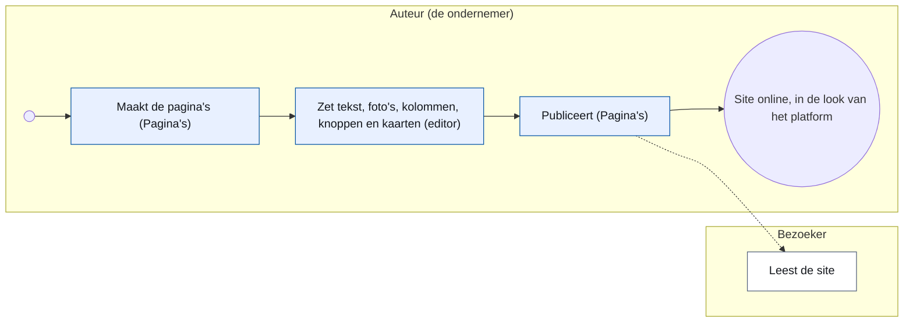
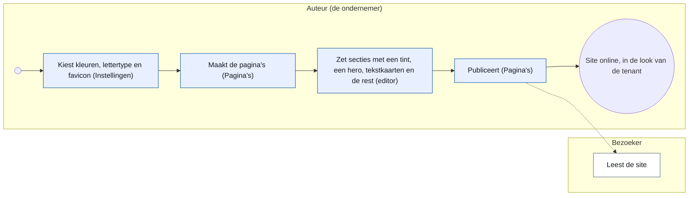
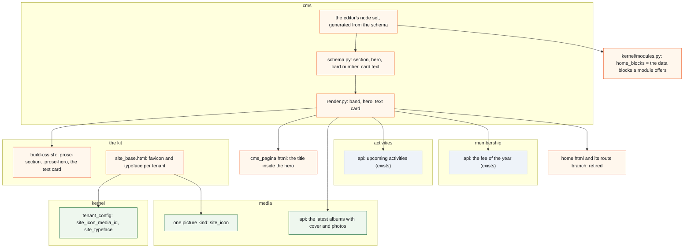

# CR-32 — Sections, text cards, data blocks and a tenant's own look: the page editor hosts a company site and the association's home page

**Status:** shaped on 15 October 2026 by the architecture CLI, on Koen's question through the master CLI · not read against the code yet · not assigned to a release
**Tracking issue:** #2003 — the one place where what is open stands; this document is the design, the issue is the status
**Applies to:** the `cms` domain (the page schema, the renderer, the editor's node set), the kit (`scripts/build-css.sh`, the public shell `site_base.html`), the tenant settings of the kernel (`tenant_config`), the media library (one picture kind); a follow-up of CR-17 (web content) and CR-19 (tenant kinds)
**Reading:** A 2 126 words · B 2 550 · C 1 752 — measured on 15 October 2026, drawings excluded; the budget is A ≤ 1 500, B ≤ 2 500: **over budget**, because three questions of one day stand in one change request (the concept site, the album card, the home page); whether to trim, split or accept is Koen's (B8.8)

---

# Part A — For the business

## A1. Reason to act — the trigger

Koen wants to host the concept website of his company on the platform and edit it there, with the page editor of CR-17: draft, publish, history (Koen, 15 October 2026: "Het doel is deze website in het platform te kunnen hosten. Ondersteunt het platform alle features om deze in het platform te hosten en editeren?"). The master CLI laid the site against the page schema on `master` and found five things the editor lacks; Koen passed three of them on (15 October 2026, to "Mag ik de ontbrekende punten als vraag aan de architectuur-CLI geven?": "Geef je 2, 3 en 5 door aan brainstorm?"):

2. **Coloured sections and a hero.** The site is ten sections, three on a tinted background, opened by a large band with a title, a lead and two buttons. The schema has no section node with a background and no hero.
3. **Text cards.** The site has 25 cards with a number, a heading and a paragraph — pain points, offers, examples — in grids of two and three. The schema's card is a *link* card (a title, one line, one destination); `columns` stops at two.
5. **Its own look.** The site has its own typefaces, a favicon and a colour trio (ink, paper, lime). A tenant brings a logo, a brand colour, an accent colour and its name today; the rest is the platform's shell.

Two more wishes came the same day, in Koen's chat with the architecture CLI, for the same change request:

6. **An album card that moves.** The association's photo page shows its albums as cards Koen likes; he wants such a card on any page, configured with how many of the latest albums it cycles through, how many photos of each album it shows at most, and every how many seconds it moves on; a click opens the album ("zodanig dat je bij wijze van spreken op een pagina een kaart kan invoegen die eigenlijk door de verschillende albums gaat en per album dan een aantal foto's laat zien, bijvoorbeeld om de 3 seconden … want foto's, dat is wel hetgeen dat onze bezoekers aantrekt").
7. **The home page from the CMS.** Today's home page is the list of activities, a band to become a member and a contact button; Koen wants it configurable so that the activity list is a block one inserts, and the sign-up band and the button can be made too, the header and the footer staying the shell's ("dan kunnen we eigenlijk een volledig configureerbare homepagina hebben. Natuurlijk de header blijft dan en de footer ook, maar de content is dan eigenlijk helemaal geconfigureerd geraakt").

The two the master CLI did not pass on — in-page anchors from the menu (the site is one page; one page per section instead) and the collapsible *Meer beelden* galleries — and the site's download of a *gespreksbrief* (a form of the platform instead) are **not decided**: Koen chose to pass on 2, 3 and 5 and did not answer the rest (B8).

## A2. As-is process — how it works today, and where it hurts

The author of a company tenant (CR-19: a company has `cms`, `media` and `forms`) writes a page in the editor from the blocks of the page set: headings, paragraphs, lists, a table, a figure, two columns, a button, a callout, link cards, a form. The page renders in the platform's shell with the tenant's logo, name, brand and accent colour; the menu comes from the pages, the footer from the organisation's details.

<!-- figure: name=cr32-as-is caption=Writing_a_company_site_today_-_every_step_in_the_platform,_three_things_the_author_cannot_say -->

The association's home page is a template of its own (`home.html`): an intro page, the membership band (the fee, *Word lid*, *Contacteer ons*) and the activity cards; a tenant may flag a CMS page as its home page since CR-19, but a CMS page cannot hold the activity list, the band or an album card, so the association's home cannot move. The photo page draws its albums with the kit's photo card (`pub.photo_card`); nothing lets a page show one.

Where it hurts, measured against the concept site: a band that spans the page in a colour cannot be said (every block sits in the one container of C4.13 on white); an opening band with a lead and two buttons cannot be said (a heading, a paragraph and two lone buttons stack at 24 px); a card that only *says* something cannot be said (a card is a link, and one without a reachable destination is left out of the site); the site's typeface and favicon are the platform's.

## A3. To-be process — how it should work afterwards

The same process, with more things the author can say: a **section** with a tone, a **hero** at the top of a page, a **card with a text**, and three **data blocks** the modules supply at render time — the **activity list**, the **membership band** and the **album card** that cycles through the latest albums; and in the tenant's settings a **favicon** and a **typeface pair** beside the colours. With the data blocks the association's home page becomes a page of the CMS. Nothing else changes: the same editor, the same publish, the same shell.

<!-- figure: name=cr32-to-be caption=Writing_a_company_site_afterwards_-_the_same_steps,_a_brand_file_and_three_more_blocks -->

*What to see:* one step is new (the brand file in the settings) and one step is wider (three more blocks); the platform still chooses the pixels.

## A4. Benefits — what the change earns

A company site that reads as the company's and not as the association's, written and published by its owner without a developer; and the same three blocks for every tenant, so an association's *Over ons* page can open with a band too. For the platform: the first site that is not an association's, hosted and edited on it — the proof CR-19 was built for.

## A5. Supplied material — and what it taught us

The concept site in Koen's project folder (a one-page site: `index.html`, `style.css`, `script.js`, 24 screenshots with captions; its README says: no external fonts, no tracking, no cookies, no external scripts, not published). Read against the schema it taught: its ten sections differ in *tone* only (three of ten), not in layout; its 25 cards are all the same shape (number, heading, paragraph), in grids of two or three, and none is a link; its colours are three (ink, paper, lime) of which two are the brand file's (brand and accent) and the third is a tint; its typefaces are system faces; its "value chain" panel beside the hero, its principles strip and its reference case are columns, a list and a figure — nothing the schema lacks.

## A6. Business requirements — what the board asks, with MoSCoW

| # | Requirement | MoSCoW |
|---|---|---|
| R1 | A section of a page can stand on a tinted band that spans the page; the content keeps the container and the left line of C4.13 | Must |
| R2 | A section can carry a small line above its heading (the *eyebrow*: "DE UITDAGING") | Should |
| R3 | A page can open with a hero: the page's title large, a lead, up to two buttons, on a band | Must |
| R4 | A card can be a text card: a number, a heading and a paragraph, no link | Must |
| R5 | Cards stand two or three in a row on a wide screen, under each other on a phone; the kit decides from the count | Must |
| R6 | A tenant chooses a favicon | Must |
| R7 | A tenant chooses its typeface pair from the platform's list | Should |
| R8 | The tones are names (plain, tint, accent), never a colour the author picks; the pixels come from the tenant's brand file | Must |
| R9 | No stylesheet, no CSS, no HTML of the tenant's own; the look stays the kit's (CR-17 C4.7) | Must |
| R10 | The three blocks exist for every tenant kind, in the page set only (not in the newsletter, not in the notes) | Must |
| R11 | A page without a hero and without sections renders exactly as today | Must |
| R12 | The concept site, rebuilt with these blocks, carries its ten sections, its hero, its 25 cards and its 24 screenshots | Should — the acceptance walk |
| R13 | An album card on any page: the author sets how many of the latest albums (1–6), how many photos per album at most (1–8) and the interval in seconds (0 = no movement, else 2–10); it cycles through the albums and their photos; a click opens the album | Must |
| R14 | The album card is the photo page's card, the same look; it moves only when the visitor's browser allows motion, and never on a page that is being edited | Must |
| R15 | The activity list is a block: the upcoming activities as the home page shows them today, with how many at most | Must |
| R16 | The membership band is a block: the fee of the year, *Word lid* and *Contacteer ons*, as today | Must |
| R17 | With R15 and R16 the association's home page is a page of the CMS, flagged as home (CR-19), with the same content as today; the header and the footer stay the shell's | Must — the second acceptance walk |
| R18 | A data block is offered only to a tenant whose module is on (a company without activities cannot insert the activity list) | Must |

## A7. Non-functional requirements — security, privacy, house style, tenants

| Concern | This change |
|---|---|
| **Security** | New nodes are validated by the schema like every node (unknown attribute refused by name); a tone is one of three names; a typeface is one of the platform's pairs; the favicon is a picture of the library served through media's own door. No HTML, no CSS, no URL of the tenant's own enters the page. |
| **Privacy** | No personal data added. |
| **House style / UI norm** | The bands, the hero and the text card are macros of the kit, rendered from the brand tokens the tenant already has (#1622); the public typography stays written once; the editor's insert menu is generated from the schema (CR-11 gate 14). |
| **Multi-tenant** | The brand file is per tenant (`kernel_tenant_settings`); the typeface pair and the favicon are two settings more; a tenant without them keeps the platform's. The platform's own landing site is a tenant like the others (CR-19: the platform kind). |
| **Europe first** | Typefaces are self-hosted files in the repository, as Inter and Radio Canada Big are; no font service, no external request from a page. |

## A8. Acceptance criteria — what the business signs off on HDEV

1. A page with a tinted section shows a band across the page; the text in it starts on the same left line as the text above it, at 390 px and at 1 280 px.
2. A page with a hero opens with its title large on a band, a lead and two buttons; without a hero it opens as today.
3. A card with a text and no destination shows the number, the heading and the paragraph and is not a link; a card with a destination is a link as before.
4. Three cards stand in one row at 1 280 px and under each other at 390 px; two cards stand in two columns.
5. A tenant with a favicon shows it in the browser tab; a tenant without shows the platform's.
6. A tenant with the *neutral* typeface pair shows no display face; with the default pair the site looks as today.
7. The concept site, rebuilt on a company tenant on HDEV, reads as the concept at 390 px and at 1 280 px (R12).
8. An album card with three albums, four photos each, every three seconds: it shows the first album's cover and photos, moves to the next after three seconds, and a click lands on that album's page; with the interval 0 it stands still; with reduced motion set in the browser it stands still.
9. The association's home page, rebuilt as a CMS page with the activity list, the membership band and an intro, reads as today's home page at 390 px and at 1 280 px; the old `home.html` is gone (R17).

---

# Part B — The solution

## B1. Solution outline — the solution and the decisions that shape it

Three additions to the page set of the schema, one addition to the brand file, no new concept:

1. **`section`** — a block node holding blocks, with a `tone` (plain · tint · accent) and an optional `eyebrow`. The renderer draws it as a band that spans the shell's width; inside the band stands the page's container (1 024 px, the left line) exactly as C4.13 draws the rest of the page. A `plain` section is a band without colour — a way to say "this belongs together" and to carry the eyebrow.
2. **`hero`** — a block node that may stand only first in a page, with `tone`, an optional `eyebrow`, a `lead` and up to two `button` children. Its title is the **page's title**: the page has one h1 (#1656), the hero draws it large instead of the title line. A page without a hero keeps the title line.
3. **A text card** — not a new node: the `card` gets two optional attributes, `number` and `text`, and its destination becomes optional. A card without a destination is a text card; the kit draws it without the stretched link and without the arrow. The `cards` block keeps its one rule for the count per row (R5), the kit's own.
4. **Three data blocks** — `activities`, `membership_band`, `albums` — nodes with settings and no content, whose data the owning module supplies at render time, the pattern CR-17 C4.5 chose for the newsletter's activity blocks. `activities` (attr `count`, 1–12) draws the upcoming activities with the kit's activity cards (`_activiteiten_cards.html`, as the home does today); `membership_band` draws the fee, *Word lid* and *Contacteer ons* as `home.html` does; `albums` (attrs `albums` 1–6, `photos` 1–8, `interval` 0 or 2–10 seconds) draws the photo page's card (`pub.photo_card`) cycling with Alpine, no library, and respects `prefers-reduced-motion`. Each is offered in the insert menu only when its module is on for the tenant (R18): the registry's `home_blocks` becomes that list, so a module names the data blocks it offers to the page set, and the home page's own template retires.
5. **The brand file** gains two settings: `site_icon_media_id` (the favicon, a picture of the library) and `site_typeface` (a code of the platform's pairs: `default` = Inter with Radio Canada Big as display, `neutral` = Inter alone). The surface of a tint is derived from the brand colour as the blue scale already is (`brand_tokens`); the accent band uses the accent colour with the text colour `_accent_text` already chooses.

What shapes it: **C4.7 of CR-17 holds** — not a site builder; a tone is a name, a typeface is a choice from a list, the pixels are the kit's. **One place per fact** — the hero has no title of its own, the page's title is it. **Model on what exists** — the card grows two attributes instead of a second card node; the section is one node with a tone instead of three; the brand tokens of #1622 carry the bands.

### B1.1 Functional analysis — the derived requirements

| # | Derived from | Requirement on the solution |
|---|---|---|
| F1 | R1, R8 | `section.tone ∈ {plain, tint, accent}`; the band's colours are read from the tenant's brand tokens at render time, never stored in the document |
| F2 | R1 | the band spans the shell (`w-full`), the content stands in `.cms-page`'s container; a section inside a section is refused by the schema (`section` is not in a section's content group) |
| F3 | R2 | `section.eyebrow` renders as a small capitalised line above the first block; empty renders nothing |
| F4 | R3 | `hero` is allowed only as the first node of a document (the validator refuses it elsewhere, by name); content `button{0,2}`; `lead: str?`, `eyebrow: str?`, `tone` |
| F5 | R3, #1656 | when a document opens with a hero, `cms_pagina.html` draws the title inside the hero and not as the title line above the content |
| F6 | R4 | `card.number: str?`, `card.text: str?`; the four destination attributes stay optional and exclusive; `_card_html` renders a card without destination as a text card and does not drop it |
| F7 | R5 | the count per row stays the look's rule in `build-css.sh` (`.prose-cards`): one card full width, two in two columns, three or more in three columns from the `md` breakpoint, one column below it |
| F8 | R6 | `SITE_ICON_MEDIA_KEY`; the shell writes `<link rel="icon">` to the media URL when set, else the platform's icon; the picture kind is `site_icon` (one row in media's kind list, CR-12) |
| F9 | R7 | `SITE_TYPEFACE_KEY` with a code list `typeface_pairs` (`default`, `neutral`); the shell sets the `--font-brand` token from it; a pair names only files under `static/fonts/` |
| F10 | R9 | no new attribute accepts free text that reaches the HTML unescaped; the sanitiser stays the last net |
| F11 | R10 | the three nodes are added to `BLOCK_SETS["page"]["insert"]` only; the editor's menu offers them from the schema (gate 14); `letter` and `notes` do not change |
| F12 | R11 | the renderer's output for a document without `section` and `hero` is byte-identical to today's (test 9) |
| F13 | R13, R14 | `albums` node: attrs `albums: int` (1–6), `photos: int` (1–8), `interval: int` (0, 2–10); the renderer asks `media.api` for the latest albums with their cover and first photos (the photo page's own query) and draws `pub.photo_card` per album with the photos under it; an Alpine `x-data` cycles albums and photos on the interval, stops under `prefers-reduced-motion` and in the admin preview; the card is a link to the album's page |
| F14 | R15 | `activities` node: attr `count: int` (1–12); the renderer asks `activities.api` for the upcoming activities and includes `_activiteiten_cards.html`, the home's own partial, so one partial serves both until the home retires |
| F15 | R16 | `membership_band` node, no attrs; the renderer asks `membership.api` for the fee of the year and draws the band as `home.html` does today, with the two buttons through the button resolver (`screen = lid-worden`, `form_slug` of the contact form) |
| F16 | R17, R18 | `ModuleSpec.home_blocks` lists the data blocks a module offers to the page set (`activities` → `activities`; `membership` → `membership_band`; `media` → `albums`); the insert menu shows a data block only when the module is on for the tenant; the validator refuses a data block of a module that is off, by name; when every association tenant has a flagged home page, `home.html` and its route branch are removed in the same change (keep it simple) |

## B2. Fit with the process and the requirements — for the business

| Requirement | Where it is met |
|---|---|
| R1, R2, R8 | the `section` node and its band (B1.1 F1–F3) |
| R3 | the `hero` node (F4, F5) |
| R4, R5 | the text card (F6, F7) |
| R6, R7 | the brand file (F8, F9) |
| R9 | C4.7 kept: no free colour, no stylesheet (F1, F10) |
| R10 | the page set only (F11) |
| R11 | unchanged rendering without the new nodes (F12) |
| R12 | the acceptance walk on HDEV (A8.7) |
| R13, R14 | the album card (F13) |
| R15, R16 | the activity list and the membership band (F14, F15) |
| R17, R18 | the data blocks per module, the home as a CMS page, `home.html` retired (F16); the second walk (A8.9) |

The step of A3 that is new — the brand file in the settings — is the tenant's settings screen of the operator today; whether the company's owner may set them is CR-24's question of rights, not this change's (B8).

## B3. The whole across the modules — for the architect

<!-- figure: name=cr32-modules caption=What_changes,_in_the_colours_of_a_change_request:_green_new,_orange_changed,_grey_unchanged -->

*What to see:* no new table, no new domain; two settings and one code-list row are the only new data; the data blocks read through the facades that exist (one query of media's is new), and the home page's own template retires.

**Data.** Two keys in `kernel_tenant_settings` (F8, F9), one row in media's kind list. No migration for the page documents: a node that is not in a document is not there; old documents validate unchanged.

**The editor.** Every node of the schema has its TipTap node extension in the vendored editor (CR-17 phase 1 built `columns`, `cards`, `button`, `callout`, `figure` so). `section` and `hero` need theirs: a wrapping node with a tone selector in its bubble menu; the card's two attributes are two fields in the card's form. The insert menu is generated from the schema (gate 14), so the menu follows.

**The renderer.** `_block_html` gains two kinds; the band is `<section class="prose-section prose-section--tint">` with the container inside; the hero `<section class="prose-hero …">` with the title the template passes in. The text card is a branch in `_card_html`: no destination → no `_resolved`, no link.

**Standards (B3a).** None applies to a section, a hero or a card; a favicon follows the HTML standard's `<link rel="icon">` with a square picture of 32 to 512 px, served as the picture is stored (PNG or SVG). Checked, not applicable: UBL, vCard.

## B4. Rules this change needs an exception from — decided once, here

One. **CR-17 R17 — "the association's sites do not change"** — is left for the home page: with R17 of this change the association's home becomes a CMS page and `home.html` retires. The content stays the same (A8.9 proves it); what changes is where it lives. Koen asked for exactly that (A1, point 7); the decision is his to confirm (B8.5).

C4.7 (not a site builder), C4.13 (one container, one left line) and #1656 (one h1) hold; the hero's title *is* the page's title, the band *contains* the container; a data block is a block of the schema, not a widget system.

## B5. Cost — investment and running cost, and what operations must know

Investment: three phases, each a few days for a dev CLI; the editor extensions are the larger half. Running cost: none — two settings, no service, no job. Operations: nothing after the merge; no env var, no one-off script. A migration only for the two settings' seeds if the settings table seeds its known keys (C1 measures it).

## B6. Phasing — shippable phases, and what changes on the failure paths

| Phase | Ships | Failure path |
|---|---|---|
| 1 | `section` (tone, eyebrow) and `hero`: schema, editor nodes, renderer, kit CSS, the title in the hero, gates | a document with a hero not first is refused at the save with the node's name; a tone outside the three is refused |
| 2 | the text card: `card.number`, `card.text`, destination optional; renderer and card form | a card with both a text and an unreachable destination behaves as today (left out on the site, reason in the preview) |
| 3 | the brand file: favicon and typeface pair; shell, settings screen, media kind | a missing picture falls back to the platform's icon; an unknown pair code is refused by the code list |

| 4 | the data blocks `activities` and `membership_band`, `home_blocks` as the offer per module, the association's home page rebuilt as a CMS page on HDEV, then `home.html` retired | a data block of a module that is off is refused at the save; a flagged home page that fails to render falls back to nothing but an error, as any page — there is no second home |
| 5 | the `albums` block: media's query for the latest albums, the card, the Alpine cycle, reduced motion | an album without photos is skipped; with no album at all the block renders nothing on the site and its reason in the preview |

Phase 1 alone makes the concept's ten sections possible; phase 2 its cards; phase 3 its look; phase 4 the association's home; phase 5 the moving card. Each is useful alone; 4 and 5 do not depend on 1 to 3.

## B7. Rule and gatekeeper — what this fixes for all future work

A rule, for the schema: **a visual choice in a document is a name from a short list, never a value** — a tone, not a colour; a typeface pair, not a font name; a placement, not a width. The gate: the schema's attribute shapes already refuse a free value where a tuple stands (`InvalidShape`); test 2 of C6 proves it for the tone, and the rule goes into `docs/code-style.md`'s section on the page schema when phase 1 is built.

## B8. Open decisions — what the approver still decides

1. **The platform's own home page, or a company tenant with its own domain?** Open with Koen (the master CLI, 15 October 2026). The design holds for both: the platform is a tenant of its own kind (CR-19); the difference is the domain and the menu.
2. **The three points not passed on**: in-page anchors (one page per section instead), the collapsible galleries (the pictures under each other), the download (a form). The master CLI's recommendation; Koen did not answer. My reading: all three stay out, and R12's walk shows whether a page per section reads well.
3. **Who sets the brand file**: the operator (today's settings screen, OPERATOR only) or the company's own administrator. CR-24's rights model answers it; this change adds the two settings to the existing screen.
4. **Two typeface pairs or three**: `default` and `neutral` cover the association and the concept; a third pair is a later row plus its font files.
5. **The association's home as a CMS page** (B4): confirm that `home.html` retires once the home page is rebuilt on HDEV and signed off (A8.9), or keep both. My proposal: retire it in the same change — two homes are two places for one fact.
6. **The album card's defaults**: three albums, four photos, every three seconds (Koen's example); and whether the card shows the album's name and date under the photos as the photo page does. My proposal: yes, the same card.
8. **One change request or two**: the concept site's three points (phases 1–3) and the association's home with the album card (phases 4–5) share the schema and the renderer but nothing else; they can be one document over budget or two within it. My proposal: one, phased as B6, because the data blocks and the sections meet on the same home page.
7. **Where the data blocks stand on the concept site**: the company tenant has no activities and no members, so it sees neither block (R18); the album card it may use if it has albums — the concept's 24 screenshots are figures, not an album.

## B9. Decisions log — dated answers

| Date | Decision | By |
|---|---|---|
| 15 Oct 2026 | The question: host and edit the concept site on the platform; points 2, 3 and 5 to the architecture CLI ("Geef je 2, 3 en 5 door aan brainstorm?") | Koen, through the master CLI |
| 15 Oct 2026 | Added to this change request: the album card that cycles through the latest albums (A1, point 6), and the home page from the CMS with the activity list and the sign-up band as blocks (A1, point 7) — his words in A1 | Koen, in the chat with the architecture CLI |

---

# Part C — For the builder

## C1. Verified premises — measured before the handover

| Premise | Measured, 15 October 2026, `master` |
|---|---|
| The page set's insert menu is `table, figure, columns, button, callout, cards` | `cms/schema.py`, `BLOCK_SETS["page"]["insert"]` |
| `columns` holds `column{1,2}` | `cms/schema.py`, `NODES["columns"]` |
| A card is a link: `title`, `line`, `icon` or `media_id`, `labels`, and exactly one of the four destinations | `NODES["card"]`, `_DESTINATION_ATTRS` |
| A card whose destination cannot be reached is left out of the site | `cms/render.py`, `_card_html` |
| How many cards stand in a row is the look's rule | `_cards_html` docstring: "read from the block (`build-css.sh`)" |
| The page's container is `.cms-page` in `cms_pagina.html`, 1 024 px centred, one left line | CR-17 C4.13; the template line 17 |
| The page's title is the only h1 | #1656, `cms_pagina.html` |
| A tenant has a brand colour and an accent colour with derived tokens, and the text colour on the accent is chosen for contrast | `kernel/tenant_config.py`: `SITE_BRAND_COLOR_KEY`, `SITE_ACCENT_COLOR_KEY`, `brand_tokens`, `_accent_text` |
| The favicon is the platform's for every tenant | `site_base.html` line 50: `statisch('favicon.ico')` |
| The brand typeface is a token, `--font-brand`; Inter and Radio Canada Big are self-hosted under `static/fonts/` | `scripts/build-css.sh` |
| The concept site: ten sections, three tinted (two "green", one "warm"), one hero, 25 cards (number, heading, paragraph), grids of two and three, system typefaces, an SVG favicon | its `index.html` and `style.css` |
| The home page is `home.html`: an intro page (`home-intro`), the membership band (fee, *Word lid*, *Contacteer ons*) and `_activiteiten_cards.html`; a tenant may flag a CMS page as home since CR-19 (`published_home_page`), and then `/` renders that page | `cms/ui.py` `homepage`, `cms/templates/home.html` |
| The registry names per module what it contributes to the home: `activities` → `activity_cards`, `membership` → `membership_band` | `kernel/modules.py`, `home_blocks` |
| The photo page lists the archived activities that have photos, grouped by year, each as `pub.photo_card(name, href, cover, date)`; an album is `/activiteiten/{key}/fotos` | `media/ui.py` `fotos_overzicht`, `_public_macros.html` |
| Alpine is in use for small client state (29 templates); the stylesheet already honours `prefers-reduced-motion` | the templates; `build-css.sh` |

To measure at the build read: whether `kernel_tenant_settings` seeds its known keys (B5); which TipTap version the vendored editor pins and how `columns` registered its node (the pattern for `section`).

## C2. Per module: what must happen

| Module | What |
|---|---|
| `cms` | schema: `section`, `hero`, the card's two attributes, destination optional, the validator's first-node rule for `hero`; renderer: two kinds and the text-card branch; the editor's two node extensions and the card form's two fields; `cms_pagina.html`: the title inside the hero |
| the kit | `build-css.sh`: `.prose-section`, its three tones from the brand tokens, `.prose-hero`, the text card; `site_base.html`: the favicon link and the typeface token per tenant; the design-system page: the three new macros with a demo |
| kernel | `tenant_config.py`: the two keys, their validation (a media id of kind `site_icon`; a code of `typeface_pairs`) |
| media | one row in the kind list, `site_icon`; the picker offers it where the settings ask |
| `app/ui` (tenants screen) | two fields on the tenant's settings |
| `activities`, `membership` | nothing new in the facade; the renderer reads what the home read; `home_blocks` renamed to the data blocks offered |
| `media` | one facade function: the latest albums with their cover and first photos (the photo page's query, once); `home_blocks = ("albums",)` |
| `cms` (home) | `homepage` renders the flagged page only; `home.html` and the intro's special case retire when the association's home is flagged (phase 4) |

## C3. Cross-cutting impact — the checklist of what gets forgotten

The CSS must be rebuilt and committed (`build-css.sh`, the `css` job); the measurement baseline (#1605) gets the hero and a tinted section on a pilot page at 390 px; the design-system page gets the three macros or the completeness gate goes red; the i18n of the three block names in the editor's menu (`Sectie`, `Hero`, the card's `Nummer` and `Tekst`); the sanitiser's allow-list for the band's `<section>` if it does not pass today; the public ratchets (`public_baseline.py`) count hand-written cards — the kit's own text card must not count as one.

## C4. Detailed decisions — one subsection each, with the reasons

### C4.1 A tone is a name; the brand file gives the pixels
Three tones, because the concept uses three (plain, two tints that differ only in hue, an accent band at the end) and because a fourth is a row in the kit, not a choice for the author. The tint is derived from the brand colour as the blue scale is (the lightest step); the accent band is the accent colour with the contrast-chosen text. A tenant with no colours set gets the platform's. No colour per block: C4.7.

### C4.2 The hero carries the page's title
One h1 per page (#1656) and one place per fact: the title is typed once, in the page's title field; the hero draws it. A hero not first in the document is refused: a band with a title in the middle of a page is a section with a heading.

### C4.3 A text card is a card without a destination
The concept's cards and the link cards share everything but the link and the paragraph; a second node would double the renderer, the editor form and the CSS. The one difference the kit shows: no stretched link, no arrow, no hover.

### C4.4 Two settings, no stylesheet
A tenant's look is its brand file: logo, name, two colours, and now a favicon and a typeface pair. What the concept's stylesheet does beyond that — its exact spacing, its radii, its lime underline — is the kit's to decide for everyone, or is not done. This is C4.7 of CR-17 applied to a company.

### C4.5 Typefaces are files in the repository
Europe first and the CSP: no font service. A pair is a code and a set of files under `static/fonts/`; the `neutral` pair needs no new file (Inter is there). A third pair is a later change with its files and its licence.

## C5. Privacy and security — the mechanics behind A7

The favicon is served by media's own door (`GET /media/{id}`) with the kind checked; a picture of another kind is refused at the setting. The typeface code is validated against the list; the token is written from the list, never from the setting's text. The section's and hero's attributes are enumerations and short strings escaped as every attribute is.

## C6. Tests — what the build must prove

1. Schema: a `section` with tone `tint` validates; with tone `pink` is refused with `InvalidShape` naming the attribute (red first: the tuple without `tint`).
2. Schema: a `hero` as the first node validates; as the second node is refused by name.
3. Schema: a `section` inside a `section` is refused.
4. Renderer: a tinted section renders `prose-section--tint` with the container inside; the plain tone renders no colour class.
5. Renderer: a card with `text` and no destination renders the number, the heading and the paragraph and no `<a>`; a card with a destination renders as before (the existing tests stay green).
6. Template: a document opening with a hero renders the title once, inside the hero; without a hero, once, as the title line (count the `<h1>`).
7. Shell: a tenant with `site_icon_media_id` renders `<link rel="icon">` to the media URL; without it, the platform's; a media id of another kind is refused at the setting.
8. Shell: the `neutral` pair sets `--font-brand` to Inter; `default` to Radio Canada Big; an unknown code is refused by the code list.
9. Rendering parity: the documents of the existing tests render byte-identically before and after phase 1 (snapshot on the old code, as the testing convention asks).
10. Browser: the author inserts a section, sets its tone, inserts a hero with two buttons, saves, publishes; the site shows the band at 390 px and 1 280 px; the measurement baseline holds the hero's and the band's positions.
11. Public ratchet: the kit's text card is not counted as a hand-written card.
12. Data blocks: a document with `activities` on a tenant whose activities module is off is refused with the block's name; on a tenant with it on, the renderer draws the upcoming activities through `activities.api` and never touches the session (the layer gate holds).
13. Membership band: the block renders the fee of the year and the two buttons; the contact button resolves through the button resolver to the contact form; without a contact form the button is left out.
14. Album card: three albums, four photos, interval three → the markup carries the albums and photos and the Alpine state; interval 0 → no timer; the admin preview renders without the timer; an album without photos is skipped; a click target is the album's page.
15. Home parity: the association's home rebuilt as a flagged CMS page renders the same intro, band and activity cards as `home.html` did — snapshot of the old home on the old code, compared element by element (the convention's snapshot rule).
16. Browser: the home page at 390 px and 1 280 px after phase 4 — the measurement baseline keeps the home's positions.

## C7. The gate — what refuses a deviation from now on

The schema's shapes (existing `InvalidShape`), extended by the two new nodes; no new gate file. The design-system completeness gate requires the three macros' demos.

## C8. Prototype findings — what was measured before the build

None yet; the build read measures the two open items of C1.

## C9. Screens before the build — the concepts the approver saw

The concept site itself is the screen material: its hero, its tinted sections and its card grids are what the three blocks must be able to say. A drawing of the editor's section node and the card form goes to the design-documentation CLI before phase 1 (the tone selector in the bubble menu; the card form with *Nummer* and *Tekst*).

## C10. Close-out at the release

The status line says "built in vX.Y.Z"; as-built deviations in B9; the contract of `cms` (*Owns*, *Screens*, *Evolutions*) and part B of the architecture document follow; the row of part E that carries this change is closed; A2.4.3 of the architecture document (web content) gains the three blocks.

## Q&A log — asked once, answered here

| # | Question | Answer |
|---|---|---|
| Q1 | Does the hero carry its own title? | No — the page's title (C4.2); proposal, not answered |
| Q2 | May the author pick a colour for a section? | No — a tone from three (C4.1); proposal, not answered |
| Q3 | Is a text card a new node? | No — a card without a destination (C4.3); proposal, not answered |

## Non-goals — deliberately outside this change

- In-page anchors in the menu, collapsible blocks, a file download from a page (B8.2: not decided; out of this question).
- A stylesheet, a theme, free colours or widths per block, a page template (CR-17 C4.7).
- Three or more columns in `columns` (the card grid carries three; a text in three columns is a later question).
- A general widget or plugin system: three data blocks, named by their modules, each a node of the schema; a fourth is a change to the schema.
- Albums of anything but an archived activity's photos (an album is what the photo page shows today).
- A video or an embedded frame (CR-17 R11).
- Changing the association's sites (CR-17 R17): a page without the new nodes renders as today.

## Relationship to existing work — issues and change requests

CR-17 (web content): this is its follow-up; its C4.7, C4.9 and C4.13 are the rules this change keeps, and its R17 the one it leaves for the home page (B4). CR-15 (media library): the albums and the photo card. CR-19: the flagged home page and the modules per tenant that gate the data blocks. CR-19 (tenant kinds): the company tenant this is built for; the platform kind as the alternative of B8.1. CR-11 (GUI redesign 2): the kit's public shell and the design-system page. #1622: the brand tokens the bands read. #1656: one h1 per page. CR-24: who may set the brand file (B8.3). The architecture document: E22 (web content) and a row of its own for this change at the assignment.
