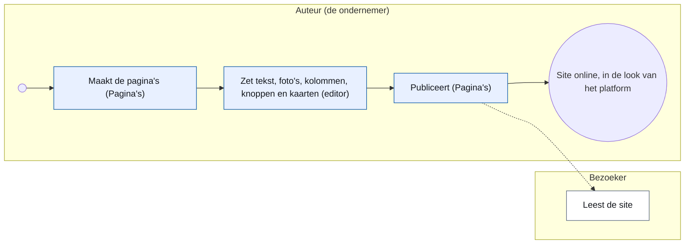
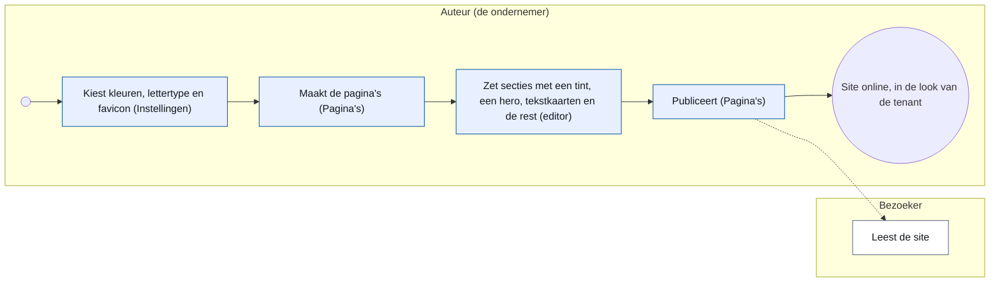
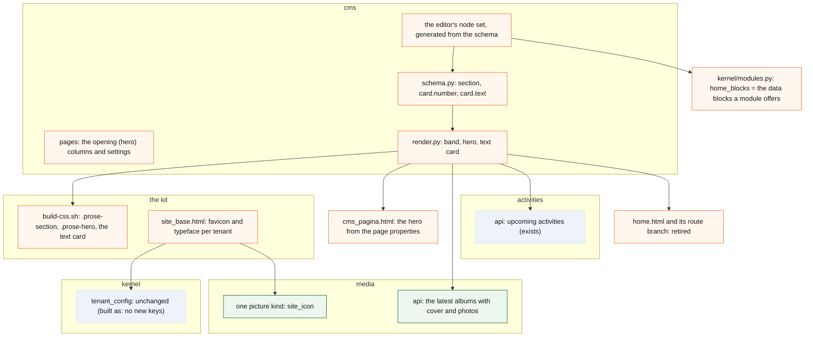

# CR-32 — Sections, text cards, data blocks and a tenant's own look: the page editor hosts a company site and the association's home page

**Status:** shaped on 15 October 2026 by the architecture CLI, on Koen's question through the master CLI · B8 answered the same day · **build read by dev1 taken in** (15 October 2026, #2003: A1–A11, B1–B2, C1–C4, D) · B8.10–B8.12 decided the same day · **built in v2.17.0** (21 October 2026, tag `060e246a`, tracking issue #2003): phases 1, 2, 4, 5 and 6 as designed, phase 3 in part (the favicon is built as the newest picture of the kind `site_icon`; the typeface pair, F9 and R7, is **not built** and dropped on Koen's word), and the additions of 18 October 2026 (a data block in a column, the fixed column ratio, the pause icon, the mark *Groot*, the closed *Opening van de pagina* section — B9); the text card and page editor refinements #2170, #2171, #2172 and #2180 shipped in the same release. Deviations from the design are in B9 and folded into the text below (marked *built as*)
**Tracking issue:** #2003 — the one place where what is open stands; this document is the design, the issue is the status
**Applies to:** the `cms` domain (the page schema, the renderer, the editor's node set), the kit (`scripts/build-css.sh`, the public shell `site_base.html`), the tenant settings of the kernel (`tenant_config`), the media library (one picture kind); a follow-up of CR-17 (web content) and CR-19 (tenant kinds)
**Reading:** A 2 126 words · B 2 550 · C 1 752 — measured on 15 October 2026, drawings excluded; the budget is A ≤ 1 500, B ≤ 2 500: **over budget**, because three questions of one day stand in one change request (the concept site, the album card, the home page); accepted as one document by Koen (B8.8)

---

# Part A — For the business

## A1. Reason to act — the trigger

Koen wants to host the concept website of his company on the platform and edit it there, with the page editor of CR-17: draft, publish, history (Koen, 15 October 2026: "Het doel is deze website in het platform te kunnen hosten. Ondersteunt het platform alle features om deze in het platform te hosten en editeren?"). The master CLI laid the site against the page schema on `master` and found five things the editor lacks; Koen passed three of them on (15 October 2026, to "Mag ik de ontbrekende punten als vraag aan de architectuur-CLI geven?": "Geef je 2, 3 en 5 door aan brainstorm?"):

2. **Coloured sections and a hero.** The site is ten sections, three on a tinted background, opened by a large band with a title, a lead and two buttons. The schema has no section node with a background and no hero.
3. **Text cards.** The site has 25 cards with a number, a heading and a paragraph — pain points, offers, examples — in grids of two and three. The schema's card is a *link* card (a title, one line, one destination); `columns` stops at two.
5. **Its own look.** The site has its own typefaces, a favicon and a colour trio (ink, paper, lime). A tenant brings a logo, a brand colour, an accent colour and its name today; the rest is the platform's shell.

Two more wishes came the same day, in Koen's chat with the architecture CLI, for the same change request:

6. **An album card that moves.** The association's photo page shows its albums as cards Koen likes; he wants such a card on any page, configured with how many of the latest albums it cycles through, how many photos of each album it shows at most, and every how many seconds it moves on; a click opens the album ("zodanig dat je bij wijze van spreken op een pagina een kaart kan invoegen die eigenlijk door de verschillende albums gaat en per album dan een aantal foto's laat zien, bijvoorbeeld om de 3 seconden … want foto's, dat is wel hetgeen dat onze bezoekers aantrekt").
7. **The home page from the CMS.** Today's home page is the list of activities, a band to become a member and a contact button; Koen wants it configurable so that the activity list is a block one inserts, and the sign-up band and the button can be made too, the header and the footer staying the shell's ("dan kunnen we eigenlijk een volledig configureerbare homepagina hebben. Natuurlijk de header blijft dan en de footer ook, maar de content is dan eigenlijk helemaal geconfigureerd geraakt").

8. **CR-17's phase 5 moves here** (Koen, 15 October 2026, to the proposal to end CR-17 at v2.17 with what is built plus its phases 3 and 4, and to put everything "blocks and look after v2.17" in one document: "Ja, verhuis fase 5 naar CR-32"): the **value block** — the five placeholders of the tenant's settings (the two membership amounts, the three dates) and the platform's list of sites as a block chosen from *Blok invoegen › Waarde*, shown in the editor as a chip with the current value, rendered from `tenant_config`; the migration maps `{{code}}` in old documents to a value node; a company tenant sees only the values its kind has — and the **gallery block** on one album, taken from CR-15's picker (CR-17 C4.4, F5, AC4, as they stood on 15 October 2026). The renderer keeps replacing the codes in the meantime.

The two the master CLI did not pass on — in-page anchors from the menu (the site is one page; one page per section instead) and the collapsible *Meer beelden* galleries — and the site's download of a *gespreksbrief* (a form of the platform instead) are **not decided**: Koen chose to pass on 2, 3 and 5 and did not answer the rest (B8).

## A2. As-is process — how it works today, and where it hurts

The author of a company tenant (CR-19: a company has `cms`, `media` and `forms`) writes a page in the editor from the blocks of the page set: headings, paragraphs, lists, a table, a figure, two columns, a button, a callout, link cards, a form. The page renders in the platform's shell with the tenant's logo, name, brand and accent colour; the menu comes from the pages, the footer from the organisation's details.

<!-- figure: name=cr32-as-is caption=Writing_a_company_site_today_-_every_step_in_the_platform,_three_things_the_author_cannot_say -->

The association's home page is a template of its own (`home.html`): an intro page, the membership band (the fee, *Word lid*, *Contacteer ons*) and the activity cards; a tenant may flag a CMS page as its home page since CR-19, but a CMS page cannot hold the activity list, the band or an album card, so the association's home cannot move. The photo page draws its albums with the kit's photo card (`pub.photo_card`); nothing lets a page show one.

Where it hurts, measured against the concept site: a band that spans the page in a colour cannot be said (every block sits in the one container of C4.13 on white); an opening band with a lead and two buttons cannot be said (a heading, a paragraph and two lone buttons stack at 24 px); a card that only *says* something cannot be said (a card is a link, and one without a reachable destination is left out of the site); the site's typeface and favicon are the platform's.

## A3. To-be process — how it should work afterwards

The same process, with more things the author can say: a **section** with a tone, a **hero** at the top of a page, a **card with a text**, and two **data blocks** the modules supply at render time — the **activity list** and the **album card** that cycles through the latest albums — while the membership band is made from blocks that exist (a section, the fee as a value, two buttons); and a **favicon** beside the colours (built as, B9: the newest picture of the media kind `site_icon`, no setting; the typeface pair was dropped). With the data blocks the association's home page becomes a page of the CMS. Nothing else changes: the same editor, the same publish, the same shell.

<!-- figure: name=cr32-to-be caption=Writing_a_company_site_afterwards_-_the_same_steps,_a_brand_file_and_three_more_blocks -->

*What to see:* one step is new (the brand file in the settings) and one step is wider (three more blocks); the platform still chooses the pixels.

## A4. Benefits — what the change earns

A company site that reads as the company's and not as the association's, written and published by its owner without a developer; and the same three blocks for every tenant, so an association's *Over ons* page can open with a band too. For the platform: the first site that is not an association's, hosted and edited on it — the proof CR-19 was built for.

## A5. Supplied material — and what it taught us

The concept site in Koen's project folder (a one-page site: `index.html`, `style.css`, `script.js`, 24 screenshots with captions; its README says: no external fonts, no tracking, no cookies, no external scripts, not published). Read against the schema it taught: its ten sections differ in *tone* only (three of ten), not in layout; its 25 cards are all the same shape (number, heading, paragraph), in grids of two or three, and none is a link; its colours are three (ink, paper, lime) of which two are the brand file's (brand and accent) and the third is a tint; its typefaces are system faces; its "value chain" panel beside the hero, its principles strip and its reference case are columns, a list and a figure — nothing the schema lacks.

## A6. Business requirements — what the board asks, with MoSCoW

| # | Requirement | MoSCoW |
|---|---|---|
| R1 | A section of a page can stand on a tinted band that spans the page; the content keeps the container and the left line of C4.13 | Must |
| R2 | A section can carry a small line above its heading (the *eyebrow*: "DE UITDAGING") | Should |
| R3 | A page can open with a hero: the page's title large, a lead, an eyebrow, up to two buttons, on a band — a property of the page, set beside its title, not a block of the document | Must |
| R4 | A card can be a text card: a number, a heading and a paragraph, no link | Must |
| R5 | Cards stand two or three in a row on a wide screen, under each other on a phone; the kit decides from the count, as it does for link cards today | Must |
| R6 | A tenant has a favicon (built as, B9: the newest picture of the kind `site_icon`, as the logo works) | Must |
| R7 | ~~A tenant chooses its typeface pair from the platform's list~~ **Dropped** (Koen, 15 October 2026, B9): not built in phase 3; a tenant that wants its own typeface is a new request | — |
| R8 | The tones are names (plain, tint, accent), never a colour the author picks; the pixels come from the tenant's brand file | Must |
| R9 | No stylesheet, no CSS, no HTML of the tenant's own; the look stays the kit's (CR-17 C4.7) | Must |
| R10 | The three blocks exist for every tenant kind, in the page set only (not in the newsletter, not in the notes) | Must |
| R11 | A page without a hero and without sections renders exactly as today | Must |
| R12 | The concept site, rebuilt with these blocks, carries its ten sections, its hero, its 25 cards and its 24 screenshots | Should — the acceptance walk |
| R13 | An album card on any page: the author sets how many of the latest albums (1–6), how many photos per album at most (1–8) and the interval in seconds (0 = no movement, else 2–10); it cycles through the albums and their photos; a click opens the album; a moving card can be paused with a small round icon on the picture (WCAG 2.2.2; built as, B9) | Must |
| R14 | The album card is the photo page's card, the same look and the same one picture slot: the photos of an album cycle **one at a time** in that slot (the cover first), then the next album; it moves only when the visitor's browser allows motion, and never on a page that is being edited | Must |
| R15 | The activity list is a block: the upcoming activities as the home page shows them today, with how many at most (1–50; built as, B9: the old home showed every upcoming activity) | Must |
| R16 | The membership band of the home page can be made from blocks: a section in the accent tone holding two columns — the intro at the left, at the right the fee of the year and *geldig tot en met <jaar>* as values in a paragraph (a sixth value, `membership_valid_until`, the year of `membership_valid_period()`), the *Word lid* button and the *Contacteer ons* button | Must |
| R17 | With R15 and R16 the association's home page is a page of the CMS, flagged as home (CR-19), with the same content as today; the header and the footer stay the shell's | Must — the second acceptance walk |
| R18 | A data block is offered only to a tenant whose module is on (a company without activities cannot insert the activity list) | Must |
| R19 | The value block (from CR-17 phase 5): a value of the tenant's settings placed in a text as a block from a closed list — the two membership amounts, the three dates, the platform's list of sites — shown in the editor with its current value and rendered from the settings; the old `{{code}}` placeholders migrate to it | Must |
| R21 | A page stores the heading levels it shows: *Kop*, *Subkop* and *Kleine kop* write h2, h3 and h4; the page's title is the only h1; the renderer no longer shifts headings | Must — decided (Koen, 15 October 2026: "Akkoord om de pagina te laten opslaan wat ze renderen") |
| R22 | A data block (`activities`, `albums`) stands at the root or in a column of a columns block at the root; two columns take a fixed ratio (equal, wide–narrow 3 : 2, narrow–wide 2 : 3) and stack in source order on a phone (added 18 October 2026, built as, B9) | Must |
| R20 | The gallery block (from CR-17 phase 5): one album of the library, chosen from a select of the photo page's albums with their year (built as, B9), shown as a grid of its photos with the kit's look; a click opens the photo | Must |

## A7. Non-functional requirements — security, privacy, house style, tenants

| Concern | This change |
|---|---|
| **Security** | New nodes are validated by the schema like every node (unknown attribute refused by name); a tone is one of three names; the favicon is a picture of the library served through media's own door. No HTML, no CSS, no URL of the tenant's own enters the page. |
| **Privacy** | No personal data added. |
| **House style / UI norm** | The bands, the hero and the text card are macros of the kit, rendered from the brand tokens the tenant already has (#1622); the public typography stays written once; the editor's insert menu is generated from the schema (CR-11 gate 14). |
| **Multi-tenant** | The brand file is per tenant (`kernel_tenant_settings`); the favicon is the newest picture of the kind `site_icon` (built as, B9: no setting); a tenant without one keeps the platform's icon. The platform's own landing site is a tenant like the others (CR-19: the platform kind). |
| **Europe first** | No typeface is added (R7 dropped); Inter and Radio Canada Big stay the self-hosted files they are; no font service, no external request from a page. |

## A8. Acceptance criteria — what the business signs off on HDEV

1. A page with a tinted section shows a band across the page; the text in it starts on the same left line as the text above it, at 390 px and at 1 280 px.
2. A page with a hero opens with its title large on a band, a lead and two buttons; without a hero it opens as today.
3. A card with a text and no destination shows the number, the heading and the paragraph and is not a link; a card with a destination is a link as before.
4. Three cards stand in one row at 1 280 px and under each other at 390 px; two cards stand in two columns.
5. A tenant with a favicon shows it in the browser tab; a tenant without shows the platform's.
6. ~~A tenant with the *neutral* typeface pair shows no display face~~ Not built (R7 dropped, B9): every site keeps its typefaces as today.
7. The concept site, rebuilt on a company tenant on HDEV, reads as the concept at 390 px and at 1 280 px (R12).
8. An album card with three albums, four photos each, every three seconds: it shows the first album's cover and photos, moves to the next after three seconds, and a click lands on that album's page; with the interval 0 it stands still; with reduced motion set in the browser it stands still.
9. The association's home page, rebuilt as a CMS page with the intro, the band (a section with columns: intro, fee, valid-until year, two buttons) and the activity list, carries the same content as today's home page and reads well at 390 px and at 1 280 px in the kit's layout (B8.10); a visitor who just sent a contact message still sees the thank-you banner on it; the old `home.html` is gone (R17). Built as (B9): the page's title is its one `h1`, visually hidden; the activity list may stand in a column beside the intro.
10. The membership price is placed as a value and follows the setting (CR-17's AC4): change the amount in the settings and the page shows the new amount without an edit.
11. A gallery of one album shows its photos as a grid at 390 px and at 1 280 px, and a page with an old `{{membership_price_full}}` placeholder shows the amount before and after the migration.

---

# Part B — The solution

## B1. Solution outline — the solution and the decisions that shape it

Three additions to the page set of the schema, one addition to the brand file, no new concept:

1. **`section`** — a block node holding blocks, with a `tone` (plain · tint · accent) and an optional `eyebrow`. The renderer draws it as a band that spans the shell's width; inside the band stands the page's container (1 024 px, the left line) exactly as C4.13 draws the rest of the page. A `plain` section is a band without colour — a way to say "this belongs together" and to carry the eyebrow.
2. **The hero** — not a node but **a property of the page** (B8.11): beside its title the page carries an *opening* — the title line (today) or a hero with `tone`, an optional `eyebrow`, a `lead` and up to two buttons with the button block's destinations. The template draws it with the page's title as the one h1 (#1656), in the place of the title line, after the concept banner; the renderer and the document know nothing of it. One place for the title, no position rule.
3. **A text card** — not a new node: the `card` gets two optional attributes, `number` and `text`, and its destination becomes optional. A card without a destination is a text card; the kit draws it without the stretched link and without the arrow. The `cards` block keeps its one rule for the count per row (R5), the kit's own.
4. **The value block and the gallery** — CR-17's phase 5, moved here whole: the `value` inline node already in the schema (`VALUE_CODES`), now in the toolbar and the editor as a chip, with the migration of `{{code}}` to it; the platform's list of sites as the one value that renders a list (CR-17 Q22); and a `gallery` block node with the album's `activity_id`, drawn as a grid of the album's photos with the kit's photo look (CR-17 F5). Nothing of CR-17's design changes by the move; only where it is built and closed.
5. **Two data blocks** — `activities`, `albums` — nodes with settings and no content, whose data the owning module supplies at render time, the pattern CR-17 C4.5 chose for the newsletter's activity blocks. `activities` (attr `count`, 1–50; built as, B9) draws the upcoming activities with the kit's activity cards (`_activiteiten_cards.html`, as the home does today); `albums` (attrs `albums` 1–6, `photos` 1–8, `interval` 0 or 2–10 seconds) draws the photo page's card (`pub.photo_card`) cycling with Alpine, no library, and respects `prefers-reduced-motion`. Each is offered in the insert menu only when its module is on for the tenant (R18): the registry's `home_blocks` becomes that list, so a module names the data blocks it offers to the page set, and the home page's own template retires. The **membership band** needs no data block: it is a section in the accent tone with the fee as a value placeholder (`membership_price_full`, phase 4 of this change; the renderer already replaces the placeholder written as text, so a band shows the fee even before phase 4) and two buttons; the switch of today's band — *Mijn gezin* instead of *Word lid* for a signed-in member with a household — is B8.9.
6. **The brand file** gains a favicon: built as (B9), the newest picture of the media kind `site_icon`, as the logo works, with no setting (a typeface setting, `site_typeface` with the pairs `default` and `neutral`, was designed and dropped). The surface of a tint is derived from the brand colour as the blue scale already is (`brand_tokens`); the accent band uses the accent colour with the text colour `_accent_text` already chooses.

What shapes it: **C4.7 of CR-17 holds** — not a site builder; a tone is a name, a typeface is a choice from a list, the pixels are the kit's. **One place per fact** — the hero has no title of its own, the page's title is it. **Model on what exists** — the card grows two attributes instead of a second card node; the section is one node with a tone instead of three; the brand tokens of #1622 carry the bands.

### B1.1 Functional analysis — the derived requirements

| # | Derived from | Requirement on the solution |
|---|---|---|
| F1 | R1, R8 | `section.tone ∈ {plain, tint, accent}`; the band's colours are read from the tenant's brand tokens at render time, never stored in the document |
| F2 | R1 | the page's HTML stands inside the 1 024 px container `.doc-page` (the prose class inside it is `.cms-page`), so a band cannot span the page by itself: the kit gets **one full-bleed rule** for `.prose-section` and `.prose-hero` — the band breaks out of the container (`margin-inline: calc(50% - 50vw)`) and re-applies the container's width and padding to its own content — and both classes join the `:not()` list of the 768 px prose rule in `build-css.sh`, or they would be held at 768 px; a section inside a section, a column, a cell or a quotation is refused by the validator (F2a) |
| F2a | R1 | `section` is **not** in the group `block` (which would make it legal in every `block+` container: a column, a list item, a table cell, a quotation, a section); the root's content stays `block+` in the grammar and **one rule in `validate_document`** says: `section` stands at the root only — a new validator rule, proven red (C6.3), and the first mechanism of its kind in the schema (`_CONTENT_EXPR` reads one selector and one quantifier, no sequence, no exclusion) |
| F3 | R2 | `section.eyebrow` renders as a small capitalised line above the first block; empty renders nothing |
| F4 | R3 | the page gets an `opening` (`title_line` · `hero`) with `hero_tone`, `hero_eyebrow`, `hero_lead` and two optional buttons (label and the four destination attributes of the button block, exclusive, resolved by the one resolver) — columns of `cms.pages` and fields of the page's settings form; no node in the document (built as, B9: the form's *Opening van de pagina* is a closed section at the bottom of the page screen) |
| F5 | R3, #1656 | `cms_pagina.html` draws the hero from the page's properties with the page's title as its h1, after the concept banner (``), in the place of the title line; a page whose opening is `title_line` renders as today; the kit's `.prose-hero` band uses the full-bleed rule of F2 |
| F6 | R4 | `card.number: str?`, `card.text: str?`; the four destination attributes stay exclusive and become optional **in three places**: `_one_destination("card", …)` in `validate_document` (refuses none today), `_card_html` (returns nothing for an unresolved card today) and the card dialog in `_macros.html` (gets the choice *geen*); two tests guard the old rule and are rewritten, not kept: `test_document_shape_1671.py::test_a_card_without_a_destination_or_with_two_is_refused` and `tests/integration/test_cards_1770.py::test_a_card_is_one_link_to_its_resolved_destination` |
| F7 | R5 | the count per row stays the look's rule in `build-css.sh` (`.prose-cards`) **as it is today**: two columns, three from the third card (`:has(>:nth-child(3))`), one column under the phone breakpoint and inside a column — so a lone card stands half wide, as a lone link card does; no change to the rule, nothing moves on the existing sites |
| F8 | R6 | built as (B9): the shell writes `<link rel="icon">` to the media URL of the newest picture of the kind `site_icon` (one row in media's kind list, migration 207), else the platform's icon; no `SITE_ICON_MEDIA_KEY`, no setting, no picker, no kind check at a setting; SVG allowed for this kind as for the logo; the apple-touch-icon and `/favicon.ico` keep the platform's icon |
| F9 | R7 | **not built** (R7 dropped, B9): no `SITE_TYPEFACE_KEY`, no pairs, no `--font-brand` per tenant |
| F10 | R9 | no new attribute accepts free text that reaches the HTML unescaped; the sanitiser stays the last net |
| F11 | R10 | the new nodes are added to `BLOCK_SETS["page"]["insert"]` only; `letter` and `notes` do not change. The editor's menu is **not** reachable from the schema alone: `static/document-editor.js` filters the configured insert items by a hard-coded list (`table`, `figure`, `columns`, `button`, `callout`, `cards`) and registers one TipTap `Node.create` per node (`columnsNode(RaakTiptap)` is the pattern; TipTap 3.31.4, vendored) — every new node is a change to that script as well, and that list is a second place the gate 14 does not see: the build names it per node in its commit |
| F12 | R11 | the renderer's output for a document without `section` and `hero` is byte-identical to today's (test 9) |
| F13 | R13, R14 | `albums` node: attrs `albums: int` (1–6), `photos: int` (1–8), `interval: int` (0, 2–10); the renderer asks `media.api` for the latest albums with their cover and first photos (the photo page's own query) and draws **one** `pub.photo_card` (one picture slot, `_public_macros.html`) whose picture, name, date and link an Alpine `x-data` swaps on the interval — photo by photo through an album, then the next album — stopping under `prefers-reduced-motion`, with interval 0 and in the admin preview; the card is a link to the album it shows at that moment (not boosted by htmx, B9); a small round pause icon on the picture, a sibling of the card's link with a 44 × 44 px hit area, shown only while the card moves (built as, B9); no second card macro. A data block may stand in a column (F20) |
| F14 | R15 | `activities` node: attr `count: int` (1–50, built as, B9); the renderer asks `activities.api` for the upcoming activities and renders `_activiteiten_cards.html`, the home's own partial, through `templates.env` with the context it needs (`path_for`, the macros, `code_label`), as `_tenant_sites.html` is rendered today, so one partial serves both until the home retires. **The viewer becomes an input of `render_document`**: `published_html` renders per request without the request today, and two things need the signed-in person — the *Mijn gezin* switch of B8.9 (today `gebruiker.has_household` in `home.html`) and nothing else yet; the parameter is optional and `None` for the preview, the chatbot and the mail. The chatbot's text target (`_document_text`) renders a data block as nothing: the bot has its own tools for activities and albums |
| F15 | R16 | no node: a `section` with tone `accent` holding `columns` (the intro | a paragraph with the values `membership_price_full` and the new `membership_valid_until`, then a `button` to the screen *lid-worden* and a `button` to the contact form); the switch to *Mijn gezin* for a signed-in member with a household is one rule of the button resolver for every button to that screen (B8.9: a). **The band's look is the kit's section-with-columns, not today's rounded box** (B8.10): the content is the same, the picture is the kit's; A8.9 judges it on HDEV in words, not element by element |
| F19 | R21 | `HEADING_LEVELS` of the page set and the notes set become (2, 3, 4), the toolbar keeps its three names; a one-off migration rewrites h1→h2, h2→h3, h3→h4 in every stored document (published and draft), proven on a snapshot; `headings_one_level_down` and its call in `render_document` go (built as, B9: it stays for the fallback of a page that kept her HTML), with their tests replaced by tests on the stored level; the site blocks (the home intro, the footer) store h2 too, which stands right once the home is a CMS page with its own title (phase 5). Built as (B9): migration 200 was changed to keep writing what it always wrote, 204 is not idempotent, and a CMS page that holds a section is no scroll holder (its tables scroll themselves, its text breaks anywhere) |
| F17 | R19 | the `value` node is already in the schema (`NODES["value"]`, `VALUE_CODES`) and the editor already has a **Code** item in its insert menu that inserts the placeholder as *text* (CR-17's step 1, 13 October 2026); the change is **not a second way in** but the one item repointed: the Code item inserts the value node, shown as a chip with the current value (read at edit time through `cms.api`), and the text path goes in the same change (keep it simple); the renderer renders the value from `tenant_config` (it already replaces the text placeholders in `_values()`, so a page shows the fee today); a one-off migration (206) rewrites `{{code}}` text to value nodes in every published and draft document, proven on a snapshot (built as, B9: a typed code that carries a link mark stays text, since a value node has no marks, and is counted); the list-of-sites value renders the kit's site cards as the landing does today |
| F18 | R20 | `gallery` block node: attr `activity_id: int` (an archived activity with photos, chosen from a select of the photo page's albums with their year; built as, B9: CR-15's picker picks pictures, not albums); the renderer asks `media.api` for the album's photos and draws the grid with the kit's figure look; an album without photos renders nothing on the site and its reason in the preview |
| F16 | R17, R18 | `ModuleSpec.home_blocks` (read by nothing today) lists the data blocks a module offers to the page set (`activities` → `activities`; `media` → `albums`; `membership` offers none: its band is made from ordinary blocks); the insert menu shows a data block only when the module is on for the tenant; **the validator decides by shape alone and does not know the tenant** (`validate_document`: "`set_name` decides nothing here"), so the module check is a rule of the service before the save, with the tenant's module set from `kernel.modules`, refusing by the block's name; when both association tenants have a flagged home page, `home.html`, its route branch and `tests/integration/test_golf11_home.py` (which guards the home's composition per module) are replaced in the same change (keep it simple) |
| F20 | R22 | built as (B9, #2101): `activities` and `albums` stand at the root or in a column of a columns block at the root, nowhere deeper (a section, a quotation and a cell refuse them); such a columns block is drawn outside the prose, each cell with its own prose strip and data-block holder, and a columns block without one stays in the prose, byte-equal; `columns` takes a fixed `ratio` (equal when absent, wide–narrow 3 : 2, narrow–wide 2 : 3), a select in the editor's toolbar while the cursor stands in the columns block; the insert menu puts a data block at the end of the cursor's column when that column stands at the root; on a phone the columns stack in source order. Koen, 18 October 2026: cards for the activities ("1a"), the ratio a fixed choice ("2 akkoord"), the count as it is ("4 houden zoals nu"), the section outside for now ("ja, bouwen voor kolommen, sectie erbuiten") |
| F21 | — | built as (B9, #2093–#2096): the home page's title is visually hidden but stays the page's one `h1`; a mark *Groot* makes words heading-sized inside a line, also on a value (the editor bundle rebuilt with `Mark`) |

## B2. Fit with the process and the requirements — for the business

| Requirement | Where it is met |
|---|---|
| R1, R2, R8 | the `section` node and its band (B1.1 F1–F3) |
| R3 | the hero as a page property (F4, F5) |
| R4, R5 | the text card (F6, F7) |
| R6 | the favicon (F8); R7 dropped (F9 not built) |
| R9 | C4.7 kept: no free colour, no stylesheet (F1, F10) |
| R10 | the page set only (F11) |
| R11 | unchanged rendering without the new nodes (F12) |
| R12 | the acceptance walk on HDEV (A8.7) |
| R13, R14 | the album card (F13) |
| R15, R16 | the activity list (F14); the membership band from existing blocks (F15) |
| R17, R18 | the data blocks per module, the home as a CMS page, `home.html` retired (F16); the second walk (A8.9) |
| R19, R20 | the value block and the gallery (F17, F18); A8.10, A8.11 |
| R22 | a data block in a column, the fixed ratio (F20) |

The step of A3 that is new — the brand file in the settings — is the tenant's settings screen of the operator today; whether the company's owner may set them is CR-24's question of rights, not this change's (B8).

## B3. The whole across the modules — for the architect

<!-- figure: name=cr32-modules caption=What_changes,_in_the_colours_of_a_change_request:_green_new,_orange_changed,_grey_unchanged -->

*What to see:* no new table, no new domain; one code-list row (built as, B9: the favicon needs no setting) is the only new data; the data blocks read through the facades that exist (one query of media's is new), and the home page's own template retires.

**Data.** One row in media's kind list (F8; built as, B9: no key in `kernel_tenant_settings`, F9 not built), the opening columns on `cms.pages` (F4: one migration, additive, default `title_line`), and the one-off rewrite of the heading levels (F19). Otherwise nothing: a node that is not in a document is not there; old documents validate unchanged.

**The editor.** Every node of the schema has its TipTap node extension in the vendored editor (`static/document-editor.js`, TipTap 3.31.4; `columns` registers as `columnsNode(RaakTiptap)`, one `Node.create` per node). `section` needs its own: a wrapping node with a tone selector in its bubble menu; the hero needs none (a property of the page); the data blocks a settings dialog each; the card's two attributes are two fields in the card's form and its destination choice gets *geen*. The insert menu's items come from the schema, but the script filters them by a hard-coded list (A4 of the build read): that list grows per node, in the same commit as the node.

**The renderer.** `_block_html` gains the section kind: the band is `
` — a `div`, because the sanitiser's allow-list (`_ALLOWED_TAGS`) has no `section` and a security allow-list does not grow for a tag name — with its blocks inside and the full-bleed rule of F2 around it. The hero is not the renderer's (F5): the renderer returns its parts, the template draws it. The text card is a branch in `_card_html`: no destination → no `_resolved`, no link. A data block is rendered through `templates.env` with the context it needs (F14, F15, F13), as `_tenant_sites.html` is rendered today.

**Standards (B3a).** None applies to a section, a hero or a card; a favicon follows the HTML standard's `<link rel="icon">` with a square picture of 32 to 512 px, served as the picture is stored (PNG or SVG). Checked, not applicable: UBL, vCard.

## B4. Rules this change needs an exception from — decided once, here

One. **CR-17 R17 — "the association's sites do not change"** — is left for the home page: with R17 of this change the association's home becomes a CMS page and `home.html` retires. The content stays the same (A8.9 proves it); what changes is where it lives. Koen asked for exactly that (A1, point 7); the decision is his to confirm (B8.5).

C4.7 (not a site builder), C4.13 (one container, one left line) and #1656 (one h1) hold; the hero's title *is* the page's title, the band *contains* the container; a data block is a block of the schema, not a widget system.

## B5. Cost — investment and running cost, and what operations must know

Investment: three phases, each a few days for a dev CLI; the editor extensions are the larger half. Running cost: none — no service, no job. Operations: nothing after the merge; no env var, no one-off script. Built as (B9), the migrations are: 204 (the heading levels, F19), 206 (`{{code}}` to value nodes), 207 (the `site_icon` row), 208 (the home page of every association), beside the opening columns on `cms.pages`; migration 200 of CR-17 was changed.

## B6. Phasing — shippable phases, and what changes on the failure paths

| Phase | Ships | Failure path |
|---|---|---|
| 1 | first the heading levels (F19: store what is shown, the migration, the shift removed), then `section` (tone, eyebrow) and the hero (its form per B8.11): schema, editor nodes, renderer, kit CSS, gates | a hero button with two destinations is refused at the save by name; a tone outside the three is refused |
| 2 | the text card: `card.number`, `card.text`, destination optional; renderer and card form | a card with both a text and an unreachable destination behaves as today (left out on the site, reason in the preview) |
| 3 | built as (B9): the favicon as the newest picture of the kind `site_icon`; shell, media kind. The typeface pair is not built | a missing picture falls back to the platform's icon |

| 4 | CR-17's phase 5: the Code item repointed to the value node with the migration of the placeholders, the sixth value `membership_valid_until`, the list of sites as a value, the gallery block on an album (chosen from a select of albums, B9) | the migration is proven on a snapshot of every document; a placeholder it cannot map stays text and is listed |
| 5 | the data block `activities`, `home_blocks` as the offer per module, the association's home page rebuilt as a CMS page on HDEV for both association tenants (the band from a section, the value and two buttons), then `home.html` retired | a data block of a module that is off is refused at the save; a flagged home page that fails to render falls back to nothing but an error, as any page — there is no second home |
| 6 | the `albums` block: media's query for the latest albums, the card, the Alpine cycle, reduced motion, the pause icon | an album without photos is skipped; with no album at all the block renders nothing on the site and its reason in the preview |

Phase 1 alone makes the concept's ten sections possible; phase 2 its cards; phase 3 its favicon; phase 4 finishes CR-17's blocks; phase 5 the association's home (it needs 4 for the fee); phase 6 the moving card. 4 and 6 do not depend on 1 to 3; 5 needs 1 (the band is a section in the accent tone) and 4 (the values). Order, as proposed to Koen on 15 October 2026: 1–3 first (the iX site), then 4, 5, 6; one builder at a time on the schema and the renderer.

## B7. Rule and gatekeeper — what this fixes for all future work

A rule, for the schema: **a visual choice in a document is a name from a short list, never a value** — a tone, not a colour; a typeface pair, not a font name; a placement, not a width. The gate: the schema's attribute shapes already refuse a free value where a tuple stands (`InvalidShape`); test 2 of C6 proves it for the tone, and the rule goes into `docs/code-style.md`'s section on the page schema when phase 1 is built.

## B8. Open decisions — what the approver still decides

1. ~~The platform's own home page, or a company tenant with its own domain?~~ **Decided**: a company tenant, iX, with its own domain (Koen, 15 October 2026: "De website zou over een tenant gaan, IX. Dus de website die master doorgaf gaat over een tenant, IX, die dus specifieke requirements heeft rond layouting en visualisatie en mogelijkheden van de website."). The tenant's own requirements on layout and visualisation are R1–R9; what the kit decides for every tenant stays the kit's (C4.4).
2. ~~The three points not passed on~~ **Decided: out** — in-page anchors (one page per section instead), the collapsible galleries (the pictures under each other), the download (a form of the platform) stay outside this change (Koen, 15 October 2026, to the three open questions of B8.9, B8.2 and B8.8: "a op 1, ja op 2, één document op 3"); R12's walk shows whether a page per section reads well.
3. ~~**Who sets the brand file**: the operator (today's settings screen, OPERATOR only) or the company's own administrator. CR-24's rights model answers it; this change adds the two settings to the existing screen.~~ **Closed, no object left** (15 October 2026): phase 3 built the favicon as the newest picture of the media kind `site_icon`, with no setting; who may upload it is the media library's rights question, CR-24's.
4. ~~**Two typeface pairs or three**: `default` and `neutral` cover the association and the concept; a third pair is a later row plus its font files.~~ **Decided: none** — no typeface setting in this release (Koen, 15 October 2026: "a"), and R7 dropped (Koen, the same day: "Inderdaad, schrappen.").
5. ~~The association's home as a CMS page~~ **Decided**: `home.html` retires once the home page with these blocks exists for both association tenants, Raak Millegem and the example division (Koen, 15 October 2026: "als we voor Raak Millegem en Raak Voorbeeld die pagina met die blokken kunnen maken, dan mag die initiële weg, want dan vervangt die haar"). Phase 4 builds both pages on HDEV, A8.9 signs them off, and the template goes in the same change.
6. **The album card's defaults**: three albums, four photos, every three seconds (Koen's example); the card shows the shown album's name and date as the photo page's card does — the same macro, one picture slot, the photos cycling in it (B2 of the build read).
9. ~~The switching button~~ **Decided: a** — every button to the screen *lid-worden* shows *Mijn gezin* to a signed-in member with a household, one rule of the button resolver, no block (Koen, 15 October 2026, to the three open questions of B8.9, B8.2 and B8.8: "a op 1, ja op 2, één document op 3").
11. ~~The hero: a property of the page or a block?~~ **Decided: a property of the page** (Koen, 15 October 2026: "ok, full-bleed, en de hero als eigenschap van de pagina"): tone, eyebrow, lead and up to two buttons beside the title in the page's settings, drawn by the template with the title as h1; no node, no position rule, no title parameter for the renderer.
12. ~~Bands edge to edge, or a coloured box in the container?~~ **Decided: edge to edge** (Koen, 15 October 2026: "ok, full-bleed, en de hero als eigenschap van de pagina"): the full-bleed rule of F2 stays.
10. ~~The home's band in the kit's layout~~ **Decided: a** — the same content in the kit's section-with-columns; the walk on HDEV judges the look (Koen, 15 October 2026, to the choice between the kit's layout and a dedicated band block: "a").
8. ~~One change request or two~~ **Decided: one** document, phased as B6, over the reading budget by his word (Koen, 15 October 2026, to the three open questions of B8.9, B8.2 and B8.8: "a op 1, ja op 2, één document op 3").
7. **Where the data blocks stand on the concept site**: the company tenant has no activities and no members, so it sees neither block (R18); the album card it may use if it has albums — the concept's 24 screenshots are figures, not an album.

## B9. Decisions log — dated answers

| Date | Decision | By |
|---|---|---|
| 15 Oct 2026 | The question: host and edit the concept site on the platform; points 2, 3 and 5 to the architecture CLI ("Geef je 2, 3 en 5 door aan brainstorm?") | Koen, through the master CLI |
| 15 Oct 2026 | The site is a tenant, iX, a company with its own domain (B8.1, his words there) | Koen, in the chat with the architecture CLI |
| 15 Oct 2026 | B8.11 the hero as a property of the page, B8.12 the bands edge to edge: "ok, full-bleed, en de hero als eigenschap van de pagina" | Koen, in the chat with the architecture CLI |
| 15 Oct 2026 | R21: the page stores the heading levels it shows (h2–h4), the renderer's shift goes — to the question why an h1 is shown as an h2 and whether that can be fixed at the root: "Akkoord om de pagina te laten opslaan wat ze renderen" | Koen, in the chat with the architecture CLI |
| 15 Oct 2026 | B8.10 a: the home's band in the kit's layout, judged on HDEV ("a") | Koen, in the chat with the architecture CLI |
| 15 Oct 2026 | The build read by dev1 (#2003, read on 5a5f773c against master ac04db79) taken in whole: the full-bleed rule and the `:not()` list (A1), the template draws the hero (A2), a positional validator rule instead of a group change (A3), the editor's filter list named (A4), the card's destination in three places with two tests rewritten (A5), the count per row as today (A6), the band a `div` (A7), the Code item repointed to the value node (A8), a sixth value and the band in the kit's layout — B8.10 (A9), the module check in the service (A10), the viewer as an input of the renderer and the chatbot's text target (A11), the thank-you banner to the shell (B1), one picture slot cycling (B2), the four text corrections (C1–C4), the measurements into C1 (D) | the architecture CLI |
| 15 Oct 2026 | CR-17's phase 5 (the value block, the gallery) moves into this change request as phase 4: "Ja, verhuis fase 5 naar CR-32" | Koen, in the chat with the architecture CLI |
| 15 Oct 2026 | B8.9 a (the switching button as one rule of the resolver), B8.2 out (anchors, collapsibles, download), B8.8 one document: "a op 1, ja op 2, één document op 3" | Koen, in the chat with the architecture CLI |
| 15 Oct 2026 | `home.html` goes once both association tenants have their home page from blocks (B8.5, his words there) | Koen, in the chat with the architecture CLI |
| 15 Oct 2026 | The membership band is not a data block: a section, the fee as a value (CR-17 phase 5) and two buttons; the switching button is B8.9 — to Koen's question what the band is ("op zich is dat toch gewoon een grafisch element met twee knoppen in") | the architecture CLI, with Koen |
| 15 Oct 2026 | Added to this change request: the album card that cycles through the latest albums (A1, point 6), and the home page from the CMS with the activity list and the sign-up band as blocks (A1, point 7) — his words in A1 | Koen, in the chat with the architecture CLI |
| 15 Oct 2026 | **Built as, phase 1 (#2004, merged as `28508c20`).** (1) Migration 200, already merged, is changed: it calls the live parser, which stores h2–h4 since F19, so it moves the levels back one to keep writing what it always wrote (dev2 measured identical tables on a fresh database, old and new 200, and 204 on top of either). (2) Migration 204 is not idempotent: a second run shifts again, since a document with h2–h3 only cannot be told apart. (3) 204 also shifts the headings of the home intro and the footer, which rendered h1–h3 unshifted; they stand a level smaller until phase 5 rebuilds the home, so v2.17 is not tagged before phase 5. Koen to the three, 15 October 2026 ("Mag dev1 de oude migratie 200 aanpassen, al staat die al op master?", "Mag migratie 204 niet idempotent zijn?", "Mag het dat de koppen van de home-intro en de footer na fase 1 een niveau kleiner staan, tot fase 5 de startpagina opnieuw opbouwt?"): "ja, op alle drie, voor v2." (4) F19 said `headings_one_level_down` goes; it stays for the fallback of a page that kept her HTML, reached only by a page without a published document that still carries HTML. (5) A CMS page that holds a section is no scroll holder: its tables scroll themselves and its text breaks anywhere (`overflow-wrap:anywhere`); a page without a section keeps the holder exactly (R11). | Koen (1–3); the master CLI, at the merge (4–5) |
| 15 Oct 2026 | **Built as, phase 4 (#2018, merged as `bf5a6b76`).** (1) The gallery picks its one album with a select of the photo page's albums, with the year, not with CR-15's picker, which picks pictures, not albums — Koen, 15 October 2026, to "Mag de galerij haar ene album uit een keuzelijst van de albums kiezen?": "ja, keuzelijst is goed." (2) Migration 206 leaves a typed code that carries a link mark as text (a value node has no marks, so the link would be lost) and counts it, with a code split over two text nodes, under "stays text"; such a code still renders through the typed path. (3) `media.api.list_albums` is the one definition of an album, read by the photo page and the gallery; `_check_references` is one door for what a document points to (picture and album), replacing the copies in `save_draft` and `_assert_publishable`. | Koen (1); the master CLI, at the merge (2–3) |
| 15 Oct 2026 | **R7 dropped.** To the question whether the typeface pair stays a parked point with an issue of its own or is struck, a tenant wanting its own typeface being a new request (the architecture CLI's recommendation: strike, no sleeping issue): "Inderdaad, schrappen." R7, B8.3 and B8.4 closed. | Koen |
| 15 Oct 2026 | **Built as, phase 3 (#2019, merged as `d3be6ac5`).** (1) F8 and C6 test 7: the favicon works as the logo — the newest picture of the media kind `site_icon` (a code row, migration 207) is the tenant's tab icon, the platform's stays without one; no setting, no picker, no kind check at a setting; SVG allowed for this kind as for the logo, cleaned the same way and served with the CSP and nosniff. The apple-touch-icon and `/favicon.ico` keep the platform's icon. Koen, 15 October 2026, to "Wordt de favicon het nieuwste beeld van de soort \"site-icoon\", zoals het logo?": "akkoord". (2) F9, R7 and C6 test 8 are not built: no typeface setting, no pairs, no `--font-brand` per tenant. Koen, the same day, to "Wat met het lettertype?" with (a) no typeface setting in this release: "a". | Koen (1–2); recorded by the master CLI at the merge |
| 15 Oct 2026 | **Built as, phase 5 (#2029, merged as `5c54ca15`).** (1) The home page is made without a step for anyone (Koen, 15 October 2026, to "Maakt de app de nieuwe startpagina zelf aan bij het opstarten, als een vereniging er nog geen heeft (a), of draai ik per omgeving een script (b)?" and the move of home-intro: "a op 4 en 5"), through two doors that share one pure `home_document`: migration 208 for the existing tenants (every association, also one without pages; it writes with SQL, not the ORM, so a later column on `cms_pages` cannot break it — the lesson of migration 200) and the seed on TenantCreated for new ones; the start-up seed the question named does not exist for existing tenants, and the test databases are built by the migration chain. (2) home-intro is unpublished for every tenant in the same transaction, also where no new home page was made, so it never stands public. (3) The `activities` block allows up to 50 (R15 said 1–12): the old home showed every upcoming activity, so a cap of 12 would drop the rest (R17 parity) — put to Koen as V5 of his Q&A of 15 October nr. 10, not answered at the merge. (4) The home page carries the organisation's name as its title (its h1); the board changes it under Pagina's. (5) The page looks as B8.10 a decided — the band a kit section with columns, full width, the fee as a value — not as the old rounded box. | Koen (1); the master CLI, at the merge (2–5) |
| 15 Oct 2026 | **Built as, phase 6 (#2032, merged as `f3c0c180`).** (1) A moving album card carries a pause button (a kit button with `aria-label` and `aria-pressed`, shown only when the interval is not 0 and hidden under reduced motion) — WCAG 2.2.2, which R13 did not name; the Alpine state lives on a wrapper, since a button may not stand inside the card's link. (2) The card's link is not boosted: htmx keeps a boosted link's address from start-up, so after the cycle a click would open the first album. (3) The date line is drawn once one picture has a date; a picture without one keeps the card's height. (4) `pub.photo_card` gained parameters with defaults only; the photo page renders as on master. | The master CLI, at the merge |
| 18 Oct 2026 | **Built as (#2101, PR #2103): a data block may stand in a column** — replaces "a data block stands at the root and nowhere else" (R13–R15, F13, F14). `activities` and `albums` stand at the root, or in a column of a columns block at the root, nowhere deeper (a section, a quotation, a cell refuse them); such a columns block is drawn outside the prose, each cell with its own prose strip and data-block holder; a columns block without one stays in the prose, byte-equal. Two columns take a fixed `ratio`: equal (absent), wide–narrow 3 : 2, narrow–wide 2 : 3; on a phone they stack in source order. The ratio is a select in the editor's toolbar while the cursor stands in the columns block (the editor has no bubble menu; tables and cards work the same); the insert menu puts a data block at the end of the cursor's column when that column stands at the root. Shape confirmed by the architecture CLI; concept by design-documentation. Koen, to "Optie A (kaarten) of B (lijst)?": "1a"; to "De verhouding als vaste keuze (gelijk, breed-smal, smal-breed)?": "2 akkoord"; to "Hoeveel activiteiten: een nieuwe keuze 2–4 of de bestaande 1–50?": "4 houden zoals nu"; to "Mag het gebouwd worden voor kolommen, met de sectie voorlopig erbuiten?": "ja, bouwen voor kolommen, sectie erbuiten". | Koen |
| 18 Oct 2026 | **Built as (#2097, PR #2098): the moving album card pauses with a small round icon on the picture** — replaces the text button "Pauzeer" under the card (WCAG 2.2.2 kept): a sibling of the card's link, 44 × 44 px hit area, pause and play joined the kit's icon set. Koen chose option b of "(a) zo laten, (b) een klein pauze-icoon in een hoek van de foto, (c) de kaart niet laten bewegen". | Koen |
| 18 Oct 2026 | **Built as (#2093, #2095, #2096): the home page's title is visually hidden** (still the page's one `h1`; Koen, 17 October, "ja op 1"); **a mark "Groot"** makes words heading-sized inside a line, also on a value, the editor bundle rebuilt with `Mark` (Koen: "Ja, dat is het. Maak je daar een issue voor voor v2.17?", and "a" to rebuilding the bundle); **the page screen's "Opening van de pagina" is a closed section at the bottom** (Koen: "1 voor v2.17, dev3 ok"). | Koen |

---

# Part C — For the builder

## C1. Verified premises — measured before the handover

| Premise | Measured, 15 October 2026, `master` |
|---|---|
| The page set's insert menu is `table, figure, columns, button, callout, cards` | `cms/schema.py`, `BLOCK_SETS["page"]["insert"]` |
| `columns` holds `column{1,2}` | `cms/schema.py`, `NODES["columns"]` |
| A card is a link: `title`, `line`, `icon` or `media_id`, `labels`, and exactly one of the four destinations | `NODES["card"]`, `_DESTINATION_ATTRS` |
| A card whose destination cannot be reached is left out of the site | `cms/render.py`, `_card_html` |
| How many cards stand in a row is the look's rule | `_cards_html` docstring: "read from the block (`build-css.sh`)" |
| The page's container is `.doc-page` in `cms_pagina.html`, 1 024 px centred, one left line; `.cms-page` is the prose class inside it; the 768 px rule of the prose excludes tables, full figures, columns and cards by a `:not()` list | CR-17 C4.13; the template; `build-css.sh` |
| The page's title is the only h1 | #1656, `cms_pagina.html` |
| A tenant has a brand colour and an accent colour with derived tokens, and the text colour on the accent is chosen for contrast | `kernel/tenant_config.py`: `SITE_BRAND_COLOR_KEY`, `SITE_ACCENT_COLOR_KEY`, `brand_tokens`, `_accent_text` |
| The favicon is the platform's for every tenant | `site_base.html` line 50: `statisch('favicon.ico')` |
| The brand typeface is a token, `--font-brand`; Inter and Radio Canada Big are self-hosted under `static/fonts/` | `scripts/build-css.sh` |
| The concept site: ten sections, three tinted (two "green", one "warm"), one hero, 25 cards (number, heading, paragraph), grids of two and three, system typefaces, an SVG favicon | its `index.html` and `style.css` |
| The home page is `home.html`: an intro page (`home-intro`), the membership band (fee, *Word lid*, *Contacteer ons*) and `_activiteiten_cards.html`; a tenant may flag a CMS page as home since CR-19 (`published_home_page`), and then `/` renders that page | `cms/ui.py` `homepage`, `cms/templates/home.html` |
| The registry names per module what it contributes to the home: `activities` → `activity_cards`, `membership` → `membership_band` | `kernel/modules.py`, `home_blocks` |
| The photo page lists the archived activities that have photos, grouped by year, each as `pub.photo_card(name, href, cover, date)`; an album is `/activiteiten/{key}/fotos` | `media/ui.py` `fotos_overzicht`, `_public_macros.html` |
| Alpine is in use for small client state (29 templates); the stylesheet already honours `prefers-reduced-motion` | the templates; `build-css.sh` |

Measured at the build read (dev1, 15 October 2026): the tenant settings table seeds no known keys, defaults live in code (`SITE_COLOR_DEFAULTS`), so the two settings need no migration; the `site_icon` kind does — media kinds are a code list in the database (`media/codes.py`), one row from `alembic revision`; the editor is TipTap 3.31.4, vendored, one `Node.create` per node (`columnsNode(RaakTiptap)` the pattern); Alpine is loaded on public pages and the CSP allows it; `--font-brand` already switches by scope in `build-css.sh`, the precedent for `neutral`.

## C2. Per module: what must happen

| Module | What |
|---|---|
| `cms` | schema: `section`, the card's two attributes, destination optional, the validator's root rule for `section`; the page's opening columns and the settings form (migration); renderer: the section kind and the text-card branch; the editor's section node and the card form's two fields; `cms_pagina.html`: the hero from the page's properties |
| the kit | `build-css.sh`: `.prose-section`, its three tones from the brand tokens, `.prose-hero`, the text card; `site_base.html`: the favicon link per tenant; the design-system page: the three new macros with a demo |
| kernel | nothing (built as, B9: no keys; the favicon is read from media) |
| media | one row in the kind list, `site_icon` |
| `app/ui` (tenants screen) | nothing (built as, B9: no settings) |
| `activities` | nothing new in the facade; the renderer reads what the home read; `home_blocks` renamed to the data blocks offered |
| `membership` | nothing: its band is ordinary blocks; the fee's value is CR-17 phase 5 |
| `media` | two facade functions: the latest albums with their cover and first photos (the photo page's query, once), and one album's photos for the gallery; `home_blocks = ("albums",)`; `list_albums`, the one definition of an album, read by the photo page and the gallery (B9) |
| `cms` (values) | the value node in the page set and the editor; the migration of `{{code}}`; the list-of-sites value |
| `cms` (home) | `homepage` renders the flagged page only; `home.html` and the intro's special case retire when the association's home is flagged (phase 4) |

## C3. Cross-cutting impact — the checklist of what gets forgotten

The CSS must be rebuilt and committed (`build-css.sh`, the `css` job); the measurement baseline (#1605) gets the hero and a tinted section on a pilot page at 390 px; the design-system page gets the three macros or the completeness gate goes red; the i18n of the block names in the editor's menu (`Sectie`, the data blocks, the card's `Nummer` and `Tekst`) and of the page's opening fields; the sanitiser's allow-list does not change (the band is a `div`, A7 of the build read); the public ratchets (`public_baseline.py`) count cards drawn by templates and do not see the renderer's cards (C4 of the build read).

## C4. Detailed decisions — one subsection each, with the reasons

### C4.1 A tone is a name; the brand file gives the pixels
Three tones, because the concept uses three (plain, two tints that differ only in hue, an accent band at the end) and because a fourth is a row in the kit, not a choice for the author. The tint is derived from the brand colour as the blue scale is (the lightest step); the accent band is the accent colour with the contrast-chosen text. A tenant with no colours set gets the platform's. No colour per block: C4.7.

### C4.2 The hero is a property of the page
One h1 per page (#1656) and one place per fact: the title is typed once, in the page's title field, and the hero is the large form of the title line, set beside it (tone, eyebrow, lead, two buttons) and drawn by the template. So there is no hero node, no rule "first and once", and the renderer knows no title; a band with a heading in the middle of a page is a section with a heading. The author sees the hero in the preview, not in the editor's text — the price of one place for the title (B8.11).

### C4.3 A text card is a card without a destination
The concept's cards and the link cards share everything but the link and the paragraph; a second node would double the renderer, the editor form and the CSS. The one difference the kit shows: no stretched link, no arrow, no hover.

### C4.4 No stylesheet
A tenant's look is its brand file: logo, name, two colours, and now a favicon (built as, B9: no typeface pair). What the concept's stylesheet does beyond that — its exact spacing, its radii, its lime underline — is the kit's to decide for everyone, or is not done. This is C4.7 of CR-17 applied to a company.

### C4.5 Typefaces are files in the repository — not built (R7 dropped, B9)
Europe first and the CSP: no font service. A pair is a code and a set of files under `static/fonts/`; the `neutral` pair needs no new file (Inter is there). A third pair is a later change with its files and its licence.

## C5. Privacy and security — the mechanics behind A7

The favicon is served by media's own door (`GET /media/{id}`), which checks no kind and asks no session — right for a favicon, which must be public; built as (B9), the newest picture of the kind `site_icon` is the favicon, so no kind is checked at a setting. There is no typeface code. The section's and hero's attributes are enumerations and short strings escaped as every attribute is.

## C6. Tests — what the build must prove

1. Schema: a `section` with tone `tint` validates; with tone `pink` is refused with `InvalidShape` naming the attribute (red first: the tuple without `tint`).
2. Page settings: a page with opening `hero` and a lead validates and saves; a button with two destinations or an unknown tone is refused at the save by name; a page with opening `title_line` ignores the hero fields.
3. Schema: a `section` inside a `section` is refused.
4. Renderer: a tinted section renders `prose-section--tint` with the container inside; the plain tone renders no colour class.
5. Renderer: a card with `text` and no destination renders the number, the heading and the paragraph and no `<a>`; a card with a destination renders as before; the two tests of F6 are rewritten to the new rule (a card with two destinations is still refused; a card with none is a text card).
6. Template: a page with opening `hero` renders the title once, inside the hero band, after the concept banner; with `title_line`, once, as the title line (count the `<h1>`).
7. Shell: a tenant with a picture of the kind `site_icon` renders `<link rel="icon">` to the newest one's media URL; without it, the platform's (built as, B9).
8. ~~Shell: the typeface pairs~~ Not built (R7 dropped, B9).
9. Rendering parity: the documents of the existing tests render byte-identically before and after phase 1 (snapshot on the old code, as the testing convention asks).
10. Browser: the author inserts a section and sets its tone in the editor, sets the page's opening to hero with a lead and two buttons in the settings, saves, publishes; the site shows the band at 390 px and 1 280 px; the measurement baseline holds the hero's and the band's positions.
11. The text card's markup carries the kit's card classes and no link: measured once on the rendered HTML (the public ratchet counts cards drawn by templates, not the renderer's output, so it cannot see this — no test on it).
12. Data blocks: a document with `activities` on a tenant whose activities module is off is refused at the save with the block's name (the service's rule, F16); on a tenant with it on, the renderer draws the upcoming activities through `activities.api` and never touches the session (the layer gate holds); `test_golf11_home.py` is rewritten for the CMS home.
13. Membership band from blocks: a section in the accent tone with the value `membership_price_full`, a button to *lid-worden* and a button to the contact form renders the fee and the two buttons; without a contact form the button is left out; a signed-in member with a household sees *Mijn gezin* on every button to *lid-worden*, a visitor *Word lid* (one test on the resolver, B8.9).
14. Album card: three albums, four photos, interval three → one photo card whose markup carries the albums and their photos and the Alpine state, the cover of the first album shown; interval 0 → no timer; the admin preview renders without the timer; an album without photos is skipped; the link is the shown album's page; a moving card carries the pause icon, a still card (interval 0) none.
15. Home parity: the association's home rebuilt as a flagged CMS page carries the same **content** as `home.html` did — the intro's text, the fee and the valid-until year, the two buttons with their targets, the same activity cards in the same order — compared as text and targets on a snapshot of the old home (the convention's snapshot rule); the layout is the kit's and is judged on HDEV (A8.9).
15a. The thank-you after a contact message: the contact form redirects to `/?bericht=verzonden` and only `home.html` shows the banner today; the banner moves to the public shell (`site_base.html`) so every page shows it for that parameter, and the test posts the form and reads the banner on the CMS home.
16. Browser: the home page at 390 px and 1 280 px after phase 5 — the measurement baseline keeps the home's positions.
17. Value block: a document with the value `membership_price_full` renders the amount of the settings; changing the setting changes the rendering without an edit (AC4); an unknown code is refused by the schema; the migration maps every `{{code}}` of the five, leaves an unknown placeholder as text and names it.
19. Data block in a column (built as, B9): `activities` and `albums` in a column of a root columns block validate and render in the data-block holder; in a section, a quotation or a cell they are refused; a columns block without one renders byte-equal; the three ratios set the column widths and stack in source order at 390 px.
18. Gallery: a `gallery` on an album with photos renders the grid; on an album without photos nothing on the site and the reason in the preview; on an activity that is not an archived album, refused at the save (chosen from the select of albums, B9).

## C7. The gate — what refuses a deviation from now on

The schema's shapes (existing `InvalidShape`), extended by the new node; the page's opening validated at the save as the page's other fields are; **two new rules**, each proven red: the root rule of F2a in `validate_document` (a section at the root only) and the module rule of F16 (a data block of a module that is off, checked in the service before the save with the tenant's module set — the validator decides by shape alone and does not know the tenant). No new gate file. The design-system completeness gate requires the new macros' demos; the rule of B7 goes into `docs/code-style.md`.

## C8. Prototype findings — what was measured before the build

None yet; the build read measures the two open items of C1.

## C9. Screens before the build — the concepts the approver saw

The concept site itself is the screen material: its hero, its tinted sections and its card grids are what the three blocks must be able to say. A drawing of the editor's section node and the card form goes to the design-documentation CLI before phase 1 (the tone selector in the bubble menu; the card form with *Nummer* and *Tekst*).

## C10. Close-out at the release

The status line says "built in vX.Y.Z"; as-built deviations in B9; the contract of `cms` (*Owns*, *Screens*, *Evolutions*) and part B of the architecture document follow; the row of part E that carries this change is closed; A2.4.3 of the architecture document (web content) gains the three blocks.

## Q&A log — asked once, answered here

| # | Question | Answer |
|---|---|---|
| Q1 | Does the hero carry its own title? | No — the page's title; the hero is a property of the page (C4.2, B8.11) |
| Q2 | May the author pick a colour for a section? | No — a tone from three (C4.1) |
| Q3 | Is a text card a new node? | No — a card without a destination (C4.3) |

## Non-goals — deliberately outside this change

- In-page anchors in the menu, collapsible blocks, a file download from a page (B8.2: decided out, 15 October 2026).
- A stylesheet, a theme, free colours or widths per block, a page template (CR-17 C4.7).
- Three or more columns in `columns` (the card grid carries three; a text in three columns is a later question).
- A general widget or plugin system: three data blocks, named by their modules, each a node of the schema; a fourth is a change to the schema.
- Albums of anything but an archived activity's photos (an album is what the photo page shows today).
- A video or an embedded frame (CR-17 R11).
- Changing the association's sites (CR-17 R17): a page without the new nodes renders as today.

## Relationship to existing work — issues and change requests

CR-17 (web content): this is its follow-up; its C4.7, C4.9 and C4.13 are the rules this change keeps, its R17 the one it leaves for the home page (B4), and its phase 5 (C4.4, F5, AC4) is phase 4 here since 15 October 2026 — CR-17 ends with its phases 3 and 4. CR-15 (media library): the albums and the photo card. CR-19: the flagged home page and the modules per tenant that gate the data blocks. CR-19 (tenant kinds): the company tenant this is built for; the platform kind as the alternative of B8.1. CR-11 (GUI redesign 2): the kit's public shell and the design-system page. #1622: the brand tokens the bands read. #1656: one h1 per page. CR-24: who may set the brand file (B8.3). The architecture document: E22 (web content) and a row of its own for this change at the assignment.
