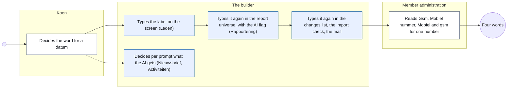
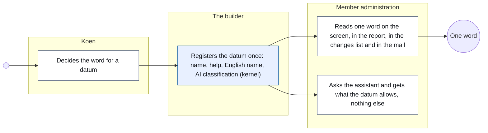
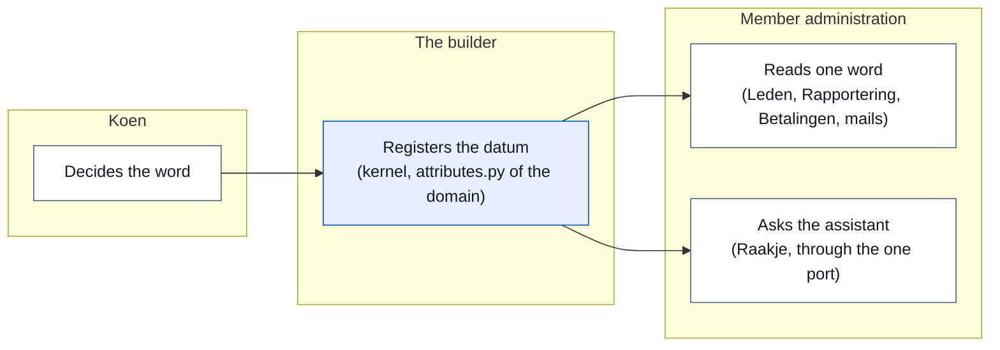
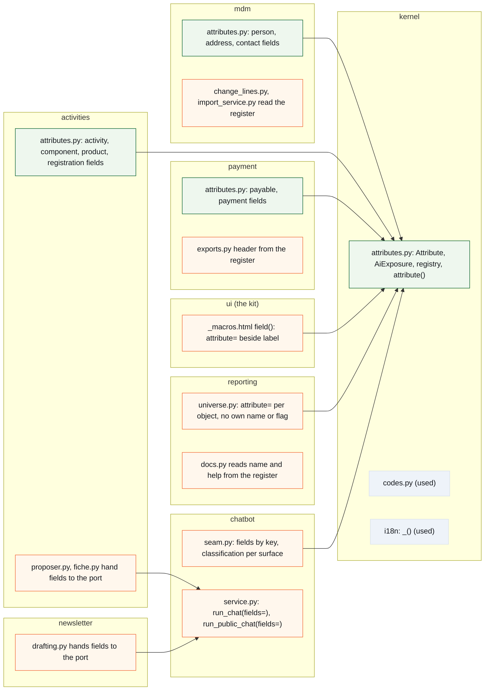
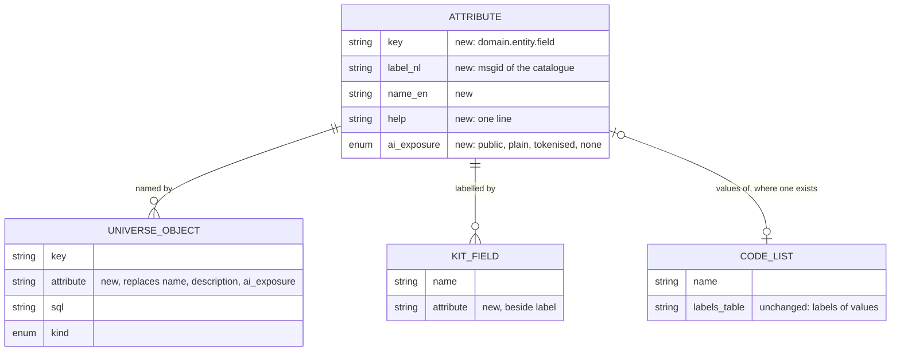

# CR-33 — The attribute register: one name and one AI classification per datum

**Status:** shaped on 15 October 2026 by the architecture CLI, on Koen's question through the master CLI (#1692, "2 mag je aan brainstorm doorgeven") · the positioning against the other field lists talked through with Koen the same day · not assigned to a release · build read not yet asked
**Tracking issue:** to be created by the master CLI from the draft in Koen's project folder (CR33 register van gegevens); until then #1692 is the status
**Applies to:** the kernel (a new register beside the code lists), every domain that shows a datum (the kit's fields, exports, the changes list, the import's check, mails), the reporting universe (names, descriptions and the AI classification become derived), the chatbot seam (the one AI port applies the classification by key for every surface)
**Reading:** A 1 630 words · B 3 065 · C 4 079 — measured on 15 October 2026, drawings excluded, tables included; prose alone A 800 · B 1 490 · C 2 590. The budget is A ≤ 1 500, B ≤ 2 500: **over budget in the tables** (the step table of A2, the traceability matrix and walkthrough of B2, the standards table of B3a); the prose is within it. Whether that is accepted is Koen's (B8, Q7)

---

# Part A — The business

## A1. Reason to act — the trigger

The same datum reads differently depending on where a board member looks. A mobile number is *Gsm* on the household record, *Mobiel nummer* on the registration form, *Mobiel* in the changes list and *gsm* in the import's check; an e-mail address is *E-mailadres* on the screens and *E-mail* in the changes list; a relation is *Relatie* on the screen and *Relatietype* in a report. Koen, 7 October 2026, when #1687 (the import's check) showed it: *"laten we voor consistente naamgeving gaan zoals gegevens/attributen in model, schermen, rapporten, … benoemd worden"*. He decided the words that day (Mobiel, E-mail, Relatie, the value *(meerderjarig) kind* stays), and #1692 (one source for labels) carries them. What #1692 leaves open is where that one source lives and what else it answers.

A second list answers a second question about the same data: *what may go to the AI, and in what form*. That list exists only inside the reporting universe, per report object, so the assistant that answers questions over reports is governed by it, and the five modules that talk to the AI directly (the newsletter's co-writer, the activity proposer and fiche, the design studio, the document reader) are not: each decides per call what it puts in the prompt, with a pattern guard behind it. Koen, 15 October 2026, asked why the classification should stay per report object: *"Sowieso gaat er een moment komen dat een module – zonder via de reporting module te passeren – rechtstreeks vragen met de AI gaat uitwisselen. Of zetten we die poort dicht?"* The door is already open, so the classification has to stand where the datum is.

## A2. As-is process — how it works today, and where it hurts

One datum, four answers to "how does it read", and one place that answers "may it go to the AI" for a part of the data only.

<!-- figure: name=cr33-as-is caption=Today_a_datum_is_named_in_every_place_it_shows,_and_classified_only_in_the_report_universe -->

*What to see:* the word is decided once and typed four times; the AI classification is one of the four copies, so a module that skips the report universe skips it too.

| Step | Who | Today | Pain |
|---|---|---|---|
| Decide the word | Koen | in a chat, per screen that comes up | decided three times for the mobile number (Gsm, Mobiel nummer, Mobiel) before 7 October 2026 |
| Name it on the screen | the builder | typed in the kit field call, 70 of 145 field calls carry a typed label | 48 occurrences of the four old words stand in the code today (E-mailadres 36, Gsm 6, Mobiel nummer 4, Relatietype 2) |
| Name it in reports | the builder | the universe carries its own name and description per object, 145 objects | *Relatietype* beside *Relatie* |
| Name it in the changes list, the import check, exports, mails | the builder | typed again; the changes list calls itself "the fourth place, until #1692" | one more copy per new reader |
| Classify it for the AI | the builder | a flag per report object, three levels, refused when missing | only the data the universe knows is classified; the five direct AI callers put values in prompt text themselves |
| Read it | member administration | four words for one number | a volunteer learns four words for one thing, and a report column means the same as a screen field without saying so |

## A3. To-be process — how it should work afterwards

<!-- figure: name=cr33-to-be caption=Afterwards_a_datum_is_registered_once_and_every_reader,_the_AI_port_included,_takes_it_from_there -->

*What changes:* three typing steps disappear into one registration; the AI classification travels with the datum to every module that talks to a model, not only to reports.

**The words the user reads** (decided by Koen on 7 October 2026): **Mobiel** · **E-mail** · **Relatie** · the relation value **(meerderjarig) kind**. The other fields of #1692's table keep their screen word (Voornaam, Achternaam, Geboortedatum, Geslacht, Telefoon, Straat, Huisnummer, Bus, Postcode); the register makes it the only one.

## A4. Benefits — what the change earns

- **One word per datum**, everywhere a volunteer reads it: no second lookup from a report column to a screen field, no "is Gsm the same as Mobiel".
- **A new reader costs nothing in words**: the webshop (CR-21) adds tens of fields for products, orders and stock; each gets its name once, and the editor, the exports and the reports have it from day one.
- **The AI boundary follows the data**: a datum that must not reach a model does not reach it from any module, and a board member can read, per datum, what the assistant is allowed to see.
- **The column descriptions reporting deferred** get a home: the one-line help per datum is what a report can show when asked what a column means.

## A5. Supplied material — and what it taught us

- **#1692's measured table** (dev1, 7 October 2026): nine data of a person and an address, each across the household screen, the reports, the code tables and the import column. It taught that only the contact type and the relation have a source for their label, the code table; the others have none.
- **Koen's words** of 7 and 15 October 2026 (B9).
- **Measurements on master @ `ff5eeb3a`** (15 October 2026, C1): 145 kit field calls, 70 with a typed label; 48 occurrences of the four old words; 145 report objects with their own name and description, classified 129 plain, 9 tokenised, 7 never; 1 691 sentences in the translation catalogue; 57 code tables; five modules calling the AI through the chatbot's facade, none through the universe; the public assistant reading activities, pages, documents and the Raakje content with a pattern guard only.
- **Reporting need:** none beyond what exists; the help text per datum is offered to the report panel as the column description it does not have (R7).

## A6. Business requirements — what the board asks, with MoSCoW

| # | Requirement | MoSCoW | Source | Comment |
|---|---|---|---|---|
| R1 | A datum has one name, and every screen, report, list, export, check and mail that shows it uses that name | Must | Koen, 7 October 2026 | #1692 |
| R2 | The words are Mobiel, E-mail, Relatie; the relation value stays (meerderjarig) kind | Must | Koen, 7 October 2026 | the import file's own column names stay |
| R3 | Where a code table carries a label, the table stays the source for the *values* | Must | Koen, 7 October 2026 | CR-12 (codes and enums) |
| R4 | What may go to an AI, and in which form, is decided per datum, not per report | Must | Koen, 15 October 2026 ("verhuis naar het gegeven op 2") | |
| R5 | One AI port for every module, with one classification and two checks: by datum for structured data, by pattern for free text | Must | Koen, 15 October 2026 ("Ja" to the proposal) | |
| R6 | The public assistant sees only what is public: activities, pages, the Raakje content | Must | Koen, 15 October 2026 | a fourth level, *public* |
| R7 | A report can say what a column means, in one line | Should | reporting's deferred column descriptions | the help text per datum |
| R8 | A new datum cannot be shown without a name in the register, and cannot go to an AI without a classification | Should | shaping | the gate of B7 |
| R9 | Renaming database columns to match the words | Won't | shaping, `AGENTS.md` *Do not rename* | labels are copy, identifiers are code |

## A7. Non-functional requirements — security, privacy, house style, tenants

| Concern | This change |
|---|---|
| **Security** | no new input from outside; no new route; the AI port refuses more than today, never less |
| **Privacy** | the change *is* the privacy mechanism for data going to a model: the classification per datum replaces one per report object and reaches the modules that compose prompts themselves; nothing new leaves the system |
| **House style / UI norm** | no new component; the words of §6 of the design system (action words) are untouched; a label changes on four screens and one report (C9) |
| **Multi-tenant** | platform-wide: a datum's name and classification are the platform's, not a tenant's; the tenant's own fields (the form builder) are data and stay out |

## A8. Acceptance criteria — what the business signs off on HDEV

| # | Criterion | Requirement | Walkthrough steps |
|---|---|---|---|
| AC1 | The household record, Mijn gezin, the registration form, the changes list and the report objects show *Mobiel*, *E-mail* and *Relatie*; no screen says Gsm, Mobiel nummer, E-mailadres or Relatietype | R1, R2 | 1–5 |
| AC2 | The import's check reads the same words as the household record | R1 | 6 |
| AC3 | A report column shows its one-line meaning on request | R7 | 7 |
| AC4 | The back-office assistant still answers over reports as today; a person's name still arrives as a token, a never-datum not at all | R4, R5 | 8–9 |
| AC5 | The public assistant answers about activities, pages and the Raakje content as today, and nothing it says contains a datum that is not public | R6 | 10 |
| AC6 | The newsletter's proposal and the activity proposer still work; a value they hand to the model travels under its datum | R5 | 11 |

---

# Part B — The solution, for whoever approves it

## B1. Solution outline — the solution and the decisions that shape it

One **register of attributes** in the kernel, declared per domain beside its code lists, one entry per datum: the key (`mdm.person.mobile`), the Dutch label as every other screen text (it goes through the translation catalogue), the English name, one line of help, and the **AI classification** in four levels (public · plain · tokenised · never). Every reader of a datum's name takes it from the register: the kit's fields, the exports, the changes list, the import's check, the mails, the reporting universe. The universe keeps no name, description or AI flag of its own: each object names the attribute it stands on, and the one AI port (the chatbot's facade) reads the classification by key for every structured value a module hands it, whatever the surface, with the pattern guard kept for free text. A ratchet over the typed labels shrinks to zero.

- **The register is code, not a table.** Decided: a frozen dataclass per entry, declared in `<domain>/attributes.py`, registered in the kernel like a code list (`kernel/codes.py` already has the form: declaration in the owning domain, a registry the gates iterate, a lookup by name). Rejected alternative: a database table like the code lists. Lost because a label is copy, not data: it changes with a release, never per tenant, and a table would need a migration, a seed and a screen for something nobody edits at run time.
- **The label is a sentence of the catalogue.** Decided: the register holds the Dutch label as the msgid and `_()` translates it, as it does for the 70 typed labels today. Rejected alternative: a label per language in the register. Lost because it would be a second translation mechanism beside the catalogue of #1341.
- **Code lists stay the source for values.** The register says how the field reads, the code list how its values read (Mobiel the field, Mobiel the contact type: two entries, two sources, by design). Rejected alternative: fold field labels into the code lists. Lost because most fields have no value list.
- **The classification stands on the datum, with four levels.** Decided: `AiExposure` moves from the universe to the kernel and gains *public*. Rejected alternative: keep it per report object until CR-16 (command port) needs it elsewhere. Lost on Koen's word: the direct AI callers exist today.
- **The universe derives, in three shapes.** Decided: a report object names its attribute; name, description and classification come from it. An object that *presents* a field (a fallback word, a code's label) names the field's attribute. A *time grain* of a date (year, quarter, month: 51 objects) names the date's attribute and its grain; the universe composes the name. A *new datum* (a membership status Ja/Nee, an address on one line, an age group) and a measure (a count, a sum) are attributes of reporting's own, with the source datum in the help. Rejected alternative: derived objects keep an inline name and classification. Lost because two lists with a flag is the duplication this change removes.
- **The port checks by key.** Decided: a module hands structured values to the facade as (attribute key, value) pairs; the port renders them after applying the classification for the surface. Free text keeps the pattern guard. Rejected alternative: classify prompt text by pattern only. Lost because a birth date or an address in a sentence has no pattern.

| # | Derived requirement | From |
|---|---|---|
| F1 | A register entry has key, label, English name, help, classification; the key is unique; the label is unique within a domain | R1, R8 |
| F2 | The kit field takes an attribute key and reads the label; the explicit label stays allowed for a field that is no datum (a search box) | R1 |
| F3 | The changes list, the import check, the payment export and the mails read their field names from the register | R1, R2 |
| F4 | The universe object carries `attribute` (and `grain` for a time grain of a date) and loses `name`, `description`, `ai_exposure`; the generated reporting documentation reads them from the register | R4, R7 |
| F5 | `AiExposure` lives in the kernel with PUBLIC, PLAIN, TOKENISED, NONE; the public surface accepts PUBLIC only, the admin surface tokenises TOKENISED and refuses NONE | R4, R5, R6 |
| F6 | `run_chat` and the public chat accept `fields` as (key, value) pairs; a key the register does not know is refused | R5 |
| F7 | The five direct callers hand their values as fields: the activity proposer and fiche, the newsletter's sources, the design studio's brief, the document reader's text stays free text | R5 |
| F8 | A ratchet of today's typed labels in kit calls, shrinking to zero; a hard gate that every universe object names an attribute | R8 |
| F9 | The 48 occurrences of the old words become the decided words | R2 |

## B2. Fit with the process and the requirements — for the business

<!-- figure: name=cr33-usage caption=Where_each_step_of_A3_lives:_one_registration_in_the_kernel,_readers_in_every_module -->

*Legend:* blue is the kernel, white the domains that read it.

| R | How the solution meets it (for the role) | F | Module (C2) | Test (C6) | AC |
|---|---|---|---|---|---|
| R1 | the administrator reads the same word on every screen, list, export and mail | F1, F2, F3 | kernel, mdm, membership, activities, payment, ui | T1, T2, T3, T9 | AC1, AC2 |
| R2 | Mobiel, E-mail, Relatie, (meerderjarig) kind | F9 | mdm, membership, activities, reporting | T9 | AC1 |
| R3 | a contact type and a relation keep their code table | — | mdm | existing CR-12 gates | AC1 |
| R4 | the classification is read per datum | F4, F5 | kernel, reporting | T4, T5 | AC4 |
| R5 | one port, by key for values and by pattern for text | F6, F7 | chatbot, newsletter, activities, designstudio | T6, T7, T8 | AC4, AC6 |
| R6 | the public assistant gets public attributes only | F5 | chatbot | T6 | AC5 |
| R7 | a column's meaning is the attribute's help | F4 | reporting | T5 | AC3 |
| R8 | a new field without a name, or a new object without an attribute, fails CI | F8 | kernel, tests | T10, T11 | — |
| R9 | Won't: no column is renamed | — | — | — | — |

**Walkthrough (HDEV, board member with the Leden and Rapportering modules):**
1. Open a household record. See *Mobiel* and *E-mail* as field labels, *Relatie* at a person.
2. Open *Mijn gezin* as a member. See the same three words.
3. Open an activity's registration page. See *Mobiel*, not *Mobiel nummer*.
4. Open *Wijzigingen*. A contact change reads *Mobiel: … → …*, *E-mail: …*.
5. Open the reports panel, class *Leden*. See *Relatie*; nowhere *Relatietype*.
6. Start a member import with a test file. The check names the fields as the record does.
7. In the report panel, ask the meaning of a column (where the panel shows descriptions). See one line.
8. Ask the assistant, from a report, "hoeveel gezinnen per gemeente". An answer as today.
9. Ask it who the head of a household is. The answer carries a token, the screen resolves it, as today.
10. On the public site, ask Raakje about an upcoming activity. An answer with name, place, dates and price; ask who organises it, and get no person.
11. Draft a newsletter with Raakje. A proposal as today; the sources it names are activities and meeting points.

## B3. The whole across the modules — for the architect

<!-- figure: name=cr33-structure caption=New_in_green,_changed_in_orange,_only_used_in_grey wide=1 -->

<!-- figure: name=cr33-model caption=The_register_and_its_readers,_all_in_code:_no_table_is_added -->

Who calls whom: every domain declares its attributes in its own `attributes.py` and the kernel's registry collects them at import, exactly as the code lists do; a reader asks the kernel (`attribute(key)`), never another domain, so the import gate sees no new cross-domain edge. The kit macro reads the kernel through the Jinja globals as it reads `_()`. The reporting universe and the chatbot seam read the kernel. The five direct AI callers already reach the chatbot through its facade; they now hand `fields` instead of formatted text. No table, no migration, no transaction boundary moves. Impact on the existing architecture: `UniverseObject` loses three fields and gains one; the universe gates that checked unique names and descriptions move to the register; `AiExposure` changes module (kernel) and gains a member; `run_chat` gains a keyword; `field()` gains a keyword. The layer rules hold: templates read a global, services read the kernel, no `ui.py` touches the database.

## B3a. Standards the model follows — and where it deviates, on purpose

Standards checked: **ISO/IEC 11179** (metadata registries, part 3: the data element with its name, definition, value domain and representation); **ISO 639** for the language of a label (nl, en); UBL/EN 16931 do not apply (no party, order or payment concept is introduced); schema.org does not apply (no public page describes a thing differently).

| Concept in this change | Standard and element | Ours | Follows / deviates — why |
|---|---|---|---|
| the datum | ISO/IEC 11179-3 *data element*: identifier, name, definition | `Attribute.key`, `label`/`name_en`, `help` | follows: one entry per data element, name and definition separate |
| its values | 11179-3 *enumerated value domain* | the code list of CR-12, referenced by the field's column | follows: the value domain is a separate object the element points at, not a list inside it |
| its representation | 11179-3 *representation class* (format) | not in the register; the universe keeps `format` per object | deviates, not now: a format is a property of how an object is shown in a report, one datum can have two |
| its language | ISO 639-1 | `nl` as msgid, `en` as name; other languages through the catalogue | follows |
| its sensitivity | 11179 has none; GDPR art. 4 *personal data* and art. 9 *special categories* are the vocabulary | `ai_exposure`: public, plain, tokenised, none | deviates on purpose: our levels say what the model may *receive*, which is the decision we take, not what the law calls the datum; the help line may name the category |
| registration authority, versions | 11179-6 | none | not now: one platform, releases are the versions |

## B4. Rules this change needs an exception from — decided once, here

| Rule (where) | What the design does instead | Mechanism | Temporary until … / the new rule | Decided |
|---|---|---|---|---|
| none | — | — | — | — |

Checked to say so: the import gate (`tests/test_import_boundaries.py`: readers go through the kernel, declarations stay in the domain); the layer gate (templates read a global, as `_()`); the template-variables gate (the macro's new keyword is a macro argument); *Do not rename* in `AGENTS.md` (no identifier changes); the Dutch-identifier ratchet (new names are English); the universe gates (three move to the register, C7); the code-list gates of CR-12 (untouched: the register is not a code list and registers in a registry of its own).

## B5. Cost — investment and running cost, and what operations must know

| Module | Phase 1 (names) | Phase 2 (classification and the port) |
|---|---|---|
| kernel | S: the dataclass, the registry, the lookup, the Jinja global | S: `AiExposure` moves in, gains PUBLIC |
| ui (kit) | S: `attribute=` on `field()` | — |
| mdm, membership | M: entries for person, address, contact; the household record, Mijn gezin, the changes list, the import check, the word changes | — |
| activities | S: entries for the registration contact, the form word | M: proposer and fiche hand fields |
| payment | S: export header from the register | — |
| reporting | M: the universe gets `attribute=` on 145 objects and `grain=` on 51, about 30 to 36 entries of its own, the three gates move, docs read the register | S: `ai_exposure` removed, read through the attribute |
| chatbot | — | M: `fields` on both chats, the classification per surface, the guard reading |
| newsletter, designstudio | — | S each: hand fields |
| tests | S: ratchet and hard gate | S: the port gates |

Total: phase 1 about M+, phase 2 about M; one dev CLI each, in sequence (phase 2 touches the universe again). Analysis is this document; the build read and the HDEV validation as for every change request. No purchase. **Running cost:** none; no job, no service. **Operations:** no env var, no setting, no kill switch; the import's test file for the walkthrough is made up.

## B6. Phasing — shippable phases, and what changes on the failure paths

| Phase | Ships | Failure paths that change | Na de merge |
|---|---|---|---|
| 1 | the register (kernel), the entries for the fields of #1692's table and of the registration contact, `attribute=` on the kit field, the changes list and the import check and the payment export reading it, the universe objects naming their attribute (name and description derived), the three universe gates moved, the 48 word changes, the ratchet | a kit field with a key the register does not know fails at render under `StrictUndefined` in dev and test, as a missing variable does; a universe object without an attribute fails at import | no migration, no env var; snapshot and measurement baselines move where a label changes width |
| 2 | `AiExposure` in the kernel with PUBLIC, every attribute classified, the universe's flag removed, `fields` on `run_chat` and the public chat, the classification applied per surface, the five callers hand fields, the hard gate on the port | a value under a NONE key is refused before the call with the key in the message, where today it would have gone; a PUBLIC-only surface given a PLAIN key refuses; a free-text hit stays what it is today | no migration, no env var; the admin assistant's answers over tokenised data unchanged |

Phase 1 alone fixes the words and the one source. Phase 2 needs 1 (the keys). Not parallel with a phase of another change request that touches the universe or the seam; parallel with CR-32 (sections, cards, data blocks and a tenant's own look) is fine, they share no file.

## B7. Rule and gatekeeper — what this fixes for all future work

**The rule:** a datum has one entry in the attribute register; its label, its English name, its help and its AI classification are read from there, and nothing reaches a language model without the entry that allows it. Home: `docs/code-style.md` (one line beside the code-list rule) and the architecture document, part D (the vocabulary of a datum: register for the name, code list for the values, catalogue for the language, universe for the questions) and part E (E52).

**Reach and baseline, measured on master @ `ff5eeb3a`:** 70 kit field calls with a typed label, 145 universe objects with their own name, 48 occurrences of the four old words, five modules formatting values into prompt text. After phase 1: typed labels frozen as a ratchet and shrunk for the fields of this change, universe names 0, old words 0. After phase 2: prompt-formatted values 0, hard gate.

**Ratchet or hard:** the label gate is a ratchet (a field that is no datum, a search box, keeps a typed label; the list may only shrink); the universe gate and the port gate are hard.

## B8. Open decisions — what the approver still decides

| # | Question | Recommendation | What the answer changes |
|---|---|---|---|
| Q4 | Which release? | v2.18, before the webshop's phases (CR-21 adds tens of fields that would then be named from the register from day one); otherwise v2.19 | the order in the webshop's tracker |
| Q5 | Does the report panel show the help line now (R7, Should), or does the register only hold it? | show it where the panel already shows descriptions today, nothing new on the screen; a new place is a design question for design-documentation | phase 1's reporting work: S either way |
| Q6 | Does phase 2 also classify the tenant's form-builder fields and the CMS page content as attributes? | no: they are data a tenant enters, the pattern guard covers their text; the page's *title* and an activity's fields are platform attributes and are classified | the scope of phase 2's entries |
| Q7 | The reading budget is exceeded by the tables (A 1 630, B 3 065 words with tables; 800 and 1 490 without): accept as one document, or move the walkthrough and the standards table to Part C? | accept: the tables are what the approver checks, and the prose is within budget | the shape of the document, not its content |

## B9. Decisions log — dated answers

| Date | Decision | By |
|---|---|---|
| 7 October 2026 | The words: Mobiel, E-mail, Relatie; the relation value stays (meerderjarig) kind; the import's column names stay (#1692) | Koen |
| 7 October 2026 | "laten we voor consistente naamgeving gaan zoals gegevens/attributen in model, schermen, rapporten, … benoemd worden" (#1687, split off as #1692) | Koen |
| 15 October 2026 | #1692 goes to the architecture CLI for a judgement whether it needs a change request: "2 mag je aan brainstorm doorgeven" | Koen, through the master CLI |
| 15 October 2026 | The AI classification moves to the datum, the universe derives it (to the question whether it moves or stays on the report object until CR-16 needs it): "verhuis naar het gegeven op 2, dat is voor mij duidelijk" | Koen |
| 15 October 2026 | One port, one classification, two checks, and the public assistant's scope named: "Ja, de publieke chatbot, dat gaat over activiteiten, webpagina's en content die we invoerden in de module Raakje content." | Koen |
| 15 October 2026 | The classification comes from the register, not from the universe (to "gaan we dan ai_exposure uit universe laten komen of vanuit het register?", the recommendation "vanuit het register" was not contested) | architecture CLI's reading, recorded as such |
| 15 October 2026 | One change request with two phases, names then classification: "één cr, kan ik die al eens lezen?" | Koen |

---

# Part C — The build, for the master CLI and the dev CLIs

## C1. Verified premises — measured before the handover

Measured on master @ `ff5eeb3a` on 15 October 2026; to be re-measured on the handover commit.

| Concept or claim | Kind | Readers or measurement | Verdict | Consequence |
|---|---|---|---|---|
| The code lists already have the form the register copies: declaration in the owning domain, a registry the gates iterate, a lookup by name that refuses two lists with one name | relies on | `backend/app/kernel/codes.py:162` (`CodeList`), `:200` (`register`), `:221` (`code_list`) | holds | the register mirrors it: `Attribute`, `register`, `attribute()` |
| `UniverseObject` carries `name`, `description`, `ai_exposure` as required fields, `sensitive` and `additive` as declared-not-enforced | changes | `backend/app/domains/reporting/universe.py:239–298`; readers: `engine.py`, `docs.py`, `assistant.py`, `exports.py`, `admin_ui.py`, the gate file | must change (C2 reporting) | `attribute` replaces the three; `sensitive` and `additive` stay as they are |
| `AiExposure` has no default and three members; a missing flag is an import error | changes | `universe.py:71–93`; readers: `universe.py` (145 declarations), `assistant.py`, `seam.py`, `docs.py` | must change (C2 kernel, reporting, chatbot) | moves to `kernel/attributes.py`, gains PUBLIC; the universe imports it from there during phase 1 |
| 145 universe objects: 104 dimensions, 28 measures, 13 details; 129 plain, 9 tokenised, 7 never; of the 117 dimensions and details 51 are time grains of a date (keys ending in year, quarter, month, day, weekday), 28 present a field with a fallback word or a code's label, 2 are a `CASE` on a count, the rest plain columns | measurement | `grep -c "UniverseObject("`, the `kind=`, `ai_exposure=`, `key=` and `sql=` counts on `universe.py` | — | three shapes of derivation (C4.5): the field's entry, the date's entry with a grain, an entry of reporting's own |
| The universe gates check unique keys and names within a class, a description that carries its weight, and that the generated document matches the declaration | changes | `reporting/tests/test_reporting_universe_gate.py:221, 244, 408` | must change (C7) | the name and description checks move to the register's gate; the document check reads through the attribute |
| The kit field takes the label as its second positional argument; 145 calls, 70 pass `_("…")`, 0 pass a bare literal, 75 pass a variable | changes | `backend/app/ui/templates/_macros.html:812`; `grep -c 'ui.field('` over the templates | must change (C2 ui) | `attribute=` added; `label` stays for the non-datum case; the ratchet lists the 70 |
| The four old words stand 48 times in app code and templates (tests excluded): E-mailadres 36, Gsm 6, Mobiel nummer 4, Relatietype 2 | changes | `grep -rhoE "(Gsm|E-mailadres|Mobiel nummer|Relatietype)"` over `backend/app` | must change (C2 mdm, membership, activities, reporting) | each becomes the register's word; the catalogue's msgids follow (#1341) |
| The changes list types person and address labels itself and says so: "a fourth place … until the shared source of #1692 exists" | changes | `backend/app/domains/mdm/change_lines.py:14–20, 53–63` | must change (C2 mdm) | reads the register; the docstring's promise is kept |
| The import's check names ten columns of the national file | relies on | `backend/app/domains/mdm/import_service.py` (10 distinct column names) | holds | the columns stay; the *check's wording* reads the register |
| The payment export types nine header words; the reporting export takes the view's column names through `_()` | changes | `backend/app/domains/payment/exports.py:62–69`; `backend/app/domains/reporting/exports.py:7, 97` | must change (C2 payment); reporting stays right (the view columns are the universe's, which derive) | — |
| Five modules call a model, all through `chatbot.api` (`get_provider`, `run_chat`, `redact`, `scrub_names`, `admin_rules`), none through the universe and none through a provider directly | relies on | `grep -rl "chatbot.providers"` outside chatbot: 0 files; callers: `activities/proposer.py`, `activities/fiche.py`, `newsletter/drafting.py`, `newsletter/service.py`, `designstudio/imaging.py`, `designstudio/service.py`, `media/extraction.py`, `forms/handlers.py` | holds | the facade is the one port; `fields` is added to it |
| The activity proposer formats values into prompt lines: `Naam: …`, `Locatie: …`, `Omschrijving: …` | changes | `backend/app/domains/activities/proposer.py:219–221` | must change (C2 activities) | becomes `fields=[(key, value), …]` |
| The newsletter's drafting hands activities as `- id: name` lines and meeting points as formatted lines, with `scrub` on everything outbound | changes | `backend/app/domains/newsletter/drafting.py:281, 311–316` | must change (C2 newsletter) | the same pairs as fields; `scrub` stays for the free text |
| The public assistant reads activities (name, location, price, dates, component names and descriptions, product names), published pages (title, slug), the Raakje content and extractable documents; its guard matches patterns only, no names and no e-mail | relies on | `chatbot/tools.py:237–320`, `chatbot/info_service.py:19–96`, `seam.py:384–392` | holds | those fields are PUBLIC attributes; an organiser's contact is not among them today and stays out |
| `run_chat` takes `messages`, `tools`, `dispatch`, `force_first`, `fallback`, `deadline` | changes | `chatbot/service.py:134–145`; callers: the eight files above and `reporting/assistant.py` | must change (C2 chatbot) | `fields: Sequence[tuple[str, Any]] = ()` added; callers that pass none are unchanged |
| The translation catalogue has 1 691 msgids; `#1341` says it lags the code | relies on | `backend/app/locales/nl_BE/LC_MESSAGES/messages.po` | holds | the register's labels are msgids like any other; the lag is #1341's |
| 57 code tables exist; a contact type and a relation have labels there | relies on | `grep '__tablename__ = ".*_codes"'` over the models | holds | R3: untouched |
| The module registry knows per module its reporting folders and record tables, nothing per field | relies on | `backend/app/kernel/modules.py:58–89` | holds | the register is per domain, not per module; the assistant's availability rule (`reporting_folders`) is unchanged |
| The design system §6 fixes action words, not field names | relies on | `docs/design-system.md:1581` | holds | no conflict |

## C2. Per module: what must happen

**kernel** (phase 1, first). *Code:* `kernel/attributes.py`: `AiExposure(str, TechnicalEnum)` with PUBLIC, PLAIN, TOKENISED, NONE (moved from the universe in phase 2, imported from here by the universe already in phase 1 so the move is one import line); `@dataclass(frozen=True) class Attribute(key, label, name_en, help, ai_exposure)`; `register()` refusing two entries with one key or two labels in one domain; `registry()`, `attribute(key)` raising `LookupError` naming the known keys of that domain; `load_all_attributes()` importing every domain's `attributes.py`, as `load_all_code_lists()` does. *Templates:* a Jinja global `attribute` beside `_`. *Database:* none. *Tests:* T1, T10.

**ui (the kit)** (phase 1). *Screens:* every screen with a kit field, unchanged in look; judged at 390 px on the four screens of C9. *Code:* `field()` in `_macros.html:812` gains `attribute=None`; when given, `label` is `_(attribute(key).label)` and a `label` argument is refused (two sources). *Tests:* T2.

**mdm** (phase 1). *Code:* `mdm/attributes.py` with the person (`first_name`, `last_name`, `birth_date`, `gender`), the address (`street`, `house_number`, `box`, `postal_code`), the contact (`email`, `phone`, `mobile`) and the relation (`relation`), each with Koen's word; `change_lines.py` reads `attribute(...).label` instead of its own `_("Voornaam")` and `RELATION_LABEL`; `import_service.py`'s check wording reads the register (the column names stay). *Templates:* the household record and the person forms: `attribute=` on the kit fields, the word *Gsm* and *E-mailadres* gone. *Database:* none. *Reporting:* the `d_person`/`d_address` views are unchanged; the objects on them name these attributes (reporting below). *Tests:* T3, T9.

**membership** (phase 1). *Templates:* Mijn gezin and Lid worden: `attribute=` on the person and address fields. *Tests:* T9, the existing e2e flows re-recorded where a label changes.

**activities** (phase 1: words; phase 2: fields). *Code:* `activities/attributes.py` with the activity (`name`, `location`, `description`, `price`, `member_price`, the dates), the component, the product and the registration contact (`contact_name`, `contact_email`, `contact_mobile`); phase 2: `proposer.py:219` and `fiche.py` hand `fields=` instead of formatted lines. *Templates:* the registration form: *Mobiel*. *Tests:* T7, T9.

**payment** (phase 1). *Code:* `payment/attributes.py` for the payable and payment fields the export names; `exports.py:62` builds its header from the register. *Tests:* T3.

**reporting** (phase 1: derive; phase 2: flag removed). *Code:* `universe.py`: `UniverseObject` gets `attribute: str` (required) and `grain: Grain | None` (a `TechnicalEnum` year · quarter · month · day · weekday) and loses `name`, `description` (phase 1) and `ai_exposure` (phase 2); properties `name` (the attribute's label, with the grain word when `grain` is set), `description`, `ai_exposure` read the register so `engine.py`, `docs.py`, `assistant.py`, `exports.py` and `admin_ui.py` keep their attribute access; `reporting/attributes.py` holds the attributes of reporting's own: the 28 measures and the new data (the Ja/Nee statuses, the address line, the age group, the household size), each with its classification and the datum it derives from in the help; the 28 fallback and label objects and the 51 grains point at the domain's field (C4.5); the gate file: the name and description tests become register tests (C7), the document test reads through the attribute, and a new test refuses a grain on an attribute that is no date. *Database:* none; no view changes. *Tests:* T4, T5, T11.

**chatbot** (phase 2). *Code:* `service.py`: `run_chat(..., fields=())` and `run_public_chat(..., fields=())`; `seam.py`: `render_fields(fields, surface)` applies the classification: PUBLIC passes on both surfaces; PLAIN passes on ADMIN and is refused on PUBLIC; TOKENISED becomes the entity token on ADMIN (the `token_prefix` and entity id move with the attribute of the object, as today) and is refused on PUBLIC; NONE is refused everywhere, before the call, with the key in the message; an unknown key is refused; the pattern guard (`admin_rules`, `public_rules`) stays on the whole payload. *Tests:* T6, T8, T12.

**newsletter, designstudio, media, forms** (phase 2). *Code:* `drafting.py` hands the activity and meeting-point values as fields; `imaging.py` and `service.py` of the design studio hand the brief's fields; the document reader's extracted text stays free text (a document has no attribute) and keeps `redact`; `forms/handlers.py` as the design studio. *Tests:* T8.

**cms** — only used: the page title is a PUBLIC attribute in `cms/attributes.py` (one entry) for the public assistant's field list; nothing else changes.

## C3. Cross-cutting impact — the checklist of what gets forgotten

| Concern | Answer |
|---|---|
| Reporting views and saved reports | no view changes; saved reports store object keys, which do not change |
| Existing tests, e2e flows, 390 px screenshots | the universe gate tests move (C7); e2e flows that read a label by text (*Gsm*, *E-mailadres*) are re-recorded; the measurement baseline moves where a shorter word changes a width, numbers in the same PR (#1692's acceptance) |
| Fixed UI decisions, `AGENTS.md` | none touched; the *Key models* lines of `AGENTS.md` stay correct |
| Design-system documentation | one sentence in §6: a field's label comes from the attribute register (proposed to Koen, not written by this CLI) |
| Code lists | untouched; R3 |
| Events, ports, handlers; new cross-domain calls | none new: readers call the kernel; the import gate sees no new edge |
| Mail templates | the three mail templates that name a field read the register (phase 1) |
| Migration | none |
| Tenant settings, env vars | none |
| JSON routes and callers | none |
| External services | none; the AI provider receives less, never more |
| Copy actions | no entity gains a field |
| Visitors and tenants | unchanged for every kind: a label is the platform's; the public assistant's refusal of a non-public datum is new and applies to anonymous and signed-in visitors alike; a company tenant without members shows the same words on the fields it has |
| Order inside a transaction | nothing new leaves the transaction |

## C4. Detailed decisions — one subsection each, with the reasons

### C4.1 The register is a Python declaration per domain

The code lists of CR-12 are tables because their values are data: a tenant's import can add a contact type, and a label of a value is read in SQL. A field's label is copy: it changes with a release, is the same for every tenant, and is read by a template or a formatter. The code-list form (declaration in the domain, registry in the kernel, gates over the registry) is right; the storage is not needed. Declaring in the domain keeps the owner visible and the import gate silent; a cross-domain reader never imports another domain's `attributes.py`, it asks the kernel by key.

### C4.2 The label is a catalogue sentence

The 70 typed labels already go through `_()`. The register keeps that: the Dutch label is the msgid, the catalogue translates. One translation mechanism, and #1341's gate measures the register's labels like any sentence.

### C4.3 Keys name the datum, not the column

`mdm.person.mobile` is a datum that is stored as a contact row with code MOBILE, not a column; `activities.registration.contact_mobile` is a column. The key follows the domain's own concept and the English code name where there is one; no database identifier changes (R9).

### C4.4 Four levels, on the datum

The universe's three levels described what the admin assistant may receive. The public assistant was outside the universe by construction, so *public* was deliberately absent. With the classification on the datum, *public* is a property of the datum (an activity's name is public, a registration's contact is not), and the surface decides which levels it accepts: PUBLIC only on the public surface; PUBLIC, PLAIN and tokenised TOKENISED on the admin surface; NONE nowhere. The seam's `AiSurface` already exists and decides the guard rules; it now also decides the accepted levels.

### C4.5 Derived dimensions: three shapes, measured

The reporting layer does not only add measures; it adds dimensions (Koen, 15 October 2026: "in de rapporteringslaag [zijn het] niet alleen measures, ook bijgemaakte dimensies"). Measured on master, the 117 dimensions and details fall in three shapes, and each gets its own answer:

| Shape | Count | Example | Attribute it names | Name shown | Classification |
|---|---|---|---|---|---|
| a field, presented | about 36 plain, 28 with a fallback word or a code's label | `COALESCE(street, 'Geen adres')`, `relation_type_label`, `_boolean_label("members_only")` | the field's own entry (`mdm.address.street`) | the field's label | the field's |
| a time grain of a date | 51 (`…_year`, `…_quarter`, `…_month`, `…_day`, `…_weekday`) | `year || '-K' || quarter` on the registration date | the date's entry, plus `grain` on the object | the date's label and the grain word, composed by the universe ("Inschrijvingsdatum, kwartaal") | the date's; a grain never identifies more than its date |
| a new datum | the rest, about 2 to 8 (`CASE` on a count, the address on one line, an age group, a household size) | `CASE WHEN active_membership_count > 0 THEN 'Ja' ELSE 'Nee'` | its own entry in `reporting/attributes.py`, help naming the source datum | its own label | its own: an age group is PLAIN while the birth date is NONE |

Inheriting a classification from the source would be wrong for the third shape; declaring it inline would be a second list. So the fallback word and the label join stay what they are, presentation in `sql`; the grain becomes one field on the object instead of 51 typed names; and only a genuinely new datum gets an entry of reporting's own. Measures (28) are new data by nature and get entries the same way. The honest cost: 145 objects get an attribute reference; reporting itself declares about 30 to 36 entries (the measures and the new data), the rest point at a domain's field.

### C4.6 The port checks by key, and what it cannot check

A module that composes a sentence from values today (`Naam: …`) hands pairs instead; the port renders them after the classification. Free text that a person wrote (a newsletter instruction, a page) and text a document yielded have no key and keep the pattern guard. The limit is honest: a module could still format a value into text. The gate of C7 measures the known formatting idioms in the AI callers and the review reads the rest; the pattern guard stays as the second net. First time right here means the rule and its port exist now, before CR-16 (command port) adds callers that act.

### C4.7 A ratchet for labels, a hard gate for the universe and the port

Zero typed labels is not the goal: a search box or a one-off filter is not a datum. The label gate freezes today's 70 as a list that may only shrink. The universe and the port have no such case: every object stands on an attribute, every structured value has a key, so those gates are hard.

## C5. Privacy and security — the mechanics behind A7

What leaves the system to a model: on the admin surface, PLAIN values as they are, TOKENISED values as `gezin-<id>`/`persoon-<id>` (the token prefix of the entity, as today), NONE values never, all before the HTTP call; on the public surface PUBLIC values only. Every payload still passes the pattern guard (`findings`) and names are scrubbed on the newsletter path. Refusals are logged in the AI log with the attribute key and no value. No route changes; the public chat route accepts the same input as today.

## C6. Tests — what the build must prove

What the build must prove:
- **T1** `kernel/tests/test_attributes.py`: two entries with one key, or two labels in one domain, are refused with the key in the message; an unknown key names the domain's known keys.
- **T2** `ui`: `field(attribute=…)` renders the register's label through `_()`; `field(attribute=…, label=…)` is refused; a snapshot of the household record before and after is byte-equal except the three words.
- **T3** `mdm`, `payment`: the changes list, the import check and the payment export read *Mobiel*, *E-mail*, *Relatie* from the register; a renamed label in a test-only entry changes all three.
- **T4** `reporting`: every object names an attribute that exists (proven with an added object without one: import error); a `grain` on an attribute that is no date is refused; a grain object's name reads as the date's label with the grain word.
- **T5** `reporting`: the generated document shows the attribute's name and help; a description-less attribute is refused by the register gate (today's "carries its weight" test, moved).
- **T6** `chatbot`: a NONE key is refused before the call; a TOKENISED value arrives as a token on ADMIN and is refused on PUBLIC; a PLAIN value is refused on PUBLIC; an unknown key is refused; proven on the mock provider with the payload read back.
- **T7** `activities`: the proposer's call carries fields, not `Naam:` lines; the fiche the same.
- **T8** `newsletter`, `designstudio`: the sources arrive as fields; the free-text instruction still passes `scrub`.
- **T9** the word gate: no template or Python file under `backend/app` contains Gsm, E-mailadres, Mobiel nummer, Relatietype as a label (proven with an added occurrence; asserts it scanned the templates it guards).
- **T10** the label ratchet: a frozen list of the 70 kit calls with a typed label; a new typed label outside it fails with the call's file and the hint `attribute=`; an entry that disappears must leave the list.
- **T11** the universe gate: no object carries `name=`, `description=` or `ai_exposure=` any more (phase 1 for the first two, phase 2 for the third).
- **T12** the port gate: no file in the AI callers formats a value into prompt text with the known idioms (`f"Naam: {`, `f"- {…id}: {…name}"`); proven with an added line.

Impact on the test landscape: `test_reporting_universe_gate.py` loses three tests to the register's gate file and keeps the rest; `test_guard_reading_1986.py` gains the field cases; the e2e golden flows of membership and the registration page re-record where they read a label by text; the measurement baseline of #1605 moves on four screens; the HTML snapshots of the household record move by three words. No other suite is expected to change: no route, no model, no migration.

## C7. The gate — what refuses a deviation from now on

Three gates, all pytest under `backend/tests/` or the domain's `tests/`, run by `backend-tests.yml` on every push:
- **the label ratchet** (T10): reads every `ui.field(` call in the templates, lists those with a typed label, compares with the frozen list; message: *"<template>:<line> types a label: give the field an `attribute=` or, if it is no datum, add it to the ratchet with the reason"*; proven with an added typed label.
- **the register and universe gate** (T1, T4, T5, T11): every universe object names an existing attribute; every attribute has a non-empty help and a classification; no object carries its own name, description or flag; message names the object key and the missing piece; proven with an added object.
- **the port gate** (T6, T12): every call into `run_chat`/`run_public_chat` from outside the chatbot passes `fields=` or is on the list of text-only callers (the document reader); no formatting idiom in the AI callers; the seam refuses an unknown or forbidden key before the call; proven with an added formatted line and with a NONE key on the mock provider.

The judgement layer keeps what a grep cannot see: a value formatted into text with a new idiom. The reviewer of an AI caller reads the prompt builder for it.

## C8. Prototype findings — what was measured before the build

No throw-away patch was run. The tests that mention the concepts were read: `test_reporting_universe_gate.py` (the three tests that move, C1), `test_guard_reading_1986.py` (the seam guard's reading of payloads, which the field rendering extends), `test_cards_1770.py` and `test_document_shape_1671.py` do not touch labels. The universe's own comment at `engine.py:205–221` already separates "what may travel to a model" from "what cuts people into small groups": the first moves, the second (`sensitive`) stays declared on the object.

## C9. Screens before the build — the concepts the approver saw

No screen is added or redesigned. Four screens and one report change a word: the household record (Gsm → Mobiel, E-mailadres → E-mail), Mijn gezin (the same), the registration page (Mobiel nummer → Mobiel), the reports panel (Relatietype → Relatie). The words were decided by Koen on 7 October 2026 on #1692 with the screens named; #1692's acceptance asks screenshots before and after at 390 px, taken by the builder in the handover. No concept drawing is made for a word change.

## C10. Close-out at the release

Not built.

---

## Q&A log — asked once, answered here

| # | Date | Question (who) | Answer |
|---|---|---|---|
| Q1 | 15 October 2026 | Where do `ai_exposure` and `sensitive` live: on the datum or on the report object until CR-16 needs them? (architecture CLI) | "verhuis naar het gegeven op 2, dat is voor mij duidelijk" (Koen). `sensitive` stays on the object: it describes a dimension's cut, not a datum |
| Q2 | 15 October 2026 | One port, one classification, two checks? (architecture CLI) | "Ja, de publieke chatbot, dat gaat over activiteiten, webpagina's en content die we invoerden in de module Raakje content." (Koen); the fourth level *public* follows |
| Q3 | 15 October 2026 | One change request with two phases, or the classification apart? (architecture CLI) | "één cr, kan ik die al eens lezen?" (Koen) |
| Q8 | 15 October 2026 | "Ik denk dat het in de rapporteringslaag niet alleen measures zijn, ook bijgemaakte dimensies. Check je dat die ook een goede oplossing krijgen in de CR?" (Koen) | Measured: 117 dimensions and details, of which 51 time grains of a date, 28 a field with a fallback or a code's label, 2 a `CASE` on a count, the rest plain columns. Three shapes with three answers in C4.5: the field's entry, the date's entry with a grain, an entry of reporting's own |

## Non-goals — deliberately outside this change

- Renaming database columns, tables or Python identifiers to match the words (R9; `AGENTS.md` *Do not rename*).
- The translation catalogue's lag and its gate (#1341).
- The form builder's fields and the CMS page content: tenant data, covered by the pattern guard and by what a tenant publishes.
- Validation messages and help sentences that use an old word inside a sentence: measured in phase 1 and listed on the tracking issue; changed where the sentence names the field, not redesigned.
- Enforcing `sensitive` (the small-cell rule removed on 14 September 2026) or `additive`.
- Command tools for the assistant (CR-16): this change gives them the port they will use.

## Relationship to existing work — issues and change requests

- Tracking issue: to be created; #1692 (one source for labels) is the origin and keeps its measured table; #1687 (the import's check) built the fourth place and named it.
- CR-12 (codes and enums): the form the register copies; the code lists stay the source for values.
- CR-07 (Raakje back office) §5.1–5.2: the three levels and the tokenisation this change moves to the datum.
- CR-16 (command port): the first caller that will act on data outside the universe; it uses the port as shaped here.
- CR-21 (webshop): tens of new fields; the reason for Q4's release recommendation.
- CR-11 block 10 / #1562: the assistant reads the screen's selection; unchanged.
- #1341 (the translation catalogue), #1719 (the gate on Mobiel/E-mail), #1605 (the measurement baseline).
- The architecture document: part D gains the vocabulary of a datum, part E the row E52.
