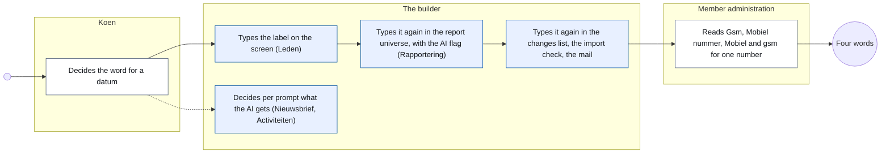
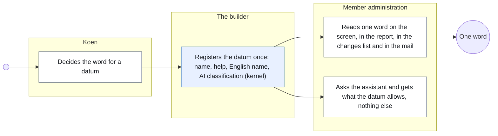
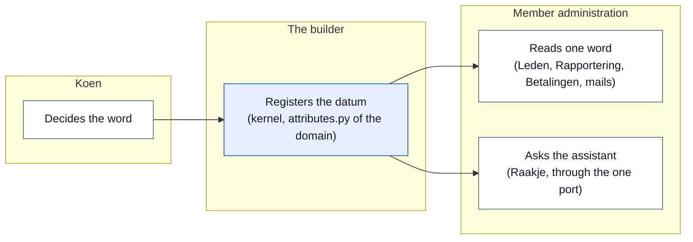
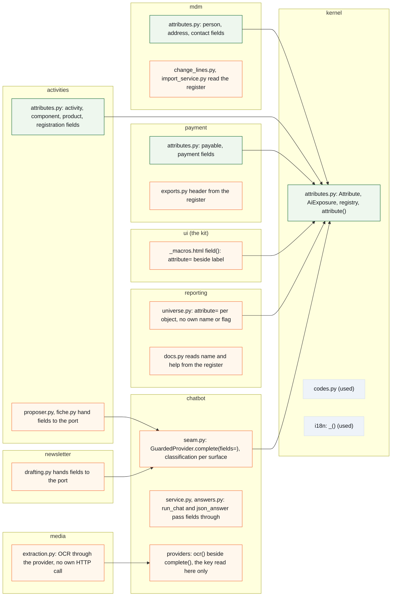
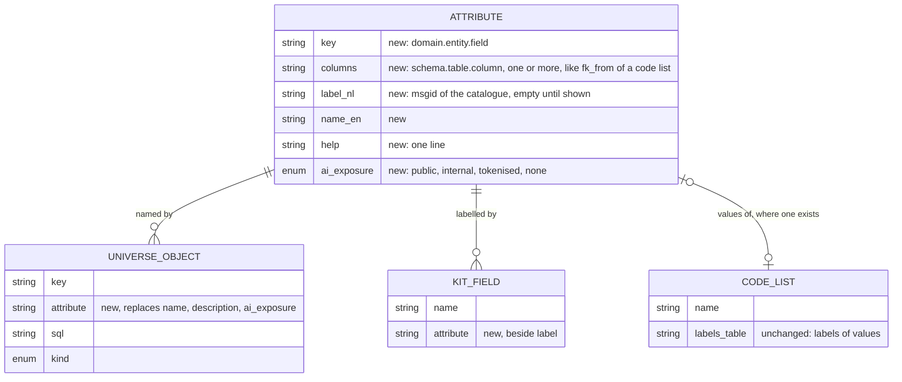

# CR-33 — The attribute register: one name and one AI classification per datum

**Status:** shaped on 15 October 2026 by the architecture CLI, on Koen's question through the master CLI (#1692, "2 mag je aan brainstorm doorgeven") · the positioning against the other field lists talked through with Koen the same day · turned from label-first to **model-first** the same day on Koen's reading ("ja") · Koen names the release the same day (to "Release: v2.18 vóór de webshopfasen, of v2.19?": "Release 2.17, dit impliceert dat webshop ook in v2.17 komt") · over budget accepted ("Ja op 3, geen probleem") · **build read by dev2 taken in** (15 October 2026, #2007: B1 the words are built by #1719, B2 the port is the guarded provider, B3 the technical rule from the metadata, B4 two more shapes in the universe, B5 the kit field's label; the smaller points) · Koen's answers on the classification rules taken in the same day (Q&A nr. 02) · Q12 answered ("akkoord"), Q5 and Q6 answered the same day ("ja, akkoord", "erbuiten op 2") · Q9 and Q10 closed the same day (Q&A nr. 03) · **B8 empty, document complete** · **built in v2.17.0** (tagged 21 October 2026, release title "the register of data (CR-33)"; phase 1 #2035 merged as `b5d7d0a7` and phase 2 #2053 merged as `70d24162` on 15 October 2026, after-phase-2 work #2055 (PR #2062) merged as `8f622c4c` on 16 October; the deviations stand in B9 as "built as" rows and are folded into the text below). Not verified for this close-out: the quality of the generated English help lines of the entries no screen or report shows (B9, phase 1 (9): a read of them was left open)
**Tracking issue:** #2007 — the one place where what is open stands; this document is the design, the issue is the status (#1692 is the origin)
**Applies to:** the kernel (a new register beside the code lists), **every domain's data model** (one entry per stored business datum, 426 columns on the webshop's build branch, about 380 on master), every domain that shows a datum (the kit's fields, exports, the changes list, the import's check, mails), the reporting universe (names, descriptions and the AI classification become derived), the chatbot seam (the one AI port applies the classification by key for every surface)
**Reading:** A 2 254 words · B 4 270 · C 7 224 — measured on 15 October 2026 after the build read and the Q&A rounds, drawings excluded, tables included; prose alone A 1 318 · B 1 960 · C 4 227. The budget is A ≤ 1 500, B ≤ 2 500: **over budget in the tables** (the step table of A2, the traceability matrix and walkthrough of B2, the standards table of B3a, the decisions log); the prose is within it. Accepted by Koen as one document (Q7: "Ja op 3, geen probleem")

---

# Part A — The business

## A1. Reason to act — the trigger

The same datum reads differently depending on where a board member looks. A mobile number is *Gsm* on the household record, *Mobiel nummer* on the registration form, *Mobiel* in the changes list and *gsm* in the import's check; an e-mail address is *E-mailadres* on the screens and *E-mail* in the changes list; a relation is *Relatie* on the screen and *Relatietype* in a report. Koen, 7 October 2026, when #1687 (the import's check) showed it: *"laten we voor consistente naamgeving gaan zoals gegevens/attributen in model, schermen, rapporten, … benoemd worden"*. He decided the words that day (Mobiel, E-mail, Relatie, the value *(meerderjarig) kind* stays), and #1692 (one source for labels) carries them. What #1692 leaves open is where that one source lives and what else it answers.

A second list answers a second question about the same data: *what may go to the AI, and in what form*. That list exists only inside the reporting universe, per report object, so the assistant that answers questions over reports is governed by it, and the four modules that talk to the AI directly (the newsletter's co-writer, the activity proposer, the design studio, the document reader) are not: each decides per call what it puts in the prompt, with a pattern guard behind it. Koen, 15 October 2026, asked why the classification should stay per report object: *"Sowieso gaat er een moment komen dat een module – zonder via de reporting module te passeren – rechtstreeks vragen met de AI gaat uitwisselen. Of zetten we die poort dicht?"* The door is already open, so the classification has to stand where the datum is.

And where the datum is, is the data model, not the screen. Koen, reading the first version of this document the same day: *"Vertrek je vanuit de databank? … Ik denk dat het best is om ook de database te incorporeren. Dus dat je alle velden van de databank of in de module logica. Misschien is dat de plaats om van te vertrekken."* A register of what is shown is a register of what we happened to show; a register of what is stored is complete, and only a complete one can promise that nothing reaches a model unclassified. So the register starts from every stored business datum, and a label is what a datum gets once a screen shows it.

## A2. As-is process — how it works today, and where it hurts

One datum, four answers to "how does it read", and one place that answers "may it go to the AI" for a part of the data only.

<!-- figure: name=cr33-as-is caption=Today_a_datum_is_named_in_every_place_it_shows,_and_classified_only_in_the_report_universe -->

*What to see:* the word is decided once and typed four times; the AI classification is one of the four copies, so a module that skips the report universe skips it too.

| Step | Who | Today | Pain |
|---|---|---|---|
| Decide the word | Koen | in a chat, per screen that comes up | decided three times for the mobile number (Gsm, Mobiel nummer, Mobiel) before 7 October 2026 |
| Name it on the screen | the builder | typed in the kit field call, 75 of 145 field calls carry a typed label | the words Mobiel and E-mail were put right by #1719 (Mobiel en E-mail overal) with a hard gate, screen by screen; the four old words still stand in 22 lines of app code, none of them a label (sentences, a group title, an add button, two code-list values) |
| Name it in reports | the builder | the universe carries its own name and description per object, 145 objects | *Relatietype* beside *Relatie*: the one label left that says a different word |
| Name it in the changes list, the import check, exports, mails | the builder | typed again; the changes list calls itself "the fourth place, until #1692" | one more copy per new reader |
| Classify it for the AI | the builder | a flag per report object, three levels, refused when missing | only the data the universe knows is classified; the five direct AI callers put values in prompt text themselves |
| Read it | member administration | four words for one number | a volunteer learns four words for one thing, and a report column means the same as a screen field without saying so |

## A3. To-be process — how it should work afterwards

<!-- figure: name=cr33-to-be caption=Afterwards_a_datum_is_registered_once_and_every_reader,_the_AI_port_included,_takes_it_from_there -->

*What changes:* three typing steps disappear into one registration; the AI classification travels with the datum to every module that talks to a model, not only to reports.

**The words the user reads** (decided by Koen on 7 October 2026): **Mobiel** · **E-mail** · **Relatie** · the relation value **(meerderjarig) kind**. Mobiel and E-mail stand on every screen since #1719 (Mobiel en E-mail overal); this change puts the last one right, *Relatie* for *Relatietype* in the reports, and makes the register the one place the word comes from. The other fields of #1692's table keep their screen word (Voornaam, Achternaam, Geboortedatum, Geslacht, Telefoon, Straat, Huisnummer, Bus, Postcode).

**The four levels a datum can have towards an AI**, in the user's words (Koen, 15 October 2026, to "gewoon": "Zouden we niet beter 'intern' dopen?"): **publiek** (the public assistant may say it) · **intern** (the back-office assistant only) · **token** (the back-office assistant sees `persoon-90`, the screen shows the name) · **nooit** (no model, ever).

## A4. Benefits — what the change earns

- **One word per datum**, everywhere a volunteer reads it: no second lookup from a report column to a screen field, no "is Gsm the same as Mobiel".
- **A new reader costs nothing in words**: the webshop (CR-21) adds tens of fields for products, orders and stock; each gets its name once, and the editor, the exports and the reports have it from day one.
- **The AI boundary follows the data**: a datum that must not reach a model does not reach it from any module, and a board member can read, per datum, what the assistant is allowed to see.
- **The column descriptions reporting deferred** get a home: the one-line help per datum is what a report can show when asked what a column means.

## A5. Supplied material — and what it taught us

- **#1692's measured table** (dev1, 7 October 2026): nine data of a person and an address, each across the household screen, the reports, the code tables and the import column. It taught that only the contact type and the relation have a source for their label, the code table; the others have none.
- **Koen's words** of 7 and 15 October 2026 (B9).
- **Measurements on master @ `ff5eeb3a`, re-measured by dev2 on `5430777e`** (15 October 2026, C1): 145 kit field calls, 75 with a typed label; the four old words in 22 lines of app code, one of them a label (Relatietype); 145 report objects with their own name and description, classified 129 plain, 9 tokenised, 7 never; 1 691 sentences in the translation catalogue; 57 code tables; four modules calling a model (activities, newsletter, designstudio, media) plus the reporting assistant, three of them through the guarded provider and one (the document reader's OCR) straight to the provider's address with the key; the public assistant reading activities, pages, documents and the Raakje content with a pattern guard only.
- **The inventory of the data model** (architecture CLI, 15 October 2026; the appendix `docs/change_request_33_attribute_inventory.md`, generated by `scripts/attribute-inventory.py`, both in the repository since Koen asked that everything the build needs travels with the change request: "als wij een change request overhandigen, dan is dat netjes, zodanig dat master weet wat te doen"): every business column of every domain table, read from the ORM in the running build container of CR-21 (webshop): 74 tables, 755 columns, of which 332 technical by what the metadata says (a primary key, a foreign key to a table that is no code list, `tenant_id`, the timestamps) and **426 business data**; on master, without the four webshop schemas (45 columns), about 63 tables and 380 business data. Per row a proposed label where the column name has a fixed word, and the AI classification **by rule** (K0–K10: a code, an identifying datum or who did it or a secret, the name of a person, free text about a person or a mail to one or the board's meeting, public content, what the public activity or shop page shows, free text of the organisation, an amount or date or flag, a label of the organisation, one column with several data): **intern 287, nooit 70, publiek 63, token 6, none left at a default**. The first version (386 rows, 116 at a default) went to Koen as Q&A nr. 02 of 15 October 2026; his answers and the build read's rule for technical columns made the second (368 rows, 79 at a default); his answers per module in Q&A nr. 03 the same day made the third, which is the one the build works from. It taught that the rules decide most rows and that Koen's decision is needed on the rules and on the exceptions, not on 426 rows.
- **Reporting need:** none beyond what exists; the help text per datum is offered to the report panel as the column description it does not have (R7).

## A6. Business requirements — what the board asks, with MoSCoW

| # | Requirement | MoSCoW | Source | Comment |
|---|---|---|---|---|
| R1 | A datum has one name, and every screen, report, list, export, check and mail that shows it uses that name | Must | Koen, 7 October 2026 | #1692 |
| R2 | The words are Mobiel, E-mail, Relatie; the relation value stays (meerderjarig) kind | Must | Koen, 7 October 2026 | Mobiel and E-mail built by #1719; Relatie is this change's; the import file's own column names stay |
| R3 | Where a code table carries a label, the table stays the source for the *values* | Must | Koen, 7 October 2026 | CR-12 (codes and enums) |
| R4 | What may go to an AI, and in which form, is decided per datum, not per report | Must | Koen, 15 October 2026 ("verhuis naar het gegeven op 2") | |
| R5 | One AI port for every module, with one classification and two checks: by datum for structured data, by pattern for free text | Must | Koen, 15 October 2026 ("Ja" to the proposal) | |
| R6 | The public assistant sees only what is public: activities, pages, the Raakje content | Must | Koen, 15 October 2026 | a fourth level, *public* |
| R7 | A report can say what a column means, in one line | Should | reporting's deferred column descriptions | the help text per datum |
| R8 | A new datum cannot be shown without a name in the register, and cannot go to an AI without a classification | Should | shaping | the gate of B7 |
| R9 | Renaming database columns to match the words | Won't | shaping, `AGENTS.md` *Do not rename* | labels are copy, identifiers are code |
| R10 | Every stored business datum is in the register with its classification, whether a screen shows it or not; the register starts from the data model, per module | Must | Koen, 15 October 2026 ("ja" to model-first) | the technical columns (ids, keys, timestamps) by one rule |

## A7. Non-functional requirements — security, privacy, house style, tenants

| Concern | This change |
|---|---|
| **Security** | no new input from outside; no new route; the AI port refuses more than today, never less |
| **Privacy** | the change *is* the privacy mechanism for data going to a model: the classification per datum replaces one per report object and reaches the modules that compose prompts themselves; nothing new leaves the system |
| **House style / UI norm** | no new component; the words of §6 of the design system (action words) are untouched; a label changes on four screens and one report (C9) |
| **Multi-tenant** | platform-wide: a datum's name and classification are the platform's, not a tenant's; the tenant's own fields (the form builder) are data and stay out |

## A8. Acceptance criteria — what the business signs off on HDEV

| # | Criterion | Requirement | Walkthrough steps |
|---|---|---|---|
| AC1 | The household record, Mijn gezin, the registration form, the changes list and the report objects show *Mobiel*, *E-mail* and *Relatie*; no screen says Gsm, Mobiel nummer, E-mailadres or Relatietype (true on master since #1719 except *Relatietype*: checked, not new) | R1, R2 | 1–5 |
| AC2 | The import's check reads the same words as the household record | R1 | 6 |
| AC3 | A report column shows its one-line meaning on request | R7 | 7 |
| AC4 | The back-office assistant still answers over reports as today; a person's name still arrives as a token, a never-datum not at all | R4, R5 | 8–9 |
| AC5 | The public assistant answers about activities, pages and the Raakje content as today, and nothing it says contains a datum that is not public | R6 | 10 |
| AC6 | The newsletter's proposal and the activity proposer still work; a value they hand to the model travels under its datum | R5 | 11 |

---

# Part B — The solution, for whoever approves it

## B1. Solution outline — the solution and the decisions that shape it

One **register of attributes** in the kernel, declared per domain beside its code lists, **starting from the data model**: one entry per stored business datum (426 columns on the webshop's build branch, about 380 on master; the 332 technical columns by one rule), plus the data that are not one column (a code-split column, a composite, a derivation, a measure). An entry has the key (`mdm.person.mobile`), the columns it covers, the Dutch label as every other screen text (it goes through the translation catalogue), the English name, one line of help, and the **AI classification** in four levels (public · internal · tokenised · never; the second was built as `INTERNAL`, B9); the label may be empty until a screen shows the datum. A gate reads the ORM and refuses a business column no entry covers. Every reader of a datum's name takes it from the register: the kit's fields, the exports, the changes list, the import's check, the mails, the reporting universe. The universe keeps no name, description or AI flag of its own: each object names the attribute it stands on, and the one AI port (the chatbot's guarded provider, which every call to a model passes, the document reader's OCR included) reads the classification by key for every structured value a module hands it, whatever the surface, with the pattern guard kept for free text. A ratchet over the typed labels shrinks to zero.

- **Model-first, not label-first.** Decided: the register covers every business column of every domain table, measured against the ORM, and a label is a property a datum gets when shown. Rejected alternative: register only what a screen shows (the first version of this document). Lost on Koen's reading: completeness of the AI classification can only be checked against what is stored, and the inventory (A5) showed that rules classify most columns, so the cost is 426 one-line entries, not 426 decisions.
- **The register is code, not a table.** Decided: a frozen dataclass per entry, declared in `<domain>/attributes.py`, registered in the kernel like a code list (`kernel/codes.py` already has the form: declaration in the owning domain, a registry the gates iterate, a lookup by name). Rejected alternative: a database table like the code lists. Lost because a label is copy, not data: it changes with a release, never per tenant, and a table would need a migration, a seed and a screen for something nobody edits at run time.
- **The label is a sentence of the catalogue.** Decided: the register holds the Dutch label as the msgid and `_()` translates it, as it does for the 75 typed labels today. Rejected alternative: a label per language in the register. Lost because it would be a second translation mechanism beside the catalogue of #1341.
- **Code lists stay the source for values.** The register says how the field reads, the code list how its values read (Mobiel the field, Mobiel the contact type: two entries, two sources, by design). Rejected alternative: fold field labels into the code lists. Lost because most fields have no value list.
- **The classification stands on the datum, with four levels.** Decided: `AiExposure` moves from the universe to the kernel and gains *public*; the levels read publiek · intern · token · nooit (`PUBLIC`, `INTERNAL`, `TOKENISED`, `NONE`). Rejected alternative: keep it per report object until CR-16 (command port) needs it elsewhere. Lost on Koen's word: the direct AI callers exist today. One rule set for every kind of row: an organisation's name is intern whether the organisation is a tenant, an account or, later, a tenant's customer or supplier, a sole trader included (Koen, 15 October 2026, C4.4); the person's columns are different columns and carry their own levels.
- **The universe derives, in three shapes.** Decided: a report object names its attribute; name, description and classification come from it. An object that *presents* a field (a fallback word, a code's label) names the field's attribute. A *time grain* of a date (year, quarter, month: 51 objects) names the date's attribute and its grain; the universe composes the name. A *new datum* (a membership status Ja/Nee, an address on one line, an age group) and a measure (a count, a sum) are attributes of reporting's own, with the source datum in the help. Rejected alternative: derived objects keep an inline name and classification. Lost because two lists with a flag is the duplication this change removes.
- **The port is the guarded provider, and there is one.** Decided: `GuardedProvider` (the chatbot's seam, which scans, logs and then sends) is the port: `fields` and the classification live on its `complete`, so `run_chat`, `json_answer` and a bare `complete` carry them alike; the document reader's OCR call, today an HTTP post to the provider's own address with the key, moves behind the facade as a provider method; a gate keeps the key and the provider addresses readable only inside the chatbot's providers. Rejected alternative: `fields` on `run_chat` (the first version of this document) — three of the four callers do not pass there (build read B2). Rejected alternative: leave the OCR call where it is as a named exception — a second door is what the gate exists to refuse. Free text keeps the pattern guard; a module hands structured values as (attribute key, value) pairs and the port renders them after the classification for the surface.

| # | Derived requirement | From |
|---|---|---|
| F1 | A register entry has key, the columns it covers, label (may be empty until shown), English name, help, classification; the key is unique; a non-empty label is unique within its entity (two entities may both say *Naam*: the activity and the registrant do today) | R1, R8, R10 |
| F10 | Every business column of every table that is no code, label or history table is covered by at least one entry (directly, as a code-split or as a composite). Technical is what the metadata says: the primary key, a column with a foreign key to another table that is no code list (a code column with its key to `*_codes` is a datum: a status, a kind), `tenant_id`, `created_at`/`updated_at`/`deleted_at`; those need no entry but may have one when a screen or a report shows them (a record number, a creation date). A name that looks technical is not: `external_id`, `provider_payment_id` and the author columns (`created_by`, `sent_by`, `done_by`, `requested_by`, `actor`) are data and get entries. The logs (`ai_call_log`, `email_log`, `export_log`) are business tables: `email_log` holds addresses | R10 |
| F11 | The entries are made from the inventory of A5, per module, with the classification the rules give and the exceptions Koen decides on the inventory | R10 |
| F2 | The kit field takes an attribute key and reads the label; the explicit label stays allowed for a field that is no datum (a search box) | R1 |
| F3 | The changes list, the import check, the payment export and the mails read their field names from the register (built as, B9: the three data of a payment carry the words of the export and the payments screen everywhere, *Te betalen*, *Betaald*, *Betaald op*) | R1, R2 |
| F4 | The universe object carries `attribute` (and `grain` for a time grain of a date, `qualifier` for a role such as *(adres)*, `note` for what the report does with the datum where the help alone would mislead there) and loses `name`, `description`, `ai_exposure`; the generated reporting documentation reads them from the register, the description as the help followed by the note (built as, B9: the line objects of the reports read *Te betalen (regel)* and *Betaald (regel)*, the measures keep *Te betalen* and *Betaald*) | R4, R7 |
| F5 | `AiExposure` lives in the kernel with PUBLIC, INTERNAL, TOKENISED, NONE; the public surface accepts PUBLIC only, the admin surface tokenises TOKENISED and refuses NONE | R4, R5, R6 |
| F6 | `GuardedProvider.complete` accepts `fields` as (key, value) pairs and applies the classification for its surface before the call; `run_chat`, `json_answer` and the public chat pass them through; a key the register does not know is refused | R5 |
| F7 | The four callers hand their values as fields: the activity proposer (its `record_text`), the newsletter's sources, the design studio's brief; the document reader's OCR moves behind the facade as `provider.ocr(...)`, its input a document and its output text, both free text under the pattern guard; the reporting assistant already passes through `run_chat` (built as, B9, phase 2: the newsletter drafter reads the meeting minutes as one named exception, with the names of the register's members removed) | R5 |
| F12 | The provider key and the provider addresses are read only inside `chatbot/providers` (and `config.py`); no HTTP call to a model from any other module | R5 |
| F8 | A ratchet of today's typed labels in kit calls, shrinking to zero; a hard gate that every universe object names an attribute | R8 |
| F9 | The one label left that says another word, *Relatietype* on the universe object `person_relation_type`, becomes *Relatie*; the gate of #1719 gains that word | R2 |

## B2. Fit with the process and the requirements — for the business

<!-- figure: name=cr33-usage caption=Where_each_step_of_A3_lives:_one_registration_in_the_kernel,_readers_in_every_module -->

*Legend:* blue is the kernel, white the domains that read it.

| R | How the solution meets it (for the role) | F | Module (C2) | Test (C6) | AC |
|---|---|---|---|---|---|
| R1 | the administrator reads the same word on every screen, list, export and mail | F1, F2, F3 | kernel, mdm, membership, activities, payment, ui | T1, T2, T3, T9 | AC1, AC2 |
| R2 | Mobiel, E-mail, Relatie, (meerderjarig) kind | F9 | mdm, membership, activities, reporting | T9 | AC1 |
| R3 | a contact type and a relation keep their code table | — | mdm | existing CR-12 gates | AC1 |
| R4 | the classification is read per datum | F4, F5 | kernel, reporting | T4, T5 | AC4 |
| R5 | one port, by key for values and by pattern for text | F6, F7, F12 | chatbot, newsletter, activities, designstudio, media | T6, T7, T8, T14 | AC4, AC6 |
| R6 | the public assistant gets public attributes only | F5 | chatbot | T6 | AC5 |
| R7 | a column's meaning is the attribute's help | F4 | reporting | T5 | AC3 |
| R8 | a new field without a name, or a new object without an attribute, fails CI | F8 | kernel, tests | T10, T11 | — |
| R9 | Won't: no column is renamed | — | — | — | — |
| R10 | every stored datum has an entry; the gate counts against the model | F10, F11 | kernel, every domain | T13 | — |

**Walkthrough (HDEV, board member with the Leden and Rapportering modules):**
1. Open a household record. See *Mobiel* and *E-mail* as field labels, *Relatie* at a person (as since #1719; now read from the register).
2. Open *Mijn gezin* as a member. See the same three words.
3. Open an activity's registration page. See *Mobiel*.
4. Open *Wijzigingen*. A contact change reads *Mobiel: … → …*, *E-mail: …*.
5. Open the reports panel, class *Leden*. See *Relatie*; nowhere *Relatietype* (the one word this change changes).
6. Start a member import with a test file. The check names the fields as the record does.
7. In the report panel, ask the meaning of a column (where the panel shows descriptions). See one line.
8. Ask the assistant, from a report, "hoeveel gezinnen per gemeente". An answer as today.
9. Ask it who the head of a household is. The answer carries a token, the screen resolves it, as today.
10. On the public site, ask Raakje about an upcoming activity. An answer with name, place, dates and price; ask who organises it, and get no person.
11. Draft a newsletter with Raakje. A proposal as today; the sources it names are activities and meeting points.

## B3. The whole across the modules — for the architect

<!-- figure: name=cr33-structure caption=New_in_green,_changed_in_orange,_only_used_in_grey wide=1 -->

<!-- figure: name=cr33-model caption=The_register_and_its_readers,_all_in_code:_no_table_is_added -->

Who calls whom: every domain declares its attributes in its own `attributes.py` and the kernel's registry collects them at import, exactly as the code lists do; a reader asks the kernel (`attribute(key)`), never another domain, so the import gate sees no new cross-domain edge. The kit macro reads the kernel through the Jinja globals as it reads `_()`. The reporting universe and the chatbot seam read the kernel. Three of the four AI callers already reach the model through the chatbot's guarded provider; they now hand `fields` instead of formatted text. The fourth, the document reader's OCR, calls the provider's address itself today and moves behind the facade (a provider method), so that there is one door and the gate can count it. No table, no migration, no transaction boundary moves. Impact on the existing architecture: `UniverseObject` loses three fields and gains three (`attribute`, `grain`, `qualifier`); the universe gates that checked unique names and descriptions move to the register; `AiExposure` changes module (kernel), renames PLAIN to INTERNAL and gains PUBLIC; `GuardedProvider.complete` gains a keyword; `field()`'s `label` gets a default and an `attribute=` beside it. The layer rules hold: templates read a global, services read the kernel, no `ui.py` touches the database.

## B3a. Standards the model follows — and where it deviates, on purpose

Standards checked: **ISO/IEC 11179** (metadata registries, part 3: the data element with its name, definition, value domain and representation); **ISO 639** for the language of a label (nl, en); UBL/EN 16931 do not apply (no party, order or payment concept is introduced); schema.org does not apply (no public page describes a thing differently).

| Concept in this change | Standard and element | Ours | Follows / deviates — why |
|---|---|---|---|
| the datum | ISO/IEC 11179-3 *data element*: identifier, name, definition | `Attribute.key`, `label`/`name_en`, `help` | follows: one entry per data element, name and definition separate |
| its values | 11179-3 *enumerated value domain* | the code list of CR-12, referenced by the field's column | follows: the value domain is a separate object the element points at, not a list inside it |
| its representation | 11179-3 *representation class* (format) | not in the register; the universe keeps `format` per object | deviates, not now: a format is a property of how an object is shown in a report, one datum can have two |
| its language | ISO 639-1 | `nl` as msgid, `en` as name; other languages through the catalogue | follows |
| its sensitivity | 11179 has none; GDPR art. 4 *personal data* and art. 9 *special categories* are the vocabulary | `ai_exposure`: public, internal, tokenised, none | deviates on purpose: our levels say what the model may *receive*, which is the decision we take, not what the law calls the datum; the help line may name the category |
| registration authority, versions | 11179-6 | none | not now: one platform, releases are the versions |

## B4. Rules this change needs an exception from — decided once, here

| Rule (where) | What the design does instead | Mechanism | Temporary until … / the new rule | Decided |
|---|---|---|---|---|
| none | — | — | — | — |

Checked to say so: the import gate (`tests/test_import_boundaries.py`: readers go through the kernel, declarations stay in the domain); the layer gate (templates read a global, as `_()`); the template-variables gate (the macro's new keyword is a macro argument); *Do not rename* in `AGENTS.md` (no identifier changes); the Dutch-identifier ratchet (new names are English); the universe gates (three move to the register, C7); the code-list gates of CR-12 (untouched: the register is not a code list and registers in a registry of its own).

## B5. Cost — investment and running cost, and what operations must know

| Module | Phase 1 (names) | Phase 2 (classification and the port) |
|---|---|---|
| kernel | M: the dataclass, the registry, the lookup, the Jinja global, the coverage gate against the ORM | S: `AiExposure` moves in, gains PUBLIC |
| every domain | M in total: `attributes.py` per domain from the inventory, 426 one-line entries (about 380 on master), the classification per rule, the exceptions as Koen decided them on the inventory | — |
| ui (kit) | S: `attribute=` on `field()` | — |
| mdm, membership | M: the household record, Mijn gezin, the changes list, the import check, the word changes | — |
| activities | S: the form word | M: proposer and fiche hand fields |
| payment | S: export header from the register | — |
| reporting | M: the universe gets `attribute=` on 145 objects and `grain=` on 51, about 30 to 36 entries of its own, the three gates move, docs read the register | S: `ai_exposure` removed, read through the attribute |
| chatbot | — | M: `fields` on the guarded provider, the classification per surface, the guard reading, `ocr()` on the provider |
| media | — | S: the OCR call moved behind the facade |
| newsletter, designstudio | — | S each: hand fields |
| tests | S: ratchet and hard gate | S: the port gates |

Total: phase 1 about L (the entries are many but mechanical; the classification is decided on the inventory before the build), phase 2 about M; one dev CLI each, in sequence (phase 2 touches the universe again). Analysis is this document; the build read and the HDEV validation as for every change request. No purchase. **Running cost:** none; no job, no service. **Operations:** no env var, no setting, no kill switch; the import's test file for the walkthrough is made up.

## B6. Phasing — shippable phases, and what changes on the failure paths

| Phase | Ships | Failure paths that change | Na de merge |
|---|---|---|---|
| 1 | the register (kernel) with the coverage gate against the ORM, the entries of every domain from the inventory (every business column, the classification as decided), labels for the fields of #1692's table and of the registration contact, `attribute=` on the kit field, the changes list and the import check and the payment export reading it, the universe objects naming their attribute (name and description derived), the three universe gates moved, the 48 word changes, the ratchet | a kit field with a key the register does not know fails at render under `StrictUndefined` in dev and test, as a missing variable does; a universe object without an attribute fails at import | no migration, no env var; snapshot and measurement baselines move where a label changes width |
| 2 | `AiExposure` in the kernel with PUBLIC and INTERNAL, every attribute classified, the universe's flag removed, `fields` on the guarded provider's `complete`, the classification applied per surface, the three callers hand fields, the OCR call behind the facade, the hard gates on the port and on the key | a value under a NONE key is refused before the call with the key in the message, where today it would have gone; a PUBLIC-only surface given a PLAIN key refuses; a free-text hit stays what it is today | no migration, no env var; the admin assistant's answers over tokenised data unchanged |

Phase 1 alone fixes the words and the one source. Phase 2 needs 1 (the keys). Not parallel with a phase of another change request that touches the universe or the seam; parallel with CR-32 (sections, cards, data blocks and a tenant's own look) is fine, they share no file.

## B7. Rule and gatekeeper — what this fixes for all future work

**The rule:** a datum has one entry in the attribute register; its label, its English name, its help and its AI classification are read from there, and nothing reaches a language model without the entry that allows it. Home: `docs/code-style.md` (one line beside the code-list rule) and the architecture document, part D (the vocabulary of a datum: register for the name, code list for the values, catalogue for the language, universe for the questions) and part E (E52).

**Reach and baseline, measured on master @ `5430777e` and on the webshop's build branch:** 0 of about 380 business columns covered by an entry (426 with the webshop's), 75 kit field calls with a typed label, 145 universe objects with their own name, one label with another word (Relatietype), three modules formatting values into prompt text and one calling the provider's address itself. After phase 1: every business column covered (hard gate), typed labels frozen as a generated ratchet and shrunk for the fields of this change, universe names 0, Relatietype 0. After phase 2: prompt-formatted values 0, own HTTP calls to a model 0, hard gates.

**Ratchet or hard:** the coverage gate is hard from phase 1 (every column, or the build does not pass); the label gate is a ratchet (a field that is no datum, a search box, keeps a typed label; the list may only shrink); the universe gate and the port gate are hard.

## B8. Open decisions — what the approver still decides

None open (15 October 2026): every question of the shaping stands answered in the Q&A log.

| # | Question | Recommendation | What the answer changes |
|---|---|---|---|

## B9. Decisions log — dated answers

| Date | Decision | By |
|---|---|---|
| 7 October 2026 | The words: Mobiel, E-mail, Relatie; the relation value stays (meerderjarig) kind; the import's column names stay (#1692) | Koen |
| 7 October 2026 | "laten we voor consistente naamgeving gaan zoals gegevens/attributen in model, schermen, rapporten, … benoemd worden" (#1687, split off as #1692) | Koen |
| 15 October 2026 | #1692 goes to the architecture CLI for a judgement whether it needs a change request: "2 mag je aan brainstorm doorgeven" | Koen, through the master CLI |
| 15 October 2026 | The AI classification moves to the datum, the universe derives it (to the question whether it moves or stays on the report object until CR-16 needs it): "verhuis naar het gegeven op 2, dat is voor mij duidelijk" | Koen |
| 15 October 2026 | One port, one classification, two checks, and the public assistant's scope named: "Ja, de publieke chatbot, dat gaat over activiteiten, webpagina's en content die we invoerden in de module Raakje content." | Koen |
| 15 October 2026 | The classification comes from the register, not from the universe (to "gaan we dan ai_exposure uit universe laten komen of vanuit het register?", the recommendation "vanuit het register" was not contested) | architecture CLI's reading, recorded as such |
| 15 October 2026 | One change request with two phases, names then classification: "één cr, kan ik die al eens lezen?" | Koen |
| 15 October 2026 | The release: "Release 2.17, dit impliceert dat webshop ook in v2.17 komt" (to "v2.18 vóór de webshopfasen, of v2.19?"); the budget overrun accepted: "Ja op 3, geen probleem"; the build read may start: "laat bouwlezing maar plaatsvinden" | Koen |
| 15 October 2026 | The second level is called *intern*, not *gewoon* (Q&A nr. 02, K7: "enkel in backoffice, niet publiek. Is dat 'gewoon'? Zouden we niet beter 'intern' dopen?"); the rules K1–K6, K8–K10 "akkoord"; K0 (codes such as gender and relation) stay intern ("op zich is zijn dat ook wel geen voorbeelden van strikte privacy en mogen die op 'gewoon' staan"); payment metadata and note, the mail log, the jobs' payload, the encrypted setting and the login payload *nooit* (his "confidential"/"privé") | Koen |
| 15 October 2026 | OCR keeps returning contact data: "ik ga ervan uit dat als een affiche bijvoorbeeld naar Mistral gestuurd wordt om daaruit de data te extraheren, dat effectief het zo wel kan zijn dat er dan bijvoorbeeld contactgegevens terugkomen. Ik denk dat dat nu een keer het nut is van die OCR. Dus dat zou mogelijk moeten blijven" — the OCR moves behind the facade with the same input and the same result (C4.6) | Koen |
| 15 October 2026 | Organisations under one rule, intern, sole traders included, no case of their own: "laten we dat gewoon consistent onder de regel van de organisaties vallen. Dus geen uitzondering die we met aparte code moeten gaan afchecken. Het is toch enkel en alleen intern. … Dus geen specifiek geval voor de eenmanszaak." | Koen |
| 15 October 2026 | The 79 rows at a default (Q&A nr. 03): intern, except stock and pricing public; mail addresses, meeting files and notes and the members discussed, the payment note, personal data and account numbers in settings nooit; articles, sizes, prices and availability public ("Ik besefte net dat we de artikels, prijs, beschikbaarheid ook publiek mogen zetten") | Koen |
| 15 October 2026 | Q5: the help line shows only where the panel shows descriptions today, nothing new on the screen: "ja, akkoord"; Q6: the form builder's fields and the page content stay outside the register: "erbuiten op 2" | Koen |
| 15 October 2026 | The corrections to his Q&A answers (organisations intern, the shop's intro publiek, the guest's name token, the author columns nooit, forms intern): "akkoord" | Koen |
| 15 October 2026 | The register starts from the data model, not from the labels; the inventory per module is the appendix on which Koen decides the exceptions (to "Akkoord met model-eerst, met de inventaris als bijlage voor jouw beslissing?"): "ja"; his reading before it: "Ik denk dat het best is om ook de database te incorporeren. Dus dat je alle velden van de databank of in de module logica. Misschien is dat de plaats om van te vertrekken." | Koen |
| 15 Oct 2026 | **Built as, phase 1 (#2035, merged as `b5d7d0a7`).** (1) The three data of a payment carry the words of the export and the payments screen everywhere — Koen, 15 October 2026, to "Mogen de woorden van de export en het betalingenscherm overal gelden: \"Te betalen\", \"Betaald\" en \"Betaald op\"?": "ja"; the time grips read *Betaald op › Jaar*. (2) In the reports the line objects read *Te betalen (regel)* and *Betaald (regel)*, the measures keep *Te betalen* and *Betaald* — Koen, the same day, to "Hoe onderscheiden we het bedrag van één betaling van het totaal?": "ajb", read as "a". (3) The contact values (mobile, e-mail, phone, link) are classified *never*, not *intern* as the inventory said — Koen, the same day, to "Wat wordt het voor contactgegevens?": "b nooit". (4) `AiExposure.PLAIN` is named `INTERNAL` (value `internal`) on 129 objects, after Koen's naming of the second level, "intern"; behaviour unchanged. (5) Keys are `domain.entity.datum`, the entity singular from the ORM class (C4.3, the architecture CLI's answer to the builder). (6) A universe object may carry a `note` of the report's own, composed after the help (F4, C4.5); five descriptions that had shifted in meaning were restored. (7) The ratchet over typed labels froze at 124, not 75. (8) The webshop's columns are not registered: whoever lands second registers the other's (Q9). (9) The help of an entry no screen or report shows is a generated English line, Dutch where reporting shows it; a read of those lines is open. | Koen (1–3); the architecture CLI (5–6); the master CLI, at the merge (4, 7–9) |
| 15 Oct 2026 | **Built as, phase 2 (#2053, merged as `70d24162`).** (1) Koen's answers of his Q&A of 15 October nr. 12: the newsletter drafter reads the minutes as one named exception, names removed — "a"; the board notes of an activity stay *never* — "akkoord"; the street is *intern*, house number, box and the address line *token* — "b, onze leden wonen allemaal in Mol, dus straatgroepering kan wel" and "\"intern\"" (the master CLI's reading of the two together). (2) The public field contract is derived from the register (entries at *public*), no second list. (3) The caller gate refuses a register value in prompt text however it is formed and follows the caller's helper modules one level inside its own domain; its named boundaries, in its docstring: the data layers (`models`, `service`, `api`, …) are not followed, names public elsewhere, raw SQL text, two modules deep, a value another domain hands already formatted. (4) The poster texts the public assistant sends (`flyer_text`, `info_text`) are *public* — the builder's reading, put to Koen; if he closes them, they leave the assistant. (5) Dictation audio, the image provider (`api.eu.bfl.ai`) and `STRUCTURE` fields are each held by a gate. (6) The names removed from the minutes are the register's members only — put to Koen (Q&A nr. 13, V11). | Koen (1); the builder and the readers dev1 and dev4, at the merge (2–6) |
| 16 Oct 2026 | **Decided, phase 2 (4).** The poster texts the public assistant sends (`flyer_text`, `info_text`) stay *public*, as built in `70d24162` — Koen, to "Mag de publieke chatbot de affiche- en infotekst van een activiteit gebruiken?" (a: yes, b: no): "Ja, a." Nothing changes in the code. | Koen |
| 16 Oct 2026 | **Decided, phase 2 (6).** The names removed from the minutes the newsletter drafter reads stay the register's members only, as built in `70d24162`; the name of a volunteer, supplier or speaker who is no member goes along to the model — Koen, to "Namen eruit gehaald in de vergaderverslagen: alleen de namen van leden (a), ook elke andere herkende naam vervangen door een code (b), of de uitzondering intrekken (c)?": "13a". Nothing changes in the code. | Koen |
| 16 Oct 2026 | **Built as, after phase 2 — the public assistant answers with what the public page shows (#2055, PR #2062, merged as `8f622c4c`).** Both activity tools read their products through `publicly_bookable_products`, the one source of the public form (`price_from` included). `activities.activity.is_cancelled` moves from *internal* to *public* in the register, and the public assistant's contract derives `cancelled` from it: a cancelled activity stays in the answer, marked cancelled, as the public list shows it — Koen, to "Mag geannuleerd in het register van intern naar publiek, zodat de chatbot zegt dat een activiteit geannuleerd is (a), of blijft het intern en antwoordt hij 'niet gevonden' (b)?": "1a". | Koen; the builder dev4 and the reader dev2, at the merge |

---

# Part C — The build, for the master CLI and the dev CLIs

## C1. Verified premises — measured before the handover

Measured on master @ `ff5eeb3a` on 15 October 2026; re-measured by dev2's build read on `5430777e` the same day (#2007); to be re-measured on the handover commit.

| Concept or claim | Kind | Readers or measurement | Verdict | Consequence |
|---|---|---|---|---|
| The code lists already have the form the register copies: declaration in the owning domain, a registry the gates iterate, a lookup by name that refuses two lists with one name, and `fk_from` naming the columns a list covers so a gate can check it against the database | relies on | `backend/app/kernel/codes.py:162` (`CodeList`, `fk_from`), `:200` (`register`), `:221` (`code_list`) | holds | the register mirrors it: `Attribute` with `columns`, `register`, `attribute()`, and a coverage gate over `Base.metadata` |
| The data model: 74 tables, 755 columns on the webshop's build branch; technical by the metadata (a primary key, a foreign key to a table that is no code list, `tenant_id`, the three timestamps) 332, **426 business columns**; code, label and history tables excluded (113 code and label tables, 14 history tables); dev2 on master counted 324 with every foreign key technical and the logs left out; with the code columns as data and the logs in, about 380 | measurement | the ORM metadata read in the running build container of CR-21 on 15 October 2026 (the inventory script, third version); per schema: activities 55, designstudio 49, form 41, newsletter 35, mdm 33, meetings 30, ai 26, payment 18, media 17, cms 16, workflow 16, reporting 14, sales 14, product 13, stock 12, auth 11, public 10, mail 6, pricing 6, membership 4 | the four webshop schemas are not on master; 28 `*_id` columns carry no foreign key and are business data (`external_id`, `provider_payment_id` among them) | every business column gets an entry (F10); the logs count as business; re-measured on master at the handover |
| The inventory's rules (third version) classify every column: K0 a code 51, K1 identifying or who did it or a secret 53, K2 a person's name 6, K3 free text about a person, a mail to one, the board's meeting 14, K4 public content 30, K5 the public activity or shop page 31, K7 organisation text 13, K8 amount/date/flag 153, K9 a label of the organisation 69, K10 one column with several data 2 | measurement | the inventory file, rule column | none at a default | all decided by Koen on 15 October 2026 (Q&A nr. 02 and nr. 03); the build makes the entries from the file |
| `UniverseObject` carries `name`, `description`, `ai_exposure` as required fields, `sensitive` and `additive` as declared-not-enforced | changes | `backend/app/domains/reporting/universe.py:239–298`; readers: `engine.py`, `docs.py`, `assistant.py`, `exports.py`, `admin_ui.py`, the gate file | must change (C2 reporting) | `attribute` replaces the three; `sensitive` and `additive` stay as they are |
| `AiExposure` has no default and three members; a missing flag is an import error | changes | `universe.py:71–93`; readers: `universe.py` (145 declarations), `assistant.py`, `seam.py`, `docs.py` | must change (C2 kernel, reporting, chatbot) | moves to `kernel/attributes.py`, gains PUBLIC; the universe imports it from there during phase 1 |
| 145 universe objects: 104 dimensions, 28 measures, 13 details; 129 plain, 9 tokenised, 7 never; of the 117 dimensions and details 51 are time grains of a date (keys ending in year, quarter, month, day, weekday), 28 present a field with a fallback word or a code's label, 2 are a `CASE` on a count, the rest plain columns | measurement | `grep -c "UniverseObject("`, the `kind=`, `ai_exposure=`, `key=` and `sql=` counts on `universe.py` | — | three shapes of derivation (C4.5): the field's entry, the date's entry with a grain, an entry of reporting's own |
| The universe gates check unique keys and names within a class, a description that carries its weight, and that the generated document matches the declaration | changes | `reporting/tests/test_reporting_universe_gate.py:221, 244, 408` | must change (C7) | the name and description checks move to the register's gate; the document check reads through the attribute |
| The kit field takes the label as its second positional argument **without a default**; 145 calls, 75 pass `_("…")` (dev2's count; the first measurement said 70), 0 pass a bare literal, the rest a variable | changes | `backend/app/ui/templates/_macros.html:812`; `grep -c 'ui.field('` over the templates | must change (C2 ui) | `label=None` as default and `attribute=` beside it: every existing call keeps working; the ratchet's list is generated from the templates, not typed |
| The four old words stand 48 times under `backend/app`, but 26 of those are in the domains' own tests; **22 lines of app code**, none of them a label: sentences ("E-mailadres is verplicht …"), a group title ("E-mailadressen"), the add button, two code-list values (`forms/codes.py`, `auth/codes.py`), one tool description; **one label left: `Relatietype`** on `person_relation_type` (`universe.py:1822`). #1719 built Mobiel and E-mail with a hard gate, `backend/tests/test_contact_labels_gate.py`, with an `ALLOWED` list per file | changes | dev2's measurement on `5430777e` | one word changes (C2 reporting); T9 extends the existing gate with "Relatietype" instead of adding a second one; the sentences are the non-goal |
| The changes list types person and address labels itself and says so: "a fourth place … until the shared source of #1692 exists" | changes | `backend/app/domains/mdm/change_lines.py:14–20, 53–63` | must change (C2 mdm) | reads the register; the docstring's promise is kept |
| The import's check names ten columns of the national file | relies on | `backend/app/domains/mdm/import_service.py` (10 distinct column names) | holds | the columns stay; the *check's wording* reads the register |
| The payment export types nine header words; the reporting export takes the view's column names through `_()` | changes | `backend/app/domains/payment/exports.py:62–69`; `backend/app/domains/reporting/exports.py:7, 97` | must change (C2 payment); reporting stays right (the view columns are the universe's, which derive) | — |
| Four modules call a model, plus the reporting assistant: `newsletter/drafting.py:830` through `run_chat`; `activities/proposer.py:706–775` through a `GuardedProvider` handed to `json_answer`; `designstudio/imaging.py:148–151` through `GuardedProvider(...).complete`; **`media/extraction.py:111` through `httpx.post` to the provider's own OCR address with the key**, outside the facade and the guard; `reporting/admin_ui.py:1191` and `reporting/evaluation.py:187` through `run_chat`. `forms/handlers.py` and `activities/fiche.py` make no call (the `Naam:` lines stand in `proposer.py`); `newsletter/service.py` and `designstudio/service.py` import placeholders and cost readers | changes | dev2's measurement; `grep "chatbot.providers"` outside chatbot: 0 files, which missed the OCR call | must change (C2 chatbot, media) | the port is `GuardedProvider.complete`, not `run_chat`; the OCR call moves behind the facade; a gate on the key and the addresses (T14) |
| The activity proposer formats values into prompt lines in `record_text`: `Naam: …`, `Locatie: …`, `Omschrijving: …` | changes | `backend/app/domains/activities/proposer.py:219–221` | must change (C2 activities) | becomes `fields=[(key, value), …]` on the guarded provider |
| The newsletter's drafting hands activities as `- id: name` lines and meeting points as formatted lines, with `scrub` on everything outbound | changes | `backend/app/domains/newsletter/drafting.py:281, 311–316` | must change (C2 newsletter) | the same pairs as fields; `scrub` stays for the free text |
| The public assistant reads activities (name, location, price, dates, component names and descriptions, product names), published pages (title, slug), the Raakje content and extractable documents; its guard matches patterns only, no names and no e-mail | relies on | `chatbot/tools.py:237–320`, `chatbot/info_service.py:19–96`, `seam.py:384–392` | holds | those fields are PUBLIC attributes; an organiser's contact is not among them today and stays out |
| `GuardedProvider` wraps any provider (scan, log, send) in `seam.py:642`; its `complete` has the provider's signature (`messages`, `tools`, `tool_choice`, `json_answer`); `run_chat` (`service.py:134`) and `json_answer` (`answers.py:84`) call it | changes | `chatbot/seam.py:642–680`, `providers/base.py:54`, callers above | must change (C2 chatbot) | `fields` on `GuardedProvider.complete`, passed through by `run_chat` and `json_answer`; `ocr()` beside `complete()` on the provider |
| The translation catalogue has 1 691 msgids; `#1341` says it lags the code | relies on | `backend/app/locales/nl_BE/LC_MESSAGES/messages.po` | holds | the register's labels are msgids like any other; the lag is #1341's |
| 57 code tables exist; a contact type and a relation have labels there | relies on | `grep '__tablename__ = ".*_codes"'` over the models | holds | R3: untouched |
| The module registry knows per module its reporting folders and record tables, nothing per field | relies on | `backend/app/kernel/modules.py:58–89` | holds | the register is per domain, not per module; the assistant's availability rule (`reporting_folders`) is unchanged |
| The design system §6 fixes action words, not field names | relies on | `docs/design-system.md:1581` | holds | no conflict |

## C2. Per module: what must happen

**kernel** (phase 1, first). *Code:* `kernel/attributes.py`: `AiExposure(str, TechnicalEnum)` with PUBLIC, INTERNAL, TOKENISED, NONE (PLAIN renamed INTERNAL, moved from the universe, imported from here by the universe so the move is one import line; built as, B9: the name `INTERNAL`, value `internal`, stands on 129 objects from phase 1); `@dataclass(frozen=True) class Attribute(key, columns, label, name_en, help, ai_exposure)` where `columns` is a tuple of `schema.table.column` the entry covers (one for a plain field, several for a composite, one shared by the code-split entries of `mdm.contact_detail.value`) and `label` may be `None` until a screen shows the datum; `register()` refusing two entries with one key or two non-empty labels in one domain; `registry()`, `attribute(key)` raising `LookupError` naming the known keys of that domain (it raises everywhere, PROD included: a wrong key is a programming error, and the gate T10 resolves every key the templates name before it can reach a screen); `covered_columns()` for the gate; `is_technical(column)`, the one rule read from the metadata: the primary key, a column with a foreign key to a table that is no code list, `tenant_id`, `created_at`, `updated_at`, `deleted_at` (F10; a name decides nothing, and a code column keeps its entry because its key points at a code list); `load_all_attributes()` importing every domain's `attributes.py`, as `load_all_code_lists()` does. *Templates:* a Jinja global `attribute` beside `_`. *Database:* none. *Tests:* T1, T10, T13.

**every domain** (phase 1). *Code:* `attributes.py` per domain, generated once from the inventory (A5) and then maintained by hand like `codes.py`: one entry per business column with the classification as decided on the inventory, the label filled for the columns a screen shows today, `name_en` the column's own name, `help` one line (built as, B9: the help of an entry no screen or report shows is a generated English line, Dutch where reporting shows it); the composite and derived entries beside them. Contact values (mobile, e-mail, phone, link) are classified *never*, not *intern* as the inventory proposed; the street is *intern*, the house number, box and address line *token* (B9). A domain without business columns of its own (membership has four) still gets the file, so the gate has one place per domain to point at. The webshop schemas per Q9 (built as, B9: phase 1 did not register them; the webshop's own build, CR-21, registered its columns when it landed).

**ui (the kit)** (phase 1). *Screens:* every screen with a kit field, unchanged in look; judged at 390 px on the four screens of C9. *Code:* `field()` in `_macros.html:812` gets `label=None` as default (today it is positional and required, build read B5) and `attribute=None` beside it; when `attribute` is given, the label is `_(attribute(key).label)`; a call with both is refused by the Jinja global the macro calls (`attribute_label(key, label)` raises when `label` is not `None`), so the refusal has a mechanism and T2 can prove it; a call with neither keeps today's behaviour under `StrictUndefined`. *Tests:* T2.

**mdm** (phase 1). *Code:* `mdm/attributes.py` with every business column of its eleven tables (the inventory), among them the person (`first_name`, `last_name`, `date_of_birth`, `gender`), the address (`street`, `house_number`, `bus_number`, `postal_code`), the contact (`contact_details.value`, label from the contact type, K10), the relation, the organisations (intern, one rule), the bank account (`beneficiary` nooit), the external number (nooit); `change_lines.py` reads `attribute(...).label` instead of its own `_("Voornaam")` and `RELATION_LABEL`; `import_service.py`'s check wording reads the register (the column names stay). *Templates:* the household record and the person forms: `attribute=` on the kit fields (the words are already right since #1719). *Database:* none. *Reporting:* the `d_person`/`d_address` views are unchanged; the objects on them name these attributes (reporting below). *Tests:* T3, T9.

**membership** (phase 1). *Templates:* Mijn gezin and Lid worden: `attribute=` on the person and address fields. *Tests:* T9, the existing e2e flows re-recorded where a label changes.

**activities** (phase 1: entries; phase 2: fields). *Code:* `activities/attributes.py` with the activity (`name`, `location`, `description`, `price`, `member_price`, the dates), the component, the product and the registration contact (`contact_name`, `contact_email`, `contact_mobile`); phase 2: `proposer.py` hands `fields=` to the guarded provider instead of the formatted lines of `record_text` (`fiche.py` makes no call of its own). *Templates:* none (the form says *Mobiel* since #1719). *Tests:* T7.

**payment** (phase 1). *Code:* `payment/attributes.py` for the payable and payment fields the export names; `exports.py:62` builds its header from the register. *Tests:* T3.

**reporting** (phase 1: derive; phase 2: flag removed). *Code:* `universe.py`: `UniverseObject` gets `attribute: str` (required), `grain: Grain | None` (a `TechnicalEnum` year · quarter · month · day · weekday) and `qualifier: str = ""` (a role word composed into the name, *(adres)*, for the two objects that stand on one attribute in one class: `member_municipality`/`address_municipality` and the two postal codes, build read B4) and loses `name`, `description` (phase 1) and `ai_exposure` (phase 2); properties `name` (the attribute's label, with the grain word and the qualifier when set), `description`, `ai_exposure` read the register; the 19 objects that stand on a technical column (`activity_id`, `member_id`, `payment_id`, and the 16 grains on `created_at`) name an entry the owning domain declares for that column (a record number, *Aangemaakt op*): technical exempts a column from coverage, it does not forbid an entry (F10); the one word change, *Relatietype* → *Relatie*, is the label of `mdm.member_person.relation_type` so `engine.py`, `docs.py`, `assistant.py`, `exports.py` and `admin_ui.py` keep their attribute access; `reporting/attributes.py` holds the attributes of reporting's own: the 28 measures and the new data (the Ja/Nee statuses, the address line, the age group, the household size), each with its classification and the datum it derives from in the help; the 28 fallback and label objects and the 51 grains point at the domain's field (C4.5); the gate file: the name and description tests become register tests (C7), the document test reads through the attribute, and a new test refuses a grain on an attribute that is no date. *Database:* none; no view changes. *Tests:* T4, T5, T11.

**chatbot** (phase 2). *Code:* `seam.py`: `GuardedProvider.complete(..., fields=())` is the port: `render_fields(fields, surface)` applies the classification before the scan and the call, and `run_chat` (`service.py`), `run_public_chat` and `json_answer` (`answers.py`) take `fields` and pass them through; `providers/base.py` gains `ocr(document) -> str` with the Mistral implementation moved from `media/extraction.py` and the mock's stand-in; the classification: PUBLIC passes on both surfaces; INTERNAL passes on ADMIN and is refused on PUBLIC; TOKENISED becomes the entity token on ADMIN (the `token_prefix` and entity id move with the attribute of the object, as today) and is refused on PUBLIC; NONE is refused everywhere, before the call, with the key in the message; an unknown key is refused; the pattern guard (`admin_rules`, `public_rules`) stays on the whole payload. *Built as, B9, phase 2:* the public assistant's field contract is derived from the register (the entries at *public*), no second list; the poster texts it sends (`flyer_text`, `info_text`) are *public*; both activity tools read their products through `publicly_bookable_products`, the one source of the public form, and `activities.activity.is_cancelled` is *public*, so a cancelled activity stays in the answer, marked cancelled, as the public list shows it. *Tests:* T6, T8, T12.

**newsletter, designstudio, media** (phase 2). *Code:* `drafting.py` hands the activity and meeting-point values as fields; `imaging.py` of the design studio hands the brief's fields through its `GuardedProvider`; `media/extraction.py` calls `get_provider().ocr(...)` through the facade instead of `httpx.post` to the provider's address, with the same document in and the same text out (Koen, 15 October 2026: the contact data a poster yields is the use of OCR and stays); the extracted text stays free text (a document has no attribute), keeps `redact` on its way into an AI context, and its stored column `extracted_text` is nooit. `forms` makes no AI call (build read B2). *Built as, B9, phase 2:* the newsletter drafter reads the meeting minutes as one named exception to the *never* of meeting files and notes, with the names of the register's members removed (the name of a volunteer, supplier or speaker who is no member goes along); the board notes of an activity stay *never*; dictation audio, the image provider and `STRUCTURE` fields are each held by a gate. *Tests:* T8, T14.

**cms** — only used: the page title is a PUBLIC attribute in `cms/attributes.py` (one entry) for the public assistant's field list; nothing else changes.

## C3. Cross-cutting impact — the checklist of what gets forgotten

| Concern | Answer |
|---|---|
| Reporting views and saved reports | no view changes; saved reports store object keys, which do not change |
| Existing tests, e2e flows, 390 px screenshots | the universe gate tests move (C7); e2e flows that read a label by text (*Gsm*, *E-mailadres*) are re-recorded; the measurement baseline moves where a shorter word changes a width, numbers in the same PR (#1692's acceptance) |
| Fixed UI decisions, `AGENTS.md` | none touched; the *Key models* lines of `AGENTS.md` stay correct |
| Design-system documentation | one sentence in §6: a field's label comes from the attribute register (proposed to Koen, not written by this CLI) |
| Code lists | untouched; R3 |
| Events, ports, handlers; new cross-domain calls | none new: readers call the kernel; the import gate sees no new edge |
| Mail templates | the three mail templates that name a field read the register (phase 1) |
| Migration | none |
| Tenant settings, env vars | none |
| JSON routes and callers | none |
| External services | none; the AI provider receives less, never more |
| Copy actions | no entity gains a field |
| Visitors and tenants | unchanged for every kind: a label is the platform's; the public assistant's refusal of a non-public datum is new and applies to anonymous and signed-in visitors alike; a company tenant without members shows the same words on the fields it has |
| Order inside a transaction | nothing new leaves the transaction |

## C4. Detailed decisions — one subsection each, with the reasons

### C4.0 Model-first: the register covers what is stored

The first version of this document registered what a screen shows. Koen read it and asked whether the database was the place to start. It is, for one reason that decides it: a classification that must be complete can only be checked against a closed set, and the set of stored columns is closed (the ORM metadata), while the set of shown labels is whatever the templates happen to contain. The code lists already use that shape: `fk_from` names the storing columns and a gate checks them against the database. The register does the same with `columns`, and the coverage gate reads `Base.metadata`, skips the code, label and history tables, applies the one technical rule, and refuses any remaining column no entry names. The inventory (A5) made the cost visible: 426 entries; the rules classified about three quarters without a question, and Koen decided the rest in two rounds on the file, before the build. A label, from here on, is what a datum gets when a screen shows it, so a column without a screen has an entry with an empty label and a full classification.

### C4.1 The register is a Python declaration per domain

The code lists of CR-12 are tables because their values are data: a tenant's import can add a contact type, and a label of a value is read in SQL. A field's label is copy: it changes with a release, is the same for every tenant, and is read by a template or a formatter. The code-list form (declaration in the domain, registry in the kernel, gates over the registry) is right; the storage is not needed. Declaring in the domain keeps the owner visible and the import gate silent; a cross-domain reader never imports another domain's `attributes.py`, it asks the kernel by key.

### C4.2 The label is a catalogue sentence

The 75 typed labels already go through `_()`. The register keeps that: the Dutch label is the msgid, the catalogue translates. One translation mechanism, and #1341's gate measures the register's labels like any sentence.

### C4.3 Keys name the datum, not the column

`mdm.person.mobile` is a datum that is stored as a contact row with code MOBILE, not a column; `activities.registration.contact_mobile` is a column. The key is `<domain>.<entity>.<datum>`, one shape for every entry: the domain's package name, the entity in the singular as the snake case of its ORM class (`Registration` → `registration`, `MemberPerson` → `member_person`, `ContactDetail` → `contact_detail`), never the table name, and the datum in the domain's own English words — the column name where the datum is one column, a chosen word where it is not. Derived from the mapper, so a builder generates the column entries and only names the composite and derived ones. The key is what screens (`attribute=`), universe objects and `fields` name, so it must survive a table rename and a column that splits into two data; no database identifier changes (R9). (Clarified 15 October 2026 on dev2's build question; the document had `mdm.contact_details.value` in two places against its own four singular keys.) Three cases where a column and a datum are not one-to-one, all three already needed by reporting: **one column, several data** (`mdm.contact_detail.value` by contact type: one entry whose label comes from the code list, the shape `change_lines.py` already uses; the inventory marks it K10); **several columns, one datum** (the address on one line: a composite entry naming its columns); **no column** (an age, an open amount, a measure: a derived entry naming its sources in the help). The coverage gate counts a column as covered when any entry names it.

### C4.4 Four levels, on the datum, one rule set for every row

The universe's three levels described what the admin assistant may receive. The public assistant was outside the universe by construction, so *public* was deliberately absent. With the classification on the datum, *public* is a property of the datum (an activity's name is public, a registration's contact is not), and the surface decides which levels it accepts: PUBLIC only on the public surface; PUBLIC, INTERNAL and tokenised TOKENISED on the admin surface; NONE nowhere. The seam's `AiSurface` already exists and decides the guard rules; it now also decides the accepted levels. The second level is called *intern* on Koen's word (the universe's `PLAIN` reads as if it said "harmless"; what it means is "the back-office assistant only").

The classification is per column, never per row. Koen asked (15 October 2026) whether organisations that are a tenant's customers, suppliers or carriers later need a rule set of their own beside the platform's tenants and accounts. They do not: a person's columns and an organisation's columns are different columns with their own levels, the tenant filter keeps one tenant's customers from another tenant's assistant, and a sole trader whose company name is a person's name is no exception either — Koen: "laten we dat gewoon consistent onder de regel van de organisaties vallen. Dus geen uitzondering die we met aparte code moeten gaan afchecken. Het is toch enkel en alleen intern." So an organisation's name, code, legal form and enterprise number are intern, for every kind of organisation, and the register has no classification per code value.

### C4.5 Derived dimensions: three shapes, measured

The reporting layer does not only add measures; it adds dimensions (Koen, 15 October 2026: "in de rapporteringslaag [zijn het] niet alleen measures, ook bijgemaakte dimensies"). Measured on master, the 117 dimensions and details fall in three shapes, and each gets its own answer:

| Shape | Count | Example | Attribute it names | Name shown | Classification |
|---|---|---|---|---|---|
| a field, presented | about 36 plain, 28 with a fallback word or a code's label | `COALESCE(street, 'Geen adres')`, `relation_type_label`, `_boolean_label("members_only")` | the field's own entry (`mdm.address.street`) | the field's label | the field's |
| a time grain of a date | 50 (`…_year`, `…_quarter`, `…_month`, `…_day`, `…_weekday`; dev2's count, the first said 51) | `year || '-K' || quarter` on the registration date | the date's entry, plus `grain` on the object | the date's label and the grain word, composed by the universe ("Inschrijvingsdatum, kwartaal") | the date's; a grain never identifies more than its date |
| a new datum | the rest, about 2 to 8 (`CASE` on a count, the address on one line, an age group, a household size) | `CASE WHEN active_membership_count > 0 THEN 'Ja' ELSE 'Nee'` | its own entry in `reporting/attributes.py`, help naming the source datum | its own label | its own: an age group is INTERNAL while the birth date is NONE |

Inheriting a classification from the source would be wrong for the third shape; declaring it inline would be a second list. So the fallback word and the label join stay what they are, presentation in `sql`; the grain becomes one field on the object instead of 50 typed names; and only a genuinely new datum gets an entry of reporting's own. Measures (28) are new data by nature and get entries the same way. The honest cost: 145 objects get an attribute reference; reporting itself declares about 30 to 36 entries (the measures and the new data), the rest point at a domain's field.

The build read (dev2, B4) found two more cases the three shapes did not cover, both answered without a fourth shape: **19 objects stand on a technical column** (three ids, sixteen grains on `created_at`); the owning domain declares an entry for such a column because a report shows it (a record number, *Aangemaakt op*), which F10 allows: technical means exempt from coverage, not forbidden an entry. **Two objects stand on one attribute in one class** with a typed qualifier (*Gemeente* and *Gemeente (adres)*, the same for the postal code); the object gets a `qualifier` word composed into the name the way the grain is, so the uniqueness test of the universe keeps holding without a typed name.

A third case came with the build (dev2, 15 October 2026): about 65 objects carry a description that holds for the report only — *Gemeente* on the household grain ("elk gezin telt één keer"), *Gezin* ("klik door naar het dossier") — and a description derived from the help alone would lose it from the panel and from `docs/reporting-universe.md`. The object gets an optional `note: str = ""`, composed into `description` after the attribute's help the way the grain word and the qualifier are composed into the name; no classification on it, no entry of reporting's own for a datum that already has one (that would be the second list C4.5 refuses). The sorting rule for those 65: a sentence that says what the datum **is** ("een concept staat wel in het rapport" on the publication status) belongs in the register's help of the owning domain, once, for every reader; a sentence that says what the **report** does with it (how it counts on this grain, where a click leads) is a note. Fewer notes than 65 are expected; the universe gate (T11) still refuses `name=` and `description=`.

### C4.6 One door: the guarded provider, the OCR behind it, the key in one place

The first version put `fields` on `run_chat`. The build read (dev2, B2) measured that only the newsletter and the reporting assistant pass there; the activity proposer hands a `GuardedProvider` to `json_answer`, the design studio calls `GuardedProvider(...).complete` itself, and the document reader's OCR posts to the provider's own address with the API key, outside the facade and outside the guard. Koen's question the same day was whether that gets an exception or a structural answer. Structural: the door every call already passes is `GuardedProvider` (scan, log, send), so `fields` and the classification live on its `complete` and reach `run_chat`, `json_answer` and a bare `complete` alike; the OCR call moves behind the facade as a method of the provider, with the same document in and the same text out; and a gate (T14) keeps the provider key and the provider addresses readable only inside `chatbot/providers` and `config.py`, with no HTTP client call to a model anywhere else. After that, "one port" is a measured fact and a second door fails CI.

What the OCR door does not do is filter the result: a poster sent to the provider yields names, phone numbers and e-mail addresses, and that is its use (Koen, 15 October 2026: "Ik denk dat dat nu een keer het nut is van die OCR. Dus dat zou mogelijk moeten blijven"). The classification governs what *we* send with a key; a document a board member offers has none and goes as a whole on the admin surface, as today. The text that comes back is kept in `media.extracted_text` (nooit) and is redacted on its way into an AI context, as today.

A module that composes a sentence from values (`Naam: …`) hands pairs instead; the port renders them after the classification. Free text that a person wrote (a newsletter instruction, a page) and text a document yielded have no key and keep the pattern guard. The limit is honest: a module could still format a value into text. The gate of C7 measures the known formatting idioms in the AI callers and the review reads the rest; the pattern guard stays as the second net. (Built as, B9, phase 2: the caller gate refuses a register value in prompt text however it is formed, and follows the caller's helper modules one level inside its own domain; its named boundaries stand in its docstring: the data layers are not followed, names public elsewhere, raw SQL text, two modules deep, a value another domain hands already formatted.) First time right here means the rule and its port exist now, before CR-16 (command port) adds callers that act.

### C4.7 A ratchet for labels, a hard gate for the universe and the port

Zero typed labels is not the goal: a search box or a one-off filter is not a datum. The label gate freezes today's 70 as a list that may only shrink (built as, B9: it froze at 124 calls, counted on the templates of the build, not 75). The universe and the port have no such case: every object stands on an attribute, every structured value has a key, so those gates are hard.

## C5. Privacy and security — the mechanics behind A7

What leaves the system to a model: on the admin surface, INTERNAL values as they are, TOKENISED values as `gezin-<id>`/`persoon-<id>` (the token prefix of the entity, as today), NONE values never, all before the HTTP call; on the public surface PUBLIC values only. Every payload still passes the pattern guard (`findings`) and names are scrubbed on the newsletter path. Refusals are logged in the AI log with the attribute key and no value. No route changes; the public chat route accepts the same input as today.

## C6. Tests — what the build must prove

What the build must prove:
- **T1** `kernel/tests/test_attributes.py`: two entries with one key, or two labels in one domain, are refused with the key in the message; an unknown key names the domain's known keys.
- **T2** `ui`: `field(attribute=…)` renders the register's label through `_()`; `field(attribute=…, label=…)` is refused; a snapshot of the household record before and after is byte-equal except the three words.
- **T3** `mdm`, `payment`: the changes list, the import check and the payment export read *Mobiel*, *E-mail*, *Relatie* from the register; a renamed label in a test-only entry changes all three.
- **T4** `reporting`: every object names an attribute that exists (proven with an added object without one: import error); a `grain` on an attribute that is no date is refused; a grain object's name reads as the date's label with the grain word.
- **T5** `reporting`: the generated document shows the attribute's name and help; a description-less attribute is refused by the register gate (today's "carries its weight" test, moved).
- **T6** `chatbot`: on `GuardedProvider.complete`, a NONE key is refused before the call; a TOKENISED value arrives as a token on ADMIN and is refused on PUBLIC; an INTERNAL value is refused on PUBLIC; an unknown key is refused; the same through `run_chat` and `json_answer`; proven on the mock provider with the payload read back.
- **T7** `activities`: the proposer's call carries fields, not `Naam:` lines.
- **T8** `newsletter`, `designstudio`: the sources arrive as fields; the free-text instruction still passes `scrub`.
- **T9** the word gate of #1719, `backend/tests/test_contact_labels_gate.py`, gains the word "Relatietype" as a fourth rule with an empty `ALLOWED`; proven red with an added `_("Relatietype")` before the universe object is relabelled. No second gate on the same rule.
- **T10** the label ratchet: a list generated from the templates of the kit calls with a typed label (75 measured at shaping; built as, B9: frozen at 124), frozen; a new typed label outside it fails with the call's file and the hint `attribute=`; an entry that disappears must leave the list; and every `attribute=` key the templates name resolves in the register, so a wrong key fails in CI and never on a screen.
- **T11** the universe gate: no object carries `name=`, `description=` or `ai_exposure=` any more (phase 1 for the first two, phase 2 for the third).
- **T12** the port gate: no file in the AI callers formats a value into prompt text with the known idioms (`f"Naam: {`, `f"- {…id}: {…name}"`); proven with an added line. (Built as, B9, phase 2: it refuses a register value in prompt text however it is formed, not only the known idioms, within the boundaries named in its docstring.)
- **T13** the coverage gate: every column of every table in `Base.metadata` that is no code, label or history table and not technical by the metadata (primary key, foreign key to a table that is no code list, `tenant_id`, the three timestamps) is named by at least one attribute's `columns`; message names `schema.table.column` and the domain's `attributes.py`; asserts it found more than 300 business columns before judging (a gate that finds nothing is green for the wrong reason); proven with a column added to a test-only model, and with `external_id` shown to count as business.
- **T14** the key gate: the provider key (`settings.mistral_api_key` and its env var) is read only in `config.py` and under `chatbot/providers`; no module outside `chatbot/providers` imports an HTTP client to call a model address (the provider hosts named in one list); proven red by re-adding the OCR post to `media/extraction.py`.

Impact on the test landscape: `test_reporting_universe_gate.py` loses three tests to the register's gate file and keeps the rest; `test_guard_reading_1986.py` gains the field cases; the e2e golden flows of membership and the registration page re-record where they read a label by text; the measurement baseline of #1605 moves on four screens; the HTML snapshots of the household record move by three words. No other suite is expected to change: no route, no model, no migration.

## C7. The gate — what refuses a deviation from now on

Four gates, all pytest under `backend/tests/` or the domain's `tests/`, run by `backend-tests.yml` on every push:
- **the coverage gate** (T13): reads the ORM metadata, applies the technical rule, and refuses a business column no entry covers; message: *"<schema>.<table>.<column> has no attribute: add it to <domain>/attributes.py with its classification"*; hard from phase 1; proven with a test-only column.
- **the label ratchet** (T10): reads every `ui.field(` call in the templates, lists those with a typed label, compares with the frozen list; message: *"<template>:<line> types a label: give the field an `attribute=` or, if it is no datum, add it to the ratchet with the reason"*; proven with an added typed label.
- **the register and universe gate** (T1, T4, T5, T11): every universe object names an existing attribute; every attribute has a non-empty help and a classification; no object carries its own name, description or flag; message names the object key and the missing piece; proven with an added object.
- **the port gate** (T6, T12, T14): every module outside the chatbot reaches a model through `GuardedProvider` (directly, or through `run_chat` or `json_answer`) and nothing else: the key and the provider addresses live under `chatbot/providers` only, no other module imports an HTTP client for a model; no formatting idiom in the AI callers; the seam refuses an unknown or forbidden key before the call; proven with an added formatted line, with a NONE key on the mock provider, and with the OCR post put back where it was.

The judgement layer keeps what a grep cannot see: a value formatted into text with a new idiom. The reviewer of an AI caller reads the prompt builder for it.

## C8. Prototype findings — what was measured before the build

No throw-away patch was run. The tests that mention the concepts were read: `test_reporting_universe_gate.py` (the three tests that move, C1), `test_guard_reading_1986.py` (the seam guard's reading of payloads, which the field rendering extends), `test_cards_1770.py` and `test_document_shape_1671.py` do not touch labels. The universe's own comment at `engine.py:205–221` already separates "what may travel to a model" from "what cuts people into small groups": the first moves, the second (`sensitive`) stays declared on the object.

## C9. Screens before the build — the concepts the approver saw

No screen is added or redesigned, and no screen changes a word: #1719 put Mobiel and E-mail on the household record, Mijn gezin and the registration page before this change (build read B1). One report object changes its label (Relatietype → Relatie), decided by Koen on 7 October 2026. The screens render the same labels from a different source; the HTML snapshots of T2 prove it byte for byte. No concept drawing, no screenshot round.

## C10. Close-out at the release

Built in v2.17.0 (tagged 21 October 2026). Phase 1 (#2035, `b5d7d0a7`): the register with the coverage gate, the entries of every domain, `attribute=` on the kit field, the universe naming attributes, the label ratchet. Phase 2 (#2053, `70d24162`): the classification on the datum, `fields` on the guarded provider, the OCR behind the facade, the key and caller gates. After phase 2 (#2055, PR #2062, `8f622c4c`): the public assistant answers with what the public page shows. Every deviation from this design stands in B9 as a "built as" row and is folded into the passages above (F3, F4, F7, C2, C4.6, C4.7, T10, T12). Open after the build: a read of the generated English help lines (B9, phase 1 (9)); the walkthrough of B2 on HDEV is Koen's, and its result is not recorded here (not verified).

---

## Q&A log — asked once, answered here

| # | Date | Question (who) | Answer |
|---|---|---|---|
| Q1 | 15 October 2026 | Where do `ai_exposure` and `sensitive` live: on the datum or on the report object until CR-16 needs them? (architecture CLI) | "verhuis naar het gegeven op 2, dat is voor mij duidelijk" (Koen). `sensitive` stays on the object: it describes a dimension's cut, not a datum |
| Q2 | 15 October 2026 | One port, one classification, two checks? (architecture CLI) | "Ja, de publieke chatbot, dat gaat over activiteiten, webpagina's en content die we invoerden in de module Raakje content." (Koen); the fourth level *public* follows |
| Q3 | 15 October 2026 | One change request with two phases, or the classification apart? (architecture CLI) | "één cr, kan ik die al eens lezen?" (Koen) |
| Q4 | 15 October 2026 | Which release: v2.18 before the webshop's phases, or v2.19? (architecture CLI) | "Release 2.17, dit impliceert dat webshop ook in v2.17 komt" (Koen, in the architecture CLI's chat); to the master CLI the same day: "We gaan van v2.17 een super-release maken, dus inclusief webshop en CR 33 die nog komt." The assignment itself follows the build read |
| Q7 | 15 October 2026 | The reading budget is exceeded by the tables: accept as one document? (architecture CLI) | "Ja op 3, geen probleem" (Koen) |
| Q11 | 15 October 2026 | May the build read be asked of the master CLI now, or after Koen's own reading? (architecture CLI) | "laat bouwlezing maar plaatsvinden" (Koen) |
| Q13 | 15 October 2026 | Build read by dev2 on master `5430777e` (#2007, comment of 15 October 2026), five findings and four smaller | All taken in: **B1** the words are built by #1719 with a hard gate, 22 lines left and none a label, one word remains (Relatietype): A2, A3, A5, R2, AC1, F9, B7, C1, C2, C9, T9 rewritten; **B2** the port is `GuardedProvider`, not `run_chat`; the OCR call stands outside the facade: B1, F6, F7, F12, B3, B5, B6, C1, C2, C4.6, T6, T14, C7; **B3** technical by the metadata, author columns and `external_id` are data, logs are business: F10, C1, C2, T13, the inventory regenerated; **B4** 19 objects on technical columns and the two *Gemeente* objects: `qualifier`, entries for shown technical columns, F4, C2, C4.5; grains 50; **B5** `label=None`, a refusing global, raise everywhere with T10 resolving every key: C2, T10; smaller: label unique per entity (F1), phase order unchanged, inventory regenerated with the new rule |
| Q14 | 15 October 2026 | "Wat is jouw oplossing daarvoor [the AI calls outside the port]? … ga je dat structureel oplossen?" (Koen) | Structural: one door, the guarded provider; the OCR behind it; a gate on the key (C4.6). Koen on the OCR: its contact data must keep coming back — it does, the door changes the route, not the result |
| Q15 | 15 October 2026 | Organisations as a tenant's customers, suppliers or carriers later: the same rules or a rule set of their own? (Koen) | The same: classification per column, persons and organisations are different columns, the tenant filter separates tenants; no case for the sole trader (Koen: "geen specifiek geval voor de eenmanszaak") — C4.4 |
| Q12 | 15 October 2026 | The architecture CLI's corrections to Koen's Q&A answers: organisations intern, the shop's intro publiek, the guest's name token, the author columns nooit, the form builder's definitions intern (architecture CLI) | "akkoord" (Koen); they stand as rules K1, K2, K5 and K9 of the second inventory |
| Q9 | 15 October 2026 | The webshop's business columns (CR-21) are in the inventory but not on master: who registers them? (architecture CLI) | A design decision, not Koen's: both are on v2.17 and the coverage gate refuses an unregistered column, so whichever lands second registers the other's columns; no coordination beyond the gate |
| Q10 | 15 October 2026 | The 79 rows at a default (Q&A nr. 03 of 15 October 2026, one answer per module) (architecture CLI) | Koen: intern for designstudio, newsletter, meetings, ai, payment, activities, reporting, workflow, product, public, form, sales; **public** for stock and pricing; with four sharpenings taken as rules: "zeker mailadressen bestemmelingen nooit naar AI" (newsletter: the reply-to address and a delivery's error text nooit, the subscribers' addresses were nooit already), "inhoud van bestanden en notes en in de sectie van de leden de leden nooit naar AI" (meetings: files, notes, the steward and the members discussed nooit), "note zeker nooit naar AI" (payment), "nooit persoonsgegevens en betaalnotes en rekeningnummers naar ai" (kernel: a tenant setting's value is classified per key, the membership amounts and dates public, the rest nooit, among them the provider keys). And in chat: "Ik besefte net dat we de artikels, prijs, beschikbaarheid ook publiek mogen zetten. Zo kan men vragen welke artikels er zijn, welke maten beschikbaar, welke prijs." — articles, variants (sizes), prices and availability public (K5); the architecture CLI keeps the stock *locations* and a movement's *note* intern and nooit: a location can be a person's garage, a note is free text; availability is a derived attribute of stock, public |
| Q5 | 15 October 2026 | Does the report panel show the help line per datum in a new place now, or only where it shows descriptions today (the tooltip in the objects pane, the generated documentation)? (architecture CLI) | "ja, akkoord" (Koen): the two existing places read the register, nothing new on the screen; a new place is a design question for later |
| Q6 | 15 October 2026 | Does phase 2 classify the form builder's fields and the CMS page content as attributes? (architecture CLI) | "erbuiten op 2" (Koen): tenant data, outside the register, the pattern guard covers their text; a page's title and an activity's fields are platform attributes and are classified |
| Q9 | 15 October 2026 | "Vertrek je vanuit de databank? Dus is de databank betrokken? Dus, of zijn het enkel de labels? Ik denk dat het best is om ook de database te incorporeren. … Want misschien valt één veld in twee labels uit elkaar." (Koen) | Model-first (C4.0): every business column covered, measured against the ORM; the three cases where column and datum are not one-to-one in C4.3; the inventory per module as the appendix; Koen: "ja" |
| Q8 | 15 October 2026 | "Ik denk dat het in de rapporteringslaag niet alleen measures zijn, ook bijgemaakte dimensies. Check je dat die ook een goede oplossing krijgen in de CR?" (Koen) | Measured: 117 dimensions and details, of which 51 time grains of a date, 28 a field with a fallback or a code's label, 2 a `CASE` on a count, the rest plain columns. Three shapes with three answers in C4.5: the field's entry, the date's entry with a grain, an entry of reporting's own |

## Non-goals — deliberately outside this change

- Renaming database columns, tables or Python identifiers to match the words (R9; `AGENTS.md` *Do not rename*).
- The translation catalogue's lag and its gate (#1341).
- The form builder's fields and the CMS page content: tenant data, covered by the pattern guard and by what a tenant publishes.
- Validation messages and help sentences that use an old word inside a sentence: measured in phase 1 and listed on the tracking issue; changed where the sentence names the field, not redesigned.
- Enforcing `sensitive` (the small-cell rule removed on 14 September 2026) or `additive`.
- Command tools for the assistant (CR-16): this change gives them the port they will use.

## Relationship to existing work — issues and change requests

- Tracking issue #2007; #1692 (one source for labels) is the origin and keeps its measured table; #1687 (the import's check) built the fourth place and named it.
- CR-12 (codes and enums): the form the register copies; the code lists stay the source for values.
- CR-07 (Raakje back office) §5.1–5.2: the three levels and the tokenisation this change moves to the datum.
- CR-16 (command port): the first caller that will act on data outside the universe; it uses the port as shaped here.
- CR-21 (webshop): tens of new fields; the reason for Q4's release recommendation.
- CR-11 block 10 / #1562: the assistant reads the screen's selection; unchanged.
- #1341 (the translation catalogue), #1719 (the gate on Mobiel/E-mail), #1605 (the measurement baseline).
- The architecture document: part D gains the vocabulary of a datum, part E the row E52.
- The inventory of the data model: the appendix `docs/change_request_33_attribute_inventory.md`, generated from the ORM by `scripts/attribute-inventory.py`, regenerated on the handover commit; the script retires with the register, when the coverage gate takes over its job. (The working versions 1 to 3 of 15 October 2026, with Koen's answers per module, stay in his project folder as the trail.)
- #1719 (Mobiel en E-mail overal): built the words and the gate this change extends with one word.
