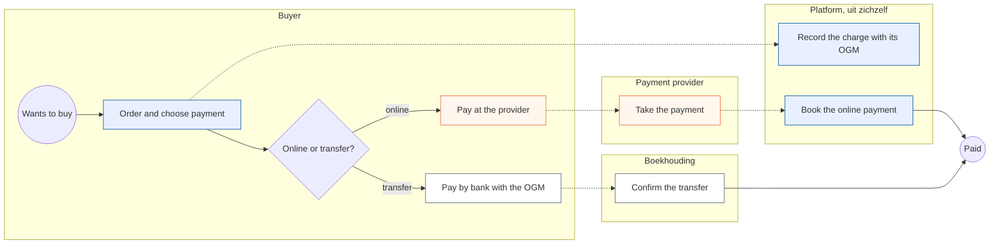
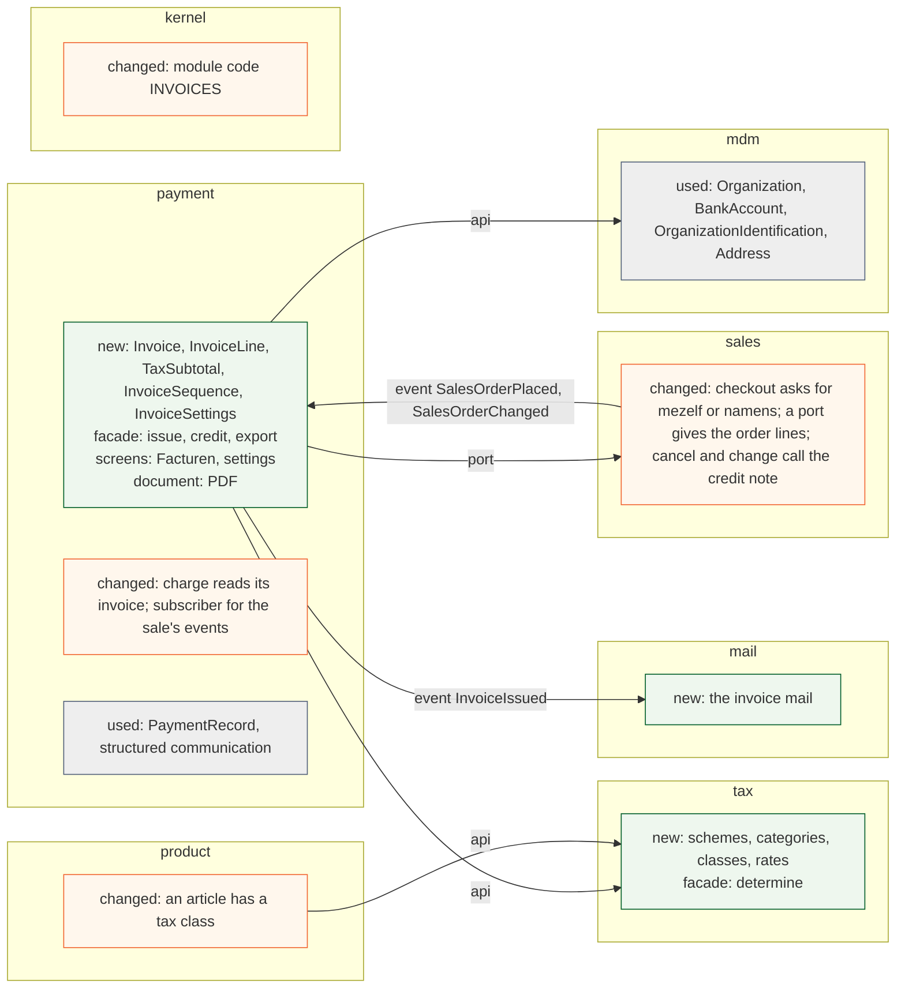
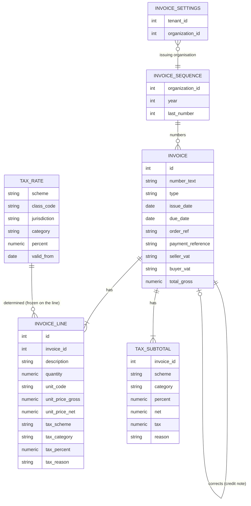

# Change Request 34 — Invoices for the webshop

**Project:** Web Portal "Raak Millegem"
**Status:** shaped on 15 October 2026 by the design-documentation CLI, on Koen's dictation · build read by Dev2 on 15 October 2026 (comment on #2009), findings taken in · 18 Oct 2026: one tenant switch for the invoices and for selling to an organisation (R18) · **not in v2.17** (Koen, 18 Oct 2026: "we gaan die twee change requesten, nog de facturatie, nog het Peppel gebeuren, niet in versie 2.17 stoppen"; his word of 15 Oct was v2.18; **no longer on v2.18** either, 18 Oct 2026: "Haal 2009 en 2010 maar van v2.18, die worden uitgesteld tegen het ogenblik dat we echt gaan factureren.", via the master CLI; postponed until invoicing starts for real) (not assigned yet: the assignment follows the build read) · **prerequisites:** CR-21 (webshop) built, and CR-26 (party model) phase 2, "the buyer" (C4.10)
**Tracking issue:** #2009 — the one place where what is open stands; this document is the design, the issue is the status
**Applies to:** `payment` (the invoice, its number, its VAT, its document; the module "invoices"), `tax` (new: tax classes, categories, rates and the one rule that picks the rate), `product` and `pricing` of CR-21 (the tax class of an article), `sales` (the buyer's details, cancelling and changing an order that has an invoice), `mdm` (the issuing organisation, the buyer as a party; read, not changed), `mail` (the invoice mail), `kernel` (the module registry), `reporting` (a view)
**Reading:** A 1 500 words · B 2 491 · C 4 082 — measured on 15 October 2026, drawings excluded, tables included; budgets A ≤ 1 500, B ≤ 2 500

---

# Part A — The business

## A1. Reason to act — the trigger

A family member of Koen is going to try a webshop for a niche cycling helmet that is not sold in Belgium today. The shop is a trial and sells to private persons and to organisations, some of them liable to VAT. A company that buys needs an invoice for its bookkeeping, and a seller owes one; a payment alone is not a sale document. Koen: "dat het niet puur een betaling is, maar dat er een factuur is." The portal knows payments and, with CR-21 (webshop), orders. It does not know invoices.

The seller is a company, not one of the Raak departments: the shop becomes a tenant of its own under Koen's company, Renko, and invoices with Renko's VAT number. The Raak departments have no invoices and must not get any.

## A2. As-is process — how it works today, and where it hurts

No webshop and no invoice run today; the webshop of CR-21 is still being built. The nearest running process is a **paid registration**, and the shop will follow the same path: the buyer chooses online payment or a transfer with a structured communication (OGM), the platform records the charge, and Boekhouding confirms a transfer by hand.

<!-- figure: name=cr34-as-is caption=Today_a_sale_ends_at_a_payment_and_nothing_a_buyer_can_hand_to_a_bookkeeper -->

*What to see: every road ends at "Paid"; no step produces a document for the buyer or for a bookkeeper.*

| Step | Who | Pain |
|---|---|---|
| Order and choose payment | Buyer | A company cannot say it buys as a company: no VAT number |
| Record the charge | Platform | The charge has an amount, no VAT, no number, no seller |
| Confirm the transfer | Boekhouding | Works, but there is nothing to match against except the OGM |
| End: "Paid" | — | No invoice: a company buyer has nothing for its own bookkeeping, and Renko has nothing for its accountant |

## A3. To-be process — how it should work afterwards

<!-- figure: name=cr34-to-be caption=Afterwards_every_sale_ends_in_a_numbered_invoice_that_says_paid_or_how_to_pay -->

*What to see: the new blue steps are "Issue the invoice", "Mail the invoice", "Follow the open invoices" and "Hand the invoices over"; the buyer's first step gains one question.*

- **"Order" gains a choice, and this change an address step:** for myself or on behalf of an organisation (CR-26, which asks nobody an address: the buyer copy takes it from the party when it has one, and stays empty for a guest); the address is asked here, only where an invoice is issued to a buyer whose party holds none.
- **"Issue the invoice" is new:** the portal numbers the invoice, calculates the VAT and writes the payment text. Online and paid: "voldaan". Transfer: the OGM and a due date.
- **"Hand the invoices to the bookkeeper" is new:** the portal produces the set, so nobody retypes it.

**What it says on the screen** (Dutch): the menu **Facturen**; the document title **Factuur** and, for a correction, **Creditnota**; the checkout choice **Wie bestelt: voor mezelf / namens <organisatie>**; the page **Mijn organisatie** (CR-26); the payment lines **Voldaan** and **Te betalen vóór <datum> met gestructureerde mededeling <OGM>**; the setting **Betaaltermijn (dagen)**; the list columns **Nummer, Datum, Koper, Totaal, Betaald**.

## A4. Benefits — what the change earns

- **The shop can sell to a company at all.** A VAT-liable buyer without an invoice does not buy.
- **No invoice is made by hand:** one per sale, numbered, with the VAT worked out.
- **The accountant gets a complete set** instead of payments to reconstruct.

## A5. Supplied material — and what it taught us

Koen's dictation of 15 October 2026 is the source; no sample invoice was supplied. Taught by shaping, from secondary sources not yet checked against the law (B9): **since 1 January 2026 a domestic invoice between two VAT-liable businesses in Belgium must be a structured e-invoice (Peppol BIS Billing 3.0); a PDF by mail no longer counts for that case**, and a consumer sale is outside it. Sending that e-invoice through the Peppol network is outside this change request: it is CR-35 (invoices through Peppol), which has this one as its prerequisite (Koen, 15 October 2026). What this change does about it is Q3.

Reporting need: the accountant gets the invoices of a period, a list and the documents, in one go (R11). A VAT return is not a need.

## A6. Business requirements — what the board asks, with MoSCoW

| # | Requirement | MoSCoW | Source | Comment |
|---|---|---|---|---|
| R1 | The shop is a **brand** and a tenant of its own, operated by Renko BV. Invoices carry the name, address, VAT number and bank account of the **issuing organisation** (Renko BV) **and, clearly, the brand's name and logo** | Must | Koen, 15 Oct 2026 | the brand's name is a working title that may change, so it is read from the tenant, never written in code or text |
| R2 | Every sale of an article of the webshop gets an invoice, to a private person and to an organisation alike | Must | Koen, 15 Oct 2026 | |
| R3 | An invoice has a number — rising, without gaps, with or without a year — and a date | Must | Koen, 15 Oct 2026 | "1, 2, 3 is fine" |
| R4 | The invoice names the seller and the buyer. A person: name and address. An organisation: also its VAT number | Must | Koen, 15 Oct 2026 | |
| R5 | VAT is worked out and shown. It is 21 % to begin with, and **every article carries a tax class** | Must | Koen, 15 Oct 2026 | |
| R6 | Not paid online: the invoice says to pay by transfer, with the OGM, within the **payment term the tenant already has** (7 days to begin with; the setting of registrations and memberships, not a new one). Paid online: it says "voldaan" | Must | Koen, 15 Oct 2026 | the OGM is the one the payment already has |
| R7 | The invoice has what Belgian law requires on it | Must | Koen, 15 Oct 2026 | the list stands in C4.1, built on as it stands (B9) |
| R8 | An invoice belongs to a booking: its amount is a receivable followed against payments | Must | Koen, 15 Oct 2026 | "daar hangt ook een boeking aan"; not a general ledger (B9) |
| R9 | Verkoop sees the invoices of its sales. Boekhouding sees all invoices and follows the payments | Must | Koen, 15 Oct 2026 | |
| R10 | The buyer gets the invoice by mail and finds it again under their purchases | Should | shaping, 15 Oct 2026 | |
| R11 | Boekhouding downloads one invoice, or all invoices of a period with a list, for the bookkeeper | Must | Koen, 15 Oct 2026 | |
| R12 | A sale that is changed or cancelled after its invoice is corrected by a credit note, never by editing | Must | shaping, 15 Oct 2026 | the law, and CR-21 lets orders change |
| R13 | A buyer in the Netherlands: a private person pays Belgian 21 % VAT under the EU limit; a VAT-liable organisation with a valid VAT number gets the intra-Community rule | Should | Koen, 15 Oct 2026 | phase 3; no limit check (B9) |
| R14 | Sending an invoice to a Belgian company through Peppol | Won't *(here)* | Koen, 15 Oct 2026 | moved to CR-35 (invoices through Peppol); this change keeps its document in the shape of the standard, so that sending is a mapping |
| R15 | Only tenants that switch invoices on have them; the Raak departments have none | Must | Koen, 15 Oct 2026 | |
| R16 | A VAT return and a bookkeeping module | Won't | Koen, 15 Oct 2026 | "btw-administratie valt buiten de scope" |
| R17 | Selling outside Belgium and the Netherlands; other currencies | Won't *(now)* | Koen, 15 Oct 2026 | "enkel Belgische facturen", the Netherlands asked to be looked at |
| R18 | **One switch per tenant: the module "invoices" also switches selling to an organisation as the buyer** (*Mijn organisatie*, *namens …* in the checkout, an order with an organisation as buyer). Off, the tenant sells to natural persons only. **Managing organisations stays available to every tenant** | Must | Koen, 18 Oct 2026 | "Misschien moeten we er maar één schakelaar van maken. Als je aan organisaties verkoopt, heb je ook facturen. Punt." (in the architecture CLI's chat) |

## A7. Non-functional requirements — security, privacy, house style, tenants

| Concern | This change |
|---|---|
| **Security** | An issued invoice cannot be edited or deleted by anyone. Boekhouding and Verkoop see invoices; a buyer sees only their own; a document is never reachable by a guessable address |
| **Privacy** | An invoice holds a name and an address, and for a company a VAT number. The law obliges the seller to keep it for years, so it is not erased on request while that duty lasts; it leaves the system only by mail to the buyer and by the export to the accountant |
| **House style / UI norm** | Screens on the kit; the document in the site's logo and colours, Dutch |
| **Multi-tenant** | Invoices exist only for tenants that switch the module on; the numbering belongs to the issuing organisation, so two tenants of one company never repeat a number |

## A8. Acceptance criteria — what the business signs off on HDEV

| # | Criterion | Requirement | Walkthrough steps |
|---|---|---|---|
| AC1 | A private buyer pays online: an invoice with the next number, 21 % VAT worked out and "Voldaan" arrives by mail and shows under their purchases | R2, R3, R5, R6, R10 | W1–W3 |
| AC2 | A company buys by transfer: the invoice names its VAT number, shows the OGM and a due date seven days on; changing the term setting changes the next invoice | R4, R6 | W4–W6 |
| AC3 | Boekhouding sees the open invoice, confirms the transfer, and it reads paid | R8, R9 | W7–W8 |
| AC4 | An article of another tax class gives that class's rate on its line, and the totals per rate add up to the payment | R5 | W9 |
| AC5 | An order cancelled after its invoice gives a credit note; the invoice is untouched | R12 | W10 |
| AC6 | Boekhouding downloads the period's invoices and the list | R11 | W11 |
| AC7 | A Raak department has no Facturen menu, no invoice route and no invoice text | R15 | W12 |
| AC8 | A buyer in the Netherlands: as R13 says | R13 | W13–W14 |
| AC9 | On a tenant with the module off the checkout offers no organisation as buyer, while the organisation can still be registered by the back office and managed; switching the module on offers it | R18 | W15 |

---

# Part B — The solution, for whoever approves it

## B1. Solution outline — the solution and the decisions that shape it

The portal issues an **invoice** when a sale is settled in business terms. The invoice is a **frozen document**: a copy of the seller, the buyer and the lines as they were, with a number from a gapless sequence of the issuing organisation, the VAT per rate and a payment text. It is rendered as a PDF in the site's logo, mailed, kept, and exported. A mistake is corrected by a **credit note**. Payments stay where they are; the invoice is the receivable they settle.

- **D1 — Invoices live in `payment`, as a module "invoices" a tenant switches on.** Koen, 7 October 2026: invoices belong to the payment domain, called finance, with no domain of their own (CR-21 Q31). The switch is a module entry in the registry (CR-19), so a Raak department has none. **The same switch governs selling to an organisation as the buyer** (R18, Koen, 18 October 2026); managing organisations is not behind it. Rejected: an `invoicing` domain, a second place for receivables.
- **D2 — The invoice is a snapshot, never a live view.** Seller, buyer, lines and VAT are copied at issue; nothing edits them, and the PDF is rendered once at issue and stored (C4.4). Rejected: an invoice that reads the order or the tenant when opened.
- **D3 — A correction is a credit note.** The same document type with a link to the invoice it corrects, issued when an order with an invoice is changed or cancelled. Rejected: editing.
- **D4 — One gapless sequence per issuing organisation**, taken inside the issuing transaction under a lock. Rejected: a sequence per tenant; two tenants of a company would repeat a number.
- **D5 — The tax is a class per article, a rate from a module of its own, in the shop's price.** The article carries a **tax class**; the new module `tax` holds the schemes, categories, classes and rates and the one function that says which applies (D9). Prices stay what the buyer pays; the invoice works net and tax out of them per rate, and its total equals the payment, a rounding amount of a few cents bridging the VAT (C4.3).
- **D6 — The issuing organisation is a setting of the module**, defaulting to the account's organisation; the brand is the tenant's own name and logo, shown beside it. Renko BV is the seller, the brand is the shop (B9, Q4).
- **D7 — The issuing moment**: online, when the payment is confirmed; transfer, when the order is placed (B9).
- **D9 — Tax lives in a module of its own, small from the first day.** It holds the schemes, categories, classes and rates (with a validity period and a jurisdiction) and one rule, `determine(class, seller, buyer, date)`, that product, sales and invoices call; an invoice only freezes the answer. VAT is the one scheme today; rules that outgrow a table of rates may later move behind this function (C4.9). The platform maintains it by migration, without a screen (B9). Rejected: rates inside `payment`.
- **D8 — The invoice is modelled after EN 16931 and the Peppol profile, and rendered only as a PDF here.** Producing the UBL file and sending it is CR-35. Rejected: building the UBL writer here — it is half of CR-35 and cannot be judged without its validation and its sending.

**Derived requirements**

| # | Derived requirement | From |
|---|---|---|
| F1 | An invoice is issued once per settled sale: a transfer in the order's transaction, an online payment after it is booked, so a failing invoice never unbooks money (C4.4); a second try is a no-op | R2 |
| F2 | The number is taken from the issuing organisation's sequence at issue; a rolled-back issue leaves no gap | R3 |
| F3 | Seller and buyer are copied onto the invoice; a later change does not change it | R4 |
| F4 | An article has a tax class from a short list; the default is the standard class, which is 21 % in Belgium | R5 |
| F5 | `tax.api.determine` returns scheme, category, percent and reason; net, tax per rate and total are computed from the gross line amounts and equal the payment | R5, R6 |
| F6 | The payment text is "Voldaan" for a paid charge, else the OGM of the charge and a due date = invoice date + term | R6 |
| F7 | The due date is the pay-before date the ledger already gives the buyer (date + the tenant's existing term, read once); no second term, no second date | R6 |
| F8 | An invoice cannot be updated or deleted after issue | R12 |
| F9 | A change or cancel of an invoiced order issues a credit note and, if the sale stands, a new invoice | R12 |
| F10 | The invoice is shown on a screen and as a PDF with the site's logo | R1 |
| F11 | A period export gives a list and the documents | R11 |
| F12 | The invoice mail leaves after the outer commit | R10 |
| F13 | A tenant without the module has no menu, route, mail or text | R15 |
| F14 | A tenant without the module sells to natural persons only: the checkout has no choice of an organisation as buyer and refuses an order on behalf of one; the organisation as a party (list, record, link to a person) is not behind the switch | R18 |

## B2. Fit with the process and the requirements — for the business

<!-- figure: name=cr34-usage caption=Every_new_step_has_a_screen_in_the_invoices_module_or_the_shop -->

*Colour is the module: green sales, blue payment, orange mail; "outside the portal" has none.*

**Traceability**

| R | How the solution meets it | F | Module (C2) | Test (C6) | AC |
|---|---|---|---|---|---|
| R1 | The invoice names the issuing organisation, and shows the brand's name and logo | F3, F10 | payment, mdm | T3, T9 | AC1 |
| R2 | One invoice per settled sale | F1 | payment, sales | T1 | AC1 |
| R3 | A gapless number from the issuer's sequence | F2 | payment | T2 | AC1 |
| R4 | Seller and buyer copied at issue; a company adds its VAT number | F3 | payment, sales | T3, T4 | AC2 |
| R5 | A tax class per article; tax per rate | F4, F5 | tax, product, payment | T5, T6, T17 | AC4 |
| R6 | "Voldaan" or OGM and due date; the term is a setting | F6, F7 | payment | T7 | AC1, AC2 |
| R7 | The legal content list of C4.1 is on the document | F10 | payment | T8 | AC1 |
| R8 | The invoice is the receivable; payment status is read from the ledger | F1 | payment | T10 | AC3 |
| R9 | Verkoop and Boekhouding see by role | — | payment | T11 | AC3 |
| R10 | The mail after the commit; the purchases page links the PDF | F12 | mail, sales | T12 | AC1 |
| R11 | The period export | F11 | payment | T13 | AC6 |
| R12 | A credit note, never an edit | F8, F9 | payment, sales | T14, T15 | AC5 |
| R13 | The Netherlands, phase 3 | F5 | payment | T16 | AC8 |
| R14 | Won't here: CR-35 | — | — | — | — |
| R15 | The module switch | F13 | kernel | T18 | AC7 |
| R18 | One switch for the invoices and for selling to an organisation | F14 | kernel, sales | T23 | AC9 |
| R16, R17 | Won't | — | — | — | — |

**Walkthrough** (HDEV, the shop tenant with the module on, Mollie in test mode)

*Private buyer.* W1 Order a helmet and pay online; see the shop's thank-you page. W2 Open the mail; see an invoice with number, date, seller, 21 % VAT worked out, "Voldaan". W3 Under *Mijn aankopen* open the same invoice.
*Company buyer.* W4 Register an organisation under *Mijn organisatie* with a VAT number, order again *namens* it, choose a transfer. W5 Open the mail; see the VAT number, the OGM and a due date seven days on. W6 In the tenant settings set *Betaaltermijn (dagen)* to 14; the next invoice says 14.
*Boekhouding.* W7 Under *Facturen* find the open invoice. W8 Confirm the transfer on the payments screen; the invoice reads paid.
*Rates.* W9 Give one article 6 % and order it with another; the lines carry their rates and the totals per rate add up to the payment.
*Correction.* W10 Cancel the first order; a credit note appears, the invoice stays.
*Accountant.* W11 Download the period's list and documents.
*Refusals.* W12 On a Raak department no *Facturen* and the route answers 404. W13 Order as a Dutch private buyer: Belgian 21 %. W14 As a Dutch company with a valid VAT number: the intra-Community text and no VAT. W15 On a tenant without the module, check out: no choice of an organisation; open *Mijn organisatie* and edit one; switch the module on and the choice appears.

## B3. The whole across the modules — for the architect

<!-- figure: name=cr34-structure caption=Green_is_new_orange_is_changed_grey_is_only_used -->

*Green new, orange changed, grey used.*

*New: all six. The article is a soft reference across schemas, the order too, and `buyer_party_id` is a real key to `mdm.parties` (the one named exception, B4); the seller and the buyer are copied columns, not keys, because the document is frozen.*

`sales` publishes `SalesOrderPlaced` and `SalesOrderChanged` (CR-21); `payment` subscribes and issues in the publisher's transaction, never committing; `payment` publishes `InvoiceIssued` and `mail` sends after the outer commit. `payment` reads the organisation's identifications through the facade of `mdm`, and asks `sales` for the order's lines and buyer through a port (C2), the one new edge. The impact on what exists: the module list and its CHECK, the payable delete gate (an invoiced order must not be soft-deleted without its credit note), `sales`' cancel (CR-21 Q61), the payments screen, and a reporting view. The import and layer gates hold.

## B3a. Standards the model follows — and where it deviates, on purpose

Standards checked: **UBL 2.1** and **EN 16931 / PEPPOL BIS Billing 3.0** for the shape (the file is CR-35), **UNCL 1001** (380 invoice, 381 credit note), **UNCL 5305** (VAT category), **UNCL 4461**, **ISO 4217, 3166, 8601, 20022, 6523**, **UN/ECE Rec. 20** for units.

| Concept | Standard and element | Ours | Follows / deviates — why |
|---|---|---|---|
| Invoice number, date, type | `cbc:ID` (BT-1), `cbc:IssueDate` (BT-2), `cbc:InvoiceTypeCode` | `invoice.number`, `issue_date`, `type` ∈ {380, 381} | follows |
| Due date | `cbc:DueDate` (BT-9) | `invoice.due_date` | follows |
| Seller and buyer | `cac:AccountingSupplierParty`, `cac:AccountingCustomerParty` with `cac:PartyLegalEntity`, `cac:PartyTaxScheme`, `cac:PostalAddress` | flat copied columns `seller_*`, `buyer_*` | follows the content, **deviates in shape**: a document embeds its party, and a key to a live party would change the invoice |
| Payee account | `cac:PayeeFinancialAccount` | `seller_iban`, `seller_bic` copied from `mdm.bank_accounts` | follows, copied |
| Payment reference | `cac:PaymentMeans/cbc:PaymentID` (BT-83) | `invoice.payment_reference` (the OGM) | follows |
| Line | `cac:InvoiceLine` (quantity with `unitCode`, `cac:Price`, `cac:Item`) | `invoice_line`, `unit_code` "C62" | follows; gross price kept, net derived (D5) — a deviation named in C4.3 |
| Tax per rate | `cac:TaxTotal/cac:TaxSubtotal`, `cac:TaxCategory` with `cac:TaxScheme` (UNCL 5153: VAT) | `tax_subtotal(scheme, category, percent, net, tax, reason)` | follows, and the scheme makes it general: VAT is a value, not a name |
| Tax rule | — (the standard states the result, not the rule) | `tax.rates`, `tax.api.determine` | no standard for the rule; modelled as reference data with a validity period and a jurisdiction |
| Credit note | `CreditNote` with `cac:BillingReference` | `type` 381 and `corrects_invoice_id` | follows |
| Exemption reason | `cbc:TaxExemptionReason` (BT-120) | `tax_subtotal.reason` | follows, used from phase 3 |

---

## B4. Rules this change needs an exception from — decided once, here

| Rule (where) | What the design does instead | Mechanism | Temporary until … / the new rule | Decided |
|---|---|---|---|---|
| Schema boundary: no foreign key across schemas | `buyer_party_id` on the order is a real key to `mdm.parties`; the gate names `mdm.tenants` and `mdm.parties` as the only targets and keeps refusing `mdm.persons` | the schema-boundary gate (CR-26 B4) | the new rule | Koen, 18 Oct 2026 (Q21) |
| CR-21 Q61: cancelling an order is a soft delete, the total reconciled to zero | An order with an invoice is cancelled together with its credit note, in one transaction | `sales` cancel calls `payment.api.credit`; the payable delete gate learns the invoice | the new rule | open — Q17 |
| `AGENTS.md` (a screen says what a value is, never what another domain does with it) | none needed | — | — | — |
| Gates checked: layer gate, import gate, module gate, rights gate, payable delete gate, the baseline of Dutch identifiers | none other bends | — | — | — |

## B5. Cost — investment and running cost, and what operations must know

**Investment (CLI-days)**

| Phase | Content | Days |
|---|---|---|
| 0 | The module `tax` (classes, rates, the function), the article's tax class, the module of invoices, the settings | 3 |
| 1 | The invoice, the number, the VAT, the document and the mail, the screens | 6 |
| 2 | Credit notes and the order's change and cancel | 3 |
| 3 | The Netherlands | 2 |
| — | Build read, review, HDEV, release steps | 3 |
| **Total** | | **17** |

No purchase.

**Running cost.** Storage of PDFs is negligible. Maintenance added: the tax rates, by a dated migration when a rate changes.

**Operations.** The module switch of the tenant; the setting of the issuing organisation, and the existing payment term; no env var. Invoices and the sequence are in the backup as any table; a restore brings both back.

## B6. Phasing — shippable phases, and what changes on the failure paths

| Phase | Delivers | Depends on | Migration | Env vars | Failure paths that change | Manual validation |
|---|---|---|---|---|---|---|
| 0 | `tax` and the article's tax class, the module of invoices, the settings | CR-21 built | additive | none | none | W6 |
| 1 | The invoice, number, VAT, payment text, PDF, mail, screens, export; Belgian buyers | 0, CR-26 phase 2 | additive | none | a transfer order whose issue fails is refused; an online payment stays booked and a job retries the invoice (C4.4) | W1–W8, W11, W12 |
| 2 | Credit notes; change and cancel | 1 | additive | none | a cancel issues its credit note in the same transaction | W10 |
| 3 | The Netherlands | 1 | additive | none | a Dutch buyer with an invalid VAT number is refused at checkout | W13, W14 |

Phases 1 and 2 go live together (B9).

## B7. Rule and gatekeeper — what this fixes for all future work

**The rule:** a document that carries a legal number is never edited and never deleted; it is corrected by another document that refers to it. It goes to the architecture document and `docs/code-style.md`. **Reach:** today there is no such document; baseline zero. **Gate:** hard (C7).

## B8. Open decisions — what the approver still decides

| # | Question | Recommendation | What the answer changes |
|---|---|---|---|
| Q17–18 | Two choices (Q&A file nr. 07): cancelling an order that has an invoice; the price for a Dutch company | a, a | B4, C4.7 |
| Q19 | ~~One module or two~~ **Answered 18 Oct 2026: one** (B9). ~~Who lands the entry first~~ **CR-26 phase 2**, as CR-34 follows later | — | — |
| Q20 | ~~Address in the checkout~~ **Answered 18 Oct 2026** (B9): from the party if it has one, typed only if not | — | — |
| Q21 | ~~`buyer_party_id`~~ **Answered 18 Oct 2026** (B9): a real key, with one named exception in the gate | — | — |

## B9. Decisions log — dated answers

| Date | Decision | By |
|---|---|---|
| 15 Oct 2026 | Six answers, each "a" (Q&A file of 15 October, nr. 03): Q1 the invoice is issued at the sale; Q3 until CR-35 is live the portal exports the invoices to Belgian companies and Koen sends them through his other Peppol route; Q5 prices stay VAT-inclusive; Q7 credit notes go live with the invoices; Q8 one sequence for both; Q11 the platform maintains the tax rates by migration, no screen | Koen |
| 15 Oct 2026 | Q2: handed to the architecture CLI. Koen: "geef maar door aan brainstorm, … over jouw vraag gaan we niet te diep nadenken". Then, shaping CR-26 with that CLI, Koen decided the cut (CR-26 B9, same day): the party is per account, a company buys through a signed-in person who registers the organisation once ("ja, akkoord"), order CR-20, CR-26 phases 1–3 in one release, then this change ("ja op 1, ja op 2"). Phase 1 of this change waits for CR-26 phase 2 (C4.10) | Koen |
| 15 Oct 2026 | Q6: no limit check in the shop; the accountant watches the EU limit. Koen: "c" | Koen |
| 15 Oct 2026 | Q9: no general ledger; the booking is the receivable. Koen: "a, … mijn boekhouder doet de boekhouding in zijn systeem met zijn grootboek"; his question about three objects is answered in C4.5 | Koen |
| 15 Oct 2026 | Q10: C4.1 is built on as it stands. Koen: "b, maar vertel me misschien even wat je erop wil zetten". Then, on reading it: the date of supply, a printed table per rate and the late-payment text are dropped; the exemption statement is open until explained (C4.1) | Koen |
| 15 Oct 2026 | Release v2.18, after CR-20 and CR-26: "deze moet ook in v2.18" (CR-26 B9) | Koen |
| 15 Oct 2026 | Five choices after the build read (Q&A nr. 06): 1 **b**, the checkout asks every buyer for an address; 2 **a**, no date of supply; 3 **a**, the VAT per rate is not printed; 4 **b**, the number is the year and a counter that restarts each year; 5 **a**, no invoice for a free order | Koen |
| 18 Oct 2026 | One switch: the module "invoices" also switches selling to an organisation; managing organisations stays open to all. Koen, in the architecture CLI's chat, to the choice between one module and two: "Misschien moeten we er maar één schakelaar van maken. Als je aan organisaties verkoopt, heb je ook facturen. Punt." This replaces the reading of the same day in which Koen thought of a separate toggle ("denk ik") and called the link with invoices "geen requirement van mij"; CR-26 Q15 records the same choice. R18, F14, T23, AC9 | Koen |
| 18 Oct 2026 | Not in v2.17. Koen: "we gaan die twee change requesten, nog de facturatie, nog het Peppel gebeuren, niet in versie 2.17 stoppen" (this change and CR-35). It had been relayed earlier that day that he wanted it in v2.17; this replaces that. The 15 Oct word, v2.18, was withdrawn the same day (next row) | Koen |
| 18 Oct 2026 | Two answers, relayed by the architecture CLI from Q&A_20261018_03 (CR-26 B4, B9): the key across schemas, "a" — one named exception, a foreign key may point to `mdm.tenants` and `mdm.parties`, `mdm.persons` stays refused, so `buyer_party_id` is a real key (Q21); the address in the checkout, "a" — from the party if it has one, typed only if not, *namens* asks nothing; Koen: "enkel bedrijven (organisaties) hebben btw-nummers, de natuurlijke persoon die voor een organisatie bestelt heeft geen BTW-nummer, een adres is dan ook niet verplicht." This replaces choice 1 "b" of 15 Oct (every buyer types an address) (Q20) | Koen |
| 18 Oct 2026 | Off v2.18 too, postponed until invoicing starts for real. Koen, via the master CLI: "Haal 2009 en 2010 maar van v2.18, die worden uitgesteld tegen het ogenblik dat we echt gaan factureren." (#2009 and #2010) | Koen |
| 15 Oct 2026 | Q4: the issuing organisation is Renko BV; the tenant is a brand, shown with its name and logo. Koen: "De verkoper is inderdaad Renko BV met zijn adres en btw-nummer."; the brand and its logo must stand on the invoice | Koen |

---

# Part C — The build, for the master CLI and the dev CLIs

## C1. Verified premises — measured before the handover

Measured on master @ `ff5eeb3a` and on the build branch of CR-21 @ `508ee052` on 15 October 2026; master is now `39b26f10` with CR-33 on it; to be measured again on master just before the handover.

| Concept or claim | Kind | Measurement | Verdict | Consequence |
|---|---|---|---|---|
| An organisation has repeatable bank accounts and identifications, with a country | relies on | `mdm/models.py`: `BankAccount`, `OrganizationIdentification` (scheme, value, country) | holds | seller IBAN and VAT number come from them |
| An organisation can own an address | relies on | `mdm/models.py` `Address.organization_id` (nullable; the relationship is declared for `person` only) | holds, thin | the seller's address read through the facade; a relationship is a C2 item |
| One structured communication per charge exists | relies on | `payment/structured_communication.py`, `PaymentRecord.structured_communication` | holds | the invoice copies it; no second generator |
| PDF rendering exists | relies on | `meetings/pdf.py` renders HTML with WeasyPrint | holds, not shared | the invoice has its own render function with its own WeasyPrint import (C4.8); `meetings.api` exports none |
| The tenant logo is read through one function | relies on | `media.api.tenant_logo`, used in `ui/__init__.py:1051` | holds | the document uses it |
| A module is a registry entry plus a CHECK migration | relies on | `kernel/modules.py` docstring; `ModuleCode` has eleven members on master and twelve on the CR-21 branch (`SHOP`), none for invoices | holds | `INVOICES` is the thirteenth; its CHECK widens the list CR-21's migration widened |
| `PayableType` has no invoice and needs none | relies on | `payment/models.py:78-88`: REGISTRATION, MEMBERSHIP (ORDER added by CR-21) | holds | the ledger keeps pointing at the order |
| Articles carry no tax class | changes | `product/models.py` on the CR-21 branch: `Product`, `ProductVariant`, no such column | holds | phase 0 adds it |
| No module holds tax | relies on | `ls backend/app/domains` on master: no `tax`; no `vat` column or table in `mdm` or `payment` (`mdm/models.py` dropped `vat_number` for identifications, #945) | holds | `tax` is new; the VAT number of a party stays in mdm identifications |
| The payment term already exists, once | relies on | `kernel/tenant_config.py:641` `tenant_payment_term_days`; `config.py:145` default 7; `payment` lists it in its module's `tenant_settings` (`kernel/modules.py:196`); read by `payment/transfer_due.py:93` for the screens and both mails | holds | the invoice reads it; no `term_days` of its own (one place for one fact) |
| `payment` reads no order today | changes | `kernel/contracts/sales.py`: events carry ids and a total; `payment` `CONTRACT.md` consumes no `sales`; `sales` offers no port (read, 15 Oct) | gap | a port (C2) |
| An order carries no buyer address | changes | `SalesOrder`: `guest_name`, `guest_email`, `guest_mobile`, `person_id` (read) | must change | the order gains the buyer copy (C2 sales) |
| The webhook books money under a lock | relies on | `refresh_payment_status` holds the record `FOR UPDATE` (read) | holds | an invoice that fails must not roll it back (C4.4) |
| `queue_mail` carries strings only; there is no trigger in `backend/` | changes | `mail.queue_mail`; no `CREATE TRIGGER` (read) | gap | a job kind (C2 mail); the first trigger (C5) |
| Readers of the article's price | changes | to be found by searching `unit_price` in `sales`, `pricing`, `payment` | open | listed at the build read |
| The delete rule for a soft-deleted order | changes | CR-21 B9, 8 Oct 2026: cancel is a soft delete (`activities/service.py:2427-2466` as the model) | holds | B4 row |

## C2. Per module: what must happen

**payment.** *Screens:* Facturen (list, filters open and paid; one invoice; settings); judged at 390 px. *Code:* `issue_invoice`, `issue_credit_note`, `export_period`, `invoice_for_order` in `api.py`; a subscriber for `SalesOrderPlaced`, `SalesOrderChanged` and the payment event; the single owner of every writer to the invoice tables is `payment/invoice_service.py`. *Database:* schema `payment`; `invoices`, `invoice_lines`, `tax_subtotals`, `invoice_sequences`, `invoice_settings`; each invoice line also carries the frozen scheme, category, percent and reason; `invoice_sequences(organization_id, year)` unique; `invoices(issuing_organization_id, number)` unique, `number` being the text *2026-0001* with the counter stored apart; every FK `ON DELETE RESTRICT`; no `SoftDeleteMixin` on an invoice; additive. Copy action: none of these tables has one. *Templates and mail:* the invoice HTML for the PDF. *Edges:* a port of `sales`, `order_invoice_source(order_id)`, that returns the lines (article, quantity, gross unit price, **tax class frozen at the order**) and the buyer copy with `buyer_party_id`; new import edges `payment→tax`, `product→tax`, `payment→sales` (port only), and none from `payment` to `product`, named in the `CONTRACT.md` of each, with `tax` in the registry, the schema-boundary test and the layer gate. *One handler:* a single subscriber on `SalesOrderChanged` runs the existing reconcile first and then issues the credit note and the new invoice from the ledger as it then stands; a second handler would have no order. *Stored document:* `invoices.document_pdf` written at issue, never updated. *Default organisation:* the account party of the tenant (`tenants.account_id`, CR-20 before this change). *Tests:* T1–T11, T13–T16, T19–T21.
**tax** (new domain, no module switch: reference data like `mdm`). *Code:* `tax/api.py` with `determine(context)` → scheme, category, percent, reason, where the context object carries today the tax class, seller and buyer country, whether the buyer (an organisation party with a VAT number in a country) has a valid tax number, and the date, and can grow without changing a caller (C4.9); the rule holds the three cases of today (Belgian rate; Dutch consumer under the EU limit, Belgian rate; Dutch taxable buyer with a valid number, intra-Community) and nothing else. *Database:* schema `tax`; code lists `tax_scheme_codes` (VAT), `tax_category_codes` (S, Z, E, AE, K), `tax_class_codes` (standard, reduced, super-reduced, zero; labels per language) and `tax_rates(scheme, class_code, jurisdiction, category, percent, valid_from, valid_to)`, seeded for Belgium; additive. No screen. *Tests:* T17.
**product** (CR-21). Article form gains a *Btw-klasse* (default standard); a copy of an article takes the class along. The article stores no percentage. Tests T5.
**sales** (CR-21). Checkout gains the choice *voor mezelf / namens <organisatie>* (the organisation is registered once under *Mijn organisatie*, CR-26), and no company fields; an order line freezes the article's tax class when the order is placed (a column on CR-21's line, because the price the buyer saw held that VAT); the address comes from the party when it has one and is typed only when it has none (*namens* asks nothing: an organisation always has an address; a guest types it; a signed-in person without an address types it only where an invoice is issued to them; CR-26 AC4, Koen 18 Oct 2026, Q20) — a private person is never asked for a VAT number — and the order carries a **buyer copy** for every buyer: name, street, number, box, postal code, municipality, country, VAT number and the **endpoint** CR-35 needs (for Belgium the enterprise number, the digits of the VAT number, scheme 0208), typed by a guest and copied from the party at the moment of ordering for a person or an organisation (the guest columns of CR-21 become its name and contact fields), plus `buyer_party_id` when there is a party; the invoice reads that one source; phase 3 lets a Dutch address through; cancel and change call `payment.api` for a credit note; the purchases page links the invoice. Tests T4, T14, T15.
**mdm.** *The buyer copy on the order belongs to CR-26 F8* (name, address, VAT number); this change adds its own columns to it (the Peppol endpoint) and asks nothing else of it. `sales_orders.person_id` stays (who placed the order) with `buyer_party_id` beside it; the invoice reads the buyer from the copy, so nothing changes for it. Read-only through the facade: the issuing organisation's name, address, identifications and account; an organisation that buys is a party of the account (C4.10); the invoice copies the order's buyer copy and keeps `buyer_party_id` as a real key to `mdm.parties` (Q21), empty for a guest.
**mail.** A job kind `mail.send_invoice(invoice_id)` that attaches the stored PDF after the outer commit; `queue_mail` carries strings only. T12.
**kernel.** `ModuleCode.INVOICES`, its registry entry, the CHECK migration (the `tenant_modules` CHECK is widened), `depends_on` the shop and payment modules (invoices on with the shop off is refused). **Off by default for every kind of tenant**, so explicitly outside `DEFAULTS["VERENIGING"]`, which today holds every module but the shop (CR-26 Q16, architecture CLI, 18 Oct 2026). The router of *Mijn organisatie* (in `mdm`) stands under `require_module(INVOICES)` with its prefix in the registration entry; **CR-26 phase 2 registers the module and makes the entry** (CR-26 F14, its commit dafa52a4 of 18 Oct 2026), since this change comes later: this change finds `ModuleCode.INVOICES`, its CHECK and the entry in place and adds its own routes and settings. T18.
**reporting.** A view `f_invoices` for the accountant's list; no existing view reads the new columns. Phase 1.

## C3. Cross-cutting impact — the checklist of what gets forgotten

| Item | Answer |
|---|---|
| Reporting views, saved reports | `f_invoices` is new; `f_payments` unchanged |
| Existing tests, e2e flows, screenshots | the checkout flow of CR-21 changes (the address step this change adds, and CR-26's choice); its e2e and 390 px screenshots are redone |
| Fixed UI decisions, `AGENTS.md` | none bent; the invoice text says what an invoice is, not what other domains do |
| Design-system documentation | the invoice document and the Facturen list get a section |
| Code lists | tax scheme, category, class; invoice type; `ModuleCode.INVOICES` |
| Events, ports, handlers; which gate sees a new call across domains | new subscriber in `payment` for `sales` events through the kernel contract; the import gate refuses any direct import |
| Attribute register (CR-33) | every new column gets its entry: buyer and seller data *nooit* for the assistant, amounts and statuses *intern* |
| Mail templates | the invoice mail |
| Migration | additive throughout |
| Tenant settings, env vars | module switch, issuing organisation; the payment term is the existing setting; env: none |
| JSON routes | none; the PDF is a screen's download behind the session |
| External services | none in this change; the Peppol access point is CR-35 |
| Copy actions | article copy takes the rate |
| Visitors and tenants | anonymous: nothing; guest: an invoice with name and address, mailed, no screen; account and member: own invoices only; board user: by role; other tenant: nothing; operator: switches the module; a tenant without the module: nothing at all |
| Order inside a transaction | a transfer issues in the order's transaction; an online payment is booked first and the invoice follows; the mail leaves after the outer commit (F12) |

## C4. Detailed decisions — one subsection each, with the reasons

**C4.1 The content of a Belgian invoice.** Built on as it stands (B9); from secondary sources, not yet from the royal decree: the word *Factuur* (*Creditnota* on a credit note); a unique sequential number; the issue date (no separate date of supply); the seller's name, legal form, registered office, enterprise number and VAT number; the buyer's name, its address (from the party, or typed where the party has none, Q20), and its VAT number when it is liable; the description and quantity of every item; the unit price excluding VAT; the rate; the total excluding VAT, the VAT and the total (the split per rate is stored, for the accountant's export and CR-35, but not printed as a table); the due date and payment terms (the late-payment interest and compensation text for a business buyer is left out of this version); the exemption or reverse-charge statement only with phase 3 (C4.7), not before (Koen, 15 Oct 2026); for a credit note the reference to the invoice. The issuing organisation's bank account is not required but is shown (the payment text). **For the accountant before go-live**, from the build read: the seller's details of a BV; the dropped date of supply on a pre-order and the unprinted VAT per rate (B9); whether a consumer sale needs an invoice unless asked; the late-payment text; the rounding by amount of C4.3; the invoice and credit note pairs of orders cancelled unpaid, and that credit notes run in the one sequence; the wording of *Creditnota* and of the exemption text; and A5's claim that a PDF by mail no longer counts for domestic B2B since 1 January 2026.
**C4.2 Number.** `invoice_sequences.last_number` is incremented with `SELECT … FOR UPDATE` inside the issuing transaction; a rollback releases it. The invoice has no draft state, so there is nothing to number early. A credit note takes the next number of the same sequence (B9). The number is the year and a counter, `2026-0001` (B9); the sequence is keyed by organisation and year, and the counter restarts each year.
**C4.3 VAT and rounding.** Lines keep the gross unit price the buyer saw and also the **net unit price with four decimals**, gross ÷ (1 + rate) (BT-146 allows it). Each line's net = round(quantity × net unit price), which is what the Peppol rule R120 asks (quantity × net price); per rate the taxable amount is the sum of the line nets (BR-CO-10); the VAT per rate = round(taxable amount × rate), the Peppol check BR-CO-17, a strict two-decimal rule in BIS Billing 3.0 as published on docs.peppol.eu (the tolerance of the 2026 revision is not in force; the prototype of C8 confirms against the validator). The total with VAT is the sum of those; the **payable rounding amount** (BT-114) is what is left to equal the payment, so the buyer pays what he saw. Examples: one line of 10.00 at 21 % gives 8.26 and 1.73, total 9.99, rounding 0.01; three of them give a net unit price of 8.2645, a line net of 24.79 (not 3 × 8.26), VAT 5.21, total 30.00, rounding 0.00. The earlier rule (VAT as the difference) would give 1.74 and fail BR-CO-17.
**C4.4 Issuing moment, payment text and failure.** *Transfer:* the order's placement issues the invoice in the order's transaction (a failure refuses the order), text OGM and due date, copied from the charge's pay-before date. *Online:* the ledger books the payment first, as today; the invoice is issued after it, in a job that retries (`kernel_jobs`) and is idempotent on (order, payment record), so a repeated webhook or a restart gives no second invoice; until it stands the order shows the status *Betaald, factuur volgt*. An invoice that fails never unbooks money. *Free order* (total 0): no invoice (B9). *Partial or repeated payment:* "Voldaan" follows `fully_paid`, not the event; a second event gives nothing. *A payment on a deleted order:* no invoice; the payment is refunded as the ledger already does. *Document:* the PDF is rendered once at issue with the brand's name, logo and colours of that moment, and stored; the mail attaches those bytes; a transfer confirmed later shows "Voldaan" on the screen from the ledger, and the stored document stays as sent. *Tax class:* frozen on the order line at the order, so a class changed later never changes the VAT of a sale already priced.
**C4.5 Invoice and ledger.** The invoice carries `order_ref` and `payment_reference`; the ledger keeps `payable_type` ORDER. The open amount of an order is the sum of its invoices minus the sum of its credit notes minus `net_paid(order)`; an invoice reads "Voldaan" when that amount is zero or less, and a credit note has no paid state (its refund record, if money goes back, is in the ledger). **Three things, not one** (Koen's question, 15 October 2026): the *document* (the invoice or the credit note), the *booking* (the charge record of the ledger for the invoice, the refund record for a credit note that gives money back, `PaymentRecord.type` CHARGE or REFUND with `refund_of_id`), and the *payment* (the money that came in: `amount_paid` and `paid_at` on the booking, and the provider's `GatewayPayment` for an online one). Today the booking and the payment sit in one record; the document is the new object, and it is not the ledger. The accountant's own ledger is outside the portal.
**C4.6 Cancel and change.** A change after issue: the reconcile of the ledger first, then a credit note for the whole invoice and a new invoice for the changed order, in one transaction and one handler (C2); both mailed. A cancel is the same with a total of 0 and no new invoice. A transfer order that is cancelled unpaid (CR-21 R22) therefore leaves an invoice and a credit note; that is in order and is on the accountant's list. Reservations and refunds behave as CR-21 specifies.
**C4.9 Tax determination: simple today, perhaps rules later.** The idea, as a perspective and not as part of this change: a rule module, perhaps with decision tables in DMN (the OMG's Decision Model and Notation), that decides how a transaction is taxed, so that these rules are **not programmed in**. A rule module could later decide from which tax number we invoice, whether we invoice at all when several entities take part, and which regime applies, with HS codes and product ids mapped in it; the kind of input it could take is the addresses, the route of the goods, the parties in the flow and the type of product. Not built now. Today the calculation is straight: gross price, the percent of the class, the tax as the difference (C4.3). What this change does so that the road stays open: (1) `determine` takes one context object and returns one result object; the fields of the context are the inputs a decision table would have, the result the outputs; (2) callers never compute or look up a percentage themselves; (3) the invoice stores the result of the decision, with the reason, never the rule. Whether it then is an engine of a standard such as DMN, an open-source one, or a small one of our own is **not decided**: it is looked at when the first rule outgrows a table of rates, in a change request of its own. This change is phase 1 of tax, and little more than a code list of tax codes with their rates.

**C4.10 What CR-26 gives this change** (its decisions of 15 October 2026, CR-26 B9). The party is per **account**: one natural person and one organisation per account, the facts (order, membership, relation) per tenant, so an organisation that buys at two tenants of one account is one row. There are no company fields in the checkout: a person signs in, registers the organisation once under *Mijn organisatie* (name, legal form, VAT number with its country, address; the VAT number is the key within the account, the enterprise number is not asked) and chooses *voor mezelf* or *namens <organisatie>* at the checkout; several people can act for one organisation. The order carries a buyer copy (C2 sales) and `buyer_party_id`, empty for a guest, who never becomes a party; a later change of the person's address leaves a placed order alone (agreed with the architecture CLI, 15 October 2026). There are no roles: the customer is whoever ordered. Order: CR-20, then CR-26 phases 1–3 in one release, then phase 1 of this change.

**C4.7 The Netherlands (phase 3).** Private buyer: Belgian rate; the shop does not check the EU limit, the accountant does (B9). Company with a valid VAT number (VIES check at checkout, the answer stored on the invoice): category K, VAT 0, the exemption text. Other countries: the shop refuses the address.

**C4.8 The PDF.** `payment/invoice_pdf.py` renders the invoice HTML with WeasyPrint, imported in that module as `meetings/pdf.py` does; no shared helper in `kernel`, because one caller does not make one. The stored bytes are the document (C4.4).

## C5. Privacy and security — the mechanics behind A7

An invoice route reads the signed-in user's tenant and role (`invoices.view`, `invoices.manage`); a buyer's route filters on the buyer. No invoice has a public address; the mail carries the PDF. The tables have no update or delete path in the service, and a database trigger refuses both on an issued invoice. The trigger is the first in the codebase: one migration creates the function and the trigger and its downgrade drops both; a test proves it with a raw UPDATE that fails with the trigger's message, besides the gate of C7 that guards the service. The log carries the number, never the name or address. Retention: invoices are kept for the statutory period; the erasure of a person leaves their invoices: `EntityMerged`, `HouseholdDeleted` and the erasure flows leave the invoice tables alone, a stated no-op with a test, and the payable delete gate learns the invoice, also for the soft delete of a guest order.

## C6. Tests — what the build must prove

| # | Test | Red when |
|---|---|---|
| T1 | One settled sale gives one invoice; a second event, a partial-payment event and a repeated webhook give none more | F1 breaks |
| T2 | Two committed sessions issue concurrently (a fixture of its own with cleanup, not the savepoint session): consecutive numbers, none lost on a rollback | the lock is missing |
| T3 | Changing the organisation's name afterwards leaves the invoice | the snapshot is a live read |
| T4 | An organisation's VAT number is on the invoice, and *Mijn organisatie* refuses a malformed one | R4 |
| T5 | An article's tax class reaches its line as the rate `determine` gives; copying the article copies the class | F4 |
| T6 | Mixed rates: net + VAT = gross per rate, the total equals the payment, to the cent | C4.3 |
| T7 | Paid online reads "Voldaan"; transfer has OGM and due date = date + term; the term setting moves it | F6, F7 |
| T8 | Every item of the one constant that holds C4.1's list is on the document; removing one item turns it red, and the accountant's changes touch that one place | R7 |
| T9 | The brand's name and logo of the tenant are on the PDF next to the issuing organisation, and a changed tenant name shows on the next invoice only | R1 |
| T10 | Confirming the transfer changes the paid state read for the invoice, not the invoice | R8 |
| T11 | Roles: Verkoop sees its sales, Boekhouding all, a buyer only theirs, ADMIN without role nothing | R9 |
| T12 | The job row for the mail exists after the commit and not on a rollback; the mail carries the stored bytes | F12 |
| T13 | The export gives the list and the documents of a period | R11 |
| T14 | A cancel after issue gives a credit note referring to the invoice | F9 |
| T15 | A change gives a credit note and a new invoice | F9 |
| T16 | A Dutch company with a valid VAT number: category K; a Dutch consumer: 21 % | R13 |
| T17 | `determine` per case: Belgian standard 21 %, a reduced class, a Dutch consumer under the limit, a Dutch taxable buyer with a valid number, a date before the rate's start gives no rate and refuses | F5 |
| T19 | An invoice that raises on an online payment leaves the payment paid; the job issues it later | F1 |
| T20 | A payment on a deleted order: no invoice, a refund | C4.4 |
| T21 | A line of 10.00 at 21 % and a line of quantity 3 at 10.00: net, VAT, total, rounding as C4.3 says, the printed lines add up, and the Peppol validator accepts both | C4.3 |
| T22 | A raw UPDATE and a raw DELETE on an issued invoice fail with the trigger's message | C5 |
| T18 | A tenant without the module: no menu, 404 on the routes, no invoice on checkout | R15 |
| T23 | A tenant without the module: the checkout has no organisation choice and a posted order on behalf of one is refused; the organisation can still be created and edited in the back office; with the module on both work | F14 |

**Impact on the test landscape:** the CR-21 checkout e2e and its screenshots, the payments screen, the module-gate test and the payable delete gate; each changes by what B4 and C2 say, none is expected to break otherwise.

## C7. The gate — what refuses a deviation from now on

A hard gate, `test_issued_document_gate.py`: no model or service writes an update or delete to an invoice table outside issue; and an `Invoice` has no `SoftDeleteMixin`. Proven by one additive violation: an `update` method on the service, expected to fail with the table's name.

## C8. Prototype findings — what was measured before the build

None made. At the build read: render one invoice, and run the line of 10.00 at 21 % and a mixed basket through the Peppol validator (C4.3).

## C9. Screens before the build — the concepts the approver saw

Not made yet. Required before assignment, at 390 px with invented data: the Facturen list, one invoice (screen and PDF), the invoice settings, and the checkout choice *Wie bestelt*; the screens *Mijn organisatie* and *Personen* belong to CR-26.

## C10. Close-out at the release

Not yet; the document describes the design.

---

## Q&A log — asked once, answered here

| # | Date | Question (who) | Answer |
|---|---|---|---|
| Q&A 03 | 15 Oct 2026 | Ten questions of this change request, put in the Q&A file of 15 October, number 03 (Claude) | answered by Koen the same day, row by row in B9 |
| Q&A 06 | 15 Oct 2026 | Five choices after the build read: address, date of supply, VAT per rate, number format, free order (Claude) | answered by Koen the same day, one row in B9 |
| Q&A 07 | 15 Oct 2026 | Two choices after the architecture review: cancelling an invoiced order, the price for a Dutch company (Claude) | open |
| — | 15 Oct 2026 | Koen opens the request and dictates the scope (A6) | no question answered; Q4 is answered in B9 |
| — | 15 Oct 2026 | Koen states the long-term intent for `tax`: rules as decision tables (DMN), not hardcoded; he called it "toekomstmuziek" | recorded in D9 and C4.9 as direction, not as a decision to build |

## Non-goals — deliberately outside this change

A VAT return and any bookkeeping or general ledger (R16); the buyer's purchase reference on the invoice and a delivery address apart from the organisation's (Koen, 15 Oct 2026: "die twee zaken zijn out-of-scope, dus onderdeel van een nieuwe CR"); selling outside Belgium and the Netherlands, other currencies (R17); subscriptions, recurring invoices and payment reminders; a rule engine for tax (C4.9) and everything it would decide — groups of companies, transport routes, HS codes, other taxes; an invoice for an activity or a membership (this change is the webshop's; the module is built so that it could follow, without promising it).

## Relationship to existing work — issues and change requests

CR-21 (webshop): builds on it, and revises its Q31 (invoices "later, for delivered lines") by Q1; CR-26 (party model): prerequisite in its phase 2, "the buyer" (C4.10); CR-19 (tenant types) and CR-20 (a tenant apart from its organisation): the tenant under Renko; CR-24 (back-office rights): the roles Boekhouding and Verkoop; CR-33 (attribute register): every new column of this change gets its entry when the register is built; CR-35 (invoices through Peppol, #2010): hands off to it, and has this one as prerequisite.
