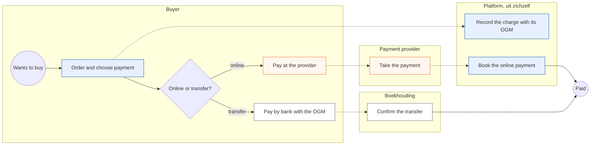
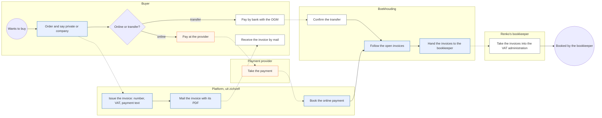
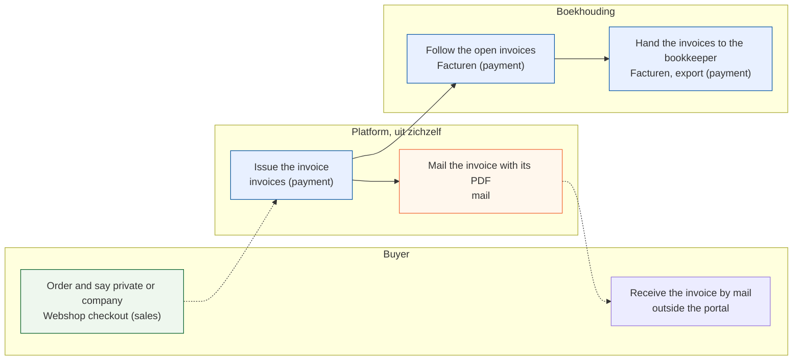
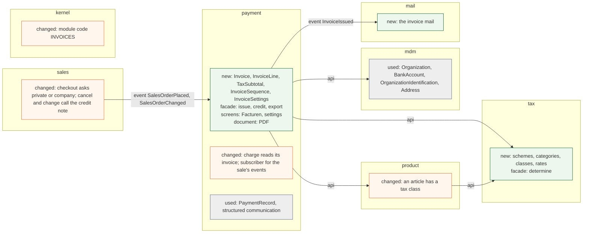
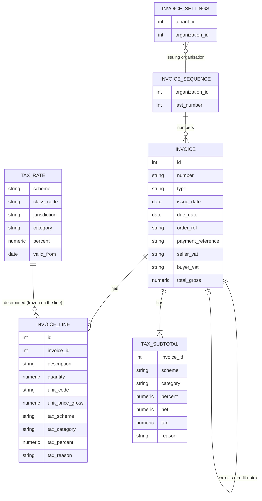

# Change Request 34 — Invoices for the webshop

**Project:** Web Portal "Raak Millegem"
**Status:** shaped on 15 October 2026 by the design-documentation CLI, on Koen's dictation (his request to this session, the same day) · build read not yet asked · not assigned to a release · **prerequisites:** CR-21 (webshop) built, and the part of CR-26 (party model) that B8 Q2 names
**Tracking issue:** #2009 — the one place where what is open stands; this document is the design, the issue is the status
**Applies to:** `payment` (the invoice, its number, its VAT, its document; the module "invoices"), `tax` (new: tax classes, categories, rates and the one rule that picks the rate), `product` and `pricing` of CR-21 (the tax class of an article), `sales` (the buyer's details, cancelling and changing an order that has an invoice), `mdm` (the issuing organisation, the buyer as a party; read, not changed), `mail` (the invoice mail), `kernel` (the module registry), `reporting` (a view)
**Reading:** A 1 497 words · B 2 494 · C 2 417 — measured on 15 October 2026, drawings excluded, tables included; budgets A ≤ 1 500, B ≤ 2 500

---

# Part A — The business

## A1. Reason to act — the trigger

A family member of Koen is going to try a webshop for a niche cycling helmet that is not sold in Belgium today. The shop is a trial and sells to private persons and to organisations, some of them liable to VAT. A company that buys needs an invoice for its bookkeeping, and a seller owes one; a payment alone is not a sale document. Koen: "dat het niet puur een betaling is, maar dat er een factuur is." The portal knows payments and, with CR-21 (webshop), orders. It does not know invoices.

The seller is a company, not one of the Raak departments: the shop becomes a tenant of its own under Koen's company, Renko, and invoices with Renko's VAT number. The Raak departments have no invoices and must not get any.

## A2. As-is process — how it works today, and where it hurts

No webshop and no invoice run today; the webshop of CR-21 is still being built. The nearest running process is a **paid registration**, and the shop will follow the same path: the buyer chooses online payment or a transfer with a structured communication (OGM), the platform records the charge, and Boekhouding confirms a transfer by hand.

<!-- figure: name=cr34-as-is caption=Today_a_sale_ends_at_a_payment_and_nothing_a_buyer_can_hand_to_a_bookkeeper -->

*What to see: every road ends at "Paid"; no step produces a document for the buyer or for a bookkeeper.*

| Step | Who | Pain |
|---|---|---|
| Order and choose payment | Buyer | A company cannot say it buys as a company: no VAT number, no company address |
| Record the charge | Platform | The charge has an amount, no VAT, no number, no seller |
| Confirm the transfer | Boekhouding | Works, but there is nothing to match against except the OGM |
| End: "Paid" | — | No invoice: a company buyer has nothing for its own bookkeeping, and Renko has nothing for its accountant |

## A3. To-be process — how it should work afterwards

<!-- figure: name=cr34-to-be caption=Afterwards_every_sale_ends_in_a_numbered_invoice_that_says_paid_or_how_to_pay -->

*What to see: the new blue steps are "Issue the invoice", "Mail the invoice", "Follow the open invoices" and "Hand the invoices over"; the buyer's first step gains one question.*

- **"Order" gains a question:** private or company. A company gives its name, address and VAT number.
- **"Issue the invoice" is new:** the portal numbers the invoice, calculates the VAT and writes the payment text. Online and paid: "voldaan". Transfer: the OGM and a due date.
- **"Hand the invoices to the bookkeeper" is new:** the portal produces the set, so nobody retypes it.

**What it says on the screen** (Dutch): the menu **Facturen**; the document title **Factuur** and, for a correction, **Creditnota**; the switch **Ik koop als bedrijf** with the field **Btw-nummer**; the payment lines **Voldaan** and **Te betalen vóór <datum> met gestructureerde mededeling <OGM>**; the setting **Betaaltermijn (dagen)**; the list columns **Nummer, Datum, Koper, Totaal, Betaald**.

## A4. Benefits — what the change earns

- **The shop can sell to a company at all.** A VAT-liable buyer without an invoice does not buy.
- **No invoice is made by hand:** one per sale, numbered, with the VAT worked out.
- **The accountant gets a complete set** instead of payments to reconstruct.

## A5. Supplied material — and what it taught us

Koen's dictation of 15 October 2026 is the source; no sample invoice was supplied. Taught by shaping, from secondary sources not yet checked against the law (Q10): **since 1 January 2026 a domestic invoice between two VAT-liable businesses in Belgium must be a structured e-invoice (Peppol BIS Billing 3.0); a PDF by mail no longer counts for that case**, and a consumer sale is outside it. Sending that e-invoice through the Peppol network is outside this change request: it is CR-35 (invoices through Peppol), which has this one as its prerequisite (Koen, 15 October 2026). What this change does about it is Q3.

Reporting need: the accountant gets the invoices of a period, a list and the documents, in one go (R11). A VAT return is not a need.

## A6. Business requirements — what the board asks, with MoSCoW

| # | Requirement | MoSCoW | Source | Comment |
|---|---|---|---|---|
| R1 | The shop is a **brand** and a tenant of its own, operated by Renko BV. Invoices carry the name, address, VAT number and bank account of the **issuing organisation** (Renko BV) **and, clearly, the brand's name and logo** | Must | Koen, 15 Oct 2026 | the brand's name is a working title that may change, so it is read from the tenant, never written in code or text |
| R2 | Every sale of an article of the webshop gets an invoice, to a private person and to an organisation alike | Must | Koen, 15 Oct 2026 | |
| R3 | An invoice has a number — rising, without gaps, with or without a year — and a date | Must | Koen, 15 Oct 2026 | "1, 2, 3 is fine" |
| R4 | The invoice names the seller and the buyer. A person: name and address. An organisation: also its VAT number | Must | Koen, 15 Oct 2026 | |
| R5 | VAT is worked out and shown. It is 21 % to begin with, and **every article carries a tax class** | Must | Koen, 15 Oct 2026 | |
| R6 | Not paid online: the invoice says to pay by transfer, with the OGM, within the **payment term the tenant already has** (7 days to begin with; the setting of registrations and memberships, not a new one). Paid online: it says "voldaan" | Must | Koen, 15 Oct 2026 | the OGM is the one the payment already has |
| R7 | The invoice has what Belgian law requires on it | Must | Koen, 15 Oct 2026 | the list stands in C4.1, to be confirmed by the accountant (Q10) |
| R8 | An invoice belongs to a booking: its amount is a receivable followed against payments | Must | Koen, 15 Oct 2026 | "daar hangt ook een boeking aan"; not a general ledger (Q9) |
| R9 | Verkoop sees the invoices of its sales. Boekhouding sees all invoices and follows the payments | Must | Koen, 15 Oct 2026 | |
| R10 | The buyer gets the invoice by mail and finds it again under their purchases | Should | shaping, 15 Oct 2026 | |
| R11 | Boekhouding downloads one invoice, or all invoices of a period with a list, for the bookkeeper | Must | Koen, 15 Oct 2026 | |
| R12 | A sale that is changed or cancelled after its invoice is corrected by a credit note, never by editing | Must | shaping, 15 Oct 2026 | the law, and CR-21 lets orders change |
| R13 | A buyer in the Netherlands: a private person pays Belgian 21 % VAT under the EU limit; a VAT-liable organisation with a valid VAT number gets the intra-Community rule | Should | Koen, 15 Oct 2026 | phase 3; Q6 |
| R14 | Sending an invoice to a Belgian company through Peppol | Won't *(here)* | Koen, 15 Oct 2026 | moved to CR-35 (invoices through Peppol); this change keeps its document in the shape of the standard, so that sending is a mapping |
| R15 | Only tenants that switch invoices on have them; the Raak departments have none | Must | Koen, 15 Oct 2026 | |
| R16 | A VAT return and a bookkeeping module | Won't | Koen, 15 Oct 2026 | "btw-administratie valt buiten de scope" |
| R17 | Selling outside Belgium and the Netherlands; other currencies | Won't *(now)* | Koen, 15 Oct 2026 | "enkel Belgische facturen", the Netherlands asked to be looked at |

## A7. Non-functional requirements — security, privacy, house style, tenants

| Concern | This change |
|---|---|
| **Security** | An issued invoice cannot be edited or deleted by anyone. Boekhouding and Verkoop see invoices; a buyer sees only their own; a document is never reachable by a guessable address |
| **Privacy** | An invoice holds a name and an address, and for a company a VAT number. The law obliges the seller to keep it for years, so it is not erased on request while that duty lasts; it leaves the system only by mail to the buyer and by the export to the accountant |
| **House style / UI norm** | Screens on the kit; the document in the site's logo and colours, Dutch |
| **Multi-tenant** | Invoices exist only for tenants that switch the module on; the numbering belongs to the issuing organisation, so two tenants of one company never repeat a number |

## A8. Acceptance criteria — what the business signs off on HDEV

| # | Criterion | Requirement | Walkthrough steps |
|---|---|---|---|
| AC1 | A private buyer pays online: an invoice with the next number, 21 % VAT worked out and "Voldaan" arrives by mail and shows under their purchases | R2, R3, R5, R6, R10 | W1–W3 |
| AC2 | A company buys by transfer: the invoice names its VAT number, shows the OGM and a due date seven days on; changing the term setting changes the next invoice | R4, R6 | W4–W6 |
| AC3 | Boekhouding sees the open invoice, confirms the transfer, and it reads paid | R8, R9 | W7–W8 |
| AC4 | An article of another tax class gives that class's rate on its line, and the totals per rate add up to the payment | R5 | W9 |
| AC5 | An order cancelled after its invoice gives a credit note; the invoice is untouched | R12 | W10 |
| AC6 | Boekhouding downloads the period's invoices and the list | R11 | W11 |
| AC7 | A Raak department has no Facturen menu, no invoice route and no invoice text | R15 | W12 |
| AC8 | A buyer in the Netherlands: as R13 says | R13 | W13–W14 |

---

# Part B — The solution, for whoever approves it

## B1. Solution outline — the solution and the decisions that shape it

The portal issues an **invoice** when a sale is settled in business terms. The invoice is a **frozen document**: a copy of the seller, the buyer and the lines as they were, with a number from a gapless sequence of the issuing organisation, the VAT per rate and a payment text. It is rendered as a PDF in the site's logo, mailed, kept, and exported. A mistake is corrected by a **credit note**. Payments stay where they are; the invoice is the receivable they settle.

- **D1 — Invoices live in `payment`, as a module "invoices" a tenant switches on.** Koen decided on 7 October 2026 that invoices belong to the payment domain, called finance, with no domain of their own (CR-21 Q31). The switch is a module entry in the registry (CR-19), so a Raak department has none. Rejected: an `invoicing` domain, a second place for receivables.
- **D2 — The invoice is a snapshot, never a live view.** Seller, buyer, lines and VAT are copied at issue; nothing edits them. Rejected: an invoice that reads the order when opened; it changes with it.
- **D3 — A correction is a credit note.** The same document type with a link to the invoice it corrects, issued when an order with an invoice is changed or cancelled. Rejected: editing.
- **D4 — One gapless sequence per issuing organisation**, taken inside the issuing transaction under a lock. Rejected: a sequence per tenant; two tenants of a company would repeat a number.
- **D5 — The tax is a class per article, a rate from a module of its own, in the shop's price.** The article carries a **tax class**; the new module `tax` holds the schemes, categories, classes and rates and the one function that says which applies (D9). Prices stay what the buyer pays; the invoice works net and tax out of them per rate, and its total equals the payment (Q5).
- **D6 — The issuing organisation is a setting of the module**, defaulting to the account's organisation; the brand is the tenant's own name and logo, shown beside it. Renko BV is the seller, the brand is the shop (B9, Q4).
- **D7 — The issuing moment**: online, when the payment is confirmed; transfer, when the order is placed (Q1).
- **D9 — Tax lives in a module of its own, small from the first day.** It holds the schemes, categories, classes and rates (with a validity period and a jurisdiction) and one rule, `determine(class, seller, buyer, date)`, that product, sales and invoices call; an invoice only freezes the answer. VAT is the one scheme today; another tax is a row and a rule later. Rules that outgrow a table of rates may later move behind this same function (C4.9). The platform maintains it by migration, without a screen (Q11). Rejected: rates inside `payment`; three modules would read them.
- **D8 — The invoice is modelled after EN 16931 and the Peppol profile, and rendered only as a PDF here.** Producing the UBL file and sending it is CR-35. Rejected: building the UBL writer here — it is half of CR-35 and cannot be judged without its validation and its sending.

**Derived requirements**

| # | Derived requirement | From |
|---|---|---|
| F1 | An invoice is issued once per settled sale, in the same transaction as the event that settles it; a second try is a no-op | R2 |
| F2 | The number is taken from the issuing organisation's sequence at issue; a rolled-back issue leaves no gap | R3 |
| F3 | Seller and buyer are copied onto the invoice; a later change does not change it | R4 |
| F4 | An article has a tax class from a short list; the default is the standard class, which is 21 % in Belgium | R5 |
| F5 | `tax.api.determine` returns scheme, category, percent and reason; net, tax per rate and total are computed from the gross line amounts and equal the payment | R5, R6 |
| F6 | The payment text is "Voldaan" for a paid charge, else the OGM of the charge and a due date = invoice date + term | R6 |
| F7 | The due date is the invoice date plus the tenant's existing payment term, read once at issue and frozen; this change adds no second term | R6 |
| F8 | An invoice cannot be updated or deleted after issue | R12 |
| F9 | A change or cancel of an invoiced order issues a credit note and, if the sale stands, a new invoice | R12 |
| F10 | The invoice is shown on a screen and as a PDF with the site's logo | R1 |
| F11 | A period export gives a list and the documents | R11 |
| F12 | The invoice mail leaves after the outer commit | R10 |
| F13 | A tenant without the module has no menu, route, mail or text | R15 |

## B2. Fit with the process and the requirements — for the business

<!-- figure: name=cr34-usage caption=Every_new_step_has_a_screen_in_the_invoices_module_or_the_shop -->

*Colour is the module: green sales, blue payment, orange mail; "outside the portal" has none.*

**Traceability**

| R | How the solution meets it | F | Module (C2) | Test (C6) | AC |
|---|---|---|---|---|---|
| R1 | The invoice names the issuing organisation, and shows the brand's name and logo | F3, F10 | payment, mdm | T3, T9 | AC1 |
| R2 | One invoice per settled sale | F1 | payment, sales | T1 | AC1 |
| R3 | A gapless number from the issuer's sequence | F2 | payment | T2 | AC1 |
| R4 | Seller and buyer copied at issue; a company adds its VAT number | F3 | payment, sales | T3, T4 | AC2 |
| R5 | A tax class per article; tax per rate | F4, F5 | tax, product, payment | T5, T6, T17 | AC4 |
| R6 | "Voldaan" or OGM and due date; the term is a setting | F6, F7 | payment | T7 | AC1, AC2 |
| R7 | The legal content list of C4.1 is on the document | F10 | payment | T8 | AC1 |
| R8 | The invoice is the receivable; payment status is read from the ledger | F1 | payment | T10 | AC3 |
| R9 | Verkoop and Boekhouding see by role | — | payment | T11 | AC3 |
| R10 | The mail after the commit; the purchases page links the PDF | F12 | mail, sales | T12 | AC1 |
| R11 | The period export | F11 | payment | T13 | AC6 |
| R12 | A credit note, never an edit | F8, F9 | payment, sales | T14, T15 | AC5 |
| R13 | The Netherlands, phase 3 | F5 | payment | T16 | AC8 |
| R14 | Won't here: CR-35 | — | — | — | — |
| R15 | The module switch | F13 | kernel | T18 | AC7 |
| R16, R17 | Won't | — | — | — | — |

**Walkthrough** (HDEV, the shop tenant with the module on, Mollie in test mode)

*Private buyer.* W1 Order a helmet and pay online; see the shop's thank-you page. W2 Open the mail; see an invoice with number, date, seller, 21 % VAT worked out, "Voldaan". W3 Under *Mijn aankopen* open the same invoice.
*Company buyer.* W4 Order again, tick *Ik koop als bedrijf*, give a VAT number, choose a transfer. W5 Open the mail; see the VAT number, the OGM and a due date seven days on. W6 In the tenant settings set *Betaaltermijn (dagen)* to 14; the next invoice says 14.
*Boekhouding.* W7 Under *Facturen* find the open invoice. W8 Confirm the transfer on the payments screen; the invoice reads paid.
*Rates.* W9 Give one article 6 % and order it with another; the lines carry their rates and the totals per rate add up to the payment.
*Correction.* W10 Cancel the first order; a credit note appears, the invoice stays.
*Accountant.* W11 Download the period's list and documents.
*Refusals.* W12 On a Raak department no *Facturen* and the route answers 404. W13 Order as a Dutch private buyer: Belgian 21 %. W14 As a Dutch company with a valid VAT number: the intra-Community text and no VAT.

## B3. The whole across the modules — for the architect

<!-- figure: name=cr34-structure caption=Green_is_new_orange_is_changed_grey_is_only_used -->

*Green new, orange changed, grey used.*

*New: all six. The order and the article are soft references across schemas; the seller and the buyer are copied columns, not keys, because the document is frozen.*

`sales` publishes `SalesOrderPlaced` and `SalesOrderChanged` (CR-21); `payment` subscribes and issues in the publisher's transaction, never committing; `payment` publishes `InvoiceIssued` and `mail` sends after the outer commit. `payment` reads the article's rate and the organisation's identifications through the facades of `product` and `mdm`; nothing new calls `sales`. The impact on what exists: the module list and its CHECK, the payable delete gate (an invoiced order must not be soft-deleted without its credit note), `sales`' cancel (CR-21 Q61), the payments screen, and a reporting view. The import and layer gates hold.

## B3a. Standards the model follows — and where it deviates, on purpose

Standards checked: **UBL 2.1** (`Invoice`, `CreditNote`) and **EN 16931 / PEPPOL BIS Billing 3.0** for the shape of the document (the file itself is CR-35), **UNCL 1001** (document type 380 invoice, 381 credit note), **UNCL 5305** (VAT category S, Z, E, AE, K), **UNCL 4461** (payment means), **ISO 4217, 3166 and 8601**, **ISO 20022** for the account, **ISO 6523** for the organisation identifiers, **UN/ECE Rec. 20** for units (as CR-21).

| Concept | Standard and element | Ours | Follows / deviates — why |
|---|---|---|---|
| Invoice number, date, type | `cbc:ID` (BT-1), `cbc:IssueDate` (BT-2), `cbc:InvoiceTypeCode` | `invoice.number`, `issue_date`, `type` ∈ {380, 381} | follows |
| Due date | `cbc:DueDate` (BT-9) | `invoice.due_date` | follows |
| Seller and buyer | `cac:AccountingSupplierParty`, `cac:AccountingCustomerParty` with `cac:PartyLegalEntity`, `cac:PartyTaxScheme`, `cac:PostalAddress` | flat copied columns `seller_*`, `buyer_*` | follows the content, **deviates in shape**: a document embeds its party, and a key to a live party would change the invoice |
| Payee account | `cac:PayeeFinancialAccount` | `seller_iban`, `seller_bic` copied from `mdm.bank_accounts` | follows, copied |
| Payment reference | `cac:PaymentMeans/cbc:PaymentID` (BT-83) | `invoice.payment_reference` (the OGM) | follows |
| Line | `cac:InvoiceLine` (quantity with `unitCode`, `cac:Price`, `cac:Item`) | `invoice_line`, `unit_code` "C62" | follows; gross price kept, net derived (D5) — a deviation named in C4.3 |
| Tax per rate | `cac:TaxTotal/cac:TaxSubtotal`, `cac:TaxCategory` with `cac:TaxScheme` (UNCL 5153: VAT) | `tax_subtotal(scheme, category, percent, net, tax, reason)` | follows, and the scheme makes it general: VAT is a value, not a name |
| Tax rule | — (the standard states the result, not the rule) | `tax.rates`, `tax.api.determine` | no standard for the rule; modelled as reference data with a validity period and a jurisdiction |
| Credit note | `CreditNote` with `cac:BillingReference` | `type` 381 and `corrects_invoice_id` | follows |
| Exemption reason | `cbc:TaxExemptionReason` (BT-120) | `tax_subtotal.reason` | follows, used from phase 3 |

---

## B4. Rules this change needs an exception from — decided once, here

| Rule (where) | What the design does instead | Mechanism | Temporary until … / the new rule | Decided |
|---|---|---|---|---|
| CR-21 Q61: cancelling an order is a soft delete, the total reconciled to zero | An order with an invoice is cancelled together with its credit note, in one transaction | `sales` cancel calls `payment.api.credit`; the payable delete gate learns the invoice | the new rule | open — Koen, at the handover |
| `AGENTS.md` (a screen says what a value is, never what another domain does with it) | none needed | — | — | — |
| Gates checked: layer gate, import gate, module gate, rights gate, payable delete gate, the baseline of Dutch identifiers | none other bends | — | — | — |

## B5. Cost — investment and running cost, and what operations must know

**Investment (CLI-days)**

| Phase | Content | Days |
|---|---|---|
| 0 | The module `tax` (classes, rates, the function), the article's tax class, the module of invoices, the settings | 3 |
| 1 | The invoice, the number, the VAT, the document and the mail, the screens | 6 |
| 2 | Credit notes and the order's change and cancel | 3 |
| 3 | The Netherlands | 2 |
| — | Build read, review, HDEV, release steps | 3 |
| **Total** | | **17** |

No purchase.

**Running cost.** Storage of PDFs is negligible. Maintenance added: the tax rates when a rate changes (a dated migration); the EU distance-sale limit to watch (Q6).

**Operations.** The module switch of the tenant; the setting of the issuing organisation, and the existing payment term; no env var is expected. Invoices and the sequence are in the backup as any table. A restore brings back the sequence with the invoices.

## B6. Phasing — shippable phases, and what changes on the failure paths

| Phase | Delivers | Depends on | Migration | Env vars | Failure paths that change | Manual validation |
|---|---|---|---|---|---|---|
| 0 | `tax` and the article's tax class, the module of invoices, the settings | CR-21 built | additive | none | none | W6 |
| 1 | The invoice, number, VAT, payment text, PDF, mail, screens, export; Belgian buyers | 0, CR-26's cut | additive | none | an issue that fails rolls the sale back or, for a mail, leaves the invoice and no mail | W1–W8, W11, W12 |
| 2 | Credit notes; change and cancel | 1 | additive | none | a cancel issues its credit note in the same transaction | W10 |
| 3 | The Netherlands | 1 | additive | none | a Dutch buyer with an invalid VAT number is refused at checkout | W13, W14 |

## B7. Rule and gatekeeper — what this fixes for all future work

**The rule:** a document that carries a legal number is never edited and never deleted; it is corrected by another document that refers to it. It goes to the architecture document and `docs/code-style.md`. **Reach:** today there is no such document; baseline zero. **Gate:** hard (C7).

## B8. Open decisions — what the approver still decides

| # | Question | Recommendation | What the answer changes |
|---|---|---|---|
| Q1 | When is the invoice issued: **at the sale** (online when paid, transfer when placed), or **at delivery** as CR-21 Q31 foresaw? | At the sale: a buyer pays before delivery and a changed delivery then needs no invoice change | the moment of F1, D7, and CR-21's invoicing status |
| Q2 | How much of CR-26 (party model) must stand first? | Only what the invoice reads: an order that can belong to an organisation, with its address and VAT number (the identification table exists) | whether phase 1 waits for all of CR-26 |
| Q3 | Until CR-35 is live, how do invoices to Belgian VAT-liable companies go out? **(a)** Koen sends them through the other Peppol route he has, from the exported documents, **(b)** the shop sells to private buyers and foreign companies only | (a): the portal issues and exports, Koen's route delivers | what R11's export must carry for that route; R14 |
| Q5 | Do prices stay VAT-inclusive for everybody, with the invoice working the net out? | Yes: a consumer must see the price he pays | D5, F5, the article form |
| Q6 | Dutch private buyers: Belgian 21 % holds under the EU-wide limit of 10 000 euro a year; above it Dutch VAT and a one-stop-shop registration apply. At the limit: warn, or refuse? | Warn at 80 %, refuse at 100 % until Koen and the accountant decide | R13, phase 3 |
| Q7 | Are credit notes in the first go-live? | Yes, phase 2 goes with phase 1: an order can already be cancelled | the order of the phases |
| Q8 | One sequence for invoices and credit notes, or two? | One, with the type shown; Koen allows any numbering | D4 |
| Q9 | Is "booking" the receivable (invoice against payments) and no general ledger? | Yes | R8 |
| Q11 | Who maintains the tax rates and classes? The platform operator, by a dated migration, no screen; Boekhouding may read them | Yes; a screen later only if rates change often | D9, C2 |
| Q10 | The accountant confirms the content list of C4.1, the late-payment text, and the Peppol scope | Ask before the build read | R7 |

## B9. Decisions log — dated answers

| Date | Decision | By |
|---|---|---|
| 15 Oct 2026 | Q4: the issuing organisation is Renko BV with its address and VAT number; the tenant is a brand, shown clearly with its name and logo. Koen, to "Is that right?" (Renko is the seller, the tenant shows its own logo and name): "De verkoper is inderdaad Renko BV met zijn adres en btw-nummer.", adding that the brand and its logo must stand on the invoice | Koen |

---

# Part C — The build, for the master CLI and the dev CLIs

## C1. Verified premises — measured before the handover

Measured on master @ `ff5eeb3a` and on the build branch of CR-21 @ `508ee052` on 15 October 2026; to be measured again on master just before the handover.

| Concept or claim | Kind | Measurement | Verdict | Consequence |
|---|---|---|---|---|
| An organisation has repeatable bank accounts and identifications, with a country | relies on | `mdm/models.py`: `BankAccount`, `OrganizationIdentification` (scheme, value, country) | holds | seller IBAN and VAT number come from them |
| An organisation can own an address | relies on | `mdm/models.py` `Address.organization_id` (nullable; the relationship is declared for `person` only) | holds, thin | the seller's address read through the facade; a relationship is a C2 item |
| One structured communication per charge exists | relies on | `payment/structured_communication.py`, `PaymentRecord.structured_communication` | holds | the invoice copies it; no second generator |
| PDF rendering exists | relies on | `meetings/pdf.py` renders HTML with WeasyPrint | holds | the invoice renders the same way |
| The tenant logo is read through one function | relies on | `media.api.tenant_logo`, used in `ui/__init__.py:1051` | holds | the document uses it |
| A module is a registry entry plus a CHECK migration | relies on | `kernel/modules.py` docstring; `ModuleCode` has eleven members, none for invoices | holds | `INVOICES` is the twelfth |
| `PayableType` has no invoice and needs none | relies on | `payment/models.py:78-88`: REGISTRATION, MEMBERSHIP (ORDER added by CR-21) | holds | the ledger keeps pointing at the order |
| Articles carry no tax class | changes | `product/models.py` on the CR-21 branch: `Product`, `ProductVariant`, no such column | holds | phase 0 adds it |
| No module holds tax | relies on | `ls backend/app/domains` on master: no `tax`; no `vat` column or table in `mdm` or `payment` (`mdm/models.py` dropped `vat_number` for identifications, #945) | holds | `tax` is new; the VAT number of a party stays in mdm identifications |
| The payment term already exists, once | relies on | `kernel/tenant_config.py:641` `tenant_payment_term_days`; `config.py:145` default 7; `payment` lists it in its module's `tenant_settings` (`kernel/modules.py:196`); read by `payment/transfer_due.py:93` for the screens and both mails | holds | the invoice reads it; no `term_days` of its own (one place for one fact) |
| Readers of the article's price | changes | to be found by searching `unit_price` in `sales`, `pricing`, `payment` | open | listed at the build read |
| The delete rule for a soft-deleted order | changes | CR-21 B9, 8 Oct 2026: cancel is a soft delete (`activities/service.py:2427-2466` as the model) | holds | B4 row |

## C2. Per module: what must happen

**payment.** *Screens:* Facturen (list, filters open and paid; one invoice; settings); judged at 390 px. *Code:* `issue_invoice`, `issue_credit_note`, `export_period`, `invoice_for_order` in `api.py`; a subscriber for `SalesOrderPlaced`, `SalesOrderChanged` and the payment event; the single owner of every writer to the invoice tables is `payment/invoice_service.py`. *Database:* schema `payment`; `invoices`, `invoice_lines`, `tax_subtotals`, `invoice_sequences`, `invoice_settings`; each invoice line also carries the frozen scheme, category, percent and reason; `invoices(issuing_organization_id, number)` unique; every FK `ON DELETE RESTRICT`; no `SoftDeleteMixin` on an invoice; additive. Copy action: none of these tables has one. *Templates and mail:* the invoice HTML for the PDF. *Tests:* T1–T11, T13–T16.
**tax** (new domain, no module switch: reference data like `mdm`). *Code:* `tax/api.py` with `determine(context)` → scheme, category, percent, reason, where the context object carries today the tax class, seller and buyer country, whether the buyer has a valid tax number, and the date, and can grow without changing a caller (C4.9); the rule holds the three cases of today (Belgian rate; Dutch consumer under the EU limit, Belgian rate; Dutch taxable buyer with a valid number, intra-Community) and nothing else. *Database:* schema `tax`; code lists `tax_scheme_codes` (VAT), `tax_category_codes` (S, Z, E, AE, K), `tax_class_codes` (standard, reduced, super-reduced, zero; labels per language) and `tax_rates(scheme, class_code, jurisdiction, category, percent, valid_from, valid_to)`, seeded for Belgium; additive. No screen. *Tests:* T17.
**product** (CR-21). Article form gains a *Btw-klasse* (default standard); a copy of an article takes the class along. The article stores no percentage. Tests T5.
**sales** (CR-21). Checkout gains *Ik koop als bedrijf* with the VAT number and company address; cancel and change call `payment.api` for a credit note; the purchases page links the invoice. Tests T4, T14, T15.
**mdm.** Read-only through the facade: the issuing organisation's name, address, identifications and account; a company buyer is a party of CR-26's cut (Q2). One line.
**mail.** The invoice mail with the PDF as attachment, after the outer commit. T12.
**kernel.** `ModuleCode.INVOICES`, its registry entry, the CHECK migration, the tenant default off. T18.
**reporting.** A view `f_invoices` for the accountant's list; no existing view reads the new columns. Phase 1.

## C3. Cross-cutting impact — the checklist of what gets forgotten

| Item | Answer |
|---|---|
| Reporting views, saved reports | `f_invoices` is new; `f_payments` unchanged |
| Existing tests, e2e flows, screenshots | the checkout flow of CR-21 changes (one question); its e2e and 390 px screenshots are redone |
| Fixed UI decisions, `AGENTS.md` | none bent; the invoice text says what an invoice is, not what other domains do |
| Design-system documentation | the invoice document and the Facturen list get a section |
| Code lists | tax scheme, category, class; invoice type; `ModuleCode.INVOICES` |
| Events, ports, handlers; which gate sees a new call across domains | new subscriber in `payment` for `sales` events through the kernel contract; the import gate refuses any direct import |
| Mail templates | the invoice mail |
| Migration | additive throughout |
| Tenant settings, env vars | module switch, issuing organisation; the payment term is the existing setting; env: none |
| JSON routes | none; the PDF is a screen's download behind the session |
| External services | none in this change; the Peppol access point is CR-35 |
| Copy actions | article copy takes the rate |
| Visitors and tenants | anonymous and guest: nothing; account and member: own invoices only; board user: by role; other tenant: nothing; operator: switches the module; a tenant without the module: nothing at all |
| Order inside a transaction | issuing is inside the publisher's transaction; the mail leaves after the outer commit (F12) |

## C4. Detailed decisions — one subsection each, with the reasons

**C4.1 The content of a Belgian invoice.** To be confirmed by the accountant (Q10); from secondary sources, not yet from the royal decree: the word *Factuur*; a unique sequential number; the issue date and, when different, the date of supply; the seller's name, address, VAT number; the buyer's name and address, and its VAT number when it is liable; the description and quantity of every item; the unit price excluding VAT; the rate; the taxable amount, the VAT and the total per rate; the total; the due date and payment terms, with the late-payment interest and fixed compensation text for a business buyer; an exemption or reverse-charge statement where it applies; for a credit note the reference to the invoice. The issuing organisation's bank account is not required but is shown (the payment text).
**C4.2 Number.** `invoice_sequences.last_number` is incremented with `SELECT … FOR UPDATE` inside the issuing transaction; a rollback releases it. The invoice has no draft state, so there is nothing to number early. A credit note takes the next number of the same sequence (Q8).
**C4.3 VAT and rounding.** Lines keep the gross unit price the buyer saw. Per rate: gross = Σ lines; net = round(gross ÷ (1 + rate)); VAT = gross − net. The total equals the payment by construction. This deviates from EN 16931's net-first calculation by working back from gross; the result is a valid set of totals because VAT is derived as a difference.
**C4.4 Issuing moment and payment text.** Online: the payment event of the ledger triggers the issue, text "Voldaan op <date>". Transfer: the order's placement triggers it, text OGM and due date. A transfer confirmed later shows "Voldaan" on the document **as displayed**, from the ledger; the mailed PDF is the document as sent. Rejected: re-sending (Q1).
**C4.5 Invoice and ledger.** The invoice carries `order_ref` and `payment_reference`; the ledger keeps `payable_type` ORDER. The receivable is `invoice.total_gross` against `net_paid(order)`.
**C4.6 Cancel and change.** A change after issue: a credit note for the whole invoice and a new invoice for the changed order, in one transaction; both mailed. Reservations and refunds behave as CR-21 specifies.
**C4.9 Tax determination: simple today, perhaps rules later.** The idea, as a perspective and not as part of this change: a rule module, perhaps with decision tables in DMN (the OMG's Decision Model and Notation), that decides how a transaction is taxed, so that these rules are **not programmed in**. A rule module could later decide from which tax number we invoice, whether we invoice at all when several entities take part, and which regime applies, with HS codes and product ids mapped in it; the kind of input it could take is the addresses, the route of the goods, the parties in the flow and the type of product. Not built now. Today the calculation is straight: gross price, the percent of the class, the tax as the difference (C4.3). What this change does so that the road stays open: (1) `determine` takes one context object and returns one result object; the fields of the context are the inputs a decision table would have, the result the outputs; (2) callers never compute or look up a percentage themselves; (3) the invoice stores the result of the decision, with the reason, never the rule. Whether it then is an engine of a standard such as DMN, an open-source one, or a small one of our own is **not decided**: it is looked at when the first rule outgrows a table of rates, in a change request of its own. This change is phase 1 of tax, and little more than a code list of tax codes with their rates.

**C4.7 The Netherlands (phase 3).** Private buyer: Belgian rate, with the running sum of EU consumer sales of the year against the limit (Q6). Company with a valid VAT number (VIES check at checkout, the answer stored on the invoice): category K, VAT 0, the exemption text. Other countries: the shop refuses the address.

## C5. Privacy and security — the mechanics behind A7

An invoice route reads the signed-in user's tenant and role (`invoices.view`, `invoices.manage`); a buyer's route filters on the buyer. No invoice has a public address; the mail carries the PDF. The tables have no update or delete path in the service, and a database trigger refuses both on an issued invoice. The log carries the number, never the name or address. Retention: invoices are kept for the statutory period; the erasure of a person leaves their invoices.

## C6. Tests — what the build must prove

| # | Test | Red when |
|---|---|---|
| T1 | One settled sale gives one invoice; the second event gives none | F1 breaks |
| T2 | Two connections issue concurrently: consecutive numbers, none lost on a rollback | the lock is missing |
| T3 | Changing the organisation's name afterwards leaves the invoice | the snapshot is a live read |
| T4 | A company buyer's VAT number is on the invoice and the checkout refuses a malformed one | R4 |
| T5 | An article's tax class reaches its line as the rate `determine` gives; copying the article copies the class | F4 |
| T6 | Mixed rates: net + VAT = gross per rate, the total equals the payment, to the cent | C4.3 |
| T7 | Paid online reads "Voldaan"; transfer has OGM and due date = date + term; the term setting moves it | F6, F7 |
| T8 | Every item of C4.1 is on the document (a list assertion) | R7 |
| T9 | The brand's name and logo of the tenant are on the PDF next to the issuing organisation, and a changed tenant name shows on the next invoice | R1 |
| T10 | Confirming the transfer changes the paid state read for the invoice, not the invoice | R8 |
| T11 | Roles: Verkoop sees its sales, Boekhouding all, a buyer only theirs, ADMIN without role nothing | R9 |
| T12 | The mail leaves after the commit and not on a rollback | F12 |
| T13 | The export gives the list and the documents of a period | R11 |
| T14 | A cancel after issue gives a credit note referring to the invoice | F9 |
| T15 | A change gives a credit note and a new invoice | F9 |
| T16 | A Dutch company with a valid VAT number: category K; a Dutch consumer: 21 % | R13 |
| T17 | `determine` per case: Belgian standard 21 %, a reduced class, a Dutch consumer under the limit, a Dutch taxable buyer with a valid number, a date before the rate's start gives no rate and refuses | F5 |
| T18 | A tenant without the module: no menu, 404 on the routes, no invoice on checkout | R15 |

**Impact on the test landscape:** the CR-21 checkout e2e and its screenshots, the payments screen, the module-gate test and the payable delete gate; each changes by what B4 and C2 say, none is expected to break otherwise.

## C7. The gate — what refuses a deviation from now on

A hard gate, `test_issued_document_gate.py`: no model or service writes an update or delete to an invoice table outside issue; and an `Invoice` has no `SoftDeleteMixin`. Proven by one additive violation: an `update` method on the service, expected to fail with the table's name.

## C8. Prototype findings — what was measured before the build

None made. A rendered invoice is the first thing to prototype at the build read; the rule against the existing suite has not been applied.

## C9. Screens before the build — the concepts the approver saw

Not made yet. Required before assignment, at 390 px with invented data: the Facturen list, one invoice (screen and PDF), the invoice settings, and the checkout question *Ik koop als bedrijf*.

## C10. Close-out at the release

Not yet; the document describes the design.

---

## Q&A log — asked once, answered here

| # | Date | Question (who) | Answer |
|---|---|---|---|
| — | 15 Oct 2026 | Koen opens the request and dictates the scope (A6) | no question answered; Q4 is answered in B9 |
| — | 15 Oct 2026 | Koen states the long-term intent for `tax`: rules as decision tables (DMN), not hardcoded; he called it "toekomstmuziek" | recorded in D9 and C4.9 as direction, not as a decision to build |

## Non-goals — deliberately outside this change

A VAT return and any bookkeeping or general ledger (R16); selling outside Belgium and the Netherlands, other currencies (R17); subscriptions, recurring invoices and payment reminders; a rule engine for tax (C4.9) and everything it would decide — groups of companies, transport routes, HS codes, other taxes; an invoice for an activity or a membership (this change is the webshop's; the module is built so that it could follow, without promising it).

## Relationship to existing work — issues and change requests

CR-21 (webshop): builds on it, and revises its Q31 (invoices "later, for delivered lines") by Q1; CR-26 (party model): prerequisite in the cut of Q2; CR-19 (tenant types) and CR-20 (a tenant apart from its organisation): the tenant under Renko; CR-24 (back-office rights): the roles Boekhouding and Verkoop; CR-33 (attribute register): every new column of this change gets its entry when the register is built; CR-35 (invoices through Peppol, #2010): hands off to it, and has this one as prerequisite.
