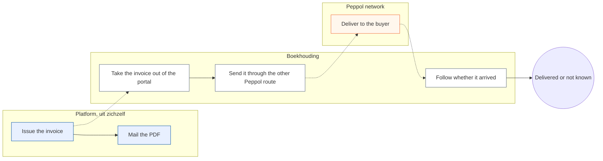
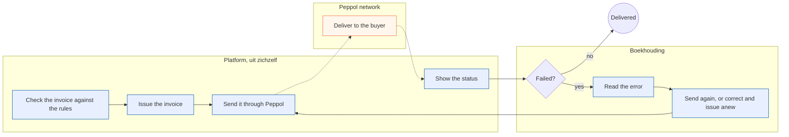
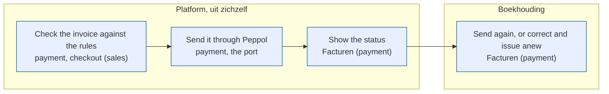
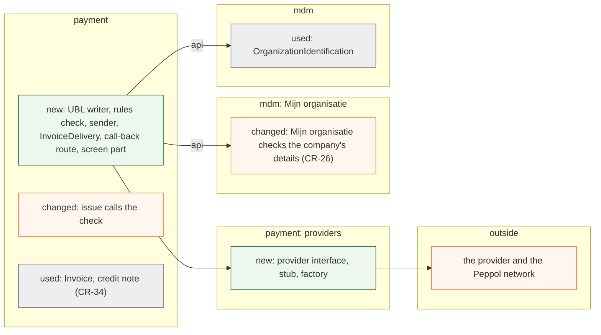
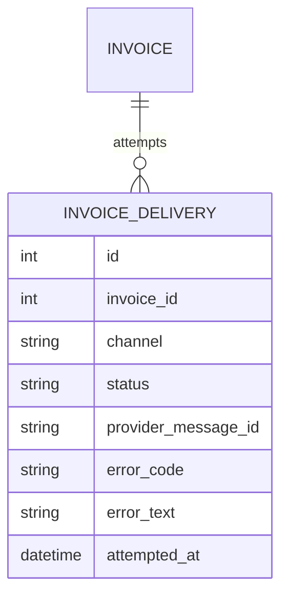

# Change Request 35 — Invoices through Peppol

**Project:** Web Portal "Raak Millegem"
**Status:** shaped on 15 October 2026 by the design-documentation CLI, on Koen's dictation (his request to this session, the same day) · build read not yet asked · **not in v2.17** (Koen, 18 Oct 2026: "we gaan die twee change requesten, nog de facturatie, nog het Peppel gebeuren, niet in versie 2.17 stoppen"; his word of 15 Oct was v2.18; **no longer on v2.18** either, 18 Oct 2026: "Haal 2009 en 2010 maar van v2.18, die worden uitgesteld tegen het ogenblik dat we echt gaan factureren.", via the master CLI; postponed until invoicing starts for real) (not assigned yet: the assignment follows the build read) · **prerequisites:** CR-34 (invoices for the webshop) built, and CR-26 (party model) phase 2, "the buyer" (B8 Q7); the buyer's endpoint is copied onto the invoice by CR-34, so phase 3 of CR-26 is no prerequisite
**Tracking issue:** #2010 — the one place where what is open stands; this document is the design, the issue is the status
**Applies to:** `payment` (the delivery of an invoice, its status, the sending, the screen), a provider interface for the Peppol network with a stub for dev and tests, in `payment`, `mdm` (the check of a company's details, CR-26), the settings and one secret
**Reading:** A 1 053 words · B 1 790 · C 1 613 — measured on 15 October 2026, drawings excluded, tables included; budgets A ≤ 1 500, B ≤ 2 500

---

# Part A — The business

## A1. Reason to act — the trigger

Since 1 January 2026 an invoice between two VAT-liable businesses in Belgium has to travel as a structured e-invoice over the Peppol network; a PDF by mail no longer counts (from secondary sources, to be confirmed by the accountant, Q5). CR-34 (invoices for the webshop) makes the invoices; this change request sends them. Koen: "In een ideale wereld wordt een factuur dat gemaakt wordt via het platform, ook via Peppol verstuurd", and he gets the status back, kept minimal. He asks to see how far a Peppol connection is possible, and has a second, alternative way of sending in the meantime, so the two can be decided apart from CR-34.

## A2. As-is process — how it works today, and where it hurts

After CR-34 the portal issues an invoice and mails its PDF. For a Belgian company that is not enough; the invoice has to be sent through Peppol, which the portal cannot do.

<!-- figure: name=cr35-as-is caption=After_CR-34_the_invoice_to_a_Belgian_company_leaves_the_portal_as_a_PDF_and_is_sent_on_by_hand -->

*What to see: the white steps are by hand and outside the portal; the portal never learns whether the invoice arrived.*

| Step | Who | Pain |
|---|---|---|
| Take the invoice out | Boekhouding | One more hand-over per invoice, with the risk of forgetting one |
| Send it through the other route | Boekhouding | The data is typed or uploaded a second time |
| Follow whether it arrived | Boekhouding | The status lives in another tool |

Not measured: how many invoices go to Belgian companies; the trial's volume is unknown.

## A3. To-be process — how it should work afterwards

<!-- figure: name=cr35-to-be caption=Afterwards_the_portal_sends_the_invoice_and_shows_its_status_and_Boekhouding_acts_only_on_a_failure -->

*What to see: nobody carries an invoice out of the portal; a person acts only on a failure.*

- **"Check the invoice against the rules" is new:** a company's details and the invoice are checked before the invoice gets its number, so an invoice that cannot be sent is not issued.
- **"Send it through Peppol" and "Show the status" are new:** one send at issue, then a status on the invoice.
- **Nothing is retried or corrected by itself.** A person reads the error and resends or corrects.

**What it says on the screen** (Dutch): the status **Verstuurd via Peppol**, **Afgeleverd**, **Mislukt**, **Niet bereikbaar via Peppol**; the button **Opnieuw versturen**; the error text of the network, shown as it is, with one line of explanation; the checkout message when a company's details do not pass, in words such as *Dit btw-nummer klopt niet*.

## A4. Benefits — what the change earns

- **The shop may sell to Belgian companies in the way the law asks**, without a hand-over per invoice.
- **No invoice is typed twice.**
- **Boekhouding sees on the invoice whether it arrived**, and only acts when it did not.

## A5. Supplied material — and what it taught us

Koen's dictation of 15 October 2026. He asks for: sending through Peppol for Belgian companies only; a minimal status; resending after an error; **no** automatic correcting or retrying of every possible message; checking the fields against the standard — maximum lengths and validations — so that what the app lets through can be improved; and showing the error, correcting, and sending again. He notes that today an organisation with a VAT number cannot be entered, let alone register itself in the webshop: that is the party model (CR-26).

Koen has no ambition to be an access point; the portal talks to the network through one, and the price matters: about 50 invoices a year, no fixed fee of a hundred euro a month. Taught by the price research of 15 October 2026 (C8): at that volume two Belgian providers appear to be free, a third costs about thirteen euro a year, and a plan with a monthly fee costs about ninety. Reporting need: none beyond the status on the invoice and the invoices list of CR-34.

## A6. Business requirements — what the board asks, with MoSCoW

| # | Requirement | MoSCoW | Source | Comment |
|---|---|---|---|---|
| R1 | An invoice and a credit note to a Belgian VAT-liable company is sent through Peppol, once, when it is issued | Must | Koen, 15 Oct 2026 | |
| R2 | The invoice shows a minimal status: sent, delivered, failed, not reachable | Must | Koen, 15 Oct 2026 | |
| R3 | A failure shows the network's error as it is | Must | Koen, 15 Oct 2026 | |
| R4 | A person can send an invoice again | Must | Koen, 15 Oct 2026 | |
| R5 | The invoice and the company's details are checked against the format's rules — formats, lengths, required fields — before the invoice is issued; a failure is shown in words, at the checkout and on the screen | Must | Koen, 15 Oct 2026 | rules that fail in practice improve the app |
| R6 | Only invoices to Belgian VAT-liable companies go through Peppol; consumers and buyers abroad never | Must | Koen, 15 Oct 2026 | the Dutch company is outside |
| R7 | Before sending, the buyer is looked up on the network; one that is not on it is shown as such | Should | shaping | Q2 |
| R8 | The invoice's UBL file can be downloaded, for the other route | Could | shaping | cheap once the file exists |
| R9 | Automatic correction of a rejected message, and automatic retrying | Won't | Koen, 15 Oct 2026 | "niet naar een oplossing streven die alle mogelijke Peppol-boodschappen automatisch gaat proberen te corrigeren" |
| R10 | Receiving invoices; an access point of our own; other countries; reporting to the tax authority | Won't | shaping | |

## A7. Non-functional requirements — security, privacy, house style, tenants

| Concern | This change |
|---|---|
| **Security** | The provider's key is a secret outside the repository; a status call-back is never trusted, the status is read from the provider |
| **Privacy** | What leaves the portal is the invoice itself, to a provider inside the EU and the buyer's access point; no more than the invoice holds |
| **House style / UI norm** | Screens on the kit, the status as a badge |
| **Multi-tenant** | Per tenant a switch and the issuing organisation's Peppol identity; a tenant without invoices has nothing |

## A8. Acceptance criteria — what the business signs off on HDEV

| # | Criterion | Requirement | Walkthrough steps |
|---|---|---|---|
| AC1 | An invoice to a Belgian test company is sent at issue and reads **Afgeleverd** | R1, R2 | W1–W2 |
| AC2 | A failure shows the network's text; **Opnieuw versturen** sends it again | R3, R4 | W3–W4 |
| AC3 | A company with a malformed VAT number is refused at the checkout in words | R5 | W5 |
| AC4 | A Dutch company and a private buyer get no Peppol sending | R6 | W6 |
| AC5 | An address not on the network reads **Niet bereikbaar via Peppol** | R7 | W7 |

---

# Part B — The solution, for whoever approves it

## B1. Solution outline — the solution and the decisions that shape it

The portal writes the invoice as a Peppol file (UBL), checks it before it is issued, sends it through the interface of an access-point provider, and keeps the provider's answers as the status of the invoice. A person only acts on a failure.

- **D1 — A provider's access point behind a provider interface; no access point of our own.** The access point is a provider like the payment provider: an interface, the real adapter, a stub for dev and the browser tests, and a factory from the settings, all in `payment`; it is not a kernel port, which is a synchronous order from one domain to another with one handler. Europe First: an EU provider. Rejected: an access point of our own — membership, certification and audits for a trial (C8).
- **D2 — Check before issuing, not after.** An invoice is frozen once numbered (CR-34 D2), so what cannot be sent must not be numbered. The company's details are checked where they are entered, under *Mijn organisatie* (CR-26); the issue checks the whole file with a small rule set of our own and no network call (C4.3). Rejected: checking at sending — the invoice would already exist with a number and be wrong.
- **D3 — One automatic send, then only by hand.** Koen wants no automatic correcting or retrying of a message. The send is a job, so a network failure before the message reached the provider is tried again by the job; a message the provider refused is never tried again. Rejected: a retry loop on rejections.
- **D4 — A failure that is the network's or the connection's: send the same document again. A failure that is the buyer's data: credit and issue anew.** The second uses CR-34's credit note (F9). Rejected: editing a numbered invoice, even one never delivered (Q3).
- **D5 — The status is a small append-only history**: one row per attempt, so the invoice shows its last status and the history shows what happened.
- **D6 — The status call-back is not trusted**: it only names the message; the status is read from the provider, as for the payment webhook.
- **D7 — The UBL writer is a pure function of the invoice**, so it is tested without a network and downloadable (R8).

**Derived requirements**

| # | Derived requirement | From |
|---|---|---|
| F1 | The writer produces Peppol BIS Billing 3.0 from an invoice or a credit note | R1 |
| F2 | The issue of an invoice to a Belgian VAT-liable company runs the file through the rules and refuses with a list of what is wrong | R5 |
| F3 | A malformed VAT number or a field over its length is refused where the company is entered, under *Mijn organisatie*, in words | R5 |
| F4 | Sending happens after the outer commit of the issue, once | R1, D3 |
| F5 | A delivery row per attempt: status, provider message id, error code and text | R2, R3 |
| F6 | The invoice screen shows the last status and the history; **Opnieuw versturen** is offered on a failed one | R2–R4 |
| F7 | The provider's call-back names a message; the status is fetched | D6 |
| F8 | A buyer with no Belgian VAT number, a consumer and a foreign buyer are never sent | R6 |
| F9 | The lookup of the buyer happens before the send and stores *not reachable* | R7 |

## B2. Fit with the process and the requirements — for the business

<!-- figure: name=cr35-usage caption=Every_new_step_has_a_home_in_payment_or_the_checkout -->

*Colour is the module: blue payment (the check at the checkout belongs to sales and is named in the label).*

| R | How the solution meets it | F | Module | Test | AC |
|---|---|---|---|---|---|
| R1 | One send at issue | F1, F4 | payment | T1, T2 | AC1 |
| R2 | The status on the invoice | F5, F6 | payment | T3 | AC1 |
| R3 | The error as it is | F5 | payment | T4 | AC2 |
| R4 | The button | F6 | payment | T5 | AC2 |
| R5 | The check at issue and where the company is entered | F2, F3 | payment, mdm | T6, T7 | AC3 |
| R6 | The condition on the buyer | F8 | payment | T8 | AC4 |
| R7 | The lookup | F9 | payment | T9 | AC5 |
| R8 | The download | F1 | payment | T10 | — |
| R9, R10 | Won't | — | — | — | — |

**Walkthrough** (HDEV, the provider's test network)
*Boekhouding.* W1 Issue an invoice to a Belgian test company. W2 See *Verstuurd*, then *Afgeleverd*. W3 Make the provider refuse a message (a test address the provider rejects). W4 See its text and press *Opnieuw versturen*.
*Buyer.* W5 At the checkout give a malformed VAT number: refused in words.
*Refusals.* W6 A Dutch company and a private buyer: no sending and no status. W7 A company not on the network: *Niet bereikbaar via Peppol*.

## B3. The whole across the modules — for the architect

<!-- figure: name=cr35-structure caption=Green_is_new_orange_is_changed_grey_is_only_used -->

*Green new, orange changed, grey used; the dashed arrow leaves the system.*

*New: one table, append-only; the invoice itself is untouched.*

`payment` calls the provider interface; the adapter calls the provider over HTTPS. The send is a job after the issue, as the invoice mail is. Impact on what exists: CR-34's issue gains one call (the check); `mdm` gains the checks of a company's details; one JSON route exists (the call-back), with its caller named in the contract (`test_every_json_route_names_its_caller`); the module list is unchanged. The import and layer gates hold.

## B3a. Standards the model follows — and where it deviates, on purpose

Standards checked: **UBL 2.1** and **Peppol BIS Billing 3.0** (the file), **EN 16931** (its rules), the **Peppol Business Message Envelope** and **AS4** (transport, the provider's part), **ISO 6523 / the Peppol endpoint identifier scheme** for the participant (the Belgian enterprise number, scheme 0208, to be verified in the prototype).

| Concept | Standard and element | Ours | Follows / deviates — why |
|---|---|---|---|
| The file | `Invoice` / `CreditNote` with CustomizationID and ProfileID of BIS 3.0 | the writer's output | follows; the identifiers are verified in the prototype |
| Buyer's address on the network | `cbc:EndpointID` with `schemeID` | read from `mdm.organization_identifications` | follows |
| Status of a message | the provider's message states | `invoice_delivery.status`, a code list of ours: SENT, DELIVERED, FAILED, NOT_REACHABLE | deviates on purpose: the providers differ, ours is the minimum Koen asked for |

---

## B4. Rules this change needs an exception from — decided once, here

| Rule (where) | What the design does instead | Mechanism | Temporary until … / the new rule | Decided |
|---|---|---|---|---|
| None bent. Gates checked: layer, import, module, rights, the JSON-route caller gate (the call-back names its caller), the Dutch-identifier baseline | — | — | — | — |

## B5. Cost — investment and running cost, and what operations must know

| Phase | Content | Days |
|---|---|---|
| 0 | The writer, the rules check and the stub provider, no network | 4 |
| 1 | The provider adapter, sending, status, the call-back, the screen part | 4 |
| 2 | Resending, and credit-and-issue-anew from a failure | 2 |
| 3 | The provider's test network, a real test buyer | 2 |
| — | Build read, review, HDEV, release steps | 3 |
| **Total** | | **15** |

Phase 0 (the writer, the check, the stub, landing dark) is about 4 days and needs no provider; the rest depends on the provider.

**Running cost.** At about 50 documents a year: nothing on the two free plans, about 12.50 euro a year at a quarter of a euro per invoice, about 83 euro a year on a monthly plan (C8). Read from the providers' own pages on 15 October 2026; a contract may differ. **Operations.** One secret (the provider's key) in each environment's own file, set by Koen before a deploy; a switch per tenant; the issuing organisation's Peppol identity at the provider. If the provider is down the invoice stays issued with the status *failed* and is sent again by hand.

## B6. Phasing — shippable phases, and what changes on the failure paths

| Phase | Delivers | Depends on | Migration | Env vars | Failure paths that change | Manual validation |
|---|---|---|---|---|---|---|
| 0 | Writer, rules check at issue and checkout, stub | CR-34 phase 1 | additive (none needed) | none | an invoice that fails the check is not issued | W5 |
| 1 | Sending, status, call-back, screen | 0, Q1 | additive | the provider's key | a failed send leaves the issued invoice and a *failed* status | W1–W2, W6 |
| 2 | Resend, credit and anew | 1, CR-34 phase 2 | none | none | none new | W3–W4 |
| 3 | Real test network and buyer | 2 | none | none | none | W7 and a real test buyer |

If the provider's contract is not there at the release, the change lands **dark** (B9): the writer, the check, the status table and the stub, with nothing sent.

## B7. Rule and gatekeeper — what this fixes for all future work

**The rule:** a document that must be machine-readable by the receiver is checked against the receiver's rules before it gets its number. It goes to `docs/code-style.md`. **Reach:** one document type today (the invoice), baseline zero. **Gate:** hard (C7).

## B8. Open decisions — what the approver still decides

| # | Question | Recommendation | What the answer changes |
|---|---|---|---|
| Q1 | Which access point? Criteria: Belgian or EU, a REST interface, a test network, delivery status, and above all price at about 50 documents a year | **Two to try (B9): Peppyrus** (Belgium; a free plan of 100 messages a month, a REST API, a separate test network; plans change on 1 November 2026) **and e-invoice.be** (Belgium, EU-hosted; 0.25 euro an invoice, about 13 euro a year; free sandbox, signed callbacks, validation). Recommand stays in reserve; a fixed monthly fee is not worth it at this volume | D1, B5, the adapter |
| Q2 | ~~A buyer that is not on the network~~ **Answered 18 Oct 2026** (B9): the portal says it cannot be sent, and the PDF goes by mail beside the process. Open only: the accountant's view whether that satisfies the law (Q5) | — | R7, F9 |
| Q3 | A rejection because of the buyer's data: credit and issue anew, or correct the numbered invoice? | Credit and issue anew; the invoice stays frozen | D4, B7 of CR-34 |
| Q4 | The rules check: the provider's validation, or a validator inside the portal? | A validator inside the portal before numbering, so the invoice's transaction holds no network call; the provider's validation at send. The build read checks this | F2, C2 |
| Q5 | The accountant confirms which buyers fall under the mandate (VAT-liable in Belgium, the exemptions) and which penalties apply | Ask before the build read | R6, F8 |
| Q6 | Is Koen's second route kept beside this one? | Yes, until this is live; R8 serves it | R8 |
| Q7 | Which part of CR-26 lets a Belgian company with a VAT number buy in the shop? | CR-26 phase 2, "the buyer": answered with CR-26's decisions (CR-34 C4.10); the endpoint is a field of the buyer copy | the start of phase 1 |
| Q8 | The status: a call-back from the provider, or asking now and then? | A call-back that names the message, and a fetch; asking now and then only as a fallback | F7 |

## B9. Decisions log — dated answers

| Date | Decision | By |
|---|---|---|
| 15 Oct 2026 | In the architecture CLI's chat, to its proposal that this CLI proposes two EU access-point providers with cost and sandbox, and that CR-35 may land dark (writer, check, status table, stub) if the provider's contract is not there at the release: "ja". CR-35 goes in v2.18 | Koen |
| 18 Oct 2026 | Not in v2.17, with CR-34. Koen: "we gaan die twee change requesten, nog de facturatie, nog het Peppel gebeuren, niet in versie 2.17 stoppen" | Koen |
| 18 Oct 2026 | Q2 answered: a buyer that is not on the Peppol network gets a message that the invoice cannot be sent, and the PDF goes by mail beside the process. Koen: "op vraag 2 omtrent melden dat die niet is aangesloten op het Peppel-netwerk, dus dat we het niet kunnen versturen, vind ik prima. Ik ga ervan uit dat de PDF als factuur er sowieso nog in zit. En dan kunnen we die altijd naast dat proces via mail versturen." (the PDF is stored and mailed with every invoice, CR-34). The accountant's confirmation (Q5) stands | Koen |
| 18 Oct 2026 | Q1: two to try, a comparison on Koen's request, read from the providers' pages on 18 October (not tested). **Correction:** e-invoice.be's page now says 0.25 euro per invoice with packages from 350 euro (Enterprise 0.18); the "about 13 euro a year, no minimum" of 15 October is not supported, and a sandbox is described in its documentation, not on the price page. Peppyrus: free plan of 100 outgoing messages a month, unlimited receiving, 200 MiB, a test API and portal, plan changes on 1 November 2026 (free stays free, per its page); its own documentation was not readable, only third-party descriptions (one message endpoint, UBL with both participant identifiers, no undo). e-invoice.be documents far better (reference, six-step quickstart, test mode, four webhook events, a validation endpoint, SDKs in five languages; no signature on webhooks stated). Recommendation: the prototype sends the same invoice through Peppyrus' free plan and e-invoice.be's test mode, then choose | design-documentation CLI |
| 18 Oct 2026 | Off v2.18 too, postponed until invoicing starts for real. Koen, via the master CLI: "Haal 2009 en 2010 maar van v2.18, die worden uitgesteld tegen het ogenblik dat we echt gaan factureren." (#2009 and #2010) | Koen |

---

# Part C — The build, for the master CLI and the dev CLIs

## C1. Verified premises — measured before the handover

Measured on master @ `ff5eeb3a` on 15 October 2026; CR-34 is not built, so what is read from it is read from its document; to be measured again at the handover.

| Concept or claim | Kind | Measurement | Verdict | Consequence |
|---|---|---|---|---|
| A provider sits behind an interface with a stub | relies on | `payment/providers/base.py`, `mollie.py`, `stub.py` | holds | the same shape for Peppol |
| The kernel port is a synchronous order between domains with one handler | relies on | `kernel/ports.py`: `Port`, `PortNotHandled`, `PortHandledTwice` | holds | not used for the provider, which follows the pattern of `payment/providers` (D1) |
| A secret is read from settings, not from code | relies on | `payment/providers/mollie.py` (`settings.mollie_api_key`) | holds | the provider's key the same |
| An organisation's identifications are a list with scheme and country | relies on | `mdm/models.py` `OrganizationIdentification` | holds | the endpoint id is read from it; the scheme list may need one row |
| The invoice, its credit note and the issue hook exist | relies on | CR-34 B3 and C2 | to be built | a prerequisite |
| A webhook never carries trusted data | relies on | `AGENTS.md`, *Payment* | holds | D6 |

## C2. Per module: what must happen

**providers** (in `payment`, as `payment/providers`): `PeppolProvider` with `send(document) → message id`, `status(message id)`, `lookup(participant)`; the real adapter and a stub for dev and tests; a factory from the settings.
**payment.** *Code:* `ubl.py` (the writer), `invoice_rules.py` (the check), `peppol_sender.py` (a job on `kernel_jobs` after the issue, writes a delivery row), `api.py`: `send_invoice`, `resend_invoice`, `delivery_status`; the call-back route and its subscriber; the route accepts only an id that belongs to a delivery row of its own, otherwise 404, and is rate-limited like the payment webhook, with its caller named in the contract of `payment`. *Database:* `invoice_deliveries(id, invoice_id FK RESTRICT, channel, status code, provider_message_id, error_code, error_text, attempted_at)`, a code list for the status, and `invoice_settings` gains the switch and the participant id; additive. *Screens:* the status badge, the history and the button on the invoice. *Tests:* T1–T10.
**mdm.** *Mijn organisatie* checks a company's VAT number (format and check digits of the Belgian number) and field lengths against the same rules (CR-26 F7). T7.
**mdm.** Read only. Reporting: none, no view reads these columns.

## C3. Cross-cutting impact — the checklist of what gets forgotten

| Item | Answer |
|---|---|
| Reporting, saved reports | none |
| Existing tests, e2e, screenshots | the invoice screen of CR-34 gains a part; its screenshots are redone |
| Fixed UI decisions | none |
| Design-system documentation | the status badge |
| Code lists | the delivery status |
| Events, ports, handlers; which gate sees a new call | a provider interface in `payment`; the import gate refuses a direct provider import from a screen |
| Mail templates | none |
| Migration | additive |
| Settings, env vars | the switch, the participant id; env: the provider's key |
| JSON routes | one: the call-back, caller named in the contract |
| External services | the provider |
| Copy actions | none |
| Visitors and tenants | only Boekhouding sees the status; buyers see nothing new |
| Order inside a transaction | the send leaves after the outer commit, as the invoice mail |

## C4. Detailed decisions — one subsection each, with the reasons

**C4.1 Who is sent.** The buyer is an organisation with a Belgian VAT identification, on an invoice or a credit note of a tenant with the switch on. Anything else is not sent and has no delivery row (F8).
**C4.2 The file.** BIS 3.0 identifiers, the buyer's endpoint id from its enterprise number, the payment means and the structured communication as in CR-34's document; one function, no I/O.
**C4.3 The check.** Required fields, formats, lengths and the Belgian number's check digits before issue, as a small rule set of our own without a network call (no schematron in Python is promised); the provider's full validation runs at the send, and a refusal on data is *credit and issue anew* (D4). The failure is a list of what is wrong, in words, with the field named; the same messages serve *Mijn organisatie*.
**C4.4 Sending and failing.** The send is a job (`kernel_jobs`, its own transaction): a connection failure before the provider got the message is tried again with a back-off; a message the provider answered with a failure writes FAILED with the text and nothing retries it. **Opnieuw versturen** writes a new row. A failure caused by the buyer's data offers *Credit and issue anew* (CR-34 F9).
**C4.5 Status.** The call-back carries a message id; the route fetches the status and writes the row. Asking now and then is the fallback (Q8).

## C5. Privacy and security — the mechanics behind A7

The key lives in the environment file of each host and is never logged. The call-back route has no session; it accepts a message id only and re-fetches. The logs carry the invoice number and the message id, never the buyer's name. The stub sends nothing.

## C6. Tests — what the build must prove

| # | Test | Red when |
|---|---|---|
| T1 | An invoice to a Belgian company gives one send and one delivery row | F4 |
| T2 | An invoice to a consumer, to a Dutch company, and a credit note to neither: no send, no row | F8 |
| T3 | The status read from the provider updates the row, not a posted body | F7 |
| T4 | A refusal stores the code and the text and shows them | F5 |
| T5 | Resending writes a new row and sends once | F6 |
| T6 | An invalid file is refused at issue with the field named, and no number is taken | F2 |
| T7 | A malformed VAT number and an over-long field are refused under *Mijn organisatie* in words | F3 |
| T8 | The condition of C4.1 holds for each of its parts | R6 |
| T9 | A buyer not on the network is stored as not reachable | F9 |
| T10 | The file validates against the format's rules and the download returns it | F1 |

**Impact on the test landscape:** the issue tests of CR-34 gain the check; nothing else is expected to break.

## C7. The gate — what refuses a deviation from now on

A hard gate: every invoice issued to a buyer under C4.1 has a delivery row (`test_issued_peppol_invoice_has_delivery`). Proven by an additive violation: an issue path that skips the send, expected to fail naming the invoice.

## C8. Prototype findings — what was measured before the build

Price research on 15 October 2026, read from each provider's own page (not a contract, not tested). Volume assumed: about 50 invoices a year, a few credit notes; amounts without VAT. An access point of our own was not considered: Koen has no ambition for it, and it needs an OpenPeppol membership, a certification and security audits.

| Provider | Where | Price at ~50 documents a year | API, status, test | Remark |
|---|---|---|---|---|
| **Peppyrus** (Tigron) | Zaventem, Belgium | **Free plan**: 100 outgoing messages a month, unlimited receiving; next plan 15 euro a month | REST API, tracking of delivery, a separate test environment on a Peppol test network | New plans "effective 1 November 2026": the free tier must be re-read before the choice; hosting not stated |
| **Recommand** | Belgium (address not on its page) | **Free plan**: 25 documents a month, then 0.30 euro each; 29 euro a month for 200 | REST API (send, list, look up a recipient); a send returns when the recipient's access point confirms; no test network mentioned | Open source (repository named, licence not); the page lists the API under the paid plan, so whether the free plan has it is to be confirmed |
| **e-invoice.be** | Zemst, Belgium; EU-hosted | **0.25 euro per invoice, packages from 350 euro** (corrected on 18 Oct; first read as no minimum, about 12.50 euro a year) | JSON in, UBL out, signed callbacks for sent and failed, validation against the rules, recipient lookup, free sandbox | One-off bank-transfer verification before the first send; the best documented API of the four |
| **Billit** | Ghent, Belgium | Starter 7.50 euro a month (6.90 on annual billing): about 83 euro a year | no API mentioned on the pricing page | An invoicing product, not made for being called by software |
| Digiteal, Storecove | — | not found | — | subscription models; not looked into further |

*What it says:* at this volume the choice is not about price but about whether the free plan's API, status and test environment are really there. The first prototype therefore runs the same invoice file through the free plans of Peppyrus and Recommand and, as the fallback, the sandbox of e-invoice.be, and looks at: validation messages, status by callback or by asking, the test network, and what a failed send returns.

*Re-read the Peppyrus plans after 1 November 2026, before phase 1 is built.* *First prototype at the build read:* the file for one real invoice, put through the rules of BIS 3.0 and through the provider's validation, to see which fields fail.

## C9. Screens before the build — the concepts the approver saw

Not made yet. Required, at 390 px with invented data: the invoice with its status and history, the failed state with the button, and the message under *Mijn organisatie* for a company's details.

## C10. Close-out at the release

Not yet; the document describes the design.

---

## Q&A log — asked once, answered here

| # | Date | Question (who) | Answer |
|---|---|---|---|
| — | 15 Oct 2026 | Koen asks for a separate change request for sending through Peppol, with invoicing as prerequisite | no question answered; the open ones are B8 |

## Non-goals — deliberately outside this change

An access point of our own; receiving invoices; sending to the Netherlands or elsewhere (Peppol sending is for Belgian companies only here); automatic correction or retrying of messages; reporting to the tax authority; sending invoices to consumers through Peppol.

## Relationship to existing work — issues and change requests

CR-33 (attribute register): every new column gets its entry, the deliveries *intern*; CR-34 (invoices for the webshop, #2009): the prerequisite, whose issue gains the check; CR-26 (party model): phase 2, "the buyer" (B8 Q7); CR-21 (webshop): the checkout; CR-24 (back-office rights): who sees the status; CR-28 (workbench tasks): a later task for a failed send, not built here.
