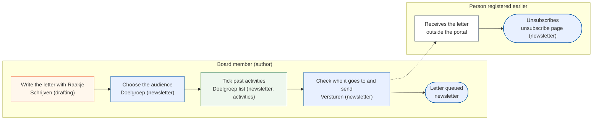
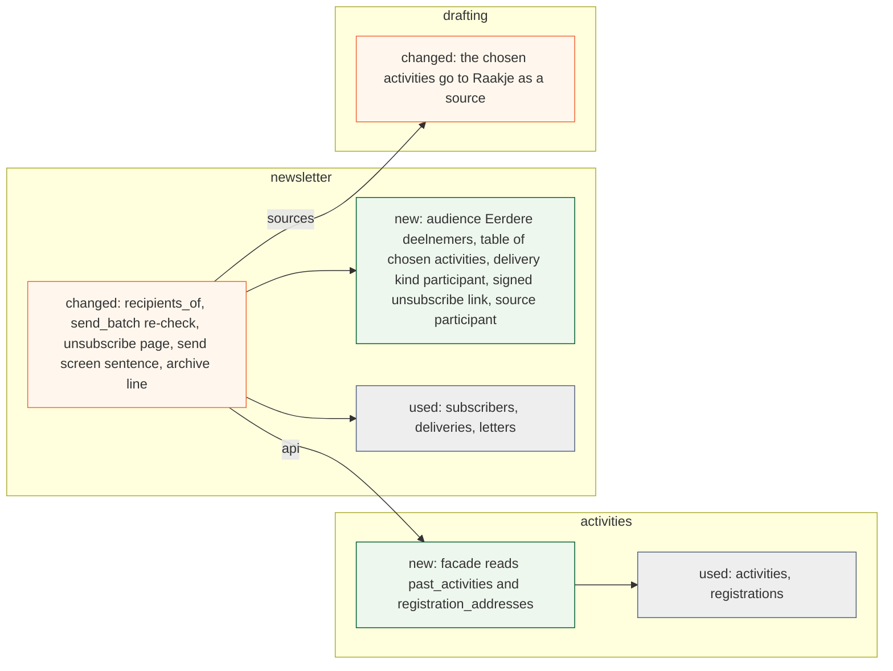
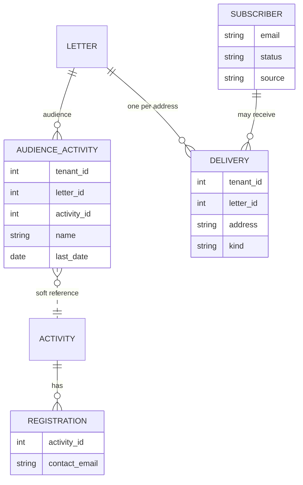

# Change Request 36 — Newsletter to the people registered for earlier activities

**Project:** Web Portal "Raak Millegem"
**Status:** built in v2.17.0 (PR #2064, migration 213; closed out 21 October 2026) · shaped with Koen on 15 October 2026; B8 answered; as-built deviations in B9 (16 Oct 2026)
**Tracking issue:** #2026 — the one place where what is open stands; this document is the design, the issue is the status
**Applies to:** the newsletter (audience choice, recipient list, send screen, Raakje's sources), the activities facade (a read of registration addresses), the unsubscribe page
**Reading:** A 759 words · B 2 110 · C 1 987 — measured per part; A ≤ 1 500, B ≤ 2 500

---

# Part A — The business

## A1. Reason to act — the trigger

Koen, 15 October 2026: the newsletter should be able to address a *specific audience*: the people who were registered for one or two activities in the past years. His example: last year there was an activity; when it comes back, the people who came get a mail "we organise it again, nice that you were there last year on that date". More targeted communication, built on who registered for similar activities before. The audience is chosen by hand in the audience choice that exists today; Raakje drafts the letter as it does today. A suggestion of a fitting past activity is outside this change (Koen, 15 October 2026).

## A2. As-is process — how it works today, and where it hurts

Today the audience of a letter is *Leden*, *Abonnees* or *Allebei*. There is no way to say "the people who came to last year's activity". My reading, to be confirmed by Koen: an author who wants that sends a mail by hand outside the portal, with the addresses copied from the registrations.

*What to see:* three of four steps are by hand and the mail leaves the portal.

| Step | Pain |
|---|---|
| Copy the addresses | slow, error-prone, one activity at a time |
| Send from the own mail program | no unsubscribe link, no archive, no queue, no help from Raakje, shares the mailbox limit with everything else |

## A3. To-be process — how it should work afterwards

*What to see:* the three by-hand steps are gone; the letter keeps its queue, archive and unsubscribe link.

What it says on the screen (Dutch):
- audience choice, a fourth option: **Eerdere deelnemers**
- under it a list: **Kies één of meer activiteiten**, past activities newest first, each with its date and the number of addresses
- the send screen says in words who gets it: "*N adressen van mensen die waren ingeschreven op <activiteit>*", and how many of them already get the letter as member

## A4. Benefits — what the change earns

- Targeted mail to people who showed interest in the same kind of activity: higher turnout for a returning activity (no figure; to be seen after the first use).
- The by-hand route disappears: the minutes of copying addresses per mail, and the mails without unsubscribe link.

## A5. Supplied material — and what it taught us

Koen's dictation of 15 October 2026 only. Reporting need: the archive of a sent letter names its audience and the activities chosen (A6 R6).

## A6. Business requirements — what the board asks, with MoSCoW

| # | Requirement | MoSCoW | Source | Comment |
|---|---|---|---|---|
| R1 | Choose, per letter, one or more past activities as the audience | Must | Koen, 15 Oct 2026 | "de ingeschrevenen op 1 of 2 gelijkaardige activiteiten vorig jaar" |
| R2 | The choice sits in the audience choice that exists | Must | Koen, 15 Oct 2026 | a drop-down by hand |
| R3 | Anyone can unsubscribe from such a letter, and is not mailed again | Must | my reading of CR-05 §3.4; Q1 | |
| R4 | The letter can name the activity and its date | Should | Koen, 15 Oct 2026 | "tof dat je vorig jaar er was op die datum" |
| R5 | Raakje suggests a past activity that fits the letter | Won't | Koen, 15 Oct 2026 | taken out of the scope: a later change if wanted |
| R6 | The archive shows which activities a letter went to | Should | my proposal | |
| R7 | Choosing people by presence, payment or age | Won't | — | not asked |

## A7. Non-functional requirements — security, privacy, house style, tenants

| Concern | This change |
|---|---|
| **Security** | only the board that may send a newsletter chooses the audience; no new public input except the unsubscribe link, which exists |
| **Privacy** | the address of a registration is used for a new purpose, a newsletter; whether that needs consent is Q1; every such letter carries a working unsubscribe link; Raakje never sees addresses |
| **House style** | the audience choice and send screen follow the kit; 390 px first |
| **Multi-tenant** | registrations and activities of the own tenant only |

## A8. Acceptance criteria — what the business signs off on HDEV

| # | Criterion | Requirement | Walkthrough steps |
|---|---|---|---|
| AC1 | Choosing *Eerdere deelnemers* shows the list of past activities with their counts | R1, R2 | step 1 |
| AC2 | The send screen says in words who gets the letter and how many | R1 | step 2 |
| AC3 | A person registered twice, or for both activities, gets one mail | R1 | step 2 |
| AC4 | The mail has an unsubscribe link; after using it the person gets nothing from a later letter of this kind | R3 | steps 6, 7 |
| AC5 | The archive shows the activities chosen | R6 | step 8 |
| AC6 | Raakje's draft can name the chosen activity and its date | R4 | step 3 |

---

# Part B — The solution, for whoever approves it

## B1. Solution outline — the solution and the decisions that shape it

A fourth audience, *Eerdere deelnemers*, next to Leden, Abonnees and Allebei. With it the letter keeps a list of the activities chosen. The recipients are the contact addresses of the registrations on those activities, deduplicated by address, fixed when sending starts like every audience. Four rules decide the rest:

1. **One rule for everybody: someone who is on a list already is not mailed twice.** Order of precedence: a household with a membership for the working year gets it as a member (as in CR-05 §3.3, no unsubscribe line); a confirmed subscriber as a subscriber; everyone else as a *participant*.
2. **An address that unsubscribed is never mailed through this audience.** There is one list: the subscriber rows. A participant who uses the unsubscribe link of a letter gets a subscriber row with the status *unsubscribed* and the source *participant* (Koen, B9), so one rule holds for everybody and nothing is kept elsewhere. The check is made again at the moment each mail leaves, because a send takes days.
3. **"Attended" means registered.** The portal does not record presence. A registration that was deleted, or an activity that was cancelled, counts for nobody; a registration whose payment never completed counts (the person showed interest).
4. **Addresses are compared in one spelling**: trimmed and lower-case, checked as everywhere in the newsletter. An address that does not pass is skipped and counted on the send screen.

*Raakje* gets the chosen activities as the source "voorbije activiteiten" of the letter, with name and date, so the letter can say it. Raakje does not suggest an activity (R5): the author ticks it. Only the *old* activities are chosen as audience; the activity the letter advertises is put in the text with the existing insert helper, and the portal links the two nowhere. Someone already registered for the new activity still gets the letter (B9).

## B2. Fit with the process and the requirements — for the business

<!-- figure: name=cr36-usage caption=Every_step_has_a_home_in_a_module_or_is_marked_outside_the_portal -->

*Colour is the module: blue newsletter, green activities (the list and its counts), orange drafting; white is outside the portal. The author stays in the newsletter screens; the person registered earlier meets the portal only in the mail and on the unsubscribe page.*

**Traceability**

| R | How the solution meets it | F | Module (C2) | Test (C6) | AC |
|---|---|---|---|---|---|
| R1 | The author ticks one or more past activities; the letter goes to the people registered on them, once each | B1 | newsletter, activities | T1, T2, T7, T9 | AC1, AC2, AC3 |
| R2 | The choice is the fourth audience *Eerdere deelnemers* in the audience choice | B1 | newsletter | T17 | AC1 |
| R3 | The mail has an unsubscribe link; whoever uses it is not mailed again | B1 | newsletter | T5, T6, T11, T12, T15 | AC4 |
| R4 | The chosen activities go to Raakje as a source, so the draft can name them with the date | B1 | drafting | T19 | AC6 |
| R5 | Won't: the author chooses the activity; Raakje does not suggest | B1 | — | — | — |
| R6 | The archive line shows the activities the letter went to | B1 | newsletter | T8, T18 | AC5 |
| R7 | Won't: not asked | — | — | — | — |

**Walkthrough** — on HDEV, with made-up registrations on the reserved example domain.

*The author (Nieuwsbrief)*

1. Open a draft and choose *Eerdere deelnemers*. See: the list of past activities of the last three working years, each with its number of addresses.
2. Tick two activities that have one person in common. See: a sentence such as "212 adressen van mensen die waren ingeschreven op …, waarvan 140 al als lid de brief krijgen", and the person on both counted once.
3. Ask Raakje for a draft. See: the draft can name the chosen activities and their date.
4. Send a test mail. See: the unsubscribe line is in it.
5. Send the letter. See: it is queued.

*The person registered earlier (made-up address)*

6. Open the mail and use the unsubscribe link. See: the page confirms.

*The author again*

7. Write a second letter to the same activities. See: the sentence skips that address.
8. Open the sent letter in the archive. See: the chosen activities are named.

*Where it must refuse or fall back*

9. As the person of step 6, press *Toch opnieuw*. See: the sentence *Je ontvangt vanaf nu onze nieuwsbrief.* and a later letter reaches the address again.
10. In a tenant without the activities module, open the audience choice. See: the option is not offered.

## B3. The whole across the modules — for the architect

<!-- figure: name=cr36-structure caption=Green_is_new_orange_is_changed_grey_is_only_used -->

*Green new, orange changed, grey used.*

*New: `AUDIENCE_ACTIVITY`, the kind `participant` and the source `participant`. The activity is a soft reference across the schema line; the name and date are copied when the send starts.*

- `activities` gives two reads through its facade: the past activities that may be offered, and the raw addresses of the registrations on a set of activities, per tenant. `newsletter` never reads `Registration` itself and normalises the addresses itself.
- `newsletter` owns the audience, the list of chosen activities (a soft reference across the schema line, with the activity's name and date copied when the send starts, so the archive survives a later deletion), the delivery kind `participant`, a signed unsubscribe link per delivery (no stored token), and a new source *participant* on the subscriber list. From now on `source` means where the row comes from, not proof of consent: the docstring of `SubscriberSource` and the register's help of `newsletter.subscriber.source` say so, and the value is labelled *Via brief aan eerdere deelnemers*.
- No new module and no new edge: `newsletter` already consumes `activities.api`.

## B4. Rules this change needs an exception from — decided once, here

None.

## B5. Cost — investment and running cost, and what operations must know

About 6 days (my estimate; the build read of 15 October added a re-check at send, normalised addresses and the signed link). No running cost. Operations: letters to this audience count against the same daily cap; one letter to a large past activity can take days, as *Allebei* does.

## B6. Phasing — shippable phases, and what changes on the failure paths

| Phase (the only one) | Content | Days |
|---|---|---|
| 1 | audience, list of activities, recipient rule with the re-check at send, participant unsubscribe (a subscriber row) and resubscribe, send screen words, archive | 6 |

**Order:** built after part 7b of #2023 (the letter on the page editor): both touch `service.py` (`update_draft`, `render_*`, the copy plan), `drafting.py`, the newsletter's attributes and the test-mail snapshot; built the other way round, four conflicts are solved twice. Nothing in this change depends on 7b. The insert helper of B1 becomes the editor's *Blok invoegen › Activiteit*, over the same featured list. The migration comes after 7a (209) and 7b (210).

Failure paths: an activity chosen and then deleted before sending is dropped from the list and the screen says so; a letter whose audience becomes empty cannot be sent.

## B7. Rule and gatekeeper — what this fixes for all future work

A letter's recipients are always a derived list with one precedence rule and one opt-out check; a new audience is one more entry in that function, never a second path. A test names the precedence order so a new audience must choose its place.

## B8. Open decisions — what the approver still decides

| # | Question | Recommendation | What the answer changes |
|---|---|---|---|
| Q1 (answered, B9) | May the association mail people who registered for an activity, without their consent, if the letter carries an unsubscribe link? (a) yes, on the existing relationship as for the imported list; (b) only people who ticked agreement on the registration form | a (Koen answered a) | b needs an answer on both ways in (the public form and the board's registration for someone, where nobody ticks: those count as not agreed) and leaves last year's people out |
| Q2 (answered, B9) | May two chosen activities be combined, so a person of either gets the letter? | yes: union, one mail | a letter naming "last year" must then speak generally |
| Q3 (answered, B9) | Which activities are offered: those of the last three working years? | yes | the list length |
| Q4 (answered, B9) | "Je moet ook een nieuwsbriefje kunnen maken om dat te versnellen": does that mean Raakje drafts the letter for this audience (as it does now)? | yes, it does with R4's sources | nothing to build beyond B1 |

## B9. Decisions log — dated answers

| Date | Decision | By |
|---|---|---|
| 15 Oct 2026 | Requirement R1, R2, R4 as written in A6 (dictation, not an answer to a question) | Koen |
| 15 Oct 2026 | R5 (Raakje suggests a past activity) leaves the scope: one phase | Koen: "haal die fase 2 op basis van een activiteit voorstellen, haal dat maar uit de scope, zodanig dat het een eenfasige change request wordt" |
| 15 Oct 2026 | People already registered for the activity the letter advertises stay on the recipient list; no exclusion | Koen, to "moeten mensen die al voor de nieuwe activiteit ingeschreven zijn uit de ontvangerslijst vallen?": "Nee, dat is geen probleem. Als die mensen die nog een mail krijgen, ook al zijn ze al ingeschreven, dat is geen probleem." |
| 15 Oct 2026 | The portal makes no link between the old activities of the audience and the activity the letter advertises; the author does that in the letter, with the insert helper that exists | Koen, to my explanation of the two kinds of activity: "Ik ben het ook met die redenering eens. [...] Het feit dat er geen link is tussen oud en nieuw, dat is helemaal aan de gebruiker om dat te doen." |
| 15 Oct 2026 | The new audience is called *Eerdere deelnemers* on the screen | Koen, to the question which word the audience carries (a *Eerdere deelnemers*, b *Ingeschreven op eerdere activiteiten*, c *Aangemeld voor eerdere activiteiten*): "eerdere deelnemers op vraag 1 is een goed voorstel" (my reading: he meant that question) |
| 15 Oct 2026 | Q1: people registered for an activity are mailed on the existing relationship, with an unsubscribe link (a) | Koen, to Q1 of Q&A nr. 08 (a or b): "a" |
| 15 Oct 2026 | Q2: two chosen activities combine into one audience, one mail | Koen, to Q2: "ja" |
| 15 Oct 2026 | Q3: the activities offered are those of the last three working years | Koen, to Q3: "ja" |
| 15 Oct 2026 | Q4: Raakje drafting the letter is a mechanism that exists | Koen, to Q4: "ja, dat is een mechanisme dat nu al bestaat, moet dus niets voor gebeuren" (my reading: the drafting itself needs nothing new) |
| 15 Oct 2026 | The chosen past activities go to Raakje as a source of the draft, with name and date and never an address, so the letter can name them (R4) | Koen, to "Moeten de gekozen eerdere activiteiten als bron naar Raakje gaan, ja of nee?": "ja, geef ze mee" |
| 15 Oct 2026 | One list: a participant who unsubscribes becomes a subscriber row with the status *unsubscribed*; no separate table of addresses | Koen, to my question whether to keep two places or merge them: "Ik zie dat eigenlijk heel eenvoudig. [...] Ja, dat record wordt simpelweg dan toegevoegd als die zegt, ik wil geen mails meer ontvangen. Dus dan wordt hij als abonnee direct toegevoegd met de status dat hem uitgeschreven is." |
| 15 Oct 2026 | The signing helper is built in `kernel`, shared with CR-37 | Koen, to "Wil je dat het hulpje in `newsletter` blijft staan tot CR-34 het echt nodig heeft?" (after the explanation that CR-34's call-back route is a third user in another domain): "we gaan dan voor kernel" |
| 15 Oct 2026 | The existing `erase` on an *unsubscribed* row keeps the row with the normalised address and the status, clears the first name and the tokens, and anonymises the deliveries, so the opt-out is not undone | Koen, to my explanation of this repair (C4.4): "akkoord" |
| 15 Oct 2026 | The unsubscribe link of a participant is signed per delivery, with no token stored (C4.2) | Koen, to "Keur je de getekende uitschrijflink zonder opgeslagen token goed, ja of nee?": "ja, akkoord" |
| 15 Oct 2026 | No sentence about the newsletter on the registration form and no hint under the audience: out of scope | Koen, to my summary of the open point (the sentence on the registration form and the hint under the audience): "dit is out-of-scope en doen we niet" |
| 15 Oct 2026 | After *Toch opnieuw* the existing text stays and one sentence is added: *Je ontvangt vanaf nu onze nieuwsbrief.* | Koen, to "Keur je die ene zin op de pagina na *Toch opnieuw* goed, ja of nee?": "ja, akkoord" |
| 15 Oct 2026 | Erasure of an address from the archives (the right to be forgotten) is not built in this change; see the known gap under Non-goals | Koen, to my question whether erasure by address should be part of this change: "Het recht om vergeten te worden gaan we voorlopig even laten liggen." |
| 16 Oct 2026 | Built as (PR #2064, `8dad019f`, migration 213): the unsubscribe link of a participant is signed with the application's own secret, no key of its own — replacing that secret stops the links in letters already sent, and the rollout notes say so; a working year is a calendar year; the list of activities shows its dates in figures (`16-08-2026`, as #1976 chose for the back office) and the sentence above it in words (`zo 16 aug`), left different on purpose | Koen, 16 October 2026, Q&A of that day: to "Wat als dat geheim ooit vervangen wordt? (a) zo laten en noteren in de uitrolnotities, (b) een eigen sleutel": "a"; to "Is een werkjaar een kalenderjaar?": "dat is prima, voor Raak zijn het kalenderjaren"; to "De lijst toont een datum als '16-08-2026', de zin erboven als 'zo 16 aug'. Gelijk maken? (a) zo laten, (b) overal hetzelfde": "a" |

---

# Part C — The build, for the master CLI and the dev CLIs

## C1. Verified premises — measured before the handover

Measured on master @ `ef4b130c` on 15 October 2026 (the build read of dev2 on #2026 re-measured it the same day); to be re-measured at the handover.

| Concept or claim | Kind | Measurement | Verdict | Consequence |
|---|---|---|---|---|
| `Audience` has three values with code table and labels (*Leden*, *Abonnees*, *Allebei*) | changes | `newsletter/models.py:72`, `codes.py:67–80` | must change | one code, one label row, one migration row |
| Readers of `Audience` | changes | `admin_ui.py:161, 537–568, 632, 687, 881–893`; `service.py:1608`; `drafting.py:285–291, 1056`; `_nb_versturen.html:5`; `admin_nieuwsbrief.html:152` | must change (C2, C3) | each reader is walked in the build |
| `recipients_for`, `audience_summary`, `_audience_said`, `audience_counts` take only the audience; `start_sending` calls `recipients_for` | changes | `service.py:429, 484, 509, 1700`; `admin_ui.py:1001` | must change | they take the letter, because the participants need its chosen activities |
| `send_batch` re-checks only a subscriber delivery | changes | `service.py:1853–1862` | must change | a participant delivery gets its own re-check (C4.2) |
| A registration keeps its address as given; members are lower-cased; subscribers go through `normalize_email`; deliveries are unique on (letter, address); older registrations may predate the address validator | changes | `activities/models.py:470`; `mdm/service.py:1613`; `service.py:75` | must change | C4.3 |
| The unsubscribe page shows on GET and acts on POST; the resubscribe form finds a subscriber by token | relies on / changes | `ui.py:118–147`; `_nb_publiek.html:54`; `subscriber_by_unsubscribe_token` | holds for subscribers; a participant's signed link creates the row on POST (C4.2) | C4.2 |
| `list_subscribers` and `subscriber_counts` return every subscriber row | relies on | `service.py:96, 107` | holds | the *Uitgeschreven* count also counts a participant who unsubscribed, though he never subscribed (Koen, B9) |
| The test mail and the preview each decide the delivery kind from the audience | changes | `service.py:1608`; `admin_ui.py:886–893` | must change | one function (C4.5) |
| `copy_newsletter` and `delete_draft` | changes | `service.py:807, 819` | must change | clear, respectively delete, the chosen activities |
| An activity has `is_cancelled`, a draft/published status and soft-deletable dates | relies on | `activities/models.py:234`, `ActivityDate` | holds | C4.6 |
| The registration form carries no newsletter wording; the board registers for someone | relies on | `board_register_for_activity` | holds | the cost of Q1 (b) |
| No presence is recorded | relies on | no field in `activities/models.py` | holds | "attended" = registered |
| `newsletter` has four data tables with `tenant_id` | relies on | `newsletter/CONTRACT.md` | holds | the new tables carry `tenant_id` |

## C2. Per module: what must happen

- **activities**: `past_activities(db, since_year)` (id, name, last non-deleted date; published, not cancelled, a non-deleted date, all dates before today) and `registration_addresses(db, activity_ids)` (the raw distinct addresses of the non-deleted registrations). Tenant-scoped.
- **newsletter**:
  - models: `Audience.PARTICIPANTS`, `DeliveryKind.PARTICIPANT`, `newsletter_audience_activities` (tenant, letter, activity, name and date filled at `start_sending`), and the value `participant` in `SubscriberSource` with its code-table row (the source column has a foreign key to a code list);
  - service: `recipients_of(db, letter)` replaces the call at `service.py:1700`; the summary, the sentence and the counts take the letter; the sentence uses the union of the chosen activities, not a sum; `send_batch` re-checks a participant delivery (C4.2); `copy_newsletter` clears the chosen activities, `delete_draft` deletes them;
  - routes: the public unsubscribe page resolves a subscriber token, then a signed delivery link (`/nieuwsbrief/uitschrijven/d/<delivery id>.<signature>`); for a delivery link POST creates the subscriber row (*unsubscribed*, source *participant*, no `consented_at`, its own unsubscribe token) and shows the existing page with that token, so *Toch opnieuw* is the existing `resubscribe` and needs no new path;
  - screens: the audience choice with the list (htmx fragment, kit macros), offered only when the `activities` module is on for the tenant; the send screen sentence with the count of skipped addresses; the archive line.
- **drafting**: the chosen activities go to `set_draft_sources`; Raakje's examples of earlier letters (`drafting.py:285–291`, which after 7b read the letter's text with markers derived from the document, not `body_html`) are looked at per audience: a participant letter about another activity is a weak example, the build decides whether to leave it out.

## C3. Cross-cutting impact — the checklist of what gets forgotten

- The readers of C1, one by one; the test-mail snapshot test `test_newsletter_test_mail_unchanged_1251.py` covers two audiences only; part 7b of #2023 regenerates it once, so "unchanged" means unchanged by this change, from that baseline, to which this change adds a third audience and nothing else.
- CR-33 attribute register (the architecture review of 15 October): entries for `newsletter.audience_activity` (`activity_id`, `name`, `last_date`: *intern*); the source *participant* needs no entry (no classification per code value); no purpose is added to the help of the registration's address (a screen does not say what another domain does with a value). The purpose of the second use goes in the privacy statement, in one newsletter section that CR-37 (Q5) adds and this change shares. CR-33's coverage gate refuses a migration without the entries once its phase 1 is on master; whoever lands second registers the columns.
- The signing helper is `kernel/signing.py`, shared with CR-37 (B1 of its review): whichever of the two lands first builds it.
- CONTRACT.md of `newsletter` and `activities`; the architecture document where it names three audiences.
- Alembic: one migration; head counted before the push.

## C4. Detailed decisions — one subsection each, with the reasons

**C4.1 Recipient rule.** `recipients_of` builds members, then subscribers, then participants (each `setdefault` on the normalised address), then drops every participant address that has an unsubscribed subscriber row. A member address is never dropped (CR-05 §3.4).

**C4.2 The participant's link and the check at send.** The unsubscribe link of a participant delivery is `/nieuwsbrief/uitschrijven/d/<delivery id>.<signature>`: the delivery row gives the address and the letter. GET shows, POST creates the subscriber row described in B1 (an existing row of that address is set to *unsubscribed* instead; the address is normalised first), one-click POST likewise. *Toch opnieuw* is the existing resubscribe: the person then is a confirmed subscriber with `consented_at` set at that moment, because he asked for it himself, and he receives every subscriber letter from then on, so the page, after the existing text, adds the sentence *Je ontvangt vanaf nu onze nieuwsbrief.* (Koen, B9). A participant who later signs up on the public form takes the existing path: `subscribe()` on an *unsubscribed* row makes it *pending* with source *public_form*, `consented_at` and the confirmation mail; the source *participant* is lost, which is right. `send_batch` has one re-check for every delivery: an *unsubscribed* row exists for the delivery's normalised address, and the delivery is not a member's: skip with "uitgeschreven tijdens het versturen".

**C4.3 One spelling.** `registration_addresses` returns raw addresses; `newsletter` runs each through `normalize_email`, an address it refuses is skipped and counted, and the delivery row stores the normalised form (so (letter, address) stays unique per person).

**C4.4 Erasure.** Erasing an address from the archives is not built in this change (B9, Non-goals). What this change does decide is the existing `erase` on a row that is *unsubscribed*: it keeps the row with the normalised address and the status, clears the first name and the tokens, and anonymises the deliveries. The opt-out is the one thing an erasure request may keep; deleting the row would re-allow the mail, because the registration is still there.

**C4.5 One mapping.** A function audience → delivery kind of a sample mail serves `render_test` and the preview; the new audience is one entry.

**C4.6 Which activities are offered.** Published, not cancelled, with at least one non-deleted date, all non-deleted dates before today, within the last three working years (Q3); newest first; label = name, last date, number of addresses.

## C5. Privacy and security — the mechanics behind A7

The registration address is used for a second purpose; Q1 is answered (B9). The link is signed with a key derived from the portal's secret, so nothing is stored per delivery (built as: the application's own secret itself, no key of its own; replacing it stops the links in letters already sent, B9 of 16 Oct 2026); a bad signature and an unknown delivery answer the same (no oracle). The unsubscribe page has no per-IP limit today and gets none now. Erasure of an address from the archives: C4.4.

## C6. Tests — what the build must prove

| # | Test |
|---|---|
| T1 | two activities, one person on both: one delivery |
| T2 | a deleted registration and a cancelled activity add nobody; an unpaid registration counts |
| T3 | a member address gets the member kind, no unsubscribe line |
| T4 | a subscriber address gets the subscriber kind |
| T5 | an unsubscribed subscriber, including one created from a participant link, is absent, unless the address is a member's; an address erased after the opt-out is still absent from the next letter (red when the row is deleted) |
| T6 | the participant link, called once and by one-click POST, creates one subscriber row *unsubscribed* with source *participant*; a second letter skips the address |
| T7 | another tenant's registrations never appear |
| T8 | copy clears audience and activities; deleting a draft deletes them |
| T9 | the audience-said sentence counts the union, not the sum |
| T10 | the test mail of a participant letter carries the unsubscribe line |
| T11 | a delivery whose address was unsubscribed during a running send, through this letter's link or another letter's, is skipped; a member's delivery is not (red when the re-check is removed) |
| T12 | a mixed-case registration against a lower-case unsubscribed row is not mailed |
| T13 | an address that fails the check is skipped and counted |
| T14 | a participant who then signs up on the public form follows the double opt-in and the row takes source *public_form* |
| T15 | *Toch opnieuw* on such a row makes a confirmed subscriber with `consented_at` set, and the page says *Je ontvangt vanaf nu onze nieuwsbrief.* |
| T16 | the *Uitgeschreven* count grows by one when a participant unsubscribes (a deliberate effect) |
| T17 | a tenant without the `activities` module is not offered the option |
| T18 | the archive keeps the activity's name after the activity is soft-deleted |
| T19 | the chosen activities reach the draft's sources with name and date, and no address |

## C7. The gate — what refuses a deviation from now on

A test that every `Audience` value has a precedence entry in `recipients_of` and an entry in the audience → kind function (an additive violation proves it: a fourth fake value fails both).

## C8. Prototype findings — what was measured before the build

Not yet taken: count the addresses of three real past activities on a dev copy with made-up data; the numbers go here.

## C9. Screens before the build — the concepts the approver saw

Not yet made: audience choice with the drop-down, send screen, archive line, at 390 px.

## C10. Close-out at the release

Status line, as-built notes folded in, tracking issue closed (`CLAUDE.md` step 14).

## Q&A log — asked once, answered here

| Q&A | Date | Question | Status |
|---|---|---|---|
| 08 | 15 Oct 2026 | Q1–Q4 and 4b of B8 asked in Q&A nr. 08; the build read of dev2 (#2026, 15 Oct 2026) is taken in | answered 15 Oct 2026, in B9 |
| — | 15 Oct 2026 | The architecture review on #2026 (15 Oct 2026): A1 (erase keeps the opt-out), A2 (the meaning of source, the third path), A4 (CR-33 boundary), B1 (a signed link instead of a stored token), B2 (one re-check) and C1–C3 are taken in; A3 (a sentence on the registration form, a hint under the audience) is out of scope (Koen, B9); B3 (the wording after *Toch opnieuw*) is decided by Koen (B9) | taken in; nothing open for Koen |
| — | 15 Oct 2026 | The second build read of dev1 on #2026 (against 7b of #2023): buildable as written; "unchanged" read from the 7b baseline; the drafting reader and the insert helper change their form; order after 7b | taken in |

## Non-goals — deliberately outside this change

A suggestion by Raakje of a fitting past activity; segments by age, payment or presence; a saved audience; mail to the registrants of an activity about that activity (CR-05 §3.14, a separate change). A sentence about the newsletter on the registration form, and a hint under the audience choice.

**Known gap, to be taken up later:** removing an address from the archives of sent letters. Today it works for a subscriber (the *Verwijderen* action anonymises his deliveries); a member's delivery and, with this change, a participant's has no such action, so the address stays in the archive. The build read found it for members already. It is left out for now; it is not decided that it stays out.

## Relationship to existing work — issues and change requests

CR-05 (newsletter) is the base; CR-37 (anonymous opens and clicks, #2027) is independent and takes nothing from this change; CR-26 (party model) may later make "who registered" a party question, not needed now.
