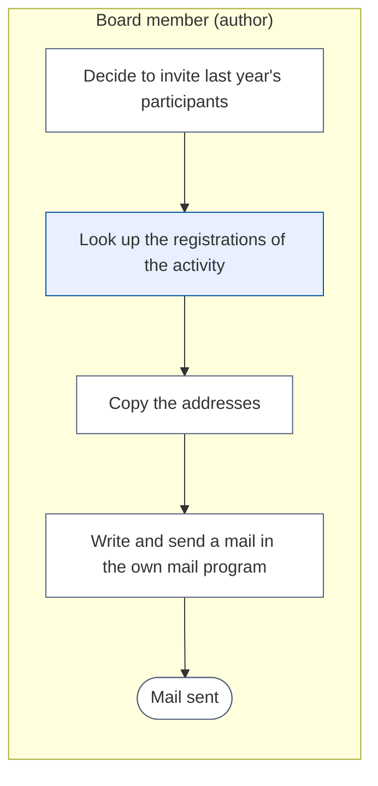
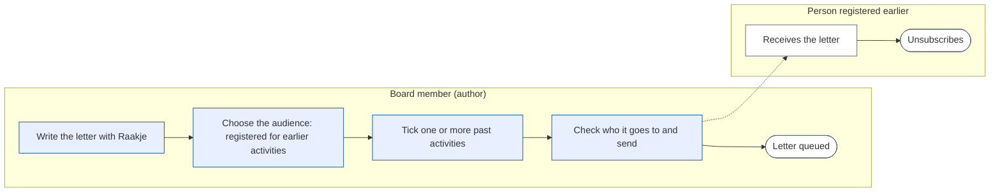

# Change Request 36 — Newsletter to the people registered for earlier activities

**Project:** Web Portal "Raak Millegem"
**Status:** shaped with Koen on 15 October 2026 · not assigned to a release; open decisions in B8
**Tracking issue:** #2026 — the one place where what is open stands; this document is the design, the issue is the status
**Applies to:** the newsletter (audience choice, recipient list, send screen, Raakje's sources), the activities facade (a read of registration addresses), the unsubscribe page
**Reading:** A 754 words · B 754 · C 932 — measured per part; A ≤ 1 500, B ≤ 2 500

---

# Part A — The business

## A1. Reason to act — the trigger

Koen, 15 October 2026: the newsletter should be able to address a *specific audience*: the people who were registered for one or two activities in the past years. His example: last year there was an activity; when it comes back, the people who came get a mail "we organise it again, nice that you were there last year on that date". More targeted communication, built on who registered for similar activities before. The audience is chosen by hand in the audience choice that exists today; an assistant may suggest which past activity fits the letter.

## A2. As-is process — how it works today, and where it hurts

Today the audience of a letter is *Leden*, *Niet-leden* or *Allebei*. There is no way to say "the people who came to last year's activity". My reading, to be confirmed by Koen: an author who wants that sends a mail by hand outside the portal, with the addresses copied from the registrations.

*What to see:* three of four steps are by hand and the mail leaves the portal.

| Step | Pain |
|---|---|
| Copy the addresses | slow, error-prone, one activity at a time |
| Send from the own mail program | no unsubscribe link, no archive, no queue, no help from Raakje, shares the mailbox limit with everything else |

## A3. To-be process — how it should work afterwards

*What to see:* the three by-hand steps are gone; the letter keeps its queue, archive and unsubscribe link.

What it says on the screen (Dutch):
- audience choice, a fourth option: **Ingeschreven op eerdere activiteiten**
- under it a list: **Kies één of meer activiteiten**, past activities newest first, each with its date and the number of addresses
- the send screen says in words who gets it: "*N adressen van mensen die waren ingeschreven op <activiteit>*", and how many of them already get the letter as member

## A4. Benefits — what the change earns

- Targeted mail to people who showed interest in the same kind of activity: higher turnout for a returning activity (no figure; to be seen after the first use).
- The by-hand route disappears: the minutes of copying addresses per mail, and the mails without unsubscribe link.
- Raakje can suggest the fitting past activity, so choosing is one click.

## A5. Supplied material — and what it taught us

Koen's dictation of 15 October 2026 only. Reporting need: the archive of a sent letter names its audience and the activities chosen (A6 R6).

## A6. Business requirements — what the board asks, with MoSCoW

| # | Requirement | MoSCoW | Source | Comment |
|---|---|---|---|---|
| R1 | Choose, per letter, one or more past activities as the audience | Must | Koen, 15 Oct 2026 | "de ingeschrevenen op 1 of 2 gelijkaardige activiteiten vorig jaar" |
| R2 | The choice sits in the audience choice that exists | Must | Koen, 15 Oct 2026 | a drop-down by hand |
| R3 | Anyone can unsubscribe from such a letter, and is not mailed again | Must | my reading of CR-05 §3.4; Q1 | |
| R4 | The letter can name the activity and its date | Should | Koen, 15 Oct 2026 | "tof dat je vorig jaar er was op die datum" |
| R5 | Raakje suggests a past activity that fits the letter | Could | Koen, 15 Oct 2026 | the author decides |
| R6 | The archive shows which activities a letter went to | Should | my proposal | |
| R7 | Choosing people by presence, payment or age | Won't | — | not asked |

## A7. Non-functional requirements — security, privacy, house style, tenants

| Concern | This change |
|---|---|
| **Security** | only the board that may send a newsletter chooses the audience; no new public input except the unsubscribe link, which exists |
| **Privacy** | the address of a registration is used for a new purpose, a newsletter; whether that needs consent is Q1; every such letter carries a working unsubscribe link; Raakje never sees addresses |
| **House style** | the audience choice and send screen follow the kit; 390 px first |
| **Multi-tenant** | registrations and activities of the own tenant only |

## A8. Acceptance criteria — what the business signs off on HDEV

| # | Criterion | Requirement | Walkthrough steps |
|---|---|---|---|
| AC1 | Choosing *Ingeschreven op eerdere activiteiten* shows the list of past activities with their counts | R1, R2 | open a draft, choose it |
| AC2 | The send screen says in words who gets the letter and how many | R1 | tick two activities, read the sentence |
| AC3 | A person registered twice, or for both activities, gets one mail | R1 | check the recipient count |
| AC4 | The mail has an unsubscribe link; after using it the person gets nothing from a later letter of this kind | R3 | unsubscribe, send a second letter |
| AC5 | The archive shows the activities chosen | R6 | open the sent letter |

---

# Part B — The solution, for whoever approves it

## B1. Solution outline — the solution and the decisions that shape it

A fourth audience, *Ingeschreven op eerdere activiteiten*, next to Leden, Niet-leden and Allebei. With it the letter keeps a list of the activities chosen. The recipients are the contact addresses of the registrations on those activities, deduplicated by address, fixed when sending starts like every audience. Three rules decide the rest:

1. **One rule for everybody: someone who is on a list already is not mailed twice.** Order of precedence: a household with a membership for the working year gets it as a member (as in CR-05 §3.3, no unsubscribe line); a confirmed subscriber as a subscriber; everyone else as a *participant*.
2. **An address that unsubscribed is never mailed through this audience** (CR-05 §3.6: an import never resubscribes). A participant's unsubscribe link writes that opt-out; it does not make the person a subscriber.
3. **"Attended" means registered.** The portal does not record presence. A registration that was deleted, or an activity that was cancelled, counts for nobody.

*Raakje* gets the chosen activities as the source "voorbije activiteiten" of the letter, with name and date, so the letter can say it. A suggestion of a fitting past activity (R5) is a second phase: Raakje proposes from the activity names and dates only, the author ticks.

## B2. Fit with the process and the requirements — for the business

Covers R1–R4 and R6 in phase 1, R5 in phase 2. An example of use: *Nieuwsbrief*, step *Doelgroep* → *Ingeschreven op eerdere activiteiten* → tick last year's activity → *Naar versturen* → "212 adressen van mensen die waren ingeschreven op …, waarvan 140 al als lid de brief krijgen"; send.

## B3. The whole across the modules — for the architect

- `activities` gives one read through its facade: the addresses of the registrations on a set of activities, per tenant. `newsletter` never reads `Registration` itself.
- `newsletter` owns the audience, the list of chosen activities (a soft reference across the schema line, as `activity` references elsewhere), and a new delivery kind `participant` with its own unsubscribe token.
- No new module, no new edge: `newsletter` already consumes `activities.api` (`activities_from`).

## B4. Rules this change needs an exception from — decided once, here

None. (A participant's opt-out is a subscriber row with status *unsubscribed*, which CR-05 already honours.)

## B5. Cost — investment and running cost, and what operations must know

Phase 1 about 5 days, phase 2 about 2 days (my estimates, to be set by the build read). No running cost. Operations: letters to this audience count against the same daily cap; one letter to a large past activity can take days, as *Allebei* does.

## B6. Phasing — shippable phases, and what changes on the failure paths

| Phase | Content | Days |
|---|---|---|
| 1 | audience, list of activities, recipient rule, participant unsubscribe, send screen words, archive | 5 |
| 2 | Raakje suggests a past activity | 2 |

Failure paths: an activity chosen and then deleted before sending is dropped from the list and the screen says so; a letter whose audience becomes empty cannot be sent.

## B7. Rule and gatekeeper — what this fixes for all future work

A letter's recipients are always a derived list with one precedence rule and one opt-out check; a new audience is one more entry in that function, never a second path. A test names the precedence order so a new audience must choose its place.

## B8. Open decisions — what the approver still decides

| # | Question | Recommendation | What the answer changes |
|---|---|---|---|
| Q1 | May the association mail people who registered for an activity, without their consent, if the letter carries an unsubscribe link? (a) yes, on the existing relationship as for the imported list; (b) only people who ticked agreement on the registration form (the form changes; old registrations excluded) | a, after the accountant or a privacy adviser agrees; legal facts here are unverified | b adds a tick to the form and leaves last year's people out |
| Q2 | May two chosen activities be combined, so a person of either gets the letter? | yes: union, one mail | a letter naming "last year" must then speak generally |
| Q3 | Which activities are offered: those of the last three working years? | yes | the list length |
| Q4 | "Je moet ook een nieuwsbriefje kunnen maken om dat te versnellen": does that mean Raakje drafts the letter for this audience (as it does now)? | yes, it does with R4's sources | nothing to build beyond B1 |

## B9. Decisions log — dated answers

| Date | Decision | By |
|---|---|---|
| 15 Oct 2026 | Requirement R1, R2, R4, R5 as written in A6 (dictation, not an answer to a question) | Koen |

---

# Part C — The build, for the master CLI and the dev CLIs

## C1. Verified premises — measured before the handover

Measured on master @ `ef4b130c` on 15 October 2026; to be re-measured at the handover.

| Concept or claim | Kind | Measurement | Verdict | Consequence |
|---|---|---|---|---|
| `Audience` has three values with a code table and labels | changes | `newsletter/models.py:72`, `AudienceCode`, `AudienceLabel` | must change | one code, label and migration row; `recipients_for` and every reader of `Audience` (C2) |
| `recipients_for` dedups by address, members first | changes | `newsletter/service.py:429` | must change | add the participant branch last |
| The recipient list is fixed in `deliveries` when sending starts | relies on | `start_sending`, `send_batch` (`service.py:1817`) | holds | the chosen activities need not be kept after, only archived |
| A registration has `contact_email`, `deleted_at`, `activity_id` | relies on | `activities/models.py:351–414` | holds | the facade read filters on `deleted_at IS NULL` |
| A cancelled activity is `is_cancelled` | relies on | `activities/models.py` (`Activity`) | to verify in the build | exclude it |
| `erase` deletes the subscriber and anonymises its deliveries | relies on | `service.py:305` | holds | an opt-out row erased by hand re-allows mailing, said in the CONTRACT |
| Unsubscribe tokens live on `Subscriber` only | changes | `newsletter/models.py` (`Subscriber.unsubscribe_token`) | must change | the participant's token lives on its delivery |
| No presence is recorded | relies on | no field in `activities/models.py` | holds | "attended" = registered (B1) |
| A copy of a letter has no audience | relies on | `service.py:808` | holds | the chosen activities are cleared on copy too |

## C2. Per module: what must happen

- **activities**: `registration_addresses(db, activity_ids)` in `api.py`, returning per activity the distinct addresses; and `past_activities(db, since_year)` with name, last date, address count. Tenant-scoped.
- **newsletter**: `Audience.PARTICIPANTS = "participants"`, code and label rows; table `newsletter.newsletter_audience_activities (newsletter_id, activity_id)`; `DeliveryKind.PARTICIPANT`; `deliveries.unsubscribe_token` (nullable, unique); `recipients_for` gets the third branch; the participant unsubscribe route records an unsubscribed `Subscriber` (source new code `participant`); `audience_summary` and `_audience_said` gain the sentence; `render_mail` and the one-click header use the delivery's token for a participant; the archive shows the activities.
- **templates**: audience choice with the drop-down (htmx fragment, kit macros), send screen line, archive line.
- **chatbot / drafting**: phase 1 hands the chosen activities to `set_draft_sources`; phase 2 a read-only proposal tool over activity names and dates.

## C3. Cross-cutting impact — the checklist of what gets forgotten

- Every reader of `Audience` (`admin_ui.py:161,537–568,632,687,881`, `_audience_said`, the test mail's unsubscribe-line check at `admin_ui.py:881`, which must count participants as non-members).
- CR-33 attribute register: the purpose list of a registration's `contact_email` gains "newsletter, to earlier participants"; the delivery token is a new attribute (class *intern*).
- CONTRACT.md of `newsletter` and `activities`; the audience figure in the architecture document if it names three audiences.
- Privacy statement of the registration form (Q1).
- Alembic: one migration with the code rows, the table, the column; head counted before the push.

## C4. Detailed decisions — one subsection each, with the reasons

**C4.1 Recipient rule.** `recipients_for` builds members, then subscribers (`setdefault`), then participants (`setdefault`), then removes every address that has an unsubscribed `Subscriber` row unless it came as a member. A member address is never removed (CR-05 §3.4).

**C4.2 Participant unsubscribe.** Token on the delivery, the public page `/nieuwsbrief/uitschrijven/<token>` resolves a subscriber token first, then a delivery token; for a delivery token it inserts or updates a `Subscriber(email, status=unsubscribed, source=participant)` and marks the delivery's letter text unchanged. One-click POST works the same.

**C4.3 Fixed at send.** The addresses are copied into `deliveries` at `start_sending` as today; later registrations do not join a running send.

**C4.4 Which activities.** Published, not cancelled, last date before today, within the last three working years (Q3); newest first; label = name + date + "N adressen".

## C5. Privacy and security — the mechanics behind A7

The registration address is used for a second purpose; Q1 decides the basis and the form text. The token is random, 32 bytes, unique; the public route answers the same for an unknown token (no oracle), is rate-limited like the existing one, and a participant's opt-out is kept when the registration is later erased (the opt-out holds the address only).

## C6. Tests — what the build must prove

| # | Test |
|---|---|
| T1 | two activities, one person on both: one delivery |
| T2 | a deleted registration and a cancelled activity add nobody |
| T3 | a member address gets the member kind, no unsubscribe line |
| T4 | a subscriber address gets the subscriber kind |
| T5 | an unsubscribed address is absent, unless it is a member |
| T6 | the participant unsubscribe link, called once and by one-click POST, writes the opt-out; a second letter skips the address |
| T7 | another tenant's registrations never appear |
| T8 | copy clears audience and activities |
| T9 | the audience-said sentence has the right counts |
| T10 | the test mail of a participant letter carries the unsubscribe line |

## C7. The gate — what refuses a deviation from now on

A test that every `Audience` value has a precedence entry in `recipients_for` (an additive violation proves it: a fourth fake value fails).

## C8. Prototype findings — what was measured before the build

Not yet taken: count the addresses of three real past activities on a dev copy with made-up data; the numbers go here.

## C9. Screens before the build — the concepts the approver saw

Not yet made: audience choice with the drop-down, send screen, archive line, at 390 px.

## C10. Close-out at the release

Status line, as-built notes folded in, tracking issue closed (`CLAUDE.md` step 14).

## Q&A log — asked once, answered here

| Q&A | Date | Question | Status |
|---|---|---|---|
| — | 15 Oct 2026 | Q1–Q4 of B8 go into a Q&A file for Koen | open |

## Non-goals — deliberately outside this change

Segments by age, payment or presence; a saved audience; mail to the registrants of an activity about that activity (CR-05 §3.14, a separate change).

## Relationship to existing work — issues and change requests

CR-05 (newsletter) is the base; CR-37 (opens and clicks) is independent; CR-26 (party model) may later make "who registered" a party question, not needed now.
