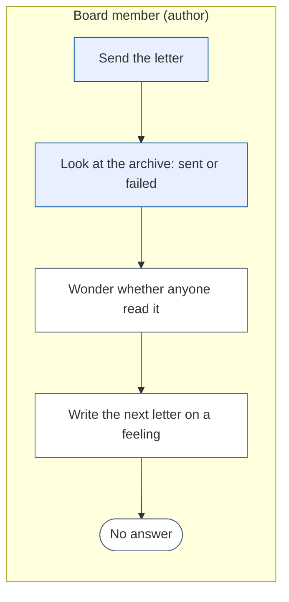
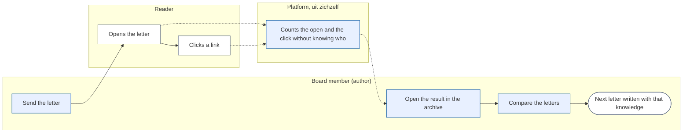
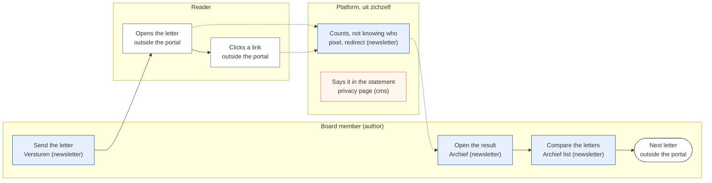
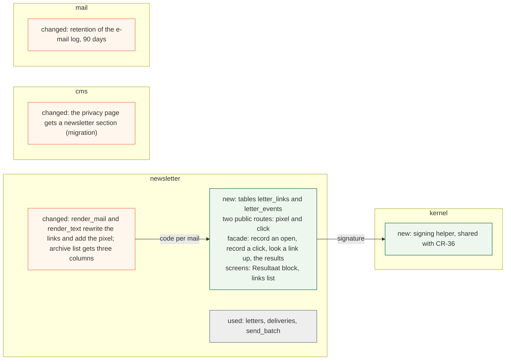
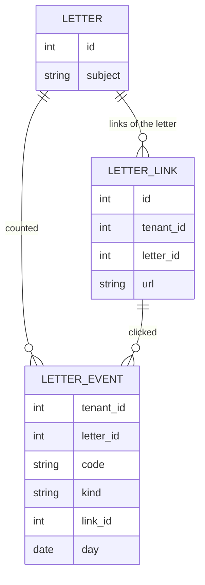

# Change Request 37 — Anonymous opens and clicks of a newsletter

**Project:** Web Portal "Raak Millegem"
**Status:** built in v2.17.0 (PR #2083, migration 214; closed out 21 October 2026) · shaped with Koen on 15 October 2026, reshaped the same day from per-person to anonymous; as-built deviations in B9 (16 Oct 2026)
**Tracking issue:** #2027 — the one place where what is open stands; this document is the design, the issue is the status
**Applies to:** the newsletter (rendering of a letter, a public pixel and redirect route, the send screen, the archive of sent letters)
**Reading:** A 909 words · B 2 243 · C 2 070 — measured per part; A ≤ 1 500, B ≤ 2 500

---

# Part A — The business

## A1. Reason to act — the trigger

Koen, 15 October 2026: after a letter has gone out, the board should see how many opened it and how often each link was clicked, so the next letter can be better: many links or few, a catchy title or not. He does not want to know *who* read what and when: "Ik vind dat zelf ook een beetje creepy. Dus voor mij is dat geen requirement." Today the board knows how many mails left, not whether anyone read them.

## A2. As-is process — how it works today, and where it hurts

*What to see:* the process ends in a guess.

| Step | Pain |
|---|---|
| Archive | counts deliveries only: sent, failed, skipped |
| Wonder, write on a feeling | no figure; no way to learn what draws interest |

## A3. To-be process — how it should work afterwards

*What to see:* the reader does nothing new; the platform counts, and nobody is named. A letter that is forwarded carries the same code, so a second reader's open counts as the first's: one code, one count.

What it says on the screen (Dutch):
- on a sent letter in the archive, a block **Resultaat**: *Verstuurd*, *Geopend (indicatie)* with a percentage, *Geklikt (indicatie)* with a percentage, and a list **Links**: each link with the number of people who clicked it
- in the archive list, per letter: subject, number of links, percentage opened, percentage clicked, so letters can be compared (built as: the list stays cards with one result line per sent letter; B9, 16 Oct 2026)
- on every letter, in the footer and in the plain-text part, one line: *Wij tellen anoniem hoeveel brieven geopend en hoeveel links aangeklikt worden.* (built as: only in real mails, not in the test mail or the preview; B9, 16 Oct 2026)
- in the privacy statement, a section on the newsletter that says what is counted and what is not (proposed text under A5)

## A4. Benefits — what the change earns

- The next letter is written with knowledge: what a subject, a number of links, a position of a button does (no figure; to be seen after three letters).
- The board sees whether a letter is read at all, instead of guessing.
- Nobody is followed: no list of who read what.
- Self-built in the portal: no external campaign service, no data leaving the EU server.

## A5. Supplied material — and what it taught us

Koen's dictation of 15 October 2026. What it taught us from the code: the portal sends one mail per recipient (CR-05 §3.7), so a code per mail is possible without a campaign service. Reporting need: the result block and the archive list of A3, no export.

Proposed text for the privacy statement, to be approved by Koen: *Bij de nieuwsbrief tellen we hoeveel brieven geopend worden en hoe vaak een link wordt aangeklikt. Dat gebeurt anoniem: we houden niet bij wie een brief las, wie op welke link klikte of wanneer. (built as: "...of wie op welke link klikte", without "of wanneer", because the day is kept; B9, 16 Oct 2026) Een uitgeschreven adres krijgt geen nieuwsbrief meer.* (The last sentence only if it stays true after CR-36.)

## A6. Business requirements — what the board asks, with MoSCoW

| # | Requirement | MoSCoW | Source | Comment |
|---|---|---|---|---|
| R1 | See, per sent letter, how many people opened it | Must | Koen, 15 Oct 2026 | anonymous |
| R2 | See, per link of a letter, how many people clicked it | Must | Koen, 15 Oct 2026 | anonymous |
| R3 | Compare letters in the archive list | Should | Koen, 15 Oct 2026 | "analyses naar doen, zodat we dat kunnen verbeteren" |
| R4 | Every letter is counted, always; there is no switch for the sender and no button for the reader | Must | Koen, 15 Oct 2026 | "We meten altijd. Het is toch anoniem." |
| R5 | Tell the reader that the letters are counted, anonymously: a footer line, and the privacy statement says what is counted and what is not | Must | Koen, 15 Oct 2026 | the statement: "dat we niet trekken wie leest, wie op wat klikt"; the footer line is my proposal, Q1 |
| R6 | The unsubscribe link is never counted or changed | Must | CR-05 §3.4, §3.7 | |
| R7 | Who opened, who clicked what, and when | Won't | Koen, 15 Oct 2026 | "geen requirement" |
| R8 | A switch to not measure a letter, or a button for the reader to refuse counting | Won't | Koen, 15 Oct 2026 | not needed when counting is anonymous |
| R9 | Export of the result | Won't | — | not asked |

## A7. Non-functional requirements — security, privacy, house style, tenants

| Concern | This change |
|---|---|
| **Security** | the pixel and the redirect accept only a code the portal itself made; a link can only go to an address that stood in that letter |
| **Privacy** | the portal keeps no link between a code and a person: the code lives in the mail only; no address, IP address or device is stored; the footer line says it (Q1) |
| **House style** | result block and list from the kit; 390 px first; "Geopend" and "Geklikt" are labelled as an indication |
| **Multi-tenant** | per tenant; always on, no setting |

## A8. Acceptance criteria — what the business signs off on HDEV

| # | Criterion | Requirement | Walkthrough steps |
|---|---|---|---|
| AC1 | After opening a real mail sent to a made-up address, the letter counts one opening | R1 | steps 4, 7 |
| AC2 | After a click, that link counts one clicker | R2 | steps 5, 7 |
| AC3 | The unsubscribe link still works and is not listed | R6 | step 6 |
| AC4 | A letter sent after the change carries the pixel and the rewritten links, members' letters included | R4 | steps 1, 2 |
| AC5 | The footer line is in every letter | R5 | step 2 |
| AC6 | The archive list shows opened and clicked percentages per letter | R3 | step 7 |
| AC7 | Nothing in the result names or identifies a person | R7 | step 8 |
| AC8 | The privacy statement has the newsletter section | R5 | step 9 |

---

# Part B — The solution, for whoever approves it

## B1. Solution outline — the solution and the decisions that shape it

The portal counts itself, and does not know who. Each mail carries one **code** that the portal makes while it renders that mail and **does not store with the recipient**: it is a random number plus a signature made with a secret of the portal, so the portal can recognise its own codes later without a list. A pixel (a one-pixel image from the portal's own address) counts an open; a redirect counts a click. An event is a row: letter, code, kind, link, **day**. No address, no delivery, no IP, no device, no time of day. The portal's own e-mail log keeps each mail with its recipient and its codes for 90 days (the setting goes from 365 to 90); the portal's tables hold no link, and the log is accepted as it is (B9). Counting different codes gives *how many people*, counting rows of one code never counts twice.

Facts that shape the screen: an open is an **indication** (mail programs that load images in advance show an open that never happened, programs that block images hide a real one), and so is a click (a mail filter that tests links in advance clicks every link). The screen says *indicatie* on both.

The rewriting works on the **letter as it is rendered**, after the activity blocks are expanded, so the links of an activity (*Schrijf je in!*, its title) are counted too and the design does not change when the newsletter moves to the page editor (#2023). **Every letter is measured, always** (Koen, 15 October 2026): counting is anonymous, so there is no switch for the sender, no button for the reader and no second scenario to build and test. The privacy statement is updated to say what is counted and what is not (A5). Four decisions: **self-built, no third party** (Europe First); **no link between a code and a person in the portal's own tables**; **the unsubscribe link and the preview and test mail are never counted**; **the results stay**, because they hold no personal data (Q3).

## B2. Fit with the process and the requirements — for the business

<!-- figure: name=cr37-usage caption=Every_step_has_a_home_in_the_newsletter_module_or_is_marked_outside_the_portal -->

*Colour is the module: blue newsletter, orange cms; white is outside the portal. Everything the author does stays in one module; the reader works in a mail program and meets the portal only through the pixel and the redirect.*

**Traceability**

| R | How the solution meets it | F | Module (C2) | Test (C6) | AC |
|---|---|---|---|---|---|
| R1 | The *Resultaat* block shows how many people opened the letter, as an indication | B1 | newsletter | T6 | AC1 |
| R2 | The block lists every link with how many people clicked it | B1 | newsletter | T3, T4, T6 | AC2 |
| R3 | The archive list gets columns for the number of links, opened % and clicked % | B1 | newsletter | T16 | AC6 |
| R4 | Every letter carries the pixel and the rewritten links; there is no switch | B1 | newsletter | T1, T13 | AC4 |
| R5 | A footer line in every letter, and a section in the privacy statement | B1 | newsletter, cms | T10, T11, T13 | AC5, AC8 |
| R6 | The unsubscribe link is left as it is | B1 | newsletter | T2 | AC3 |
| R7 | Won't: nothing is stored that names a person; a gate on the table's columns keeps it so | B1 | newsletter | T7 | AC7 |
| R8 | Won't: no switch and no button; counting is anonymous | B1 | newsletter | — | — |
| R9 | Won't: not asked | — | — | — | — |

**Walkthrough** — on HDEV, with made-up addresses on the reserved example domain.

*The author (Nieuwsbrief)*

1. Write a letter with one ordinary link and one activity block. Send it to a made-up subscriber. See: the letter reaches *Verzonden*.
2. Read the source of the received mail. See: the pixel, every link going through the portal (the activity block's *Schrijf je in!* too), the unsubscribe link unchanged, the footer line *Wij tellen anoniem hoeveel brieven geopend en hoeveel links aangeklikt worden.*
3. Send a test mail and open the preview. See: no pixel and no rewritten link.

*The reader (the made-up address)*

4. Open the mail twice. See: nothing special.
5. Click the ordinary link twice. See: the destination opens both times.
6. Click the unsubscribe link. See: it works as before.

*The author again (Archief)*

7. Open the letter. See: *Resultaat* says opened 1 (indicatie), clicked 1 (indicatie), and the link list shows 1 for the link clicked twice. In the list: columns for the number of links, opened % and clicked %.
8. Read the result. See: no name, address or time anywhere.

*The administrator*

9. Open the privacy page. See: the newsletter section.

*Where it must refuse*

10. Change a character in the code of the pixel address. See: the picture still loads and no count changes.
11. Call a click address with the link number of another letter. See: not found, no count.

## B3. The whole across the modules — for the architect

<!-- figure: name=cr37-structure caption=Green_is_new_orange_is_changed_grey_is_only_used -->

*Green new, orange changed, grey used.*

*New: `LETTER_LINK` and `LETTER_EVENT`. The event holds no address, delivery, IP or time of day; the code is random and stored nowhere else.*

Everything inside `newsletter`: the rendering (`render_mail`, `render_text`) rewrites links and adds the pixel in every letter; two public routes, `/nieuwsbrief/o/<code>.gif` (the pixel) and `/nieuwsbrief/k/<code>/<link>` (the click); table `newsletter.letter_links` (per letter: id, url, filled the first time a link is rendered) and `newsletter.letter_events` (letter, code, kind, link, day; unique on letter, code, kind and link). Four entries in `newsletter.api` (record an open, record a click, look a link up, the results) because the screens may call only the facade. `kernel` gets the signing helper CR-36 shares, and the retention of the e-mail log goes from 365 to 90 days (one setting). No token on the delivery: CR-36's unsubscribe link is signed with the same helper.

## B3a. Standards the model follows — and where it deviates, on purpose

None applies: the events describe no party, address, identification or payment.

## B4. Rules this change needs an exception from — decided once, here

None. The two public routes name their callers in the CONTRACT (a mail client; a reader's browser), like the unsubscribe page.

## B5. Cost — investment and running cost, and what operations must know

About 5 days (my estimate, to be set by the build read). Running cost: one small row per different code per open and per click, kept. Operations: a link in a letter points at the portal's address; if the portal is down, links of a sent letter fail until it is back — said in the CONTRACT. The signing secret is derived from the portal's existing secret; rotating that secret makes the codes of letters sent earlier unrecognisable, so their late opens and clicks are not counted; the same secret signs sessions and other links, so the CONTRACT says that a rotation also ends the counting of late opens and that nothing else in this change depends on it. The e-mail log keeps the mails for 90 days, and the sending mailbox keeps them with their codes.

## B6. Phasing — shippable phases, and what changes on the failure paths

| Phase | Content | Days |
|---|---|---|
| 0 | codes, link store, rewrite on the rendered letter, pixel and click routes, the footer line, the privacy statement section | 3 |
| 1 | the result block and the archive list | 2 |

**Order:** built after part 7b of #2023 (the letter on the page editor): both touch `service.py` (`render_mail`, `render_text`), the archive screen, the newsletter's attributes and the test-mail snapshot, which 7b regenerates once; "byte-identical" holds from that baseline. Migration numbers come after 7a (209) and 7b (210).

Failure paths: a code that does not verify gives the 1×1 image for the pixel and a 404 for a link; a link that is gone from the store gives 404; a failed event write never blocks the redirect.

## B7. Rule and gatekeeper — what this fixes for all future work

A link in a letter that leaves through the portal goes through one function; a test fails when a mail carries an external address that is not in the link store. A second gate: the events table has no column that can hold an address, a delivery or an IP.

## B8. Open decisions — what the approver still decides

| # | Question | Recommendation | What the answer changes |
|---|---|---|---|
| Q1 (answered, B9) | Is counting codes that are not linked to a person enough that no consent is needed, with the footer line and the privacy statement? | yes (Koen answered yes); the design cannot name a person, so the question is only about the footer line and the pixel | the wording of the footer line; at worst a tick at sign-up for later letters |
| Q2 (answered, B9) | Is *indicatie* on opens and on clicks acceptable? | yes | nothing; the alternative is no figure at all |
| Q3 (answered, B9) | Keep the results (they are anonymous) or remove them after twelve months? | keep: there is no personal data and the comparison over years is the point | a purge at start-up if removed |
| Q4 (answered, B9) | Who sees the result: everyone who may send a newsletter? | yes | the right on the screen |
| Q5 (answered, B9) | How does the privacy statement get its newsletter section: a data migration that appends it to the `privacy` page of every tenant that lacks it (as migration 061 did for the speech-input section; since CR-17 through the CMS's document, see C3), or Koen writes it in the page editor? | the migration (Koen's choice), so every tenant has it from the release; the text of A5 | the migration and its test, or nothing to build |

## B9. Decisions log — dated answers

| Date | Decision | By |
|---|---|---|
| 15 Oct 2026 | Requirements R1, R2 as written in A6 (dictation, not an answer to a question) | Koen |
| 15 Oct 2026 | The content of the first, per-person version was in order: "Dan ben ik het ook eens met CR37. Voor mij is die ook in orde." (not an answer to the open questions, not an assignment; the document was then reshaped) | Koen |
| 15 Oct 2026 | No *Niet meten* button for the reader; the sender decides per letter whether it is measured (superseded by the last row of this log) | Koen, to my explanation of the link *Niet meten*: "We gaan de nieuwsbrief naar leden niet uitbreiden met een knop \"niet meten\". De verzender kan wel beslissen niet te meten." |
| 15 Oct 2026 | Anonymous counting; who read what and when is not a requirement | Koen, to my asking per person or counts: "Kunnen we anders niet gaan voor een oplossing dat we anoniem meten? [...] Maar ik vind persoonlijk ook dat puur trekken, welke persoon heeft gelezen, wanneer, wie heeft op welke knop geklikt, wanneer. Ik vind dat zelf ook een beetje creepy. Dus voor mij is dat geen requirement." |
| 15 Oct 2026 | Every letter is measured, always: no switch for the sender, no button for the reader; the privacy statement is updated to say that who reads and who clicks is not tracked | Koen, to my asking whether *Meten* is ticked from the start: "Nu we toch anoniem meten, zou ik zelfs die optie om niet te meten verwijderen. Het is simpel. We meten altijd. Het is toch anoniem. Dan moeten we die verschillende scenario's ook niet testen. Die knop ook niet bouwen." and "herinneren we eraan dat we onze privacy clausule updaten. [...] dat we niet trekken wie leest, wie op wat klikt, dat dat duidelijk verwoord is." |
| 15 Oct 2026 | Q1: anonymous counting with the footer line is enough, without consent | Koen, to question 5 of Q&A nr. 08: "ja" |
| 15 Oct 2026 | Q2: opens and clicks are shown as *indicatie* | Koen, to question 6: "ja" |
| 15 Oct 2026 | Q3: the results are kept | Koen, to question 7 (keep or remove after twelve months): "akkoord" |
| 15 Oct 2026 | Q4: everyone who may send a newsletter sees the result | Koen, to question 8: "ja" |
| 15 Oct 2026 | The rows per code stay as they are; they are folded into counts only when performance asks for it | Koen, to my question whether the rows may stay until there are performance problems: "ja" |
| 15 Oct 2026 | No floor on the number of recipients: the result shows its figures for every letter | Koen, to the review's proposal of a floor of ten addresses: "ondergrens doen we niet" |
| 15 Oct 2026 | The opened figure stays, so the pixel stays; a letter counts once however often it is opened | Koen: "ik wil weten hoeveel keer de mail geopend werd, niet de persoon kennen"; to "één keer per brief, of elke opening afzonderlijk?": "één keer per brief" (my reading: he wants the open figure, so the review's option of counting clicks only is not taken) |
| 15 Oct 2026 | The e-mail log is not masked; its retention goes from 365 to 90 days, and nothing is built to hide the codes in the logged body | Koen: "Laten we 90 dagen nemen en de koppeling-maskering niet bouwen." (to my proposal of 30 days, with the reason that a code can be tied to a recipient through the log for as long as it is kept) |
| 15 Oct 2026 | The signing helper is built in `kernel`, shared with CR-36 | Koen, to "Wil je dat het hulpje in `newsletter` blijft staan tot CR-34 het echt nodig heeft?" (after the explanation that CR-34's call-back route is a third user in another domain): "we gaan dan voor kernel" |
| 15 Oct 2026 | Q5: a migration adds the newsletter section to the privacy page of every tenant that lacks it | Koen, to question 9 (a migration or he writes it himself): "a" |
| 16 Oct 2026 | Built as (PR #2083, `a8d48107`, migration 214): the events carry no `kind` column — an event without a link is an open; the list of letters stays cards, with one result line per sent letter; the footer with the counting sentence stands only in real mails, not in the test mail or the preview; the privacy section says "we houden niet bij wie een brief las of wie op welke link klikte" (no "of wanneer": the day is kept); the domain's CONTRACT names the line — no link to a person in the tables or the mail log (90 days), while the sending mailbox's Sent folder and each recipient keep code and address; the default of `email_log_retention_days` went from 365 to 90 | the builder (Desktop Dev2), read by Desktop Dev1 (comment 6221186634 on #2083); no new decision of Koen |

---

# Part C — The build, for the master CLI and the dev CLIs

## C1. Verified premises — measured before the handover

Measured on master @ `ef4b130c` on 15 October 2026 (the build read of dev2 on #2027 re-measured it the same day, with #2023 read as the next change to the same code; the reshaping to anonymous counting is not read yet); to be re-measured at the handover.

| Concept or claim | Kind | Measurement | Verdict | Consequence |
|---|---|---|---|---|
| One mail per recipient | relies on | `send_batch`, `newsletter/service.py:1817` | holds | a code per rendered mail |
| `send_campaign_mail` logs every campaign mail with its recipient and full body for 365 days, and a campaign mail has no retry job | relies on / changes | `mail/service.py:220–250`, `:481–487`; `config.py:37` | measured by the architecture review of 15 October: today a code joins to a recipient through the log | the retention setting goes from 365 to 90 days; the logged body keeps its codes (B9) |
| `render_mail` and `render_text` know the unsubscribe URL, not a code | changes | `service.py:1501, 1473`; call site `1868` | must change | both gain an optional `code`, default none |
| The links of an activity block are made when the letter is rendered, not in the stored body | changes | `expand_blocks`, `service.py:1195–1230` (after part 7b of #2023: `render_body` and `mail_blocks`; re-measure at the handover) | must change | rewrite on the rendered HTML; the link store fills on first use (C4.1) |
| The letter's origin is `link_base` | relies on | `service.py:1515` | holds | pixel and redirect use it |
| The public unsubscribe page shows on GET and acts on POST, without a rate limit | relies on | `newsletter/ui.py:118–147` | holds | the new routes need no per-IP limit (C4.2); the signing check refuses forged codes without a query |
| The signup limiter is 5 calls per 60 seconds per IP | relies on | `limiter.py:125` | does not fit | proxies fetch hundreds of pixels from a few addresses; not used |
| The test mail and the preview share `render_mail` | relies on | `service.py:1608`; `admin_ui.py:886–893`; snapshot test `test_newsletter_test_mail_unchanged_1251.py` | holds | no code passed: byte-identical |
| A member's mail has no footer line besides name and address; `render_text` has its own footer | changes | `service.py:1511–1529, 1473–1488` | must change | the counting line in both |
| The two public routes are page routes, not `/api/v1` | relies on | `test_rules_gate.py:516` | holds | the JSON gate does not ask for a caller; the CONTRACT names it; `ui.py` calls `api.py` only |
| The archive list and detail screens exist | relies on | `admin_nieuwsbrief_archief.html`, `admin_ui.py` | holds | the block and the columns go there |
| Nothing of the newsletter is in the reporting universe | relies on | `reporting/universe.py` | holds | no entry; the results are read through `newsletter.api` |

## C2. Per module: what must happen

- **newsletter**: `letter_links` (tenant, letter, url, unique on letter and url); `letter_events` (tenant, letter, code, kind, link, day; built as: no `kind`, an event without a link is an open, B9 of 16 Oct 2026; unique on letter, code, kind, link as `UNIQUE NULLS NOT DISTINCT`, because the link is empty for an open and a plain unique key lets one code open twice); the code made and verified with the shared helper `kernel/signing.py` (`sign(context, *parts)`, `verify(...)`; random number and signature over letter id and number, derived from the portal's secret with its own context), also used by CR-36's unsubscribe link, whichever of the two lands first builds it; the setting `email_log_retention_days` goes from 365 to 90; `render_mail` and `render_text` take an optional `code`; one rewrite function for the HTML and the text; the pixel at the end of the HTML only; the footer line in HTML and text; the two routes; `api.py`: `record_open`, `record_click`, `link_target`, `results_of`; the archive block and the list columns (subject, number of links, opened %, clicked %).
- **cms**: the section of the privacy statement (Q5).
- **templates**: the result block, the links list and the list columns in the archive.

## C3. Cross-cutting impact — the checklist of what gets forgotten

- CR-33 attribute register: an entry per column, classification *intern*: `letter_links.url`, `letter_events.code`, `kind`, `link_id`, `day`; the signing secret is a secret, not an attribute. `email_log.body` is already *nooit* in the inventory.
- The privacy page is a document since CR-17 (a translation with `draft_json` and `published_json`, a history row per publish; `content` only for a page that did not convert). The migration of Q5 writes through the CMS's own door, `save_document` and `publish`, per tenant, in the stored heading levels, so that both versions and the history carry the section and a *restore* does not take it away; a page that kept its HTML gets the section in `content` and in the draft. The build measures the state of the privacy page on the three environments first; the answer decides which paths the migration needs.
- CONTRACT.md of `newsletter`: two public routes with their callers, the rewritten links, and that a link of a sent letter fails while the portal is down.
- The privacy statement (the `privacy` CMS page, tested by `cms/tests/test_cms_privacy.py`) and the footer line (Q1, Q5).
- Alembic: one migration; head counted before the push.
- The pixel route sends `Cache-Control: no-store`; Caddy's snippets do not touch `/nieuwsbrief` (not read in the shared parts).

## C4. Detailed decisions — one subsection each, with the reasons

**C4.1 Rewriting.** After the blocks are built (`expand_blocks`, after part 7b of #2023 `render_body`) and `with_inline_styles`, on the rendered HTML, and on the URLs of the text part, which after 7b is written as `text (address)`. The rewrite reads an `<a>` with its attributes in any order and any quote; links stand in the activity block, the calendar, a button block and the paragraphs of the body. A picture block is an `` with an absolute address, not a link: it is neither rewritten nor counted. Every `http` and `https` link is rewritten except the unsubscribe link; `mailto:`, `tel:` and in-page anchors stay. The destination is read from `letter_links`, never from the request, so the route cannot be an open redirect; the store row is created the first time a link is rendered, as an insert that does nothing on a conflict on the unique key (letter, url). The rewrite skips a link that already points under `/nieuwsbrief/k/` and the pixel itself, so rendering the same HTML twice does not wrap a link twice. Known limit, measured in C8: when the visible text of a link is a URL, the href differs from the text and some filters weigh that.

**C4.2 The code and the pixel.** The code is `<letter id>.<12 random bytes>.<signature>`; it is made in `render_mail` for each mail and stored nowhere. `GET /nieuwsbrief/o/<code>.gif` verifies the signature without a query, answers the same 43-byte GIF with `no-store` for a good and a bad code, and writes (letter, code, open, day) once. No per-IP limit, for the reason in C1.

**C4.3 Click.** `GET /nieuwsbrief/k/<code>/<link_id>`: the signature must verify and the link must belong to the letter in the code, else 404; the event is written once per (letter, code, link), a failing write is swallowed, the answer is a 302.

**C4.4 No time, no address.** An event keeps the day, not the time, so an event cannot be matched to the moment one mail left. The first-ten-seconds rule of the earlier version falls away with it: early clicks of link-testing filters count, and the figure says *indicatie*.

**C4.5 No switch.** Every letter is measured. There is no field on the letter, no setting and no screen element, so there is one path to build and to test.

**C4.6 The numbers.** Opened % = different codes with an open ÷ mails sent (status sent) of that letter; clicked % likewise; per link the number of different codes. A letter sent twice to one reader (a resend of a failed delivery) counts the second mail as another code, a small and accepted overcount.

**C4.7 No erasure question.** The events hold no address and no delivery, so there is nothing in them to erase for a person.

## C5. Privacy and security — the mechanics behind A7

No IP, no user agent, no address, no delivery, no time of day. The signature uses a key derived from the portal's secret with its own context string, so a code cannot be forged without the secret and a forged code costs no query. The click route forwards only to a stored address. A scanner that follows a link counts a click; the screen says *indicatie*. What is kept elsewhere: the e-mail log holds a mail with its recipient and its codes for 90 days, and the sending mailbox keeps every sent mail with its code. Koen accepts both (B9).

## C6. Tests — what the build must prove

| # | Test |
|---|---|
| T1 | every real mail carries the pixel and rewritten links; the test mail and the preview do not (snapshot) |
| T2 | every external link of a rendered letter that holds an activity block, a calendar and a button block goes through the portal; the unsubscribe link does not |
| T3 | a click forwards to the stored address and writes one event; a second click of the same code writes none |
| T4 | a link id of another letter, or a code of another letter, gives 404 and writes nothing |
| T5 | a code with a wrong signature gives the GIF and writes nothing (that it runs no query is a design sentence, not asserted) |
| T6 | two different codes opening count as two openings; one code opening twice counts one, proved with a direct second insert that the constraint refuses, not by the service's own check |
| T7 | the table `letter_events` has no column for an address, a delivery, an IP or a time of day (a gate that lists its columns) |
| T8 | the test mail and the preview carry no pixel and no rewritten link |
| T9 | a failing event write still redirects |
| T10 | the plain-text part's URLs are rewritten, and carry the footer line |
| T11 | after the privacy migration the rendered `privacy` page has the newsletter section (asserted on the page, not on `content`), a *restore* of an earlier version keeps it, and a second run adds nothing |
| T13 | a member's letter carries the footer line |
| T14 | fifty pixel fetches of different codes from one address are all recorded |
| T15 | a link that appears for the first time in the third batch gets a store row |
| T16 | the archive list percentages equal the counts of the events |

## C7. The gate — what refuses a deviation from now on

A gate (T2's form) that renders a letter with an external link in a block and in the body and fails when a link is not in `letter_links`; and T7's gate on the columns of `letter_events`; both proved by an additive violation (a link added to a block; a column added to the table).

## C8. Prototype findings — what was measured before the build

Not yet taken: send a letter to three mail programs with made-up addresses and record which opens and clicks arrive; check the rewritten link with a URL as its visible text.

## C9. Screens before the build — the concepts the approver saw

Not yet made: the result block with the links list, and the archive list with the percentage columns, at 390 px.

## C10. Close-out at the release

Status line, as-built notes folded in, tracking issue closed (`CLAUDE.md` step 14).

## Q&A log — asked once, answered here

| Q&A | Date | Question | Status |
|---|---|---|---|
| 08 | 15 Oct 2026 | Q1–Q5 of B8 asked as questions 5 to 9 of Q&A nr. 08; the build read of dev2 (#2027, 15 Oct 2026) was on the per-person version and is taken in where it still applies | answered 15 Oct 2026, in B9; a second build read is due |
| — | 15 Oct 2026 | The architecture review on #2027 (15 Oct 2026): A1 (the e-mail log ties a code to a person: instead of masking the body, the retention goes to 90 days, Koen), A4 (`UNIQUE NULLS NOT DISTINCT`), B1 (one signing helper in `kernel`), B2, B3, B4 (order with CR-17), B5 (CR-33 entries) and C1 are taken in; A2 (fold the rows into counts), A3 (a floor of ten addresses) and A5 (pixel or clicks only) are decided by Koen (B9) | taken in; nothing open for Koen |
| — | 15 Oct 2026 | The second build read of dev1 on #2027 (against 7b of #2023): the privacy migration writes through the CMS's document, the rewrite handles the new kinds of link, order after 7b, a rotation note and a forwarded-mail sentence are taken in | taken in |

## Non-goals — deliberately outside this change

Who opened or clicked; any profile of a person; an export; device or place statistics; measuring any mail other than the newsletter.

## Relationship to existing work — issues and change requests

CR-05 (newsletter) is the base; CR-36 (mail to earlier participants, #2026) is independent and its letters are counted like any other; CR-33 (attribute register) gets the entries.
