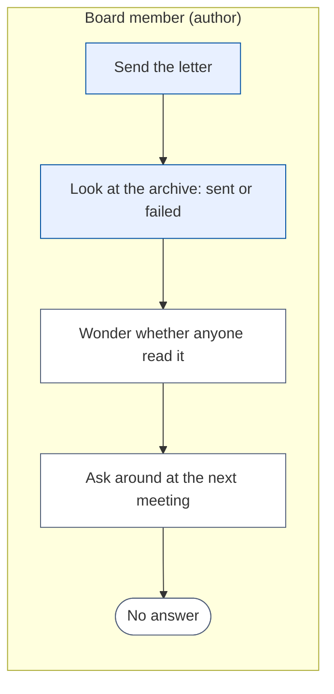

# Change Request 37 — See who opened a newsletter and who clicked which link

**Project:** Web Portal "Raak Millegem"
**Status:** shaped with Koen on 15 October 2026 · not assigned to a release; open decisions in B8, and nothing is built before Q1 is answered
**Tracking issue:** #2027 — the one place where what is open stands; this document is the design, the issue is the status
**Applies to:** the newsletter (rendering of a letter, a public pixel and redirect route, the send screen and the archive screen of a sent letter)
**Reading:** A 726 words · B 1 093 · C 1 526 — measured per part; A ≤ 1 500, B ≤ 2 500

---

# Part A — The business

## A1. Reason to act — the trigger

Koen, 15 October 2026: "dat we kunnen zien wie een nieuwsbrief geopend heeft en wie op welke link aanwezig in die nieuwsbrief heeft geklikt". After a letter has gone out the board knows how many mails left, not whether anyone read it or what interested them. Without that, the next letter is written blind.

## A2. As-is process — how it works today, and where it hurts

*What to see:* the process ends in a guess.

| Step | Pain |
|---|---|
| Archive | counts deliveries only: sent, failed, skipped |
| Wonder, ask around | no figure; no way to learn which activity in the letter drew interest |

## A3. To-be process — how it should work afterwards

*What to see:* the reader does nothing new; the platform notes it by itself.

What it says on the screen (Dutch), on the sent letter in the archive:
- a block **Resultaat**: *Verstuurd*, *Geopend (indicatie)*, *Geklikt (indicatie)*, and whether the letter was measured at all
- a list **Links**: each link with its number of clickers
- a list **Wie**: address, *geopend*, *geklikt op …*; filter *Geopend / Geklikt / Niet geopend*
- on the send screen, a choice **Meten of deze brief geopend en aangeklikt wordt**, not ticked until the sender ticks it
- on each measured letter, members' letters included, in the footer and in the plain-text part, one line saying that the association sees whether the letter was opened and which links were clicked

## A4. Benefits — what the change earns

- The next letter is written with knowledge: which activity or link drew interest (no figure; to be seen after three letters).
- The board can see whether a letter was read at all, instead of guessing.
- Self-built in the portal: no external campaign service, no data leaving the EU server.

## A5. Supplied material — and what it taught us

Koen's dictation of 15 October 2026. What it taught us from the code: the portal sends one mail per recipient (CR-05 §3.7), so a per-person figure is possible without a campaign service. Reporting need: the result screen of A3, no export in this version.

## A6. Business requirements — what the board asks, with MoSCoW

| # | Requirement | MoSCoW | Source | Comment |
|---|---|---|---|---|
| R1 | See, per sent letter, who opened it | Must | Koen, 15 Oct 2026 | "wie een nieuwsbrief geopend heeft" |
| R2 | See, per link of a letter, who clicked | Must | Koen, 15 Oct 2026 | "wie op welke link geklikt heeft" |
| R3 | Tell the reader that the letter is measured | Must | my reading of the GDPR; Q1 | |
| R3b | The sender decides, per letter, whether it is measured | Must | Koen, 15 Oct 2026 | "De verzender kan wel beslissen niet te meten." There is no *Niet meten* button for the reader |
| R4 | The unsubscribe link is never measured or changed | Must | CR-05 §3.4, §3.7 | |
| R5 | A figure per letter: how many opened, how many clicked | Should | my proposal | |
| R6 | Export of the result | Won't | — | not asked |
| R7 | Compare letters, or follow a person over time | Won't | — | not asked |

## A7. Non-functional requirements — security, privacy, house style, tenants

| Concern | This change |
|---|---|
| **Security** | the pixel and redirect routes accept only a token of an own delivery; an unknown token gives the same answer as a known one for the pixel and a 404 for the link; a link can only go to an address that stood in that letter |
| **Privacy** | who reads what is personal data and needs a legal basis; Q1 decides; the result is for the board only; no IP address and no device is stored |
| **House style** | result block and lists from the kit; 390 px first; "Geopend" is labelled as an indication |
| **Multi-tenant** | per tenant; the sender chooses per letter, no tenant setting |

## A8. Acceptance criteria — what the business signs off on HDEV

| # | Criterion | Requirement | Walkthrough steps |
|---|---|---|---|
| AC1 | After opening a test letter's mail, its address shows *geopend* | R1 | send to a made-up address, open it |
| AC2 | After a click, the address shows under that link | R2 | click a link |
| AC3 | The unsubscribe link still works and is not listed | R4 | use it |
| AC4 | A letter sent without the tick has no pixel and no rewritten link | R3b | read the mail source |
| AC5 | The footer line is there when the letter is measured, also in a member's letter | R3 | read the mail |
| AC6 | The sender ticks *Meten* on one letter and not on the next; the archive says which was measured | R3b | send two letters |

---

# Part B — The solution, for whoever approves it

## B1. Solution outline — the solution and the decisions that shape it

The portal measures itself: a pixel (a one-pixel image from the portal's own address) for an open, and a redirect for a click. Each mail carries its delivery's token; every link of the letter, except the unsubscribe link, goes through the portal, which notes the click and forwards the reader to the real address. Events are rows per delivery: kind, link, time. Nothing else is stored.

Facts that shape the screen, not the design: an open is an **indication** — mail programs that load images in advance (Apple's mail privacy protection) show an open that never happened, and programs that block images hide a real one; a click is an indication too, because a mail filter that tests links in advance clicks every link, also later and again. The screen says *indicatie* on both and the build ignores events in the first ten seconds after a delivery left.

The rewriting works on the **letter as it is rendered**, after the activity blocks are expanded, so the links of an activity (*Schrijf je in!*, its title) are measured too and the design does not change when the newsletter moves to the page editor (#2023). Whether a letter is measured is the **sender's choice on the send screen**, made once when sending starts and kept on the letter; the archive says *gemeten: ja/nee*.

Four decisions: **self-built, no third party** (Europe First); **the sender chooses per letter** (not ticked until he ticks it), no tenant setting and no button for the reader; **the unsubscribe link and the preview/test mail are never measured**; **retention**: events are removed after twelve months (Q3), by a purge at start-up and at every send start, as the e-mail log is purged today.

## B2. Fit with the process and the requirements — for the business

Covers R1–R5. Use: *Nieuwsbrief* → *Archief* → a sent letter → *Resultaat*.

## B3. The whole across the modules — for the architect

Everything inside `newsletter`: the rendering (`render_mail`, `render_text`) rewrites links when the letter is measured; two public routes, `/nieuwsbrief/o/<token>.gif` (the pixel) and `/nieuwsbrief/k/<token>/<link>` (the click); table `newsletter.letter_links` (per letter: id, url, filled the first time a link is rendered) and `newsletter.delivery_events` (delivery, kind, link, at). **Shared with CR-36 (#2026):** the delivery `token`; whichever is assigned first builds it. No tenant setting: the choice is a field of the letter. Four entries in `newsletter.api` (record an open, record a click, look a link up, the results) because the screens may call only the facade. No other domain changes.

## B4. Rules this change needs an exception from — decided once, here

None. The two public routes name their caller in the CONTRACT (a mail client; a reader's browser), like the unsubscribe page.

## B5. Cost — investment and running cost, and what operations must know

About 7 days (my estimate; the build read of 15 October added the rendered-HTML rewrite and retention; the *Niet meten* route is out). The shared token is in it; with CR-36 built first it is about 5. Running cost: one small row per open and click; twelve months of retention. Operations: a link in a letter now points at the portal's address; if the portal is down, links of a sent letter fail until it is back — said in the CONTRACT.

## B6. Phasing — shippable phases, and what changes on the failure paths

| Phase | Content | Days |
|---|---|---|
| 0 | tables, link store, rewrite on the rendered letter, pixel and click routes, the choice on the send screen, retention purge; dark: nothing is rewritten unless the sender ticks it | 5 |
| 1 | the result screen on the archive | 3 |

Failure paths: an unknown token gives a 1×1 image for the pixel and a 404 for a link; a link that is gone from the store forwards nowhere and gives 404; a failed event write never blocks the redirect.

## B7. Rule and gatekeeper — what this fixes for all future work

A link in a letter that leaves through the portal goes through one function; a test fails when a mail of a measured letter carries an external address that is not in the link store.

## B8. Open decisions — what the approver still decides

| # | Question | Recommendation | What the answer changes |
|---|---|---|---|
| Q1 | Per person ("wie"), or only counts per letter and per link? Per person is personal data and, for members who cannot unsubscribe (CR-05 §3.4), cannot be refused by them: with the sender's choice per letter, a member of a measured letter is measured and has no button to stop it (Koen, 15 October 2026). (a) per person, with a footer notice; (b) counts only, nobody named; (c) per person only for subscribers who agree | a, after the accountant or a privacy adviser agrees; legal facts here are unverified; answer it together with Q1 of CR-36 (#2026), because both stack a purpose on the same people | a measures members of a measured letter without a way out for them; b is simpler and answers only part of the request; c leaves almost nobody to measure |
| Q2 | Is *indicatie* on opens and on clicks acceptable, given mail programs that load images and test links in advance? | yes | nothing; the alternative is showing no figure at all |
| Q3 | Retention of the events: twelve months? | yes | the retention job |
| Q4 | Who sees the result: everyone who may send a newsletter? | yes | the right on the screen |

## B9. Decisions log — dated answers

| Date | Decision | By |
|---|---|---|
| 15 Oct 2026 | Requirements R1, R2 as written in A6 (dictation, not an answer to a question) | Koen |
| 15 Oct 2026 | The content of the document is in order; the questions Q1–Q4 of B8 stay open | Koen, on reading the document: "Dan ben ik het ook eens met CR37. Voor mij is die ook in orde." (not an answer to Q1–Q4, and not an assignment to a release) |
| 15 Oct 2026 | Erasure of an address from the archives (the right to be forgotten) is not built in this change; see the known gap under Non-goals | Koen, to my question whether erasure by address should be part of this change: "Het recht om vergeten te worden gaan we voorlopig even laten liggen." |
| 15 Oct 2026 | No *Niet meten* button for the reader, in members' letters or any other; the sender decides per letter whether it is measured | Koen, to my explanation of the link *Niet meten*: "We gaan de nieuwsbrief naar leden niet uitbreiden met een knop \"niet meten\". De verzender kan wel beslissen niet te meten." (that the choice is not ticked until the sender ticks it is my proposal) |

---

# Part C — The build, for the master CLI and the dev CLIs

## C1. Verified premises — measured before the handover

Measured on master @ `ef4b130c` on 15 October 2026 (the build read of dev2 on #2027 re-measured it the same day, with #2023 read as the next change to the same code); to be re-measured at the handover.

| Concept or claim | Kind | Measurement | Verdict | Consequence |
|---|---|---|---|---|
| One mail per recipient, a delivery row each | relies on | `send_batch`, `newsletter/service.py:1817` | holds | the token belongs on the delivery |
| `render_mail` and `render_text` know the unsubscribe URL, not the delivery | changes | `service.py:1501, 1473`; call site `1868` | must change | both gain an optional token, default none |
| The links of an activity block are made when the letter is rendered, not in the stored body | changes | `expand_blocks`, `service.py:1195–1230` | must change | rewrite on the rendered HTML; the link store fills on first use, not at start (C4.1) |
| A letter is immutable once sending starts | relies on | `_refuse_unless_draft` | holds | `measured` is set once at start, from the sender's choice |
| The letter's origin is `link_base` | relies on | `service.py:1515` | holds | pixel and redirect use it |
| The public unsubscribe page shows on GET and acts on POST, without a rate limit | relies on | `newsletter/ui.py:118–147` | holds | a link-following filter unsubscribes nobody; the new pages follow it |
| The signup limiter is 5 calls per 60 seconds per IP | relies on | `limiter.py:125` | does not fit | proxies fetch hundreds of pixels from a few addresses; the pixel and the click get no per-IP limit (C4.2) |
| No recurring-job registry; the e-mail log is purged at start-up | relies on | `kernel/jobs.py:39`, `main.py:131` | holds | the purge follows that pattern (C4.8) |
| A member's mail has no footer line besides name and address; `render_text` has its own footer | changes | `service.py:1511–1529, 1473–1488` | must change | the measuring line in both |
| The test mail and the preview share `render_mail` | relies on | `service.py:1608`; `admin_ui.py:886–893`; snapshot test `test_newsletter_test_mail_unchanged_1251.py` | holds | no token passed: byte-identical |
| The two public routes are page routes, not `/api/v1` | relies on | `test_rules_gate.py:516` | holds | the JSON gate does not ask for a caller; the CONTRACT names it; `ui.py` calls `api.py` only |
| Nothing of the newsletter is in the reporting universe | relies on | `reporting/universe.py` | holds | no entry; the results are read through `newsletter.api` |

## C2. Per module: what must happen

- **newsletter**: `deliveries.token` (shared with CR-36); `newsletters.measured` (bool, the sender's choice on the send screen, fixed at `start_sending`); `letter_links` (tenant, letter, url, unique on letter and url); `delivery_events` (tenant, delivery, kind, link, at, early); `render_mail` and `render_text` take an optional `track_token`; one rewrite function used for the HTML and the text; the pixel at the end of the HTML only; the footer line in HTML and text; the routes of B3; `api.py`: `record_open`, `record_click`, `link_target`, `results_of`; the purge; the archive screen with *Resultaat*, the links list and the who list.
- **templates**: the *Meten* choice on the send screen; result block, links list, who list with filter, in the archive screen.

## C3. Cross-cutting impact — the checklist of what gets forgotten

- CR-33 register: the events are about a person (*intern*, tied to the delivery, retention twelve months); the token gets an entry (the register's gate is not on master yet; the merge order decides who carries it).
- CONTRACT.md of `newsletter`: two public routes with their callers (a mail client, a reader's browser), the retention at a restart, the rewritten links, and that a link of a sent letter fails while the portal is down.
- The privacy statement and the footer line (Q1).
- Alembic: one migration; head counted before the push; two nullable columns on `deliveries` would be one (the shared `token`).
- The pixel route sends `Cache-Control: no-store`; Caddy's snippets do not touch `/nieuwsbrief` (not read in the shared parts).

## C4. Detailed decisions — one subsection each, with the reasons

**C4.1 Rewriting.** After `expand_blocks` and `with_inline_styles`, on the rendered HTML, and on the URLs of the text part. Every `http` and `https` link is rewritten except the unsubscribe link; `mailto:`, `tel:` and in-page anchors stay. The destination is read from `letter_links`, never from the request, so the route cannot be an open redirect; the store row is created the first time a link is rendered, under the unique key (letter, url), so a link that changes during a send is simply a new row. Known limit, measured in C8: when the visible text of a link is a URL, the href differs from the text and some filters weigh that.

**C4.2 Pixel.** `GET /nieuwsbrief/o/<token>.gif` always returns the same 43-byte GIF with `no-store`. A write only for a known token and only once per delivery per hour. No per-IP limit, for the reason in C1; an unknown token costs one indexed lookup, as on the unsubscribe page.

**C4.3 Click.** `GET /nieuwsbrief/k/<token>/<link_id>`: the delivery and the link must belong to the same letter, else 404; the event is written, a failing write is swallowed, the answer is a 302. No limiter.

**C4.4 First ten seconds.** An event within ten seconds of the delivery's `sent_at` is stored, flagged `early`, and left out of the figures.

**C4.5 The choice is made once.** On the send screen, kept on the letter at `start_sending` as `measured`. A letter in the middle of a send never changes shape, and the archive says which letters were measured.

**C4.6 No button for the reader.** There is no *Niet meten* link and no objection list for measuring (Koen, 15 October 2026). A reader who does not want to be measured can unsubscribe (a subscriber); a member of a measured letter has no way, which is the consequence of Q1.

**C4.7 Erasure.** Not part of this change (B9, Non-goals). The events hang on the delivery, not on a person row, so whenever an address is anonymised in the archive its events stay as counts. The objection row holds the address only.

**C4.8 Retention.** A purge of events older than twelve months at start-up, as `_purge_old_email_logs` does, and at every `start_sending`. It runs at a restart, which is every deploy; the CONTRACT says so.

## C5. Privacy and security — the mechanics behind A7

No IP, no user agent. Events hang on a delivery, so whenever an address is anonymised the events stay as counts without a person. The click route forwards only to a stored address.

## C6. Tests — what the build must prove

| # | Test |
|---|---|
| T1 | not measured: the mail is byte-identical to today (snapshot) |
| T2 | measured: every external link of the rendered letter, an activity block's links included, goes through the portal; the unsubscribe link does not |
| T3 | a click forwards to the stored address and writes one event |
| T4 | a link id of another letter gives 404 and writes nothing |
| T5 | an unknown pixel token gives the GIF and writes nothing |
| T6 | an event in the first ten seconds is not counted |
| T8 | the purge removes events older than twelve months and nothing newer, at start-up and at send start |
| T9 | the test mail and the preview carry no pixel and no rewritten link |
| T10 | a failing event write still redirects |
| T11 | the plain-text part's URLs are rewritten, and carry the footer line |
| T12 | the sender's choice is fixed at the start: ticking or unticking afterwards changes nothing for a running send |
| T13 | a letter sent without the tick has no pixel, no rewritten link and no footer line, members' letters included |
| T14 | a member's letter carries the footer line when measured |
| T15 | fifty pixel fetches from one address are all recorded |
| T17 | a link that appears for the first time in the third batch gets a store row |

## C7. The gate — what refuses a deviation from now on

A gate (T2's form) that renders a measured letter with an external link in a block and in the body and fails when a link is not in `letter_links`; proved by an additive violation.

## C8. Prototype findings — what was measured before the build

Not yet taken: send a measured letter to three mail programs with made-up addresses and record which opens and clicks arrive.

## C9. Screens before the build — the concepts the approver saw

Not yet made: the result block, the links list and the who list at 390 px.

## C10. Close-out at the release

Status line, as-built notes folded in, tracking issue closed (`CLAUDE.md` step 14).

## Q&A log — asked once, answered here

| Q&A | Date | Question | Status |
|---|---|---|---|
| — | 15 Oct 2026 | Q1–Q4 of B8 go into a Q&A file for Koen; the build read of dev2 (#2027, 15 Oct 2026) is taken in | open |

## Non-goals — deliberately outside this change

Export, comparison between letters, a profile of a person over time, device or place statistics, measuring any mail other than the newsletter.

**Known gap, to be taken up later:** removing an address from the archives of sent letters. Today it works for a subscriber (the *Verwijderen* action anonymises his deliveries); a member's delivery and, with this change, a participant's has no such action, so the address stays in the archive. The build read found it for members already. It is left out for now; it is not decided that it stays out.

## Relationship to existing work — issues and change requests

CR-05 (newsletter) is the base; CR-36 (mail to earlier participants) is independent and its letters are measured like any other; CR-33 (attribute register) gets the new entries.
