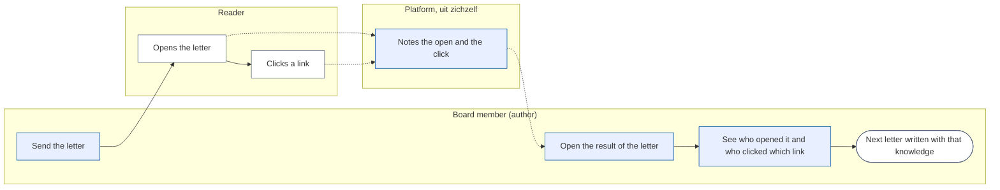

# Change Request 37 — See who opened a newsletter and who clicked which link

**Project:** Web Portal "Raak Millegem"
**Status:** shaped with Koen on 15 October 2026 · not assigned to a release; open decisions in B8, and nothing is built before Q1 is answered
**Tracking issue:** #2027 — the one place where what is open stands; this document is the design, the issue is the status
**Applies to:** the newsletter (rendering of a letter, a public pixel and redirect route, the archive screen of a sent letter), the tenant settings
**Reading:** A 625 words · B 691 · C 837 — measured per part; A ≤ 1 500, B ≤ 2 500

---

# Part A — The business

## A1. Reason to act — the trigger

Koen, 15 October 2026: "dat we kunnen zien wie een nieuwsbrief geopend heeft en wie op welke link aanwezig in die nieuwsbrief heeft geklikt". After a letter has gone out the board knows how many mails left, not whether anyone read it or what interested them. Without that, the next letter is written blind.

## A2. As-is process — how it works today, and where it hurts

*What to see:* the process ends in a guess.

| Step | Pain |
|---|---|
| Archive | counts deliveries only: sent, failed, skipped |
| Wonder, ask around | no figure; no way to learn which activity in the letter drew interest |

## A3. To-be process — how it should work afterwards

*What to see:* the reader does nothing new; the platform notes it by itself.

What it says on the screen (Dutch), on the sent letter in the archive:
- a block **Resultaat**: *Verstuurd*, *Geopend (indicatie)*, *Geklikt*
- a list **Links**: each link with its number of clickers
- a list **Wie**: address, *geopend*, *geklikt op …*; filter *Geopend / Geklikt / Niet geopend*
- on each letter, in the footer, one line saying that the association sees whether the letter was opened and which links were clicked

## A4. Benefits — what the change earns

- The next letter is written with knowledge: which activity or link drew interest (no figure; to be seen after three letters).
- The board can see whether a letter was read at all, instead of guessing.
- Self-built in the portal: no external campaign service, no data leaving the EU server.

## A5. Supplied material — and what it taught us

Koen's dictation of 15 October 2026. What it taught us from the code: the portal sends one mail per recipient (CR-05 §3.7), so a per-person figure is possible without a campaign service. Reporting need: the result screen of A3, no export in this version.

## A6. Business requirements — what the board asks, with MoSCoW

| # | Requirement | MoSCoW | Source | Comment |
|---|---|---|---|---|
| R1 | See, per sent letter, who opened it | Must | Koen, 15 Oct 2026 | "wie een nieuwsbrief geopend heeft" |
| R2 | See, per link of a letter, who clicked | Must | Koen, 15 Oct 2026 | "wie op welke link geklikt heeft" |
| R3 | Tell the reader that this is measured | Must | my reading of the GDPR; Q1 | |
| R4 | The unsubscribe link is never measured or changed | Must | CR-05 §3.4, §3.7 | |
| R5 | A figure per letter: how many opened, how many clicked | Should | my proposal | |
| R6 | Export of the result | Won't | — | not asked |
| R7 | Compare letters, or follow a person over time | Won't | — | not asked |

## A7. Non-functional requirements — security, privacy, house style, tenants

| Concern | This change |
|---|---|
| **Security** | the pixel and redirect routes accept only a token of an own delivery; an unknown token gives the same answer as a known one for the pixel and a 404 for the link; a link can only go to an address that stood in that letter |
| **Privacy** | who reads what is personal data and needs a legal basis; Q1 decides; the result is for the board only; no IP address and no device is stored |
| **House style** | result block and lists from the kit; 390 px first; "Geopend" is labelled as an indication |
| **Multi-tenant** | per tenant; a tenant setting switches measuring on, default off |

## A8. Acceptance criteria — what the business signs off on HDEV

| # | Criterion | Requirement | Walkthrough steps |
|---|---|---|---|
| AC1 | After opening a test letter's mail, its address shows *geopend* | R1 | send to a made-up address, open it |
| AC2 | After a click, the address shows under that link | R2 | click a link |
| AC3 | The unsubscribe link still works and is not listed | R4 | use it |
| AC4 | With measuring off, no pixel and no rewritten link is in the mail | R3 | read the mail source |
| AC5 | The footer line is there when measuring is on | R3 | read the mail |

---

# Part B — The solution, for whoever approves it

## B1. Solution outline — the solution and the decisions that shape it

The portal measures itself: a pixel (a one-pixel image from the portal's own address) for an open, and a redirect for a click. Each mail carries its delivery's token; every link of the letter, except the unsubscribe link, goes through the portal, which notes the click and forwards the reader to the real address. Events are rows per delivery: kind, link, time. Nothing else is stored.

Facts that shape the screen, not the design: an open is an **indication** — mail programs that load images in advance (Apple's mail privacy protection) show an open that never happened, and programs that block images hide a real one; a click is nearly always real, but a mail filter that tests links in advance can produce clicks at the moment of delivery. The screen says *indicatie* and the build ignores events in the first ten seconds after a delivery left.

Four decisions: **self-built, no third party** (Europe First); **a tenant setting, default off**, per tenant; **the unsubscribe link and the preview/test mail are never measured**; **retention**: events are removed after twelve months (Q3).

## B2. Fit with the process and the requirements — for the business

Covers R1–R5. Use: *Nieuwsbrief* → *Archief* → a sent letter → *Resultaat*.

## B3. The whole across the modules — for the architect

Everything inside `newsletter`: the rendering (`render_mail`, `render_text`) rewrites links when the setting is on; two public routes `/nieuwsbrief/o/<token>.gif` and `/nieuwsbrief/k/<token>/<link>`; table `newsletter.letter_links` (per letter: id, url) and `newsletter.delivery_events` (delivery, kind, link, at). One setting in the tenant configuration read through the existing settings facade. No other domain changes.

## B4. Rules this change needs an exception from — decided once, here

None. The two public routes name their caller in the CONTRACT (a mail client; a reader's browser), like the unsubscribe page.

## B5. Cost — investment and running cost, and what operations must know

About 7 days (my estimate, to be set by the build read). Running cost: one small row per open and click; twelve months of retention. Operations: a link in a letter now points at the portal's address; if the portal is down, links of a sent letter fail until it is back — said in the CONTRACT.

## B6. Phasing — shippable phases, and what changes on the failure paths

| Phase | Content | Days |
|---|---|---|
| 0 | tables, link store, pixel and redirect routes, setting, retention job; dark: nothing is rewritten while the setting is off | 4 |
| 1 | the result screen on the archive | 3 |

Failure paths: an unknown token gives a 1×1 image for the pixel and a 404 for a link; a link that is gone from the store forwards nowhere and gives 404; a failed event write never blocks the redirect.

## B7. Rule and gatekeeper — what this fixes for all future work

A link in a letter that leaves through the portal goes through one function; a test fails when a mail of a measured letter carries an external address that is not in the link store.

## B8. Open decisions — what the approver still decides

| # | Question | Recommendation | What the answer changes |
|---|---|---|---|
| Q1 | Per person ("wie"), or only counts per letter and per link? Per person is personal data and, for members who cannot unsubscribe (CR-05 §3.4), cannot be refused by them. (a) per person, with a footer notice and a link *niet meten* that stops measuring that address; (b) counts only, nobody named; (c) per person only for subscribers who agree | a, after the accountant or a privacy adviser agrees; legal facts here are unverified | a adds a table of objecting addresses; b is simpler and answers only part of the request; c leaves almost nobody to measure |
| Q2 | Is *indicatie* on the open acceptable, given mail programs that load images in advance? | yes | nothing; the alternative is dropping opens and keeping clicks |
| Q3 | Retention of the events: twelve months? | yes | the retention job |
| Q4 | Who sees the result: everyone who may send a newsletter? | yes | the right on the screen |

## B9. Decisions log — dated answers

| Date | Decision | By |
|---|---|---|
| 15 Oct 2026 | Requirements R1, R2 as written in A6 (dictation, not an answer to a question) | Koen |

---

# Part C — The build, for the master CLI and the dev CLIs

## C1. Verified premises — measured before the handover

Measured on master @ `ef4b130c` on 15 October 2026; to be re-measured at the handover.

| Concept or claim | Kind | Measurement | Verdict | Consequence |
|---|---|---|---|---|
| One mail per recipient, a delivery row each | relies on | `send_batch` (`newsletter/service.py:1817`) | holds | the token belongs on the delivery |
| `render_mail` and `render_text` take the delivery's unsubscribe URL, not the delivery | changes | `service.py:1501`, `1868` | must change | both gain the delivery's token |
| The letter's origin is `link_base` | relies on | `service.py:1515` | holds | pixel and redirect use it |
| The public unsubscribe page is GET to show, POST to act | relies on | `newsletter/ui.py:118,131` | holds | a filter that follows links does not unsubscribe anybody |
| The signup limiter exists | relies on | `app.limiter.newsletter_signup_limiter` (`ui.py:27`) | holds | reuse for the two routes |
| `erase` anonymises a subscriber's deliveries | relies on | `service.py:305` | holds | events of an anonymised delivery lose their token and stay as counts |
| The test mail is rendered by the same function | relies on | `render_test`, snapshot test `test_newsletter_test_mail_unchanged_1251.py` | holds | the test mail passes no token: it stays byte-identical |

## C2. Per module: what must happen

- **newsletter**: `deliveries.track_token` (nullable, unique, random); tables `letter_links`, `delivery_events`; `start_sending` fills `letter_links` from the sanitised body when the setting is on; `render_mail` and `render_text` rewrite every external link except the unsubscribe link, and add the pixel at the end of the HTML only; routes in `ui.py`; `results_of(db, letter_id)` in `api.py`; retention job in `kernel_jobs`.
- **tenant configuration**: `newsletter_measure_opens` (bool, default off).
- **templates**: result block, links list, who list with filter, footer line, in the archive screen.

## C3. Cross-cutting impact — the checklist of what gets forgotten

- CR-33 register: the events are about a person (*intern*, tied to the address, retention twelve months); the token is *intern*.
- CONTRACT.md of `newsletter`: two new public routes with their callers, the retention, the rewritten links.
- The privacy statement and the footer line (Q1).
- Alembic: one migration; head counted before the push.
- The Caddy compression and security-header snippets are untouched; the pixel route sends `Cache-Control: no-store`.

## C4. Detailed decisions — one subsection each, with the reasons

**C4.1 Rewriting.** Only when the setting is on and the delivery has a token. The forwarding address is read from `letter_links`, never from the request, so the route cannot be an open redirect. The unsubscribe link, `mailto:` links and the in-page anchors stay as they are.

**C4.2 Pixel.** `GET /nieuwsbrief/o/<token>.gif` always returns the same 43-byte GIF with `no-store`; a write happens only for a known token, once per delivery per hour.

**C4.3 Click.** `GET /nieuwsbrief/k/<token>/<link_id>`: both must belong to the same letter, else 404; the event is written, a write failure is swallowed, the answer is a 302.

**C4.4 First ten seconds.** An event within ten seconds of `sent_at` of its delivery is stored but flagged `early` and left out of the figures.

## C5. Privacy and security — the mechanics behind A7

No IP, no user agent. Events are linked to a delivery, not to a subscriber row, so erasing a subscriber (CR-05 §4) leaves counts and no person. The objection list (Q1 a) is address-only and survives erasure of the subscriber, because without it the person would be measured again.

## C6. Tests — what the build must prove

| # | Test |
|---|---|
| T1 | setting off: the mail is byte-identical to today (snapshot) |
| T2 | setting on: every external link goes through the portal; the unsubscribe link does not |
| T3 | a click forwards to the stored address and writes one event |
| T4 | a link id of another letter gives 404 and writes nothing |
| T5 | an unknown pixel token gives the GIF and writes nothing |
| T6 | an event in the first ten seconds is not counted |
| T7 | erasing a subscriber leaves the counts and removes the person |
| T8 | the retention job removes events older than twelve months and nothing newer |
| T9 | the test mail carries no pixel and no rewritten link |
| T10 | a failing event write still redirects |

## C7. The gate — what refuses a deviation from now on

A gate (T2's form) that renders a measured letter with an external link and fails when the link is not in `letter_links`; proved by an additive violation.

## C8. Prototype findings — what was measured before the build

Not yet taken: send a measured letter to three mail programs with made-up addresses and record which opens and clicks arrive.

## C9. Screens before the build — the concepts the approver saw

Not yet made: the result block, the links list and the who list at 390 px.

## C10. Close-out at the release

Status line, as-built notes folded in, tracking issue closed (`CLAUDE.md` step 14).

## Q&A log — asked once, answered here

| Q&A | Date | Question | Status |
|---|---|---|---|
| — | 15 Oct 2026 | Q1–Q4 of B8 go into a Q&A file for Koen | open |

## Non-goals — deliberately outside this change

Export, comparison between letters, a profile of a person over time, device or place statistics, measuring any mail other than the newsletter.

## Relationship to existing work — issues and change requests

CR-05 (newsletter) is the base; CR-36 (mail to earlier participants) is independent and its letters are measured like any other; CR-33 (attribute register) gets the new entries.
