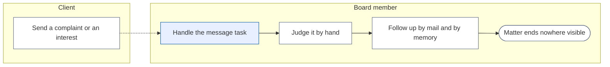
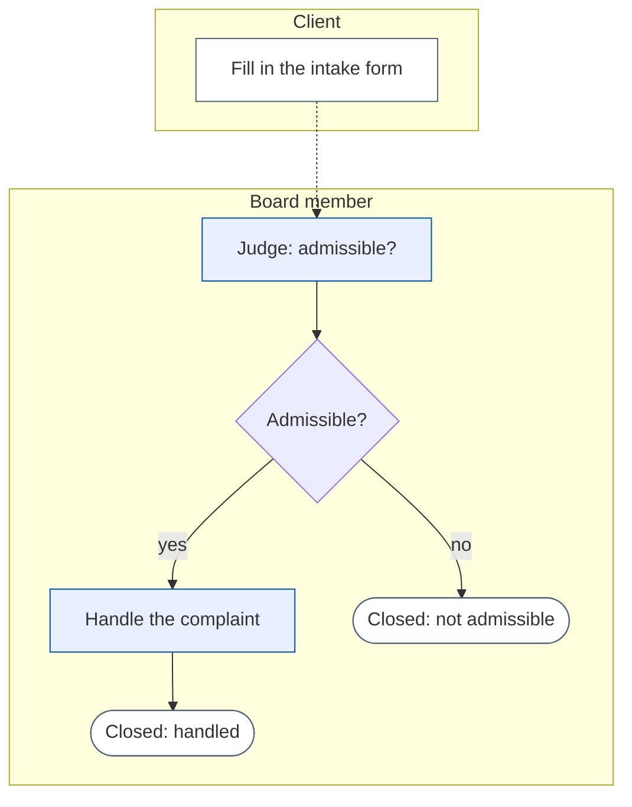
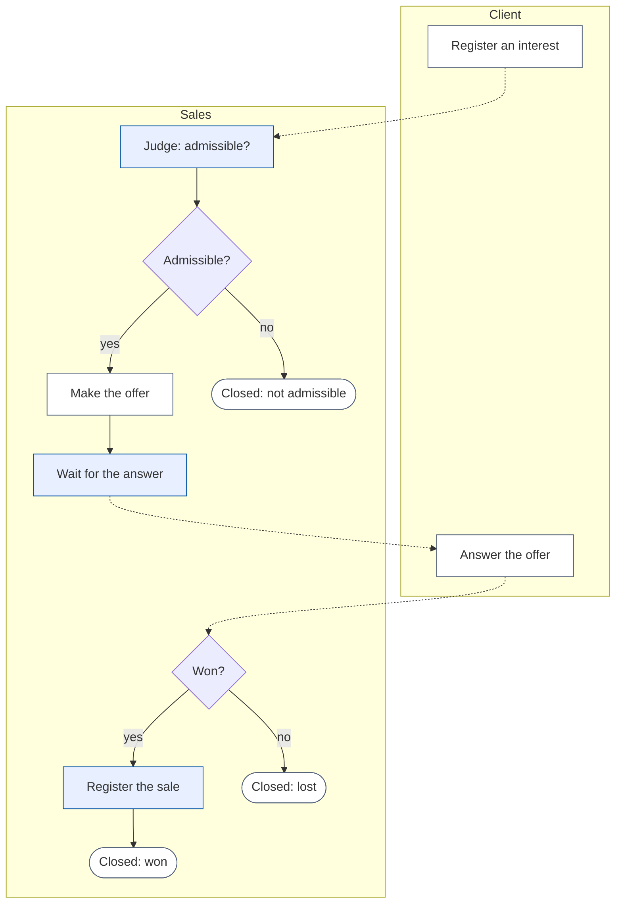

# Change Request 38 — Case Management Lite: follow a case from intake to close

**Project:** Web Portal "Raak Millegem"
**Status:** shaped with Koen on 15 October 2026 · not assigned to a release · the data model and the domain boundaries of B3 are a proposal for the architecture CLI to confirm
**Tracking issue:** #2030
**Applies to:** the workbench (`workflow`), the form engine (`forms`), a new domain `cases`, the party model (CR-26), the shop (CR-21) and activities for the sale step; the back-office menu and the public site
**Reading:** A 1 492 words · B 2 500 · C 2 259 — measured per part; A ≤ 1 500, B ≤ 2 500

---

# Part A — The business

## A1. Reason to act — the trigger

Koen, 15 October 2026: a tenant should be able to follow a **case** of any type from beginning to end, with its own workflow, without a developer. Two types are in his head and are the first two to build: a **complaint** (a claim) and an **opportunity** in a sales context; they serve a business and an association alike. Today the portal takes a message and puts one task on the workbench; it cannot follow a matter through steps, with questions and a decision, to a clear end.

## A2. As-is process — how it works today, and where it hurts

As far as I understand it (Koen to confirm): a complaint or an interest arrives as a *message*; one person gets one task *"Bericht behartigen"*; the rest happens outside the portal.

*What to see:* after the first task the matter leaves the portal.

| Step | Pain |
|---|---|
| Handle the message task | one task, one comment, no structured questions |
| Judge, follow up | nothing records whether a complaint was admissible, who handled it, or how it ended |
| The end | no closed state and no reason; nobody can say how many offers were won |

## A3. To-be process — how it should work afterwards

The **case** is the umbrella over the tasks. The workbench stays what it is, the one place where tasks are done; a case is the matter the tasks belong to, with its request, its steps and its end.

*What to see:* the intake form starts the case; each step is a task; a decision sends it on; the end says why it closed.

The opportunity:

*What to see:* the offer is made outside the portal but followed in it; registering the sale closes the case by itself.

What it says on the screen (Dutch), decided here:
- the umbrella is called **Zaak** (plural *Zaken*); the menu item in the back office is **Zaken**
- a case has a **status**: *Open* (registered, nobody has worked on it yet), *In behandeling* (being worked on), *Gesloten* (an end is reached); a closed case has a **reden**: *Behandeld*, *Niet ontvankelijk*, *Gewonnen*, *Verloren*
- on the workbench: **Nieuwe zaak**
- one menu item, *Zaken*; its button **Instellingen** opens **Soorten zaken** (new, intake form, export, import), and per type **Proces**, a list of steps like the form engine's: **Stap toevoegen** with four types, **Taak met formulier**, **Beslissing**, **Verkoop registreren** and **Einde**
- on a case: the request, a tab per step, the process drawn, the party

## A4. Benefits — what the change earns

- Every complaint and opportunity is registered and followed to a visible end (no figure).
- A tenant sets up its own case types: one tool instead of a screen per matter.
- Structured answers per step let the board count: admissible or not, won or lost.

## A5. Supplied material — and what it taught us

Koen's dictation of 15 October 2026. It taught us that the blocks exist: the workbench, the form engine and its form export and import, and the form-to-task link of the contact message. Reporting need: R13.

## A6. Business requirements — what the board asks, with MoSCoW

| # | Requirement | MoSCoW | Source | Comment |
|---|---|---|---|---|
| R1 | A tenant defines its own case types; each starts with a form | Must | Koen, 15 Oct 2026 | "elke tenant zet zijn case types op" |
| R2 | A case starts when its intake form comes in, from the public site or from the back office | Must | Koen, 15 Oct 2026 | signed in or not |
| R3 | A case is about a person, optionally an organisation the person acts for (R21) | Must | Koen, 15 Oct 2026 | needs CR-26 |
| R24 | A contact message is a case of the simplest type: handle it or not, then closed | Should | Koen, 15 Oct 2026 | |
| R20 | See and change, in the back office, who a case is about | Won't (first delivery) | Koen, 15 Oct 2026 | parked |
| R21 | One applicant block for everything a user registers for (activity, shop order, form): the person always, an organisation optionally | Must | Koen, 15 Oct 2026 | a chapter of its own (B1b) |
| R23 | A tenant setting: works with organisations or not; off hides the organisation choice | Must | Koen, 15 Oct 2026 | in CR-26 |
| R22 | The applicant of a registration, an order or a case is editable in the back office | Should | Koen, 15 Oct 2026 | cases: parked as R20 |
| R4 | A case follows a process of steps; each step is a task for a role, chosen per step in the process | Must | Koen, 15 Oct 2026 | "Aan een taak moet je natuurlijk ook rollen kunnen toekennen." |
| R5 | A step may have a form; what is filled in is kept with the step | Must | Koen, 15 Oct 2026 | |
| R6 | A decision after a step, on a field of a form, sends the case on one way or another | Must | Koen, 15 Oct 2026 | admissible or not; won or lost |
| R7 | A case has a status from a list: Open, In behandeling, Gesloten, and a closing reason | Must | Koen, 15 Oct 2026 | "een codelijst" |
| R8 | A closed step cannot be changed | Must | Koen, 15 Oct 2026 | "niet meer wijzigbaar" |
| R9 | A step can trigger a system action: registering a sale for the party; when the sale is registered, the case closes by itself as won | Must | Koen, 15 Oct 2026 | an activity registration or a shop order |
| R10 | A screen per case: the request, a tab per step, the process drawn with the current step | Must | Koen, 15 Oct 2026 | |
| R11 | A process, with its forms, can be exported and imported between environments | Must | Koen, 15 Oct 2026 | as forms can today |
| R12 | The process is stored in BPMN | Should | Koen, 15 Oct 2026 | rendered by a good renderer or as a Mermaid diagram |
| R13 | A menu item *Zaken* with the cases listed by status (open, in progress, closed), filterable by type and reason, and searchable | Must | Koen, 15 Oct 2026 | "Uiteraard moet je ook kunnen zoeken op die cases." Search: number, party name and e-mail, intake text (my proposal) |
| R14 | Dropdowns in the intake form that point at articles or activities | Won't | Koen, 15 Oct 2026 | later |
| R16 | A process drawn on a canvas by dragging shapes | Won't | my proposal | the list screen is the editor |
| R17 | A due date on a task | Won't | Koen, 15 Oct 2026 | "Due dates buiten de scope." |
| R19 | Cases in the reports | Won't | Koen, 15 Oct 2026 | "Dat is voor later." |
| R18 | A history of the status of a case, and of who completed which task when | Won't | Koen, 15 Oct 2026 | "buiten scope" |
| R15 | A screen to model a process from start to end, in the way of the form engine: choose steps, order them, choose a step type, say what a decision does with the status and which task follows | Must | Koen, 15 Oct 2026 | "een scherm om die processen van startpunt tot eindpunt te kunnen modelleren"; textual or visual |

## A7. Non-functional requirements — security, privacy, house style, tenants

| Concern | This change |
|---|---|
| **Security** | a public intake form is new input from outside, under the form engine's rules and limits; a case is seen only by the roles that handle it |
| **Privacy** | a complaint holds personal data and sensitive text; retention is Q3; CR-33's register gets the attributes |
| **House style** | screens from the kit, 390 px first; the case screen follows the workbench's norms |
| **Multi-tenant** | case types, forms and processes are per tenant; the two first types ship as examples to import |

## A8. Acceptance criteria — what the business signs off on HDEV

| # | Criterion | Requirement | Walkthrough steps |
|---|---|---|---|
| AC1 | Filling in the public complaint form starts a case with a first task | R1, R2 | fill it in signed out, then signed in |
| AC2 | A member signed in sees the person in *Wie*, not editable; the case is about that person | R3 | fill in the complaint as a member |
| AC2a | A person can choose an organisation tied to them; the case is about both | R3 | fill it in for it |
| AC3 | *Niet ontvankelijk* closes the case at once, with that reason | R6, R7 | fill the first step, pick no |
| AC4 | *Ontvankelijk* gives the handling task; closing it closes the case as *Behandeld* | R4–R7 | pick yes, handle, close |
| AC5 | A finished step shows its answers and cannot be changed | R8 | open a done step |
| AC6 | The opportunity runs to *Gewonnen* by registering a sale, to *Verloren* by a lost answer | R6, R9 | walk both |
| AC7 | A case can be started from the workbench for a chosen party | R2 | *Nieuwe zaak* |
| AC11 | *Instellingen* opens the case types, each with form and process | R1, R15 | open it |
| AC8a | *Zaken* lists cases with status; a search finds one by number, name or a word of the intake | R13 | search |
| AC8 | The case screen draws the process with the current step | R10 | open a running case |
| AC9 | A process exported from one environment imports into another with its forms | R11 | export, import |
| AC10 | A process made in the screen runs, and the drawing matches | R15 | build the complaint process and run it |

---

# Part B — The solution, for whoever approves it

## B1. Solution outline — the solution and the decisions that shape it

**A case is the umbrella over a process.** Three new things, all data, none code per type:
1. **Case type**: a name, an intake form, and a **process**.
2. **Process**: a BPMN 2.0 diagram, stored as such, in a small agreed subset: a start (the intake form), tasks (a role, an optional form), exclusive gateways (a choice on a field of an earlier form), a system action (register a sale), and ends (each with a closing reason). The workbench draws it; Mermaid is the fallback of the diagram (Q1, C8).
3. **Case**: one running process, about a party, with a status and, when closed, a reason, both code lists.

**The workbench stays the place where tasks are done.** A step of a case is an ordinary workbench task; it can carry a form, and closing it moves the case on.

Five decisions:
- **Status**: *open* = no step done yet; *in progress* = at least one step done (a task has no "started" state, Q6); *closed* = an end reached, with a reason. The tasks define it, and both lists are code lists (Koen, 15 Oct 2026).
- **A step with a form is filled in, closed, then fixed**, as an attached submission of the form engine.
- **A decision is a rule on one field**: a choice question equals an option.
- **The sale step is a task with a button** that opens the existing screen for an activity registration or a shop order with the party filled in; registering the sale closes the step and the case, as *won*. I read "triggert een systeemactie" this way (Q2).
- **A process screen, as a list** (R15): steps in order, each with a type; the screen writes the BPMN, so the stored process is always standard BPMN, its layout generated. The first two types ship ready-made. B1a analyses the options.

### B1a. The process screen — the options

| Option | How it works | For | Against |
|---|---|---|---|
| A. A list of steps (recommended) | as in the form engine: add a step, pick its type and where it goes next; a decision has a list of rules | same way of working as the forms; fits a phone; no library | no free drawing |
| B. A canvas (bpmn.io modeler) | drag shapes | the real BPMN modeller | a large library, a logo licence (unverified), poor on a phone, shapes the engine does not run |
| C. Text (BPMN XML or Mermaid) | the author types it | cheapest; exact | not for a board member |

**Step types in option A**, each a row in the list:
- **Taak met formulier**: a title, a role, an optional form (the answers are fixed when the task is done), and *next step*.
- **Beslissing** (automatic, no person): rules *if the field F of form X is option O, then go to step N and optionally set the status to S*, and one *otherwise* route. This is what Koen calls the automatic step. It is a BPMN exclusive gateway.
- **Verkoop registreren**: a task with a button to register an activity registration or a shop order for the party; when the sale is registered the step is done by itself.
- **Einde**: the status *closed* and a reason from the list (*Behandeld*, *Niet ontvankelijk*, *Gewonnen*, *Verloren*, or the tenant's own).

The screen refuses a process with no start step, a step that nothing leads to, a step with no way on, or no end. A loop back (rework) is allowed. A status set on a route comes from the status list; if none is set, the status follows the rule of C4.2.

### B1b. The applicant block — a pattern of its own

Koen: the block is "reusable tussen die drie" (activity registration, shop order, form), "los van deze change request". It is one value, **who it is for**: the person, optionally an organisation the person acts for, and the contact details copied at that moment. The party model (`mdm`) owns it; registration, order (CR-34's buyer copy is this shape plus an address) and case store the same shape. One kit macro shows it in three modes: signed in (from the session, not editable, a choice of the person's organisations), signed out (name, e-mail, phone), back office (any person or organisation). Detail: C4.8; who builds it when: Q7. The organisation choice shows only where the tenant works with organisations (R23; proposed default off).

*Not the final form:* B3 puts cases in a new domain; the architecture CLI may place them in `workflow`.

## B2. Fit with the process and the requirements — for the business

Covers R1–R13. Use, the complaint: *Klacht indienen* → intake form → case *Open*, task *Beoordeel ontvankelijkheid* (*ja/nee*, a motivation) → *ja*: task *Behandel de klacht* → closed *Behandeld*; *nee*: closed *Niet ontvankelijk*. The opportunity: *Interesse tonen* (a dropdown, remarks) → *Beoordeel* → *Maak een offerte* (by hand) → *Wacht op antwoord klant* (*Gewonnen? ja/nee*) → *ja*: *Registreer verkoop* → closed *Gewonnen* once the sale is registered; *nee*: closed *Verloren*.

## B3. The whole across the modules — for the architect

A proposal for the architecture CLI to confirm.
- **`cases` (new domain)** owns the case type, the case (party, type, status, reason, started, closed), the case's steps (a link to the workbench task and to the attached submission) and the process (BPMN text, per tenant). It consumes `workflow.api` (tasks), `forms` (intake submission, attached answers), `mdm` (the party, CR-26) and publishes `CaseClosed`.
- **`workflow`** keeps the task and the workbench. It gains a task *form* (the slug) and a way to hand a finished task to `cases` instead of walking its own step list. Its linear step list (`WorkflowDefinition.steps`, used by the contact message) is replaced by a one-step BPMN process in the last phase, so there is one engine; until then both exist and that is said.
- **`forms`**: a form can be linked to a case type (*when this form comes in, start this case*). It already offers the intake event and the attached answers; the link is one field.
- **`activities` and `sales` (CR-21)** publish an event when a registration or an order is made from a case's screen, carrying the case's number as an opaque value; they import nothing from `cases`.
- **Party (CR-26)**: a case holds a person and optionally an organisation (a person acting for it). The intake form gets one block *Wie*, the block of CR-26's checkout (*voor mezelf* / *namens*): signed in, the person comes from the session and is not editable; signed out, name, e-mail and phone are asked and the person is not a party (as a guest buyer in CR-34); in the back office, a search over every person and organisation. Changing who a case is about afterwards is parked (R20).

## B3a. Standards the model follows — and where it deviates, on purpose

Checked on 15 October 2026 (Koen: "laten we het warm water niet opnieuw uitvinden"): **BPMN 2.0** for the process, our additions as extension attributes; **CMMN** for its words only (status, outcome, milestone), not its model; **DMN** is the shape if the rules grow; **UBL 2.1 / EN 16931** says nothing on cases, and for the applicant the party is `cac:Party` with `cac:Contact` (the person) and `cac:PartyLegalEntity` (the organisation), as in CR-34. The reasoning is in C4.9.

## B4. Rules this change needs an exception from — decided once, here

| Rule (where) | What the design does instead | Mechanism | Temporary until … / the new rule | Decided |
|---|---|---|---|---|
| `workflow.SubjectType` is a closed list a definition cannot extend (`workflow/models.py:41`) | a case is a new subject, `case` | one code row and one enum member | permanent: a subject type is code, a case type is data | proposal, not yet put to Koen |
| One engine (the duplication rule in `AGENTS.md`) | the step list of `bericht` and the BPMN engine exist side by side until the last phase | phase 5 replaces the step list | until phase 5 | proposal, not yet put to Koen |

## B5. Cost — investment and running cost, and what operations must know

About 28 days (my estimate), with the process screen and without CR-26's own work. Running cost: rows per case, step and answer. Operations: the two first processes are imported on each environment; a process may be changed while cases run (B9).

## B6. Phasing — shippable phases, and what changes on the failure paths

| Phase | Content | Days |
|---|---|---|
| 0 | case type, case, status and reason lists, the intake from a form (public and back office), the first task, the party, the case list and screen without the diagram | 6 |
| 1 | the steps: a form per task, fixed after closing, gateways on a field, ends with a reason; the complaint runs end to end | 6 |
| 2 | the diagram on the case screen; export and import of a process with its forms | 4 |
| 3 | the process screen: the list, the four step types, the rules, the checks, the BPMN written and read back | 6 |
| 4 | the sale step for both kinds of sale, the opportunity runs end to end | 3 |
| 5 | the contact message becomes the case type *Bericht* on the one engine (C4.10) | 3 |

Failure paths: a decision with no matching rule and no default, or a changed process that lost the case's last done step or its route, stops the case with a task for ADMIN ("cannot continue"); a sale made from a case's screen but never registered leaves the step open; an import that refers to a form the environment lacks is refused whole.

## B7. Rule and gatekeeper — what this fixes for all future work

A matter followed over several steps is a case of a type, not a new table and screen. A gate: a task with a form cannot be closed without a valid submission; a closed step's answers cannot change.

## B8. Open decisions — what the approver still decides

| # | Question | Recommendation | What the answer changes |
|---|---|---|---|
| Q1 | How is the process drawn: a BPMN viewer (bpmn.io; its licence requires its logo, unverified), or a Mermaid diagram made from the BPMN? | prototype both (C8); Mermaid if the logo is unacceptable | the renderer |
| Q2 | Is registering a sale a button on the task that opens the existing screen (my reading), or does the portal register it itself? | the button: a person chooses the article or activity and the amount | phase 4 |
| Q3 | How long is a closed case kept? | a number of years, a tenant setting; the legal period is unverified | a setting and a purge |
| Q4 | Which role handles a complaint, which an opportunity? | ADMIN; Verkoop (CR-21) | the role in two processes |
| Q5 | Is the case's number visible to the client, so a client can ask about it? | yes, a number on the confirmation mail | a field and a mail line |
| Q6 | Is a case *in progress* from the first step done, or from the moment a person opens its task? | the first step done: a task has no started state and the workbench would need one | a started state on a task, or nothing |
| Q7 | Who builds the applicant block, and when does an activity registration adopt it? | made once in CR-26's phase 2 for the checkout, used by the case intake, adopted by the registration in an issue of its own | no second block; no change to the registration form here |
| Q8 | Do messages already received become closed cases? | no, only new ones | a one-off import |

## B9. Decisions log — dated answers

| Date | Decision | By |
|---|---|---|
| 15 Oct 2026 | Requirements R1–R14 as written in A6 (dictation, not an answer to a question) | Koen |
| 15 Oct 2026 | The statuses of a case are a code list: *open*, *in progress*, *closed* | Koen: "Misschien moeten we de statussen die een case heeft vastleggen, dat dat een codelijst is. Open, in progress, closed." |
| 15 Oct 2026 | The workbench stays a view on tasks; the case is the umbrella above it | Koen: "Dus de werkbank blijft een visualisatie van de taken, maar daar zit dus een koepel boven en dat is de case." |
| 15 Oct 2026 | A screen to model a process from start to end is part of this change, in the way of the form engine; the earlier proposal of ready-made types without an editor is withdrawn | Koen: "dat er dus ook een scherm is om die processen van startpunt tot eindpunt te kunnen modelleren. […] in een textueel scherm zoals de Form Engine" |
| 15 Oct 2026 | Standards: look at CMMN and others before inventing; the analysis stands in B3a | Koen: "laten we dan het warm water niet opnieuw uitvinden" |
| 15 Oct 2026 | Every task of a process is given a role; due dates are out of the scope | Koen: "Aan een taak moet je natuurlijk ook rollen kunnen toekennen. Dat ben ik juist vergeten te zeggen. [...] Due dates buiten de scope." |
| 15 Oct 2026 | A history of the status and of who completed which task when is out of the scope | Koen: "Ook buiten scope is historiek op status meten van wie welke taak wanneer voltooid heeft. Oké, dat gaat het misschien automatisch hebben, maar dat nemen we allemaal buiten scope." |
| 15 Oct 2026 | The case types are managed through a button *Instellingen* on the *Zaken* list, so there is one menu item, not two | Koen, who left the choice open ("kies maar"): "Ik denk bij cases is het voor mij goed dat we misschien de knop instellingen voorzien op de cases menulijn. Dat we daar de processen kunnen definiëren." |
| 15 Oct 2026 | Processes and forms may be changed while cases run; no versions and no protection of running cases; a case keeps its status and last done step; the forms' own protection stays | Koen: "Zolang dat ze maar hun status en hun vorige stap nog weten, dan kunnen we verder. Dus we gaan daar geen oplossingen voor voorzien […] Dat is voor later." |
| 15 Oct 2026 | Integration of cases in the reports is out of the scope | Koen: "ook integreren in de rapporten. Dat is voor later." |
| 15 Oct 2026 | Who a case is about: the *Wie* block (B3). Seeing and changing it afterwards in the back office is parked, out of the first delivery | Koen: "Parkeer dat maar even als een requirement […] uit de scope vallen […] van de eerste oplevering."; "In de back-office kan men elke natuurlijke persoon en elke organisatie selecteren." |
| 15 Oct 2026 | The applicant block is a pattern of its own, reusable for activity registration, shop order and form, always the person and optionally an organisation, editable in the back office; handled in this change request as a separate chapter and requirement; the modelling is left to me | Koen: "Ik leg het aan jou om te modelleren hoe je dat bouwt. […] Eigenlijk staat dat zelfs los van deze change request. Dus behandelt het in deze change request als een apart hoofdstuk, een apart requirement" |
| 15 Oct 2026 | Working with organisations is a tenant setting, off for a Raak department; it belongs in CR-26, which the architecture CLI owns | Koen: "dat is een optie die we moeten kunnen aangeven, of dat je met parties kunt werken of niet." |
| 15 Oct 2026 | The contact message is a case of the simplest type | Koen: "het contactformulier is eigenlijk ook een case. […] Afhandelen of niet afhandelen. En dan is gesloten." |

---

# Part C — The build, for the master CLI and the dev CLIs

## C1. Verified premises — measured before the handover

Measured on master @ `ef4b130c` on 15 October 2026 (CR-21 and CR-26 are not on master; read from their branches); a build read is still to come, and the table is to be re-measured at the handover.

| Concept or claim | Kind | Measurement | Verdict | Consequence |
|---|---|---|---|---|
| A workflow definition is a linear list of steps in JSON; `advance` goes to the next step | changes | `workflow/models.py:140–158`, `api.py:285` | must change | gateways need a graph; phase 5 retires the list |
| A task has a role, a title, a subject, a free-text `decision`, no form | changes | `workflow/models.py:86–135` | must change | a form slug on the task |
| `SubjectType` is a closed list of four | changes | `workflow/models.py:41` | must change | add `case` (B4) |
| `complete_task` closes the task and advances the instance in one commit | relies on | `workflow/api.py:301` | holds | a case step completes through it |
| A contact submission starts the `bericht` definition by event | relies on | `SubmissionCreated`, `workflow/handlers.py` | holds | the generic start reads a form → case-type link instead |
| The form engine stores answers of another record as an attached submission under the form's own rules, and updates them | relies on | `SubmitAttached`, `UpdateAttached` in `forms/CONTRACT.md` | holds | fixing a closed step = refusing `UpdateAttached` for it |
| A form definition exports and imports as JSON | relies on | `forms/admin_ui.py:723, 907`; `forms/service.py:1102, 1517` | holds | the process export bundles it |
| The board can register for an activity | relies on | `board_register_for_activity` (activities) | to verify | the case screen links to it with a case number |
| The shop's back-office order and the role Verkoop | relies on | CR-21 on `cr21/webshop` | not on master | phase 4 waits for CR-21 |
| The party model: person, household, organisation; an account's *Mijn organisatie* | relies on | CR-26 on `claude/cr-26-party-model` | not on master | phases 0 and later wait for CR-26 phase 2 |
| Roles are ADMIN, FINANCE, OPERATOR, ACCOUNT_ADMIN | relies on | `auth/models.py:28–31` | to verify with CR-24 (roles as bundles) | Q4 |

## C2. Per module: what must happen

- **cases (new)**: tables `case_types`, `cases`, `case_steps`, `processes` (BPMN text per type, versioned), code lists `case_status` (*open*, *in_progress*, *closed*) and `case_close_reason` (*handled*, *not_admissible*, *won*, *lost*; a tenant's process may name its own, as codes in the BPMN end event); an engine that reads the BPMN subset (start, user task, exclusive gateway with a rule on one field, service task `register_sale`, end event with a reason); a facade `start_case`, `case_of`, `list_cases` (filters and a search term); events `CaseStarted`, `CaseClosed`; the case screens and the *Zaken* menu; export and import of a process with its forms; the process screen (C4.6).
- **workflow**: a `form_slug` on a task; the hand-over of a finished task to `cases`; `SubjectType.CASE`; phase 5 replaces the step list.
- **forms**: the link *form → case type*; the intake handler; a refusal to update the answers of a fixed step.
- **activities, sales**: an event on a registration or an order made from a case's screen, with the case number as an opaque value.
- **mdm**: reads only (the party), after CR-26.

## C3. Cross-cutting impact — the checklist of what gets forgotten

- Every reader of `SubjectType` and of the workbench's `subject_url` (the workbench must find the way to a case).
- The seeded `bericht` definition of each tenant and `can_handle_messages`.
- CR-33 register: the case, the steps and the answers are personal data; the retention (Q4).
- CR-24 rights: a right per case type or one right for cases; `docs/rollen-en-rechten.md`.
- CONTRACT.md of `cases`, `workflow`, `forms`; `docs/architecture.md` (a domain, two figures).
- The public intake form's limits and spam brake, as the contact form has.
- Alembic: one migration per phase; head counted before the push.

## C4. Detailed decisions — one subsection each, with the reasons

**C4.1 The BPMN subset.** `startEvent`, `userTask`, `serviceTask`, `exclusiveGateway`, `sequenceFlow` with an optional rule, `endEvent`. Extension attributes (namespace `raak`): `role`, `form`, `action`, `when="<form>|<question>=<option value>"`, `reason`. A form's question has no code of its own, so a rule names it by its label: renaming the question breaks the rule. A stable `code` on a question is a point for the build read. Anything else is refused at import with the element named.

**C4.2 Status.** `open` at start; `in_progress` when the first step is done; `closed` at an end event with its reason. Closing is one transaction with the last step.

**C4.3 The sale step.** A `serviceTask` with `action="register_sale"` creates a workbench task with a button. The screens of both kinds of sale accept a case number and the party; their event carries both; `cases` records the link and completes the step, which reaches the end event *won*.

**C4.4 Start from the workbench.** *Nieuwe zaak* lists the case types that have an intake form; it opens the form in the back office on behalf of a chosen party or contact details.

**C4.5 Fixing.** A step's submission is updatable until its task is done; after that `UpdateAttached` is refused.

**C4.6 The process screen.** One page per case type, `/admin/zaken/instellingen/<type>/proces`, a list of steps like the form builder's (htmx, kit macros). The screen holds a small model (steps, type, role, form, routes with rules and status) and writes BPMN with generated layout; opening it reads the stored BPMN back into the same model, and a BPMN that the screen cannot read (an import with elements outside the subset) is refused at import, so the two never disagree. Saving runs the checks of B1a and is refused with the step named. A process may be changed while cases run: a case keeps its status and its done steps, and goes on from the last done step in the changed process; if that step or its route is gone, the failure path of B6 applies. No version is kept.

**C4.8 The applicant block.** Value: `person_party_id` (set whenever the person is signed in or chosen), `organisation_party_id` (nullable), and the copy taken at that moment: name, e-mail, phone (a guest has the copy only and no party; an order adds its address and VAT number as in CR-34). Owner: `mdm.api` returns the view-model for a mode (`session`, `guest`, `staff`) and checks a posted value: the person of a signed-in mode is the session's and cannot be posted otherwise; an organisation must be tied to the person (CR-26); `staff` may choose any, under the back-office right of the screen. Consumers: `activities.registrations` (has `person_id` and `contact_*` today; gains the organisation), `sales` orders (CR-21, CR-34's buyer copy) and `cases`. Each stores its own columns; none imports another. One kit macro `applicant_block` renders the three modes, and leaves out the organisation when the tenant does not work with organisations (R23); a gate counts that the three entrances use it.

**C4.9 Standards, in full.** **BPMN 2.0 (OMG)** for the process: start and end events, user and service tasks, exclusive gateways, sequence flows. Our additions (role, form, action, closing reason, status) are extension attributes in our own namespace, as the standard allows. It fits: the two first processes are sequences with decisions. **CMMN (OMG Case Management Model and Notation)** is the standard for cases, but for flexible knowledge work: plan items that become available, enabled and active under *sentries*, discretionary tasks a person adds while working, *milestones*, a case file. Its case lifecycle ends in *completed* and *closed*. We **borrow its words, not its model**: the status list (*open*, *in progress*, *closed*) and the closing reason are CMMN's idea of a case with an outcome, and a milestone is what *in progress* marks. Its flexibility (a person adds tasks as the case unfolds) is not asked for; the Camunda 7 and CIB seven documentation support a subset and no planning. A later need for ad-hoc tasks is a reason to look at CMMN again. **DMN (OMG decision tables)** is the standard for the rules of a decision. Our rule is one field equal to one option; if rules grow, DMN is the shape, plugged into *Beslissing*. **UBL 2.1 / EN 16931** describe documents (invoice, order), not cases or processes: nothing in them applies here. The party is CR-26's.

**C4.10 The contact message as a case.** It fits without a new concept: intake form `berichten`; one user task (role ADMIN, the form *Afhandeling* with a choice *Afhandelen* / *Niet afhandelen*); a decision on that choice; two ends, *Afgehandeld* and *Niet afgehandeld*. What changes: `SubmissionCreated` starts the case through the generic form → case type link, not the `bericht` definition; `seed_message_workflow` and `can_handle_messages` become the seeded type *Bericht* and its check; a deleted submission closes its case with an end reason *Verwijderd* (the old `SubmissionDeleted` closing). The sender is mostly signed out: the contact form's own name and e-mail questions give way to the applicant block (R21), which is a change to the form. Messages already received stay as they are (forms results and finished tasks); only new ones become cases (Q8).

## C5. Privacy and security — the mechanics behind A7

A public intake form takes free text from outside: the form engine's validation and brake; the case is visible to the role of its tasks and to ADMIN of the tenant; the case's answers are never put in a mail beyond the confirmation. Import is allowed to ADMIN only.

## C6. Tests — what the build must prove

| # | Test |
|---|---|
| T1 | an intake form linked to a type starts a case with the first task, signed in and signed out |
| T2 | the gateway sends on by a field's option; an unmatched value with no default stops the case with a task |
| T3 | a task with a form cannot be closed without a valid submission |
| T4 | a closed step's answers cannot be updated |
| T5 | status goes open → in progress → closed; the reason is set at the end only |
| T6 | registering a sale from a case's screen completes the step and closes the case as won |
| T7 | a sale made elsewhere for the same party does not close the case |
| T8 | export then import of a process and its forms into an empty tenant gives the same process; an import with a missing form is refused whole |
| T10 | a BPMN element outside the subset is refused with its name |
| T11 | the contact message starts its task (before phase 5), and becomes a case of the type *Bericht* with that task (after) |
| T23 | a case of type *Bericht* closes as *Afgehandeld* or *Niet afgehandeld* by the choice, and as *Verwijderd* when its submission is deleted |
| T12 | a task of another tenant's case is not visible |
| T18 | signed in as a member, the case is about that person and the block cannot be edited; the form cannot be sent with another person |
| T19 | signed in, choosing an organisation of the person gives a case about both; an organisation of someone else is refused |
| T20 | in the back office any person and organisation can be chosen |
| T22 | a tenant that does not work with organisations shows no organisation choice, in any of the three modes, and refuses a posted organisation |
| T21 | the three entrances (activity registration, shop order, form) render the one `applicant_block` macro (a gate; an additive violation, a fourth entrance with its own fields, fails it) |
| T17 | *Zaken* filters by status, type and reason, and finds a case by number, party name, e-mail and a word of the intake answers |
| T13 | a process made in the screen is written as BPMN and read back to the same list (round trip) |
| T14 | the screen refuses a process with no end, a step nothing leads to, or a step with no way on, naming the step |
| T15 | a case whose process was changed keeps its status and done steps and goes on from its last done step; if the route is gone it stops with a task for ADMIN |
| T16 | a route that sets a status moves the case to it; a route that sets none follows the derived rule |

## C7. The gate — what refuses a deviation from now on

A gate that every `userTask` of a seeded process names a role that exists and a form that exists, proved with an additive violation (a task naming a role that is not there).

## C8. Prototype findings — what was measured before the build

Not yet taken: draw the two first processes with bpmn.io's viewer and as Mermaid, and look at both on a phone; check the viewer's licence text.

## C9. Screens before the build — the concepts the approver saw

Not yet made, at 390 px: the process screen (the list of steps, a decision with its rules), the *Zaken* list, the case screen (the request, the tabs, the diagram), *Nieuwe zaak* on the workbench, the task with its form, the public complaint form.

## C10. Close-out at the release

Status line, as-built notes folded in, tracking issue closed (`CLAUDE.md` step 14).

## Q&A log — asked once, answered here

| Q&A | Date | Question | Status |
|---|---|---|---|
| — | 15 Oct 2026 | Q1–Q6 of B8 go into a Q&A file for Koen | open |

## Non-goals — deliberately outside this change

Due dates on tasks; a history of statuses and of who did what when (beyond what a task already keeps); protection of running cases against a changed process (versions, refusals); cases in the reports; a canvas editor with dragging of shapes; dropdowns of articles or activities in an intake form; conditions other than a field equal to an option; parallel steps, timers, messages between cases and sub-processes; assigning a task to a person (a task goes to a role); a client portal showing the case to the client.

## Relationship to existing work — issues and change requests

Builds on the workbench (CR-05's sibling work in `workflow`, #403) and the form engine (CR-14). Needs CR-26 (party model) for the party and CR-21 (webshop) for the sale step. CR-24 (rights) and CR-25 (back office) shape the menu and the roles; CR-33 (attribute register) gets the entries.
