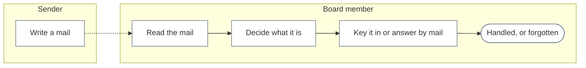
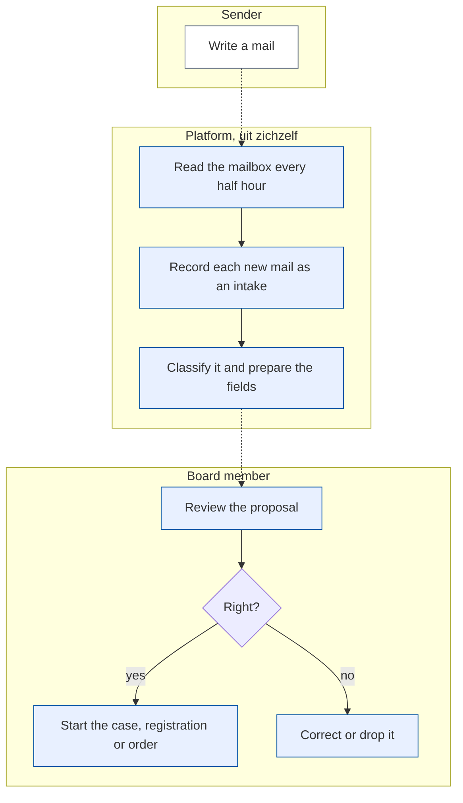

# Change Request 39 — The first AI agent: it reads a mailbox and prepares the intake

**Project:** Web Portal "Raak Millegem"
**Status:** opened with Koen on 15 October 2026 · a study first: Part B is a frame with open questions, Part C is not written · not assigned to a release
**Tracking issue:** #2031
**Applies to:** a new idea, *agents* (a periodic job with a purpose); the mail domain (reading a mailbox), the chatbot's provider seam and its guard, the cases of CR-38, the party model of CR-26, the shop (CR-21) and activities as targets
**Reading:** A 927 words · B 923 · C 418 — measured per part; A ≤ 1 500, B ≤ 2 500

---

# Part A — The business

## A1. Reason to act — the trigger

Koen, 15 October 2026: the platform should be able to run **agents**, each doing one task at fixed times. The first one reads a **mailbox** that is set up for it. Mails arrive from people who want to register for an activity, buy articles (t-shirts), buy helmets for a company, complain (which may lead to a credit note), or show interest in what the association or the shop offers. The agent reads the new mails every half hour, says what each one is, fills in as much as it can of the request, and finds out who wrote it. Nobody should have to read every mail first to know what to do with it.

One condition outweighs the others, in Koen's words: no e-mail addresses, VAT numbers, national register numbers, names of persons, names of companies or bank account numbers may travel to an AI model, "zelfs niet in Europa". And because the subject is new and large, Koen wants this change request to include a **study**: four to eight hours of working through models, prompting, security, privacy and law together, before anything is built.

## A2. As-is process — how it works today, and where it hurts

As far as I understand it (Koen to confirm): a mail arrives in a mailbox; whoever reads it decides what it is and keys it in by hand, or answers it by mail.

*What to see:* every step is by hand, and nothing records that the mail came in.

| Step | Pain |
|---|---|
| Read, decide | every mail is read in full to find out what it is; nobody tracks which are open |
| Key in | the same data is typed again into a registration, an order or a case |

## A3. To-be process — how it should work afterwards

*What to see:* the platform reads, records and proposes; a person decides. The agent never starts anything on its own.

What it says on the screen (Dutch) is not decided yet; it follows the study (Q9).

## A4. Benefits — what the change earns

- No mail is read twice or forgotten: every one is an intake with a status (no figure; to be counted after a month).
- The retyping stops: a proposal arrives with its fields filled.
- A first agent shows what the platform can do next, with the privacy rule fixed once.

## A5. Supplied material — and what it taught us

Koen's dictation of 15 October 2026. What it taught us from the code: the assistant of CR-07 already has a provider seam with an independent guard that refuses names, e-mail addresses, phone numbers and IBANs before a call leaves, a log of every outgoing call, daily budgets and a provider in Europe. The first findings of the study are in the study note kept with Koen's material outside the repository. Reporting need: counts of intakes per kind and per outcome.

## A6. Business requirements — what the board asks, with MoSCoW

| # | Requirement | MoSCoW | Source | Comment |
|---|---|---|---|---|
| R1 | The platform can run agents, each doing one task at set times | Must | Koen, 15 Oct 2026 | "agents kunnen maken in het platform die op periodieke tijdstippen een activiteit uitvoeren" |
| R2 | The first agent reads a mailbox every half hour and picks up the new mails | Must | Koen, 15 Oct 2026 | a mailbox made for it |
| R3 | Every received mail is a visible *mail intake* with its status | Must | Koen, 15 Oct 2026 | |
| R4 | The agent says what a mail is: a registration for an activity, an order of articles, an order of articles by a company, a complaint (possibly with a credit note), an interest in what is sold, or none of these | Must | Koen, 15 Oct 2026 | the list of kinds is open (Q3) |
| R5 | The agent fills in as many fields as it can of the request the mail leads to (a claim, an opportunity, a registration, an order) | Must | Koen, 15 Oct 2026 | needs CR-38 and the party model |
| R6 | The agent finds who the sender is, from the address and from a name in the mail | Should | Koen, 15 Oct 2026 | "met respect voor de privacy" |
| R7 | No e-mail address, VAT number, national register number, name of a person or company, or bank account number goes to an AI model, not even in Europe | Must | Koen, 15 Oct 2026 | the condition of the whole change |
| R8 | This change request includes a study of models, prompting, security, privacy and law before the build | Must | Koen, 15 Oct 2026 | four to eight hours together |
| R9 | A person decides before anything is started from a mail | Must | my proposal; Q2 | the agent only proposes |

## A7. Non-functional requirements — security, privacy, house style, tenants

| Concern | This change |
|---|---|
| **Security** | a mail comes from anyone and is untrusted input: a mail may try to instruct the model; the agent has no power to act, only to propose (B1) |
| **Privacy** | a mail holds personal data of a person who did not use a form; R7; retention of intakes and of the mail text is Q6 |
| **House style** | the intake screens follow the kit and the workbench; 390 px first |
| **Multi-tenant** | agents and mailboxes are per tenant; the model and its budget are the platform's choice and the tenant's switch |

## A8. Acceptance criteria — what the business signs off on HDEV

Not written yet: they follow the study. Three are fixed by R7 and R9: the outgoing call of a test mail holds none of the listed data (read in the call log), nothing is started without a person, and a mail that tries to instruct the model changes nothing.

---

# Part B — The solution, for whoever approves it

## B1. Solution outline — the solution and the decisions that shape it

A frame, to be filled by the study. Four principles are proposed now.

1. **An agent is a periodic job with one purpose, a switch, a budget and a log.** It runs on the job queue the platform already has (`kernel_jobs`), per tenant, and it can be switched off at once.
2. **The agent proposes; a person decides.** A mail intake becomes a *proposal* (a draft case, registration or order, with its fields), reviewed on the workbench. Nothing is sent, started or credited by the agent. This also keeps the rule of the GDPR on decisions taken only by a machine out of the picture (unverified).
3. **The model never sees what R7 lists.** Which way is the heart of the study: (a) a model that runs on the association's own server, so nothing leaves; (b) the text is cleaned of the listed data first and an EU model reads the cleaned text; (c) a plain local classifier for the clear cases and a model only for the rest. The chatbot's seam and its independent guard stay the last line either way.
4. **The model has no tools.** It receives text and answers in a fixed shape (a category from a list and typed fields); the answer is checked and anything else is refused. A mail that says "ignore your instructions" can at most make the proposal wrong, and a person reads it.

Sender identification (R6) is done by the platform against its own data, never by the model: the address is looked up exactly, and a name found in the text is matched locally.

## B2. Fit with the process and the requirements — for the business

Covers R1–R7 and R9; R8 is the study. The relation to the other changes: the targets are the cases of CR-38 (a complaint, an opportunity), the party of CR-26, an order of CR-21 and an activity registration.

## B3. The whole across the modules — for the architect

Not written: a proposal waits for the study. Known inputs: `mail` (reading a mailbox, a new capability), `chatbot` (the seam, the guard, the log, the provider and its budgets), `workflow` (the review task), `cases` (CR-38), `mdm` (matching), `kernel` (jobs). A new domain for agents or a place in `chatbot` is a question for the architecture CLI.

## B3a. Standards the model follows — and where it deviates, on purpose

To study: IMAP and its OAuth 2.0 access, MIME and the threading headers of e-mail (RFC 5322), SPF, DKIM and DMARC for the sender's identity, and the data protection rules named in the study note. Nothing is decided.

## B4. Rules this change needs an exception from — decided once, here

None known yet. One to watch: the rule that no personal data goes to a model outside the EU (Europe First) is stricter here, so the exception is the other way round.

## B5. Cost — investment and running cost, and what operations must know

Not estimated: it depends on the choice in B1 (an own model needs a machine; a cleaned call to an EU model costs per mail). The study measures both.

## B6. Phasing — shippable phases, and what changes on the failure paths

A proposal, to be refined: phase 0, the mailbox reader and the intake object with no model (every mail recorded, classified by hand); phase 1, the classifier in *shadow* (it proposes, nobody sees, the board compares); phase 2, the proposals reviewed on the workbench; phase 3, the target proposals (case, registration, order). Failure paths: a mailbox that cannot be read, a model that does not answer, a mail the cleaning cannot process, each ends in an intake marked for a person.

## B7. Rule and gatekeeper — what this fixes for all future work

A gate: no outgoing call to a model carries what R7 lists, tested with seeded mails; and a rule for every later agent: it proposes, it has no tools that act, and it goes through the one seam.

## B8. Open decisions — what the approver still decides

| # | Question | Recommendation | What the answer changes |
|---|---|---|---|
| Q1 | Where does the model run: own server, an EU model on cleaned text, or a split? | decide after the study's measurements | cost, quality, privacy |
| Q2 | May the agent ever act without a person, for the kinds with no risk (for example filing an interest)? | no, in this change | R9 |
| Q3 | Which kinds of mail does it recognise, and what does each lead to? | the six of R4, reviewed with real, anonymised examples | the classifier and the targets |
| Q4 | Which mailbox and which provider, and how does the agent get in? | an own mailbox at an EU provider, with a password only the portal knows or OAuth | the reader |
| Q5 | How does the agent show a person a mail for review without that person's data going further than the board? | a workbench task with the mail text, as the messages today | the screens |
| Q6 | How long are an intake and its mail text kept? | a short period after it is handled, a tenant setting | a purge |
| Q7 | How good must it be before it is used? | a measured agreement with the board's own reading on a set of real mails, in shadow mode | the go-live |
| Q8 | Are attachments read? | no, in this change | the reader |
| Q9 | What does the screen say? | after the study | A3 |

## B9. Decisions log — dated answers

| Date | Decision | By |
|---|---|---|
| 15 Oct 2026 | Requirements R1–R8 as written in A6 (dictation, not an answer to a question) | Koen |

---

# Part C — The build, for the master CLI and the dev CLIs

## C1. Verified premises — measured before the handover

Not written yet. Measured so far, on master @ `ef4b130c` on 15 October 2026: the provider seam, its independent guard and the call log exist in `chatbot` (`seam.py`, `CONTRACT.md`); the provider is a plain httpx call to Mistral; nothing in the code reads a mailbox (no IMAP or POP).

## C2. Per module: what must happen

Not written yet.

## C3. Cross-cutting impact — the checklist of what gets forgotten

Known so far: the CR-33 register (a mail is personal data, an intake is a new record), the privacy statement, CR-24 rights for who reviews, and the guard's rule set for this capability.

## C4. Detailed decisions — one subsection each, with the reasons

Not written yet; they follow the study.

## C5. Privacy and security — the mechanics behind A7

Not written yet. The study note holds the first findings on cleaning personal data from free text, on prompt injection and on the legal frame.

## C6. Tests — what the build must prove

Not written yet. Fixed by R7 and R9: a mail with each listed kind of data (address, VAT number, national register number, a name, a company, an IBAN) produces an outgoing call without it; a mail that tries to instruct the model changes nothing; nothing is started without a person.

## C7. The gate — what refuses a deviation from now on

Not written yet (B7).

## C8. Prototype findings — what was measured before the build

Not yet taken: the study's measurements on the models and on the cleaning.

## C9. Screens before the build — the concepts the approver saw

Not yet made.

## C10. Close-out at the release

Status line, as-built notes folded in, tracking issue closed (`CLAUDE.md` step 14).

## Q&A log — asked once, answered here

| Q&A | Date | Question | Status |
|---|---|---|---|
| — | 15 Oct 2026 | Q1–Q9 of B8 wait for the study | open |

## Non-goals — deliberately outside this change

Replying to a mail by the agent; reading attachments; any agent other than the mailbox reader; learning from the board's corrections (a later change, once there is a measured need).

## Relationship to existing work — issues and change requests

CR-07 (the assistant, its seam and its guard) is the base for the provider and the privacy checks. CR-38 (Case Management Lite) gives the targets for a complaint and an opportunity; CR-26 (party model) and CR-21 (webshop) give the party and the order; CR-34 (invoices) the credit note a complaint may lead to; CR-33 (attribute register) and CR-24 (rights) shape the data and who reviews.
