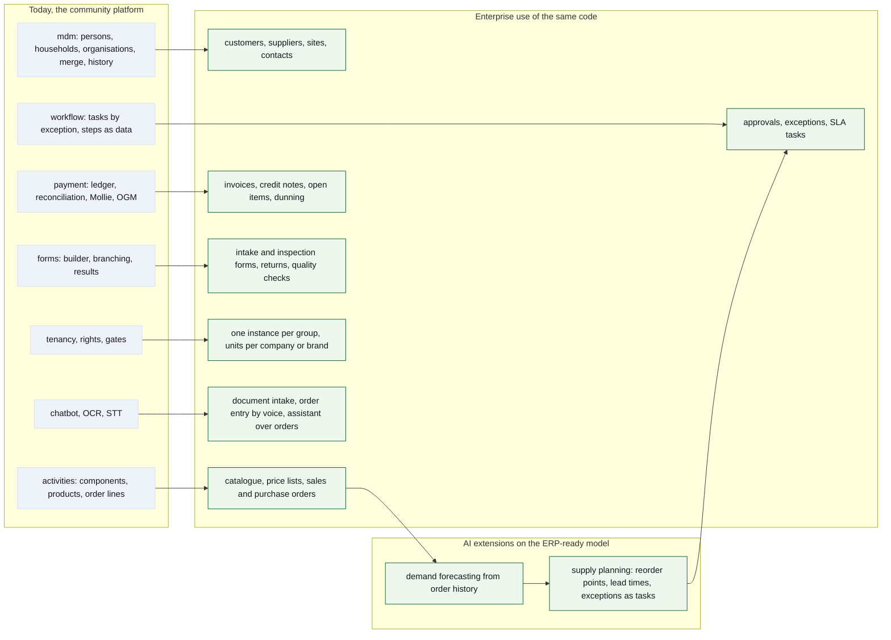

| | |
|---|---|
| **Date** | 13 October 2026 |
| **Quotes** | `docs/architecture.md` (the as-is of the platform), `master` @ cf80ccde |
| **Purpose** | what the platform's building blocks become in enterprise use, and the conversation guide that goes with it; this document is the pitch, the architecture document is the measurement |

This document was chapter 8 and the *Gespreksleidraad* of the architecture
document until 13 October 2026 (Koen, Q&A of 11 October 2026, question 2: "a,
maar ook wel de evoluties erin" — the pitch moves out, the evolutions stay in
the architecture document as part E). It carries its own date because it ages
differently: the architecture document is re-measured at every release, this
one when the conversation changes.

# 1. Why it is an ERP foundation and not a club portal

The platform runs in production for one community association since June
2026. Its functional surface is small; its *structure* is that of business
software: fifteen domain packages behind facades with one PostgreSQL schema
each, master data with merge and survivorship, a payment ledger with a stated
reconciliation invariant, row-level multi-tenancy from the kernel, a kernel
with in-transaction events, ports and a durable job queue, and a workbench that
turns every exception into a task. None of that is needed to sell tickets for
a barbecue; all of it is needed the day the same code runs an order book, a
warehouse or a second customer. The architecture document names, per claim,
the file that proves it (its part A and Appendix B).

How it was built: by one architect directing AI coding agents. That only works
when agents cannot quietly break things, so much of the engineering went into
the harness (part C of the architecture document): on 13 October 2026, 6 291
tests against a real PostgreSQL 16, 53 gate files that fail the build on
architectural drift, a gate over the rendered HTML of every admin page, browser
flows where money moves, a measurement baseline of the screens at 390 px, and a
CI whose eight jobs — seven of them blocking — boot the real startup script.
The agent corrects itself on the failing test.

# 2. The same building blocks in enterprise use

The platform was built for a community, but the blocks were chosen for what
they become: the foundation of a multi-tenant ERP that I-X IT Solutions
develops further for distribution, warehousing, production and web-shop
companies. The table names, per block, what exists in code today, its
enterprise counterpart and the gap in code terms, so that the distance is
sized rather than assumed.

| Block | Today, in code | Enterprise counterpart | Gap |
|---|---|---|---|
| Master data | persons, households, organisation tree, typed contacts, addresses via lookup, merge/unmerge, history | customers, suppliers, sites, contacts | the party model (architecture document → E28) and roles on the organisation tree; same patterns |
| Orders | activity → component → product → registration → order line, server-computed totals, member pricing; the webshop in build (→ E25) | catalogue, price lists, sales and purchase orders | quantities on stock, units of measure, price-list dimension |
| Ledger | charge/refund records, polymorphic payable, reconciliation invariant, structured communication, Mollie | invoices, credit notes, open items, payment matching | document numbering, VAT, bank-statement import; the invariant already fits |
| Forms | builder, branching, wizard, statistics, ODS, AI format guide | intake, inspection, quality and return forms | attach a form to any subject via the existing soft reference |
| Workflow | tasks by role, step definitions as data, sweep that opens and closes by state | approvals, exceptions, SLA queues | definitions editor, deadlines, escalation |
| Tenancy and roles | account/unit tree, row-level filter, per-tenant config and secrets, rights-derived roles (CR-24), modules per tenant (CR-19) | one instance per group, units per company | tenant-aware background jobs (→ E4), RLS (→ E6), SSO |
| AI | context-stuffed assistant with tool boundary, OCR, speech, a co-writer that checks its claims | document intake, voice order entry, assistant over orders | retrieval over larger corpora; the tool boundary pattern carries over |
| Forecasting and planning | not present | demand forecasting, reorder proposals as workbench tasks | a read model over order lines; the exception-as-task delivery already exists |

The honest conclusion: the *shape* transfers, the *volume* does not yet.
Nothing in the codebase has been load-tested beyond an association's traffic
(→ E37), media is stored in the database (→ E11), and the rate limiter is per
process (→ E14). Those are known, sized items, not surprises; each is a row of
the architecture document's part E.

<!-- figure: name=enterprise caption=Building_blocks_today_(grey)_and_their_enterprise_counterparts_(green) wide=1 -->

*What to see:* every block on the left has a counterpart on the right; the
arrows are the same code with more rows and a few more columns, not a rewrite.

# 3. Gespreksleidraad

**Kernboodschap.** Dit zijn de fundamenten van een enterprise-ready,
multi-tenant ERP, en ze draaien vandaag al in productie. Ik bouw
bedrijfssoftware met een klein team dat AI-agents aanstuurt, en ik kan dat
bewijzen met een product dat geld, persoonsgegevens en meerdere tenants
aankan, met een kwaliteitslaag die de meeste bedrijven pas na jaren hebben.
I-X IT Solutions ontwikkelt dit platform verder.

**Waarom dit meer is dan een verenigingssite.** De functionaliteit is klein,
de structuur is die van een ERP: vijftien domeinpakketten achter facades met
elk een eigen schema, masterdata met merge en historiek, een betaalgrootboek
met één reconciliatie-invariant, rijniveau-multitenancy vanuit de kernel, een
werkbank die elke uitzondering een taak maakt. Hetzelfde skelet draagt morgen
orders, facturen en een magazijn.

**Bewijspunten** (allemaal in de code; de cijfers van 13 oktober 2026, zie het
architectuurdocument, deel C en bijlage B).

1. 6 291 tests tegen een echte PostgreSQL, 53 poortbestanden die de bouw doen
   falen op architecturale drift, acht CI-jobs waarvan zeven blokkerend,
   coverage-drempel 85 %, een meetbasis van de schermen op 390 px.
2. Achttien gatekeepers tussen request en rij; rechten per request afgeleid,
   nooit in een token; de penningmeester kan betalingen wijzigen, de beheerder
   niet; de Mollie-webhook wordt nooit vertrouwd.
3. Multitenancy als kernel-mixin plus globaal ORM-filter; modules per tenant
   als data; een tweede tenant is configuratie, geen code.
4. AI in beide richtingen: gebouwd mét agents binnen de poorten, en AI ín het
   product (chatbot met toolgrens, OCR, spraak, een co-schrijver die zijn
   beweringen toetst), alles Europees en dark-launched.
5. Eerlijkheid als methode: het architectuurdocument noemt zijn eigen gaten
   in deel E (achtergrondjobs zonder tenant, CSP, geen rijniveaubeveiliging),
   en de poorten bewijzen dat een test rood kán worden.

**Hoe ik werk met AI-agents.** Elke wijziging start bij een issue; een
structurele wijziging bij een change request dat tegen de code gelezen wordt
vóór het wordt toegewezen. De agent bouwt op een feature branch, de poorten
zijn zijn feedback, CI is zijn reviewer, en ik valideer op HDEV wat CI niet kan
zien. Drie stappen stoppen voor een mens: UAT, de gedeelde proxy, PROD. Twee
leesagenten bewaken design-conformiteit en de publieke repo; bouwers buiten de
Claude-reeks werken op één tak met één pull request als brievenbus. Wat de
agent fout deed, werd een poort; zo groeit de kwaliteit met elke fout.

**Wat ik zoek in dit gesprek.** Een klankbord op twee vragen: welke van deze
bouwstenen zijn voor een bedrijf het meest waard als startpunt, en welke
ontbrekende schakel (SSO, RLS, objectopslag, load) zou u als eerste willen zien
voordat u dit in een organisatie zou vertrouwen?

**I-X IT Solutions.** AI-first softwarebedrijf in oprichting: kleine teams die
agents aansturen, met kwaliteit als infrastructuur. Referentie: deze
repository. Contact: *[link en contactgegevens I-X invullen]*.
